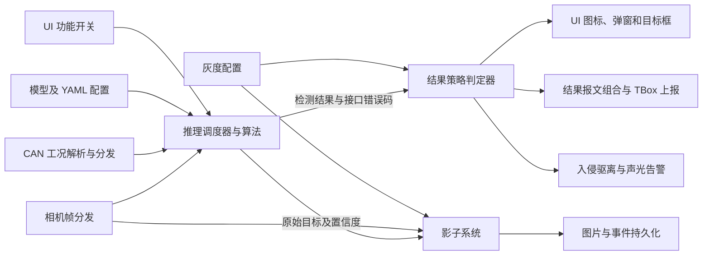

# 中控详细设计说明书0921：理解与核验报告

> 核验日期：2026-10-10。原始文件：[中控详细设计说明书0921.docx](./中控详细设计说明书0921.docx)。对照依据：[中控智能安全功能需求说明v5.1.docx](./中控智能安全功能需求说明v5.1.docx)。
>
> 可搜索证据：[新增设计文档正文与表格索引](./核验材料/中控详细设计说明书0921_正文索引.md)。本报告中的 P/T 编号对应 `word/document.xml` 的正文块序号，从 0 起；P 表示段落，T 表示表格，R/C 表示表格行/列（含表头，从 0 起）。这是提取定位号，不是 Word 页码或原文需求编号。

## 1. 应怎样理解这份新增文档

**这份文件描述整个中控产品的算法接入、界面和平台功能，原来的五项外包安全检测功能是其中一部分。它已经提供不少集成接口约定，但存在空白、规则差异和内部冲突，目前适合作为设计评审稿，不能单独支撑完整开发与验收。**“设计评审稿”是本次核验对成熟度的判断，原文件没有明确标注这个审批状态。

原需求 V5.1 主要回答五项功能“检测什么、何时报警、达到什么指标、交付什么”；新增文档主要回答“这些功能怎样接入中控、怎样显示结果、怎样通过 CAN 上报、怎样记录事件”，同时列入另外十一项功能和多种平台服务。

| 材料 | 实际内容与用途 | 本次核验结论 |
| --- | --- | --- |
| 原需求 V5.1 | 五项外包功能、平台约束、接口规范、性能、数据、交付、测试 | 仍是五项功能的重要对照依据；其本身也有待统一条款 |
| 新增详细设计 | 16 项算法功能、UI、中控平台服务、结果 CAN 布局 | 给出了更大的产品集成视图；未证明新增全部范围由同一供应商承担 |
| 既有两个 Markdown | 2026-09-29 对旧需求和时间计划的整理与核验 | 早于本次新增文件，其“尚未收到详细设计”等描述有当时的资料边界；阅读现状应补充本报告 |

不能因为文件名带“0921”，或导入时间较晚，就认定它正式替代 V5.1。新增文档的开头没有版本履历、引用需求版本或审批记录；旧需求又明确以双方签署技术协议及合同附件确定最终交付标准。本目录没有这些签署材料，**本次能确认设计内容和差异，不能确认合同范围或变更已获批准**。

## 2. 本次核验覆盖与文件状态

本次直接解析两份 DOCX 的 XML、正文表格和图片关系，检查新增文档的所有 357 张正文表格，对 16 个算法章节及 UI、平台、附录进行核验，并对原五项功能逐项回看 V5.1 原文。图片通过总览及关键图原尺寸检查，特别核对通用告警图、多相机架构图、影子系统流程图；没有将纯文本提取中不可见的流程规则假定为不存在。

| 检查项 | 核实结果 |
| --- | --- |
| 新增文件 | Git 状态显示《中控详细设计说明书0921.docx》为未跟踪新增文件，大小 8,435,658 字节 |
| 文件完整性 | ZIP 容器校验通过；未发现修订插入/删除标记或独立批注文件 |
| 正文结构 | 1,168 个顶层段落、357 张顶层表格，无嵌套表格；表格内段落不计入这个段落数 |
| 图片 | 44 个实际 PNG 文件，正文有 57 次图片引用；多处重复使用同一告警流程图 |
| 页面数 | WPS 文件属性记录 206 页；本次未重新排版验证，不能视作精确阅读页码 |
| 时间信息 | 文件属性：创建 2026-08-28，最后修改 2026-09-22；导入目录的修改时间为 2026-10-10。属性时间不证明审批或实施时间 |
| 原始文件保护 | 两份 DOCX 均未修改；新增的是本报告、搜索索引与三个原文图示副本 |

新增文件 SHA-256：`9087dee29adb8bc59d37ce1b00e06c41cd146c9dd0ca8337f3e33eb843cf1e49`。

旧需求 SHA-256：`e0c6c3158a31d167f3e324e57bd13832afb122cb475124e944664d6e7a668f8c`。

## 3. 新增文档的实际范围

### 3.1 十六项算法功能

文档 §3.1 对应以下顺序。“算法功能”是文档分类，其中支腿伸出状态目前描述为传感器数据与配置比对，不能据此认定每一项都使用深度学习模型。

| 原文章节 | 功能 | 实际意图 | UI 分组 |
| --- | --- | --- | --- |
| §3.1.1 | 卷扬乱绳 | 检出卷筒及乱绳，展示告警和卷筒框 | 基础 |
| §3.1.2 | 卷扬倍率 | 实际倍率与设定倍率一致性检测；支持操作手反馈 | 基础 |
| §3.1.3 | 吊钩安装状态 | 主、副钩实际配置与设定配置比对 | 高阶 |
| §3.1.4 | 支腿伸出状态 | 支腿实际伸出比例与配置比对 | 高阶 |
| §3.1.5 | 支腿附近人员 | 支腿动作期间监测附近人员 | 高阶 |
| §3.1.6 | 装副臂用主臂吊载 | 检测安装副臂后使用主臂吊载的违规工况 | 高阶 |
| §3.1.7 | 360 电子围栏 | 上车环视人员入侵检测、声光及可视化告警 | 基础 |
| §3.1.8 | DMS | 作业时闭眼、打哈欠、抽烟、玩手机、接电话、头伸出窗外 | 高阶 |
| §3.1.9 | 主钩测距 | 臂头变焦相机测量主钩高度/距离并显示 | 基础 |
| §3.1.10 | 吊钩过卷 | 吊钩距臂头距离与防过卷阈值比较 | 高阶 |
| §3.1.11 | 离开操作室操纵 | 非遥控模式下，操作手离开操纵室仍操纵时告警 | 高阶 |
| §3.1.12 | 卷扬冰雪 | 主、副卷扬冰雪识别；属于旧五项 | 高阶 |
| §3.1.13 | 高度限位开关状态 | 重锤正确安装/错误安装/未安装识别；属于旧五项 | 高阶 |
| §3.1.14 | 载荷附近人员 | 臂头加两路长焦相机检测人员；属于旧五项 | 基础 |
| §3.1.15 | 载荷下方人员 | 两路长焦相机检测人员；属于旧五项 | 高阶 |
| §3.1.16 | 大臂下方人员 | 两路长焦相机检测人员；属于旧五项 | 高阶 |

UI 明确将 16 项分成基础 5 项、高阶 11 项，并写“6 TOPS 版本只启用基础算法，6+32 TOPS 版本可控制启停所有算法”（T1152～T1156）。**因此按当前设计，6 TOPS 基础版本只提供原五项中的“载荷附近人员”；完整五项的产品搭载条件需要确认。**这与旧需求“适配 RK3588 Linux、高通 8775 Android”的要求是不同维度，不能自动互相替代。

文档没有说明 32 TOPS 扩展算力的硬件、驱动、推理 SDK、任务分配和平台映射，也没有给 16 项并发时的实际算力预算。标称 TOPS 和旧需求“单功能 ≤2 TOPS”不能单独证明全部功能的并发帧率或时延。

### 3.2 界面与平台服务

| 层面 | 新增文档明确描述的内容 | 对项目工作的意义 |
| --- | --- | --- |
| UI | 竖屏 1080×1920；顶部报警区、视频区、底部导航；14 路视频；语言、录像、声光、AI、WiFi、回放、事件页面 | 需要结果渲染、相机通道映射、设置及权限处理 |
| 平台 | 时钟同步、设备自检、AHD 掉线、上下车视频通信、车车通信、影子/灰度、事件记录、工况采集、OTA | 需要将算法接入车辆和中控运行环境 |
| 附录 | 六类结果和状态 CAN 报文的字节/位布局 | 需要统一编码、发送策略及主控/TBox 对接 |

14 路视频包括上车环视 4 路、主/副卷扬、左/右超起、长焦 1/2、DMS、操纵室前方、臂头以及下车已拼接好的 360 视频。旧需求的五路相机是原五项功能的输入环境，新增文档列的是更大产品的视频范围；**本次未发现可直接据以断言“原五路硬件全部被取消”的证据**。

## 4. 核心架构与接口应该怎样读

### 4.1 数据流及职责

下面是按模块概述和原文图示整理的目标数据流，表示设计意图，不代表已有源码实现。

对应原文：[载荷附近人员模块架构图](./核验材料/载荷附近人员_原文架构图.png)，位置 T851、原 DOCX `image16.png`。图中结果策略判定器写有“开启灰度不显示、不上报异常结果”；人员功能还连接入侵驱离和声光报警器。

算法模块产生结果；调度器决定调用；结果策略判定器决定结果能否展示、上报；影子系统记录数据；报文组合器将结果序列化。**模型识别置信度、业务危险状态、灰度发布状态和接口故障是四件不同的事**，不能用一个“报警标志”互相代替。

旧需求 §1.4 的边界仍需保留：系统提供安全感知与告警辅助信息，起重机动作最终控制由三一主控执行。新增图示增加声光报警链路，不构成已确认的“算法直接控制起重机动作”方案。

图中出现帧分发器、推理调度器、结果策略判定器、报文组合器和入侵驱离等关键组件，但正文没有为所有这些组件提供独立、完整的详细设计。总体设计章空白，线程、队列、调度优先级、过载丢帧和恢复策略尚未闭合。

### 4.2 四个接口和三个状态字段

| 接口或字段 | 应怎样理解 | 原文仍需补齐的部分 |
| --- | --- | --- |
| `initialize(config)` | 加载模型和资源、可选预热；失败回滚，重复调用不泄漏 | 统一的完整配置类型、超时、实际错误码及并发约定 |
| `detect(...)` | 消费图像和必要工况，输出本次业务结果 | 图像格式、缓冲区寿命、多相机同步、工况新鲜度及结果来源 |
| `updateConfig(...)` | 校验并更新配置，非法参数拒绝更新 | 哪些字段可动态更新、原子生效时点、失败后旧配置是否继续有效 |
| `release()` | 释放内部资源，允许重复释放；对象仍由调用方销毁 | 原型为 `void`，与统一日志中“release 返回 ErrorCode”冲突 |
| `ErrorCode` | 接口执行是否成功；0 为成功，非 0 为失败 | 新文档未列原需求规定的模块号和业务自定义错误码明细 |
| `result_code` | 业务结果是否有效；部分算法另有低置信度状态 | 无结果、正常无目标、低置信度、仍在检测等如何区分 |
| `alert_level` | 有效业务结果的告警等级 | 灰度、静止状态、危险区外目标、故障提示与最终展示的映射 |

例如，在静止工况下检出人员可以同时满足：`ErrorCode=SUCCESS`、业务结果有效、`alert_level=ALERT_NONE`。**这表示检测成功但不触发业务告警，不能由 `ALERT_NONE` 推导“没有人员”。**新增三个人员章节却把这个状态解释为“未检测到行人”，见问题 D-08。

## 5. 与原五项需求的逐项对照

| 原五项功能 | 新文档补充了什么 | 尚未闭合的差异或缺口 |
| --- | --- | --- |
| 载荷附近人员（旧 §3.1 → 新 §3.1.14） | `detect` 明确输入臂头、左长焦、右长焦及工况；输出展示目标和影子目标 | 没有明确 10 米半径、连续 3 帧、缺工况立即报警及地面距离/顺时针角度字段；工况只列 `is_working=0/1`，不能表示缺失/过期 |
| 载荷下方人员（旧 §3.2 → 新 §3.1.15） | 改为明确两路长焦输入；展示和影子目标分流 | 旧测试条件列臂头和长焦，新接口不接臂头；10 米、≥50 米、遮挡与多视角判定没有落地；物理位置字段缺失 |
| 大臂下方人员（旧 §3.3 → 新 §3.1.16） | 两路长焦输入，加入作业状态字段 | 没有落实左右各 40°、幅度半径、≥50 米和距离/角度输出；接口错误引用载荷下方结果类型；概述误写“载荷下方警戒区域” |
| 高度限位开关（旧 §3.4 → 新 §3.1.13） | 图像和臂长/臂尾角度输入；概述保留三种安装状态；附录有两路状态编码 | 没有落实基本臂长、5°、10 帧、15 秒、75°的业务状态机；`LimitStatusResult` 表只列有效性、告警和“其他”，未明确三状态、置信度、双重锤结果 |
| 卷扬冰雪（旧 §3.5 → 新 §3.1.12） | 图像输入、冰雪目标列表、摄像头通道、界面告警 | 新增“上电后使用一次，返回结果后不再调用”；没有面积比例、面积阈值和主副卷扬完成规则，与旧行为存在实质差异 |

新文档可以明确多路图像接入，但**没有给出相机标定、地面投影、多视角目标关联、遮挡判定和坐标转换方案**。检测框只能提供像素区域，不能直接替代旧需求要求的米制距离、角度和危险区域判定。

原五项的需求指标仍需映射进入设计与测试：旧文档正文要求准确率/召回率 ≥92%，其总表另称精确率；人员识别 ≤200 ms，高度限位开关 ≤15 s，冰雪专项 ≤1 s、总表另写 ≤200 ms；通用约束还有单功能 ≤2 TOPS、≤150 MB、帧率和 72 小时稳定性。**新增文档未解决这些旧口径差异，也没有明确取消这些约束。**

旧报告已指出的“10 米需求与 5 米测试范围”“≥50 米能力布点不足”等问题，在新文档没有得到补充测试方案。本次不重新把旧问题描述成新增文件已经解决。

## 6. 必须优先处理的核验发现

分类含义：**内部冲突**指新文档自己前后不一致；**需求差异**指与 V5.1 的行为或输入要求不同；**设计缺口**指当前材料不足以完成明确实现。优先级是工程评审建议，不是原文定义的缺陷等级。

### D-01：关键章节和算法指标未完成（高；设计缺口）

“引言”P0 后即“总体设计”P1；P2～P24 全为空，随后进入“模块详细设计”。“测试与验收”P1486 后直接“部署与运维”P1487，再直接“附录”P1488。这四章均没有正文。

16 项算法的精确率、召回率、检测延迟和备注单元格全部为空。证据：T90、T157、T222、T279、T342、T406、T470、T531、T599、T657、T723、T784、T845、T908、T973、T1036。另有三个表的功能名残留“倍率识别”。

影响：无法单凭此文件安排完整的验收、容量评估、交付或运维。应填入对应旧需求/新增需求的指标、统计方法、测试场景和交付证据，而非只补一个百分比。

### D-02：完整五项功能的搭载范围未明确（高；范围缺口）

T1152 明确 6 TOPS 只启用基础五项；原五项中四项被放入高阶组。新文档没有关联具体车型、RK3588/高通平台、32 TOPS 模块或本次供应商范围。

需形成“功能 × 车型/硬件 × 平台 × 版本 × 责任方”矩阵。文中的“宏英定义”“算法合作供应商定义”能够证明字段仍待合作方完善，不能证明整个 UI、通信、OTA 和十一项新功能都已纳入同一合同。

### D-03：三个人员模块的工况 CAN 布局冲突（高；内部冲突）

T877、T942、T1005 都把以下两个信号写在同一 CAN ID 的同一 16 位区间：

| 信号 | CAN ID | 起始字节 | 起始位 | 长度 | 精度 | 偏移 |
| --- | --- | --- | --- | --- | --- | --- |
| 臂尾角度 | `1AC81DBD` | 2 | 16 | 16 | 0.0125 | -360 |
| 幅度 | `1AC81DBD` | 2 | 16 | 16 | 0.0125 | -2500 |

文档未写多路复用条件，不能同时据这组位得到两个独立物理量。按常见线性换算 `物理量 = raw × 精度 + 偏移`，若幅度 raw 为无符号 16 位，则最大值为 `65535 × 0.0125 - 2500 = -1680.8125`，与工况字段范围 0～200 不符。这个算术结论以线性编码假设为前提，真实换算应由协议确认。

§3.3 工况汇总 T1465 仍重复这个幅度定义；T1467、T1469 又没有列出各自接口需要的幅度，尽管原文架构图也把幅度列为输入。

应向协议负责人核对原 DBC/协议表，统一 ID、字节序、有无符号、位编号规则、比例、偏移、单位和无效值。**本次不能推定正确幅度的 ID 或起始位，不应自行“猜一个修正值”。**

### D-04：工况缺失被二值动作标志遮蔽（高；需求落实缺口）

旧需求 §3.1.2/P179 明确：载荷附近人员在没有作业工况数据输入时，范围内检出人员立即报警。新 T870 的 `is_working` 只有 0/1，没有有效性、采样时间或过期状态。

如果调用方把无报文当作 0，就可能把“工况未知”错误处理成“静止不报警”。需区分静止、作业、未知/过期，并定义报文超时和新鲜度。这个立即报警要求只在旧载荷附近功能明确规定，不能自动推广到另外两项。

### D-05：人员危险区及物理坐标没有接口承载（高；设计缺口）

T874、T939、T1002 的目标结构只列类别、置信度与 `x/y/width/height`，没有米制距离、顺时针夹角、参考中心或坐标有效性。配置表也没有明确列出 10 米范围、左右各 40°及连续 3 帧规则；大臂概述 P977 还写成“载荷下方警戒区域”。

必须明确吊钩投影/大臂根部坐标基准、相机内外参及变焦参数、地面假设、区域边界容差、帧间人员计数规则和结果字段。否则“能框人”不能证明“能判断人在指定危险区”。

### D-06：卷扬冰雪监测周期和面积规则发生变化（高；需求差异）

新 P727 原文：“该功能仅在上电后使用一次，返回结果后不在调用。”旧 §3.5.2/P239～P240 为上电并开启功能后检测，超过面积阈值报警并退出；其描述还要求全天候监测，本身已有恢复规则未明的问题。

“任何结果返回后停止”与“面积超过阈值报警后退出”的退出条件不同，不能简单合并。新 T741 未定义覆盖阈值，T751 只列冰雪目标框，不列卷筒有效表面积、冰雪面积、覆盖占比或面积判定信息。

还需明确“一次”是一帧、一次检测会话还是主副卷扬均完成的一轮；主卷扬先返回正常时，副卷扬是否仍检测；无有效图像时是否结束；除冰后怎样重新检测。**模型置信度阈值不能代替冰雪覆盖面积阈值。**

### D-07：高度限位开关未落地业务状态机（高；设计缺口）

旧需求规定准备状态、基本臂长、根部角度约 5°启动，以及 ≥10 帧、静止 ≥15 s 或角度 >75°结束。新增“处理流程”P821～P828 只描述对象构造、初始化、调用、释放，是资源生命周期，不是这套业务状态机。

T811 只列 `result_code`、`alert_level` 和“其他”，没有三状态结果/置信度。附录 T1512 已为重锤 1/2 分配有效、检测中和识别结果位，算法结果结构却未与之对应。

需确定启动/结束/重试优先级、正确/错误/未安装与无法判断的区别、基本臂长来源、双重锤处理和最终结果锁存。5°边界在旧文档仍存在“≥”与“超过”的差异，不能由本次自行定案。

### D-08：人员“没有告警”被误写成“没有人员”（高；内部语义冲突）

三个概述 P849、P912、P977 都说非动作工况不触发告警；但 P899、P964、P1027 又说 `ALERT_NONE` 表示“未检测到行人”。静止检出人员、区域外检出人员或未满足连续帧条件时，都可能有检测结果但不报警。

需要分别定义检测对象、区域内占用状态、告警状态和功能故障，保留静止时有效人员结果及日志。不能将无告警状态用作无目标状态。

### D-09：灰度抑制、阈值边界与业务告警没有统一（高；内部冲突）

算法架构图中结果策略判定器写“开启灰度不显示、不上报异常结果”；影子系统正文 P1378 又写 `t >= t2` 触发原有异常报警。若该“触发”指最终可见/对外告警，两者会冲突；若只是内部候选事件，应在接口中明确。

同一节的边界亦不一致：

| 位置 | 异常报警条件 | 影子事件条件 |
| --- | --- | --- |
| P1378～P1379 | `t >= t2` | `t1 <= t < t2` |
| 输出表 T1398 | `t > t2` | 未给边界 |
| 性能表 T1422 | `t > t2` | `t1 < t < t2` |
| 流程图 T1403 / image43 | `t > t2` | `t > t1 且 t < t2` |

在 `t=t1`、`t=t2` 时会产生不同实现。应统一边界并给出“灰度开/关 × 业务危险/正常 × 置信度区间 × 结果有效性”的决策表。**置信度高仅代表对所识别类别有把握，不能单凭高置信度绕过作业状态、危险区、面积、安装正确性等业务规则。**例如高置信度“正确安装”不能自动生成危险告警。

灰度作为事件产生时的快照保存、不追改历史记录这一点，P1381、P1419 有清楚定义，可以保留。原文影子流程图见[图示副本](./核验材料/影子系统_原文流程图.png)。

### D-10：多相机结果无法明确归属到输入帧（高；设计缺口）

载荷附近一次 `detect` 消费三幅图像，另外两项消费两幅；结果表 T872、T937、T1000 却只给整个结果一个 `camera_channel`，每个目标没有相机来源、帧 ID 或时间戳。通用 `ImageData` 本身也未列通道 ID。

这不足以明确人员框该画在哪幅图上、跨相机同一人员怎样合并、影子采集保存哪一帧。应定义每相机子结果或每目标来源、输入同步容差、工况快照时间、过期数据丢弃策略和像素到显示画面的转换。

### D-11：bbox 定义自相矛盾（高；接口冲突）

多项 `Detection/DetectedObject` 表把 `width` 的范围写为 `0～(img_w-x)`，却说明为“目标 bbox 右下点 x 坐标”；`height` 同理。字段名与范围指向宽/高，说明指向右下角坐标，是两种不同表达。

例如 `x=100,width=50`：按宽度右边界是 150；按右下角坐标右边界是 50，可能使画框及区域判断错误。需统一为 `x,y,w,h` 或 `x1,y1,x2,y2`，定义像素坐标、开闭边界和裁剪规则。证据包括 T57、T186、T753、T874、T939、T1002。

### D-12：接口原型、数据表及日志不一致（高；接口冲突）

| 位置 | 已核实问题 | 需处理 |
| --- | --- | --- |
| T794 与 P796/T797 | 初始化用 `LimitStatusConfig`，配置定义称 `LimitStatusDetConfig`，标题还残留“吊钩倍率” | 统一真实类型和字段 |
| T930 | 写 `PersonUnderLoad Result&`，表 T937 定义 `PersonUnderLoadResult` | 修正带空格的原型 |
| T993 与 T1000 | 大臂功能引用 `PersonUnderLoad Result&`，结果定义为 `PersonUnderBoomResult` | 改成自身类型 |
| 多处 `release` 及日志表 | 原型 `void Detector::release()`，日志却要求记录其返回 `ErrorCode` | 统一返回约定及日志实现 |
| 文本调用顺序与原型 | 多写 `update`，真正 API 为 `updateConfig`；`WorkingCondition/WorkingCondtion/WorkingConditions` 等混用 | 以可编译头文件作为统一接口源 |
| T865/T930 参数说明 | 左长焦参数重复；右长焦说明误称左侧 | 统一左右通道 |

新文档中的供应商自定义占位，可以在评审过程中补全；在多方代码开始独立实现前需要冻结公共头文件、命名空间、枚举、版本和错误码。

### D-13：通用图将“无业务结果”并入接口故障路径（高；图文冲突）

原文 image2/T78 等通用告警图中，接口成功后 `result_code` 不等于 1 会走向“连续 n 帧异常”判断，最终可能显示功能异常图标；正文 P79 等描述的故障条件则是连续 n 帧返回错误码。

正常无目标、识别仍在进行、倍率低置信度（值为 2）不必然表示接口坏了。需区分“调用失败”“暂无有效业务结果”“可靠的正常结果”。同时冻结 n 的数值、计数是否在成功时清零、故障图标 3 秒显示/重复出现和恢复条件。[原文通用图](./核验材料/算法告警_原文通用流程图.png)。

### D-14：CAN 结果协议缺少发送必需信息（高；协议缺口）

附录六类报文均有“报文 ID：”“频率：”但值为空：P1491～P1492、P1497～P1498、P1503～P1504、P1509～P1510、P1515～P1516、P1520～P1521。

虽然各表有位布局，仍缺完整的 ID、发送周期、字节序、DLC、有效/无效默认值、超时处理、状态更新/保持/解除、协议版本等约定。工况输入表还混用全帧起始位（如 16、32）和字节内位（如字节 7/位 3），需说明二者如何解读。

附录 T1512 支持“双主钩”状态值 4，算法 T182/T184 只允许 0～3；倍率/重锤/测距报文还有双结果，而算法多数只有单结果。需要产品变体及结果结构到 CAN 的完整映射，避免某些位无数据来源。

### D-15：工况协议汇总与模块表存在不同定义（高；内部冲突，部分原文已标待确认）

| 信号 | 模块内定义 | 工况汇总定义 | 核验意见 |
| --- | --- | --- | --- |
| 主卷扬落钩电流 | T373：`1AC862BF`，字节 4/位 32/16 位 | T1450：`1AC863BF`，字节 4/位 32/16 位 | 汇总与副卷扬落钩重合；该主/副落钩行原文已标黄，并写“标黄的是待确认的” |
| 吊钩配置状态 | T189/T1444：`16CAF8BD`，字节 0/位 0/8 位 | 其他相关功能 T373/T570/T626 等：同 ID，字节 1/位 8/8 位 | 如为不同协议/车型必须明确条件，否则需统一 |
| 重力检测开关 | T1461：字节 6，起始位 1 | 同表其他一类信号多用全帧起始位 | 首先明确起始位口径，不能直接猜成 49 |

倍率 YAML 已列 `protocol.style` 的 NEW_C 和若干旧协议类型（T155），但各工况表没有据此区分具体变体。不能把全部定义混成一个通用解析器。

### D-16：时钟实现语义存在偏移风险（高；实现定义不清）

P1196、P1216、T1213 和流程图把 UTC 加本地时区后“同步至系统时钟”。Linux 的实时时钟使用相对于 UTC Epoch 的时间，时区转换应在时间表达层完成；单调时钟适用于测量间隔。[Linux 官方时间文档](https://docs.kernel.org/core-api/timekeeping.html)。

需分清：CAN 的 UTC+8 日历字段转成绝对 UTC，RTC/系统实时时钟保存绝对时间，UI/日志按时区显示，连续帧超时和检测耗时用合适的单调时钟。若 `syncSystemTime(local_time)` 内部做了正确的带时区转换，未必发生错误；但目前文档没有说明，直接把偏移后的值作为 UTC 设置会产生二次偏移。

另外 year 是 BCD 还是二进制、以哪年为基准、日期合法性、跨日/跨年换算、系统首次无可信时间及校时回跳处理未定义；时区只允许整数小时，也没有表达半小时/四十五分钟时区。`ImageData.timestamp_ms` 用 `uint32_t` 且没有时间基准：若从启动累积毫秒，约 49.71 天回绕；如果表示绝对毫秒时间则容量不足。

### D-17：OTA 有行为要求但缺实施方案（高；设计缺口）

P1474～P1485 指定 TBox 以太网、4G 两条路径，以及 ≤5 分钟、≤18 MB、配置保留、异常包拒绝、断电恢复、问题版本回滚、日志 ≥6 个月等要求。这是有用的目标和测试方向；未给下载/验证/安装/重启状态机、包清单、分区或回滚机制、签名验签、配置迁移及版本健康判据。

“升级时间从下载完成时间和系统重启时间两段时间”语句不清，不能确定下载是否计入 5 分钟。前文对两种路径列同样规范，末尾又说详细要求主要针对以太网、4G 不做要求，需要分别冻结适用范围。18 MB 是应用包、差分包、是否包含模型也未明确。

原文“R4495/R4496”编号不完整。官方可核实的相关国标名称为 [GB 44495-2024《汽车整车信息安全技术要求》](https://openstd.samr.gov.cn/bzgk/std/newGbInfo?hcno=2DB552CAA58F589705C3DC7AD47AC2AB&refer=outter) 和 [GB 44496-2024《汽车软件升级通用技术要求》](https://openstd.samr.gov.cn/bzgk/std/newGbInfo?hcno=8BC0D8B44DD4E71F9557BADE5175565A)，官方页面均注明第 1 号修改单。**推测原文意指这两项，仍须编制方确认**；本次没有验证具体车型适用性或作出合规通过判断。

### D-18：告警清除与故障持续状态没有完整定义（高；状态策略缺口）

多处规定初始化/配置失败时，操作手确认后清除故障图标，“本阶段不再触发”；未解释本阶段的起止，也未说明故障仍存在时 CAN 功能异常状态怎样保持、何时允许恢复。确认信息、消除故障和清除危险是不同动作。

AHD 异常表 T1323 写某路恢复后“取消顶部状态栏报警图标”，但 P1309 又定义这个图标汇总多路异常。一条恢复而另一条仍掉线时应如何保留汇总提示需要明确。当前正文还没有定义冻结画面检测算法、静止画面误判防护、相机屏蔽和恢复防抖。

## 7. 其他已确认的问题与待完善项

| 编号 | 证据与发现 | 影响及建议 |
| --- | --- | --- |
| A-01 | T118：`session_duration_seconds` 字段说明为毫秒 | 秒/毫秒单位冲突，统一单位和命名 |
| A-02 | T118：`ratio_scores` 称长度 69、元素范围 1～68；倍率值另写 1～128 | 分数范围、类别索引、支持倍率集合不清，需冻结 |
| A-03 | T184 为 `hook_conf_id`，P214 使用 `hook_config_id` | UI 读结果字段不一致 |
| A-04 | P214 的吊钩安装弹窗提供识别正确/错误按钮，但本模块没有类似倍率的反馈接口 | 明确反馈只关闭界面还是影响会话，及记录方式 |
| A-05 | P270 四个支腿读取字段都写 `rf_outrigger_status` | 会遗漏/误指其余支腿，改为 RF/RR/LF/LR |
| A-06 | T235/T241 等 RF/LR/LF 描述重复称 RR，“当前压力”又写“压力阈值” | 区分位置、测量值、阈值和单位 |
| A-07 | 支腿附近人员配置 T340 残留臂角/臂长参数 | 应补支腿警戒区域、支腿动作与支反力判定配置 |
| A-08 | 卷扬乱绳 T44 只列统一 confidence/nms，T88 列卷筒/乱绳/抑制三套阈值 | 结构体到 YAML 字段映射未一致 |
| A-09 | `model_path/Model_path`、`detect/detector`、`smooth_alpth`、`mian_hook_height`、`condidence` 等混用 | YAML 路径/头文件拼写需统一，避免配置无法加载 |
| A-10 | 多数 `ImageData` 没有 stride、数据大小、格式枚举、缓冲区寿命；通道数又允许灰度，部分接口说明只允许 RGB24 | 冻结图像契约；公共非拥有指针如何符合旧规范需解释 |
| A-11 | 灰度称每个算法有置信度，但支腿、安装状态、非法吊载等结果表没有完整置信度/原始目标字段 | 不能把所有算法强制套同一个 t 判定，应分别定义采集依据 |
| A-12 | §3.3 影子模块说统一写库，事件记录模块又承担统一持久化；表 T1400/T1431 的 event_type 含义不同 | 定义事件主类、子类、影子标记、灰度快照及唯一写入路径，避免重复 |
| A-13 | 原文事件流程图 image44 还有“事件上云”，正文未提供云接口、失败重试、图片上传及容量策略 | 将上云纳入真实接口和交付边界 |
| A-14 | 主钩测距概述只说数值展示，未定义距离是吊钩离地还是吊钩到臂头；`required_focal` 没有单位与控制契约 | 明确测量基准、焦距/变倍命令、反馈、多个算法共享变焦的仲裁 |
| A-15 | 上车 UI 明确取消鸟瞰拼接，显示设置却保留“360 3D 车模”；底部示意图有 5 按钮，正文为 4 按钮 | 确认当前界面方案，注明旧示意中哪些元素失效 |
| A-16 | 语言设置一处称顺序固定，另一处要求繁体中文等常用语言前置；示意图含日语但清单不含 | 确定最终 22 种语言及顺序，图示不能作为额外范围 |
| A-17 | 界面语言用繁体中文，报警语音对应位置为粤语 | 不一定是错误，但需语言/语音映射表 |
| A-18 | 删除密码设置页面，同时 AI 配置要密码、事件导出要管理员；事件导出又称后门模式才显示 | 定义身份来源、权限、维护入口及两类导出的一致规则 |
| A-19 | UI 写 DMS/人脸识别，DMS 算法正文只定义六种行为 | 本文没有人脸身份识别接口、数据或测试定义，应澄清名称/范围 |
| A-20 | UI 列 14 路视频，附录 T1500 只列 12 个相机状态，未列 DMS/下车 360 | 明确是否有意排除及其异常如何上报；下车 360 在 UI 不显示异常图标是原文明确特例 |
| A-21 | 设备自检接口 T1243 写 CPU0～CPU8，实际数组 core[8] 和其他描述为 CPU0～CPU7 | 统一 8 核范围，补采集失败的状态与正常基准来源 |
| A-22 | 时钟章 T1223～T1227 混入完整设备自检阈值和性能表，后面重复时钟自己的小节 | 删除误粘贴或明确归属，避免章节使用错误 |
| A-23 | 支腿状态 T1494、CPU/eMMC T1500 的 raw 0～100 与“精度 0.01”缺少比例/百分数单位约定 | 示例 86 与比例 0.86可兼容，不能直接判错；需明确物理单位 |
| A-24 | 多个图号、图名残留“360电子围栏”“吊钩安装状态”“3.1.2.2” | 修正文档引用；重复图中的字段也需与该模块实际结果对应 |
| A-25 | 上下通信给 1080P/25 fps、双向 >5000 Kbps、10 分钟稳定测试，但帧/通信超时无值 | 缺编码格式、码率、传输协议、时延、重连及有效性定义；10分钟链路测试不能代替旧72小时稳定性 |
| A-26 | 车车通信只有 AP/STA 角色与职责 | 缺消息格式、车辆身份、协议、周期、超时、重连及验收指标 |
| A-27 | 事件和图片要求写库，未给去重、限流、保留/清理、存储满、掉电一致性与查询分页 | 需要持久化设计，特别避免按帧重复产生事件耗尽存储 |

以上列出已证实的文档差异或可定位缺口；未写明的实现可能存在于其他资料中，本目录目前没有这些资料，不能由本文断言供应商没有实现。

## 8. 怎样把它变成可实施、可验收的设计

建议依次完成下面五项具体成果，不需要等到全部模型训练完成才开始接口评审。

1. **冻结范围和依据。**给文档补版本、对应需求及评审记录；明确 16 项中的开发分工、原五项的硬件/平台适配与搭载；对冰雪检测周期和载荷下方相机输入形成变更结论。
2. **冻结协议和公共头文件。**先处理 D-03、D-12、D-14、D-15；交付带版本的 CAN/DBC 表、可编译接口、统一配置 schema、错误码和结果到报文映射。
3. **补五项业务设计。**给出区域几何、标定、帧间规则、工况有效性、安装状态机、冰雪面积及会话规则；补同步、目标来源、失败与恢复策略。
4. **补统一结果策略。**用决策表冻结有效/无效、危险/正常、灰度、静止、未知、故障、确认及恢复的关系；图示、UI、声光、CAN 和事件持久化引用同一规则。
5. **补可执行验收与交付。**填写指标、计时起止点、数据集与真值、边界测试、并发资源及稳定性测试、安装/OTA、部署/运维和资料清单。

优先验证用例应能区分当前冲突的两种行为：

| 核验场景 | 必须核对的结果 |
| --- | --- |
| 载荷附近工况缺失/超时但检测范围内有人 | 不能误当静止；与旧立即报警规则对应 |
| 静止时检出人员、连续第 1/2/3 帧 | 检测结果、记录和告警分别正确，帧计数有明确口径 |
| 恰好在 10 米、±40°及约定远距离边界 | 区域和坐标符合冻结规则，有标定真值 |
| 双/三相机不同步、重复目标及某一路断流 | 框归属正确；融合、降级和故障状态可追溯 |
| 冰雪正常/临界覆盖/超阈值及主副卷扬先后返回 | 面积规则和结束规则符合确认后的需求 |
| 高度限位 5°、75°、10 帧、15 秒等边界 | 业务状态机及无可靠结果时的处理一致 |
| `t=t1`、`t=t2`，灰度开/关，高置信度正常目标 | 事件、UI、声光和报文输出统一 |
| 接口成功但无结果/低置信度，连续接口失败 | 正常无结果不被无条件判为功能坏了 |
| 两路相机故障、一条恢复 | 顶部汇总提示与剩余异常一致 |
| 时区切换、CAN 校时、长时间运行和回绕 | 绝对事件时间不因显示时区改变；超时不受校时误导 |
| OTA 断网、断电、异常包及启动健康失败 | 状态、回滚、配置保存和日志有实测证据 |

## 9. 本次结论的边界

本次确认的是文件内容、可定位的差异和工程缺口。目录没有该项目对应的源码、真实头文件、DBC、模型、标定数据、测试原始记录、签署协议或验收报告，所以没有验证算法准确率、运行时延、硬件容量、实际项目完成进度或合规通过情况。

这份新增文档的重要价值是把原五项功能放进更大的中控集成链路，补出了多相机调用、结果/UI 分流、灰度、事件和车辆报文的大致关系。下一步开发评审应以这些关系为基础，优先解决协议冲突、业务规则差异、结果字段和验收缺口，再将确认后的设计冻结为实施依据。
