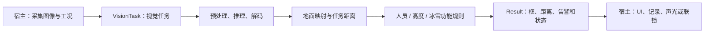
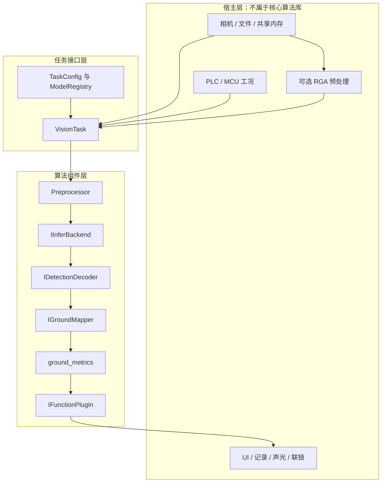
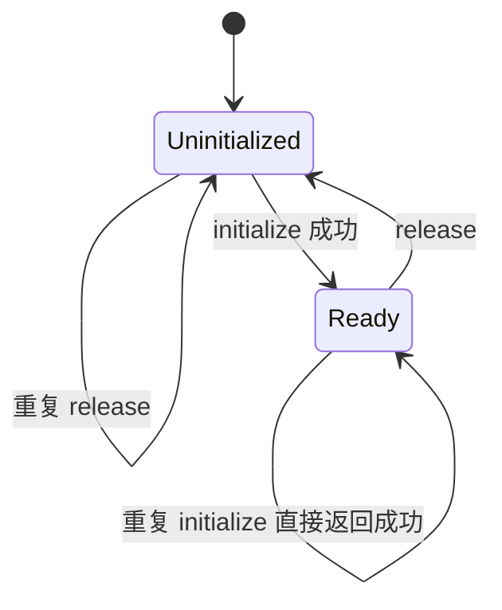
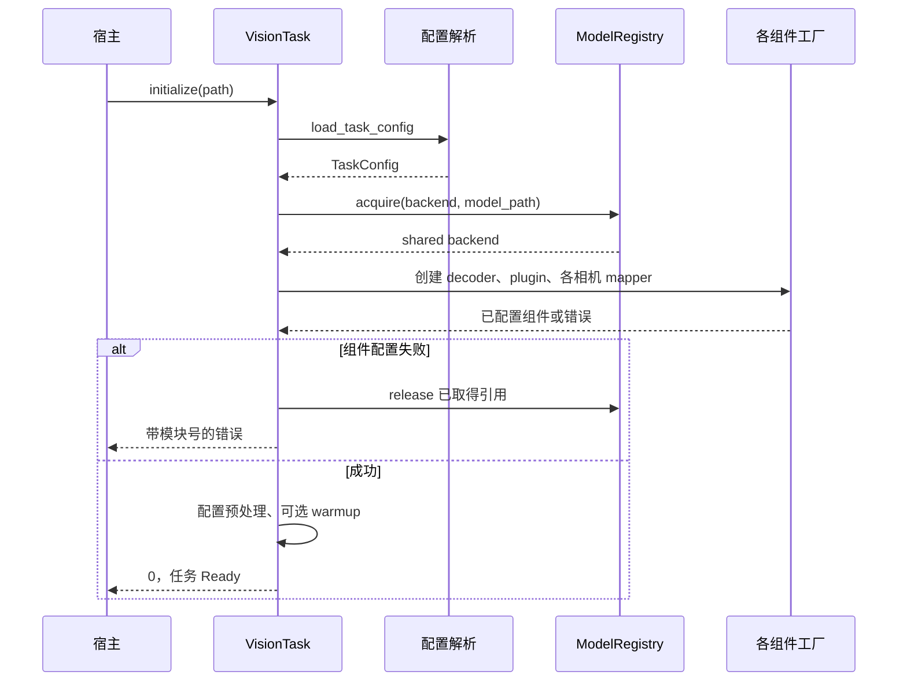
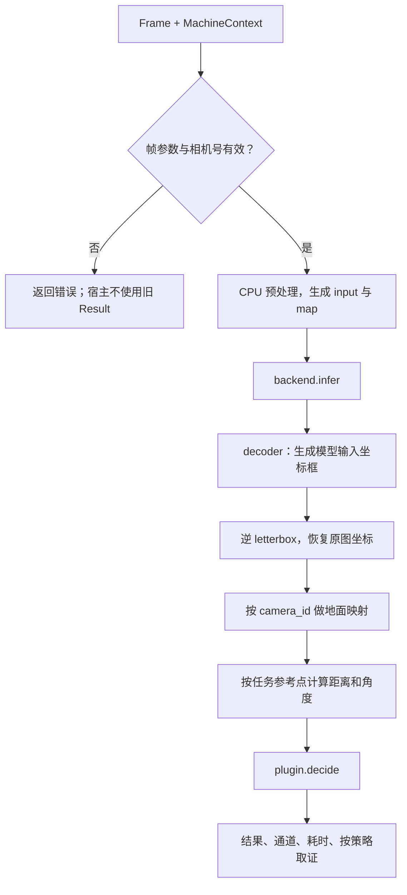
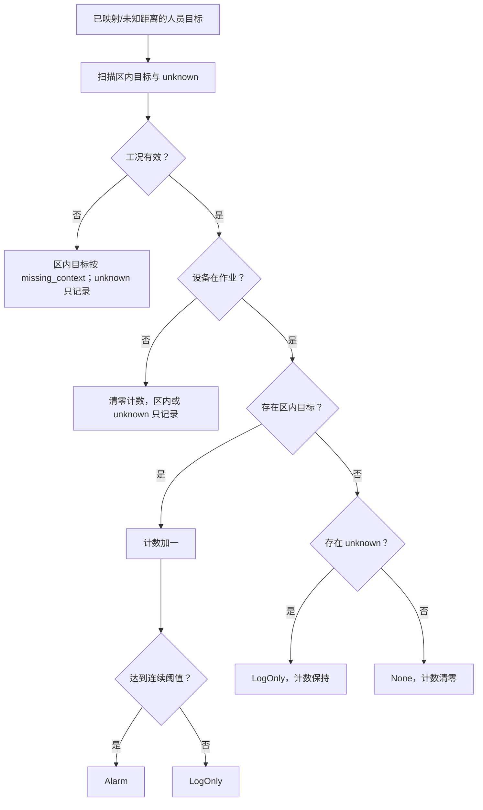
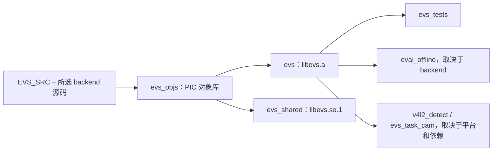

# EdgeVision 仓库深度分析报告

> 分析及源码核验时间：2026 年 10 月 15 日。
> 源码仓库：`/home/tronlong/lyp/code/edgevision`。
> 分析提交：`b69bfdb2e76efe93585983d2c714d270be96724c`。
> 结构参考：[mpc-base 分析报告](/home/tronlong/lyp/perCode/idevelop_md/meari/mpc-base/mpc-base分析报告.md)，沿用“概述 → 平台 → 目录 → 架构 → 模块 → 工具 → 数据流 → 构建 → 接口 → 安全 → 场景 → 总结”的十二章层次。

**阅读结论**：EdgeVision 已形成可独立测试的视觉任务框架，人员规则、预处理、地面单应映射、静态登记和离线评测均有实现；高度安装判断、卷扬冰雪和动态工况测距仍有明显占位。当前 mock 构建与测试通过，Linux 非 mock 顶层构建存在配置错误，两份文件带源码保护头；不能据此认定已具备完整的板端产品交付能力。

**先掌握调用主线**：一个功能建一个 `VisionTask`，用 `initialize()` 读取 YAML 并初始化一次；宿主每帧提供原图 `Frame` 和当前工况 `MachineContext`，调用 `detect()` 后读取结果；停止任务时 `release()`。库内部完成预处理、推理、解码、地面映射和功能判断。[最简代码见 11.1](#111-场景一一个功能一个任务逐帧检测)。

| 阅读目的 | 入口 |
| --- | --- |
| 快速了解项目与功能完成程度 | [第一章](#一仓库概述)、[第二章](#二支持平台) |
| 接手代码并定位实现 | [第三章](#三目录结构总览)、[第五章](#五核心模块深度解析) |
| 理解一帧图像如何变成告警 | [第四章](#四核心架构设计)、[第七章](#七关键数据流分析) |
| 编译、运行和核对验证范围 | [第八章](#八编译构建体系)、[第十一章](#十一典型使用场景) |
| 对接宿主、相机和结果结构 | [第九章](#九接口设计规范)、[第六章](#六工具与辅助能力详解) |
| 评估现存问题和后续工作 | [第十章](#十安全与加密)、[第十二章](#十二总结) |

**证据约定**：下文“源码确认”表示在当前明文实现中找到相应逻辑；“本次实测”表示实际执行了命令或最小复现；“历史记录”来自仓库说明，没有在本次硬件环境重测。源码链接固定到本机路径及当前行号，仓库后续变化时需重新核对。

---

## 一、仓库概述

### 1.1 核心定位

EdgeVision 是面向起重机安全检测的 **C++17 视觉算法库**。宿主输入摄像头帧和设备工况，库完成预处理、推理、检测结果解析、地面映射及功能规则判断，再返回统一结果。

对于宿主，接入顺序只有以下五步：

| 步骤 | 宿主做什么 | 调用时机 |
| --- | --- | --- |
| 1 | 为需要的功能创建一个 `VisionTask` | 功能启动时 |
| 2 | `initialize("任务配置.yaml")` | 初始化一次，YAML 的 `module_id` 决定功能 |
| 3 | 取原图并填 `Frame`，把最新工况填入 `MachineContext` | 每一帧 |
| 4 | `detect(frame, ctx, result)`，成功后使用结果 | 每一帧，同一实例串行调用 |
| 5 | `release()`；析构也会释放 | 功能停止时 |

“一个功能”按模块号区分：载荷附近、载荷下方、大臂下方、高度限位、卷扬冰雪分别使用自己的实例。**不是每帧创建一个实例**，否则连续帧等跨帧状态无法保留。同一功能可以按 YAML 白名单接收多路相机，每次仍处理一张图；独立功能实例之间可由模型注册表共享相同后端和模型，详见 4.3。

它提供两种调用层次：

- **完整任务层**：使用 `VisionTask`，同时得到检测框、地面距离和功能告警。
- **检测组件层**：宿主直接组合 `Preprocessor`、后端和 decoder，适合模型联调、取景和离线精度评测。



相机设备、GStreamer、Qt/QML、PLC/MCU 通信和联锁执行不属于核心库。库也没有提供网络服务端、录像存储服务或完整设备管理系统。职责依据见 [VisionTask 接口](/home/tronlong/lyp/code/edgevision/include/evs/vision_task.h:13)、[宿主说明](/home/tronlong/lyp/code/edgevision/docs/host_api.md:1)。

### 1.2 源码规模与分析范围

本次按 `git ls-files` 统计，工作区与分析提交一致，未修改源码：

| 项目 | 当前快照 |
| --- | --- |
| 跟踪文件 | 111 个，包含源码、文档、配置、模型及评测图像 |
| `.cpp` | 29 个，其中 1 个带加密头，无法按明文分析 |
| `.h` | 31 个 |
| 明文 C++/头文件物理行数 | 10,284 行，包含工具和测试，未去除注释/空行 |
| `src/` 与 `include/` 中的 C++/头文件 | 50 个，其中明文部分 5,675 行 |
| Markdown / YAML | 15 / 10 个 |
| 已入库模型 | 根目录 `yolov5s.onnx`，约 29 MB |

分析覆盖公共接口、任务主链、配置、模型注册、明文后端、共享解码器、地面映射、三个插件目录、采集工具、共享内存、调试、评测、CMake 和测试。未解读受保护的 x86 实现与自检生成脚本，也未审计外部 Qt 宿主或 RKNN/RGA SDK 内部。

### 1.3 功能成熟度概览

| 能力 | 当前实现 | 本次验证 |
| --- | --- | --- |
| mock 框架链路 | 无模型依赖，可初始化与执行空检测 | 构建成功，`PASS=235 FAIL=0` |
| 三类人员告警 | 共享策略引擎，支持工况、区域、遮挡与连续帧 | 由现有单元测试覆盖主要规则 |
| 单应矩阵测距 | 按相机配置，支持标定尺寸和静态安装变换 | 明文实现已核对；未做实车标定验收 |
| x86 / ONNXRuntime | 公共接口及构建分支存在，具体 `.cpp` 受保护 | 未完成真实模型运行 |
| RKNN | 模型加载、推理、输出反量化和 YOLO 解码有实现 | 静态核对，未交叉编译或上板 |
| 高度限位 | 能判断无框，能保留最可信框 | 有框后的安装姿态判断未实现 |
| 卷扬冰雪 | 有配置及插件入口 | 面积与告警逻辑未实现 |
| `crane_pose` 动态测距 | 有 mapper 入口与工况参数位置 | 公式未实现，输出 unknown |
| 采集与 Qt 框通信 | 宿主工具有 GStreamer、共享内存及 RGA 代码 | 未执行真实相机和 UI 联调 |

功能存在、可以编译、检测有效、业务告警可靠是不同层次。尤其 mock 不产生真实目标，其测试通过不能证明模型精度或板端联锁行为。

---

## 二、支持平台

### 2.1 平台与后端矩阵

`EVS_BACKEND` 决定编进库的主要后端，任务 YAML 再选择使用哪个已编入的实现。mock 始终存在。

| 平台/路径 | 构建选择 | 依赖与用途 | 当前限制 |
| --- | --- | --- | --- |
| Linux PC，框架测试 | `mock` | CMake、C++17；无第三方推理 SDK | 本次已实测 |
| PC 参考检测 | `x86` | 设计上为红/蓝色块连通域参考算法 | Linux 顶层 CMake 故障；实现文件受保护 |
| PC 真实 ONNX | `onnx` 或 x86 配合 ORT | ONNXRuntime 库、头文件和兼容模型 | 不能仅凭 `onnx` 名称认定已加载真实模型 |
| Windows / MSVC | mock 或 x86/onnx 路径 | CMake 设置 `/utf-8`；真实推理还需 ORT DLL | 文档有历史用法，本次未构建 Windows |
| RK3576 等 aarch64 板端 | `rknn` | RKNN 头文件、目标运行库、NPU 驱动及模型 | 源码具备路径，本次无硬件验证 |
| QNN 平台 | `qnn` 预留名 | 尚无可用后端实现 | 不能作为已支持平台列入交付清单 |

后端选择与别名以 [backend_factory.cpp](/home/tronlong/lyp/code/edgevision/src/core/backend_factory.cpp:18) 为准：onnx 构建接受 `onnx` 和 `x86`；单独 x86 构建没有对称提供 `onnx` 别名。

### 2.2 库与工具的平台边界

核心 mock 库使用标准 C++，不要求摄像头或图形环境。RKNN/ORT 的实现细节放在相应后端，公共推理接口不暴露 SDK 类型。

采集工具依赖 Linux V4L2、POSIX 共享内存及可选 GStreamer/RGA。CMake 实际用 `if(NOT WIN32)` 包住部分 Linux 工具，条件比真正支持的平台更宽，因此不能据此宣称 macOS/BSD 采集可用。[IInferBackend](/home/tronlong/lyp/code/edgevision/include/evs/iinfer_backend.h:13)、[采集构建条件](/home/tronlong/lyp/code/edgevision/CMakeLists.txt:251)。

---

## 三、目录结构总览

```text
edgevision/
├── CMakeLists.txt                 # 后端、库、依赖、工具及测试
├── README.md                      # 总览与历史验证记录，部分内容已过时
├── build_check.bat                # 旧 Windows 编译脚本，不是当前可靠入口
├── cmake/
│   └── aarch64-linux-gnu.toolchain.cmake
├── include/evs/                   # 宿主公共 C++ 接口
│   ├── vision_task.h             # 任务生命周期、detect / detectPrepared
│   ├── frame.h                   # 图像帧、起重机工况
│   ├── status.h                  # 错误、目标、结果
│   ├── task_config.h             # YAML 配置结构
│   ├── iinfer_backend.h          # 推理后端抽象
│   ├── detection_decoder.h       # 检测输出解析
│   ├── function_plugin.h         # 业务功能抽象
│   ├── ground_*.h                # 地面配置、mapper、参考系及参数
│   ├── model_registry.h          # 模型共享与引用计数
│   ├── preprocess.h              # 输入处理及坐标映射
│   └── log.h / debug.h / offline_eval.h
├── src/
│   ├── vision_task.cpp           # 任务装配与同步处理主链
│   ├── evs_register.h            # 静态登记机制
│   ├── core/                     # 配置、工厂、预处理、评测与调试
│   ├── backend/
│   │   ├── mock/                 # 始终编入的空检测后端
│   │   ├── x86/                  # 受保护的参考/ORT 实现
│   │   ├── rknn/                 # RKNN 实现与局部说明
│   │   └── yolo_decode.h         # YOLOv5 / v11 / YOLOX 共用头解码
│   ├── ground/                   # 单应映射、动态测距占位、统一地面量
│   └── tasks/
│       ├── function_plugin_factory.cpp
│       ├── person/               # 0x0004、0x0005、0x0006
│       ├── height_limit/         # 0x0007
│       └── winch_ice/            # 0x0008
├── tools/
│   ├── eval_offline/             # 评测 CLI、数据生成脚本、fixtures
│   ├── v4l2_detect/              # 采集、RGA、框共享内存及启动脚本
│   ├── task_cam/                 # 经过 VisionTask 的相机示例
│   └── linux_source/             # 只有宿主分工说明，无独立可执行目标
├── configs/                      # 任务 YAML 与 camera_config.json
├── tests/test_core.cpp           # 单个测试程序，内部 CHECK 计数
├── eval_onnx_demo/               # bus.ppm 和模型自检标注
├── docs/                         # API、集成、采集、交叉编译、现场修改
└── yolov5s.onnx                  # 已跟踪模型资产
```

当前没有完整 `models/` 目录或所有部署配置。`yolox.rknn`、训练后的高度/冰雪模型，以及 README 中部分 yolo11 配置和改名程序需由外部交付。

`tools/v4l2_detect/main.cpp.bak_20261007_200859` 是已入库备份，不在构建清单；`build/` 等构建目录也不属于当前跟踪源码结构。真正的编译范围以 [EVS_SRC](/home/tronlong/lyp/code/edgevision/CMakeLists.txt:35) 和工具目标声明为准。

---

## 四、核心架构设计

### 4.1 整体分层



图中是职责划分，不代表每个组件各自有线程。核心任务按一次同步调用串行推进；`detectPrepared()` 会跳过 CPU 预处理，复用后续链路。

### 4.2 四个替换点

| 替换点 | 接口 | 选择依据 | 扩展方式 |
| --- | --- | --- | --- |
| 功能规则 | `IFunctionPlugin` | `module_id` | 新 `.cpp` 自登记模块号，加入 `EVS_SRC` |
| 推理执行 | `IInferBackend` | 编译选项与 YAML `backend` | 后端实现、工厂分支、CMake 配置 |
| 输出解析 | `IDetectionDecoder` | `output_format` | 自登记格式名，加入构建 |
| 地面映射 | `IGroundMapper` | `ground.cameras[].mapper` | 自登记 mapper 名，专属参数放 `params` |

插件、decoder 和 mapper 工厂维护名称/模块号到创建函数的映射。创建动作发生在初始化时，不会每帧重新加载算法，也没有运行时外部动态插件发现流程。[evs_register.h](/home/tronlong/lyp/code/edgevision/src/evs_register.h:13)、[功能工厂](/home/tronlong/lyp/code/edgevision/src/tasks/function_plugin_factory.cpp:17)。

### 4.3 对象、状态与共享资源

`VisionTask::Impl` 持有配置、共享后端、独占 decoder/plugin、按相机划分的 mapper、预处理器、调试对象和可选最后输入缓存。

```text
VisionTask 实例 A ── 独立规则状态 / decoder / mapper / 调试统计
                  └─ shared_ptr ─┐
                                 ├─ 同一 backend:model_path 对应的后端
VisionTask 实例 B ── shared_ptr ─┘
                  └─ 独立规则状态 / decoder / mapper / 调试统计
```

模型后端按 `(backend, model_path)` 复用，而非按功能号复用。这允许三类人员功能共享同一模型，但不会自动合并它们的区域规则。[任务成员](/home/tronlong/lyp/code/edgevision/src/vision_task.cpp:76)、[注册表获取](/home/tronlong/lyp/code/edgevision/src/core/model_registry.cpp:10)。

### 4.4 生命周期与并发边界



- 单个实例不可复制，检测为同步接口；检测、配置更新、释放应由宿主串行协调。
- 模型注册表有互斥，但仅保护创建/引用计数/容器操作，不保护后端推理。两个任务共享 RKNN 上下文时，不能据注册表加锁推断可以并发推理。
- 核心库没有提供全局任务调度器或跨相机告警汇总服务；这些由产品宿主实现。
- 采集工具可使用独立取帧线程，其缓冲和丢帧策略属于工具层，见 6.2 与 7.4。

---

## 五、核心模块深度解析

本章说明组件各自如何工作；第七章再按初始化、单帧、告警、更新等场景串联调用顺序。

### 5.1 VisionTask：统一任务入口

**文件**：`include/evs/vision_task.h`、`src/vision_task.cpp`。

主接口包含 `initialize()`、`detect()`、`detectPrepared()`、`updateConfig()`、`release()`，以及输入尺寸查询与调试接口。

初始化主要分为：解析配置、确认后端可用、取得模型引用、设置输入尺寸、创建 decoder/plugin、构建 mapper、配置预处理、可选 warmup，最后提交初始化状态。decoder、plugin 或 mapper 创建失败时会归还已取得的模型引用。

**两个容易误解的行为**：

1. 成功初始化后，再传另一个 YAML 调用 `initialize()` 仍直接返回 0，不切模型。必须释放后重建任务。
2. warmup 推理失败只记录警告，并不让初始化失败。初始化成功也不能单独证明已经完成一次成功推理。

`acceptFrame()` 检查初始化状态、非空像素指针、正宽高及相机白名单。它没有帧缓冲长度参数，因此无法完成全部图像内存校验。[初始化](/home/tronlong/lyp/code/edgevision/src/vision_task.cpp:95)、[帧校验](/home/tronlong/lyp/code/edgevision/src/vision_task.cpp:198)。

`finishDetect()` 统一执行后端推理、上层解码、原图坐标恢复、地面投影、任务距离和插件判断，再填写通道号并更新统计。许多前置错误直接返回，未必覆盖调用方已有 `Result`，宿主应先检查函数返回值。[主链](/home/tronlong/lyp/code/edgevision/src/vision_task.cpp:277)。

### 5.2 配置解析与热更新

**文件**：`include/evs/task_config.h`、`src/core/config.cpp`。

#### 5.2.1 配置模型

| 配置组 | 主要字段 | 作用 |
| --- | --- | --- |
| 身份与相机 | `task`、`module_id`、`camera.video_channel` | 功能选择、通道白名单与日志标识 |
| 后端与模型 | `backend`、`Model_path`、`warmup`、`init_timeout_s` | 模型取得和初始化 |
| 图像输入 | `input_width/height`、`input_format`、`letterbox` | 模型张量生成 |
| 输出解码 | `output_format`、`decoder_classes`、`person_class_id` | 行宽、格式和类别过滤 |
| 人员策略 | `zone.*`、`on_missing_context` | 区域、遮挡、连续帧、无工况处理 |
| 地面坐标 | `ground.*` | 每相机算法、矩阵、安装变换、参考点与距离模式 |
| 专属功能 | 高度窗口参数、`area_ratio`、`exit_on_alarm` | 高度/冰雪的配置入口，部分尚未消费 |
| 性能与取证 | `latency_budget_ms`、`min_fps`、`debug.*` | 预算反馈与有界落盘 |

真正决定功能的是 `module_id`。`task: load_near` 的文本或文件名不会替代功能号。

#### 5.2.2 轻量 YAML 的能力与限制

解析器先移除注释、提取缩进和键值，再处理常见嵌套以及专用 `ground.cameras` 列表。它不是完整 YAML 实现，不应依赖 anchors、多文档、多行字符串或任意复杂类型。

支持的兼容名包括 `model`/`Model_path`、`camera_ids`/`video_channel`、`score_threshold`/`confidence_threshold`、`thresholds.score`。部分数值使用宽松的 `strtol/strtod` 转换，未知键多被忽略；配置能读入不代表全部字段有效或生效。[解析入口](/home/tronlong/lyp/code/edgevision/src/core/config.cpp:104)、[字段分派](/home/tronlong/lyp/code/edgevision/src/core/config.cpp:235)。

`ground.cameras[].params` 保存 mapper 专属字符串，由 mapper 再使用 `ground_param_int/float/bool/float_array` 读取，减少公共结构随算法增长而变化。

#### 5.2.3 热更新的实际契约

`updateConfig()` 读取一份完整的新配置，先检查不可变项，构建新 mapper，配置插件，再提交允许字段。它不是只更新文件中出现字段的补丁机制。

| 字段类型 | 当前源码行为 |
| --- | --- |
| `backend`、模型路径、模块号、输出格式、类别数、筛选类别 | 改变则返回 `NotSupported` |
| 分数阈值、区域、无工况策略、完整 ground、延迟预算、专属插件参数、debug | 验证后提交 |
| 输入尺寸、颜色格式、letterbox、`video_channel` 等 | 未见不可变比较，也未应用到原任务配置 |
| `nms_threshold` | 解析及保存，但共用 YOLO NMS 未读取此值 |

**本次最小实测**：将输入宽度从 64 改为 32，更新返回 0，`inputWidth()` 仍为 64。因此成功返回不代表新 YAML 中每个字段都已生效。[更新实现](/home/tronlong/lyp/code/edgevision/src/vision_task.cpp:368)。

mapper 在临时容器中构造；任一 mapper 或插件配置失败时，已有任务继续使用旧配置。这种行为要求新增插件的 `configure()` 先完成校验，再改变成员状态。人员插件更新配置不重置连续帧计数。

### 5.3 ModelRegistry：共享模型与引用计数

**文件**：`include/evs/model_registry.h`、`src/core/model_registry.cpp`。

注册表以 `backend + ":" + model_path` 为键。`acquire()` 在已有项上增加显式引用计数，未命中时创建后端并加载；`release()` 降到 0 后移除表项。返回的 `shared_ptr` 还负责 C++ 对象的实际存活。

这种设计减少相同模型的重复加载，但有三个边界：

- 键使用原始路径字符串，不做绝对路径或符号链接规范化；两个字符串可能指向同一文件却生成两项。
- 注册表锁不覆盖 `infer()`；共享后端的上下文与缓存仍需并发约束。
- `configure_input()` 在获取共享后端后调用，键里不包含输入尺寸；同一模型的任务应保持模型输入契约一致。

`snapshot()` 提供后端名、模型路径、ref 和 loaded 状态，适合排查重复加载和引用未释放。[获取](/home/tronlong/lyp/code/edgevision/src/core/model_registry.cpp:10)、[释放](/home/tronlong/lyp/code/edgevision/src/core/model_registry.cpp:36)。

### 5.4 Preprocessor：输入规范化与坐标逆变换

**文件**：`include/evs/preprocess.h`、`src/core/preprocess.cpp`。

输入支持 NV12、RGB、BGR。处理后输出紧密排列的 **uint8 NHWC 三通道数据**，尺寸为 `input_width × input_height × 3`。NV12 路径使用查表/整数颜色转换；缩放使用定点双线性，letterbox 区域填充 114。

预处理同时记录 `scale_x/scale_y`、`pad_x/pad_y` 和模型输入尺寸。对检测框做逆变换时：

```text
模型归一化框中心
  → 乘模型输入宽高，得到模型像素位置
  → 减去 letterbox padding
  → 除以缩放比例，得到原图像素位置
  → 除以原图宽高，恢复原图归一化坐标
```

框宽高按比例恢复，不减中心 padding。后续地面映射和插件收到的是原图坐标，而非模型输入图坐标。[预处理](/home/tronlong/lyp/code/edgevision/src/core/preprocess.cpp:88)、[坐标回映射](/home/tronlong/lyp/code/edgevision/src/core/preprocess.cpp:232)。

`Frame.stride` 在 CPU 预处理里按字节使用；NV12 的 Y/UV 使用相同行跨距。`dma_fd` 没有在 CPU 路径代替 `data`。输入尺寸不合法时保留旧的空输入/单位映射行为，这是兼容处理，不能视为真实模型的通用输入方式。

### 5.5 推理后端：mock、x86/ONNX 与 RKNN

#### 5.5.1 mock 后端

`load()` 不读取模型，直接设置 loaded；`infer()` 检查 loaded 后清空输出并返回成功。这提供的是流程和错误处理测试基础，不能模拟真实目标、推理负载或精度。[mock_backend.cpp](/home/tronlong/lyp/code/edgevision/src/backend/mock/mock_backend.cpp:8)。

#### 5.5.2 x86/ONNX 路径的可确认范围

公共 `X86Backend` 接口、CMake 的 ORT 查找和相关测试均存在；文档描述了参考色块检测与真实 ONNX 模式。然而 `src/backend/x86/x86_backend.cpp` 的工作区及 HEAD 内容带 `E-SafeNet` 保护头，本次不能核验具体加载、张量转换和推理分支。

因此这里只确认**接口与集成意图**，不把文档描述升格为本次明文审阅结论。构建时也要核对实际 ORT 检测结果，不能只看 `EVS_BACKEND=onnx`。[公共接口](/home/tronlong/lyp/code/edgevision/include/evs/x86_backend.h:32)、[ORT 查找](/home/tronlong/lyp/code/edgevision/CMakeLists.txt:79)。

#### 5.5.3 RKNN 加载与单帧推理

`RknnBackend` 使用 PIMPL 封装 SDK 状态，主要流程为：

1. 读模型字节，调用 `rknn_init()`。
2. 查询输入输出数量和 tensor 属性。
3. 读取环境变量设置 NPU 亲和、输入缩放、头解码模式。
4. 推理时检查输入大小，构造 `rknn_input`。
5. float32 输入按缩放值转换；量化模型路径提交 uint8 数据。
6. 调用 `rknn_inputs_set()`、`rknn_run()`、`rknn_outputs_get(want_float=1)`。
7. 将输出张量及形状交共享 YOLO helper，生成统一行矩阵，再释放 SDK 输出。

这些调用可在 [加载实现](/home/tronlong/lyp/code/edgevision/src/backend/rknn/rknn_backend.cpp:115)、[推理实现](/home/tronlong/lyp/code/edgevision/src/backend/rknn/rknn_backend.cpp:200) 找到。

配置层尚有未接通之处：YAML `npu_core_mask` 没有传入后端，当前实际读 `EVS_NPU_CORE_MASK`；`init_timeout_s` 在 RKNN `load()` 参数中未使用，不能证明 SDK 初始化具备超时保障。输入 layout/dims 的假设也需要对目标模型和 runtime 实测，不能从抽象接口推导任意 RKNN 模型都支持。

### 5.6 解码系统：原始检测头与统一行矩阵

这里有**两层解码**，是换模型和排查“零框”的关键。

```text
RKNN 原始张量：形状、布局、激活、量化后数值
  → src/backend/yolo_decode.h
  → 归一化行矩阵 [center_x, center_y, width, height, class_scores...]
  → IDetectionDecoder
  → Target：单个类别、置信度、框坐标
```

#### 5.6.1 上层 decoder

| 格式名 | 实际消费的数据 | 行为 |
| --- | --- | --- |
| `flat6` | 每条 6 float：类别、分数、中心及宽高 | 阈值过滤；不额外保证只保留人员类别 |
| `yolov8` | `[N, 4+C]` 行矩阵 | 类别 argmax、阈值过滤、可选类别筛选 |
| `yolo11` | 后端已完成重处理的同类行矩阵 | 不在这里重新处理九张 DFL 头 |
| `yolo11_raw`、`yolo11_decoup` | `yolo11` 的登记别名 | 名称带 raw 不改变输入契约 |
| `yolox` | 同样的行矩阵 | 使用对应格式标签及类别过滤 |

未知格式工厂返回空指针，`VisionTask::initialize()` 转为 `ModelInvalidFormat`；但已知格式遇到错误行宽可能直接返回空目标，不一定报错。[decoder 实现及登记](/home/tronlong/lyp/code/edgevision/src/core/detection_decoder.cpp:34)、[创建工厂](/home/tronlong/lyp/code/edgevision/src/core/detection_decoder.cpp:197)。

#### 5.6.2 共享 YOLO helper

- **YOLOv5**：识别 anchor 检测头，按通道主序取数，结合 stride、anchors 和激活模式得到框。
- **YOLOv11**：按尺度组合 reg/cls/obj，使用 DFL-16 期望恢复边界，分数由 objectness 与类别概率组合。
- **YOLOX**：支持 packed anchors 或逐尺度头，按网格和 stride 恢复中心、指数恢复宽高。
- 对候选排序、过滤退化框、执行 NMS，再输出统一行矩阵。

当前常量包括 `kClasses=80`、`kInputSize=640`、候选分数 0.05、NMS 前最多 3000 候选。YOLOv5/v11 默认 NMS IoU 0.45；YOLOX 为 0.5 且不分类别。[常量](/home/tronlong/lyp/code/edgevision/src/backend/yolo_decode.h:29)、[分派](/home/tronlong/lyp/code/edgevision/src/backend/yolo_decode.h:506)。

**换模型的实际含义**：只改 YAML `decoder_classes` 只能改变上层行宽，不能自动改下层固定的类别数、输入尺寸和 anchors。新模型若改变原始头契约，应同时检查 backend/helper 与 decoder。

### 5.7 地面映射与任务参考系

**文件**：`src/ground/`、`include/evs/ground_*.h`。

#### 5.7.1 两阶段几何适配

第一阶段，`IGroundMapper` 把原图目标转换为统一地面平面上的 `(x_m, y_m)`，并用 `ground_ok` 标记可信度。

第二阶段，功能插件提供任务参考点，`apply_ground_metrics()` 再计算该目标相对参考点的 `distance_m` 与 `angle_deg`。这样相机算法不需要了解“载荷附近”或“大臂下方”的业务含义。

| 模式 | 距离 | 角度 |
| --- | --- | --- |
| `legacy_forward_y` | 目标相对参考点的前向 Y 分量 | 从 +Y 向 +X 顺时针，范围 `(-180°,180°]` |
| `radial` | `sqrt(dx² + dy²)` | 同方向定义，范围 `[0°,360°)` |

`ground.reference: task` 必须配 `radial`，否则配置解析失败。[统一换算](/home/tronlong/lyp/code/edgevision/src/ground/ground_metrics.cpp:38)、[组合校验](/home/tronlong/lyp/code/edgevision/src/core/config.cpp:228)。

#### 5.7.2 homography 单应映射

mapper 取原图框底边中心，并按标定图宽高恢复标定像素坐标；乘 3×3 单应矩阵并进行齐次除法，再把厘米转换为米。对退化分母、非有限值和不符合前向约束的点返回 unknown。

可选 `mount.x_m/y_m/yaw_deg` 提供静态安装平移和旋转。`on_boom`、`offset_m` 没有让这个实现自动具备臂架动态测距能力。[homography](/home/tronlong/lyp/code/edgevision/src/ground/homography_mapper.cpp:47)。

未配置 ground 时，相机 0–3 使用 `/userdata/matrix_<id>_1280x720.txt`，缺失可回退内置历史矩阵。显式路径会被识别为严格加载意图，现场样例还明确设置 `strict_matrix: true`。应区分“测试允许内置矩阵”和“现场标定已正确加载”。

#### 5.7.3 动态测距与参考点缺口

`crane` 和 `crane_pose` 是同一占位 mapper 的两个登记名，当前 `map()` 始终返回无效地面点。[crane_pose_mapper.cpp](/home/tronlong/lyp/code/edgevision/src/ground/crane_pose_mapper.cpp:7)。

人员 task 参考系中，0x0004/0x0005 在工况有效时把吊钩暂放 `(0, hoist_radius)`，无工况时回退原点；0x0006 使用大臂根部原点。由于 `MachineContext` 没有绝对回转角，吊钩方向与扇形轴线还不能反映完整实车方位。[参考点](/home/tronlong/lyp/code/edgevision/src/tasks/person/person_plugin.cpp:145)。

### 5.8 PersonPlugin：三类人员安全规则

**文件**：`src/tasks/person/person_plugin.cpp`、`include/evs/person_plugin.h`。

三个功能共用检测模型接口和策略引擎，由 `make_person_config()` 构造差异：

| 功能 | 模块号 | 区域 | 无有效工况 |
| --- | --- | --- | --- |
| 载荷附近 | `0x0004` | 默认 10 m 圆 | 配置为 `alarm` 时，已映射的区内人立即告警；否则只记录 |
| 载荷下方 | `0x0005` | 圆内扣除载荷遮挡扇区 | 只记录 |
| 大臂下方 | `0x0006` | 半径 `max(50, hoist_radius)` 的扇形，默认半角 40° | 只记录 |

#### 5.8.1 作业判断

当前判断等价于：

```cpp
ctx.context_valid &&
    (ctx.is_working != 0 || ctx.hoist_moving || ctx.telescope_moving)
```

`context_valid` 默认 true；焦距 `focal_length` 不参与作业判断。旧角速度字段已经移除，`work_motion_epsilon` 参数保留但未参与计算。[is_working()](/home/tronlong/lyp/code/edgevision/src/tasks/person/person_plugin.cpp:10)。

#### 5.8.2 连续帧与 unknown 的处理

`person_decide()` 先扫描是否有区内目标、是否有未知距离目标，然后判断工况：

| 情况 | 告警与计数 |
| --- | --- |
| 工况有效，设备静止 | 区内或 unknown 只记录，连续计数归零 |
| 作业中，存在区内目标 | 连续计数加 1，达到阈值输出 Alarm，之前 LogOnly |
| 作业中，没有区内目标但存在 unknown | LogOnly，既不增加也不清零连续计数 |
| 作业中，没有区内目标也没有 unknown | None，连续计数归零 |
| 工况无效 | 按模块策略处理，不进入上述作业计数流程 |

未知地面距离不会被当成“极近的人”；它保留在结果中以便记录，但不能自己推进区域告警。反过来，“unknown 帧不打断计数”也意味着该规则不是严格的每一帧都有有效地面证据。[策略](/home/tronlong/lyp/code/edgevision/src/tasks/person/person_plugin.cpp:61)。

当前连续计数属于**任务实例**，没有按相机或目标 track_id 分开。多路相机轮流送帧时会共享该计数；对具体人持续跟踪不在当前实现范围内。

### 5.9 HeightLimitPlugin：高度限位的两阶段入口

**文件**：`src/tasks/height_limit/`。

当前阶段拆为：

1. 由检测模型判断有无开关；无框输出 `limit_state=1`。
2. 若有框，选置信度最高目标，调用 `judge_switch_mount(frame, box)` 判断装对/装错。

第二阶段目前始终返回 0，即“姿态尚未判断”，并未输出实际的 2/3 结论。开启 `EVS_WITH_OPENCV` 也只进入预留分支，不会产生安装几何判断。[插件](/home/tronlong/lyp/code/edgevision/src/tasks/height_limit/height_limit_plugin.cpp:34)、[安装入口](/home/tronlong/lyp/code/edgevision/src/tasks/height_limit/height_limit_mount.cpp:5)。

`configure()` 校验停止角大于启动角、最少帧大于零，并保存窗口参数；`decide()` 尚未使用这些参数完成状态机。训练模型、安装图像规则、观测窗口和设备基本臂约束仍需补齐。

### 5.10 WinchIcePlugin：卷扬冰雪骨架

**文件**：`src/tasks/winch_ice/`。

`configure()` 校验面积阈值在 `[0,1]` 并保存 `area_ratio`、`exit_on_alarm`；`decide()` 当前不消费图像或目标，每帧清空目标、设置 `ice_ratio=0`、`alarm=None`。

预留的 `ice_exited_` 由 `reset()` 清零，但检测逻辑未设置和使用它。因此“达到阈值报警后退出”只是待实现意图，而不是现有能力。[winch_ice_plugin.cpp](/home/tronlong/lyp/code/edgevision/src/tasks/winch_ice/winch_ice_plugin.cpp:8)。

如果未来使用分割模型，当前只返回检测框的通用 decoder 还不能直接提供掩码；观测区域、面积计算、框重叠和告警复位语义也需要明确。

---

## 六、工具与辅助能力详解

### 6.1 OfflineEvaluator：离线检测评测

**文件**：`src/core/offline_eval.cpp`、`include/evs/offline_eval.h`、`tools/eval_offline/main.cpp`。

评测器读取同一类任务 YAML，独立创建后端与 decoder，对 P6 PPM 图像运行预处理、推理和坐标恢复，再与标注比较。它**没有进入 PersonPlugin、工况判断或地面告警链路**，所以检测 mAP 不能代替告警正确率。

数据结构为 `images/` 加 `annotations.json`：

```json
{
  "images": [
    {
      "file": "example.ppm",
      "boxes": [{"class": 0, "x": 0.5, "y": 0.5, "w": 0.2, "h": 0.4}]
    }
  ]
}
```

#### 6.1.1 指标计算

预测按置信度排序，在相同类别的尚未匹配标注中寻找满足 IoU 阈值的最佳项；每个标注最多匹配一次。形成 TP/FP/FN 后，计算 precision、recall、F1 和 VOC all-point AP。实际 mAP 按成功处理样本中 GT 或预测出现过的类别键集取均值，包含仅有预测、没有 GT 的类别；这一点与头文件注释不同，见 6.1.3。它是指定 IoU 与分数条件下的结果，不是默认 COCO 多 IoU 平均指标。[匹配](/home/tronlong/lyp/code/edgevision/src/core/offline_eval.cpp:397)、[指标](/home/tronlong/lyp/code/edgevision/src/core/offline_eval.cpp:461)。

CLI 可生成 `report.json`、`report.csv`、`images.csv`，`--dump` 实际针对出现 FP/FN 的样本输出对比图。建议显式设置输出目录，避免覆盖已入库 fixture 报告。

#### 6.1.2 异常样本统计的一致性问题

读图、预处理或推理失败时，源码将该图的标注数写到逐图 `ir.fn`，随后直接 `continue`，未进入全局 FN 和每类 GT 汇总。

**本次已最小复现**：两张图各有一个 GT，一张正常读入、一张文件缺失，mock 无检测。结果为 `n_images=2`、逐图 FN 合计 2，但 `total_fn=1`，`run()` 仍返回成功。报告使用者需要检查样本有效性和分项一致性，否则可能遗漏失败样本。[失败分支](/home/tronlong/lyp/code/edgevision/src/core/offline_eval.cpp:345)。

#### 6.1.3 无 GT 类别的 mAP 汇总口径

`EvalReport` 头文件注释写“只对有 GT 的类别求均值”，但实现把预测类别也加入 `gt_count`，并对其全部键累加 AP。只预测出来、未有标注的类别会以 AP=0 参与平均。

本次用临时登记的合成 decoder 验证：唯一 GT 为类别 0，预测正确命中它，另产生一个类别 1 的 FP，结果为 `AP0=1 AP1=0 mAP=0.5`，而非仅对 GT 类别求均值得到的 1。这个探针用于核对评测汇总，不代表真实模型表现。与外部工具比较时需先统一参与平均的类别集合。[头文件口径](/home/tronlong/lyp/code/edgevision/include/evs/offline_eval.h:60)、[实际累加](/home/tronlong/lyp/code/edgevision/src/core/offline_eval.cpp:490)。

### 6.2 采集工具与最新帧策略

#### 6.2.1 v4l2_detect

工具直接组合预处理、backend 和 decoder，用于观察检测框及模型效果。支持的入口包括：

| 输入 | 参数/组件 | 用途 |
| --- | --- | --- |
| 裸 NV12 | `--raw`、`--raw-width/height` | 固定帧回归，排除实时采集差异 |
| V4L2 | `--device` | 摄像头设备联调 |
| JSON 选路 | `--config`、`--channel` | 按 camera_config 数组选取通道 |
| 图像共享内存 | `--shm N`、`ShmCapture` | 消费外部 Qt 的 `/picshare<N>` |
| MP4 | `--mp4`、`Mp4KeyframeCapture` | 关键帧模型联调，不是逐帧完整视频评估 |

`--shm-write` 是检测框输出，与 `--shm` 图像输入不同；`--daemon`、`--stats` 用于长期运行和汇总日志。[参数与输入分派](/home/tronlong/lyp/code/edgevision/tools/v4l2_detect/main.cpp:532)。

相机 JSON 提供请求参数，但当前 `GstCapture::open()` 的管线没有写入宽高/帧率 caps，参数在该函数中被显式忽略；实际尺寸从协商后的 sample caps 读取。因此不能只修改 JSON 就认定 GStreamer 路径已经按指定分辨率或 FPS 取流。[管线构造](/home/tronlong/lyp/code/edgevision/tools/v4l2_detect/capture.cpp:292)。

#### 6.2.2 evs_task_cam

这个程序创建 `VisionTask`，执行完整插件链路。它启动取帧线程，将最新帧写入单槽缓冲；处理线程慢时，旧帧被新帧覆盖，而不是形成无限队列。[Latest](/home/tronlong/lyp/code/edgevision/tools/task_cam/main.cpp:76)、[线程启动](/home/tronlong/lyp/code/edgevision/tools/task_cam/main.cpp:236)。

示例工况固定为 `context_valid=true`、`is_working=1`。这适合验证模块接线，产品需换成真实中控值。是否 RGA 预处理由可用性决定，成功时走 `detectPrepared()`；CPU 路径走 `detect()`。[调用分支](/home/tronlong/lyp/code/edgevision/tools/task_cam/main.cpp:271)。

### 6.3 RGA：宿主侧硬件预处理

**文件**：`tools/v4l2_detect/rga_preprocess.h/.cpp`。

RGA 代码不属于 `libevs` 核心实现，而是在采集端完成缩放、颜色转换和 letterbox，交付与 CPU 预处理相同的张量及 `PreprocessMap`。

现有代码区分像素 stride 与字节跨度：`rga_buffer_t::wstride` 使用像素，自己计算 RGB 行地址需乘 3。混用会导致几何错位或越界。`EVS_RGA_CSC` 可选诊断策略，`--bench` 可同帧比较 CPU/RGA 输出。[RGA 核心](/home/tronlong/lyp/code/edgevision/tools/v4l2_detect/rga_preprocess.cpp:137)。

README 记录过约 53 ms CPU 预处理与约 3 ms RGA 预处理的历史结果，但模型、输入格式、分辨率和板端环境都会影响数字；本次没有重测。`--rga-fd` 还依赖相机的 dma-buf 导出能力，不能由普通 RGA 路径成功推断零拷贝可用。

### 6.4 共享内存：图像输入与检测框输出

#### 6.4.1 `/picshare<N>` 图像输入

`ShmCapture` 按“BGR 像素 + 32 字节尾部元数据”读取外部共享内存，再转换成 NV12。元数据包含序号、rows、cols、type、data_bytes，当前要求 OpenCV `CV_8UC3` 对应的 type 16。[输入实现](/home/tronlong/lyp/code/edgevision/tools/v4l2_detect/capture.cpp:494)。

这里读取并保存 `seq`，但没有看到读取前后序号一致性复核，不能把它视为与下述检测框输出相同的 seqlock 协议。源进程并发写图像时的数据一致性还要结合外部生产者核对。

#### 6.4.2 `/detection_boxes` 框输出

| 项目 | 当前协议 |
| --- | --- |
| magic / version | `0xDE7EC710` / 1 |
| 相机通道 / 每路框数 | 4 / 最多 64 |
| 单框 / 通道块 / 总大小 | 24 / 1620 / 6496 字节 |
| channels 起始偏移 | 16 字节 |
| 框坐标 | 原图像素角点，包含置信度与 mappedY |
| 距离单位 | 厘米，非正值表示未知 |
| 同步 | 每路 seq 写前变奇数、写后变偶数 |

布局有 `static_assert`，与外部 Qt reader 对齐；同一路只应有一个写者。关闭时发布无效状态并 unmap，不主动 unlink。[协议](/home/tronlong/lyp/code/edgevision/tools/v4l2_detect/detection_shm.h:39)、[发布](/home/tronlong/lyp/code/edgevision/tools/v4l2_detect/detection_shm.cpp:97)。

**源码确认的首次运行前提**：`open()` 调用 `shm_open(name, O_RDWR, 0666)`，没有 `O_CREAT`。尽管注释声称能够创建段，实际共享内存不存在时会失败；后续 `ftruncate()` 不会替代创建。当前需要外部先创建段，或补齐创建逻辑。本次未操作实际共享内存验证。[打开逻辑](/home/tronlong/lyp/code/edgevision/tools/v4l2_detect/detection_shm.cpp:28)。

### 6.5 日志、统计与取证

#### 6.5.1 Logger

日志支持运行期级别、编译期裁剪、文件输出、宿主 sink 和默认 256 条环形历史。宿主 sink 在互斥锁之外回调，允许回调查询日志；但捕获的对象必须在回调有效期内存活。[Logger](/home/tronlong/lyp/code/edgevision/src/core/log.cpp:73)、[输出逻辑](/home/tronlong/lyp/code/edgevision/src/core/log.cpp:170)。

#### 6.5.2 TaskDebug

记录 pre/infer/decode/total 的 last/avg/min/max，以及告警、错误和超预算数。total p95 使用最多 200 个近期样本，按实现条件更新；不是所有阶段都有独立 p95 计算。

调试关闭时不缓存最后输入，也不自动取证，但基础统计仍执行，不能将文档的“零额外开销”理解成完全无操作。[统计](/home/tronlong/lyp/code/edgevision/src/core/debug.cpp:135)。

取证生成模型输入 PPM 和可选 JSON 侧车，受 `enabled`、`dump_input`、间隔、告警条件和最大张数约束。有两个实际语义：

- `dump_meta=true` 本身不会独立触发只保存元数据，当前主分支仍要求 `dump_input=true`。
- `dump_on_alarm_only=true` 的判断为 `alarm != None`，包括 `LogOnly`；本次最小复现确认 LogOnly 会触发取证，名称比行为更窄。

参见 [maybe_dump()](/home/tronlong/lyp/code/edgevision/src/core/debug.cpp:163)。

`library_snapshot()` 汇总版本、模型引用和日志；其顶层 backend 标签优先命中始终存在的 mock 宏，不能据此判断任务实际后端，应查看任务快照及模型列表。[标签定义](/home/tronlong/lyp/code/edgevision/src/core/debug.cpp:114)。

#### 6.5.3 环境变量速查

| 环境变量 | 作用 | 使用时注意 |
| --- | --- | --- |
| `EVS_LOG_LEVEL`、`EVS_LOG_FILE` | 日志级别和输出文件 | 运行级别仍受编译期裁剪限制 |
| `EVS_YOLO_HEAD_MODE` | 0 raw、1 分数已激活、2 Detect 已融合、3 auto | 需结合头部实际数值与模型导出方式 |
| `EVS_RKNN_HEAD_MODE` | RKNN 解码模式 | 优先于通用 YOLO 变量 |
| `EVS_YOLO11_SIGMOID`、`EVS_YOLOX_SIGMOID` | 指定相关模型是否需要激活处理 | 对已经是概率的数据避免重复 sigmoid |
| `EVS_YOLO_DUMP`、`EVS_RKNN_DEBUG` | 打印框或输出头数值 | 部分实现检查“存在”，赋值 0 不等于关闭 |
| `EVS_RKNN_INPUT_SCALE` | float 输入缩放 | 是否除以 255 由模型契约决定 |
| `EVS_NPU_CORE_MASK` | 当前实际生效的 RKNN 核选择入口 | YAML 同名含义字段尚未透传 |
| `EVS_GROUND_MODEL` | 进程级覆盖全部相机 mapper | 诊断用途，覆盖会影响每路配置 |
| `EVS_RGA_CSC`、`EVS_RGA_NOPAD` | 预处理策略与 padding 诊断 | 诊断选项可能改变模型输入几何 |
| `EVS_DUMP_BENCH` | 指定 CPU/RGA 对比图前缀 | 配合工具 `--bench` 使用 |

部分环境变量在初始化或首次使用时缓存，不应当作任务级热更新 API；改变后应按相应后端生命周期重启验证。YAML 中的 `debug.*` 或 `setDebugConfig()` 才是明确的任务调试更新入口。

### 6.6 数据脚本、启动脚本与文档

- `gen_fixtures.py` 用标准库生成红/蓝块合成图和标注，输出到脚本旁的 `fixtures/`。数据特意包含 FP/FN，用于验证指标链路。
- `gen_selfcheck_dataset.py` 带源码保护头，本次没有运行或审阅其具体实现。
- `S99evsdetect` 提供 start/stop/restart/status/watchdog 入口，watchdog 需要外部定时调用；不是脚本自身持续巡检。
- 该脚本默认二进制名和 `eval_yolo11.yaml` 不一定存在于当前构建输出/配置目录；部署前需实际配齐。
- `docs/` 为集成说明；其中旧阶段信息与当前实现不一致时，以源码和测试为准，不能以说明文字代替调用链核验。

---

## 七、关键数据流分析

### 7.1 初始化：从 YAML 到可执行任务



模型加载并不是每帧动作；插件和 mapper 也在这里确定。运行期写了新文件并不会自动触发更新。[initialize()](/home/tronlong/lyp/code/edgevision/src/vision_task.cpp:95)。

### 7.2 CPU 单帧检测主链



`camera_blind` 分支目前使用固定 false，占位分支不能视为已具备光学致盲检测。SDK 推理、预处理或插件错误也会沿返回值向上传播。[detect()](/home/tronlong/lyp/code/edgevision/src/vision_task.cpp:213)、[finishDetect()](/home/tronlong/lyp/code/edgevision/src/vision_task.cpp:277)。

### 7.3 人员告警决策



该链关注“任务实例在连续处理的帧中是否存在区内目标”，没有要求目标身份相同，也没有相机独立计数。[person_decide()](/home/tronlong/lyp/code/edgevision/src/tasks/person/person_plugin.cpp:61)。

### 7.4 RGA 与最新帧链路

```text
取帧线程：GStreamer sample → 保有像素缓冲 → 覆盖 Latest 单槽
                                                   ↓
处理线程：取最新帧 → RGA 张量 + PreprocessMap → detectPrepared
                                                   ↓
                         复用推理、解码、地面、插件和统计
```

最新帧策略降低积压延迟，但允许丢帧。推理速度低于相机帧率时，连续帧规则的实际时间跨度随处理帧率变化，不能简单以相机标称 FPS 换算。

`preprocess_ms` 由宿主传入统计；Prepared 路径仍要求原图尺寸、相机号和非空原始帧指针，以便公共校验及需要原图的功能继续工作。[Prepared 校验](/home/tronlong/lyp/code/edgevision/src/vision_task.cpp:250)。

### 7.5 离线评测链路

```text
任务 YAML + PPM/标注
  → 创建后端与 decoder
  → 每图预处理、推理、解码、原图坐标恢复
  → 按类和 IoU 匹配
  → 每图 TP/FP/FN
  → 每类指标、micro 指标、AP/mAP
  → JSON/CSV 和 FP/FN 对比图
```

这条链既可用于 PC，也可用于支持 SDK 的板端，但它不包含实时相机时间间隔、工况来源、地面标定误差或联锁执行。异常样本统计缺口见 6.1.2。

### 7.6 热更新的提交顺序

```text
读完整新配置
  → 校验模型/解码/功能身份不变
  → 临时构建全部新 ground mapper
  → plugin.configure(newcfg)
  → 提交允许字段，替换 mapper，更新 debug 策略
```

前面失败时保留旧任务。成功时保留插件已有连续状态；相机白名单与输入预处理配置不会随当前实现自动更新。该顺序解释了“配置更新成功，但输入尺寸仍旧”的实测结果。

---

## 八、编译构建体系

### 8.1 构建目标与链接关系

项目声明最低 CMake 3.14，使用 C++17。对象代码启用 PIC，由一份对象集合生成静态库和可选共享库。



| 目标 | 创建条件 | 产物/作用 |
| --- | --- | --- |
| `evs_objs` | 始终 | 公共源与后端对象集合 |
| `evs` | 始终 | 静态库 |
| `evs_shared` | `EVS_BUILD_SHARED=ON`，默认开启 | Linux 共享库，SONAME 为 `libevs.so.1` |
| `evs_tests` | 仓库作为顶层项目 | 注册为一个 CTest 用例 |
| `eval_offline` | 顶层 + x86/onnx/rknn | 评测 CLI |
| `v4l2_detect` | 上述 backend + 非 Windows | 摄像头/文件/共享内存模型验证 |
| `evs_task_cam` | 再满足 GStreamer 头文件检测 | 完整任务采集示例 |

静态登记对象没有被普通函数直接引用时，链接器可能把整份 `.o` 丢掉。`evs_link_whole()` 对静态消费者采用 GNU whole-archive 或 MSVC `/WHOLEARCHIVE`；动态库直接用完整对象列表，包含登记构造函数。[库定义](/home/tronlong/lyp/code/edgevision/CMakeLists.txt:107)、[整库链接](/home/tronlong/lyp/code/edgevision/CMakeLists.txt:143)。

### 8.2 构建选项与第三方依赖

| 选项/变量 | 默认或含义 | 依赖边界 |
| --- | --- | --- |
| `EVS_BACKEND` | `mock` | 选择所编译的额外后端，mock 始终存在 |
| `EVS_BUILD_SHARED` | `ON` | 同时构建共享库 |
| `EVS_WITH_ORT` | `OFF` | x86/onnx 路径接 ONNXRuntime |
| `ONNXRUNTIME_LIB_DIR`、`ONNXRUNTIME_INCLUDE_DIR` | 外部 ORT 路径 | 头文件、库和运行期 DLL/SO 需匹配 |
| `RKNN_API_LIB`、`RKNN_API_INCLUDE_DIR` | 显式目标库与头文件 | 交叉链接不能使用宿主架构运行库 |
| `EVS_WITH_RGA` | `OFF` | 只给采集工具增加硬件预处理 |
| `RGA_LIB`、`RGA_API_INCLUDE_DIR`、`DRM_LIB` | RGA 与 DRM 配套文件 | 头库版本及目标架构需一致 |
| `EVS_WITH_GSTREAMER` | `ON` | 按 sysroot 查找工具所需 GStreamer/GLib |
| `GSTREAMER_SYSROOT` | 未传时使用历史 `/home/xp/...` 路径 | 不是自动适配任意 PC 开发环境 |
| `EVS_WITH_OPENCV` | `OFF` | 当前只加宏，没有查找/链接 OpenCV |

`EVS_WITH_OPENCV=ON` 既不等于 OpenCV 依赖已配好，也不等于高度/冰雪算法已经实现。[选项](/home/tronlong/lyp/code/edgevision/CMakeLists.txt:29)。

### 8.3 本次已通过的构建与测试

本次使用 GNU C++ 13.3.0，构建目录在 `/tmp`，源码未被修改：

```bash
cmake -S /home/tronlong/lyp/code/edgevision \
  -B /tmp/edgevision_init_mock_20261015 \
  -DEVS_BACKEND=mock -DEVS_WITH_GSTREAMER=OFF
cmake --build /tmp/edgevision_init_mock_20261015 -j4
ctest --test-dir /tmp/edgevision_init_mock_20261015 --output-on-failure -V
```

结果：`evs`、`evs_shared`、`evs_tests` 构建成功；CTest **1/1 通过**，程序内 **`PASS=235 FAIL=0`**。报告编写时再次执行 CTest，结果相同。

`tests/test_core.cpp` 覆盖配置、生命周期、功能工厂、人员区域/工况/连续帧、unknown、decoder、YOLOX 合成头、预处理、坐标回映射、日志、统计、取证、高度/冰雪骨架等。x86/onnx 专属段受编译宏保护，mock 不执行这部分。[测试入口](/home/tronlong/lyp/code/edgevision/tests/test_core.cpp:50)、[后端专属测试](/home/tronlong/lyp/code/edgevision/tests/test_core.cpp:892)。

测试程序会在工作目录生成临时文件，使用 CTest 从构建目录运行可避免污染源码。README 中 PASS=161/137 属于历史记录，不是当前回归结果。

### 8.4 本次补充的最小行为验证

使用同一 mock 静态库，在 `/tmp` 编译单独的小程序，验证报告中容易混淆的行为。该程序用于观察既有实现，没有改写仓库测试。

| 验证项 | 输入 | 本次实际输出 | 说明 |
| --- | --- | --- | --- |
| 输入尺寸热更新 | 原宽 64，新配置宽 32，其余模型身份不变 | `hot_update_status=0 inputWidth=64 requestedWidth=32` | 返回成功但尺寸不变 |
| 失败图像的评测统计 | 两张图各 1 GT，一张正常、一张文件缺失；mock 无框 | `eval_status=0 n_images=2 total_fn=1 sum_image_fn=2` | 逐图和总 FN 不一致 |
| mAP 参与类别 | 单个类别 0 GT；合成 decoder 正确命中并额外预测类别 1 | `AP0=1 AP1=0 mAP=0.5 gt_classes=1 reported_classes=2` | 无 GT 类别也参与平均，与头注释不同 |
| 仅告警取证 | enabled、dump_input、dump_on_alarm_only 均为 true，状态 LogOnly | `dump_on_alarm_only=1 alarm=LogOnly dumped=1` | LogOnly 也满足当前落盘条件 |
| 最小宿主接入 | 有效 RGB 帧、mock、关闭地面映射 | 成功、空目标、无告警 | 用于核对第十一章调用顺序 |

补充探针临时源码位于 [edgevision_report_probe_20261015.cpp](/tmp/edgevision_report_probe_20261015.cpp)，输入及取证放在 `/tmp/edgevision_report_checks_20261015/`；临时目录可能被系统清理，核心输入与结果已完整列于上表。

### 8.5 当前构建阻碍

#### 8.5.1 Linux 非 mock 顶层 CMake 错误

本次在 x86 配置复现：

```text
CMake Error at CMakeLists.txt:270 (target_link_libraries):
  The keyword signature for target_link_libraries has already been used
  with the target "v4l2_detect".
```

原因是 `evs_link_whole()` 对目标使用 `PRIVATE` keyword 签名，后续给 `v4l2_detect` 链 zlib 使用 plain 签名。该工具分支同样覆盖 onnx/rknn；`EVS_WITH_GSTREAMER=OFF` 不会让它消失。[冲突前半](/home/tronlong/lyp/code/edgevision/CMakeLists.txt:148)、[冲突后半](/home/tronlong/lyp/code/edgevision/CMakeLists.txt:270)。

这发生在配置阶段，因此指定 `cmake --build ... --target evs` 不能绕过尚未完成的配置。外部父项目用 `add_subdirectory()` 可以跳过本仓库顶层工具定义，但仍需满足选中后端的源码/SDK 条件，且不会自动创建这里的测试目标。

#### 8.5.2 采集工具绑定历史开发机路径

同一行还硬编码 aarch64 sysroot 的 `libz.so` 绝对路径。修复链接签名后，普通 Linux PC 仍需要正确处理 zlib 发现和平台库选择；不能把配置成功和全目标链接成功混为一谈。

#### 8.5.3 受保护源码与旧脚本

x86 `.cpp` 不能直接作为普通明文源码交给当前编译器。`build_check.bat` 还引用已过时的 `src/tasks/person_plugin.cpp`，缺当前源集合，不可替代 CMake 修复。

### 8.6 交叉编译与交付要求

RKNN 库构建需要仓库工具链文件、aarch64 GNU 编译器、配套 `rknn_api.h` 和目标 `librknnrt.so`。纯库交付可关闭采集侧 GStreamer/RGA，构建 `evs`、`evs_shared`；但当前顶层配置错误仍需先处理。

依赖准备及共享库集成见 [cross_compile.md](/home/tronlong/lyp/code/edgevision/docs/cross_compile.md:1)。文档中的 `/home/xp/...` 是历史路径，本机是否存在必须单独核对。

运行库、头文件、驱动和模型要形成匹配组合。板端实际加载自己的 runtime；交叉链接使用编译机上同架构的副本。宿主还需找到 `libevs.so.1`，公共头文件布局变化后应重编，不能只替换 `.so`。

本次没有执行真实 ORT、RKNN 推理、交叉链接或上板，不给出这些环境的通过结论。

---

## 九、接口设计规范

### 9.1 C++ 接口风格与 ABI

接口位于 `namespace evs`，使用 C++17、`std::vector`、智能指针和 PIMPL。它是 C++ API，不是稳定的纯 C ABI；生成共享库也不会自动消除编译器、标准库和结构布局的兼容要求。

`Target` 新增字段、`MachineContext` 字段变化、虚接口变化都可能要求宿主用新头文件重编。内部实现替换与公共 ABI 变化应分开评估。

### 9.2 图像帧与数据所有权

`Frame` 的主要字段：

| 字段 | 含义 | 宿主约束 |
| --- | --- | --- |
| `camera_id` | 逻辑相机号 | 必须在任务 `video_channel` 中 |
| `width/height` | 原图真实尺寸 | 不填模型尺寸 |
| `stride` | 每行字节数，0 表示紧凑 | RGB/BGR 为宽×3；NV12 按 Y/UV 行跨度 |
| `format` | NV12 / RGB / BGR | 与像素实际排列一致 |
| `timestamp_us` | 宿主采集时间戳 | 单位为微秒 |
| `data` | 非拥有像素指针 | detect 返回前缓冲有效 |
| `dma_fd` | 可选 dma-buf fd | 当前 CPU 路径不据此替代 data |

定义见 [frame.h](/home/tronlong/lyp/code/edgevision/include/evs/frame.h:11)。Prepared 路径还需张量尺寸、颜色顺序和 map 与原图完全对应，不应重复执行颜色转换或坐标恢复。

### 9.3 工况输入

| 字段 | 当前用途 |
| --- | --- |
| `context_valid` | 默认 true，声明当帧工况是否可信 |
| `is_working` | 非零视为作业 |
| `hoist_moving`、`telescope_moving` | 有效工况下可使设备进入作业判断 |
| `focal_length` | 焦距，人员规则当前未消费 |
| `hoist_radius` | 幅度/半径，米；用于扇形半径和临时吊钩参考点 |
| `boom_length`、`boom_angle` | 臂长与角度；动态测距/高度规则尚未完整使用 |
| `timestamp_us` | 工况时间戳，宿主负责来源及同步 |

没有绝对回转角，也没有独立“基本臂安装状态”字段。不能凭已有长度/角度字段自动推导完整设备状态。[MachineContext](/home/tronlong/lyp/code/edgevision/include/evs/frame.h:23)。

### 9.4 目标、结果与相机号

`Target` 使用中心坐标加宽高，均相对原图归一化。`ground_ok` 表示地面坐标可信，`distance_m=-1` 表示未知；`track_id` 当前默认 -1，不等于已实现跟踪。

| `Result` 字段 | 含义 |
| --- | --- |
| `status` | 成功为 0；前置失败时需以函数返回值为准 |
| `alarm` | None=0、LogOnly=1、Alarm=2 |
| `targets` | 功能最终保留的目标，不保证所有插件都原样复制检测框 |
| `limit_state` | 0 未知、1 未安装、2 装错、3 装对 |
| `ice_ratio` | 冰雪面积比，当前骨架为 0 |
| `camera_blind` | 当前任务主链占位为 false |
| `camera_channel` | 四字节打包相机号，未使用位置为 0xFF |

例如 `pack_camera_channel(1,2,3)` 得到 `0xFF030201`。当前一次 detect 只填低字节的本帧相机号，不代表内部一次完成四图融合。[Target/Result](/home/tronlong/lyp/code/edgevision/include/evs/status.h:87)、[通道打包](/home/tronlong/lyp/code/edgevision/include/evs/status.h:74)。

地面字段使用米，而 UI 共享内存 `mappedY` 使用厘米。这个单位转换发生在宿主输出适配层，不能把共享内存结构直接当作 `Target` 二进制布局。

### 9.5 返回值与错误码

错误格式为 `0xMMMMEEEE`：高 16 位是功能模块，低 16 位是通用或功能私有错误。成功始终为 0。

| 低 16 位 | 含义 | 常见触发 |
| --- | --- | --- |
| `0x1001` | InvalidParameter | 非法图像尺寸、非法/重复地面相机配置 |
| `0x1002` | NullPointer | 像素指针为空 |
| `0x1005` | InvalidCameraIndex | 相机不在白名单 |
| `0x1007` | NotInitialized | 未成功初始化 |
| `0x1009` | NotSupported | 后端未编入、功能不存在、热改不可变项 |
| `0x2002` | ModelLoadFailed | 上层未取得成功加载的模型 |
| `0x2003` | ModelInvalidFormat | 任务初始化时未知输出格式 |
| `0x3001` | InferFailed | SDK 推理链路错误 |
| `0x4001` | ConfigInvalid | 配置打不开、严格矩阵加载失败 |
| `0x4002` | ConfigParse | 配置字段组合等解析错误 |

例如载荷下方相机非法为 `0x00051005`。`with_module()` 保留已有模块号，不给成功值添加模块；私有错误范围由 `make_module_error()` 处理。[status.h](/home/tronlong/lyp/code/edgevision/include/evs/status.h:19)。

底层 backend 与离线评测器返回码未必经过同一任务模块包装。`ModelRegistry::acquire()` 只返回指针，加载失败的细分原因主要留在日志中，上层常统一成模型加载失败。

---

## 十、安全与加密

本章保留参考报告的安全主题，但按本项目实际职责展开。EdgeVision 是算法库，本仓库未发现完整的账户鉴权、TLS 传输、固件签名或模型可信验证链路，不能因“有检测模型和动态库”就推断存在这些能力。

### 10.1 源码保护文件

以下两个文件的前部含 `E-SafeNet` 标识，存在非 UTF-8/二进制内容：

| 文件 | 影响 |
| --- | --- |
| `src/backend/x86/x86_backend.cpp` | 无法完成明文实现审阅，也阻碍普通 x86/onnx 源码编译 |
| `tools/eval_offline/gen_selfcheck_dataset.py` | 无法按普通 Python 脚本审阅或执行 |

工作区与 Git HEAD 均为该内容，重新 checkout 同一个 HEAD 不会恢复明文。这表明源码受到保护，不代表模型、图像、日志或运行通信都经过加密。恢复应通过具备权限的正常源码来源，本报告没有尝试解密或以猜测实现覆盖。

### 10.2 输入与本地共享数据的信任边界

- `Frame` 是非拥有裸指针接口，长度、格式、stride 和缓冲生命周期需要宿主保证。当前检查不足以验证全部尺寸乘积、色度边界和内存容量。
- 配置/标注解析器是轻量实现，未证明具备面对任意不可信输入的资源限制与完整 schema 校验。
- 输入共享内存的生产者与消费者需协调一致性；检测框输出的 seqlock 解决更新可见性问题，不是访问权限或来源认证机制。
- 检测框段使用命名共享内存及本地权限；`shm_open` 的 mode 参数在未创建时不会自动调整既有段的权限。
- 库没有单独提供相机数据或模型来源认证。产品应按部署方式控制进程、文件和共享内存访问。

这些是源码可见的接口边界，不是本次已经完成利用验证的漏洞清单。[帧接口](/home/tronlong/lyp/code/edgevision/include/evs/frame.h:11)、[共享内存访问](/home/tronlong/lyp/code/edgevision/tools/v4l2_detect/detection_shm.cpp:28)。

### 10.3 诊断输出与功能安全边界

调试图像、模型路径和目标信息可以落盘。应使用有界取证并在完成排障后关闭；`max_dumps>0` 时限制张数，非正值没有相同的张数上限，不能将所有配置都视作天然有界。

`Result::Alarm` 是算法结论，不是物理联锁已执行的确认。工况有效性、传输时延、模型漏检、标定误差、相机失效及宿主执行策略需要在产品层验收；本次报告没有作功能安全认证或完整安全审计。

---

## 十一、典型使用场景

### 11.1 场景一：一个功能一个任务，逐帧检测

先看实际接入形式，再看可在当前 PC 上运行的 mock 示例。两者使用相同的任务调用接口，差别在 YAML 所选后端和运行依赖。

#### 11.1.1 最简 RKNN / NV12 调用示例

下面按 `configs/eval_yolox.yaml` 演示一次检测调用：该配置选择 RKNN、YOLOX 和模块 `0x0004`，要求使用编入 RKNN 的库，并在进程当前目录提供 `yolox.rknn`。代码中的 1920×1080 是原图尺寸，模型输入仍由 YAML 配置为 640×640。

```cpp
#include "evs/vision_task.h"

#include <cstddef>
#include <cstdint>
#include <cstdio>
#include <vector>

int main() {
    evs::VisionTask task;
    const uint32_t init = task.initialize("configs/eval_yolox.yaml");
    if (init != 0u) {
        std::fprintf(stderr, "initialize failed 0x%08X\n",
                     static_cast<unsigned>(init));
        return 1;
    }

    // 宿主自己取帧。这里分配全 0 占位像素，实际替换为相机的 NV12 数据。
    const int w = 1920, h = 1080;
    std::vector<uint8_t> nv12(static_cast<std::size_t>(w) * h * 3 / 2);

    evs::Frame frame{};
    frame.camera_id = 0;
    frame.width = w;
    frame.height = h;
    frame.stride = w;
    frame.format = evs::PixelFormat::NV12;
    frame.data = nv12.data();

    // 示例假设工况有效且正在作业；实际每帧更新为中控/PLC 的最新值。
    evs::MachineContext ctx{};
    ctx.context_valid = true;
    ctx.is_working = 1;
    ctx.hoist_radius = 20.f;

    evs::Result result{};
    const uint32_t status = task.detect(frame, ctx, result);
    if (status != 0u) {
        std::fprintf(stderr, "detect failed 0x%08X\n",
                     static_cast<unsigned>(status));
        return 1; // task 析构时也会释放资源。
    }
    std::printf("status=0x%08X alarm=%d targets=%zu\n",
                static_cast<unsigned>(status),
                static_cast<int>(result.alarm), result.targets.size());

    task.release();
    return 0;
}
```

这段代码说明接口接线：占位像素已分配内存，但没有真实画面，不能用其输出判断模型效果。NV12 缓冲必须在 `detect()` 返回前保持有效；生产环境还需正确提供图像/工况时间戳与标定。

实际主循环把“取帧 → 更新工况 → detect → 处理结果”反复执行，`initialize()` 在循环前，`release()` 在循环后。示例只调一次，不会验证默认连续三帧告警规则。同一实例不要并发检测。

本次对该示例完成 C++17 语法检查，未在 RKNN 环境运行。当前 PC 的无模型运行示例见下一小节；真实后端构建条件见第八章。

#### 11.1.2 当前 PC 可运行的 mock 示例

先完成 8.3 的 mock 构建。将以下配置保存为 `/tmp/edgevision_demo.yaml`：

```yaml
task: minimal_demo
module_id: 0x0004
camera:
  video_channel: [0]
backend: mock
Model_path: demo.mock
output_format: flat6
input_width: 64
input_height: 64
input_format: rgb
letterbox: true
ground:
  enabled: false
```

这里关闭地面映射，使最小调用不依赖 `/userdata` 标定文件；真实区域告警应配置可靠映射。保存程序为 `/tmp/edgevision_demo.cpp`：

```cpp
#include <cstdint>
#include <iostream>
#include <vector>
#include "evs/vision_task.h"

int main() {
    evs::VisionTask task;
    if (task.initialize("/tmp/edgevision_demo.yaml") != 0u)
        return 1;

    std::vector<uint8_t> pixels(64 * 64 * 3, 128);
    evs::Frame frame{};
    frame.camera_id = 0;
    frame.width = 64;
    frame.height = 64;
    frame.stride = 64 * 3;
    frame.format = evs::PixelFormat::RGB;
    frame.data = pixels.data();

    evs::MachineContext ctx{};
    ctx.context_valid = true;
    ctx.is_working = 1;

    evs::Result result{};
    const uint32_t status = task.detect(frame, ctx, result);
    if (status != 0u)
        return 2;

    std::cout << "status=" << status
              << " targets=" << result.targets.size()
              << " alarm=" << static_cast<int>(result.alarm) << '\n';
    task.release();
    return 0;
}
```

静态链接时保留全部登记对象：

```bash
g++ -std=c++17 \
  -I/home/tronlong/lyp/code/edgevision/include \
  /tmp/edgevision_demo.cpp \
  -Wl,--whole-archive /tmp/edgevision_init_mock_20261015/libevs.a \
  -Wl,--no-whole-archive -pthread -o /tmp/edgevision_demo
/tmp/edgevision_demo
```

本次验证的预期输出为 `status=0 targets=0 alarm=0`。空目标来自 mock 的既定行为，不能用这个程序判断图像中有没有人。

### 11.2 场景二：接入真实 RKNN 人员模型

该场景是部署步骤说明，本次未上板执行。

1. 处理 8.5 的构建问题，准备匹配的工具链、SDK/runtime 与模型。
2. 交叉构建 RKNN 版库及实际需要的工具，检查产物为 aarch64。
3. 配置 `backend: rknn`、实际 `Model_path`、输入尺寸/色序、输出格式、类别数和人员类别。
4. 用固定原始帧验证输入缩放、输出激活、框数量与坐标，再进入实时采集。
5. 产品宿主使用完整 `VisionTask`，提供真实工况和标定；不要把 `v4l2_detect` 的框显示当作人员功能告警。

仓库的 `configs/eval_rknn.yaml`、`configs/eval_yolox.yaml` 是入口样例，不包含模型文件本身；`configs/eval_onnx.yaml` 还保留 Windows 绝对模型路径，PC 评测需调整配置副本。

若使用 `evs_task_cam`，其示例命令为：

```bash
./evs_task_cam --task configs/eval_yolox.yaml \
  --config configs/camera_config.json --channel 0 --frames 5
```

运行前需确认二进制、runtime、相机节点和相对模型路径均已满足。JSON 通道号还必须出现在任务 YAML 的白名单里。

### 11.3 场景三：给某路相机配置真实标定

以下为任务 YAML 中的地面配置片段，需合并到包含模型和功能身份的完整配置中：

```yaml
ground:
  enabled: true
  reference: camera_origin
  distance_mode: legacy_forward_y
  cameras:
    - id: 0
      mapper: homography
      params:
        matrix: /userdata/matrix_0_1280x720.txt
        calibration_width: 1280
        calibration_height: 720
        strict_matrix: true
```

应验证矩阵文件读入成功、原图框底边中心落点合理、`ground_ok` 与距离连续性符合现场数据。改用 `reference: task` 时必须同时改为 `radial`，还要接受当前吊钩方位只按局部 +Y 的限制。

相机改分辨率时应核对视场、裁剪与标定关系。归一化坐标能适配相同画面的尺寸缩放，不意味着更换镜头或裁剪后原矩阵仍有效。

### 11.4 场景四：热改区域或现场取证

宿主以完整新 YAML 调用 `updateConfig()`，检查返回值后再继续检测。适合调整分数阈值、区域和 ground/debug 配置；换模型或功能身份要重建任务。

```cpp
// 调用片段：task 已初始化，宿主已串行协调检测和更新。
const uint32_t status = task.updateConfig("updated_task.yaml");
if (status != 0u) {
    // 保留旧任务配置，记录返回码并处理失败。
}
```

若只改调试策略，可用 `setDebugConfig()`。保存输入张量前需先开启缓存，`saveLastInput()` 的 false 返回值可能表示尚无可用输入。考虑到 LogOnly 也触发当前“告警取证”，现场应设置合适间隔与张数上限。

### 11.5 场景五：离线比较两个模型版本

完成可用后端构建后，对同一批独立人工标注数据使用相同 IoU/分数条件，分别输出到不同目录：

```bash
./eval_offline --task model_a.yaml --dataset /data/field_dataset \
  --iou 0.5 --score 0.25 --dump --out /tmp/evs_eval_a
./eval_offline --task model_b.yaml --dataset /data/field_dataset \
  --iou 0.5 --score 0.25 --dump --out /tmp/evs_eval_b
```

该命令是使用模板，`model_a/b.yaml`、数据及有效二进制需由实际环境提供。比较前检查失败/缺失样本以及逐图 FN 与总数一致性，再看每类 P/R、AP 和 FP/FN 对比图。

仓库自检集可验证移植趋势，但由模型生成的标注不能作为该模型自身精度的独立证据。离线检测提升后，还需验证区域距离与告警层是否改善。

### 11.6 场景六：新增功能、decoder 或 mapper

| 扩展内容 | 必须做的事 | 通常不需要做的事 |
| --- | --- | --- |
| 新功能 | 实现 `IFunctionPlugin`、唯一模块号登记、加入 `EVS_SRC`、配置与规则验证 | 在 `VisionTask` 中增加专属业务分支 |
| 新输出格式 | 实现 decoder、格式名登记、核对 backend 输出、加入构建 | 修改人员策略来理解原始张量 |
| 新地面算法 | 实现 mapper、自登记名称、在 `params` 读取专属参数 | 为每个相机增加公共配置结构字段 |
| 新推理平台 | backend 实现、工厂分支、CMake/SDK 集成及错误验证 | 假定有了 YAML 名称就会自动编入 |

登记工具位于 `src/evs_register.h`；新编译单元仍必须加入构建清单，静态消费者继续整库链接。注册机制不等于自动扫描源文件或运行时加载插件。

---

## 十二、总结

### 12.1 技术特点

1. **任务与宿主分工清楚**：图像和工况由宿主输入，采集/UI/联锁不进入核心规则，便于 PC 和板端复用。
2. **四个算法替换点明确**：功能、后端、decoder、mapper 各有接口；功能、decoder 和 mapper 的静态登记将新增实现与工厂查找分开。
3. **地面坐标与业务参考点分离**：相机负责投影，插件描述任务参考点，统一距离层负责计算。
4. **模型可共享、规则状态独立**：多个任务可复用后端，同时保持自己的功能配置与计数。
5. **具备离线评测和现场取证路径**：有指标、比较图、日志快照和耗时统计，便于定位链路差异。
6. **mock 基线可实际运行**：当前明文核心可在无推理 SDK 环境构建并通过 235 项内部检查。

这些特点建立了继续开发的基础，但不消除下面的实现和交付缺口。

### 12.2 已确认问题与影响

下表按“先恢复可构建与结果可信，再补业务能力”的顺序整理，不是安全漏洞评级：

| 顺序 | 问题 | 影响 | 证据 |
| --- | --- | --- | --- |
| 1 | CMake 链接签名混用 | Linux 非 mock 顶层无法完成配置 | 本次 x86 配置已复现，8.5.1 |
| 2 | x86 实现及自检脚本受保护 | 普通明文构建/分析链路不完整 | 工作区与 HEAD 文件头确认，10.1 |
| 3 | 工具硬编码目标 zlib/sysroot | 迁移编译机与 PC 构建受限 | CMake 静态确认，8.5.2 |
| 4 | 输入/通道等热更新未拒绝也未应用 | 成功状态可能被误解为新输入契约已生效 | 尺寸变更最小实测，8.4 |
| 5 | 异常图像没有完整计入汇总指标 | 逐图和总 FN 不一致，影响评测可信度 | 缺图最小实测，6.1.2 |
| 6 | 框共享内存打开缺少 `O_CREAT` | 首次无共享段时无法由当前 writer 自行创建 | 代码确认，未做共享内存运行测试，6.4.2 |
| 7 | 高度安装、冰雪与动态测距占位 | 功能号存在但业务结果不完整 | 实现确认，5.7/5.9/5.10 |
| 8 | 绝对回转角、独立目标/相机计数缺失 | 多相机及真实吊钩区域语义需进一步定义 | 人员实现确认，5.8 |
| 9 | 部分配置未接通实际算法 | NMS、NPU mask、超时/FPS 参数可能被误判为有效控制 | 配置到消费路径核对，5.2/5.5 |
| 10 | 调试行为与名称/文档不完全一致 | LogOnly 落盘、全局 backend 标签可能误导排障 | 最小实测与代码确认，6.5 |
| 11 | mAP 汇总类别与头注释不同 | 与外部工具比较时可能使用不同口径 | 最小实测，6.1.3 |
| 12 | GStreamer 管线未使用传入宽高/FPS | JSON 请求值不等于实际协商值 | 采集源码确认，6.2 |

### 12.3 建议推进顺序

**先恢复可重复构建与验证。** 统一链接签名，按平台查找依赖，恢复合法明文源码，建立 mock、真实 PC 模型和 RKNN 交叉构建各自的明确入口。

**再完善契约与统计。** 明确热更新哪些项应用、哪些拒绝；补齐评测异常样本处理并统一 mAP 类别口径；校验共享内存首次创建；让采集参数、未生效配置与诊断标签符合实际行为。

**随后完成业务算法。** 提供训练后的高度/冰雪模型与验收样本，补安装姿态、面积和观测窗口；定义绝对回转角及多相机计数/融合策略，实现并标定动态 mapper。

**最后做产品链路验收。** 使用独立现场标注、固定帧 PC/板端对照和真实工况，验证帧率、端到端时延、长期稳定性、相机失效、UI 失效清理及联锁行为。README 历史性能与自检数据可以作对照，不替代这一步。

### 12.4 本报告的验证边界

本报告完成源码静态核验、文件/构建范围统计、mock 构建与回归、四个最小行为复现和最小宿主示例验证。源码仓库保持未修改，未提交或部署任何改动。

未执行受保护源码解密、真实 ONNX 模型推理、RKNN/RGA 交叉编译、板端采集、外部 Qt UI 联调、现场标定、模型精度或完整安全专项测试。上述领域的可用性与产品级可靠性仍需相应依赖和运行证据。
