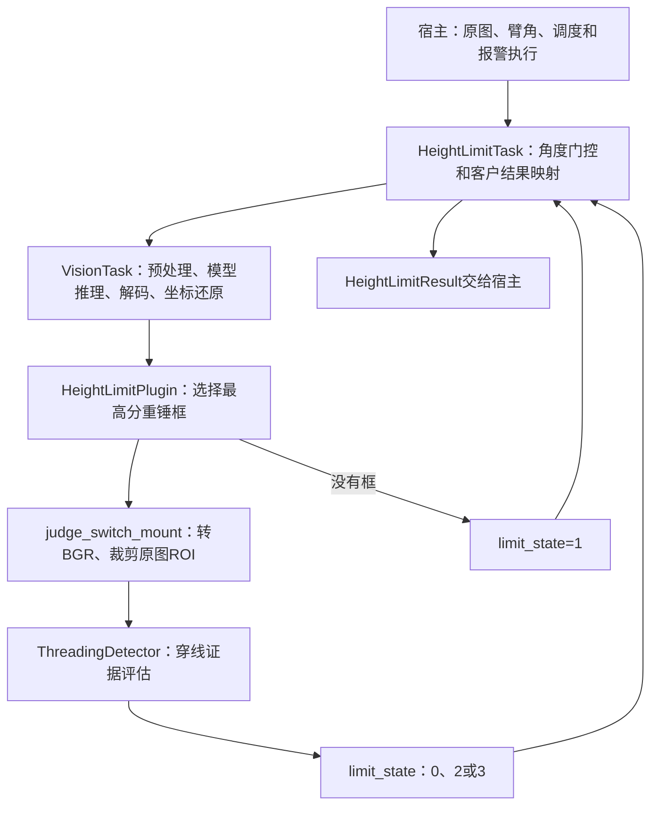
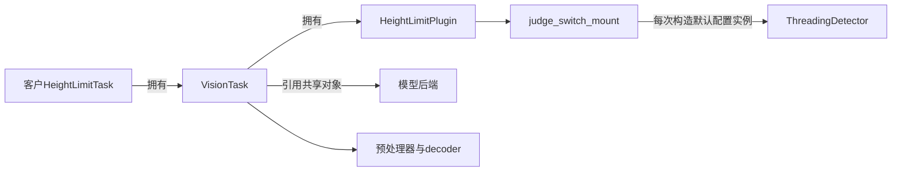
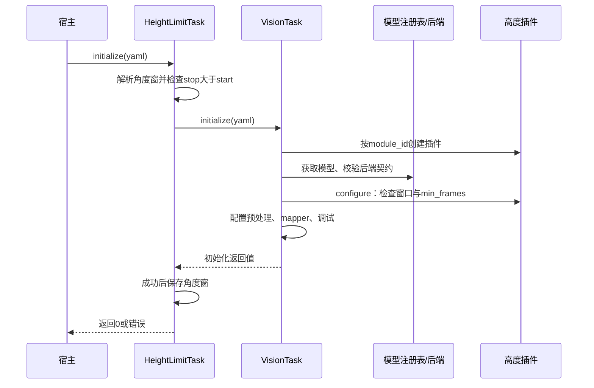
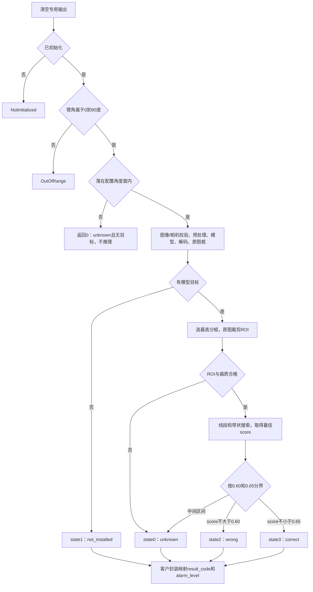
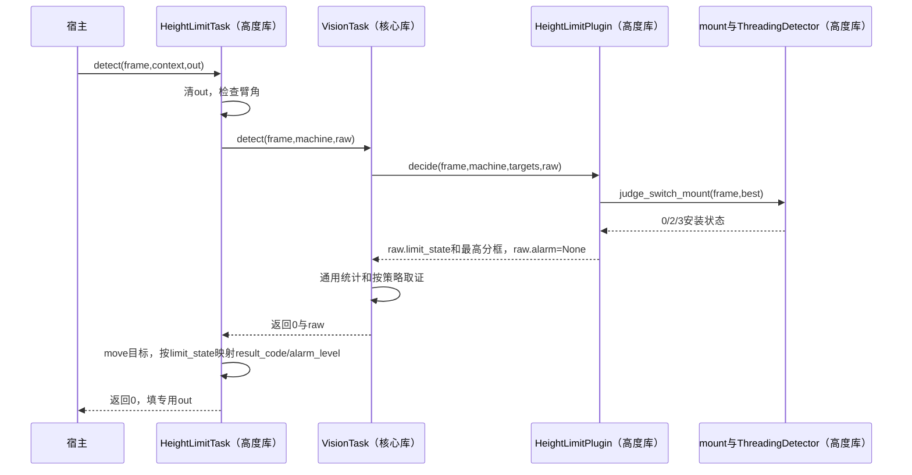

# evs_height_limit 高度限位开关插件库深度分析报告

> 分析日期：2026 年 10 月 25 日。
> 源码仓库：`/home/tronlong/lyp/code/edgevision`。
> 分析分支：本地远端跟踪分支 **`origin/feature/chs-apps`**；固定提交 **`3dec8e44266cfac4bcf94a1802175e875ba9144b`**，提交日期为 2026-10-23。
> 分支名称核对：本地已有记录中没有 `feature/cha-apps`，包含本报告所述高度限位功能的是 `feature/chs-apps`。本次查询远端时 DNS 解析失败，无法确认远端后续是否有新提交。
> 本文沿用 `meari/mpc-base/mpc-base分析报告.md` 与冰雪插件报告的十二章组织方式，聚焦高度限位功能及其必需的核心库和宿主链路。
> 原源码工作区保持在 `feature/split-core-plugin-libs`，没有切换或修改。分析从 Git 提取固定分支快照；下文源码路径、行号均指 `3dec8e4`，不能按当前工作分支的同名文件解释。
> 调用链补充：第七章7.6–7.13展开宿主、客户封装、核心、插件、OpenCV和RKNN之间的函数调用与返回；核对提交保持3dec8e4，未新增板端验证结论。

当前高度限位功能的主线是：**宿主输入图像和大臂根部角度；角度落在配置窗口内时，用模型定位重锤，取最高置信度框；再在原图框内用 OpenCV 搜索穿过预设孔区的连续带状结构，将证据映射成安装状态与报警。**

它识别的是限位开关重锤的安装状态，不直接执行机械限位切断，也不测量吊钩到臂头的真实安全高度。

先区分以下五种结果：

| 场景 | `detect()` 返回值 | `limit_state` | `result_code` | `alarm_level` |
| --- | --- | --- | --- | --- |
| 合法角度但在检测窗口外 | 0 | 0 unknown | 0 NO_RESULT | 0 NONE |
| 已推理，模型无框 | 0 | 1 not_installed | 0 NO_RESULT | 0 NONE |
| 有重锤框，但画质/几何证据不足 | 0 | 0 unknown | 0 NO_RESULT | 0 NONE |
| 有重锤框，判断未穿线 | 0 | 2 wrong | 1 MATCH | 1 WARN |
| 有重锤框，判断已穿线 | 0 | 3 correct | 1 MATCH | 0 NONE |

**当前“未检出重锤”不报警；只有状态 2 在客户封装中映射为报警。**10 帧累计、15 秒静止结束、基本臂长门控尚未进入实际判定，不能把配置字段存在当作这些规则已实现。

**阅读导航**：首次了解功能，读第一、四、五、七章；接入开发重点读第八、九、十一章；第十章集中说明代码边界与需求差异。

| 章节 | 内容 |
| --- | --- |
| [一、插件库概述](#一插件库概述) | 功能定位、完成程度和职责分工 |
| [二、支持平台与运行条件](#二支持平台与运行条件) | 模型、RKNN、OpenCV 与主机测试边界 |
| [三、目录结构总览](#三目录结构总览) | 代码地图与阅读入口 |
| [四、核心架构设计](#四核心架构设计) | 客户封装、通用任务、插件和穿线检测器 |
| [五、核心模块深度解析](#五核心模块深度解析) | 角度门控、模型框、ROI、穿线评分和状态映射 |
| [六、工具与辅助能力详解](#六工具与辅助能力详解) | 图片 demo、日志、图像与 JSON 产物 |
| [七、关键数据流分析](#七关键数据流分析) | 从宿主入口沿函数追踪初始化、核心推理、穿线判断、返回、更新与释放 |
| [八、编译构建体系](#八编译构建体系) | 实际可用入口、构建脚本、链接、部署和本次验证 |
| [九、接口设计规范与配置契约](#九接口设计规范与配置契约) | 公开方法、字段、默认值、配置及错误码 |
| [十、可靠性、需求差异与实现限制](#十可靠性需求差异与实现限制) | 未实现状态机、边界问题和现场验收事项 |
| [十一、典型使用场景](#十一典型使用场景) | 最小宿主示例、批量读图、更新与排障 |
| [十二、实现现状与接手要点](#十二实现现状与接手要点) | 版本变化、代码入口及覆盖核对表 |

后文术语：**宿主**是调用算法的产品应用；**ROI**是原图中选中的重锤矩形区域；**孔区先验**是按经验给定的孔位置范围；**带状候选**是具有两侧边缘和相对均匀内部的长条图像结构；**证据分数**是人工设计的评分，不是统计校准后的概率。

---

## 一、插件库概述

### 1.1 核心定位

高度限位插件为模块 **`0x0007`**，产物为 `libevs_height_limit.a`、`libevs_height_limit.so.1`。它依赖核心库的预处理、模型推理、解码及框坐标还原，插件内部完成重锤框选择和安装判断。

识别分为两步：

1. **模型定位重锤**：判断图像中是否存在目标，输出位置与模型置信度。
2. **OpenCV 判断穿线**：在最高分框中，寻找穿过预设孔区的连续带状证据。

“模型检出重锤”与“重锤已正确穿线”不是同一个结论。有框后仍可能是 wrong 或 unknown。



### 1.2 已实现功能与未完成部分

| 能力 | 当前代码行为 |
| --- | --- |
| 客户专用接口 | `HeightLimitTask`、专用工况和专用结果结构 |
| 臂角物理范围检查 | 角度必须在 `[0°,90°]`，NaN/Inf 同样拒绝 |
| 检测角度窗 | 默认 `[5°,75°]`，包含两端；窗外成功返回并跳过推理 |
| 重锤模型检测 | 经核心 RKNN/decoder 链路完成，配置决定模型与格式 |
| 重锤框选择 | 只取最高置信度的一个目标，同分取输入中先出现者 |
| 安装状态判断 | 库内 OpenCV 检测连续带状穿孔证据 |
| 画质拒绝 | 小图、低对比度、模糊等返回 unknown |
| 专用报警映射 | wrong 报警；correct、unknown、not_installed 均不报警 |
| 热更新 | 调用核心更新成功后同步更新客户角度窗 |
| 图片工具 | 单图/目录输入，输出框图、逐图 JSON、汇总 JSON 和日志 |
| 10 帧累计与投票 | 配置被保存，实际未使用 |
| 15 秒静止结束 | 配置被保存，实际未使用 |
| 基本臂长门控 | `basic_boom_only` 与 `boom_length` 未参与实际判断 |
| 自动结束、结果锁存、重试 | 尚无完整业务状态机，由宿主另行安排 |

### 1.3 库与宿主的分工

库处理同步识别，不打开摄像头、不读取 PLC/MCU、不创建产品检测循环、不控制机械输出。宿主负责相机帧、工况更新、启停条件、线程调度、报警执行和失效策略。

当前客户工况只给出臂长与臂角，没有功能开关、备车状态、工况有效性或数据时间戳字段；业务需要这些信息时，应由宿主决定何时调用，不能假定库内部已经检查。

本文以当前分支实际实现为准。文档仓库原有总报告描述的“高度安装判断占位”适用于旧分支，不能套到这里；本分支已加入穿线算法，但尚未形成完整备车检测状态机。

---

## 二、支持平台与运行条件

### 2.1 运行与验证环境

| 环境 | 适用内容 | 边界 |
| --- | --- | --- |
| RK3588 ARM64 Linux、RKNN、OpenCV | 配套模型检测与库内穿线判断 | 分支客户文档的主要交付环境 |
| Linux PC、mock、不启用 OpenCV | 包装接口、角度门控、无框状态、配置、解码与框架回归 | 有框安装判断直接返回 unknown |
| Linux PC、mock、启用 OpenCV | 可构建并单独验证 ROI 穿线算法 | mock 本身不能证明真实模型定位正确 |
| RK3576 或其他芯片 | 更换匹配芯片的模型、SDK 和构建环境后适配 | 当前附带 RK3588 模型不自动跨芯片通用 |
| x86/ONNX | 核心存在相关构建分支 | 当前 demo 为 RKNN 交付路径；未据此验收 PC 真模型 |

### 2.2 依赖与版本要求

| 依赖 | 作用 |
| --- | --- |
| C++17 | 库、客户封装与 demo 的语言标准 |
| CMake | 核心/cmake_env 最低 3.14；独立 demo 最低 3.16 |
| RKNN 头文件、运行库、驱动 | 模型加载和目标芯片推理 |
| OpenCV ≥4.5.4 | 库内穿线算法使用 core/imgproc；cmake_env 还查找 imgcodecs |
| OpenCV imgcodecs | 图片 demo 的 JPEG/PNG/BMP 读取与 JPEG 输出 |
| 相机及线程组件 | 实际产品宿主负责；本图片 demo 不取流 |

穿线源码用 `static_assert` 要求 OpenCV 至少 4.5.4，cmake_env 和 demo 也请求对应版本。数学版本条件满足不等于运行时 ABI 匹配；构建时选的 OpenCV SONAME 必须在目标板可找到。

当前分支随 demo 提供的是 ARM64 OpenCV 4.5.4 开发/运行资产，不能拿这些 `.so` 在 x86 主机运行。本次没有为文档安装额外 OpenCV 或连接目标板。

### 2.3 模型资产

分支内模型位置：`demo/height_limit_detect_demo/zch_generalize_int8.rknn`，文件大小 **6,747,548 字节**，本次从 Git blob 核验 SHA-256：

```text
9ef3d7cdcb3f31fefe9f5f7bd86efc29e6e1ab7b8783f9050848f1f5d1c3e8bf
```

样例采用 640×640、BGR、左上对齐补边的单类 YOLOX。具体权重准确率、色序配套及真实输出需要设备验证，本次没有执行该模型。

---

## 三、目录结构总览

以下均为 `3dec8e4` 分支快照中的相对路径。

```text
edgevision/
├── include/evs/
│   ├── height_limit.h                       # 客户工况、结果与HeightLimitTask
│   ├── status.h                             # 公共枚举、Target、通用Result
│   ├── frame.h                              # Frame与通用MachineContext
│   ├── task_config.h                        # 模型、预处理与高度专属配置
│   └── vision_task.h                        # 核心任务生命周期与检测
├── src/
│   ├── vision_task.cpp                      # 通用装配与逐帧处理
│   ├── core/
│   │   ├── config.cpp                       # YAML子集、角度窗、补边锚点
│   │   ├── backend_factory.cpp              # 推理路径与显式单输出分派
│   │   ├── detection_decoder.cpp            # 行矩阵转Target
│   │   ├── preprocess.cpp                   # 色序、缩放、补边和坐标逆变换
│   │   └── model_registry.cpp               # 模型后端共享与引用管理
│   ├── backend/rknn/
│   │   ├── rknn_backend.cpp                 # SDK调用与模型契约校验
│   │   └── detection_rows.h                 # 单输出YOLOX原始行解码
│   └── tasks/height_limit/
│       ├── height_limit_api.cpp             # 角度门控及专用结果映射
│       ├── height_limit_plugin.h/.cpp       # 插件登记、最高分框与状态编排
│       ├── height_limit_mount.h/.cpp        # Frame转BGR、原图ROI与状态转换
│       ├── height_limit_threading.h/.cpp    # 库内带状结构穿线判别器
│       └── 待办.md                          # 当前功能说明
├── configs/height_limit.yaml                # 通用mock样例，非正式模型配置
├── cmake_env/
│   ├── CMakeLists.txt                       # 本分支可用的独立构建入口
│   ├── README.md                            # 构建环境说明，部分旧描述需复核
│   └── include/src/tests/tools -> ../...    # 指向真实源码的软链接
├── build-chs-env.sh                         # 工具链、sysroot、OpenCV构建包装
├── CMakeLists.txt                           # 本提交166行存在语法错误
├── demo/height_limit_detect_demo/
│   ├── main.cpp                            # 图片输入、客户接口、结果产物
│   ├── height_limit_zch.yaml                # RK3588单类YOLOX正式示例
│   ├── zch_generalize_int8.rknn             # 重锤模型
│   ├── CMakeLists.txt / build.sh            # 独立demo构建与运行库收集
│   ├── opencv454/                          # ARM64 OpenCV 4.5.4资产
│   ├── compat/                             # 特定glibc新符号兼容实现
│   ├── README.md                           # 内部记录与历史板测说明
│   └── 客户接入说明.md                      # 客户调用和交付资料
└── tests/test_core.cpp                      # 插件、任务、角度窗和更新回归
```

建议阅读顺序：`height_limit.h → height_limit_api.cpp → HeightLimitPlugin::decide() → judge_switch_mount() → ThreadingDetector::detect() → evaluateBoundary()`。

穿线判断与选框都在库内。demo 使用 OpenCV 读图和画框，不再承担安装识别算法；不能只阅读 demo 就判断算法逻辑。

---

## 四、核心架构设计

### 4.1 四个处理层次

| 层次 | 所在产物 | 职责 |
| --- | --- | --- |
| `HeightLimitTask` | `libevs_height_limit` | 窄工况/结果接口、角度门控、包装通用任务 |
| `VisionTask` | `libevs_core` | 模型和预处理装配、推理、解码、坐标回映射、调试 |
| `HeightLimitPlugin` | `libevs_height_limit` | 根据模型框区分无目标和有目标，保留最高分框 |
| `ThreadingDetector` | `libevs_height_limit`，OpenCV启用时 | 从原图ROI判断带状结构是否穿过孔区先验 |

`HeightLimitTask::Impl` 持有一个 `VisionTask`，任务按 `module_id` 工厂创建插件。客户封装没有自行创建第二套模型引擎，也没有把 OpenCV 判断搬到宿主。



### 4.2 插件注册与链接

`FunctionPluginRegistration(0x0007, make_height_limit_plugin)` 在插件 `.cpp` 中静态登记。核心工厂按功能号找插件，没有自动扫描动态库目录或自动卸载的管理器。

动态库必须实际被加载，静态归档必须保留登记对象。客户直接调用 `HeightLimitTask` 已引用高度插件符号；仅使用 `VisionTask` 的宿主需要额外防止高度插件被链接器裁掉，详见第八章。

### 4.3 专用入口与通用入口的区别

| 调用方式 | 臂角门控 | 返回结构 | 报警来源 |
| --- | --- | --- | --- |
| `HeightLimitTask::detect()` | 在调用核心推理前执行 | `HeightLimitResult` | 封装将状态 2 映射 WARN |
| `VisionTask::detect()`，模块7 | 插件当前不使用角度字段，不自动门控 | 通用 `Result` | 插件将 `alarm` 固定为 None |

因此绕过 `HeightLimitTask` 直接调用模块7时，需要宿主自行执行角度策略并解释 `limit_state`。两种入口的 `alarm` 不能当作相同输出读取。

### 4.4 共享模型与线程模型

模型注册表按后端与路径共享后端对象，注册表锁保护引用操作，不等于推理方法已按实例隔离。一个 `HeightLimitTask` 的初始化、检测、热更新和释放应串行；多个实例共享同一后端时也应由宿主统一调度。

每次 `detect()` 返回当前图像状态，不建立跨帧投票或轨迹。`h_frames_` 虽保留为成员，当前只在 reset 时清零，没有在检测中累计。

---

## 五、核心模块深度解析

### 5.1 客户初始化与配置读取

`height_limit_api.cpp::load_angle_window()` 先用通用配置解析器读取 YAML，只检查 `stop_angle_deg > start_angle_deg`，取出开始和结束角度；之后 `HeightLimitTask::initialize()` 再让 `VisionTask` 读取配置并装配模型、decoder、插件、预处理器和调试组件。

初次成功后，封装保存角度窗并标记 initialized。客户 API 没有单独接受 `TaskConfig` 的初始化重载，入口是配置文件路径。

需要注意两个边界：

- 窗口校验只比较先后，不强制窗口本身在 `[0°,90°]` 内；例如 `[-5°,100°]` 可以通过配置，但逐帧角度仍被物理范围约束。
- 封装没有检查 YAML 必须是 `module_id: 0x0007`。其他已登记模块可能初始化成功，客户必须提供正确模块号；本次用模块4探针确认了这一行为。

源码依据：`src/tasks/height_limit/height_limit_api.cpp:16`、`:42`。

### 5.2 逐帧角度门控与执行顺序

`HeightLimitTask::detect()` 按以下顺序执行：

1. 将调用方输出赋为默认 `HeightLimitResult{}`，清空上一帧目标和状态。
2. 检查实例已初始化，否则返回模块7的 NotInitialized。
3. 检查角度满足 `0 <= boom_angle <= 90`，不满足返回 OutOfRange。
4. 若角度 `< start` 或 `> stop`，返回 0，输出保持默认值，不调用核心。
5. 填写通用工况并调用 `VisionTask::detect()`，成功后复制状态、转移目标向量，再映射客户结果。

默认窗口边界为：

| 角度 | 结果 |
| --- | --- |
| -1°、95°、NaN、正负Inf | OutOfRange |
| 0°、4.99° | 合法物理角度，但跳过检测 |
| 5° | 执行推理 |
| 45° | 执行推理 |
| 75° | 执行推理 |
| 75.01°、90° | 跳过检测 |

角度检查在图像校验之前。窗外即使 Frame 为空，也可能成功返回；这说明没有执行识别，不能用这种成功结果确认图像可用。相机号、图像尺寸、数据指针在进入核心后才检查。

`boom_length` 被复制到通用工况，但当前插件不使用它，也未检查其 0–200 米范围或 NaN。包装工况的 `context_valid` 被设为 true，不代表库检测了外部工况是否真实、新鲜。

源码依据：`height_limit_api.cpp:86`。角度边界、NaN/Inf、窗外空图跳过及臂长未使用已由本次主机探针确认。

### 5.3 图像预处理与左上补边

`VisionTask` 接收原图 `Frame`，预处理根据 `input_format` 转为模型需要的 RGB/BGR，再保持宽高比缩放到模型输入大小并补边。

高度 demo 的正式配置为：

```yaml
input_width: 640
input_height: 640
input_format: bgr
letterbox: true
letterbox_anchor: top_left
```

缩放比例 `s = min(640/原图宽, 640/原图高)`，缩放后放在输入左上角，剩余区域填 114。默认公共预处理则居中补边；两者不可混用，框逆变换也必须使用对应 map。

例如原图 1280×720，缩放成 640×360：左上锚点使下方补 280 行；居中补边则上下各补 140 行。颜色通道或补边位置不匹配会改变模型输入，不能只对照最终框尺寸。

配置解析器接受 `letterbox_anchor: top_left/top-left/topleft/left_top` 和独立布尔 `letterbox_top_left`。未知锚点文字会落为居中布尔值，没有严格报错，建议固定使用样例拼写。

源码依据：`src/core/config.cpp:267`、`src/core/preprocess.cpp:122`、`src/vision_task.cpp:190`。

### 5.4 RKNN 与单类 YOLOX 检测

demo 的 `decoder_classes=1`、`output_format=yolox`、`backend=rknn` 会进入核心显式单输出契约分支，校验实际模型输入尺寸、3通道、单输出形状和元素数。

640×640 单类 YOLOX 的原始输出为 `[1,8400,6]`，8400 对应 stride 8/16/32 三层网格：

```text
每行 = tx, ty, tw, th, objectness, class_probability
center_x = (tx + grid_x) × stride / input_width
center_y = (ty + grid_y) × stride / input_height
width    = exp(tw) × stride / input_width
height   = exp(th) × stride / input_height
confidence = objectness × class_probability
```

概率按模型已激活解释，不重复 sigmoid。解码成归一化行后，由 decoder 进行置信度过滤、类别选择，最后撤销补边并映回原图 `Target`。

高度插件没有实现冰雪的 `IUnfilteredDetectionInput` 标记，因此这里正常使用 `confidence_threshold`，默认公共值 0.45，正式高度 demo 配置为 0.25。

行decoder的过滤是“分数小于阈值就丢弃”，等于阈值保留；高度插件没有再排除零分。因此将阈值设为0时，合法零分行也可能成为输入目标，不能照搬冰雪业务分支“零阈值仍排除零分框”的规则。高度配置也没有冰雪专属的完整阈值范围校验，应保持有限且合理的正数阈值。

**当前这条显式单类路径没有额外 NMS。**显式行解码不做 NMS，后续 YOLOX 行 decoder 也不做，最后插件直接从目标集合取最高分框。README 流程里的“NMS”不能据此视为本路径已执行；共享 COCO helper 中有 NMS，不代表此单输出路径经过它。`nms_threshold` 也没有被高度插件使用。

源码依据：`src/core/backend_factory.cpp:43`、`src/backend/rknn/detection_rows.h:47`、`src/core/detection_decoder.cpp`、`src/vision_task.cpp:354`。

### 5.5 HeightLimitPlugin：无框状态与最高分框

插件 `configure()` 检查 `stop > start` 和 `min_frames >=1`，随后保存高度配置。`decide()` 不使用这些工况规则，只执行：

```text
清通用alarm、ice_ratio和targets
  → 找到最高confidence目标
  → 无目标：limit_state=1
  → 有目标：保留该一个框，并调用judge_switch_mount()
```

最高分比较使用严格 `>`，同分保留最先出现的目标。插件本身不再按“重锤类别”过滤，所以类别约束必须由模型/decoder 的配置保证。单类样例设 `person_class_id:-1` 表示保留全部类别，字段名沿用通用接口，不代表检测人员。

没有双重锤分别判断、稳定对象ID或跟踪排序；输入多个框时仍仅判断最高分对象。`limit_state=1` 的直接含义是“本次模型没有留下目标框”，现场不能把模型漏检排除在解释之外。

`out.alarm` 始终是通用 None；专用报警在客户包装层另行生成。`out.ice_ratio=0` 只是高度功能保持无关字段为零，与冰雪含义无关。

源码依据：`src/tasks/height_limit/height_limit_plugin.cpp:10`、`:21`、`:34`。

### 5.6 judge_switch_mount：原图转换与ROI

安装判断函数在 OpenCV 开启时：检查原图和框宽高 → 原图转 BGR → 原图像素框裁剪 → 调用穿线检测器。

`Target` 的 `x/y` 为原图归一化中心，`w/h` 为归一化宽高。插件用两端点分别舍入：

```text
x1 = lround((x - w/2) × 原图宽)
y1 = lround((y - h/2) × 原图高)
x2 = lround((x + w/2) × 原图宽)
y2 = lround((y + h/2) × 原图高)
ROI = Rect(x1,y1,x2-x1,y2-y1) ∩ 原图边界
```

ROI 为空时返回 unknown。穿线判断取原图局部，不对640×640补边图进行判断。

Frame 支持 BGR、RGB、NV12；RGB/NV12 转成 BGR，BGR 可借用原输入。图像所有权仍属宿主，直到同步调用结束前必须有效。

**NV12 的 stride 必须明确填写。**本函数 stride 未给正数时统一回退到 `width×3`，这对紧凑 NV12 并不正确。NV12 应写实际 Y/UV 共用的字节行跨距，紧凑情况为 width，并保证偶数宽高和完整缓冲；不能套用“stride=0总是安全紧凑布局”的通用假设。

未编译 OpenCV 时有框也只返回 0 unknown，不会从模型框直接推断 correct。颜色转换和ROI建立位于局部 try/catch 之前，详细异常边界见第十章。

源码依据：`src/tasks/height_limit/height_limit_mount.cpp:19`。

### 5.7 ThreadingDetector：输入约束与质量筛选

内部检测器接收单个重锤 ROI，支持8位灰度、BGR、BGRA，转换为灰度后执行：

1. 空图：`empty_input`，Uncertain。
2. ROI 短边小于48像素：`input_too_small`，Uncertain。
3. 按比例将长边缩放到256，使用线性插值；也可能放大小ROI，不只下采样。
4. 用灰度直方图求 p05、p95，令 `contrast=p95-p05`；小于20返回 `low_contrast`。
5. 计算 Laplacian 方差作为清晰度；小于12返回 `blurred`。
6. 用 p05/p95 将灰度线性拉伸至0–255并截断，3×3高斯模糊，sigma=0.7。

质量不合格直接返回 Uncertain，不进入“缺少带状证据就是未穿线”的最终判断。

非二维、非8位或通道数不为1/3/4的内部Mat输入会抛 `std::invalid_argument`；从正式mount路径调用检测器时，这类检测器阶段的异常在局部catch中降为unknown。质量提前返回与异常降级都不等同于模型未检出。

公开 Frame 不支持灰度/BGRA 的直接枚举；内部算法可接受这些 Mat 格式，不等于客户 `HeightLimitTask` 同样直接接收这些格式。

源码依据：`height_limit_threading.cpp:56`、`:70`、`:257`。

### 5.8 默认参数与孔区先验

`judge_switch_mount()` 每次构造默认 `ThreadingDetector`，当前参数如下：

| 参数 | 默认值 | 作用 |
| --- | --- | --- |
| `holeRegion` | `(0.37,0.45,0.34,0.40)` | ROI归一化矩形，作为孔区搜索先验 |
| `normalizedMaxSide` | 256 | 算法计算图长边 |
| `minInputSide` | 48 | 原ROI短边最低像素数 |
| `minContrast` | 20 | 归一化后p95-p05下限 |
| `minSharpness` | 12 | 归一化后Laplacian方差下限 |
| `minBandWidthRatio` | 0.035 | 带宽相对计算图短边的下限 |
| `maxBandWidthRatio` | 0.24 | 带宽搜索上限，循环使用严格小于 |
| `minBandLengthRatio` | 0.48 | 带状连续窗口相对长边的基础长度 |
| `maxAngleDegrees` | 60° | 带方向与图像水平方向的最大偏离 |
| `threadedThreshold` | 0.65 | 已穿线证据阈值，包含等号 |
| `notThreadedThreshold` | 0.60 | 未穿线证据阈值，包含等号 |
| `maxCandidateLines` | 80 | 最多评估的合格线段数量 |

孔区矩形中心为 `(0.54,0.65)`，实际搜索按该矩形内接椭圆计算。它是针对**正立、紧裁剪重锤**的经验位置，不是模型检测到的孔，也没有执行机械尺寸标定。

60°是图像中带方向的限制，5–75°是大臂工况角度窗，两者位于不同阶段，含义不同。

参数存在于私有 `DetectorConfig`，当前客户头和 YAML 没有暴露其调参接口。改 YAML 的置信度阈值不会修改孔区和穿线评分阈值；需要调整时应改库内构造配置并重新构建。

源码依据：`height_limit_threading.h:17`。构造时会校验配置：孔区坐标有限、宽高为正且位于归一化图内；计算长边128–512；最小输入边至少16；候选数1–500；对比度1–255；清晰度下限为有限非负数；带宽比例满足`0<min<max<=0.5`；基础带长0.25–0.8；角度`(0,90]`；判定阈值满足`0<=未穿线阈值<穿线阈值<=1`。参与判断的浮点阈值均检查有限性；非法设置抛 `std::invalid_argument`。

### 5.9 线段生成与带状候选搜索

质量通过后，算法对归一化灰度图运行 LSD 线段检测器 `LSD_REFINE_STD`，按长度降序遍历：

- 线段长度小于计算图长边的10%时结束后续遍历。
- 方向归一化，使 x 分量非负；与水平偏离超过60°的线段跳过。
- 每条合格线段视作可能的带边界，评估不超过80条合格线段。

对某条边界，沿法向搜索带宽：从 `0.035×短边` 起，以采样步长增加，到 `<0.24×短边`；分别尝试边界两侧的带中心。

采样步长为 `step=2×计算图长边/256`，默认约2像素。候选中心线与孔区椭圆的最近点，归一化椭圆方程值须不大于0.85，先排除只擦过孔区外沿的情况。

随后沿带方向采样，法向7条轨迹相对带宽的位置为：

```text
-0.58、-0.42：第一侧边界的外/内样本
 0.42、 0.58：第二侧边界的内/外样本
-0.30、 0、 0.30：带内部的三条样本轨迹
```

像素采用双线性插值。样本离图边界太近时跳过；再用前缀和保存两侧边缘、成对边缘、内部灰度及平方和和孔区内样本数，避免每次评估连续窗口重新读取全部像素。

连续窗口尝试长度比例 `0.48/0.60/0.75`，即基础长度、基础+0.12、基础+0.27；窗口起点每次推进4个采样点。孔区内部样本数至少达到 `0.10×短边/step`，才进入评分。

源码依据：`height_limit_threading.cpp:115`、`:304`。

### 5.10 穿线证据评分公式

每个采样位置的两侧边缘强度：

```text
e1 = clamp01((abs(v[-0.58] - v[-0.42]) - 4) / 22)
e2 = clamp01((abs(v[ 0.42] - v[ 0.58]) - 4) / 22)
paired_sample = sqrt(e1 × e2)
```

对某个连续窗口，设有效采样数为 n：

```text
edgeSupport = min(sum(e1), sum(e2)) / n
pairedEdgeSupport = sum(sqrt(e1×e2)) / n
variance = 三条内部轨迹的灰度方差
uniformity = exp(-variance / 32²)
score = 0.35×edgeSupport + 0.25×pairedEdgeSupport + 0.40×uniformity
若 edgeSupport < 0.32：score再乘以edgeSupport/0.32
```

两侧边缘都存在、沿带持续出现、内部相对均匀时分数更高。最后的弱边缘惩罚避免仅凭平滑背景就得到较高分；灰度差取绝对值，没有把亮带/暗带设成单一极性。

用一组假设值理解公式：`edgeSupport=0.80`、`pairedEdgeSupport=0.75`、内部标准差16，对应方差256，则`uniformity=exp(-256/1024)≈0.779`，总分约`0.35×0.80+0.25×0.75+0.40×0.779=0.779`。边缘支持高于0.32，不再受弱边缘惩罚；该分数达到0.65，最终判Threaded。这是计算示例，不是实测样本，也不能将0.779解释成77.9%的正确安装概率。

所有候选窗口中仅保留最高 score，分数相同时不替换已有候选。保存的诊断还包括两侧支持、成对支持、内部标准差、孔区及候选带四角。

候选四角从计算图映回原ROI时，按缩放舍入后的实际 x/y 比例分别处理，不强行使用同一个逆比例。四角属于 ROI 局部坐标；若要叠到完整原图还需要加ROI左上偏移，当前客户结果没有导出它们。

### 5.11 穿线三态与安装四态

对于已通过质量检查的ROI，最终按最佳分数判定：

| 条件 | 内部状态 | reason | `limit_state` |
| --- | --- | --- | --- |
| score ≥0.65 | Threaded | continuous_band_crosses_hole_prior | 3 correct |
| score ≤0.60 | NotThreaded | no_sufficient_band_evidence | 2 wrong |
| 0.60 < score < 0.65 | Uncertain | borderline_band_evidence | 0 unknown |
| 质量提前拒绝 | Uncertain | empty_input/input_too_small/low_contrast/blurred | 0 unknown |

最高分初值为0。质量通过但完全没有可用带状候选时，也会走 score≤0.60，得到 NotThreaded；不是所有“没找到线”都返回 unknown。

内部`DetectionResult`另有`hasCandidate`标志：只有某个候选严格提高当前最佳分数时才置true，保存对应`band`四角。最终三态比较直接使用score，没有再以hasCandidate作为有效性门槛。调用方也不能把默认四个零点当作真实带位置。

这里的0.60是正数阈值。内部README用`+0.65/-0.60`表达正负判定方向，不应误读成代码使用负0.60。

Threaded/NotThreaded 是图像证据判断，并非确定看到了真实钢丝绳穿过真实孔洞。经验孔区、姿态、框裁剪、反光和背景线都可能影响结果。

源码依据：`height_limit_threading.cpp:340`、`height_limit_mount.cpp:81`。

### 5.12 专用结果与报警映射

`HeightLimitTask` 取得通用 `limit_state` 和目标向量后，再统一映射：

```text
limit_state=2 → RESULT_MATCH + ALERT_WARN
limit_state=3 → RESULT_MATCH + ALERT_NONE
limit_state=0/1/其他 → RESULT_NO_RESULT + ALERT_NONE
```

因此 `RESULT_MATCH` 表示已形成正确或错误安装的判定，不仅仅表示有模型框。unknown可有一个目标框，NO_RESULT也可保留该框；not_installed没有框。

这里的 `alarm_level` 与冰雪接口的 `alert_level` 字段名不同。两者虽共用 `evs::AlertLevel`，不能直接复制字段访问代码。

本结果没有上一帧保持、N帧投票或最终结论锁存。当前每一帧可以 correct → wrong → unknown 地变化，产品如何去抖和保持由宿主决定。

源码依据：`height_limit_api.cpp:116`。

---

## 六、工具与辅助能力详解

### 6.1 图片 demo 的实际职责

`demo/height_limit_detect_demo/main.cpp` 只负责参数、文件、读图、填 Frame 和窄工况、调用 `HeightLimitTask`、测总耗时、画框及生成结果文件。重锤定位与穿线判断均在动态库内。

| 参数 | 行为 |
| --- | --- |
| `--task` | 配置文件，默认 height_limit_zch.yaml |
| `--model` | 覆盖模型路径，并转换为绝对路径 |
| `--image` | 必填，单图或目录 |
| `--out` | 必填，输出目录必须尚不存在 |
| `--limit` | 必须为正，默认最多5张 |
| `--threshold` | 显式覆盖置信度阈值 |
| `--boom-angle` | 所有图片使用同一臂角，默认45° |

目录模式仅枚举当前目录的 `.jpg/.jpeg/.png/.bmp`，忽略扩展名大小写，按路径排序，不递归；单文件模式不按这些扩展名再次筛选，实际解码由 OpenCV 处理。

帮助文字称 threshold 默认0.25，但代码仅在显式传 `--threshold` 时覆盖；未传时实际沿用 YAML。样例正好是0.25，所以默认样例下数值一致，换YAML后不要误认为工具始终强制0.25。

### 6.2 运行时配置与固定相机号

只要传 `--model` 或 `--threshold`，工具就读取原YAML，替换对应值并写到输出目录 `_runtime.yaml`，再以这个文件初始化任务。它没有修改原配置文件。

通用高度配置的模型相对路径按**进程工作目录**解析，不按YAML目录解析。`--model` 转绝对路径避免了这一问题；仅改阈值产生 `_runtime.yaml` 也不会让模型自动相对于输出目录解析。

demo 使用 `imread(..., IMREAD_COLOR)` 取得BGR，填写 `Frame.camera_id=0`、实际宽高、`stride=cols×3` 和当前微秒时间。通道0是demo硬编码，改YAML为相机1会在进入核心时不匹配；产品应填写真实相机号。

demo的 `boom_length=0`，没有为每张图读取不同工况，也没有相机视频输入。它是图片接入示例，不是完整实车工况调度器。

### 6.3 JSON、图像与退出码

输出包括：

- stdout 每图一行JSON。
- 输出目录 `<index>_<stem>_boxes.jpg`，画框、模型置信度与最终状态。
- 成功处理全部图像后写汇总 `results.json`。
- 覆盖参数时写 `_runtime.yaml`。

单图 JSON 字段包括 `image/frame/detect_ms/result_code/result_name/alarm_level/alarm_name/limit_state/limit_name/targets`。

`targets[].xyxy` 是原图**像素浮点角点**，`targets[].xywh` 是原图**归一化中心和宽高**。同一记录里两者单位不同；`confidence` 是模型分数，不是穿线 score。

`detect_ms` 是宿主围绕专用detect调用测的墙钟时间，包含推理和库内穿线，不包含读图、之后画框和JPEG写入。窗外跳过调用也会计时并算作一次成功处理，不能拿全部成功记录数当真实推理次数。

| 退出码 | 含义 |
| --- | --- |
| 0 | 全部图像正常处理；也可能是角度窗外或没有目标 |
| 2 | 参数、目录、读图、写文件或捕获到的其他异常 |
| 3 | 初始化返回非零 |
| 4 | detect返回非零 |

中途错误立即返回，之前单图框图可能已经产生，汇总JSON未必生成。输出目录存在会拒绝，不覆盖旧运行目录。

### 6.4 框图与算法ROI的细小差异

算法裁剪用左右端点分别舍入，demo画框则“左上角舍入、宽高单独舍入”。两种舍入方式在边界上可能有1像素差异。排查像素级ROI时以库内 `[OPENCV] roi=[x y w h]` 日志为准，不能假设画框矩形与计量矩形逐像素一致。

当前demo只画模型框，不导出孔区、最佳带四角或中间边缘图。目标框为空或裁剪为空仍会生成带最终状态标签的原图。

### 6.5 日志与诊断指标

demo通过核心 `EVS_LOGI/W/E` 输出 `[INIT]/[ROI]/[RESULT]`；其模块标签是 `height_limit_detect_demo`，插件当前沿用默认 `algo` 标签。

`judge_switch_mount()` 输出：ROI像素矩形、threaded/not_threaded/uncertain、score、reason、contrast、sharpness、edge、paired、stddev。这里 `stddev` 是带内部灰度标准差，不是整体ROI清晰度。

| 现象 | 重点日志 |
| --- | --- |
| 输入不清晰 | reason=blurred、sharpness |
| 图像灰度变化太小 | low_contrast、contrast |
| 小目标 | input_too_small |
| 分数落在灰区 | borderline_band_evidence，检查0.60–0.65 |
| 有框但判错 | ROI、孔区先验、edge/paired/stddev |
| 根本没执行OpenCV | 是否角度跳过、是否无模型框、是否启用OpenCV |

日志依赖核心ALOG/Logger桥，`EVS_LOG_LEVEL`、`EVS_LOG_FILE`控制默认日志策略；宿主替换全局回调后，应按自身回调实现理解日志过滤。回调应在开始并发工作前注册并自行隔离异常。

---

## 七、关键数据流分析

### 7.1 初始化与资源关系



高度插件未实现 `IFunctionTaskHooks`，通用任务中某些扩展约束不会像冰雪专用路径那样生效。例如可选warmup失败对没有严格hook的任务只是记录警告，不能只依据初始化成功判定预热也已成功。

### 7.2 单帧决策流程



核心调用任何明确错误会直接返回，不进入上述成功状态映射。图中score仅是穿线证据分数，与检测confidence不同。

### 7.3 完整状态对照

| 情况 | 返回值 | `limit_state` | `targets` | `result_code/alarm_level` |
| --- | --- | --- | --- | --- |
| 未初始化 | `0x00071007` | 0 | 空 | 0/0 |
| 臂角不合法 | `0x00071003` | 0 | 空 | 0/0 |
| 合法但窗外 | 0 | 0 | 空 | 0/0 |
| 相机/图像/推理返回错误 | 非0 | 0 | 空 | 0/0 |
| 窗内模型无框 | 0 | 1 | 空 | 0/0 |
| 有框，未启用OpenCV | 0 | 0 | 1个最高分框 | 0/0 |
| 有框，ROI为空或画质拒绝 | 0 | 0 | 1个最高分框 | 0/0 |
| 有框，score处于灰区 | 0 | 0 | 1个最高分框 | 0/0 |
| 有框，质量通过但无足够带证据 | 0 | 2 | 1个最高分框 | 1/1 |
| 有框，穿线证据充分 | 0 | 3 | 1个最高分框 | 1/0 |

`HeightLimitResult` 不包含“本帧确实执行了推理”的独立字段，窗外与有框无法判断同为state0，但后者保留框。宿主应结合已知角度门控和目标数区分，不能将所有unknown解释成同一种质量问题。

### 7.4 热更新流程

`HeightLimitTask::updateConfig(path)`：先检查已初始化 → 解析新窗口 → 核心更新完整配置 → 仅核心接受后提交封装窗口。

窗口倒置或核心明确拒绝变更时，旧窗口保留；现有测试覆盖了失败后继续按旧窗口检测。更新不是局部键补丁，新文件漏写字段会恢复默认或与原模型契约冲突，应提供完整配置。

| 项目 | 当前处理 |
| --- | --- |
| start/stop角度、置信度等可更新策略 | 核心接受后生效，封装同步角度 |
| min_frames/still_timeout/basic_boom_only | 可保存更新，但业务仍未使用 |
| backend、模型路径、输出格式、类别和模块号 | 核心拒绝变更，需释放重建 |
| 输入宽高、色序、letterbox和锚点、相机白名单 | 高度没有专属hook检查；核心更新未实际应用这些输入配置，需释放重建 |
| 孔区与穿线阈值 | 不在客户YAML更新范围 |

配置文件改动不会被自动监控；需要宿主显式调用更新。

### 7.5 重复初始化的特殊边界

当前包装层 `initialize()` 没有提前判断已初始化：它会重读角度窗，而底层 `VisionTask::initialize()` 已初始化时直接返回0并忽略新配置。结果可能变成**新角度窗配旧模型、旧相机和旧预处理**。

本次探针：初次配置相机0、窗口5–75；再次initialize相机1、窗口10–80后，80°已进入检测，但相机1仍返回InvalidCameraIndex，证明底层仍保留相机0。产品不要用重复initialize实现切配置，应使用支持范围内的updateConfig，或release后重建。

### 7.6 函数级运行路线与阅读约定

前面7.1–7.5建立业务全貌，下面展开真正的项目自有函数调用。建议按7.7初始化 → 7.8逐帧 → 7.9穿线内部 → 7.11返回读取；需要看硬件调用时查7.10，需要看配置与资源管理时查7.12。

| 阅读目的 | 直接入口 |
| --- | --- |
| 看demo从main开始怎样运行 | [7.13.4 程序入口](#7134-demo怎样组织整个检测程序) |
| 看库和模型怎样初始化 | [7.7 初始化函数树](#77-从加载插件到初始化完成的逐函数调用) |
| 追一帧图像进入核心和插件 | [7.8 单帧函数树](#78-一帧从客户入口到高度插件的函数树) |
| 查穿线判定内部每一步 | [7.9 内部辅助函数](#79-threadingdetector内部辅助函数的调用顺序) |
| 查返回、失败、热更新和释放 | [7.11 返回与退出](#711-结果怎样逐层返回错误从哪里退出)、[7.12 更新与释放](#712-配置更新释放与析构的逐函数调用) |

标记约定：`[宿主]`是产品应用或图片demo，`[高度]`是libevs_height_limit，`[核心]`是libevs_core，`[CV]`是OpenCV接口，`[SDK]`是RKNN接口。缩进表示谁调用谁，同一层从上到下表示执行顺序。标准容器、操作系统加载器以及OpenCV/RKNN内部实现不属于本仓库，展开至其外部函数边界；数值判定含义在第五章已有说明。

高度功能的调用会在两份库之间往返：

```text
宿主 → [高度] HeightLimitTask
         → [核心] VisionTask与模型后端
             → [高度] HeightLimitPlugin与ThreadingDetector
             ← 通用Result和返回码
         ← [高度] 将通用状态转换成客户结果与报警
     ← 宿主得到HeightLimitResult
```

这一过程同步执行。封装、插件和穿线检测器不通过独立服务交换消息；返回的`limit_state`和`alarm_level`也不是同时在同一个函数内产生，下面分开追踪。

### 7.7 从加载插件到初始化完成的逐函数调用

#### 7.7.1 库加载时登记创建入口

```text
[高度] kHeightLimit静态对象：FunctionPluginRegistration(0x0007,...)
└─ [核心] register_function_plugin(0x0007, make_height_limit_plugin)
   └─ 在工厂表保存模块7的创建函数
[核心] decoder静态登记
└─ register_decoder("yolox", make_yolox)等
```

静态登记没有加载重锤模型。只有后面`create_function_plugin()`调用创建函数时，才创建任务的插件实例。高度没有登记自己的文件配置适配器，因此不能套用冰雪“加载YAML时补齐单类RKNN契约与相对路径”的行为。

#### 7.7.2 一次成功初始化的调用树

```text
[宿主] task.initialize(yaml_path)
└─ [高度] HeightLimitTask::initialize()
   ├─ load_angle_window(path,start,stop)                 第一次读配置
   │  └─ [核心] load_task_config()
   │     └─ detail::load_task_config_with_module()
   │        ├─ parse_task_config()
   │        │  └─ trim/strip_comment/split_kv、数组与to_*转换
   │        └─ 模块7无专属loader，返回通用TaskConfig
   │  返回后检查stop>start；保存到局部start/stop
   ├─ [核心] VisionTask::initialize(path)               第二次读配置
   │  ├─ 已初始化？是 → 返回0，不重读底层配置
   │  ├─ detail::load_task_config_with_module() → cfg/options
   │  └─ initializeTask(cfg,options)
   │     ├─ create_function_plugin(cfg.module_id)
   │     │  └─ [高度] make_height_limit_plugin() → new HeightLimitPlugin
   │     ├─ dynamic_cast到IFunctionTaskHooks → 高度没有此接口
   │     ├─ [核心] create_backend(cfg.backend)检查是否编入
   │     ├─ global_registry().acquire(backend,model,timeout)
   │     │  ├─ 已有同键后端 → 增引用并复用
   │     │  └─ 无同键后端 → create_backend() → backend->load()
   │     ├─ 建立局部ModelLease用于后续失败回滚
   │     ├─ detail::validate_backend_contract() → 正式单类RKNN形状校验
   │     ├─ backend->configure_input(w,h)
   │     ├─ create_decoder("yolox",-1,1,640,640)
   │     │  └─ make_yolox() → YoloV11Decoder，format_name="yolox"
   │     ├─ [高度] HeightLimitPlugin::configure(cfg)
   │     │  └─ 检查stop>start与min_frames>=1，再保存配置
   │     ├─ [核心] build_ground_mappers()/warn_missing_ground_mappers()
   │     │  └─ 正式样例ground=false，直接跳过实际mapper创建
   │     ├─ 将cfg/backend/decoder/plugin等存到VisionTask::Impl
   │     ├─ Preprocessor::configure()
   │     │  └─ BGR、640×640、letterbox=true、top_left=true
   │     ├─ 若warmup=true → infer_backend_contract(全零张量)
   │     │  └─ 高度无严格hook，明确返回的预热错误仅记录警告
   │     ├─ TaskDebug::configure()，initialized=true
   │     └─ ModelLease提交，返回0
   ├─ [高度] 保存第一次读取的start/stop，initialized=true
   └─ 返回0给宿主
```

树中decoder参数采用正式`height_limit_zch.yaml`；其它配置会改变后端和decoder，不能把mock样例看成已执行正式RKNN。复用的类名YoloV11Decoder在此接收YOLOX已解码行，不在这里再次处理YOLO11原始头。

这里确实会读取同一配置两次；调用期间应保持文件内容稳定，否则外层窗口与底层完整配置存在不一致机会。首次角度读取也没有强制检查module7，故正确模块号仍由宿主保证。

初始化失败分层返回：配置/角度错误在外层结束；底层模型、decoder或插件错误逐层返回；ModelLease未提交时撤销模型引用并清理已装配资源。后端共享键为backend和模型路径，正常每帧不会重新load模型。

源码定位：`height_limit_api.cpp:16/45`、`vision_task.cpp:101/124`、`height_limit_plugin.cpp:21`、`model_registry.cpp:10`。

### 7.8 一帧从客户入口到高度插件的函数树

#### 7.8.1 外层先决定是否进入核心

```text
[宿主] HeightLimitTask::detect(frame, height_ctx, out)
└─ [高度] out = HeightLimitResult{}                     每次先清输出
   ├─ 未初始化？→ 返回0x00071007
   ├─ boom_angle不属于[0,90]，含NaN/Inf？→ 返回0x00071003
   ├─ boom_angle在配置窗外？→ 返回0，不调用任何核心推理步骤
   ├─ 创建MachineContext，context_valid=true，复制boom_length/angle
   ├─ 创建局部Result raw{}
   ├─ [核心] VisionTask::detect(frame,machine,raw)         见下面子树
   ├─ 非0？→ 原样返回，out仍为默认空结果
   ├─ out.limit_state = raw.limit_state
   ├─ out.targets = std::move(raw.targets)
   ├─ switch(limit_state) → 写result_code和alarm_level
   └─ 返回0
```

因此单次返回0可能完全没进入核心；外层只复制臂长，不检查基本臂长、运行工况或数据时效。图像所有权仍由宿主持有，直到本次调用返回。

#### 7.8.2 核心逐帧处理的实际顺序

```text
[核心] VisionTask::detect(frame,ctx,raw)
├─ acceptFrame() → 初始化、data、宽高、相机白名单检查
├─ camera_blind分支 → 当前false占位，没有实际运行致盲检测
├─ Preprocessor::run(frame,input,pre_map)
│  ├─ BGR/RGB复制或换色；通用NV12路径调用nv12_to_target()
│  ├─ 定点双线性缩放；正式样例贴左上、其余填114
│  └─ 交付input(NHWC uint8)和PreprocessMap(scale/pad)
└─ finishDetect(frame,ctx,input,pre_map,pre_ms,raw)
   ├─ debug.enabled时缓存一份模型输入
   ├─ detail::infer_backend_contract() → 7.10展开RKNN调用
   ├─ decoder->decode(output,cfg.confidence_threshold,targets)
   │  └─ YoloV11Decoder::decode() → 取类别/分数并构造Target
   ├─ 对每个目标调用map_target_to_original()
   ├─ 清ground标记，按相机查mapper；正式ground=false，无投影
   ├─ clear_ground_metrics(targets) → 无需地面距离参与高度判断
   ├─ raw = Result{}，raw.status=0
   ├─ plugin->decide(frame,ctx,targets,raw)
   │  └─ [高度] HeightLimitPlugin::decide()，见下一个子树
   ├─ [核心] pack_camera_channel(frame.camera_id)
   ├─ 超延迟预算？→ TaskDebug::note_budget(true)与警告
   ├─ TaskDebug::note() → 用通用raw.alarm记录耗时/计数
   ├─ TaskDebug::maybe_dump() → 按策略保存模型输入与元数据
   └─ 返回0给HeightLimitTask
```

高度没有`IUnfilteredDetectionInput`，核心decoder用配置阈值；当前显式单输出路径在此链上也没有独立NMS调用。decoder之后还原原图坐标，再送插件，不应把模型640×640坐标直接裁到原图。

#### 7.8.3 核心如何调用插件和安装判断

```text
[高度] HeightLimitPlugin::decide(frame,ctx,targets,raw)
├─ raw.alarm=None，ice_ratio=0，清raw.targets
├─ best_switch(targets)
│  └─ 线性比较confidence，仅严格大于时替换最佳目标
├─ 无最佳目标？→ raw.limit_state=1，返回0，不调用OpenCV
├─ raw.targets.push_back(最高分框)
├─ judge_switch_mount(frame,最高分框)
│  ├─ 未启用OpenCV？→ 直接返回0 unknown
│  ├─ 检查data、宽高、框w/h为正
│  ├─ [CV] 原图转BGR：RGB→cvtColor，NV12→cvtColorTwoPlane
│  │  └─ BGR直接借用原图Mat视图
│  ├─ lround原图端点，Rect与图像边界求交
│  ├─ ROI为空？→ 返回0 unknown
│  └─ try范围内：
│     ├─ 构造ThreadingDetector(默认DetectorConfig)
│     │  └─ validate(config)检查几何与数值范围
│     ├─ detector.detect(bgr(roi)) → 7.9展开
│     ├─ stateName()与OPENCV日志输出诊断
│     └─ Threaded→3；NotThreaded→2；Uncertain→0
│     catch std::exception → 记录日志，返回0 unknown
├─ raw.limit_state = 安装判断返回的整数
└─ 返回0给VisionTask::finishDetect()
```

模型没有框时，安装检测器根本不构造；有框时，每次调用都构造默认ThreadingDetector，没有在这个对象内累计跨帧证据。该插件当前也不通过min_frames建立观察窗口。

### 7.9 ThreadingDetector内部辅助函数的调用顺序

```text
[高度] ThreadingDetector::ThreadingDetector(config)
└─ validate(config)
   └─ finite()检查浮点值，校验孔区、尺度、带宽与阈值关系

[高度] ThreadingDetector::detect(roi)
├─ 建立默认DetectionResult：Uncertain、score=0、hasCandidate=false
├─ 空图？→ reason=empty_input，直接返回
├─ toGray(roi)
│  ├─ 检查2D、8位、1/3/4通道
│  └─ [CV] BGR/BGRA→cvtColor；灰度借用视图
├─ 计算原ROI坐标中的holeRegion矩形
├─ 原ROI短边不足minInputSide？→ input_too_small，返回
├─ [CV] resize() → 长边归一化到256
├─ percentiles(gray8)
│  ├─ 遍历像素建立256级直方图
│  └─ 局部percentile()累计分布，取得p05/p95
├─ contrast不足？→ low_contrast，返回
├─ [CV] Laplacian + meanStdDev → sharpness
├─ sharpness不足？→ blurred，返回
├─ [CV] convertTo/max/min → 灰度拉伸并截断；GaussianBlur
├─ [CV] createLineSegmentDetector(LSD_REFINE_STD)->detect()
├─ lengthSquared()作为排序辅助，线段按长度降序
├─ 遍历足够长、方向合格的线段，最多80条
│  └─ evaluateBoundary(gray,direction,boundaryOffset,config,result)
│     ├─ 建立normal、孔区中心、椭圆inEllipse()判定
│     ├─ 求图像角点在方向轴上的范围，确定采样起止
│     ├─ 遍历候选width及sign=-1/+1
│     ├─ 孔区最近点未通过0.85约束？→ 跳过该候选
│     ├─ 沿方向采样每个t，产生7条法向位置
│     │  ├─ 贴近图边界？→ 跳过该采样位置
│     │  ├─ interpolate() → 浮点灰度双线性插值
│     │  ├─ clamp01() → 两侧边缘强度
│     │  └─ 更新Prefix前缀和、内部灰度矩和孔区计数
│     ├─ 遍历3种窗口长度，起点每次推进4个采样位置
│     │  ├─ 采样数或孔区覆盖不足？→ 跳过窗口
│     │  ├─ 从Prefix差分求edge、paired、variance和score
│     │  └─ score严格提高最佳值？→ 保存指标、band、hasCandidate
│     └─ 返回当前最优result，继续下一条线段
├─ 将result.band四角分别按实际sx/sy映回原ROI
├─ 对最佳score做0.60/0.65分界，写state与reason
└─ 返回DetectionResult给judge_switch_mount()
```

quality提前返回时state仍为Uncertain；质量通过而没有候选时，初始score=0会在末尾形成NotThreaded。`hasCandidate`不额外控制最终状态，这个标志不能替代score判断。

Prefix只是evaluateBoundary内的临时累计结构，DetectionResult保存本次最优证据；两者都不表示跨帧累计。完整公式、参数和数值例子参见5.8–5.11。

### 7.10 从核心进入RKNN的加载与逐帧函数

#### 7.10.1 首次加载后端与初始化校验

```text
[核心] ModelRegistry::acquire(backend,model,timeout)
├─ 已有同键后端？→ 增引用并复用，跳过模型load
└─ create_backend("rknn") → RknnBackend::load()
   ├─ read_file() → model_bytes
   ├─ [SDK] rknn_init() → ctx
   ├─ 可选EVS_NPU_CORE_MASK → to_rknn_core() → rknn_set_core_mask()
   ├─ [SDK] rknn_query(IN_OUT_NUM/INPUT_ATTR) → 模型布局和类型
   ├─ 读取输入scale与head_mode等环境设置
   ├─ [SDK] query各OUTPUT_ATTR并记录输出形状
   └─ loaded=true

[核心] detail::validate_backend_contract(backend,cfg)
└─ explicit_detection_rows(cfg)为true
   └─ RknnBackend::validateDetectionModel()
      ├─ 检查实际输入宽高、3通道、单输出
      ├─ [SDK] query(OUTPUT_ATTR)
      └─ rknn_detection_shape()检查YOLOX行列、stride和元素数量
```

支持检查的create_backend与注册表新建可能分别构造后端，但只有注册表路径调用load，不等于重复加载模型。`backend->configure_input()`对RKNN沿用基类默认空实现，不能用它替换模型真实尺寸。

RKNN load并未真正使用传入init_timeout_s控制超时；NPU核设置来自环境变量，不是YAML值直接生效。匹配模型及SDK成功返回仍是正式检测必要条件。

加载错误存在一层归并：load内部读文件失败可返回StorageRead，但ModelRegistry::acquire以nullptr表示失败，initializeTask向宿主给出ModelLoadFailed；模型加载后的显式形状校验失败则可以ModelInvalidFormat返回。需要对照后端日志确认更具体原因。

#### 7.10.2 每帧输入、推理、行矩阵和释放

```text
[核心] detail::infer_backend_contract(backend,cfg,input,output)
└─ RKNN + decoder_classes=1 + yolox → inferDetectionRows()
   ├─ validateDetectionModel() → 每帧再次校验输出契约
   └─ RknnBackend::inferImpl(input,output,"yolox",1)
      ├─ 校验loaded、ctx、input长度
      ├─ 准备rknn_input：NHWC、pass_through=0
      │  ├─ 模型FLOAT32 → uint8转float并乘in_scale
      │  └─ 其他分支 → uint8缓冲交SDK转换
      ├─ [SDK] rknn_inputs_set()
      ├─ [SDK] rknn_run()
      ├─ [SDK] rknn_outputs_get(want_float=1)
      ├─ 成功取得输出后建立OutputGuard
      ├─ [SDK] query(OUTPUT_ATTR)，校验输出大小
      ├─ rknn_detection_rows(raw_float,...)
      │  ├─ rknn_detection_shape()检查布局
      │  ├─ 原始值有限性与概率范围校验
      │  └─ stride8/16/32解码：网格+exp、obj×class → [N,5]
      ├─ 更新后端last_run_us，准备返回
      └─ OutputGuard析构 → [SDK] rknn_outputs_release()
```

格式错误或异常发生在成功get之后，也通过OutputGuard归还该批SDK输出。核心随后处理的是自有float向量，不保存已释放的SDK输出指针。

正式单类路径直接进入inferDetectionRows，不调用默认`RknnBackend::infer() → yolo::decode_heads()`多头路线。该分支对共享helper新增的YOLOX自动类数推断位于默认多头路线，不应误认成当前正式样例实际调用了该helper。mock测试走mock后端infer，不执行SDK。

### 7.11 结果怎样逐层返回，错误从哪里退出

#### 7.11.1 成功返回：先安装状态，后客户报警



无框时插件直接写state1，不进入M。最终WARN是HeightLimitTask在核心返回之后产生；核心统计和取证看到的通用raw.alarm仍是None，因此核心“只按报警取证”的策略不会因这个外层WARN自动触发。

与冰雪不同，这里没有额外调用`functionPlugin()`或`winch_result()`读取插件私有报告：状态和目标通过普通raw直接返回，目标向量再move给客户结果。内部穿线DetectionResult在mount局部使用，score、reason、band等没有一起进入公共结果。

#### 7.11.2 各种退出的后续调用是否发生

| 退出位置 | 返回与输出 | 被跳过的后续步骤 |
| --- | --- | --- |
| 外层未初始化/臂角非法 | 模块7错误，客户out已清 | 核心校验、预处理、模型、插件 |
| 外层合法但窗外 | 返回0，客户out为unknown空目标 | 整个核心链，包含统计和取证 |
| acceptFrame返回错误 | VisionTask::rejectFrame后逐层返回非0，客户out仍清空 | 预处理与模型 |
| Preprocessor或后端返回错误 | note记录相应错误，rejectFrame后返回 | 后续decoder/安装判断 |
| 无模型框 | 插件state1并返回0，核心正常收尾 | mount和ThreadingDetector |
| 未启用CV、ROI不合法、质量拒绝或灰区 | state0、保留模型框、返回0 | 相应尚未到达的安装判断后续阶段 |
| ThreadingDetector阶段抛std::exception且被mount捕获 | 降为state0并记录日志，整体仍可返回0 | 剩余内部计算 |
| mount的颜色转换/建ROI或上层其他阶段抛异常 | 包装层没有统一catch，可能向宿主传播 | 常规返回路线未必完成 |

`VisionTask::rejectFrame()`只在插件实现IFunctionTaskHooks时调用其reject_frame。高度没有这个hook，故直接使用VisionTask的调用方不能依靠它保证清除上一帧Result；HeightLimitTask因每次先清out且raw为局部新对象，避免把旧客户结果带出。

明确返回的错误码与异常传播是两种控制流，不能把所有异常都画成“返回PostprocessFailed”。相应日志、异常边界和普通错误码需分别检查。

### 7.12 配置更新、释放与析构的逐函数调用

#### 7.12.1 配置更新到内外两层提交

```text
[宿主] HeightLimitTask::updateConfig(path)
└─ [高度] 检查initialized
   ├─ load_angle_window(path,start,stop) → 通用解析，检查窗口
   ├─ [核心] VisionTask::updateConfig(path)
   │  ├─ detail::load_task_config_with_module() → 第二次读完整配置
   │  └─ updateTask(newcfg,options)
   │     ├─ 拒绝backend/model/output/classes/class_id/module改变
   │     ├─ build_ground_mappers()/warn_missing_ground_mappers()
   │     ├─ 检查plugin；高度无hooks->validate_task步骤
   │     ├─ 复制下一cfg/options/debug并configure调试策略
   │     ├─ [高度] HeightLimitPlugin::configure(newcfg)
   │     │  └─ stop>start、min_frames>=1后保存配置
   │     ├─ [核心] swap提交cfg/options/debug/mappers
   │     └─ 返回0
   ├─ [高度] 仅底层成功后提交外层start/stop
   └─ 返回0
```

正常校验失败保留旧窗口与策略；更新期间同样应保持文件稳定。此链没有重新调用Preprocessor::configure或后端load，因此不能用更新文件实现输入尺寸、色序、补边锚点或模型切换。重复initialize造成内外不一致的原因已在7.5说明。

#### 7.12.2 释放顺序与共享后端

```text
[宿主] HeightLimitTask::release()
└─ [核心] VisionTask::release()
   ├─ 已初始化且有backend → ModelRegistry::release()减少登记引用
   ├─ 清hooks指针和FunctionOptions
   ├─ [高度] plugin->reset() → h_frames_=0
   ├─ [核心] 销毁plugin、ground_mappers和decoder
   ├─ initialized=false
   └─ backend.reset()释放本任务shared_ptr
[高度] 外层initialized=false

若最后一个后端shared_ptr结束
└─ [核心] ~RknnBackend() → release()
   ├─ [SDK] rknn_destroy(ctx)
   └─ 清模型字节和后端输出头等
```

注册表引用归零只表示表项删除；任务自身及其他持有者的shared_ptr也结束后，后端才最终析构。存在其他共享任务时不会因当前任务release而无条件销毁其模型上下文。

不显式release时，`~HeightLimitTask → Impl销毁 → ~VisionTask → release`释放资源。宿主应先停止调用线程，再销毁实例；release不清宿主旧结果副本，也没有为调用者提供“设备已经物理安全”的确认。

### 7.13 数据对象、执行频率与源码索引

#### 7.13.1 一帧数据在哪里生成、在哪里结束

| 数据 | 生成或拥有位置 | 存活和返回方式 |
| --- | --- | --- |
| Frame原图、HeightLimitMachineContext | 宿主 | 原图至少活到detect返回，角度在外层先使用 |
| MachineContext、Result raw | HeightLimitTask::detect局部 | raw承接核心结果；成功时targets移交客户 |
| input、PreprocessMap、float output、Target集合 | 核心单帧局部 | 分别用于模型、解码和插件；收尾后释放 |
| RKNN输出内存 | SDK，OutputGuard归还 | 已复制/解码到float向量后才供后续处理 |
| bgr/ROI视图、ThreadingDetector、DetectionResult | judge_switch_mount局部 | 只在本次安装判断内存在，诊断写日志 |
| normalized gray、lines、Prefix、临时候选 | ThreadingDetector内部 | 逐ROI计算，不保存上一帧证据 |
| HeightLimitResult.targets | 宿主输出对象 | 由raw.targets移动取得，可在返回后保留 |
| backend/decoder/plugin/preprocessor | VisionTask实例 | 跨帧复用，直到释放或析构 |

#### 7.13.2 哪些调用一次，哪些调用每帧

| 调用 | 频率和条件 |
| --- | --- |
| 静态功能/decoder登记 | 每次相应库被实际加载时 |
| 模型load | 注册表没有同键模型时，非每帧 |
| 配置文件解析 | initialize/updateConfig时；外层与核心分别读 |
| 外层角度校验 | 每次HeightLimitTask::detect |
| 核心预处理、推理、解码 | 只有角度窗内且前置检查通过 |
| ThreadingDetector构造与ROI算法 | 只有有模型框、启用CV且原图ROI有效 |
| TaskDebug::note | 核心正常收尾；部分预处理/推理错误也记录，窗外不记录 |
| TaskDebug::maybe_dump | 核心成功收尾才调用，内部再判断策略；不保证每帧生成文件 |
| demo画框、JPEG和JSON | detect返回后由宿主执行，不包含在库内识别链 |

`detectPrepared()`是VisionTask的替代入口：`acceptFrame → 检查张量字节数和map模型尺寸 → finishDetect`，跳过CPU预处理。HeightLimitTask没有暴露它；直接用通用Prepared入口的宿主需自行执行臂角策略及专用报警映射，不能借此自动获得外层封装逻辑。

调试计数即使debug.enabled为false也能更新，图像落盘则需满足enabled/dump_input等策略。VisionTask::release没有统一调用dbg.reset，也未主动清last_input缓存；历史调试信息与新一轮业务输出应分开解释。

核心maybe_dump收到的是解码后的Target集合，不是插件只保留的最高分raw.targets；侧车里多个框与客户结果一个框并不矛盾。核心输入PPM与demo的原图框图也分属不同阶段。

#### 7.13.3 从报告跳回源码的入口

| 跟踪内容 | 固定3dec8e4的源码位置 |
| --- | --- |
| 客户窗口加载、初始化、更新、释放、检测 | height_limit_api.cpp:16 / 45 / 61 / 80 / 85 |
| 核心装配、ModelLease和预处理设置 | vision_task.cpp:124–229 |
| 原图detect、Prepared、拒绝帧与单帧主体 | vision_task.cpp:247 / 286 / 310 / 328 |
| 通用热更新与资源释放 | vision_task.cpp:439 / 516 |
| 模型注册、SDKload/推理/释放 | model_registry.cpp:10/36；rknn_backend.cpp:126/246/255/388 |
| 插件选择最高分框、配置与判定 | height_limit_plugin.cpp:10 / 21 / 34 |
| 原图ROI、调用内部算法和返回整数状态 | height_limit_mount.cpp:19 |
| 参数、灰度、分位数、插值、候选搜索与主算法 | height_limit_threading.cpp:31 / 56 / 70 / 93 / 115 / 257 |

本补充按以上固定提交核对函数关系，既有255项主机检查和16项探针仍按8.6的范围解释，没有因调用树展开就增加真实模型、OpenCV像素或设备验证结论。

#### 7.13.4 demo怎样组织整个检测程序

`demo/height_limit_detect_demo/main.cpp`把上面的接口组织为一次进程运行：

```text
[宿主] main(argc,argv)
├─ parse_args() → Options；帮助或参数错误按约定退出
├─ 检查out目录不存在并创建
├─ collect_images(image,limit) → 单图或排序后的目录图像列表
├─ 有model/threshold覆盖？
│  └─ read_text() → replace_yaml_value() → write_text(_runtime.yaml)
├─ 构造HeightLimitTask，initialize(task_path) → 7.7，循环外一次
├─ 逐张图片：
│  ├─ [CV] imread(IMREAD_COLOR) → BGR原图
│  ├─ 填Frame：相机0、尺寸、stride、data、now_us()
│  ├─ 填HeightLimitMachineContext：臂长0、Options指定的臂角
│  ├─ steady_clock计时 → task.detect() → 7.8
│  ├─ 返回非0？→ 退出4；否则继续处理结果
│  ├─ target_json()生成原图像素xyxy与归一化xywh
│  ├─ [CV] 画框/标签 → write_jpeg() → imencode并写文件
│  └─ 按limit_state累计分类数，输出本图JSON并保存record
├─ write_text(results.json)写全部成功records
├─ 打印汇总，返回0；捕获的文件/其它异常返回2
└─ 作用域结束，HeightLimitTask析构释放内部任务
```

模型初始化失败返回3，读图失败返回2；有框/无框/正确/错误都不是进程退出码本身，需读取每图结果。窗外detect成功也会继续画unknown标签并计入unknown数量，因此最终统计的images不是“完成模型推理次数”。

demo使用task析构释放资源，没有在每张图后release；因此同一进程的图片复用同一模型。产品接摄像头时可替换输入循环，保留“外部取图与工况 → 同一HeightLimitTask.detect → 状态输出”的调用结构。

---

## 八、编译构建体系

### 8.1 本提交的两个CMake入口

**根目录 `CMakeLists.txt` 当前无法直接配置。**`evs_add_plugin(evs_height_limit ...)` 在mount.cpp后已闭括号，下一行的 `height_limit_api.cpp)` 成为游离参数。实际执行得到：

```text
CMake Error at CMakeLists.txt:166:
Parse error. Expected a command name, got unquoted argument with text
"src/tasks/height_limit/height_limit_api.cpp".
```

根目录清单还没有把threading.cpp按条件加入高度插件。因此不能把修正一个括号等同于正式OpenCV构建已经完整。

本分支可用入口为 **`cmake_env/CMakeLists.txt`**：高度源列表包含plugin、mount、api，开启OpenCV时加入threading.cpp并链接OpenCV。该目录用软链接指向真实源码；复制源码包时应保留这些链接。

`cmake_env/README.md` 的部分历史说明称根目录仍有旧签名/zlib绝对路径问题，不能代替当前源码核对。根目录和cmake_env已形成两份不同构建清单，开关、工具、测试和安装能力都不能默认相同。

### 8.2 构建目标与功能依赖

| 目标 | 产物/说明 |
| --- | --- |
| `evs` | `libevs.a` |
| `evs_shared` | `libevs_core.so.1`及链接名 |
| `evs_height_limit` | `libevs_height_limit.a` |
| `evs_height_limit_shared` | `libevs_height_limit.so.1`及链接名 |
| `evs_tests` | cmake_env顶层创建的核心测试程序 |
| 独立height_limit_detect_demo工程 | 链接已构建核心/高度库，另需OpenCV imgcodecs和RKNN运行库 |

cmake_env的 `EVS_WITH_OPENCV` 默认OFF，正式安装判断需ON。开启时查找OpenCV4.5.4的core/imgproc/imgcodecs，同时给高度和冰雪插件链接依赖。共享高度插件的运行库搜索使用`$ORIGIN`。

cmake_env没有照搬根目录的所有工具开关和安装规则，本次仅注册1个CTest。不能引用冰雪另一分支的“6/6”作为这里的结果，也不能假设从cmake_env运行install就会自动生成完整高度交付包。

### 8.3 分支提供的交叉构建脚本

从该分支源码根目录执行，先准备实际工具链和目标依赖：

```bash
EVS_SYSROOT=/path/to/target/sysroot \
EVS_ENV_SETUP=/path/to/environment-setup \
CMAKE_TOOLCHAIN_FILE=/path/to/toolchain.cmake \
EVS_OPENCV_DIR=/path/to/target/opencv/cmake/opencv4 \
./build-chs-env.sh

EVS_SYSROOT=/path/to/target/sysroot \
EVS_ENV_SETUP=/path/to/environment-setup \
CMAKE_TOOLCHAIN_FILE=/path/to/toolchain.cmake \
EVS_OPENCV_DIR=/path/to/target/opencv/cmake/opencv4 \
./demo/height_limit_detect_demo/build.sh
```

上面是示例，未在本次执行。脚本默认路径属于原开发环境，使用前须替换；两个脚本构建目录分别默认为build_env和build_demo。

`build-chs-env.sh` 设置RKNN参数，构造兼容multiarch布局的sysroot软链接，优先选demo/opencv454，开启OpenCV，从cmake_env构建。它还强制包含兼容头，限制glibc2.38头对部分C23解析符号的重定向。

demo的build.sh构建后复制核心、高度插件、OpenCV和部分运行依赖到build_demo，清理该构建目录中过去复制的OpenCV/相关运行库，避免混包。它不是只读脚本，不应无差别对已有交付目录执行。

两套脚本需使用同一组OpenCV和工具链参数。若自定义核心BUILD_DIR，demo构建还应相应覆盖 `EVOS_LIB_DIR`；当前build.sh将其固定传为源码根下build_env，单独改BUILD_DIR并不会自动改变库搜索位置，需要直接配置demo CMake或调整构建调用。

### 8.4 运行库兼容和交付

demo的独立CMake要求已存在核心/高度动态库与sysroot中的RKNN库；设置运行时搜索为`$ORIGIN`，GNU链接中明确保留高度插件。交叉链接允许部分共享库外部符号在目标板解析，链接通过不代表运行时依赖已齐。

优先使用板端匹配的OpenCV4.5.4。回退到较新OpenCV时，CMake在ARM64且OpenCV≥4.8条件下编译glibc238_compat，用来满足特定新符号引用；它不是通用glibc兼容层，不能保证任意新库都可在旧板运行。

建议交付目录包含：

```text
height_limit_package/
├── height_limit_detect_demo
├── height_limit_zch.yaml
├── zch_generalize_int8.rknn
├── libevs_core.so / libevs_core.so.1
├── libevs_height_limit.so / libevs_height_limit.so.1
├── libopencv_core.so.*
├── libopencv_imgproc.so.*
├── libopencv_imgcodecs.so.*
└── include/evs/                         # 宿主重新编译时需要
```

模型和YAML要单独放入交付目录；build.sh复制运行库不等于已收齐模型、配置、样本和头文件。RKNN及OpenCV间接依赖还依靠目标环境，需在目标板用ldd确认无not found、架构和实际加载路径正确。

### 8.5 动静态链接

动态客户宿主示意：

```text
-Wl,--no-as-needed -levs_height_limit -Wl,--as-needed -levs_core
```

直接引用HeightLimitTask已产生高度库符号需求；保留选项同时照顾纯VisionTask按模块号创建插件的场景。静态调用应整库保留核心和所需插件的登记对象，例如：

```text
-Wl,--whole-archive libevs.a libevs_height_limit.a -Wl,--no-whole-archive
```

再补齐对应OpenCV、RKNN等依赖。只链接核心库不能获得高度插件的创建函数和安装判断。

### 8.6 本次主机实测与证据范围

本次提取固定提交的自有源码、配置、测试、文档及demo源文件到 `/tmp/evs_height_limit_report_20261025/source`，没有提取ARM OpenCV运行包来冒充主机依赖。通过cmake_env执行：

```bash
cmake -S /tmp/evs_height_limit_report_20261025/source/cmake_env \
  -B /tmp/evs_height_limit_report_20261025/build_mock \
  -DEVS_BACKEND=mock -DEVS_WITH_OPENCV=OFF \
  -DEVS_WITH_GSTREAMER=OFF
cmake --build /tmp/evs_height_limit_report_20261025/build_mock -j4
ctest --test-dir /tmp/evs_height_limit_report_20261025/build_mock \
  --output-on-failure -V
```

| 检查 | 本次结果 |
| --- | --- |
| 根目录CMake配置 | 失败，已确认166行解析错误 |
| cmake_env mock配置与构建 | 通过，GNU C++13.3.0 |
| cmake_env CTest | **1/1通过** |
| evs_tests内部检查 | **PASS=255，FAIL=0** |
| 补充客户接口边界探针 | **16项检查，失败0** |
| 11.1完整宿主示例 | 当前头和动态库编译、链接、mock运行通过，得到state=1/result=0/alarm=0/targets=0 |

现有测试覆盖模块7配置、无框/有框unknown、核心接线、倒置窗口更新回滚、客户窗口跳过、超范围角度、释放后调用等。16项补充探针进一步覆盖5°/75°包含边界、NaN/Inf角度、窗外空图、臂长未检查、重复initialize的不一致、非高度模块被接受和宽窗口仍受物理范围约束。

临时证据：[CTest日志](/tmp/evs_height_limit_report_20261025/ctest_mock.log)、[接口探针源码](/tmp/evs_height_limit_report_20261025/wrapper_probe.cpp)。临时目录可被清理，本文表格保留结论与验证边界。

本次没有运行OpenCV穿线图像回归、真实RKNN、交叉编译、目标板demo或长时间稳定性验证。mock测试并未得到真实state2/3图像结果，不能据此证明模型或穿线精度。

### 8.7 已有历史板测记录

分支demo README记录RK3588、Ubuntu22.04、glibc2.35、OpenCV4.5.4、RKNN2.3.0下3张烟测图：穿线score约0.676/0.730/0.826，均返回correct，C++框与当时Python探针一致，单帧detect约68–82ms。

这是**分支文档中的历史记录**。本次只读取文档，没有重跑或取得对应原始输出复核；它不能证明wrong/not_installed/unknown各类覆盖，也不能替代多姿态、多场景精度和状态机验收。

---

## 九、接口设计规范与配置契约

### 9.1 公开类与方法

客户头为 `include/evs/height_limit.h`，命名空间统一为 `evs`。

| 方法 | 输入/输出 | 使用约定 |
| --- | --- | --- |
| 构造/析构 | 内部Impl与VisionTask | 析构释放内部资源；实例不可拷贝，未提供移动接口 |
| `initialize(string_view)` | YAML路径，返回uint32_t | 成功后可detect；不要用重复initialize切配置 |
| `updateConfig(string_view)` | 完整YAML路径，返回uint32_t | 已初始化才允许；成功后同步角度窗 |
| `detect(Frame, HeightLimitMachineContext, HeightLimitResult&)` | 同步一帧 | 先清输出，返回0还要解释状态和是否跳过 |
| `release()` | 无返回值 | 释放内部资源，可重复；不清宿主已经复制出的旧结果 |

该分支公共 `ResultCode/AlertLevel` 在status.h，方法返回类型仍直接是`uint32_t`。不要套用冰雪另一分支的 `evs::ErrorCode` 别名，此提交status.h没有该别名。

### 9.2 专用工况

```cpp
struct HeightLimitMachineContext {
    float boom_length = 0.f;
    float boom_angle = 0.f;
};
```

| 字段 | 设计单位/范围 | 当前实际用途 |
| --- | --- | --- |
| boom_length | 米，说明范围0–200 | 复制到通用工况，不参与判断，也不验证范围 |
| boom_angle | 度，0–90 | 物理范围检查与检测角度窗 |

没有时间戳与valid字段，无法在库内判断工况是否过期。默认angle0会直接跳过默认窗口，即使图像很好也没有推理；宿主应明确填写当前角度。

### 9.3 专用结果与通用结果

```cpp
struct HeightLimitResult {
    ResultCode result_code = ResultCode::RESULT_NO_RESULT;
    AlertLevel alarm_level = AlertLevel::ALERT_NONE;
    int32_t limit_state = 0;
    std::vector<Target> targets;
};
```

`result_code`和`alarm_level`均为int32_t底层枚举，合法值分别是NO_RESULT/MATCH=0/1、NONE/WARN=0/1。通用 `AlarmState` 的Alarm=2，不可直接与WARN=1按整数互转。

| 内容 | 专用接口 | 通用VisionTask接口 |
| --- | --- | --- |
| 调用状态 | detect返回值 | detect返回值及Result.status |
| 安装状态 | limit_state | limit_state |
| 最高分目标 | targets | targets |
| 安装报警 | 包装层state2转WARN | 高度插件当前始终写AlarmState::None |
| 相机号 | 无字段，宿主保留Frame.camera_id | camera_channel打包字节表示 |
| 耗时 | 无字段，宿主可计时 | debugStats分阶段统计 |
| 穿线score/reason | 无字段，当前看日志 | 同样没有专用字段 |

结果向量转移给调用方，调用返回后可自行保留；不能在实例停止后继续把旧副本当作当前帧。输出没有完成窗口标志、最终状态锁存、双对象逐项结果或置信度校准信息。

### 9.4 Frame与坐标

Frame的data为宿主只读借用内存；width/height填原图实际尺寸，stride填字节行跨距，timestamp_us为微秒。dma_fd不替代当前CPU路径所需data指针，不能仅填dma_fd就认为可用。

| 图像 | 推荐填写 |
| --- | --- |
| 紧凑BGR/RGB | 对应format，stride=width×3 |
| 带padding的BGR/RGB | stride填写真实跨距 |
| NV12 | 偶数宽高，stride填真实Y/UV跨距，紧凑为width |

Target中x/y为原图归一化中心，w/h为归一化宽高，confidence为模型分数。距离/地面字段来自通用结构，正式高度样例关闭ground，不用于穿线或报警。当前track_id没有形成目标跟踪契约。

### 9.5 正式示例配置

`demo/height_limit_detect_demo/height_limit_zch.yaml` 的关键内容：

```yaml
task: height_limit
module_id: 0x0007
camera:
  video_channel: [0]
backend: rknn
Model_path: zch_generalize_int8.rknn
output_format: yolox
person_class_id: -1
decoder_classes: 1
input_width: 640
input_height: 640
input_format: bgr
letterbox: true
letterbox_anchor: top_left
confidence_threshold: 0.25
start_angle_deg: 5
stop_angle_deg: 75
min_frames: 1
still_timeout_s: 15
basic_boom_only: true
ground:
  enabled: false
```

通用 `configs/height_limit.yaml` 为mock、yolov8示例，未配decoder_classes1，且没有显式关闭ground；不能当成真实重锤模型的等价配置。正式示例的min_frames1也不表示已经实现“1帧投票结束”，因为当前根本不使用该参数累计。

| 参数 | 公共默认/样例 | 是否参与当前业务 |
| --- | --- | --- |
| start/stop | 5/75 | 客户包装层使用 |
| confidence_threshold | 公共0.45，正式样例0.25 | decoder使用 |
| min_frames | 公共10，正式样例1 | 只验证至少1并保存 |
| still_timeout_s | 15 | 保存，未使用 |
| basic_boom_only | true | 保存，未使用 |
| nms_threshold | 0.5 | 高度显式单类路径不使用 |
| letterbox_top_left | 公共false，正式样例top_left | 初始化预处理时使用 |
| ground | 正式关闭 | 穿线不需要地面标定 |

当前解析器是通用轻量YAML子集，不对高度的所有字段做严格类型和未知键拒绝。例如部分数字文本经strtod/strtol宽松转换；没有冰雪那样的高度专属文件配置适配器。宿主应使用规范样例，检查initialize和updateConfig返回值。

### 9.6 错误码与异常边界

正确模块配置下，常见错误码：

| 错误 | 值 | 常见原因 |
| --- | --- | --- |
| NotInitialized | `0x00071007` | 未初始化或释放后调用 |
| OutOfRange | `0x00071003` | 臂角非法、窗口倒置、min_frames<1 |
| NullPointer | `0x00071002` | 窗内输入data为空 |
| InvalidCameraIndex | `0x00071005` | Frame相机号不在白名单 |
| NotSupported | `0x00071009` | 后端/插件未编入，或热更新不支持的契约 |
| ModelLoadFailed | `0x00072002` | 模型路径或SDK加载失败 |
| ModelInvalidFormat | `0x00072003` | 模型形状、数值、输出格式不符合 |
| InferFailed | `0x00073001` | RKNN设置输入、运行或取得输出失败 |
| ConfigInvalid/Parse | `0x00074001/0x00074002` | 配置文件/解析问题 |

上表不是任意异常都能保证返回这些码。客户包装函数没有像冰雪Detector那样统一捕获bad_alloc/std::exception；部分颜色转换发生在mount局部try之前，可能抛异常。mount在检测器调用内部捕获std::exception后则降为unknown并记录日志。

调用方需区分“明确返回错误”“成功但unknown”“本帧未推理”。模块号配置错误时，底层也可能返回其他模块的高16位，不能忽视前述module_id未验证边界。

---

## 十、可靠性、需求差异与实现限制

### 10.1 与业务需求的对应关系

结合文档仓库[高度限位需求整理](demand/中控智能安全功能需求规格说明书_整理稿.md#64-f-04-高度限位开关安装状态识别)，当前状态如下：

| 需求 | 实现情况 |
| --- | --- |
| 识别未安装、错误安装、正确安装 | 有对应状态；另增unknown；无框仍可能是漏检 |
| 臂角5°附近开始 | 专用包装默认5°包含边界；原需求边界措辞仍需产品确认 |
| 基本臂长、上电、备车、功能开启 | 库内未形成完整门控，宿主负责 |
| 累计≥10帧给出最终结论 | 未实现，min_frames当前不累计 |
| 静止≥15秒结束 | 未实现，未有对应静止计时器 |
| 角度>75°结束并返回结果 | 当前只是跳过并清输出，不返回历史最终结论 |
| 未正确安装时异常报警 | 当前仅wrong报警，not_installed和unknown不报警，存在口径差异 |
| 识别精度、召回率及响应要求 | 没有由本次主机测试或少量历史烟测完成验收 |

报告说明实际行为，不将未实现规则补写成已经存在的状态机。需要完整备车业务时，应先确认宿主与库各自负责的状态、结束优先级及失效处理。

### 10.2 图像算法的主要假设

算法依赖紧裁剪、正立重锤及固定相对孔区。模型框太松、偏移、旋转或部分遮挡会移动实际孔位，使“带穿过先验椭圆”与真实穿孔关系不一致。

带检测利用双边缘和内部均匀性，不是钢丝绳语义分割。反光、接缝、孔边、背景线条可能提供高分；细绳、模糊、低对比度或超出方向范围也可能缺少证据。score不是错误概率，confidence也不能作为安装正确率。

只有最高分框进入判断；多重锤或误检最高分框的场景需要单独定义产品策略。当前没有跨帧跟踪来维持同一重锤身份。

### 10.3 代码边界与接入影响

| 边界 | 当前影响 | 接入处理 |
| --- | --- | --- |
| 根CMake解析错误 | 根目录无法配置 | 使用已核验cmake_env入口；源码修复另立任务 |
| 包装不校验module7 | 可能错误装配其他插件 | 固定并检查YAML模块号 |
| 重复initialize只更新外层角度窗 | 新窗口与旧模型/相机并存 | 更新策略或release后重建 |
| 输入规格更新未实际应用 | YAML改色序、锚点等不一定生效 | 对输入契约变更重建任务 |
| NV12 stride默认不合适 | 有框安装判断可能错误读取图像 | 明确填写真实跨距和缓冲布局 |
| 非所有异常都转错误码 | 宿主可能收到C++异常 | 在产品调用边界安排异常处理 |
| 包装state0语义复用 | 跳过与不可判断都为unknown | 保留宿主门控状态和目标信息 |
| 公共TaskConfig新增letterbox成员 | 不能直接沿用另一分支的布局兼容结论 | 核心、插件和宿主配套重编 |

新增高度封装不改VisionTask的函数签名，并不自动意味着所有公共C++结构与任意旧插件二进制都兼容。当前接口含std::vector等C++类型，需要匹配工具链、运行库和头文件。

### 10.4 性能和可观测性

LSD线段虽最多评估80条，每条仍会遍历带宽、正反法向、沿线采样和多个窗口，最坏成本与图像纹理有关；不能从单张简单图推导固定耗时上限。

原ROI先转灰度再缩放到256长边，画质和形态分辨率依赖ROI大小。增加摄像头分辨率不直接扩大算法计算图，但原图转换、ROI生成和核心预处理仍增加开销。

通用debug统计主要记录核心阶段和通用alarm；高度包装报警在核心返回后计算，所以不能用核心告警计数代替客户WARN次数。要测完整识别性能和报警，应在宿主记录detect墙钟、专用limit_state/alarm_level、实际推理帧数及跳过原因。

### 10.5 后续验证顺序

1. 先确认目标板模型、BGR色序、top_left补边和原图框与独立参考一致。
2. 对correct/wrong/not_installed/unknown分别准备独立标注，覆盖姿态、反光、模糊、尺寸和遮挡。
3. 核对孔区先验、方向、带宽范围与实际安装形态；分别评估模型漏检和穿线误判。
4. 明确10帧、15秒、基本臂长、结束后返回历史结果及未安装报警的业务职责和优先级。
5. 再做多路、持续运行和错误恢复验证，不能用mock通过或3张正确样本替代。

---

## 十一、典型使用场景

### 11.1 场景一：宿主接入高度专用任务

以下最小程序只用公共头，不让客户直接依赖OpenCV类型。合成BGR只是调用示例，正式运行需匹配的库、配置和模型；合成图结果不证明识别精度。

```cpp
#include <evs/height_limit.h>
#include <cstdint>
#include <cstdio>
#include <vector>

int main(int argc, char** argv) {
    if (argc != 2) return 1;
    evs::HeightLimitTask task;
    uint32_t rc = task.initialize(argv[1]);
    if (rc != 0u) return 2;

    // 产品中替换为相机的真实图像，内存保持到detect返回。
    constexpr int width = 1280, height = 720;
    std::vector<uint8_t> pixels(static_cast<std::size_t>(width) * height * 3, 128);
    evs::Frame frame{};
    frame.camera_id = 0;
    frame.width = width;
    frame.height = height;
    frame.stride = width * 3;
    frame.format = evs::PixelFormat::BGR;
    frame.timestamp_us = 1000000;
    frame.data = pixels.data();

    evs::HeightLimitMachineContext context{};
    context.boom_length = 20.f;
    context.boom_angle = 45.f;
    evs::HeightLimitResult result;
    rc = task.detect(frame, context, result);
    if (rc != 0u) {
        std::printf("height detect failed: 0x%08X\n", static_cast<unsigned>(rc));
        return 3;
    }
    std::printf("state=%d result=%d alarm=%d targets=%zu\n",
                static_cast<int>(result.limit_state),
                static_cast<int>(result.result_code),
                static_cast<int>(result.alarm_level), result.targets.size());

    // 四态独立显示，unknown和not_installed均不是correct。
    switch (result.limit_state) {
        case 1: std::puts("model found no weight"); break;
        case 2: std::puts("mount judged wrong"); break;
        case 3: std::puts("mount judged correct"); break;
        default: std::puts("skipped or judgement unavailable"); break;
    }
    if (result.alarm_level == evs::AlertLevel::ALERT_WARN)
        std::puts("current frame warning");

    task.release();
    return 0;
}
```

持续检测时将取图和detect放入宿主串行循环，初始化和释放放在循环外。宿主要额外记录本帧是否窗外跳过，不把state0统一当作识别失败或安全确认。

### 11.2 场景二：图片批量联调

在目标板的匹配交付目录执行：

```bash
./height_limit_detect_demo \
  --task height_limit_zch.yaml \
  --model zch_generalize_int8.rknn \
  --image samples \
  --out run_001 \
  --limit 20 \
  --boom-angle 45
```

输出目录必须不存在。若要验证角度门控可用80°，但这只会跳过默认窗口，不能用输出0/unknown证明模型已经测试过这些图。

### 11.3 场景三：调整角度窗与置信度

复制一份完整配置，保持module、backend、model、类别、输入规格和相机一致，只修改支持更新的策略字段，再调用：

```cpp
const uint32_t rc = task.updateConfig("height_limit_updated.yaml");
if (rc != 0u) {
    // 正常拒绝时保留旧策略，宿主记录错误并继续按旧配置管理。
}
```

调整模型confidence影响哪些框能进入最高分选择，不改变内部0.60/0.65穿线证据阈值。更换BGR/RGB、top_left/center、模型尺寸、模型或相机配置时，先停止调用、release，再重新initialize。

### 11.4 场景四：排查有框但unknown

先确认窗口内且启用了OpenCV，再检查：原图ROI是否有效、短边是否至少48、contrast是否≥20、sharpness是否≥12、score是否处在0.60–0.65灰区。结合库内ROI日志核对实际裁剪，而非只看demo画框。

只有框并不能保证可判；框中心、框背景比例及姿态会影响孔区先验。内部score没有经公共结果导出，应从OPENCV日志看具体reason。

### 11.5 常见现象与定位入口

| 现象 | 优先检查 |
| --- | --- |
| 根目录cmake直接失败 | 本提交166行语法错误，使用cmake_env |
| 有模型框但状态一直0 | OpenCV是否编入，ROI质量与灰区reason |
| 80°输入成功且没框 | 默认窗外跳过，不是模型无检出 |
| 无重锤却没有报警 | 当前state1→NO_RESULT/NONE，属于已确认映射 |
| VisionTask的alarm一直None | 高度报警在HeightLimitTask封装生成 |
| 改臂长或min_frames没效果 | 这些字段当前未进入实际判定 |
| 改YAML模型路径找不到 | 高度相对模型路径按进程工作目录，建议--model绝对化 |
| 改输入色序后结果没变化 | updateConfig未应用输入契约，需重建 |
| 第二次initialize相机配置没变 | 底层已初始化直接返回，外层窗口却可能已变 |
| 输出confidence很高但判错 | 模型定位分数与穿线证据独立，检查ROI及OPENCV日志 |
| NV12输入异常 | 显式填写实际stride，检查偶数尺寸和UV位置 |
| demo没有results.json | 是否中途初始化/读图/detect错误，汇总只在末尾写 |
| 批量全部unknown且耗时极小 | 检查是否默认angle0或设置窗外角度 |

---

## 十二、实现现状与接手要点

### 12.1 当前已经形成的功能链

`feature/chs-apps@3dec8e4` 已有客户HeightLimitTask、臂角门控、模型定位、库内OpenCV穿线判断、四态输出和专用报警映射。它比旧分支的安装判断占位实现更完整，但当前仍是逐帧识别，不是需求中的完整备车观察状态机。

本次mock构建通过255项核心检查，补充16项接口探针通过；实际模型、OpenCV判别精度、板端环境和持续运行不在本次实测范围内。

### 12.2 关键概念对应

| 概念 | 当前含义 |
| --- | --- |
| 检出重锤 | 模型框通过decoder置信度与类别条件 |
| 已穿线 | 原图ROI中的带状结构满足经验孔区及评分要求 |
| confidence | 模型定位分数 |
| score | 内部穿线启发式证据分数，仅诊断输出 |
| MATCH | 状态2或3形成安装判断 |
| NO_RESULT | 窗外、unknown或not_installed均可能 |
| WARN | 专用封装对状态2的本帧报警 |
| stop_angle | 超过后跳过当前帧，不返回累计终结结果 |

### 12.3 近期版本与主要入口

| 提交 | 作用 |
| --- | --- |
| `f515509` | 实现高度限位demo及相关安装判断链路 |
| `1cbdbd5` | 按客户设计增加专用工况/结果及角度门控 |
| `6bb08b2` | 补充客户接入说明 |
| `707dc49` | demo统一复用核心日志 |
| `3dec8e4` | ResultCode、AlertLevel统一放到核心公共定义 |

| 要理解/修改的内容 | 首选文件或函数 |
| --- | --- |
| 公开接口、字段 | include/evs/height_limit.h |
| 角度窗、包装状态、报警 | height_limit_api.cpp |
| 模型无框、最高分框 | height_limit_plugin.cpp::best_switch/decide |
| ROI与图像格式转换 | height_limit_mount.cpp::judge_switch_mount |
| 孔区、带宽、质量与阈值 | height_limit_threading.h::DetectorConfig |
| 搜索、前缀和、评分 | height_limit_threading.cpp::evaluateBoundary |
| 质量拒绝和最终三态 | ThreadingDetector::detect |
| top_left预处理 | config.cpp、preprocess.cpp、vision_task.cpp |
| 可用构建清单 | cmake_env/CMakeLists.txt |
| 图片输入、框图和JSON | demo/height_limit_detect_demo/main.cpp |

### 12.4 覆盖核对表

| 覆盖项 | 本文位置 |
| --- | --- |
| 公开类、两种专用结构、全部生命周期方法 | 5.1–5.2、7.4–7.5、9.1–9.3 |
| 插件登记、核心关系、共享后端与串行调用 | 第四章、8.5 |
| 图像、补边锚点、YOLOX数学与原图框 | 5.3–5.6、9.4 |
| 无框、最高分、类别、无NMS分支 | 5.4–5.5 |
| 图像质量、默认参数、配置验证与孔区先验 | 5.7–5.8 |
| 线段、带宽、采样、前缀和与评分公式 | 5.9–5.10 |
| 三态/四态、报警映射与完整状态表 | 5.11–5.12、第七章 |
| 函数级初始化、核心推理、插件与穿线辅助函数 | 7.6–7.10 |
| 结果返回、错误退出、配置提交、释放与数据生命周期 | 7.11–7.13 |
| demo参数、配置覆盖、格式、JSON、日志和退出码 | 第六章 |
| 实际构建入口、脚本、交付和兼容边界 | 第八章 |
| 默认值、无效参数、错误码和异常 | 第九章 |
| 10帧/15秒/基本臂长与报警需求差异 | 1.2、10.1 |
| 已核实的代码边界与后续验证 | 第十章、8.6–8.7 |

### 12.5 源码定位与复现约定

本文提到的`path:line`均绑定固定提交3dec8e4。由于原工作区仍是另一分支，读取这些实现可使用：

```bash
git -C /home/tronlong/lyp/code/edgevision \
  show 3dec8e44266cfac4bcf94a1802175e875ba9144b:src/tasks/height_limit/height_limit_api.cpp
```

关键固定提交链接：[客户接口](https://gitlab.irootech.com/overseas/hardware/project/edgevision/-/blob/3dec8e44266cfac4bcf94a1802175e875ba9144b/include/evs/height_limit.h)、[客户封装](https://gitlab.irootech.com/overseas/hardware/project/edgevision/-/blob/3dec8e44266cfac4bcf94a1802175e875ba9144b/src/tasks/height_limit/height_limit_api.cpp)、[功能插件](https://gitlab.irootech.com/overseas/hardware/project/edgevision/-/blob/3dec8e44266cfac4bcf94a1802175e875ba9144b/src/tasks/height_limit/height_limit_plugin.cpp)、[ROI适配](https://gitlab.irootech.com/overseas/hardware/project/edgevision/-/blob/3dec8e44266cfac4bcf94a1802175e875ba9144b/src/tasks/height_limit/height_limit_mount.cpp)、[穿线算法](https://gitlab.irootech.com/overseas/hardware/project/edgevision/-/blob/3dec8e44266cfac4bcf94a1802175e875ba9144b/src/tasks/height_limit/height_limit_threading.cpp)。这些链接指向同一Git提交，访问需有对应GitLab权限；本文分析依据为本地Git对象，未完成在线访问核验。
