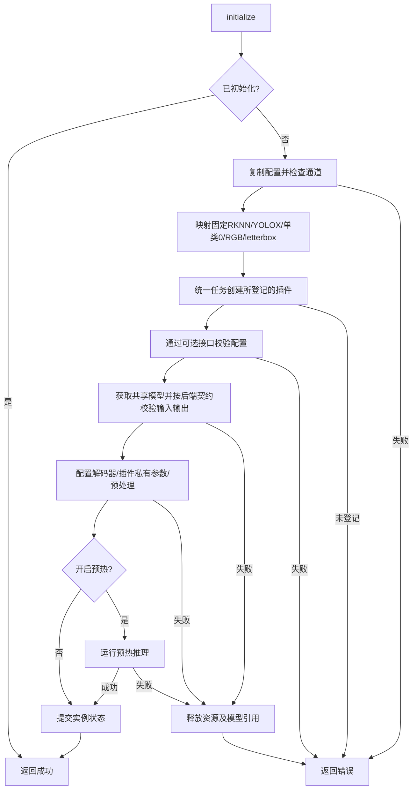
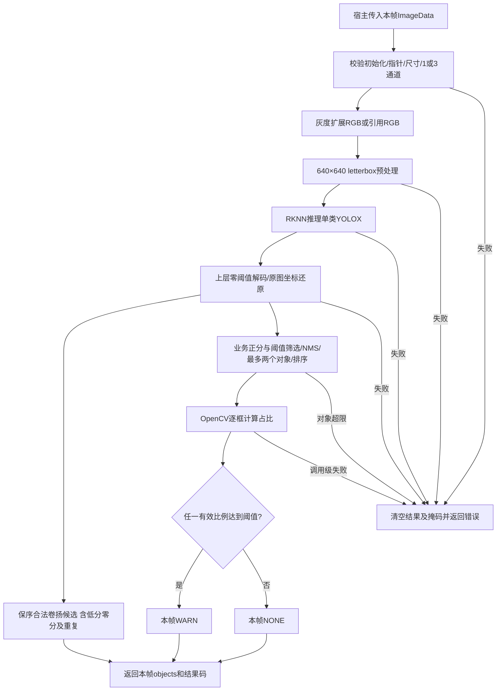
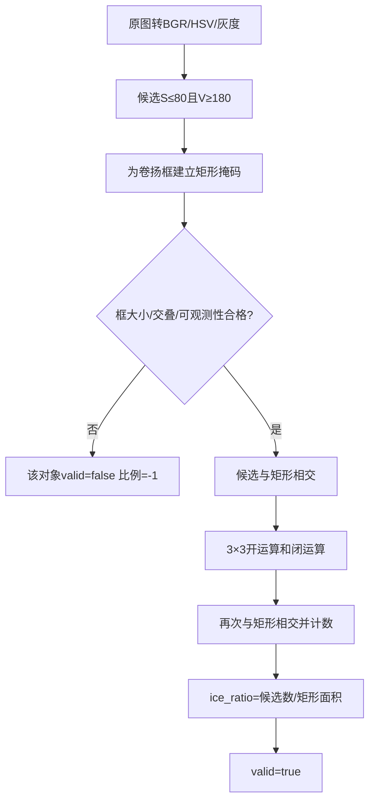
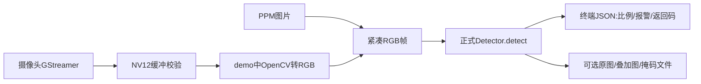

# 卷扬冰雪源码、客户API与demo说明

> 版本说明：2026-10-23将源码及API说明同步到`427a3a6`；第6、8至12节的构建、模型和板端数据保留各自阶段，不能当作最新提交验收。历史UI链路记录见[实现与板端验证](../evs_ice_ui/evs_ice_ui_实现与板端验证.md)及[核验与优化](../evs_ice_ui/evs_ice_ui_核验与优化.md)；定位与计量精度仍需独立验收。本次未复核firmware交付包或重跑设备测试。

> 路径约定：文中的 `src/`、`include/`、`docs/`、`build_ice_delivery/` 等源码及证据路径，均相对于实际源码仓库 `/home/tronlong/lyp/code/edgevision`，不相对于本文所在目录。

更新：2026-10-23。源码基线为`427a3a659603e78da43a4ba3f855667bd73ca99a`，原插件稳定接口基线仍为`137a845`。当前说明与历史记录按下表阅读：

| 阅读目的 | 章节 |
| --- | --- |
| 接入当前API、理解字段与执行链 | 第1至5节；第2.4节为完整调用示例 |
| 查构建命令和旧测试结果 | 第6节；其中实测表属于2026-10-21阶段 |
| 核对待闭合需求 | 第7节 |
| 回看旧模型、单图与架构整改验证 | 第8至12节，保留当时版本及数据 |
| 核对候选契约、公共类型迁移、日志及本次检查 | 第13节 |

**当前方案：配套RKNN模型定位卷扬，OpenCV计算每个卷扬框内冰雪候选占比，任一有效对象达到阈值则本帧全局报警。** 宿主每次detect传入一帧，结果只属于该帧，包括重复时间戳；无首次锁定、库内十次重试、缓存返回或跨帧保持。独立Qt UI已有历史链路验证，见上方入口。模型名为winch_model.rknn，不加入安装规则，单独部署。

**临时候选契约：snow_detections自d6b63ba起返回同次推理的合法卷扬候选，保留模型顺序、低/零分及重复，不做业务阈值、NMS或Top-K筛减；它仍不是客户最终要求的冰雪模型目标。** OpenCV占比从objects读取，MATCH只表示存在业务对象，每项计量有效性看valid。427a3a6将公共类型统一为`evs::ErrorCode/ResultCode/AlertLevel`，4e193f3增加诊断日志与成功帧窗口；细节见第13节。

## 1. 当前实现与交付物

早前接口精简保存了129个源码/资源文件、差异和SHA256清单，原始归档见第8节。随后完成插件边界整改，客户`include/evs/winch_ice.h`在该整改中逐字保留。下面的客户字段精简结果仍适用于当前版本。

| 项目 | 精简前 | 当前 |
|---|---|---|
| 客户原六结构额外字段 | 18个 | 3个：camera_channel、area_ratio、objects |
| 新WinchObjectResult | 10个字段 | 3个：box、ice_ratio、valid |
| ModelConfig | 需要额外模型适配参数 | 客户原4项；RKNN/YOLOX/类别/预处理留在库内 |
| ImageData | 额外format/stride/size_bytes，灰度不支持 | 客户原5项，紧凑RGB24/8位灰度 |
| 结果错误/处理状态 | 与返回值重复 | 错误读取方法返回码；对象检查valid |
| HSV阈值 | 对外暴露 | 内部S≤80、V≥180，正式API只公开3个检测阈值 |
| 相机demo | NV12直接传扩展API | NV12在demo转RGB再传客户API |
| 模型交付 | 前一轮加入自动安装 | 按用户最新要求取消自动安装；winch_model.rknn单独部署，配置路径相对YAML |
| 预热失败 | 警告后可能成功 | 仅冰雪模块在预热失败时返回错误并回滚 |

提供两个共享库及配套头文件：

| 产物 | 职责 |
|---|---|
| libevs_ice.so.1、开发链接libevs_ice.so | Detector、冰雪插件、OpenCV计量、配置适配 |
| libevs_core.so.1、开发链接libevs_core.so | 模型注册、RKNN后端、预处理、解码及公共执行链 |
| libevs_ice.a、libevs.a | 可选静态接入 |
| include/evs/winch_ice.h | 正式C++17接口，命名空间evs::winch_ice |
| include/evs/status.h | 公共evs::ErrorCode、ResultCode、AlertLevel及EvsStatus；由winch_ice.h包含，须配套保留 |
| winch_model.rknn、configs/winch_ice.yaml | 必需模型及配套配置 |
| ice_replay、winch_ice_demo、docs/winch_ice.md | 图片/相机demo与编译、调用、测试说明 |

库尾号保持`.so.1`。原`IFunctionPlugin`、`TaskConfig`及`src/evs_register.h`已恢复为稳定基线`137a845`，HSV不再加入公共配置，冰雪专属结果不再加入原插件虚表。部署使用配套核心和冰雪库；整改前工作区按过渡虚表编译的库不可混用。旧人员/高度插件兼容验证仅覆盖`137a845`及本机同一C++工具链，不能推及任意版本。冰雪宿主只需链接`-levs_ice -levs_core`，不必部署人员/高度插件。运行依赖匹配目标板的RKNN运行库及OpenCV；相机demo另依赖GStreamer。

`include/evs/testing/ice_replay.h`只提供只读掩码快照，供demo展示，正式业务取比例无需调用；没有正式人工框或无模型回退入口。原工程OpenCV开关仍保留，正式冰雪必须ON，本轮不将无OpenCV构建作为冰雪验收。

## 2. 正式API、字段与调用

### 2.1 四个方法

```cpp
evs::ErrorCode Detector::initialize(const WinchSnowConfig& config);
evs::ErrorCode Detector::detect(const ImageData& image, WinchSnowResult& result);
evs::ErrorCode Detector::updateConfig(const DetectConfig& config);
void Detector::release();
```

参数类型、const/引用及void释放方式保持；updateConfig形参变量名不影响原型。公共evs::ErrorCode为uint32_t别名，0成功、非0异常，错误格式仍为0x0008EEEE。427a3a6已移除冰雪命名空间下三类型的原定义，旧类型引用须迁移到evs，见13.2；不能仅凭名称或底层存储大小宣称任意C++ ABI兼容。

一个实例绑定一路相机，串行调用；同模型实例共享后端，宿主也应串行调度。初始化重复调用不重载；release可重复，释放后允许重新初始化。宿主负责取流、PLC工况、调用时机、重试、报警保持及UI。

### 2.2 客户24个字段逐项核验

依据原Word：`/home/tronlong/lyp/perCode/idevelop_md/demand/中控详细设计说明书0921.docx`第3.1.12，直接读取正文及15张表。原文SHA256：`9087dee29adb8bc59d37ce1b00e06c41cd146c9dd0ca8337f3e33eb843cf1e49`。

24字段的名称及原字段相对顺序保留；427a3a6将两个枚举改为evs命名空间中的公共定义，底层int32_t及0/1值保持，完整类型名发生变化。下表同步当前语义；原Word和历史核验数据保持原样。配置与结果标注“算法合作供应商定义”，配置表留有“其他字段”，允许补充设计；并不代表客户已批准当前全部扩展。

| 结构.字段 | 客户所列类型 | 当前字段核对 | 含义/能力核对 |
|---|---|---|---|
| WinchSnowConfig.model_config | ModelConfig | 保留 | 模型配置用途一致，保留客户四项；固定模型适配留在库内 |
| WinchSnowConfig.detect_config | DetectConfig | 保留 | 检测配置用途一致，只新增面积报警阈值area_ratio |
| ModelConfig.Model_path | std::string | 保留 | 有效模型文件路径；当前仍从文件加载，符合用途 |
| ModelConfig.input_width | int32_t | 保留，默认0 | 模型输入宽度；初始化要求有效，当前配置640 |
| ModelConfig.input_height | int32_t | 保留，默认0 | 模型输入高度；初始化要求有效，当前配置640 |
| ModelConfig.warmup | bool | 保留 | false跳过；true执行预热，失败使冰雪初始化失败并回滚 |
| DetectConfig.confidence_threshold | float | 保留 | 范围0～1，仍为模型置信度过滤，未改成冰雪面积比例 |
| DetectConfig.nms_threshold | float | 保留 | 范围0～1，仍为NMS IoU阈值 |
| ImageData.data | const uint8_t* | 保留 | 当前帧只读像素指针，用途一致 |
| ImageData.width | uint32_t | 保留 | 正尺寸受支持；仍有实现整数/像素总量上限，输入帧小不保证检出有效卷扬 |
| ImageData.height | uint32_t | 保留 | 正尺寸受支持；仍有实现整数/像素总量上限，输入帧小不保证检出有效卷扬 |
| ImageData.channels | uint32_t | 保留 | 3=紧凑RGB24、1=8位灰度，均支持；NV12/BGR由宿主转RGB |
| ImageData.timestamp_ms | uint32_t | 保留 | 毫秒时间戳保留，不用于缓存；客户未指定时钟基准，demo单调时钟不是客户已明定的基准 |
| WinchSnowResult.result_code | ResultCode(int32_t) | 当前evs::ResultCode，0/1一致 | 业务objects非空即MATCH，计量全部无效也可MATCH；不是计量有效性或有冰雪的结论 |
| WinchSnowResult.alert_level | AlertLevel(int32_t) | 当前evs::AlertLevel，0/1一致 | 按本帧有效对象面积阈值汇总，调用失败时先处理返回码 |
| WinchSnowResult.snow_detections | std::vector<Detection> | 保留类型和名称 | 临时为未经业务阈值/NMS筛减的合法卷扬候选；最终冰雪模型目标仍未实现 |
| WinchSnowResult.inference_time_ms | uint32_t | 保留 | 单位毫秒一致；包含后端适配阶段，不单指rknn_run；客户未细化边界，统计口径待统一 |
| WinchSnowResult.camera_channel | uint32_t | 保留 | 普通摄像头通道编号符合本节含义；当前由实例配置绑定，并附加0～254约束 |
| Detection.class_id | uint32_t | 保留 | objects.box及临时snow_detections均为卷扬模型类别，不代表冰雪类别 |
| Detection.confidence | float | 保留 | 范围0～1；当前YOLOX为obj×class，不是面积占比；客户未细化obj/类别概率组合，需模型参考确认 |
| Detection.x | uint32_t | 保留 | 原图bbox左上点x坐标，符合 |
| Detection.y | uint32_t | 保留 | 原图bbox左上点y坐标，符合 |
| Detection.width | uint32_t | 保留 | 当前为框宽；客户字段名/范围像宽度，但说明写“右下点x”，用户已确认按常规宽高；文档文字矛盾应澄清 |
| Detection.height | uint32_t | 保留 | 当前为框高；客户字段名/范围像高度，但说明写“右下点y”，用户已确认按常规宽高 |


### 2.3 仅保留的业务扩展

| 结构.字段 | 类型/默认值 | 约定 |
|---|---|---|
| WinchSnowConfig.camera_channel | uint32_t，0 | 实例相机编号，当前0～254，写入结果 |
| DetectConfig.area_ratio | float，0.5 | 0～1，ice_ratio≥此阈值则报警 |
| WinchSnowResult.objects | vector<WinchObjectResult> | 本帧卷扬结果，从左到右排列，不承诺跨帧主/副身份 |
| WinchObjectResult.box | Detection | 卷扬定位框；confidence为模型obj×class，不是冰雪占比 |
| WinchObjectResult.ice_ratio | float，-1 | 有效时0～1；无效-1 |
| WinchObjectResult.valid | bool，false | 是否可用于比例和报警 |

原ModelConfig只含Model_path、input_width、input_height、warmup；原DetectConfig的confidence_threshold/nms_threshold仍为模型置信度与NMS阈值，没有挪作面积阈值。updateConfig整体替换3项检测阈值，传入非法配置返回错误且不更新。默认置信度0.45、NMS0.5、面积0.5是实现默认值，不能称客户指定默认值。

ImageData只读指针在同步调用期间必须有效，宿主保证至少width×height×channels字节，紧凑排列无行填充。channels=3为RGB24；channels=1为8位灰度，库内复制成RGB，HSV的S恒0，因此仅剩亮度筛选，颜色判别及模型精度仍需实机验收。BGR、NV12和带行填充的帧由宿主转换/打包。

框用原图像素表示：例如左上(100,50)、右下边界(300,170)，返回x=100、y=50、width=200、height=120。用户已确认采用宽高；客户表的右下坐标文字仍应修订澄清。

调用返回非0时，候选、对象和报警清空到NO_RESULT/NONE。返回0后可读取候选，不以result_code为门槛；MATCH表示至少一个业务对象，读取比例前逐项检查valid。无业务对象为NO_RESULT；所有业务对象计量无效仍可MATCH，此时比例为-1、无有效报警。两种结果均不能当作“确认无雪”。

### 2.4 完整宿主调用例子

保存为host_ice.cpp；输入为宿主准备的紧凑RGB原始像素文件，图片解码与相机采集留在宿主。

```cpp
#include <evs/winch_ice.h>
#include <cstdint>
#include <fstream>
#include <iostream>
#include <iterator>
#include <stdexcept>
#include <string>
#include <vector>

int main(int argc, char** argv) {
    using namespace evs::winch_ice;
    try {
        if (argc != 5) {
            std::cerr << "usage: host_ice task.yaml frame.rgb width height\n";
            return 2;
        }
        const int width = std::stoi(argv[3]);
        const int height = std::stoi(argv[4]);
        if (width <= 0 || height <= 0)
            throw std::runtime_error("invalid image size");
        std::ifstream input(argv[2], std::ios::binary);
        if (!input)
            throw std::runtime_error("cannot open RGB buffer");
        std::vector<uint8_t> pixels((std::istreambuf_iterator<char>(input)),
                                     std::istreambuf_iterator<char>{});
        if (pixels.size() != uint64_t(width) * uint64_t(height) * 3)
            throw std::runtime_error("RGB buffer size mismatch");

        WinchSnowConfig config;
        auto rc = load_config(argv[1], config);
        if (rc) {
            std::cerr << "config error: " << rc << '\n';
            return 2;
        }
        Detector detector;
        rc = detector.initialize(config);
        if (rc) {
            std::cerr << "initialize error: " << rc << '\n';
            return 2;
        }

        ImageData image;
        image.data = pixels.data();
        image.width = static_cast<uint32_t>(width);
        image.height = static_cast<uint32_t>(height);
        image.channels = 3;
        image.timestamp_ms = 0; // Metadata only; repeated values are supported.

        WinchSnowResult result;
        rc = detector.detect(image, result);
        if (rc) {
            std::cerr << "detect error: " << rc << '\n';
            return 1;
        }
        std::cout << "candidates=" << result.snow_detections.size() << '\n';
        if (result.result_code == evs::ResultCode::RESULT_NO_RESULT)
            std::cout << "NO RESULT\n";
        for (size_t i = 0; i < result.objects.size(); ++i) {
            const auto& object = result.objects[i];
            std::cout << "winch=" << i
                      << " valid=" << object.valid;
            if (object.valid)
                std::cout << " ice=" << object.ice_ratio * 100.0f << "%";
            std::cout << '\n';
        }
        std::cout << "alarm="
                  << (result.alert_level == evs::AlertLevel::ALERT_WARN) << '\n';
        detector.release();
        return 0;
    } catch (const std::exception& error) {
        std::cerr << error.what() << '\n';
        return 2;
    }
}
```

安装后编译：

```bash
g++ -std=c++17 host_ice.cpp -Ipackage_ice/include -Lpackage_ice/lib \
  -Wl,-rpath,'$ORIGIN/package_ice/lib' -levs_ice -levs_core -o host_ice
./host_ice package_ice/share/edgevision/configs/winch_ice.yaml frame.rgb 200 100
```

GNUInstallDirs可能使用lib64或multiarch目录，届时将链接/运行路径换成实际安装目录。直接构造ModelConfig的Model_path为相对路径时仍按工作目录解析；load_config辅助函数会将YAML相对模型路径转为绝对路径。

## 3. 源码执行逻辑与流程图

### 3.1 初始化与配置



`make_task_config`将客户配置映射到原`TaskConfig`，固定模型细节留在客户适配层。文件入口先由公共解析器读取节点，再调用冰雪插件登记的适配器，完成冰雪专属校验、默认模型参数和相对路径归一化；客户`load_config`与`VisionTask`文件入口共用该适配器。公共解析器不含HSV业务键或模块8判断，公共`TaskConfig`没有`IceConfig`成员。客户入口仍拒绝与固定模型及默认HSV冲突的配置。

冰雪插件另外实现可选`IFunctionTaskHooks`，由其承担配置校验、私有参数提交、预热失败策略和失败帧清理。`Detector`通过通用`functionPlugin()`借用任务内唯一的冰雪插件，读取专属结果和掩码；释放任务前清除借用指针。原插件接口没有冰雪结果、掩码或清理方法，公共任务也没有冰雪友元。

### 3.2 一次detect处理一帧



当前源码按原始YOLOX `[1,8400,6]`解析；架构整改前的RK3588真实单图记录与独立解码核对匹配，详见第11节：tx、ty、tw、th、objectness、class_probability；stride8/16/32，grid+exp还原框，置信度为obj×class，不额外重复sigmoid。现有共享适配仍保留flat6/yolov8代码供内部既有路径使用，正式Detector固定当前YOLOX，不扩大本轮精简范围。

### 3.3 OpenCV比例与报警



分母是原图框width×height，包含框内背景及支架，属于粗估，不是卷筒精细分割。内部保留像素计数和掩码用于计量/演示，不必通过正式结果公开。

当前仍保留最多两个NMS后业务对象、交叠框无效、框至少3×3、灰度均值低于12或均值≥250且标准差<3无效等规则；这些不是客户表中明确要求，现场仍需确认。业务对象超限返回调用错误并清空整帧结果；原始临时候选数组无两对象截断。其他对象质量无效可返回0及valid=false，详见13.1。

## 4. demo怎么实现

| 文件 | 职责 |
|---|---|
| tools/ice_replay/main.cpp | 加载配置/模型，读取单张P6 PPM，调用正式detect，保存比例和报警；保留可选序列回放 |
| tools/winch_ice_demo/main.cpp | 复用GStreamer摄像头采集，将紧凑NV12转RGB，逐帧调用正式detect，输出JSON及可选文件 |
| tools/ice_replay/replay_io.h | 图片读取、客户ImageData封装、JSON、原图/叠加图及可选掩码输出 |
| tools/ice_replay/host_gate.h | 可选宿主工况示例，库不调用 |
| tools/v4l2_detect/capture.cpp | 原有采集单元，本轮未改 |



默认相机demo无需PLC；附加--simulate-context或--context-json时由demo检查工况，两者互斥。图片序列工况检查也是宿主示例，不进入库。这两个CLI没有实时UI窗口；独立Qt宿主已有阶段验证，见文首入口。CLI从d6b63ba起序列化完整临时卷扬候选，叠图仍画objects；Qt快照JSON尚未包含候选。

相机首帧等待8秒、后续3秒；实际尺寸以协商结果为准，现有采集管线不保证命令行宽高/帧率。--channel未指定则沿用任务配置，显式指定须一致。紧凑NV12须偶数宽高、字节数width×height×3/2；无法确定行填充时明确报错。

终端及_result.json中status来自方法返回值，id来自本帧数组索引，都不是新增正式结果字段；每个对象输出valid、ratio、box。没有有效结果时叠加图显示NO RESULT。重复输出前缀会先清理旧叠加/掩码，避免把旧文件当新结果。

退出码：0表示无调用级错误（仍须区分NO_RESULT和宿主跳过）；1表示至少一次detect错误；2表示参数、配置/初始化、文件或取流异常。

## 5. 当前源码与配套文件的职责

下表按当前实现归纳职责，同类文件合并列出。早前“34项/35个Git条目”和公共虚表桥接的清单已经过时；当前文件数量应通过工作区状态及对应阶段快照核对，不沿用历史统计。

| 文件 | 当前状态与作用 |
|---|---|
| `include/evs/function_plugin.h`、`include/evs/task_config.h`、`src/evs_register.h` | 与`137a845`逐字一致。原插件接口无冰雪专用虚方法，公共配置无HSV成员；公共面积默认值保持0.3 |
| `include/evs/function_task_hooks.h` | 独立可选任务扩展和`FunctionOptions`；不改变原插件虚表，其他插件可继续只实现原接口 |
| `include/evs/vision_task.h`、`src/vision_task.cpp` | 统一任务及内存配置重载、可选能力调用、通用插件借用入口、资源回收及热更新；没有冰雪专用类型、友元或模块8分支 |
| `src/core/config.cpp`、`src/core/config_internal.h` | 公共配置节点与功能适配器登记；按登记传递实例选项，保留未扩展模块的原解析语义。冰雪专属校验不在公共解析器 |
| `src/core/backend_factory.cpp`、`src/core/backend_contract.h` | 按模型契约分发后端校验和推理，供预热及正式帧复用；不按冰雪模块号选路径 |
| `include/evs/rknn_backend.h`、`src/backend/rknn/rknn_backend.cpp`、`src/backend/rknn/detection_rows.h` | RKNN模型输入输出检查、显式单输出解析和SDK输出释放。原80类路径保持；单类YOLOX供当前卷扬模型使用 |
| `include/evs/winch_ice.h`、`src/tasks/winch_ice/winch_ice_api.cpp` | 客户四方法、固定模型配置映射、异常清理及同一插件结果读取；最新头包含公共status.h，API实现补充诊断日志，路径解析仍复用冰雪配置适配器 |
| `src/tasks/winch_ice/winch_ice_plugin.h/.cpp` | 私有配置登记、候选/业务分流、HSV参数、NMS、计量、报警与清理；4e193f3新增成功帧窗口和诊断，均留在功能库 |
| `src/tasks/winch_ice/ice_measurement.h/.cpp` | 私有`IceConfig`、图像检查与像素计量；4e193f3增加错误日志，像素规则保持 |
| `include/evs/testing/ice_replay.h` | 可选只读掩码诊断，供demo展示和测试使用；正式读取比例不需要调用它 |
| `include/evs/status.h`、`src/core/log.cpp`、`src/core/model_registry.cpp` | status.h统一公共错误别名和业务枚举；既有日志与模型清理实现保留，最新两条提交未改后两文件 |
| `configs/winch_ice.yaml`、`winch_model.rknn` | 相机0、640×640输入、面积阈值0.5及单独部署的卷扬模型；客户默认面积阈值也是0.5 |
| `CMakeLists.txt` | 独立功能库、OpenCV链接、demo、测试和安装；不安装模型；相机目标须启用GStreamer且依赖可用 |
| `tools/ice_replay/main.cpp`、`replay_io.h`、`host_gate.h` | 图片/序列演示、JSON和叠加文件、可选宿主工况；正式业务仍调用客户Detector |
| `tools/winch_ice_demo/main.cpp`、原`tools/v4l2_detect/capture.cpp` | GStreamer采集、紧凑NV12转RGB、逐帧客户API调用和可选文件；原采集单元未因架构整改修改 |
| `tests/test_core.cpp`、`test_ice.cpp`、`test_ice_allocation.cpp`、`test_ice_cli.py`、`ice_test_support.h` | 公共回归、冰雪像素/解码/结果、分配故障、命令行失败路径和私有合成框夹具 |
| `tests/compat/v1/include/evs/function_plugin.h`、`task_config.h`、`tests/compat/v1_plugin.cpp`、`tests/test_plugin_integration.cpp` | 冻结稳定接口，验证旧插件派发、原配置布局及不依赖冰雪的新插件扩展 |
| `README.md`、`docs/winch_ice.md`、`docs/plugin_architecture.md`、`docs/api.md`、`docs/host_api.md`、`src/tasks/README.md` | 当前接入、结果含义、插件边界和兼容范围；`src/tasks/winch_ice/待办.md`列出真实待办 |
| 本文、`docs/capture_test.md` | 本文保留阶段证据并标明对应版本；capture_test为固定BuildID的历史板测记录，不替代当前冰雪说明 |

## 6. 编译、安装与测试

目标环境为RK3588 Ubuntu，安装匹配的OpenCV/GStreamer开发依赖和RKNN头文件/运行库后：

```bash
cmake -S . -B build_ice -DCMAKE_BUILD_TYPE=Release -DEVS_BACKEND=rknn \
  -DEVS_WITH_OPENCV=ON -DEVS_WITH_GSTREAMER=ON \
  -DRKNN_API_INCLUDE_DIR=/path/to/rknn/include -DRKNN_API_LIB=/path/to/librknnrt.so
cmake --build build_ice -j2
ctest --test-dir build_ice --output-on-failure
cmake --install build_ice --prefix "$PWD/package_ice"
./package_ice/bin/ice_replay package_ice/share/edgevision/configs/winch_ice.yaml \
  input.ppm /tmp/ice_image/run
./package_ice/bin/winch_ice_demo --task package_ice/share/edgevision/configs/winch_ice.yaml \
  --device /dev/video0 --frames 100 --out /tmp/ice_camera/run
```

cmake --install不复制模型。模型单独交付/部署，Model_path可改为实际绝对路径；保留示例../winch_model.rknn时，需手动放到share/edgevision/winch_model.rknn。YAML相对路径按YAML目录解析。图片demo只读P6 PPM，JPEG/PNG须先转换。旧工具默认不构建，其历史SDK问题另行处理。

无设备时可验证内部像素和解码，正式Detector不会用mock冒充模型：

```bash
cmake -S . -B build_test -DEVS_BACKEND=mock -DEVS_WITH_OPENCV=ON -DEVS_WITH_GSTREAMER=OFF
cmake --build build_test -j2
ctest --test-dir build_test --output-on-failure
```

### 架构整改前的接口精简验证（历史）

以下只记录当时的源码、依赖和结果。早期接口精简没有执行无OpenCV构建；最终架构版本另有四组构建，见第12节。主机依赖解包到/tmp，没有修改系统安装包。

| 核验 | 实际结果与边界 |
|---|---|
| mock＋OpenCV回归 | CTest 5/5；验证内部插件、像素、解码和错误路径，不代替模型推理 |
| RKNN接口模拟器＋OpenCV＋真实GStreamer构建 | CTest 5/5；实际SDK头文件配合模拟C运行库，包含相机demo的编译与链接，不使用NPU |
| 单项断言 | 公共框架235、冰雪静态/动态各216、分配故障75，均通过；另有CLI错误路径测试 |
| 正式Detector完整接口模拟 | 302项通过：原ModelConfig四字段初始化、重复时间戳、逐框比例/OR报警、错误清理、配置更新分配失败、RGB/灰度、灰度扩展OOM、正数1像素尺寸、相机编号、预热失败回滚及重试 |
| 安装规则的阶段变化 | 接口精简前的安装检查曾包含模型；后续已取消模型安装，当前须单独部署。core/ice SONAME均为.so.1，ice依赖core.so.1 |
| 配套文档宿主例子 | 从本文提取并用安装头文件/库编译，在/tmp工作目录加载安装YAML，模拟结果60%及0%，全局报警1 |
| 安装图片demo | 从/tmp加载安装YAML与模型，输出双卷扬比例、报警JSON和叠加文件；推理使用模拟器 |
| 相机demo帧模拟 | 替换采集单元输入3帧NV12，走当时真实demo的NV12→RGB→正式API→JSON/叠加；20%→60%→20%，报警0→1→0 |
| 真实GStreamer错误分支 | 安装相机demo使用不存在的设备，明确camera open failed，退出2并释放模型；不代表真实相机取流通过 |
| 字段/范围及工作区 | 客户24原字段及顺序保留，额外3项、新结果3项；Git变更路径仍34，无新增路径，模型与其他未触及文件哈希不变；git diff --check通过 |

相对当时保存基线，业务源码/配置/构建修改为98行增加、199行删除，净减少101行（不计测试和文档；末尾注释调整不影响净值）。当时实际改动18个已有变更路径，没有新增业务文件。原有公共历史修改保留，故Git条目数不会随字段减少而自动归零。

以上主机模拟不证明真实winch_model.rknn在RK3588上的推理结果、精度、灰度性能或真实摄像头可用，也不代表snow_detections客户契约已经验收。

## 7. 尚未闭合的事项

- snow_detections临时提供合法卷扬候选，原模型冰雪目标输出仍无对应实现；最终影子系统契约仍须对应模型及客户验收。
- 客户文档width/height文字与名称/范围矛盾；用户已确认按常规宽高实现，但应同步修订客户设计文字。
- 最新版本验收：第11节是架构整改前的RK3588单图推理，后续UI历史验证见文首入口；这些记录不覆盖最新两条提交，本次未重跑设备回归或复核firmware记录。
- HSV是颜色候选粗估，反光/背景可能误计，暗雪/透明冰可能漏计，分母包括框内背景；质量/最多两个候选等规则仍须现场确认。
- 客户参考YAML允许按算法增改，当前平铺配置不能宣称可直接读取客户原model.path嵌套示例。camera尺寸、灰度功能发布开关、UI、连续错误策略由宿主处理。
- 客户release原型为void，而日志段写返回ErrorCode，文档自身矛盾；当前按void实现。
- 旧build_ice_delivery中的历史so.3包不适用于本轮接口，即使尾号相同的旧包也不能混用。此次主机验证产物不作为正式RK3588交付包。

## 8. 基线与证据

- 早期接口精简前基线：`build_ice_delivery/api_slim_20261021/baseline/`，含workspace.tar.gz、manifest.json、tracked.diff、status.txt、head.txt；这是忽略目录中的备份，不是交付包。原始临时副本在/tmp/ice_api_baseline_20261021_105413。
- 早期接口精简验证副本：`build_ice_delivery/api_slim_20261021/verification/`，只保存探针源码、日志与清单，不是RK3588交付包。
- 早期临时构建及探针：/tmp/ice_api_build、/tmp/ice_api_rknn_build、/tmp/ice_api_sdk；依赖解包到/tmp/ice_api_deps。
- 更早完整外部归档：/home/tronlong/lyp/code/edgevision_archive_20261020_231720，保留此前清理前资料和历史验证；不将旧日志当作本轮结果。
- 原Word抽取：/tmp/ice_customer_api_audit，保留15张表、24字段比较及精简前探针，旧探针描述的是精简前行为。
- 2026-10-21上述整改阶段的旧模型SHA256：`cff5bb8245653e2fcf6eec66ae7083aa6506fad1d2e4fd89bec933a6afe7d5e8`。模型已于d6b63ba替换，最新大小/哈希见13.1，不能用旧单图记录替代新模型验收。

- 当前架构整改归档及验证：`build_ice_delivery/architecture_isolation_20261021/`，含执行前快照、最新主机验证记录及当前主机验证安装目录，范围见第12节。

## 9. 模型坐标与VisionTask重载说明（含模型重命名阶段记录）

模型定位卷扬，OpenCV测量冰雪，因此模型资源改名winch_model.rknn，库与功能名仍为winch_ice/evs_ice。改名不改变模型内容或输出格式。

算法同事所说“像素坐标、裁剪矩形框”通常指定位框位置：框可由左上与右下两点，或左上与宽高，或中心与宽高表达；只有单个像素点无法确定完整矩形范围。还需确认坐标属于原图还是640×640输入图，以及RKNN直接输出是否已解码。当前源码按原始YOLOX输出解码，不能仅凭六列形状确认语义。

当前处理顺序：raw YOLOX解码→置信度过滤→撤销letterbox并映射原图→边界裁剪→NMS→整数像素框(x,y,width,height)→矩形掩码→HSV与形态学计数→snow_pixels/(width×height)。坐标还原复用公共链路，边界裁剪、NMS和计量由冰雪插件负责。代码使用全图掩码限定矩形，未复制单独裁剪图片；框外不计入分母和最终冰雪计数。形态学保留既有全图边界处理，不能声称与任意ROI裁剪实现逐像素完全相同。

VisionTask原先只有initialize(string_view路径)、updateConfig(string_view路径)，客户Detector接收的是WinchSnowConfig/DetectConfig内存结构。新增initialize(const TaskConfig&)、updateConfig(const TaskConfig&)是供Detector将结构映射到既有执行链的重载，免去写临时YAML。原路径接口仍保留并调用共同实现；客户宿主只需Detector四方法，无需调用VisionTask。

模型重命名阶段只更新模型名称、配置/相关测试/说明并移除模型install规则，当时没有改YOLOX解码、坐标换算、掩码算法或VisionTask声明。以下是该阶段历史记录：当时两组CTest各5/5通过；全新安装目录及install_manifest均无.rknn文件，未部署模型时初始化明确失败；手动部署重命名模型后，安装图片demo从/tmp解析配置成功，模拟结果60%与0%，报警1。模型SHA256未变；以上使用RKNN接口模拟器，未连接设备。

## 10. 新增实图的先前主机局部核验（2026-10-21，实机结果见第11节）

输入：工作区新增img_v3_0214i_bcfb0319-9f3a-4947-ba6b-890a0bd1176m.jpg，704×576；原图不修改。该阶段主机为x86_64，无RK3588 NPU设备及真实RKNN运行环境，当时尚未对该图运行真实模型。没有调用固定框SDK模拟器充当图片模型推理。

该阶段明确使用私有PixelDetector测试夹具，人工选定矩形x=90、y=120、width=560、height=456，调用当前实际冰雪插件/计量代码；该人工区域不作为正式Detector模式或自动回退。

| 核验项 | 结果 |
|---|---|
| 区域来源 | 人工选择，非模型输出；位置仅供辅助测量，不是卷扬真值标注 |
| 矩形面积 | 255360像素，等于560×456 |
| HSV/形态学后冰雪候选 | 88026像素 |
| 当前候选占比 | 34.4713% |
| 50%阈值下该人工区域的报警 | 不报警 |
| 框外最终候选数 | 0，掩码限制和分母核对通过 |
| 模型定位及解码 | 未核验，需要真实RKNN输出或算法同事参考后处理结果 |

叠加图红框为人工区域，绿色为实际计入的候选。部分灰暗雪面未计入；V≥180的阈值会排除较暗雪像素。因此该比例是当前规则在这个人工矩形内的计算值，不是已经验收的真实冰雪覆盖率，也不能据单张图自动调整阈值。矩形分母还含背景及支架，比例受框的位置和大小影响。

证据在build_ice_delivery/user_image_check_20261021/：overlay.png、manual_crop.png、snow_mask.png、input.json、result.json及独立测试源码check_image.cpp。仅用于主机辅助核验，不是模型检测结果或板端交付包。

该阶段之后，已在RK3588获取这张图片的真实输出并做独立数学解码核对，结果见第11节；该次核对没有采用算法供应方参考程序，不能代替供应方后处理验收。人工区域记录本身没有修改模型、算法、正式API或模型安装规则。

## 11. RK3588真实模型输出与本帧解码核验（2026-10-21，历史快照）

本节对应`rk3588_model_check_20261021_134125/source.tar.gz`，早于后续插件边界整改。当前任务、冰雪插件及客户API实现已与该快照不同，像素计量cpp保持一致。以下保留当时数据，不作为当前版本整体验收结果。

### 11.1 结论

已SSH连接192.168.2.127，确认aarch64 RK3588设备，使用工作区winch_model.rknn和新增原始JPEG进行真实NPU推理。不是SDK模拟器，不使用人工框。当时源码解码与独立Python YOLOX数学实现对同一原始输出给出的矩形一致，最终四个整数坐标差异均为0像素。

本图的模型框没有覆盖上方部分可见积雪，HSV又漏计框内部分灰暗雪面，因此当时结果不能认定为准确冰雪覆盖率。技术解码在本图核对通过，业务区域和计量精度仍需确认。没有根据单图调阈值、扩大模型框或修改正式算法。

### 11.2 环境、隔离和输入

- 设备：192.168.2.127，hostname=smartdisplayer，架构aarch64；RKNN运行库2.3.0（c949ad889d@2024-11-07T11:35:33），驱动0.9.8，OpenCV4.5.4。
- 独立设备目录：/home/hytop/l_evs/rk3588_model_check_20261021_134125；没有覆盖设备原有程序、库或模型。
- 本地完整证据：build_ice_delivery/rk3588_model_check_20261021_134125/device_results/；源码快照source.tar.gz与执行前哈希清单保存在其父目录。
- 原始模型SHA256：cff5bb8245653e2fcf6eec66ae7083aa6506fad1d2e4fd89bec933a6afe7d5e8；设备模型与本地一致，模型未改。
- 图片：img_v3_0214i_bcfb0319-9f3a-4947-ba6b-890a0bd1176m.jpg，704×576；本地与设备图片SHA256一致，详情见verification.json/input_hashes.txt。
- 使用设备已有RKNN头文件、/usr/lib/librknnrt.so和OpenCV，该次只构建快照中的core/ice/ice_replay目标。ldd证明正式程序加载独立build目录内新编的libevs_ice.so.1与libevs_core.so.1，以及真实系统librknnrt.so；没有加载此前主机模拟库。
- 预处理直接编译当时src/core/preprocess.cpp，保持RGB、640×640、letterbox；scale=0.9090909362、pad_x=0、pad_y=58。独立探针和正式API走同一预处理实现。

### 11.3 模型实际返回的数据

| 项目 | 实际值 |
|---|---|
| 输入张量 | images，[1,640,640,3]，NHWC，INT8量化；接口传入RGB uint8，由RKNN转换 |
| 输出数量 | 1 |
| 输出张量 | predictions，[1,8400,6]，INT8量化，50400元素 |
| 输出量化参数 | zero_point=-27，scale=0.02910974436 |
| 保存的未解码输出 | SDK反量化后的float32张量，raw_output_0.f32与raw_output_0.npy；尚未做坐标解码/筛选/NMS，不是原生INT8字节 |
| 当时采用的解释 | tx、ty、tw、th、目标概率、类别概率 |
| 置信度≥0.45的候选 | 8个 |
| NMS IoU阈值0.5后 | 1个框 |

这8400行是候选，不是8400个卷扬。真实数据前四列含负值、范围约-2.39～3.81，不能直接当作原图像素矩形；后两列在0～1内。本图的原始数值、网格解码及可视位置共同支持当时采用的raw YOLOX解释，不能仅凭6列形状推断。

最终保留的候选数组索引8270（从0开始），原始6项为：

```text
[0.582194865, 0.029109744, 2.678096533, 2.270560026, 0.960621536, 0.902402103]
```

其网格位置(10,13)、stride=32。按当时公式：

```text
模型输入图中心x = (0.582194865+10)×32 ≈ 338.630
模型输入图中心y = (0.029109744+13)×32 ≈ 416.932
框宽 = exp(2.678096533)×32 ≈ 465.835
框高 = exp(2.270560026)×32 ≈ 309.914
置信度 = 0.960621536×0.902402103 ≈ 0.866866887
```

撤销补边与缩放后，原图浮点左上/右下边界约为(116.284,224.372)/(628.703,565.278)。按现有四舍五入端点规则，返回x=116、y=224、width=513、height=341。Python独立解码与正式API坐标差异0像素；这是对本图和当时公式的交叉核对，不是算法供应方参考程序验收。

### 11.4 正式API本帧结果

| 项目 | 真实结果 |
|---|---|
| detect返回码 | 0 |
| result_code | MATCH(1)，至少一个有效对象 |
| 卷扬数 | 1 |
| 位置 | x=116、y=224、width=513、height=341 |
| 类别/置信度 | class_id=0，confidence≈0.866867 |
| 有效性 | valid=true |
| 矩形面积 | 174933像素，即513×341 |
| 冰雪候选像素 | 31199 |
| ice_ratio | 31199/174933≈17.8348% |
| 当时面积阈值 | 50% |
| alert_level | NONE(0)，本帧不报警 |
| API记录的推理耗时 | 38ms；独立探针单次run+取输出约36.52ms，非性能验收 |

已从实际掩码重新计数，确认分母与框面积一致、框外最终候选像素为0；裁剪图尺寸确认为513×341。

第10节人工框的34.47%与本节模型框的17.83%采用不同区域，不能混用。模型框从y=224开始，图中上方部分积雪处于框外；框内灰暗雪面还有部分达不到V≥180。若业务需要覆盖上方积雪，应先与算法同事明确定位框的训练标注及计量区域定义，不根据单张图片擅自扩大框。

### 11.5 可直接查看的证据

以下相对路径均位于build_ice_delivery/rk3588_model_check_20261021_134125/device_results/：

| 文件 | 内容 |
|---|---|
| output/model_boxes.png | 真实模型经当时程序得到的红色定位框，不是人工框 |
| output/crop_0.png | 按正式API矩形裁出的513×341图像 |
| output/snow_overlay.png | 真实模型框内实际计入的候选，绿色高亮 |
| output/formal_result.json | 正式API本帧JSON，含框、置信度、占比和报警 |
| output/metadata.json | SDK/驱动、输入输出属性和预处理映射 |
| output/raw_output_0.f32、raw_output_0.npy | SDK反量化后、未做框解码的原始输出 |
| output/top_candidates.csv | 最高候选的原始6项、网格、stride、置信度和解码边界 |
| output/analysis.json | 列范围、候选数、独立解码和正式API逐框对照 |
| output/formal_object_0_roi.pgm、formal_object_0_snow.pgm | 当时算法的原始矩形掩码和候选掩码 |
| raw_probe.cpp、analyze_output.py | 独立真实输出采集及解码核对源码，仅测试目录使用 |
| raw_probe.log、formal.log、build.log、linked_libraries.txt | 推理、构建和真实动态库加载证据 |

模型输出语义在这张图上与当时解析匹配；多图定位鲁棒性、训练区域定义、灰度精度、HSV计量精度和真实摄像头链路仍未因此验收。该次核验没有修改检测源码、API、库名或模型安装规则。

## 12. 架构与验证范围（2026-10-21历史记录）

### 12.1 当时约定

- 原`IFunctionPlugin`、`TaskConfig`和`src/evs_register.h`与`137a845`逐字一致；客户`winch_ice.h`在架构整改中未改。
- `TaskConfig`没有HSV成员，公共面积默认值为0.3；客户`DetectConfig`和正式冰雪YAML的默认面积阈值仍为0.5。
- 冰雪配置适配器及其登记位于`winch_ice_plugin.cpp`；已合并先前单独拆出的配置源文件。登记声明在`src/core/config_internal.h`，原注册头文件不包含这些新增配置声明。
- 公共任务只调用通用接口，后端分发按模型契约，冰雪结果、掩码、框裁剪和业务规则均归功能插件。原插件可以继续只实现原接口。
- 库和两个demo的主要调用代码已具备。`snow_detections`、真实相机、多场景精度和现场质量规则仍按第7节列为未闭合事项，不能以测试通过替代需求完成。

### 12.2 当时源码对应的既有验证

下面保留2026-10-21架构整改阶段的验证记录；后续源码和模型已经变化，不能将这些通过数用于427a3a6。最新提交的本次检查见第13节。

| 验证 | 结果 | 范围 |
|---|---|---|
| mock、OpenCV关闭、共享库 | CTest 4/4 | 编译和错误/插件接口路径；不是正式冰雪识别验收 |
| mock、OpenCV开启、共享库 | CTest 6/6 | 清理重建后通过，含冰雪像素/解码、分配失败及插件兼容验证 |
| mock、OpenCV开启、纯静态库 | CTest 4/4 | 静态登记和调用链 |
| RKNN SDK模拟器、OpenCV开启 | CTest 6/6 | SDK接口模拟，未使用真实NPU |
| 客户原二进制及安装SDK重编原探针 | 各302项通过 | 方法、结果、错误清理、更新回滚等已覆盖行为 |
| 原137a845人员/高度插件配新核心 | 模块4/5/6/7通过 | 已记录实际加载路径；限本机同一C++工具链 |
| 非冰雪配置对照 | 45例一致 | 当前配置解析与稳定基线对照 |
| 统一任务入口及另一模块复用单类模型 | 通过 | 配置加载/检测/更新及后端不依赖冰雪功能号 |
| 当前主机验证安装SDK | 头文件、配置、安装说明及库与当前源文件/构建结果一致 | x86_64模拟验证产物，不能部署到ARM板；模型及测试插件不安装 |

上述四组构建均关闭GStreamer，不覆盖当前相机demo目标。第6节的早期相机demo编译、帧模拟和不存在设备错误分支记录继续保留，真实摄像头链路尚未验收。

### 12.3 证据与后续验收

证据目录：`build_ice_delivery/architecture_isolation_20261021/`。

- `final_audit_*_build.log`、`final_audit_*_ctest.log`：四组构建及测试记录。
- `final_audit_frozen_sdk.log`、`final_audit_installed_sdk.log`：原客户探针记录。
- `final_audit_legacy_plugins.json`、`final_audit_config_comparison.json`：旧插件和配置对照。
- `final_audit_generic_module9.log`、`final_audit_installed_cli.log`：统一入口、另一功能及安装图片demo记录。
- `逐文件核验.md`、`核验结果.md`：架构整改阶段的文件职责及验证记录；其中按阶段快照统计的数量不作为后续文档修改后的Git总数。
- `docs_sync_before.tar.gz`：本次文档同步前的六份文档快照；历史测试原始日志和板端数据没有改写。
- `文档同步核验.md`、`docs_sync_install_check.json`：本次文档变更、代码未改及安装说明同步核对；早期架构归档内的文件数和哈希仍属于各自阶段。

当前代码仍需针对最终版本重新进行RK3588板端回归、真实相机、连续运行、识别精度和性能验收；第11节的单图结果保留其历史范围。

## 13. 最新源码增量（2026-10-23，427a3a6）

### 13.1 沿用d6b63ba的候选与模型契约

上层`IUnfilteredDetectionInput`使decoder使用零阈值；插件将合法卷扬框先复制为临时候选，再另做业务正分/置信度、NMS及最多两个对象检查。候选保序、保留重复及低/零分，原图裁剪舍入后要求像素宽高非零；业务正分零像素框仍可能成为无效对象，因此objects不保证是候选数组子集。成功帧候选不随三个业务阈值改变；超限等调用错误仍清候选、对象及报警。

result_code只表示objects是否非空；有效比例及报警看valid和area_ratio。小框、交叠、极暗/均匀极白可能随成功调用输出无效对象，比例为-1，MATCH不表示计量有效。最终冰雪模型目标仍待接入。

d6b63ba替换后的模型为10,665,756字节，SHA256为`aa328d06f185bdf126a10b0357a28caa1249246e89e14474eb7669b9237550b7`。最新两条提交未再改模型。模型元数据声明RK3588及输入[1,3,640,640]、输出[1,8400,6]，不等于真实数值或RK3576兼容已验收。详细证据见[分析报告5.6.4](../edgevision分析报告.md#564-d6b63ba的模型替换与验证边界)。

### 13.2 427a3a6的公共类型迁移

`evs/status.h`统一定义`evs::ErrorCode`（uint32_t别名）、`evs::ResultCode`和`evs::AlertLevel`（均为int32_t枚举）。枚举值仍为`RESULT_NO_RESULT/RESULT_MATCH=0/1`、`ALERT_NONE/ALERT_WARN=0/1`，WinchSnowResult成员顺序保持；完整枚举类型名已经改变。原`evs::winch_ice::`定义未保留同名别名，只导入冰雪命名空间也无法再无限定使用三类型。

宿主应使用完整`evs::`类型名，同步头文件并重编；`winch_ice.h`包含`status.h`，两者须配套交付。通用AlarmState仍为0/1/2，调用成功与否仍以返回错误码判断。core和ice继续配套更新；本次没有执行任意旧二进制混用验证。

### 13.3 4e193f3的日志和帧窗口

冰雪API、插件及像素计量增加`winch_ice` tag诊断，覆盖配置、拒帧、数据及异常。私有窗口记录候选筛选、NMS、计量有效性及报警帧等项；只有成功走到插件汇总处的帧计数。首个成功序号和100的倍数输出INFO并清窗口，其他成功帧输出DEBUG，reset输出剩余窗口并清序号；前两个窗口分别为1及99帧，之后通常100帧。

插件汇总之前失败不计入，逐对象无效但处理到汇总处可计入；若随后API复制结果失败，已累计计数不回滚，因此不能按窗口数推算API最终返回0的次数。它没有补齐核心debugStats的错误统计，也未改变inference_time_ms边界。日志使用既有EVS/ALOG路由和同步回调，宿主控制过滤及异步落盘；完整口径见[分析报告6.5.4](../edgevision分析报告.md#654-冰雪诊断日志与成功帧窗口)。

### 13.4 本次检查及历史结果边界

源码分支为`feature/split-core-plugin-libs`，HEAD为427a3a6、工作区干净；`d6b63ba..427a3a6`共15文件、389行增加及89行删除。本次核对两条提交、日志分支和公共头，C++17语法检查确认旧无限定类型写法失败、完整evs写法通过；本文2.4的宿主例子按新头重新进行语法检查，没有链接或运行真实模型。

d6b63ba的主机CTest6/6、8/8、6/6、核心235、冰雪154/337、分配失败75及候选JSON8项断言属于2026-10-22，详见[分析报告8.3](../edgevision分析报告.md#83-固定提交的本次构建验证)。本次未重跑完整构建、CTest、NPU或Qt链路，未复核firmware交付包记录；第6及8至12节的旧构建、模拟器和单图证据保留原有范围。
