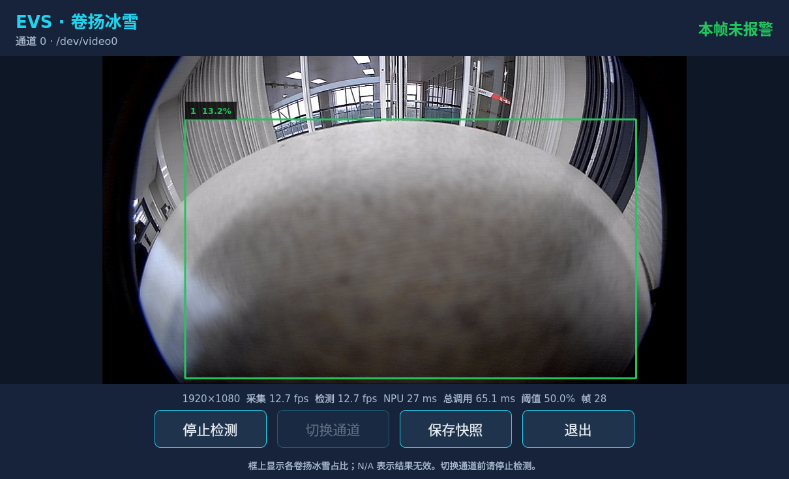
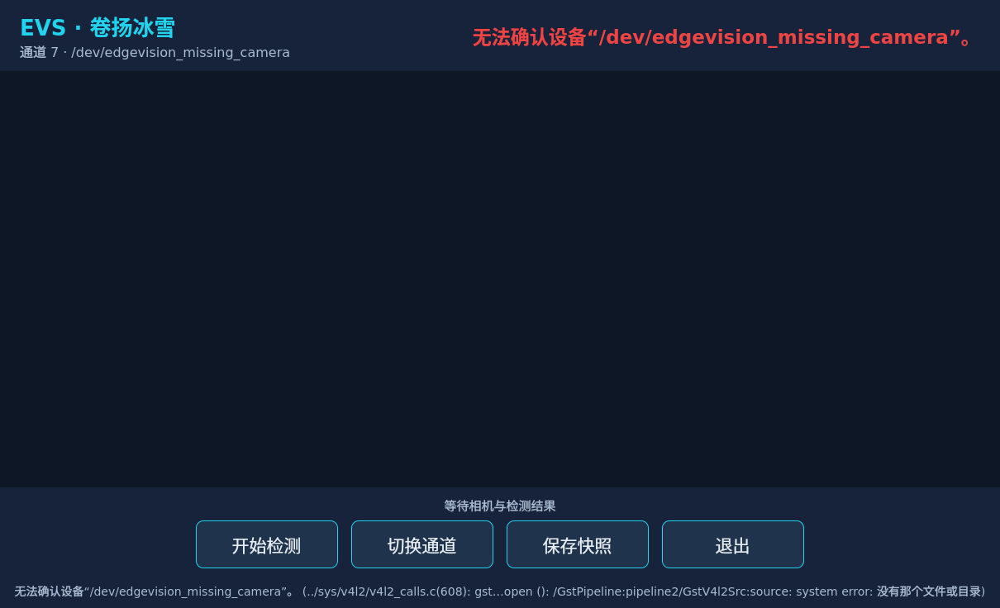

# 卷扬冰雪实时 UI：实现与板端验证

> 后续版本1.1已完成显示语义和稳定性修复，最新1000帧检查及剩余风险见[核验与优化](evs_ice_ui_核验与优化.md)。本文保留首版实现与当时验证记录。

本轮已完成有源码的 Qt Quick 单路实时 demo，并在 192.168.2.127 的 RK3588 Ubuntu 上完成真实相机、真实 RKNN 模型及真实 X11 窗口验证。旧 `evs_ice_ui`、旧库和其他功能程序未被覆盖。

这证明取流、算法调用、结果传递和界面操作链路能够运行，不代表卷扬定位或冰雪计量精度达标。实际室内非卷扬场景出现了大框误检，必须单独评估算法效果。

## 源码与部署位置

新增源码：`/home/tronlong/lyp/code/edgevision/tools/winch_ice_ui/`。

- `camera_source.*`：GStreamer 真实采集、协商 RGB、按 GstVideoFrame 的 plane offset/stride 整理紧凑 RGB。
- `ice_controller.*`：采集/算法工作线程、容量为 1 的待处理与已完成数据、串行 Detector 调用、生命周期和状态处理。
- `ui_support.*`：严格 JSON 通道选择、同帧数据结构、逐对象叠加、状态与快照。
- `Main.qml`、`main.cpp`、`resources.qrc`：Qt Quick 界面及参数入口。
- `tests.cpp`：宿主契约测试；不向正式 Detector 注入假结果。
- `run_winch_ice_ui.sh`：可迁移安装前缀的启动入口，默认 Qt Quick 软件渲染。

根 CMake 新增可选 `EVS_BUILD_ICE_UI`，默认 OFF；启用时要求 Linux、共享库和 OpenCV，并检测 Qt/GStreamer 开发依赖。纯算法库继续不依赖 Qt。`docs/winch_ice.md` 已补充界面构建与运行说明。

设备独立目录：

```text
/home/hytop/l_evs/winch_ice_ui_demo_20261021/
  source/       本轮构建使用的源码与模型
  build/        板端原生构建和测试
  package/      可运行安装包
    bin/winch_ice_ui
    bin/run_winch_ice_ui.sh
    lib/libevs_ice.so.1
    lib/libevs_core.so.1
    share/edgevision/configs/
    share/edgevision/winch_model.rknn
  evidence/     测试日志、脚本、图像、JSON及校验清单
```

`ldd` 已确认安装包加载 `package/lib` 中配套的冰雪与核心库，没有加载 `l_evs` 根目录的旧库。模型按现有约定在安装后手动复制，CMake 没有新增自动安装模型规则。

## 如何启动与操作

在设备已登录桌面的终端运行：

```sh
/home/hytop/l_evs/winch_ice_ui_demo_20261021/package/bin/run_winch_ice_ui.sh --channel 0
```

从 SSH 启动本轮已核对的用户 X11 会话：

```sh
DISPLAY=:0 \
XAUTHORITY=/run/user/1000/gdm/Xauthority \
XDG_RUNTIME_DIR=/run/user/1000 \
/home/hytop/l_evs/winch_ice_ui_demo_20261021/package/bin/run_winch_ice_ui.sh --channel 0
```

开始/停止控制本次程序自己的采集与算法线程；停止后可切换 JSON 中已启用的通道，再开始检测。保存快照会生成同一帧的原图 PNG、叠加 PNG 和结果 JSON；退出按钮会等待工作线程正常停止。启动脚本不会 pkill 其他检测程序，也不会修改系统库。

安装包通道配置：`package/share/edgevision/configs/camera_config.json`。目前映射 0→/dev/video0、1→/dev/video3、2→/dev/video13、3→/dev/video14。本轮真实取流验证的是通道 0；其他物理通道尚未逐路验证。

算法配置：`package/share/edgevision/configs/winch_ice.yaml`。当前阈值为 0.5。首版修改阈值后通过停止/重新开始读取新配置，没有热更新控件。通道切换由新宿主严格选择 JSON 项，并在每次初始化前绑定 Detector 的 camera_channel，不修改磁盘 YAML；这与旧 demo 固定 --channel 0 的逻辑不同。

可用验证参数：

```sh
# 有界的真实相机检测：完成 10 次 detect，保存最后一帧并退出。
QT_QPA_PLATFORM=offscreen \
/home/hytop/l_evs/winch_ice_ui_demo_20261021/package/bin/run_winch_ice_ui.sh \
  --channel 0 --frames 10 --snapshot-on-finish --log-json
```

`--snapshot-dir` 指定快照位置，`--task` 和 `--config` 可覆盖启动脚本的默认文件；`--no-autostart` 等待点击开始；`--quit-after-ms` 用于限时退出。offscreen 用于无人值守验证，不在桌面显示窗口。

## 已实现的处理链路

```text
严格选择相机通道与设备
  → GStreamer（应用请求宽高/帧率，协商 RGB）
  → 按实际行跨度整理原图 RGB
  → 最新待处理帧（容量1）
  → 当前公开 Detector API / 配套动态库 / RKNN
  → 原图 + 本帧 objects + 状态 + 帧号 + 通道
  → 最新完成包（容量1）
  → GUI 主线程读取 → Qt Quick 等比例显示与逐对象叠加
```

UI 不通过 PPM/stdout 分开拼接图像与结果，不在 GUI 线程做采集或推理。图像缓冲独立持有，在 GstBuffer unmap 后仍有效；帧序号采用 uint64，同 API 的毫秒时间戳分开。日志分别记录 detection 与 display 的同一组 session/frame_seq/channel；切换通道前完成旧线程停止，旧会话数据不再交付。

显示框使用新接口的原图像素左上角及宽高。各对象显示独立比例；无目标显示 NO RESULT，无效对象显示 N/A，部分对象无效会提示。报警读取库返回的 ALERT_WARN；旧框和旧比例不会在错误相机上继续显示。框上对象编号只是当前帧索引，不是稳定跟踪身份。

初始化和相机错误结束当前会话；单帧 API 错误作为错误观察结果交给 UI，后续帧可以恢复，验证模式会记录错误计数与失败退出码。当前同步 RKNN 调用没有硬取消接口，停止需要等待正在执行的调用返回。

## 最终版本验证结果

| 验证 | 实际结果 | 能说明的范围 |
| --- | --- | --- |
| 原生编译及依赖 | GNU 11.4、Qt 5.15.3、实际 GStreamer/OpenCV/RKNN 环境编译成功，安装包依赖路径正确 | AArch64 构建与动态链接可用 |
| CTest | 7/7 通过；新增宿主测试 PASS=47 FAIL=0 | 通道/像素/结果/快照契约及已有库回归 |
| 真实桌面交互 | 12 项检查通过，脚本正常退出 | 新窗口、真实帧、快照、重复启停、切换限制、错误及恢复、退出 |
| 报警传递 | 真实相机/NPU 5 帧，通过测试配置把 area_ratio 降到 0.1，得到库返回的报警 | 验证报警接线；不是雪景精度证据 |
| 无结果传递 | 真实相机/NPU 5 帧，把置信度阈值提高到 0.99，均为空对象并显示 NO RESULT | 不把未检测到目标显示成正常 0% |
| 连续运行 | 500 次真实 detect，500 次 GUI 完成包交付，API 错误 0，采集计数 501 | 短时连续链路与有界交付正常 |
| 同帧快照 | 元数据帧号能在对应 display/detection 记录中找到；原图、叠加图和 JSON 一起保存 | 图像与结果身份对应 |

500 帧测试使用安装包，从 `/tmp` 工作目录启动，证明配置与库不依赖源码工作目录。测试时采用 offscreen 界面；X11 桌面操作另由 gui_probe.py 验证。

本次 500 帧含初始化/相机启动共 46.690 秒，按整个墙钟区间为 10.709 次处理/秒；完整 detect 耗时中位数 66.522 ms、P95 82.258 ms，NPU 推理中位数 29 ms。界面显示的是近期计数速率，首次测量之前显示“--”，不把启动等待计入实时 FPS。请求配置为 25fps，但不能据此声称整个链路达到 25fps。

连续测试开始 10 秒后的 RSS 采样约 104.8～149.4 MiB，最后约 104.8 MiB。此为约 47 秒的短时观察，不能据此宣称长期无泄漏或完成小时级压力验收。

真实 GUI 检查包含：创建 X11 窗口、点击开始后显示真实帧、点击快照、核对快照与交付帧身份、运行中禁用切换、停止并释放、重新开始、再次停止、切换到不存在的设备后报错且没有旧帧、切回通道 0 恢复、退出时停止工作线程。错误相机是专门的测试 JSON 条目，不会改写正式相机配置。

## 精度与剩余边界

实际摄像头当前拍摄室内场景，模型却给出了大范围卷扬框，HSV 返回约 13%～15% 的候选占比。截图和日志均保留，未用人工框、固定 ROI 或 UI 修改值掩盖。这里的比例不是人工确认的真实冰雪面积。

首版已完成完整单路宿主；尚不包含多相机同时显示/并行检测、PLC 工况通信、外部声光联锁、目标跟踪、掩码显示和报警锁存。阈值由配置读取。当前库对多个候选、交叠和图像质量的约束仍然有效；本轮没有修改算法规则、公共 API 或模型。

双对象的数据/渲染路径已实现，宿主测试覆盖独立对象框和部分对象无效；真实相机当前场景没有完成双卷扬精度验收。其他物理相机、真实冰雪样本、多场景精度与长期运行还需要单独验收。

## 构建复现

在准备了同类依赖的 RK3588 Ubuntu 上：

```sh
cmake -S source -B build -DCMAKE_BUILD_TYPE=RelWithDebInfo \
  -DEVS_BACKEND=rknn -DEVS_WITH_OPENCV=ON -DEVS_WITH_GSTREAMER=ON \
  -DEVS_BUILD_SHARED=ON -DEVS_BUILD_ICE_UI=ON -DEVS_BUILD_LEGACY_TOOLS=OFF \
  -DRKNN_API_INCLUDE_DIR=/path/to/rknn/sdk \
  -DRKNN_API_LIB=/lib/librknnrt.so
cmake --build build -j2
ctest --test-dir build --output-on-failure
cmake --install build --prefix "$PWD/package"
cp winch_model.rknn package/share/edgevision/winch_model.rknn
```

模型 SHA256：`cff5bb8245653e2fcf6eec66ae7083aa6506fad1d2e4fd89bec933a6afe7d5e8`。

本地交付文件位于 `/home/tronlong/lyp/code/edgevision/build_ice_delivery/winch_ice_ui_20261021/evidence/`：

- `winch_ice_ui_rk3588_20261021.tar.gz`：运行包，已手动放入模型，依赖目标系统 Qt/GStreamer/OpenCV/RKNN。
- `winch_ice_ui_source_20261021.tar.gz`：对应构建源码；不包含模型、SDK 和构建树。
- `ctest.log`、`gui_probe_result.json`、`*_summary.json`：验证结果。
- `gui_probe.py`、`runtime_probe.py`：验证脚本。
- `gui_probe.log`、`*_probe.log`、`installed_ldd.log`、`source_binary_manifest.sha256`：调用与依赖证据。
- `ui_live.xwd`、`ui_stopped.xwd`、`ui_camera_error.xwd`：真实应用窗口截图。

运行包 SHA256：`876b9f99aaf378e63c2c9052a16c954c759d94b7eec70d2c298f0bd06e8ced2e`。

源码包 SHA256：`440fe9ed6c25b00b87fe79794b0b63a08d6de9f1bf0b191ef8c9894889000cc2`。

## 真实窗口截图

下图为设备真实窗口；其中室内场景的大框属于已明确记录的模型误检，不能当作真实卷扬或积雪识别正确的样例。



以下是使用专门测试配置选择不存在的设备后的界面，画面和旧检测结果均已清除。


