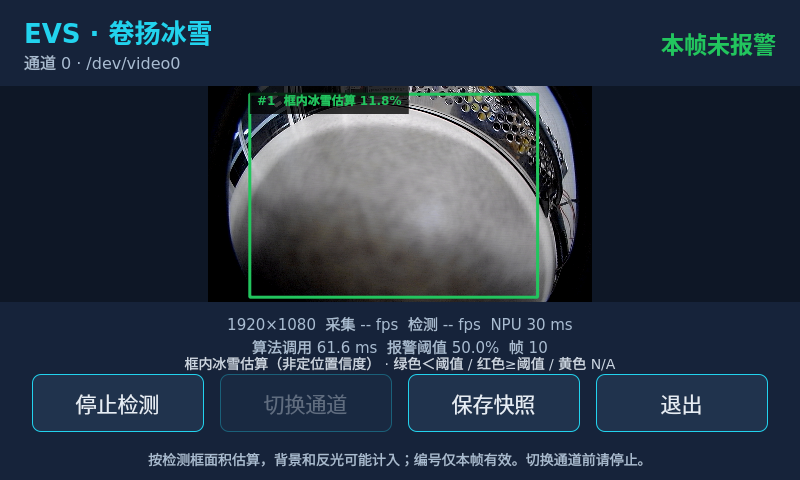

# 卷扬冰雪 UI：占比含义、稳定性核验与优化

核验日期：2026-10-21。源码根目录 `/home/tronlong/lyp/code/edgevision`；板端 `192.168.2.127`，RK3588 Ubuntu。

本报告补充《evs_ice_ui_实现与板端验证.md》。本轮修改仅涉及 `tools/winch_ice_ui/` 和对应接入说明，没有修改模型、计量规则、公共 Detector API 或报警阈值。

算法库、客户 API 和模型的阶段核验见[算法与 API 核验](../evs_ice/evs_ice_算法与API核验.md)。

## 1. 13.2% 究竟表示什么

按当前库的定义，它是“框内冰雪候选面积占比”的估算值：

```text
ice_ratio × 100%
= 框内符合 HSV 冰雪颜色规则、经形态学处理后的候选像素数
  ÷ 检测矩形框全部像素数 × 100%
```

例如一个框包含10000个像素，其中1320个被规则判为候选，结果就是13.2%。它不是模型置信度，也不是整幅图的冰雪比例。

模型负责定位卷扬，框是模型返回的卷扬框，不是冰雪轮廓。颜色规则默认S≤80、V≥180，再做3×3开闭运算；分母是矩形框width×height，没有把支架、缝隙和背景从卷扬真实表面中分割出来。白色地面、背景和反光可能误计，暗雪、透明冰可能漏计。

当前室内画面存在把地面误识别为卷扬的情况。即使API返回valid=true，也只表示通过了现有可观测性检查，不能证明框里真的有卷扬或冰雪。不能把现场约12%～15%的数值解释为已经确认的真实积雪覆盖率。

绿色表示有效估算低于阈值；红色表示有效估算达到或超过阈值；黄色虚线框/N/A表示无效。当前area_ratio=0.5，即50%。没有目标显示NO RESULT。编号#1、#2仅代表本帧顺序，不是跨帧跟踪ID。全局报警继续使用库返回的alert_level，UI不独立发明算法结论。

计量来源：`src/tasks/winch_ice/ice_measurement.cpp`；报警来源：`src/tasks/winch_ice/winch_ice_plugin.cpp`；显示来源：`tools/winch_ice_ui/ui_support.cpp`。

## 2. 已修复和改善的内容

| 问题 | 本轮处理 |
| --- | --- |
| 裸编号/百分比容易误读 | 框上改为“#1 框内冰雪估算 13.2%”；常驻显示颜色说明、分母估算提示和背景/反光限制 |
| 小窗口指标截断、标题区可能重叠 | 指标分两行；标题和状态区明确分配宽度；按钮宽度自适应；支持最小800×480 |
| 没有图像仍可点击保存 | 无帧时禁用快照；停止中禁用重复启停，并显示“正在停止…” |
| 停止或出错后还保留旧指标 | 清除旧图像的同时清除旧FPS、阈值和帧号显示 |
| 修改相机JSON后仍使用启动时缓存 | 每次开始、每次切换通道重新读取；无效配置报错，开始不会静默回退到别的相机 |
| 相机相对路径依赖工作目录 | 要求绝对设备路径；原有重复/禁用/缺失/类型校验继续生效 |
| 有限帧结束可能遗漏最后一帧 | 在消费完成队列前读取两个线程的完成标志；若线程在其后完成，下一轮先交付最终结果再结束会话 |
| Ctrl+C/终端断开/进程终止直接结束 | SIGINT、SIGTERM、SIGHUP的处理器只设置标志；GUI定时读取后正常停止并等待资源释放 |
| EOS时消费者已退出仍可能等待缓冲消费 | Appsink增加wait-on-eos=false；保留max-buffers=1、drop=true和有限时取帧 |
| 导出数据没有记录占比口径 | JSON新增ice_ratio_basis和object_identity；原有ice_ratio、confidence和坐标字段保留 |
| 现场难以判断实际依赖环境 | ready启动事件记录版本、Qt/GStreamer运行时版本、平台和配置路径；程序版本1.1 |

结束时序问题的关键不是调大队列，而是保证“观察到线程已经完成”之后，仍先消费最后一次写入的完整图像/结果包。容量仍为1，不累计旧帧。

## 3. 保持有效的实现约束

- 采集和检测各自在线程中执行，Detector初始化、detect、release在同一算法线程串行调用。
- 采集帧按实际GstVideoFrame offset/stride整理；解映射后仍持有独立RGB缓冲。
- 待处理帧、已完成帧各只有一个位置；慢消费者覆盖旧待处理数据，不无限积压。
- UI接收同一包中的原图、对象、帧号和通道；缩放时同步映射框，不通过分离的PPM/stdout猜测配对。
- 无目标、无效结果、API错误、相机错误分别显示；错误或过期时不会保留旧的正常绿框。
- UI调用配套的libevs_ice和libevs_core，不改动旧evs_ice_ui。运行包的库加载路径已核对。

## 4. 实测证据

本轮全部使用本设备真实相机、正式RKNN模型与配套动态库，没有向正式API注入假检测框。

| 检查 | 实际结果 |
| --- | --- |
| 板端原生构建 | 通过，程序版本1.1 |
| CTest全套 | 7/7通过；UI宿主检查PASS=53 FAIL=0 |
| X11真实界面 | 16项通过：启停、快照同帧、切换限制、错误恢复、配置重读等 |
| 最终帧 | 连续10次单帧会话：最后detect帧、最后交付帧、最终快照JSON帧号均一致 |
| 正常退出 | SIGINT、SIGTERM、SIGHUP及未开始时SIGTERM均正常退出；有会话时记录release和session_finished |
| 连续检测 | 1000次detect、1000次完成包交付、API错误0，采集1001帧 |
| 最小窗口 | 真实800×480窗口截图，按钮和提示可见；随后恢复最大化 |
| 依赖 | Qt5.15.3、GStreamer运行时1.22.9、xcb；加载package/lib中的配套so |

1000帧含启动、最终快照及退出共86.568秒，约11.55次处理/墙钟秒；detect中位数66.654ms、P95 79.948ms。此为offscreen稳定性检查，真实X11界面另行验证。完成包交付次数不等同于显示器实际刷新次数。

启动10秒后的RSS采样约75.6～148.4MiB，最后约75.6MiB；最后采样已接近资源释放阶段，不能据此推导稳态内存更低或证明没有泄漏。约87秒的测试不构成小时级稳定性验收。

证据：`review_20261021/ctest.log`、`gui_probe_result.json`、`runtime_review_result.json`、`review_sustained_summary.json`、`compact_review_result.json`，以及对应测试脚本和日志。



截图中的地面大框仍是模型误检，绿色仅表示当前估算低于报警阈值。

## 5. 兼容性范围

已实测的是本设备AArch64/RK3588 Ubuntu、Qt5.15.3和现有GStreamer/OpenCV/RKNN环境。CMake声明Qt≥5.12、GStreamer≥1.16；这表示源码依赖下限，不代表已经逐版本、逐板卡验证。

- Qt5宿主与算法库分开，Qt依赖没有进入算法库；没有新增Qt6接口。
- 继续使用设备现有drop属性；不强制使用GStreamer1.28才新增的leaky-type。wait-on-eos从1.8提供，在当前依赖下限内。
- 当前只实现Linux原始V4L2取流，经videoconvert转RGB；没有MJPEG/H.264解码链。不同设备不支持请求分辨率/帧率时会报错，不保证自动协商到其他模式。
- 默认软件渲染，避免额外要求可用的Qt Quick OpenGL环境；实际桌面还需要匹配的Qt平台/QML插件和字体。Wayland、eglfs、Qt6、其他发行版没有完成实测。
- 安装包是本机架构的程序，不是包含操作系统依赖的通用自包含包。配套核心库、冰雪库、模型和头文件应保持匹配，不能随意混入旧版本so。
- 本轮实际相机仍为通道0→/dev/video0；其他通道只有配置映射，没有逐路物理验证。

GStreamer官方属性说明：[wait-on-eos与版本](https://gstreamer.freedesktop.org/documentation/applib/gstappsink.html#appsink:wait-on-eos)，[Appsink队列、drop和leaky-type](https://gstreamer.freedesktop.org/documentation/applib/gstappsink.html)。

## 6. 下一阶段应优先处理的事项

1. **先验证定位和占比精度。** 准备实际卷扬的无雪、少量雪、重度雪、反光、暗光及遮挡样本；分别标注卷扬框和冰雪区域，核对漏检、误检和占比偏差。仅靠当前地面场景无法验收覆盖率。
2. **需要更准确覆盖率时调整计量口径。** 如果需求是“真实卷扬表面覆盖率”，需要表面有效区域或分割掩码作为分母，并验证雪/冰候选；不能只把UI文字改成覆盖率。若要显示冰雪掩码，应由库提供同帧诊断数据，不在UI重复实现一套不同算法。
3. **长时间验收和故障恢复。** 建议完成8～24小时的CPU/RSS、帧率及温度观察，覆盖相机拔插、设备忙、NPU错误和重复启停。目前相机异常明确停止，恢复后手动开始；尚无有上限的自动重连。
4. **进程级卡死恢复。** 信号退出依赖驱动和同步NPU调用最终返回；没有硬取消接口。产品常驻可加入心跳和外部看门狗，达到持续无帧阈值后重启进程。本轮没有安装系统服务或改设备自启动。
5. **快照和日志的长期运行行为。** 当前手动PNG压缩/落盘仍在GUI线程，慢存储可能短时影响界面响应；可以后续改为有界的独立保存任务。三个文件分别原子写入，JSON最后写，不能声称整组文件具有事务原子性。默认不逐帧落图；长期打开--log-json需配套日志轮转和磁盘容量管理。
6. **性能优化按实测推进。** 当前RGB整理、全尺寸图像复制和Qt绘制都消耗CPU；可评估减少拷贝、按显示分辨率缩图、RGA或纹理上传，但要重新验证色彩、stride、对象坐标和缓冲生命周期。不能只凭相机配置25fps就承诺整链路25fps。
7. **多实例和其他相机。** 当前没有跨进程相机互斥管理，启动重复程序可能设备忙；现场先退出旧窗口。多相机并行、不同硬件格式和新的显示后端需要单独实现及实测。

可选UI后续功能包括定位置信度独立展示、只读对象列表、阈值编辑与生效提示、掩码开关和报警历史。它们不解决当前模型误检，报警保持/联锁也不能用UI颜色替代。

## 7. 运行位置和复现

```text
/home/hytop/l_evs/winch_ice_ui_demo_20261021/
  source/tools/winch_ice_ui/     本轮宿主源码
  build/                       原生构建
  package/bin/winch_ice_ui      版本1.1
  package/bin/run_winch_ice_ui.sh
  package/lib/                 配套so
  package/share/edgevision/    模型、配置、接入说明
  evidence/review_20261021/    本轮证据与修复前备份
```

设备桌面终端：

```sh
/home/hytop/l_evs/winch_ice_ui_demo_20261021/package/bin/run_winch_ice_ui.sh --channel 0
```

SSH启动本轮已核对的X11桌面：

```sh
DISPLAY=:0 \
XAUTHORITY=/run/user/1000/gdm/Xauthority \
XDG_RUNTIME_DIR=/run/user/1000 \
/home/hytop/l_evs/winch_ice_ui_demo_20261021/package/bin/run_winch_ice_ui.sh --channel 0
```

先退出已经运行的同相机窗口。相机JSON和算法YAML位于`package/share/edgevision/configs/`；修改后停止/开始，或停下后切换通道。

修复前宿主源码为`evidence/review_20261021/ui_before_review.tar.gz`，修复前UI可执行文件为`winch_ice_ui_before_review`。旧算法和旧evs_ice_ui没有被替换。本轮运行包归档另用review后缀，原交付归档仍保留历史含义。
