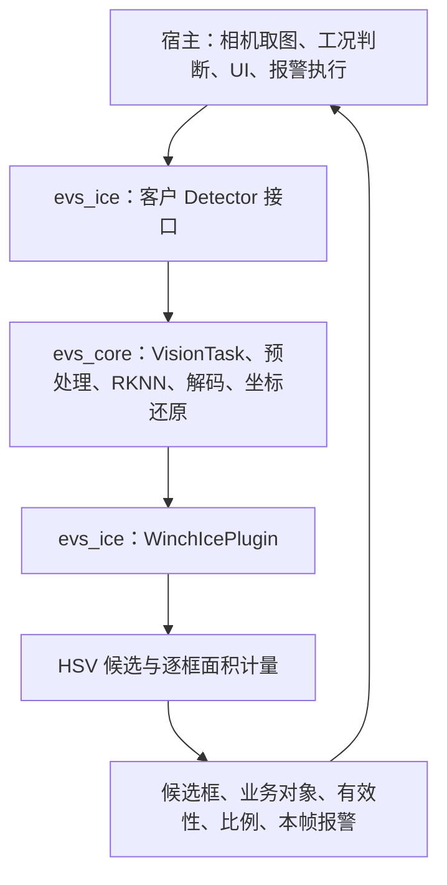
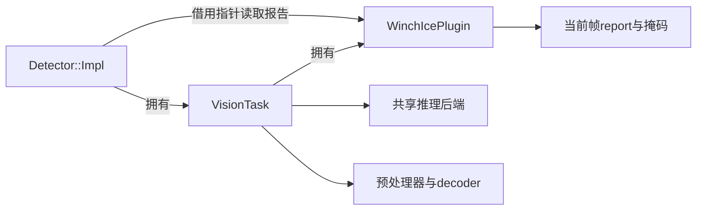
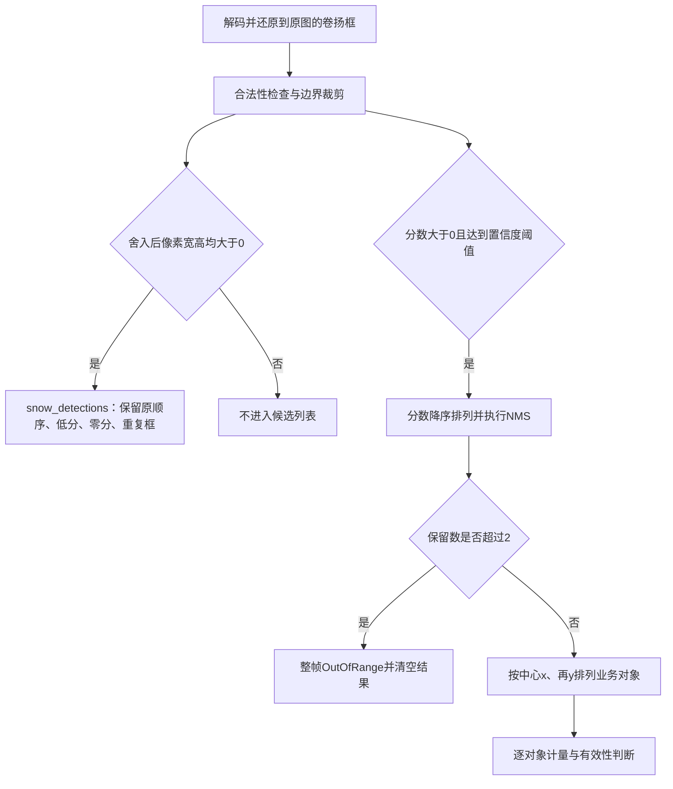
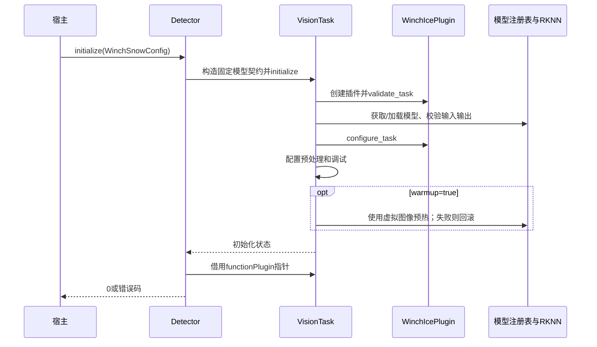
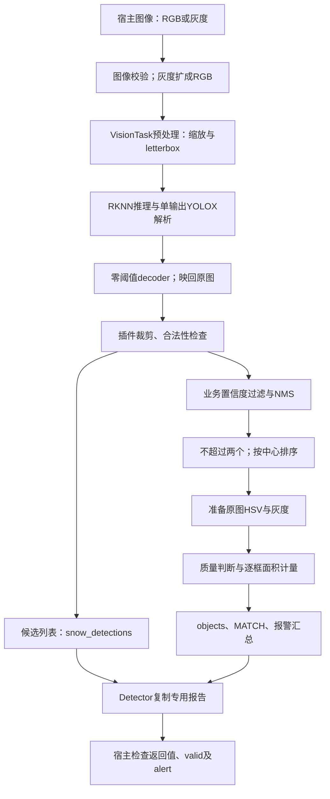
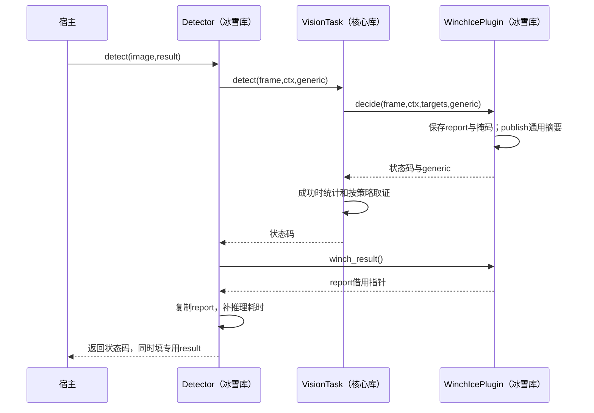

# evs_ice 冰雪插件库深度分析报告

> 分析日期：2026 年 10 月 25 日。
> 核验源码：`/home/tronlong/lyp/code/edgevision`；分支：`feature/split-core-plugin-libs`。
> 分析提交：`427a3a659603e78da43a4ba3f855667bd73ca99a`，核对时源码工作区干净。
> 本文保存于文档仓库 `idevelop_md/edgevision`，章节编排参照 `meari/mpc-base/mpc-base分析报告.md`，聚焦冰雪插件及其必需的核心库、宿主接入链路。
> 证据分为“当前源码确认”“本次主机实测”“历史记录”。本次未连接 RK3588、运行真实模型或执行相机/UI 验收。
> 调用链补充：第七章 7.5–7.11 按同一提交展开函数、库边界、数据传递、错误返回与释放顺序；本次补充为源码核对，没有新增板端验收结论。

冰雪插件的当前功能可以概括为：**输入一帧图像，用卷扬模型找出卷扬位置，再按每个卷扬矩形框统计 HSV 冰雪候选像素占比；任一有效对象达到阈值，即返回本帧报警。**当前还没有独立冰雪模型，也没有卷扬表面的精确分割。

接入时最需要理解四个独立判断：

| 判断 | 读取位置 | 含义 |
| --- | --- | --- |
| 调用是否成功 | `detect()` 返回的 `evs::ErrorCode` | 0 表示本次处理成功；无卷扬也可以成功 |
| 是否有业务卷扬对象 | `result.result_code`、`objects` | `RESULT_MATCH` 表示置信度/NMS 筛选后至少有一个业务卷扬 |
| 比例是否可用 | `objects[i].valid` | 只有为 true 时，才使用该对象的 `ice_ratio` |
| 本帧是否报警 | `result.alert_level` | 任一有效对象的 `ice_ratio >= area_ratio` 时为 `ALERT_WARN` |

`snow_detections` 名称沿用客户接口，**当前装的是业务阈值和 NMS 之前的卷扬候选框**。它与 `objects` 用途不同，不能据此认定模型识别到了雪。

**阅读导航**：第一次了解功能，按第一章 → 第四章 → 第五章 → 第七章阅读；宿主开发重点看第八章、第九章和第十一章。其余章节用于查代码、运行条件和实现限制。

| 章节 | 回答的问题 |
| --- | --- |
| [一、插件库概述](#一插件库概述) | 它能做什么，算法和宿主如何分工？ |
| [二、支持平台与运行条件](#二支持平台与运行条件) | 正式运行和主机测试分别需要什么？ |
| [三、目录结构总览](#三目录结构总览) | 源码在哪里，从哪个文件开始读？ |
| [四、核心架构设计](#四核心架构设计) | 两个库、Detector、任务和插件是什么关系？ |
| [五、核心模块深度解析](#五核心模块深度解析) | 框如何筛选，比例如何计算，何时报警？ |
| [六、工具与辅助能力详解](#六工具与辅助能力详解) | 如何回放、采集、显示、导出和定位问题？ |
| [七、关键数据流分析](#七关键数据流分析) | 从宿主入口沿函数调用、核心推理、插件判断和返回路线理解运行过程 |
| [八、编译构建体系](#八编译构建体系) | 如何构建、链接、部署，本次验证了什么？ |
| [九、接口设计规范与配置契约](#九接口设计规范与配置契约) | 每个方法和字段怎样正确使用？ |
| [十、可靠性、实现限制与改进方向](#十可靠性实现限制与改进方向) | 当前算法和交付还有哪些实际限制？ |
| [十一、典型使用场景](#十一典型使用场景) | 如何写宿主调用代码和运行示例？ |
| [十二、实现现状与接手要点](#十二实现现状与接手要点) | 接手时必须掌握什么，最近版本改了什么？ |

几个后文反复使用的术语：

| 术语 | 本文含义 |
| --- | --- |
| 宿主 | 调用算法库的应用，负责取图、调度、界面和实际报警执行 |
| 候选框 | 模型产生、尚未按业务置信度/NMS 筛选的卷扬位置 |
| 业务对象 | 通过业务筛选，进入计量阶段的卷扬框 |
| HSV | 按色相 H、饱和度 S、亮度 V 表示颜色；当前用 S/V 筛选冰雪候选像素 |
| NMS / IoU | NMS 用框的交并面积比 IoU 抑制重复框；IoU 越大，两个框越重合 |
| letterbox | 保持原图比例缩放并补边至模型尺寸；结果必须撤销补边、映回原图 |
| 掩码 | 与图像对应的像素选择图；这里用来限定卷扬矩形和冰雪候选区域 |

---

## 一、插件库概述

### 1.1 核心定位

`evs_ice` 是 EdgeVision 中模块号为 **`0x0008`** 的卷扬冰雪功能库，采用 C++17 和 CMake 构建。它以插件形式使用核心库的模型、预处理、推理、解码和任务生命周期能力，自身负责卷扬框业务筛选、HSV 计量、逐对象结果和报警判断。



这里的“冰雪检测”由两个算法阶段组成：

1. **目标定位**：配套 `winch_model.rknn` 检测卷扬，给出卷扬框和模型置信度。
2. **像素粗估**：在原图卷扬矩形内，根据低饱和度、高亮度像素估算冰雪候选占比。

模型负责定位，HSV 负责比例。模型置信度、HSV 比例、报警阈值是三种不同的量。

### 1.2 已有能力与职责边界

| 能力 | 当前实现 |
| --- | --- |
| 模型初始化 | 初始化时加载并复用模型，可选预热 |
| 图像输入 | 客户接口接收紧凑 RGB24 或 8 位灰度 |
| 卷扬候选输出 | 保留合法非零像素面积候选，保持模型顺序，含低分和零分框 |
| 业务卷扬输出 | 正分且达到置信度阈值后执行 NMS，最多两个对象 |
| 计量 | 对每个业务矩形分别计算候选像素数/矩形面积 |
| 无效对象标记 | 小框、交叠、极暗或均匀极白等情况保留对象但标为无效 |
| 报警 | 任一有效对象达到面积阈值，本帧报警 |
| 热更新 | 客户接口整体更新置信度、NMS、面积阈值三项 |
| 诊断 | 日志、成功帧窗口统计、只读掩码诊断、图片和相机示例 |
| 实时界面 | 可选 Qt Quick 宿主，负责取流、显示和快照 |

摄像头生命周期、工况门控、报警保持、重试策略、PLC/MCU 通信及实际控制动作由宿主负责。库每次同步处理一张图，不自行创建业务检测线程，不因报警自动停止后续检测。

依据：[客户接口](/home/tronlong/lyp/code/edgevision/include/evs/winch_ice.h:67)、[插件主逻辑](/home/tronlong/lyp/code/edgevision/src/tasks/winch_ice/winch_ice_plugin.cpp:312)。

### 1.3 分析范围

本次直接读取公共头、冰雪目录全部实现，以及 `VisionTask`、配置适配、模型注册、RKNN 显式输出解析、通用 decoder、CMake、测试和宿主相关代码。冰雪三个 `.cpp` 合计 933 行；加上两个私有头和客户公共头，直接相关 C++/头文件共 1,155 行，按当前文件物理行数统计，包含空行和注释。

本文说明当前实现，不把归档目录中的旧源码作为当前版本。已有的[算法与 API 核验](evs_ice/evs_ice_算法与API核验.md)、[库关系专项报告](卷扬冰雪库与核心库_架构关系_API差异及影响核验.md)可补充历史演变和验证记录。

---

## 二、支持平台与运行条件

### 2.1 正式运行与主机测试

| 环境 | 可做的事 | 实现边界 |
| --- | --- | --- |
| RK3588 Linux，配套 RKNN/OpenCV | 正式模型定位、HSV 计量、客户 Detector 调用 | 当前正式配置对应平台；仍需按当前模型和设备验收 |
| Linux PC，mock，无 OpenCV | 框架、配置、解码辅助逻辑、兼容与拒绝路径回归 | 正式 Detector 不能据此执行真实冰雪检测 |
| Linux PC，mock，有 OpenCV | 内部人工框/合成像素、阈值、掩码和错误清理回归 | 人工框属于测试入口；不证明 NPU 或模型精度 |
| 其他 Rockchip 平台 | 核心库存在 RKNN 后端，可准备相应构建 | 不能直接把 RK3588 模型视为 RK3576 可用模型 |
| x86/ONNX 或 QNN | 项目整体存在相关分支或预留 | 当前客户 Detector 固定 RKNN；QNN 无可用实现 |

“核心库支持某后端”与“正式冰雪客户接口支持该后端”需要分开判断。`Detector` 内部固定构造 RKNN、单类 YOLOX 的任务配置，修改 CMake 后端名不会把它自动切换为 PC 模型。

### 2.2 必需与可选依赖

| 组件 | 作用 | 是否为算法库必需 |
| --- | --- | --- |
| CMake ≥ 3.14、C++17 | 构建与语言标准 | 是 |
| RKNN SDK 头文件、目标运行库、匹配 NPU 驱动 | 模型加载和推理 | 正式检测必需 |
| OpenCV `core`、`imgproc` | 颜色转换、掩码、形态学、像素统计 | 正式冰雪计量必需 |
| GStreamer | 相机示例及 UI 取流 | 宿主依赖 |
| Qt5 / Qt Quick | 可选实时界面 | 宿主依赖 |
| RGA | 部分宿主工具的硬件预处理 | 可选，不属于冰雪规则实现 |

`EVS_WITH_OPENCV` 默认 OFF。库文件即使成功构建，也可能只是包含“不支持冰雪计量”的分支；不开 OpenCV 时，插件配置返回 `NotSupported`。

依据：[构建选项](/home/tronlong/lyp/code/edgevision/CMakeLists.txt:19)、[OpenCV 依赖](/home/tronlong/lyp/code/edgevision/CMakeLists.txt:171)、[无 OpenCV 拒绝路径](/home/tronlong/lyp/code/edgevision/src/tasks/winch_ice/winch_ice_plugin.cpp:253)。

---

## 三、目录结构总览

以下路径均相对于源码仓库 `/home/tronlong/lyp/code/edgevision`。

```text
edgevision/
├── CMakeLists.txt                        # 核心/插件静动库、依赖、测试、安装
├── include/evs/
│   ├── winch_ice.h                       # 客户结构、Detector、load_config
│   ├── status.h                          # 公共错误码、结果枚举、通用Result
│   ├── vision_task.h                     # 通用同步任务入口
│   ├── function_plugin.h                 # 功能插件基础接口
│   ├── function_task_hooks.h              # 可选任务扩展和未过滤候选标记
│   └── testing/ice_replay.h               # 回放/诊断支持；非正式人工框入口
├── src/
│   ├── vision_task.cpp                   # 通用装配和逐帧主链
│   ├── evs_register.h                    # 静态登记辅助
│   ├── core/
│   │   ├── config.cpp                    # 通用轻量配置解析
│   │   ├── model_registry.cpp            # 模型后端共享与引用管理
│   │   ├── backend_factory.cpp           # 后端选择及专用输出契约分派
│   │   ├── detection_decoder.cpp         # 行矩阵转Target
│   │   └── preprocess.cpp                # 颜色、缩放、letterbox及框坐标还原
│   ├── backend/rknn/
│   │   ├── rknn_backend.cpp              # SDK调用、模型形状校验、输出释放
│   │   └── detection_rows.h              # 显式单输出YOLOX等解析
│   └── tasks/winch_ice/
│       ├── winch_ice_api.cpp              # Detector对VisionTask的客户适配
│       ├── winch_ice_plugin.h/.cpp        # 配置适配、框筛选、计量编排、报警
│       ├── ice_measurement.h/.cpp         # 图像转换、HSV、掩码、面积计数
│       └── 待办.md                       # 实现状态及现场验收缺口
├── configs/winch_ice.yaml                # 正式算法配置；单路、640×640
├── winch_model.rknn                      # 卷扬定位模型；需单独部署
├── tools/
│   ├── ice_replay/                       # P6图片回放、JSON、叠图和掩码
│   ├── winch_ice_demo/                   # 无窗口相机检测CLI
│   └── winch_ice_ui/                     # 可选Qt Quick单路宿主
├── tests/
│   ├── test_ice.cpp                      # 配置、解码、像素、候选及结果契约
│   ├── ice_test_support.h                # 内部人工框测试适配
│   ├── test_ice_allocation.cpp           # 内存分配失败恢复
│   └── compat/                          # 旧插件接口兼容fixture
└── docs/winch_ice.md                     # 源码仓库接入说明
```

阅读顺序建议为：`winch_ice.h → winch_ice_api.cpp → VisionTask::finishDetect() → WinchIcePlugin::decide() → ice_measurement.cpp`。定位比例异常时，优先看原图框和计量逻辑；定位模型无框时，先检查 RKNN 契约与预处理。

---

## 四、核心架构设计

### 4.1 两个库、一条任务链

| 层次 | 实际归属 | 职责 |
| --- | --- | --- |
| 客户 API | `libevs_ice` | `Detector`、客户结构与通用任务配置适配 |
| 公共任务 | `libevs_core` | 生命周期、预处理、推理、解码、坐标回映射、调试统计 |
| 功能策略 | `libevs_ice` | 卷扬框筛选、HSV 计量编排、逐对象报告与本帧报警 |
| 像素处理 | `libevs_ice` | HSV 候选、原图矩形掩码、开闭运算及计数 |
| 产品宿主 | 示例或产品应用 | 相机、工况、线程调度、UI、报警保持与控制 |

`libevs_ice` 依赖核心库，不是可以脱离核心库独立推理的完整引擎。动态链接时通常需要 `libevs_ice.so.1 + libevs_core.so.1`，并具备 RKNN/OpenCV 等运行依赖。

### 4.2 Detector 是适配层，任务内只有一个冰雪插件

`Detector::Impl` 持有一个 `VisionTask`，初始化后从 `task.functionPlugin()` 获取 `WinchIcePlugin*` 借用指针。该指针指向任务内部插件；客户 API 没有另外创建第二套筛框或计量引擎。



每帧先由 `VisionTask` 执行完整流程，插件生成专用报告；`Detector` 再复制报告给调用方。这样客户接口和通用任务入口使用同一份业务逻辑。[实现](/home/tronlong/lyp/code/edgevision/src/tasks/winch_ice/winch_ice_api.cpp:48)。

### 4.3 插件登记与可选能力

插件通过静态对象登记两类内容：

- `FunctionPluginRegistration(0x0008, ...)`：按功能号创建冰雪插件。
- `FunctionConfigRegistration(0x0008, ...)`：解析冰雪专属配置、补齐默认值、处理模型相对路径。

`WinchIcePlugin` 同时实现三个接口：

| 接口 | 冰雪使用方式 |
| --- | --- |
| `IFunctionPlugin` | 原有 `configure/decide/reset` 等功能接口 |
| `IFunctionTaskHooks` | 模型契约校验、扩展参数配置、预热要求、失败清理 |
| `IUnfilteredDetectionInput` | 要求通用任务将上层 decoder 的置信度阈值设为 0 |

这些扩展让公共任务按能力调用，避免在任务主链硬编码“模块 8 的特殊处理”。未过滤标记只取消该层 decoder 的业务阈值，不能恢复更早已被后端丢弃的数据；正式单类 YOLOX 显式路径本身没有后端 NMS。

登记仍依赖链接器保留对象文件、系统加载器实际加载动态库。当前项目没有自动扫描目录、`dlopen` 和卸载插件的管理器。[接口](/home/tronlong/lyp/code/edgevision/include/evs/function_task_hooks.h:7)、[登记](/home/tronlong/lyp/code/edgevision/src/tasks/winch_ice/winch_ice_plugin.cpp:574)。

### 4.4 模型共享与并发边界

模型注册表以 `backend + Model_path` 为键共享后端，重复使用同一键时增加引用，释放到零时销毁。注册表内部互斥保护的是注册与引用操作，没有给每帧推理建立统一互斥。

因此一个实例的方法应串行调用；多个实例若共享同一模型后端，宿主也应统一串行调度。对象报告和掩码属于各插件实例，模型共享不等于跨实例推理安全。[注册表](/home/tronlong/lyp/code/edgevision/src/core/model_registry.cpp:10)。

---

## 五、核心模块深度解析

### 5.1 客户接口适配：winch_ice_api.cpp

`make_task_config()` 将 `WinchSnowConfig` 转为 `TaskConfig`，固定以下模型契约：

| 字段 | 客户 Detector 内部值 |
| --- | --- |
| `module_id` | `0x0008` |
| `backend` | `rknn` |
| `output_format` | `yolox` |
| `decoder_classes` | 1 |
| `person_class_id` | 0，在这里表示卷扬类别，沿用通用字段名 |
| `input_format` | `rgb` |
| `letterbox` | true |
| `ground.enabled` | false |
| `video_channel` | 客户配置中的唯一相机号 |

客户需要提供模型路径和输入尺寸，并可设置三项检测阈值。模型格式、类别及 letterbox 由适配层固定，客户接口不支持借这些内部字段自由更换输出布局。

插件初始化还检查：模型路径非空、输入宽高各在 1–8192、关闭 ground、输入色序为 RGB/BGR；通用入口允许类别数 1–4096，目标类别须在对应范围内，后端为 RKNN、输出格式属于 flat6/yolov8/yolox。客户 Detector 在此基础上进一步固定 RGB、单类 class0、YOLOX 和 letterbox。实际模型形状和网格检查会继续收紧条件，例如 YOLOX 要求输入宽高能被 32 整除。

`initialize()` 已初始化时直接返回成功，不重新加载新参数。需要更换模型、输入规格或相机时，先 `release()` 再初始化。初始化过程借助通用任务的模型引用回滚；若要求预热，冰雪插件会要求预热成功。[适配](/home/tronlong/lyp/code/edgevision/src/tasks/winch_ice/winch_ice_api.cpp:20)、[初始化](/home/tronlong/lyp/code/edgevision/src/vision_task.cpp:124)。

### 5.2 图像适配：RGB 与灰度

客户 `ImageData` 只包含数据指针、宽、高、通道数和毫秒时间戳，没有 stride 或缓冲区长度。

- `channels=3`：按紧凑 RGB24 解释，行长度为 `width × 3` 字节。
- `channels=1`：将每个灰度值复制到 R/G/B 三通道，临时向量存活到同步调用返回。
- 其他通道数、空指针或不合法尺寸：返回错误，清空当前帧业务结果。

RGB 缓冲由宿主拥有，在 `detect()` 返回前必须有效。带行填充的 RGB、BGR、NV12 不能直接按客户结构送入，应先由宿主转换。通用 `VisionTask + Frame` 的底层路径支持 RGB/BGR/NV12 和 stride，但它比客户 Detector 接口更宽，不能混用输入约定。

客户尺寸检查要求宽高非零，宽不超过 `INT_MAX/3`、高不超过 `INT_MAX/2`、总像素数不超过 `INT_MAX`，以避免内部整数运算溢出。这些上限属于表示范围检查，不是实际内存容量或可达到帧率的承诺。图像实际缓冲至少要有 `width × height × channels` 字节，仍由宿主保证。

灰度转三通道后饱和度恒为 0，HSV 计量主要依赖亮度，丢失颜色区分能力。接口支持灰度不等于灰度现场精度已验收。[图像适配](/home/tronlong/lyp/code/edgevision/src/tasks/winch_ice/ice_measurement.h:43)。

### 5.3 通用任务主链：VisionTask

一帧的处理顺序为：校验相机和图像 → 预处理 → RKNN 推理及显式行解码 → 通用 decoder → 撤销 letterbox/恢复原图框 → 插件判断 → 调试统计与报告。

冰雪关闭地面映射，不依赖矩阵标定、地面距离或吊钩位置。`MachineContext` 仍存在于通用函数签名中，冰雪 `decide()` 不使用它。

通用任务通过 `IUnfilteredDetectionInput` 检测到冰雪需求后，用 0 阈值调用 decoder，使低分、零分候选能进入插件。业务置信度阈值在插件内部统一执行。[任务主链](/home/tronlong/lyp/code/edgevision/src/vision_task.cpp:329)。

### 5.4 卷扬模型与显式 YOLOX 解码

正式 Detector 固定使用单类 YOLOX。RKNN 后端先检查实际输入尺寸、3 通道、单输出张量以及输出元素数，之后按明确契约解析。

对于配套 640×640 模型，输出原始行布局为：

```text
[1, 8400, 6]
每行：[tx, ty, tw, th, objectness, class_probability]
8400 = 80×80 + 40×40 + 20×20
```

在 stride 8、16、32 的网格上进行还原：

```text
center_x = (tx + grid_x) × stride / input_width
center_y = (ty + grid_y) × stride / input_height
width    = exp(tw) × stride / input_width
height   = exp(th) × stride / input_height
confidence = objectness × class_probability
```

两项概率按模型已激活处理，不再重复 sigmoid。单类解码后是 `[N,5]` 的归一化行矩阵；后续 decoder 转成 `Target`。输入宽高还须满足 YOLOX stride 网格约束，不能只在 YAML 填任意正整数。

当前解析保留合法零分行的几何信息。原始 NaN/Inf 会拒绝；有限原始值解码后几何无法安全表示时，零分行可以留下空几何，正分行则拒绝整帧。它不是对任意六列模型的通用猜测解析。

虽然共享后端有 YOLOv8 split/fused 等代码，正式 Detector 的 `classes=1 + yolox` 会进入专用显式单输出路径，不通过共享 COCO 多头自动识别链。

当前模型文件为 10,665,756 字节，SHA-256：

```text
aa328d06f185bdf126a10b0357a28caa1249246e89e14474eb7669b9237550b7
```

本次核对了文件哈希；形状解释按源码和既有模型说明分析，未调用真实 RKNN 查询或执行模型。源码能够检查形状，仍不能自动证明模型类别语义、训练质量和色序配套正确。

依据：[契约分派](/home/tronlong/lyp/code/edgevision/src/core/backend_factory.cpp:43)、[模型校验](/home/tronlong/lyp/code/edgevision/src/backend/rknn/rknn_backend.cpp:222)、[原始行解码](/home/tronlong/lyp/code/edgevision/src/backend/rknn/detection_rows.h:47)。

### 5.5 坐标还原与矩形定义

模型框先从模型输入坐标撤销 letterbox，映回原图归一化坐标。插件再裁剪到 `[0,1]` 图像边界，并将两端点分别乘原图宽高、`lround()` 舍入和限界。

最终 `Detection` 使用：

```text
x, y            原图像素左上角
width, height   原图像素宽高
像素范围         [x, x+width) × [y, y+height)
```

`width/height` 不是右下角坐标。框显示、掩码和面积分母使用同一套舍入后的端点，避免画框范围与计量范围不一致。

计量使用原始分辨率图像；模型输入 640×640 不意味着以 640×640 图像计算 HSV。也没有将每个矩形裁剪成独立小图再做等价声明，当前实现使用全图掩码及全图形态学边界处理。[像素框转换](/home/tronlong/lyp/code/edgevision/src/tasks/winch_ice/winch_ice_plugin.cpp:168)。

### 5.6 框处理的两个分支：候选列表与业务对象

插件首先校验几何、裁剪框、检查置信度、筛选卷扬类别，再分成两路：



两路差异如下：

| 规则 | `snow_detections` | `objects` |
| --- | --- | --- |
| 数据含义 | 临时卷扬候选 | 业务卷扬对象与计量结果 |
| 置信度 | 包括低分和 0 分 | 必须 `>0` 且 `>= confidence_threshold` |
| NMS | 不执行 | 执行 |
| 顺序 | 保持模型解码顺序 | 按框中心从左到右，x 相同再按 y |
| 数量 | 无 Top-K/两对象截断 | NMS 后超过两个则整帧报错 |
| 零像素面积框 | 排除 | 正分微小框仍可能进入，随后计量无效 |
| 比例/有效性 | 不提供 | 提供 `ice_ratio` 和 `valid` |

由于像素面积筛选条件不同，`objects` 不保证严格是 `snow_detections` 的子集。候选列表“不过滤”也是相对业务阈值/NMS 而言，仍受格式合法性、类别、裁剪、像素面积和整帧失败规则约束。

NMS 采用置信度降序贪心保留，当与已保留框的 **IoU 严格大于** `nms_threshold` 时抑制。等于阈值不会被这一条件抑制；同分先后没有稳定排序保证。阈值为 1 时完全重叠框也可能同时留下，随后因交叠而无法计量。

依据：[候选与业务分流](/home/tronlong/lyp/code/edgevision/src/tasks/winch_ice/winch_ice_plugin.cpp:405)。

### 5.7 HSV 候选像素生成

`prepare_ice_pixels()` 先得到 BGR 原图，再生成灰度图与 HSV 候选掩码。默认候选条件为：

```text
0 <= H <= 179
0 <= S <= 80
180 <= V <= 255
```

也就是默认不限制色相，筛选“低饱和度且较亮”的像素。HSV 只是颜色规则，不提供雪、霜、冰的语义分类。

整帧颜色转换和候选掩码每次准备一次，供该帧多个卷扬复用。当前即便业务对象为空，也会先准备像素数据，因此成功“无框”仍有相关图像处理成本。[像素准备](/home/tronlong/lyp/code/edgevision/src/tasks/winch_ice/ice_measurement.cpp:27)。

### 5.8 逐对象质量判断、形态学与面积统计

业务对象经过以下判断后才会计量成功：

1. 像素框宽、高均至少 3；更小的框保留但无效。
2. 与另一个保留对象没有正面积交叠；有交叠时相关对象均不计量，边界贴合不算交叠。
3. 在该矩形掩码内计算灰度均值和标准差，排除当前能识别的不可观测情况。

不可观测条件为：

```text
mean_gray < 12
或者
mean_gray >= 250 且 stddev_gray < 3
```

前者表示极暗，后者表示接近纯白且变化很小。它们是有限质量检查，不是完整的遮挡、结霜或相机致盲检测。

可计量时，在矩形掩码内取 HSV 候选，使用 3×3 矩形核先开运算、再闭运算，之后再次与矩形掩码相交，统计非零像素：

```text
surface_pixels = box.width × box.height
snow_pixels    = 形态学处理后且位于矩形内的候选像素数
ice_ratio      = snow_pixels / surface_pixels
```

例如矩形 100×100，最终候选像素 6,000，则比例为 0.60。这里是公式示例，不是本次现场测量。

**分母是整个检测矩形，包含框内背景和支架。**它不等于真实卷扬表面积，也不是雪的体积、厚度或物理表面覆盖率。开闭运算会改变细小区域，统计分子也不等于直接阈值命中的原始像素数。

实现用全分辨率 `surface/snow` 掩码，不是只分配 ROI 大小的掩码。这便于诊断，也会随原图尺寸和对象数增加内存流量。[逐框计量](/home/tronlong/lyp/code/edgevision/src/tasks/winch_ice/ice_measurement.cpp:86)、[质量编排](/home/tronlong/lyp/code/edgevision/src/tasks/winch_ice/winch_ice_plugin.cpp:478)。

### 5.9 结果汇总与报警

汇总逻辑只有两个业务判断：

```text
result_code = objects非空 ? RESULT_MATCH : RESULT_NO_RESULT
alert_level = 存在(valid && ice_ratio >= area_ratio) ? ALERT_WARN : ALERT_NONE
```

默认 `area_ratio=0.5`，使用包含等号的比较。两个有效对象一个 20%、一个 60% 时，本帧报警；一个有效 20%、另一个无效时，本帧不报警，但宿主仍应显示那个对象的计量异常。

`RESULT_MATCH` 不依赖 HSV 有效性。因此“有对象但全部无效”仍是 MATCH，比例为 -1，报警为 NONE；这不能解释成冰雪风险已排除。

报警没有连续帧门槛、滞回或跨帧保持。20% → 60% → 20% 的输入比例对应不报警 → 报警 → 不报警；重复时间戳也会再次处理。`exit_on_alarm` 仅保留配置兼容，不使检测器停止或进程退出。[汇总与通用输出](/home/tronlong/lyp/code/edgevision/src/tasks/winch_ice/winch_ice_plugin.cpp:281)。

### 5.10 错误清理与实例状态

每帧开始重新建立报告并清空旧掩码；拒绝调用时清空候选、对象、报警和计量时间戳。内存分配失败或明确后处理错误会使整帧失败；小框、交叠、不可观测等对象级问题通常通过 `valid=false` 表达，整帧仍可返回 0。

`Detector::detect()` 捕获 `std::bad_alloc` 并映射为内存错误，其他 `std::exception` 映射为后处理失败，再执行清理。不能据此宣称所有 API、任意回调异常都被统一兜底；例如初始化、热更新没有相同的完整异常捕获范围。

跨帧保留的是配置、模型引用和日志统计，不保留上帧比例作为当前结果。对象索引也只属于当前帧；本库没有为两个卷扬实现稳定跟踪 ID。[清理](/home/tronlong/lyp/code/edgevision/src/tasks/winch_ice/winch_ice_plugin.cpp:302)、[客户异常边界](/home/tronlong/lyp/code/edgevision/src/tasks/winch_ice/winch_ice_api.cpp:126)。

---

## 六、工具与辅助能力详解

### 6.1 ice_replay：固定图片回放

图片工具直接调用正式 Detector，目前只读取 **P6 PPM**，JPEG/PNG 需先转换。输出包括 JSON、叠加图和可取得的逐对象掩码，适合固定同一帧反复核对坐标、颜色和阈值。

JSON 包含 `snow_detections`，并显式标记：

```json
{"detections_target":"winch","detections_stage":"pre_confidence_pre_nms"}
```

候选 JSON 可很大，叠图仍只画 `objects`。无对象显示 `NO WINCH`，有对象但均无有效计量显示 `MEASUREMENT N/A`，有有效计量再按报警状态显示 `ALARM/NO ALARM`。[回放输出](/home/tronlong/lyp/code/edgevision/tools/ice_replay/replay_io.h:78)。

工具也支持 `--sequence sequence.json`，依次读取 `frames` 数组。每项要求 `angle/working`，可选 `image/valid/context_age_ms/image_age_ms`；逐项 image 相对路径按序列 JSON 目录解释，未指定则使用命令行输入图。序列模式用来演示逐帧输入及宿主工况门控，不提供人工框，也不为模型补充跨帧跟踪能力。

产物以输出前缀组织，包含 `_result.json`、`_original.ppm`、`_overlay.ppm`，以及可取得的 `_object_<序号>_roi.pgm`、`_object_<序号>_snow.pgm`；其中 roi 文件保存 surface 掩码，多帧时前缀加帧序号。复用前缀会先删除旧图像和掩码，跳过检测或 API 报错时只保留本次 JSON，避免把旧掩码当成本帧结果。正常完成且 API 均未报错退出 0；出现检测 API 错误会累计并最终退出 1，参数、配置、读图等异常退出 2。无业务对象或宿主跳过检测均可能正常退出，所以脚本仍应检查 JSON 中的 `api_called/host_reason/status`。

### 6.2 winch_ice_demo：相机命令行宿主

相机 CLI 负责采集、NV12 转紧凑 RGB、调用 Detector 和输出结果，本身不创建显示窗口。可通过设备节点或相机 JSON 选择来源；显式通道必须与任务配置一致，采集尺寸以实际协商结果为准。

默认逐帧检测。可选 `--simulate-context` 或 `--context-json` 演示宿主门控，二者互斥。`host_gate.h` 的示例规则要求工况有效、数据新鲜、大臂角度恰为 0、正在作业；默认新鲜度窗口为 500 ms。这些条件属于宿主示例，没有放进冰雪算法内部。[门控](/home/tronlong/lyp/code/edgevision/tools/ice_replay/host_gate.h:33)。

相机 CLI 检查输入为紧凑 NV12、宽高为偶数，且缓冲长度恰好匹配 `width × height × 3/2`，之后转换为 RGB。首帧等待上限 8 秒、后续为 3 秒；超时或格式不符走异常退出。外部工况 JSON 每帧读取 `boom_angle/is_working/valid/timestamp_ms`，读取或解析失败时按无效工况处理，宿主跳过帧会清空本帧显示结果。`--out` 控制是否额外落盘，终端 JSON 仍逐帧输出。

### 6.3 winch_ice_ui：可选实时界面

Qt Quick 宿主负责单路采集、同帧图像与结果配对、开始/停止、停止后切换通道和保存快照。框采用原图像素坐标，界面按有效性和比例显示绿/红框，无效对象显示黄色虚线及 N/A。

UI 调用相同的 Detector 动态库，没有另写一套 HSV 报警算法。当前快照 JSON 输出对象和状态，尚未导出完整 `snow_detections`；不能用 UI 快照代替 CLI 候选输出。[宿主说明](/home/tronlong/lyp/code/edgevision/tools/winch_ice_ui/README.md:1)、[快照序列化](/home/tronlong/lyp/code/edgevision/tools/winch_ice_ui/ui_support.cpp:128)。

### 6.4 掩码与内部测试入口

只读掩码诊断可复制插件当前计量的 `surface/snow`，供示例保存和查看。无效对象可能只有 surface 而无 snow；跳过计量的对象可能没有可导出掩码，不应以“没有掩码文件”直接推断 API 未运行。

正式 `Detector` 无人工框输入，也无固定区域代替模型的回退。人工框来自内部测试适配，用来隔离像素计量规则。测试能注入框不代表客户可跳过模型。[掩码复制](/home/tronlong/lyp/code/edgevision/src/tasks/winch_ice/winch_ice_plugin.cpp:519)。

### 6.5 统一日志与成功帧窗口

日志经 `EVS_LOG` 桥接统一 ALOG，宿主可注册 C 回调。`alg_init()` 是日志接入函数，不是 Detector 或模型初始化。

`4e193f3` 新增诊断日志，统计输入框、裁剪为空、其他类、零面积、零分、低分、NMS 抑制、候选数、计量成功、不可观测、小框、交叠及报警帧等。序号在成功处理路径推进：第一帧、之后每逢序号 100 的倍数输出 INFO 并清窗口，其余输出 DEBUG；释放/reset 时输出剩余窗口。

因此首窗口为 1 帧、第二窗口为第 2–100 帧，共 99 帧，后续通常每 100 帧一窗。拒绝帧不进入这一成功窗口，不能拿窗口计数当全部调用数。

宿主日志回调是进程级设置，注册和替换未建立同步保护，应在并发检测前完成；回调内应自行隔离异常。大量候选逐帧输出 JSON 的成本也不包含在“模型纯推理耗时”这一简单解释中。[窗口统计](/home/tronlong/lyp/code/edgevision/src/tasks/winch_ice/winch_ice_plugin.cpp:348)、[日志回调实现](/home/tronlong/lyp/code/edgevision/src/core/algo.cpp:13)。

---

## 七、关键数据流分析

### 7.1 初始化流程



若先从 YAML 读取，`load_config()` 在此之前执行。加载配置成功只表示配置解析和部分契约检查通过，不等于模型文件、形状、SDK 和全部阈值范围已通过正式初始化检查。

### 7.2 单帧成功主链



实际流程也会在无业务框时准备图像数据并返回空对象；图中两个输出分支在同一次调用内生成，没有第二次模型推理。

### 7.3 常见结果状态

| 当前帧情况 | 返回值 | `result_code` | `objects` | `alert_level` |
| --- | --- | --- | --- | --- |
| 完成处理，没有业务卷扬 | 0 | NO_RESULT | 空 | NONE |
| 只有低分或零分候选 | 0 | NO_RESULT | 空，候选列表可非空 | NONE |
| 一个有效对象，比例 0.20 | 0 | MATCH | 1 个，valid=true | NONE，按默认阈值 |
| 一个有效对象，比例 0.50 | 0 | MATCH | 1 个，valid=true | WARN，达到默认阈值 |
| 两个有效对象，比例 0.20/0.60 | 0 | MATCH | 2 个 | WARN |
| 有业务框，但均太小、交叠或不可观测 | 0 | MATCH | 保留，valid=false、比例 -1 | NONE |
| 一个无效、一个有效且 0.60 | 0 | MATCH | 2 个 | WARN |
| NMS 后仍超过两个业务对象 | OutOfRange | NO_RESULT | 清空，候选也清空 | NONE |
| 图像、推理、内存或后处理错误 | 非 0 | 清理后 NO_RESULT | 清空 | NONE |

表中百分比是行为说明，未作为本次真实模型输出。无报警可能对应无对象、无效计量或有效低比例，宿主应保留这些差别。

### 7.4 热更新流程

客户将完整 `DetectConfig` 传给 `Detector::updateConfig()`，API 复制当前模型/相机配置，仅替换三项阈值，再交给任务与插件校验。普通校验失败保留旧配置；成功后下一次检测使用新阈值，不自动重算已返回的上一帧。

例如将 `area_ratio` 从 0.5 改为 0.7，不会改变同一图像中按 HSV 算出的比例，只会改变报警比较；修改置信度/NMS 会改变业务对象集合，但成功帧候选列表不按这三项业务阈值筛减。

### 7.5 函数调用链的读法与执行边界

前面7.1–7.4用于先看全貌，下面按实际执行顺序追到函数。建议先读7.6初始化，再读7.7单帧主链；需要定位模型交互时查7.8，需要找“结果从哪里回来”时查7.9。

| 阅读目的 | 直接入口 |
| --- | --- |
| 看程序怎样从main启动并循环 | [7.11.4 宿主入口](#7114-从宿主main把这些调用串成程序) |
| 看模型和插件怎样准备好 | [7.6 初始化调用](#76-配置登记与初始化的逐函数调用) |
| 顺着一帧进入核心与业务插件 | [7.7 单帧函数树](#77-一帧图像的逐函数调用树) |
| 看返回数据、失败和资源释放 | [7.9 返回路线](#79-成功结果与失败状态分别怎样返回)、[7.10 更新与释放](#710-热更新释放与析构的调用顺序) |

调用树的标记如下：`[宿主]`为产品应用或demo，`[冰雪]`为libevs_ice，`[核心]`为libevs_core，`[SDK]`为RKNN外部调用，`[CV]`为OpenCV外部调用；`[内联]`表示头文件中的实现，实际机器码可落在调用它的编译单元中。缩进表示调用关系，同层从上到下为执行顺序，条件分支会明确写出。

**本文的完整展开范围是正式Detector所经的项目自有调用链，以及其RKNN/OpenCV调用边界。**标准容器、系统加载器、RKNN驱动和OpenCV函数内部实现不在本仓库内；本节列到对外函数边界。逐帧几何和像素规则由第五章解释，下面着重说明它们何时执行、传入什么、结果交给谁。

最容易混淆的运行关系是：宿主先进入冰雪客户API，API调用核心VisionTask；核心完成通用处理后再调用冰雪插件。两者通过普通同步函数调用往返，不通过进程间消息，也没有额外冰雪推理线程。

| 阶段 | 发起者与跨库方向 | 主要交付数据 |
| --- | --- | --- |
| 配置 | 宿主→冰雪加载器→核心解析→冰雪配置适配 | WinchSnowConfig |
| 初始化 | 冰雪Detector→核心任务→冰雪插件配置 | 持久任务、后端引用、decoder和插件 |
| 每帧前半段 | 冰雪Detector→核心任务→RKNN | 模型输入字节、解码行矩阵、原图Target |
| 每帧业务 | 核心任务→冰雪插件→OpenCV | 候选、objects、比例、掩码与报警 |
| 每帧返回 | 插件→核心返回状态；Detector再读取插件报告→宿主 | ErrorCode和WinchSnowResult |

### 7.6 配置、登记与初始化的逐函数调用

#### 7.6.1 库加载时登记，初始化时创建实例

在系统加载器实际加载插件时，静态登记对象先运行：

```text
[冰雪] kWinchIce：FunctionPluginRegistration构造
  └─ [核心] register_function_plugin(0x0008, make_winch_ice_plugin)
       └─ 在功能工厂表保存“模块8 → 创建函数”
[冰雪] kIceConfig：FunctionConfigRegistration构造
  └─ [核心] detail::register_function_config_loader(0x0008, load_ice_options)
       └─ 保存“模块8 → 专属文件配置适配器”
[核心] decoder静态登记对象
  └─ register_decoder("yolox", make_yolox) 等
```

登记只是保存创建入口，没有在此时加载winch_model.rknn，也没有提前创建每个任务的WinchIcePlugin。后面的`create_function_plugin()`才调用创建函数；这是“库已经加载”和“任务已经初始化”的区别。

#### 7.6.2 宿主选择从YAML加载客户配置

```text
[宿主] evs::winch_ice::load_config(path, out)
└─ [冰雪] load_config()
   ├─ make_task_config(默认WinchSnowConfig) → 预置模块8等契约
   ├─ [核心] detail::load_task_config_with_module(path, TaskConfig, ...)
   │  ├─ parse_task_config() → 文本节点与通用TaskConfig
   │  │  └─ trim/strip_comment/split_kv、parse_int_array、to_* 等解析辅助
   │  ├─ function_config_loader(parsed_module) → 查模块8适配器
   │  └─ [冰雪] load_ice_options(document, cfg, options)
   │     ├─ 检查专属键、类型、重复键及别名
   │     ├─ 补齐RKNN/YOLOX/单类/默认面积阈值与ground关闭
   │     └─ 按YAML目录归一化模型路径
   ├─ 检查客户接口允许的模型契约、单相机和默认HSV
   ├─ valid_public_config() → 相机号小于255
   └─ 成功后将局部配置提交到out
```

这一步只得到配置。宿主也可以直接构造WinchSnowConfig，跳过文件解析；因此Detector内部不需要写临时YAML，相对路径规则也不能从文件入口自动带到手工配置入口。

#### 7.6.3 Detector初始化到核心任务装配

```text
[宿主] detector.initialize(config)
└─ [冰雪] Detector::initialize()
   ├─ 已初始化？是 → 返回0，保留已有配置
   ├─ valid_public_config()，复制配置为next
   ├─ make_task_config(next) → 固定模块8、RGB、单类YOLOX等
   ├─ [核心] VisionTask::initialize(const TaskConfig&)
   │  └─ initializeTask(config, 空FunctionOptions)
   │     ├─ create_function_plugin(0x0008)
   │     │  └─ [冰雪] make_winch_ice_plugin() → new WinchIcePlugin
   │     ├─ dynamic_cast到IFunctionTaskHooks
   │     ├─ [冰雪] WinchIcePlugin::validate_task(cfg)
   │     ├─ [核心] create_backend("rknn") → 检查编译支持
   │     ├─ global_registry().acquire(backend, model, timeout)
   │     │  ├─ 已有同键后端 → 引用数增加，返回shared_ptr
   │     │  └─ 无同键后端 → create_backend() → backend->load()
   │     ├─ 建立局部ModelLease，保护后续失败的模型引用回滚
   │     ├─ detail::validate_backend_contract() → 7.8中的模型校验
   │     ├─ backend->configure_input(w,h) → RKNN使用接口默认空实现
   │     ├─ create_decoder("yolox",0,1,w,h)
   │     │  └─ make_yolox() → YoloV11Decoder，format_name="yolox"
   │     ├─ [冰雪] configure_task(cfg, options) → 校验并保存阈值/HSV
   │     ├─ [核心] build_ground_mappers() → ground关闭，直接成功
   │     ├─ warn_missing_ground_mappers() → ground关闭，无映射告警
   │     ├─ 将cfg/backend/decoder/plugin/hooks等转存到VisionTask::Impl
   │     ├─ Preprocessor::configure() → RGB、尺寸、居中letterbox
   │     ├─ warmup开启且预处理就绪？→ infer_backend_contract(全零输入)
   │     │  └─ 失败且require_warmup_success()为true → 初始化回滚
   │     ├─ TaskDebug::configure()，置initialized=true
   │     └─ ModelLease.committed=true，返回0
   ├─ task.functionPlugin() → dynamic_cast为WinchIcePlugin借用指针
   ├─ 检查确实取得冰雪插件，保存next和initialized
   └─ 返回0给宿主
```

`create_backend()`在支持检查和注册表真正创建时可能各执行一次，但前者不调用load，不是加载了两份模型。RKNN的实际`configure_input()`沿用基类空实现，实际尺寸在load时从模型属性读取，再由契约函数比对配置。

ModelLease未提交时会调用任务release并撤销该次注册表引用；正常初始化不会每帧重新获取模型。配置、推理后端、decoder、插件和预处理器在任务存活期间持续复用。

源码定位：`winch_ice_api.cpp:97/162`、`vision_task.cpp:124`、`model_registry.cpp:10`、`detection_decoder.cpp::make_yolox()`。直接调用`VisionTask::initialize(path)`时，会先走文件解析和模块配置适配，再进入同一个initializeTask；没有Detector最后借用插件指针这一层。

### 7.7 一帧图像的逐函数调用树

下面沿正式`Detector::detect()`入口展开。`→`后的类型或名称表示该步产生、修改的主要数据。

```text
[宿主] detector.detect(image, result)
└─ [冰雪] Detector::detect()                         外层异常边界
   └─ Detector::Impl::detect()
      ├─ 检查initialized；失败走Impl::reject()
      ├─ [内联] winch_ice::detail::make_frame(image, camera, frame, gray_rgb)
      │  ├─ 检查data、尺寸、channels
      │  ├─ channels=1 → gray_rgb扩为三通道
      │  └─ 填Frame：RGB、紧凑stride、相机号、timestamp_us
      ├─ task.debugStats().frames → 保存调用前计数
      ├─ [核心] VisionTask::detect(frame, context, generic)
      │  ├─ acceptFrame() → 初始化、data、尺寸、相机白名单
      │  ├─ camera_blind分支 → 当前布尔常量false，不执行真实致盲识别
      │  ├─ Preprocessor::run(frame, input, pre_map)
      │  │  ├─ RGB/BGR复制换色；通用NV12路径调用nv12_to_target()
      │  │  ├─ 定点双线性缩放，letterbox填114
      │  │  └─ input：NHWC uint8；pre_map：scale/pad及模型尺寸
      │  └─ finishDetect(frame, ctx, input, pre_map, pre_ms, generic)
      │     ├─ debug.enabled时缓存模型输入副本
      │     ├─ detail::infer_backend_contract() → 7.8展开RKNN与行解码
      │     ├─ decoder->decode(output, 0.f, targets)
      │     │  └─ YoloV11Decoder::decode()，按单类行构造Target
      │     ├─ 对每个Target调用map_target_to_original()
      │     ├─ 清ground标记；ground关闭，没有mapper投影
      │     ├─ clear_ground_metrics(targets) → 距离保持unknown
      │     ├─ 清generic，调用plugin->decide(...)
      │     │  └─ [冰雪] WinchIcePlugin::decide() → 下面的业务子树
      │     ├─ [核心] pack_camera_channel() → 通用相机号
      │     ├─ 延迟超预算？→ TaskDebug::note_budget(true)，记录警告
      │     ├─ TaskDebug::note() → 成功帧耗时/报警等统计
      │     ├─ TaskDebug::maybe_dump() → 按策略保存模型输入与元数据
      │     └─ 返回0
      ├─ [冰雪] plugin->winch_result() → 读取任务中唯一插件的report
      ├─ result = *current → 复制候选、对象及专用状态
      ├─ 统计计数发生变化？→ 从infer.last_ms填写inference_time_ms
      └─ 返回VisionTask的状态码，退出同步调用
```

decoder阈值为0的原因是核心检测到冰雪实现了`IUnfilteredDetectionInput`。这里的YoloV11Decoder是实际复用的类名，它接收已解码行，不是此刻又把模型当YOLO11原始头处理。

冰雪业务子树：

```text
[冰雪] WinchIcePlugin::decide(frame, ctx, targets, generic)
├─ 清report、measurement_timestamp_ms和上帧measurements
├─ 检查插件配置与相机号；定义fail()和log_frame_summary()局部函数
├─ 逐Target验证数值并裁剪原图归一化边界
│  ├─ pixel_box() → 原图像素Detection
│  ├─ 非零像素面积 → push到report.snow_detections
│  └─ 正分且达到业务阈值 → push到selected
├─ selected按分数降序，overlap()计算IoU并执行NMS
├─ 保留超过2个？→ fail(OutOfRange)并结束本帧
├─ 保留框按中心x、再y排序
├─ prepare_ice_pixels(frame, ice_, pixels)
│  ├─ valid_ice_config()与图像布局校验
│  └─ [CV] cvtColor到BGR/gray/HSV，inRange()生成整帧candidate
├─ 记录计量时间戳；selected为空？→ publish + log_frame_summary，返回0
├─ 为每个业务对象分配report.objects及measurements
│  ├─ pixel_box()填对象框；宽或高小于3？→ 留invalid并继续
│  ├─ intersects()判断与其他框交叠；交叠？→ 留invalid并继续
│  └─ measure_ice_pixels(pixels, rect, measurement)
│     ├─ [CV] 创建surface掩码，meanStdDev()检查可观测性
│     ├─ 不可观测？→ 返回kIceUnobservable，当前对象保持invalid
│     ├─ [CV] bitwise_and、3×3核、开运算、闭运算、再次限界
│     ├─ [CV] countNonZero() → snow_pixels，计算ratio
│     └─ 返回0 → 当前对象valid=true并保存ratio
├─ publish(generic)
│  ├─ summarize() → objects是否非空、任一有效对象是否达面积阈值
│  └─ 写通用status/ice_ratio/alarm/camera，清generic.targets
├─ log_frame_summary() → 更新成功窗口并输出INFO或DEBUG
└─ 返回0给VisionTask::finishDetect()
```

**执行上的两个细节**：无业务框仍先生成整帧HSV等像素数据；模型框和HSV处理用的是两个分辨率层次，前者在模型输入上推理，后者在原图上计量。原图Frame一直传到插件，因此核心不会把宿主原图指针替换成640×640张量。

### 7.8 从核心进入RKNN：加载、推理与输出释放

#### 7.8.1 仅首次获得该模型后端时load

```text
[核心] ModelRegistry::acquire() → 新建RknnBackend时
└─ RknnBackend::load(model_path, init_timeout_s)
   ├─ read_file() → model_bytes
   ├─ [SDK] rknn_init(model_bytes) → ctx
   ├─ 读取EVS_NPU_CORE_MASK；大于0时rknn_set_core_mask(to_rknn_core(...))
   ├─ [SDK] rknn_query(IN_OUT_NUM) → 输入/输出数量
   ├─ [SDK] rknn_query(INPUT_ATTR) → 输入形状、布局、类型
   ├─ 读取EVS_RKNN_INPUT_SCALE及head_mode相关环境参数
   ├─ [SDK] 对输出query(OUTPUT_ATTR)，记录形状日志
   └─ loaded=true，返回0
```

`load()`的`init_timeout_s`参数在RKNN实现中未实际使用，不产生超时线程或中断。NPU核选择实际读取环境变量，并未由同名YAML字段直接透传。

随后`detail::validate_backend_contract()`识别RKNN非80类单输出路径，调用`validateDetectionModel()`，后者query输出属性并调用`rknn_detection_shape()`验证单类YOLOX行数、列数和元素数。

模型加载阶段的错误并非所有原码都直接返回宿主：例如read_file失败时load返回StorageRead，注册表将加载失败表示为nullptr，initializeTask再统一返回ModelLoadFailed。后续契约校验失败则可返回ModelInvalidFormat并加模块8前缀，定位加载问题应同时看具体后端日志。

#### 7.8.2 每帧实际推理函数

```text
[核心] detail::infer_backend_contract(backend, cfg, input, output)
├─ explicit_detection_rows(cfg) → 当前RKNN+单类YOLOX为true
└─ RknnBackend::inferDetectionRows()
   ├─ validateDetectionModel() → 每帧仍会query并校验输出属性
   └─ inferImpl(input, output, "yolox", 1)
      ├─ 检查loaded、ctx和输入字节长度
      ├─ 准备NHWC rknn_input，pass_through=0
      │  ├─ 模型FLOAT32 → 转float并乘in_scale
      │  └─ 其他输入类型分支 → 传uint8缓冲，由SDK转换
      ├─ [SDK] rknn_inputs_set()
      ├─ [SDK] rknn_run()
      ├─ [SDK] rknn_outputs_get(want_float=1)
      ├─ 成功取出输出后建立OutputGuard
      ├─ [SDK] rknn_query(OUTPUT_ATTR)并校验输出字节数
      ├─ rknn_detection_rows()
      │  ├─ rknn_detection_shape()验证布局
      │  ├─ 检查raw有限性与概率范围
      │  └─ stride8/16/32网格还原几何、obj×class → [N,5]行矩阵
      ├─ 更新last_run_us，准备返回0
      └─ OutputGuard析构 → [SDK] rknn_outputs_release()
```

成功取得SDK输出后，正常返回、格式错误早退及C++异常栈展开都会经过OutputGuard释放该批SDK缓冲。返回给核心的是自有`std::vector<float>`，后面的decoder不再借用已归还的SDK输出指针。

这条路径不调用`RknnBackend::infer()`的共享多头默认链，也不经过`yolo::decode_heads()`。mock测试则进入后端的`infer()`占位实现，不会调用上述SDK函数；不能把mock调用图当作正式NPU已执行的证据。

源码定位：`rknn_backend.cpp:124/222/244/253`、`backend_factory.cpp:42/66`、`detection_rows.h:47`。

### 7.9 成功结果与失败状态分别怎样返回

#### 7.9.1 两条返回线路在Detector汇合



完整候选与逐对象比例不依赖generic.targets回传，该字段被插件清空。generic承担公共状态和摘要，专用数据来自插件report；这是为何Detector在核心返回后还要读一次插件。

#### 7.9.2 错误在哪里截断后续调用

| 失败位置 | 清理与返回路线 | 不会继续执行的步骤 |
| --- | --- | --- |
| 未初始化或make_frame失败 | Impl::reject → plugin存在则reject_call；清客户result并返回 | 核心预处理、模型与HSV |
| acceptFrame、预处理或后端返回错误 | VisionTask::rejectFrame → hooks->reject_frame → 冰雪reject_call → publish | 后续decoder或插件正常计量 |
| 框数超过2、框数据非法 | 插件fail → reject_call → 返回非0 → finishDetect设置status并返回 | 剩余像素处理、成功统计与maybe_dump |
| 像素准备失败、计量内存/后处理失败 | reject_call清report/掩码，状态逐层返回 | 当前帧后续对象及成功返回 |
| 小框、交叠、kIceUnobservable | 对象保留invalid；处理其他对象并最终返回0 | 只跳过该对象的有效比例写入 |
| std::bad_alloc或其他std::exception进入Detector外层catch | Impl::reject，分别映射MemoryAllocation/PostprocessFailed | 正常结果交付 |

`reject_frame()`先重置通用Result，再调用`reject_call()`；后者清候选、对象、计量掩码和报警并publish。核心在错误时仍可通过hook清掉插件上一帧结果，所以Detector即使在rc非0时读取report，也不会把旧有效对象作为本帧交付。

统计也有返回分支：预处理失败和推理失败会调用`TaskDebug::note()`记录错误；acceptFrame失败、插件decide失败会提前返回，不走成功收尾。Detector是根据统计计数是否变化来决定补填infer.last_ms，因此失败结果里的耗时不能作为有效识别依据。

### 7.10 热更新、释放与析构的调用顺序

#### 7.10.1 客户三阈值更新

```text
[宿主] Detector::updateConfig(DetectConfig)
└─ [冰雪] 检查initialized，复制当前WinchSnowConfig为next
   ├─ next.detect_config替换为完整新值
   ├─ make_task_config(next)
   ├─ [核心] VisionTask::updateConfig(const TaskConfig&)
   │  └─ updateTask(newcfg, 当前FunctionOptions)
   │     ├─ 拒绝backend/model/output/classes/class_id/module变更
   │     ├─ build_ground_mappers() → 冰雪ground关闭
   │     ├─ [冰雪] hooks->validate_task(newcfg)
   │     ├─ [核心] 预先复制下一配置、options和debug，准备提交
   │     ├─ [冰雪] hooks->configure_task(newcfg,next_options)
   │     │  └─ 范围校验成功后保存插件阈值与私有HSV
   │     ├─ [核心] swap提交cfg/options/debug/mappers
   │     └─ 返回状态
   └─ 成功才保存Detector自己的next，否则保留原客户配置
```

此更新不重新调用模型load，也不重新推理上一帧。直接使用`VisionTask::updateConfig(path)`还会先重新解析完整YAML及冰雪专属选项，再进入updateTask。

#### 7.10.2 release与共享模型最终销毁

```text
[宿主] Detector::release()
└─ [冰雪] 先将借用plugin指针置空
   ├─ [核心] VisionTask::release()
   │  ├─ 已初始化且有backend → ModelRegistry::release()减少登记引用
   │  ├─ hooks置空，options清理
   │  ├─ [冰雪] plugin->reset()
   │  │  ├─ 输出剩余日志窗口
   │  │  └─ 清configured、计量时间、帧计数、report、measurements
   │  ├─ [核心] 销毁plugin、mappers、decoder，initialized=false
   │  └─ backend.reset() → 释放本任务shared_ptr
   └─ [冰雪] Detector initialized=false

最后一个后端shared_ptr释放时
└─ [核心] ~RknnBackend() → release()
   ├─ [SDK] rknn_destroy(ctx)
   └─ 清模型字节、输出头等后端资源
```

注册表引用归零时删除的是表项；如果当前任务或其他持有者仍有shared_ptr，后端析构会等到最后一个指针释放，并非在删除表项时无条件立即销毁SDK上下文。其他任务仍引用同模型时不应销毁其后端。

没有显式release时，`~Detector → Impl销毁 → ~VisionTask → release`形成资源释放路线。release不主动修改宿主已取得的结果副本；通用VisionTask的调试统计和缓存也不是在release中统一调用reset清空，不能把仍可读取的历史调试数据当新会话保证。

### 7.11 数据生命周期、替代入口与源码索引

#### 7.11.1 一次detect中各对象存活到哪里

| 对象 | 拥有者与存活期 | 后续用途 |
| --- | --- | --- |
| ImageData.data原图 | 宿主，至少到detect返回 | 预处理与原图HSV都会读 |
| gray_rgb | Detector::Impl::detect局部变量 | 灰度输入临时RGB；直到核心返回后才销毁 |
| input/pre_map/output/targets | 核心单帧局部变量 | 模型输入、行矩阵、坐标映射；调用结束释放 |
| RKNN输出缓冲 | SDK分配、OutputGuard归还 | 转成自有float向量后不再依赖 |
| plugin.report_/measurements_ | 当前任务的冰雪插件 | 保留最近一次业务报告与掩码，下一帧/失败/reset覆盖 |
| 调用方WinchSnowResult | 宿主自己的值对象 | 复制后可保留，需由宿主标记时效 |
| backend/decoder/plugin/pre | VisionTask实例 | 跨帧复用，release/析构时结束相应资源 |

原图到输入张量发生颜色/缩放复制，输出float和结果向量也有复制或分配，因此当前流程不是从采集到报告的全链路零拷贝。

#### 7.11.2 detectPrepared和诊断不在客户主链中自动发生

`VisionTask::detectPrepared()`允许通用宿主提供已准备的张量与PreprocessMap：`acceptFrame → 校验tensor.size与map输入尺寸 → finishDetect`，跳过Preprocessor::run。原图Frame仍要有效，冰雪插件仍在原图上计量。客户Detector没有暴露此入口，其detect不会自动调用它。

掩码诊断由宿主在需要时调用：`IceReplayAccess::copyMasks(detector,out) → WinchIcePlugin::copy_ice_masks()`，复制surface/snow与计量时间戳；它不触发新的推理或计量。demo随后序列化JSON、保存叠图、掩码，属于detect返回后的宿主调用，不是核心每帧一定落盘。

TaskDebug::note在正常核心收尾时即使debug未启用也会更新统计；maybe_dump则按enabled、dump_input、间隔/告警与数量上限判断。保存失败通常返回false并记录日志，不自动将成功检测改成错误码。

核心调试侧车保存的是传给maybe_dump的解码Target集合，冰雪业务候选/置信度/NMS分流发生在插件内部，不能把调试侧车targets等同于最终objects。模型输入PPM也不是宿主原图；demo保存原图和掩码是另一条宿主产物链。

#### 7.11.3 沿源码继续跟踪的入口

| 查什么 | 固定427a3a6的源码位置 |
| --- | --- |
| 客户配置/初始化/检测/更新/释放 | winch_ice_api.cpp:162 / 97 / 126及62 / 138 / 156 |
| 核心装配与失败回滚 | vision_task.cpp:124–228 |
| 核心帧校验/预处理/Prepared/拒绝帧 | vision_task.cpp:231 / 246 / 285 / 309 |
| 推理、decoder、插件与统计收尾 | vision_task.cpp:327–416 |
| 核心热更新与资源释放 | vision_task.cpp:438 / 515 |
| 注册表共享与引用减少 | model_registry.cpp:10 / 36 |
| 后端分派与SDK边界 | backend_factory.cpp:52 / 66；rknn_backend.cpp:124 / 244 / 253 / 381 |
| 业务筛选/发布/错误清理/reset | winch_ice_plugin.cpp:312 / 290 / 302 / 543 |
| 原图像素准备与逐框计量 | ice_measurement.cpp:27 / 86 |

本补充依据固定提交源码逐段核对；既有主机测试范围仍按8.4解释，没有由调用树推导出新的真实模型或硬件验收结论。

#### 7.11.4 从宿主main把这些调用串成程序

图片程序`tools/ice_replay/main.cpp`的入口顺序：

```text
[宿主] main(argc,argv)
├─ 检查参数数量
├─ load_config(task.yaml,cfg) → 7.6.2
├─ 构造Detector并initialize(cfg) → 7.6.3，只在循环外一次
├─ 可选FileStorage读取sequence.frames
├─ 逐条输入：
│  ├─ PpmImage(path) → token()/parse_int()校验并读取P6像素
│  ├─ PpmImage::frame() → ImageData，fresh_time()填写时间戳
│  ├─ 根据序列条目构造HostWorkingCondition
│  ├─ host_decision() → 判断宿主是否允许检测
│  ├─ 允许 → detector.detect()，进入7.7；否则清当前显示结果
│  ├─ artifacts(detector,image,result,...)
│  │  ├─ IceReplayAccess::copyMasks() → 只读复制插件掩码
│  │  └─ artifacts(image,result,...,masks) → 写JSON、按状态保存图像
│  └─ json(result,decision,status) → stdout
├─ 按累计API错误返回0或1；外层异常返回2
└─ 作用域结束，Detector析构释放任务
```

相机CLI`tools/winch_ice_demo/main.cpp`复用同一Detector，宿主前半段改为：参数解析 → load_config → 可选`cap::load_capture_config/select_entry`选择设备 → Detector初始化 → `GstCapture::open()` → 循环`grab_for()` → 检查紧凑NV12并`cvtColor()`到RGB → 可选host_decision → Detector检测 → JSON与可选artifacts → 正常结束camera.close。相机抓帧循环与工况门控在宿主，不是核心每次detect替宿主重新打开设备。

Qt宿主也在采集后调用相同Detector，线程和界面交付属于独立宿主层；相关UI专项报告负责其线程生命周期。本节的插件调用树不会因使用Qt而换成另一套算法。

---

## 八、编译构建体系

### 8.1 目标与产物

| CMake 目标 | 产物 | 说明 |
| --- | --- | --- |
| `evs` | `libevs.a` | 核心静态库 |
| `evs_shared` | `libevs_core.so.1` 及链接名 | 核心动态库 |
| `evs_ice` | `libevs_ice.a` | 冰雪静态库，包含客户 API 和计量实现 |
| `evs_ice_shared` | `libevs_ice.so.1` 及链接名 | 依赖核心动态库 |
| `ice_replay` | 图片回放程序 | 需相关工具开关及 OpenCV |
| `winch_ice_demo` | 相机 CLI | 另需可用 GStreamer |
| `winch_ice_ui` | Qt 实时宿主 | 单独开关，默认关闭 |

`EVS_BUILD_SHARED=OFF` 时不生成共享库，静态库仍保留。`evs_ice` 的源文件只包含冰雪三份 `.cpp`，人员和高度规则由另外两组插件承载。

影响冰雪工具与测试是否创建的条件如下：

| 目标/开关 | 创建条件及默认值 |
| --- | --- |
| `EVS_BUILD_TESTS` | 默认 ON；常规测试仅在顶层构建创建 |
| `EVS_BUILD_TOOLS` | 默认 ON；常规冰雪 CLI 总开关，顶层构建生效 |
| `ice_replay` | TOOLS=ON 且 OPENCV=ON |
| `winch_ice_demo` | TOOLS、OPENCV、GSTREAMER 均 ON，UNIX 非 Apple，且 pkg-config 找到所需 GStreamer 开发组件；缺依赖时省略目标 |
| `evs_ice_cli` 测试 | 存在 ice_replay、TESTS=ON，且找到 Python3 解释器 |
| 分配失败测试 | TESTS=ON 且 OPENCV=ON |
| 动态冰雪测试 | TESTS=ON 且 SHARED=ON；旧插件集成 fixture 另受 UNIX 条件约束 |
| `EVS_BUILD_LEGACY_TOOLS` | 默认 OFF；旧评测/采集工具需另行开启，不等于新冰雪 CLI |
| `winch_ice_ui` | 独立 UI 开关，默认 OFF；要求 Linux、SHARED/OPENCV=ON、Qt5≥5.12、GStreamer≥1.16 |

UI 不受普通 TOOLS 开关关闭影响，内部仍必需 GStreamer，不能用 `EVS_WITH_GSTREAMER=OFF` 取消 UI 的取流依赖。更完整的产品 UI 生命周期见 [UI 专项逻辑分析](evs_ice_ui/evs_ice_ui_逻辑分析.md)。

### 8.2 链接注意点

客户直接调用 `Detector` 时，通常动态链接 `-levs_ice -levs_core`。只通过 `VisionTask` 按功能号创建插件的宿主，没有直接引用冰雪符号，GNU 链接器可能因 `--as-needed` 裁掉冰雪库，需要明确保留：

```text
-Wl,--no-as-needed -levs_ice -Wl,--as-needed -levs_core
```

静态库中的登记对象也可能被普通链接丢弃，外部宿主应整库保留核心和所需冰雪归档，例如：

```text
-Wl,--whole-archive /path/to/libevs.a /path/to/libevs_ice.a -Wl,--no-whole-archive
```

再补齐 OpenCV、RKNN 等对应依赖。动态插件的 RUNPATH 为 `$ORIGIN`，便于找到同目录核心库；宿主仍需配置自身搜索路径。[构建与保留规则](/home/tronlong/lyp/code/edgevision/CMakeLists.txt:136)。

### 8.3 正式 RK3588 构建示例

下面命令供 **RK3588 目标环境** 使用，工作目录为源码根目录，SDK 路径需替换为该环境实际值。本次没有执行这组真实后端命令。

```bash
cmake -S . -B build_ice \
  -DCMAKE_BUILD_TYPE=Release \
  -DEVS_BACKEND=rknn \
  -DEVS_WITH_OPENCV=ON \
  -DEVS_WITH_GSTREAMER=ON \
  -DEVS_BUILD_SHARED=ON \
  -DEVS_BUILD_LEGACY_TOOLS=OFF \
  -DRKNN_API_INCLUDE_DIR=/path/to/rknn/include \
  -DRKNN_API_LIB=/path/to/librknnrt.so
cmake --build build_ice -j2
ctest --test-dir build_ice --output-on-failure
cmake --install build_ice --prefix "$PWD/package_ice"
cp winch_model.rknn package_ice/share/edgevision/winch_model.rknn
```

`cmake --install` **不安装模型**。保留样例中的 `../winch_model.rknn` 时，模型应在 `share/edgevision/winch_model.rknn`，相对于 `share/edgevision/configs/winch_ice.yaml` 解析。库目录由 GNUInstallDirs 决定，不一定恒为 `lib`。

若开启 UI，追加 `-DEVS_BUILD_ICE_UI=ON`，并准备 Qt/GStreamer。PC 的 x86_64 产物不能直接放到 ARM 板；交叉编译须使用目标工具链、sysroot 和目标依赖。[安装规则](/home/tronlong/lyp/code/edgevision/CMakeLists.txt:539)。

### 8.4 本次主机实测及验证范围

本次从 `427a3a6` 用 `git archive` 提取独立源码快照，在 `/tmp/evs_ice_report_20261025` 构建，避免在外部源码目录生成测试文件。编译器为 GNU C++ 13.3.0，配置为：

```bash
cmake -S /tmp/evs_ice_report_20261025/source \
  -B /tmp/evs_ice_report_20261025/build_mock \
  -DEVS_BACKEND=mock -DEVS_WITH_OPENCV=OFF \
  -DEVS_WITH_GSTREAMER=OFF -DEVS_BUILD_LEGACY_TOOLS=OFF \
  -DEVS_BUILD_TOOLS=OFF
cmake --build /tmp/evs_ice_report_20261025/build_mock -j4
ctest --test-dir /tmp/evs_ice_report_20261025/build_mock \
  --output-on-failure -V
```

| 检查 | 本次结果 |
| --- | --- |
| 配置及构建 | 通过，核心与插件静/动态库、测试均完成 |
| `evs_tests` | PASS=235，FAIL=0 |
| `evs_ice_tests` | ICE PASS=154，FAIL=0 |
| `evs_ice_dynamic_tests` | ICE PASS=154，FAIL=0 |
| `evs_plugin_integration_tests` | PLUGIN ABI/EXTENSION FAIL=0 |
| 两个宿主日志示例 | 运行通过；属于打印演示，不视为完备行为断言 |
| CTest 合计 | **6/6 通过** |

日志为 [ctest_mock.log](/tmp/evs_ice_report_20261025/ctest_mock.log)，属于可清理的临时证据。当前主机未找到 OpenCV 开发环境，本次没有执行启用 OpenCV 的像素/分配失败测试，也没有运行真实 RKNN、相机、UI 或持续性能测试。

文档中的 11.1 完整接入示例已使用当前公共头执行 C++17 语法检查通过，未链接或运行真实模型；文内文件链接和代码围栏已检查。

已有文档记录过 d6b63ba 的有 OpenCV 回归及更早 RK3588 板测，这些属于各自提交的历史记录，本文不将它们计入本次结果。尤其旧模型的真实单图/1000 帧记录，不能替代当前 10,665,756 字节模型的验收。

---

## 九、接口设计规范与配置契约

正式客户头提供一个 `Detector` 类和一个独立配置加载函数，公开操作如下：

| 操作 | 前置状态 | 成功后的状态/数据 | 失败与重复调用 |
| --- | --- | --- | --- |
| 构造 `Detector()` | 无 | 建立内部 Impl，尚未初始化 | 构造分配失败可能抛异常，不返回 ErrorCode |
| `load_config(path, out)` | 与 Detector 状态无关 | 写入解析后的完整配置，不加载模型 | 普通解析/校验失败不提交局部配置；仍须检查返回码 |
| `initialize(config)` | 通常为未初始化 | 模型和插件就绪，绑定一路相机 | 已初始化时直接成功，忽略新配置；失败检查错误码并按需重试 |
| `detect(image, result)` | 已初始化 | 输出当前帧候选、对象、有效性和报警 | 未初始化返回 NotInitialized；失败清当前帧对象与报警 |
| `updateConfig(config)` | 已初始化 | 整体更新三项检测阈值 | 未初始化拒绝；普通校验失败保留旧配置 |
| `release()` | 任意正常生命周期状态 | 清内部插件、模型引用和初始化状态，可重新 initialize | 可重复调用；不清宿主持有的旧 result 副本 |
| 析构 `~Detector()` | 无后续调用 | 内部任务释放资源 | 调用方应先停止使用实例的工作线程 |

`Detector` 禁止拷贝，当前也未提供移动接口；应由宿主明确管理其唯一生命周期。`release()` 释放的是实例内部资源，宿主若仍显示先前复制出的结果，应自行标记该结果已过期。

### 9.1 公共类型与命名空间

最新提交 `427a3a6` 将公共类型统一放到 `evs/status.h`：

| 类型 | 定义 | 取值 |
| --- | --- | --- |
| `evs::ErrorCode` | `uint32_t` 别名 | 成功 0，其余为错误码 |
| `evs::ResultCode` | `int32_t` 枚举 | NO_RESULT=0，MATCH=1 |
| `evs::AlertLevel` | `int32_t` 枚举 | NONE=0，WARN=1 |
| `evs::AlarmState` | 通用告警枚举 | None=0，LogOnly=1，Alarm=2 |

前两种结果枚举分别具有完整成员名 `RESULT_NO_RESULT/RESULT_MATCH`、`ALERT_NONE/ALERT_WARN`。`AlertLevel` 与 `AlarmState` 含义相关，但数值不同，不能直接按整数互换。

客户结构和 Detector 仍在 `evs::winch_ice`，旧的 `evs::winch_ice::ErrorCode/ResultCode/AlertLevel` 类型名没有保留同名别名。只写 `using namespace evs::winch_ice` 后再无限定使用这些公共类型的旧代码，应更新到 `evs::...`。部署时配套更新头文件、核心与冰雪库，并重新编译宿主。

### 9.2 客户结构和数据所有权

| 结构 | 主要字段 | 使用约定 |
| --- | --- | --- |
| `ImageData` | data、width、height、channels、timestamp_ms | 只读借用输入；无 stride/长度字段 |
| `ModelConfig` | Model_path、input_width/height、warmup | 宽高是模型输入尺寸，不是相机分辨率 |
| `DetectConfig` | confidence_threshold、nms_threshold、area_ratio | 默认 0.45、0.5、0.5；合法范围为有限 `[0,1]` |
| `WinchSnowConfig` | model_config、detect_config、camera_channel | 单实例单相机，合法相机号 0–254 |
| `Detection` | class_id、confidence、x/y/width/height | 当前类别 0 是卷扬；坐标为原图像素 |
| `WinchObjectResult` | box、ice_ratio、valid | valid=false 时比例为 -1 |
| `WinchSnowResult` | result_code、alert_level、snow_detections、objects、inference_time_ms、camera_channel | 当前调用的值结果；对象顺序只属于当前帧 |

客户结果复制给调用方，包含的向量由结果对象自己持有。宿主不得仅依赖结构中的指针和宽高推断库已验证输入实际字节数；接口没有可供校验的缓冲长度字段。

`inference_time_ms` 来自任务 `DebugStats::infer.last_ms` 四舍五入到毫秒，覆盖该后端契约调用中的推理及行处理，不是整个 `detect()` 的墙钟耗时，也不是纯 NPU `rknn_run` 的独立测量。采集、预处理、HSV、报告复制和宿主输出还会增加总时间。

### 9.3 与通用 Result 的对应关系

| 专用报告 | 通用 `evs::Result` |
| --- | --- |
| `alert_level=ALERT_WARN` | `alarm=AlarmState::Alarm` |
| 恰一个业务对象且有效 | `ice_ratio` 为该对象比例 |
| 多对象、无对象或唯一对象无效 | `ice_ratio=-1` |
| 专用逐框结果 | `targets` 被清空，不从通用 targets 取冰雪框 |
| `camera_channel` 是普通相机号 | 每字节打包相机号，未使用字节填 `0xFF` |

例如相机 0 的专用结果是 `0`，通用结果是 `0xFFFFFF00`。多对象的比例必须逐项读取专用 `objects`，不能从通用标量比例推断平均值或最大值。

### 9.4 错误码

冰雪模块的错误码通常为 `0x0008EEEE`，常见值如下：

| 错误 | 码值 | 常见触发 |
| --- | --- | --- |
| NullPointer | `0x00081002` | 输入 data 为空 |
| OutOfRange | `0x00081003` | 阈值越界，或 NMS 后超过两个业务对象 |
| MemoryAllocation | `0x00081004` | 图像、报告或后处理分配失败 |
| InvalidCameraIndex | `0x00081005` | 通用任务输入帧相机不匹配 |
| NotInitialized | `0x00081007` | 正式 Detector 未初始化即调用 |
| NotSupported | `0x00081009` | 未编入所需后端、未启用 OpenCV 或不支持契约 |
| ModelLoadFailed | `0x00082002` | 模型缺失或加载失败 |
| ModelInvalidFormat | `0x00082003` | 实际输入输出或数值不符合契约 |
| InvalidImageData / Size | `0x00083002/0x00083003` | 客户图像通道或尺寸异常 |
| PostprocessFailed | `0x00083005` | 明确后处理错误或检测异常映射 |
| ConfigInvalid / Parse | `0x00084001/0x00084002` | 配置不兼容或解析失败 |

`kIceUnobservable=0x0008C001` 在逐框计量内部使用，通常被转换为该对象 `valid=false`，不作为整帧 detect 失败直接返回。相同错误码可能有多个触发位置，应结合日志定位。[错误定义](/home/tronlong/lyp/code/edgevision/include/evs/status.h:31)。

### 9.5 正式 YAML 与配置适配

源码样例使用：

```yaml
task: winch_ice
module_id: 0x0008
camera:
  video_channel: [0]
ground:
  enabled: false
Model_path: ../winch_model.rknn
input_width: 640
input_height: 640
warmup: false
confidence_threshold: 0.45
nms_threshold: 0.5
area_ratio: 0.5
```

冰雪库登记的配置适配器补齐 RKNN、YOLOX、单类和类别 0，未显式配置 ground 时关闭地面映射；相对模型路径按 YAML 所在目录解析。直接手工构造 `ModelConfig` 时不经过文件适配，相对路径仍依赖进程工作目录。

底层是轻量 YAML 子集解析器，不是完整 YAML 引擎；本接口使用平铺模型字段，不应自行改造成嵌套 `model_config:` 后仍假定等价。专属适配会拒绝未知 `ice_*`、非法模式、部分重复键/别名、非法整数或布尔文本，但不能据此宣称所有未知通用键均严格拒绝。

还有两处默认值差异需要注意：

- 公共 `TaskConfig.area_ratio` 保留历史默认 **0.3**；客户 `DetectConfig` 和冰雪 YAML 适配默认 **0.5**。手工构造通用任务时须明确设置。
- 专用 `load_config()` 要求 RGB、letterbox、单类 YOLOX、HSV 默认 80/180；通用冰雪任务实现允许较宽的格式/类别契约，以及通过 `FunctionOptions` 设置私有 HSV 参数。客户 `DetectConfig` 不暴露 HSV 参数。

客户加载器没有执行初始化的全部范围与模型检查，不能将 `load_config()==0` 当成可以直接运行的保证。[配置适配](/home/tronlong/lyp/code/edgevision/src/tasks/winch_ice/winch_ice_plugin.cpp:27)、[客户加载器](/home/tronlong/lyp/code/edgevision/src/tasks/winch_ice/winch_ice_api.cpp:162)。

### 9.6 热更新与重建边界

| 变更内容 | 客户接口处理 |
| --- | --- |
| 置信度/NMS/面积阈值 | 通过 `updateConfig(完整 DetectConfig)` 更新 |
| 非有限值、低于 0 或大于 1 的阈值 | 拒绝，普通校验失败保留旧配置 |
| 模型路径、模型输入规格、相机 | `release()` 后重新初始化 |
| 文件内容变化 | 不会自动监听，需要宿主显式加载并更新/重建 |
| HSV S/V 阈值 | 客户 DetectConfig 未提供字段 |

更新是整体替换三个检测阈值，不是仅覆盖某个非默认字段。若只想改面积阈值，宿主仍需保留并传回当前置信度与 NMS 值。[更新实现](/home/tronlong/lyp/code/edgevision/src/tasks/winch_ice/winch_ice_api.cpp:138)。

---

## 十、可靠性、实现限制与改进方向

### 10.1 算法精度的主要限制

| 当前限制 | 对结果的影响 |
| --- | --- |
| 当前只有卷扬定位模型 | `snow_detections` 不能作为雪目标识别结果 |
| HSV 将低饱和高亮区域作为候选 | 金属反光、白色背景会误计；暗雪、灰雪和透明冰可能漏计 |
| 分母包含整个矩形 | 框大小与背景比例直接影响占比，不能解释为真实表面覆盖率 |
| 极暗/均匀极白被判不可观测 | 可能保留卷扬对象而不给有效比例 |
| 缺少跨帧跟踪和平滑 | 框变化或分数波动可引起对象顺序和报警跳变 |
| 业务最多两个对象、交叠不计量 | 多卷扬及重叠场景需要产品规则另行确认 |

优先验收卷扬定位和像素计量两部分：先确认模型框覆盖所需观察面，再用人工标注评估 HSV 分子与比例误差。单纯调低报警阈值无法修复框漏检或不可观测。

### 10.2 运行成本与稳定性

候选列表不做 Top-K，640×640 YOLOX 可产生大量合法候选；报告复制、向量分配、候选 JSON 序列化均有开销。全图 HSV、灰度以及各对象全图掩码也随相机分辨率增加成本。

当前 `inference_time_ms` 不能覆盖这些全部成本。若要评估帧率，应以实际输入分辨率测量端到端 detect、候选数量、宿主输出、内存峰值和持续运行表现，按是否输出全量候选分别记录。

### 10.3 版本与接口风险

核心与冰雪库必须配套：旧核心可能在候选到达插件前先过滤低分，导致即使插件更新也无法实现当前候选契约。最新公共类型迁移还要求宿主更新类型引用并重新编译。

公共接口是带 `std::string/std::vector` 的 C++ 接口，不是跨编译器稳定的 C ABI。既有旧插件 fixture 只证明特定历史头文件和同工具链下的兼容情形，不能扩展为任意 SDK、编译器或过渡版本混用保证。

### 10.4 现场完善的优先顺序

1. 用当前模型在目标板确认输入色序、输出契约与实际卷扬框，并建立独立标注样本。
2. 对积雪、暗雪、透明冰、反光、白色背景、夜间及过曝分别验证有效率、漏检和误报。
3. 明确无卷扬、无效计量、超过两个对象时的宿主策略，并补充报警保持、恢复和重试要求。
4. 测量大分辨率、全量候选输出和真实相机下的端到端性能及长期运行表现。
5. 冰雪模型和目标表面分割方案确定后，再更新候选语义、比例分母及客户契约。

这些属于当前实现的后续工作，不代表本文已经修改算法或完成产品验收。

---

## 十一、典型使用场景

### 11.1 场景一：为一路相机接入客户 Detector

下面展示可复用一份图像缓冲的最小程序。图像为合成 RGB，只用于说明调用方式，运行仍要求目标板、配套库和真实模型；不能用于证明模型或计量精度。

```cpp
#include <evs/winch_ice.h>
#include <cstdint>
#include <cstdio>
#include <vector>

int main(int argc, char** argv) {
    if (argc != 2) return 1;
    evs::winch_ice::WinchSnowConfig config;
    evs::ErrorCode rc = evs::winch_ice::load_config(argv[1], config);
    if (rc) return 2;

    evs::winch_ice::Detector detector;
    rc = detector.initialize(config);
    if (rc) return 3;

    // 产品中替换为真实取图，数据在detect返回前保持有效。
    const uint32_t width = 1280, height = 720;
    std::vector<uint8_t> rgb(size_t(width) * height * 3, 128);
    evs::winch_ice::ImageData image;
    image.data = rgb.data();
    image.width = width;
    image.height = height;
    image.channels = 3;
    image.timestamp_ms = 1000;

    evs::winch_ice::WinchSnowResult result;
    rc = detector.detect(image, result);
    if (rc) {
        std::printf("detect failed: 0x%08X\n", static_cast<unsigned>(rc));
        return 4;
    }

    // 成功时候选可以单独读取，不要求result_code为MATCH。
    std::printf("candidates=%zu objects=%zu\n",
                result.snow_detections.size(), result.objects.size());
    for (const auto& object : result.objects) {
        if (!object.valid) {
            std::puts("winch measurement unavailable");
            continue;
        }
        std::printf("ice estimate=%.1f%%\n", object.ice_ratio * 100.0f);
    }
    if (result.alert_level == evs::AlertLevel::ALERT_WARN)
        std::puts("current frame alarm");

    detector.release(); // 析构同样会释放。
    return 0;
}
```

宿主持续运行时，将逐帧取图与 `detect()` 放入自己的串行循环；初始化和释放放在循环外。工况不满足时由宿主决定是否调用，未调用帧应明确标注“未检测”，不能复用旧报告冒充本帧结果。

### 11.2 场景二：只更新报警比例阈值

```cpp
auto next = config.detect_config; // 使用宿主保存的当前配置。
next.area_ratio = 0.7f;
const evs::ErrorCode rc = detector.updateConfig(next);
if (rc == 0) config.detect_config = next;
```

同一对象计量为 60% 时，新阈值使下一帧不报警；候选输出仍遵循原有候选契约。不要每帧重复初始化，也不要把更新成功理解为上一帧已重新处理。

### 11.3 场景三：固定图片排查比例异常

在匹配的安装包环境中运行：

```bash
./package_ice/bin/ice_replay \
  package_ice/share/edgevision/configs/winch_ice.yaml \
  input.ppm /tmp/ice_image/run
```

依次核对返回状态、业务框是否正确、对象是否有效、surface 掩码和 snow 掩码。若框覆盖不到积雪，先处理定位问题；若框正确但暗雪漏计，再分析 HSV 候选和质量判断；若面积正确但 UI 数字错误，检查是否读取了 confidence 或无效比例。

### 11.4 场景四：相机及实时 UI 联调

```bash
./package_ice/bin/winch_ice_demo \
  --task package_ice/share/edgevision/configs/winch_ice.yaml \
  --device /dev/video0 --width 1280 --height 720 \
  --frames 100 --out /tmp/ice_camera/run
```

这是无窗口 CLI。实时显示使用单独构建的 `winch_ice_ui`；相机 JSON 负责实际设备和采集分辨率，算法 YAML 负责模型输入与阈值。二者通道应一致，不能将模型的 640×640 输入尺寸当成相机唯一可用分辨率。

### 11.5 场景五：常见现象的定位顺序

| 现象 | 优先检查 |
| --- | --- |
| 初始化 NotSupported | 是否加载冰雪库、是否编入 RKNN、是否启用 OpenCV |
| 模型加载失败 | 模型是否手工部署、相对路径是否按 YAML 目录理解、SDK/模型平台是否匹配 |
| 有候选但 NO_RESULT | 候选是否为零分/低分；候选与业务对象规则不同 |
| MATCH 但比例为 -1 | 对象 valid、小框、交叠、灰度极暗/均匀极白条件 |
| 双对象通用 ice_ratio 为 -1 | 通用标量规则如此；读取专用 objects |
| 候选列表空但有无效对象 | 检查正分微小框是否舍入成零像素面积 |
| 超过两个对象整帧失败 | 排查误检和 NMS；当前实现不会静默只取前两个 |
| 报警下一帧消失 | 当前每帧重算；宿主负责保持和恢复策略 |
| 改 YAML 后行为没变 | 是否显式更新；是否错误地对已初始化实例再次 initialize |
| UI 快照没有候选 | 当前 UI 序列化范围如此，可用 CLI 结果核对候选 |

---

## 十二、实现现状与接手要点

### 12.1 当前已经形成的完整链路

现有冰雪库已具备客户配置 → 同步图像输入 → 卷扬模型定位 → 原图框还原 → 候选/业务分流 → HSV 逐框计量 → 有效性和报警汇总 → 宿主显示与诊断的完整代码链路。功能逻辑集中在插件，核心库提供公共算法流水线，客户 Detector 复用任务内唯一插件。

本次在当前提交上完成无 OpenCV mock 构建和 6/6 CTest 回归；HSV 像素、真实模型和目标设备运行仍须按各自依赖与环境验证。

### 12.2 不能混淆的六组概念

| 概念 | 当前区别 |
| --- | --- |
| 卷扬定位 / 冰雪识别 | 只有卷扬模型，冰雪为 HSV 候选粗估 |
| 候选 / 业务对象 | 候选保留低分和重复；业务有阈值、NMS、两对象限制 |
| 调用成功 / 计量有效 | 返回 0 后仍须检查 valid |
| MATCH / 报警 | MATCH 表示存在业务卷扬；报警还要求有效比例达到阈值 |
| 框内候选占比 / 真实表面覆盖率 | 当前分母是整个原图矩形，包含背景 |
| 本帧报警 / 产品报警保持 | 库每帧重算，宿主负责保持、重试与实际执行 |

### 12.3 主要实现入口与版本核对

| 要理解或修改的内容 | 入口 |
| --- | --- |
| 客户字段和生命周期 | `include/evs/winch_ice.h`、`winch_ice_api.cpp` |
| YAML 专属默认值和路径 | `winch_ice_plugin.cpp::load_ice_options()` |
| 模型输出形状与数学解释 | `rknn_backend.cpp`、`detection_rows.h` |
| 候选输出、NMS、对象数限制 | `WinchIcePlugin::decide()` |
| 比例分子、分母、形态学 | `ice_measurement.cpp` |
| MATCH 和报警定义 | `WinchIcePlugin::summarize()/publish()` |
| 失败清理 | `reject_frame()/reject_call()`、客户 detect 异常处理 |
| 宿主门控与 UI | `tools/ice_replay/host_gate.h`、`tools/winch_ice_ui/` |

最近三条与接入直接相关的提交：

| 提交 | 影响 |
| --- | --- |
| `d6b63ba` | 补全临时卷扬候选输出，明确对象存在与计量有效性的区别；替换模型 |
| `4e193f3` | 增加冰雪诊断日志及成功帧窗口统计 |
| `427a3a6` | 将公共 ErrorCode、ResultCode、AlertLevel 统一至 evs 命名空间 |

本文依据截至 `427a3a6` 的实际实现。后续模型、候选含义、计量分母或接口变化时，应重新核对这些入口及测试，不能只根据功能名或旧板测记录推定行为。

### 12.4 源码覆盖核对表

下表用于核对本文是否覆盖冰雪库的完整功能主线。覆盖指相应接口和逻辑已在文中解释，不代表每个分支均在目标设备执行过。

| 核对项 | 文档位置 |
| --- | --- |
| 客户头全部结构与公开操作，包括生命周期、配置加载和释放 | 5.1–5.2、第九章、11.1–11.2 |
| API 对 TaskConfig、图像、报告、错误及耗时的适配 | 4.2、5.1–5.3、5.10、9.2 |
| 插件创建、配置登记、可选 hooks 和未过滤候选能力 | 4.3、5.1、9.5 |
| 模型输入输出校验、YOLOX 数学解码、坐标还原 | 5.3–5.5 |
| 几何合法性、类别、裁剪、零分/低分、像素舍入 | 5.5–5.6 |
| NMS、对象数量、排序、小框与交叠规则 | 5.6、5.8 |
| 颜色转换、质量检查、掩码、形态学、分子和分母 | 5.2、5.7–5.8 |
| MATCH、valid、报警、通用 Result、错误清理与 reset | 5.9–5.10、6.5、7.3、9.3–9.4 |
| 配置默认值、路径、约束、热更新、模型共享与串行调用 | 4.4、7.4、9.5–9.6 |
| 函数级初始化、核心/插件往返、SDK及结果返回 | 7.5–7.9 |
| 更新、释放、数据生命周期、替代入口和main宿主循环 | 7.10–7.11 |
| 图片/序列回放、相机门控、诊断产物及 Qt 宿主边界 | 第六章、11.3–11.5 |
| 构建开关、静动态链接、安装、模型部署及验证范围 | 第八章 |
| 精度、性能、兼容限制及当前版本变化 | 第十章、12.3 |
