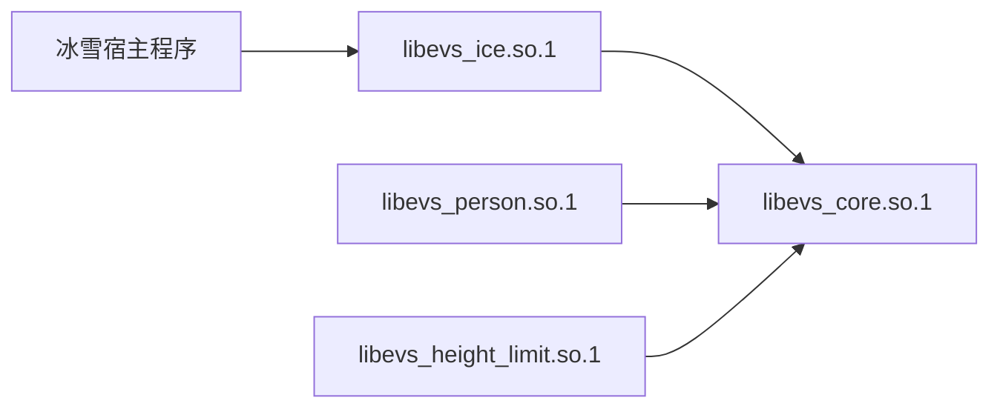

# 卷扬冰雪库与核心库：架构关系、API 差异及影响核验

| 项目 | 说明 |
| --- | --- |
| 核验日期 | 2026-10-22 |
| 源码目录 | `/home/tronlong/lyp/code/edgevision` |
| 当前提交 | `310010d7c5991802599d22268bbfca7b7faa2b5f` |
| 比较基线 | `137a845`，核心与功能库拆分后的提交 |
| 核验方式 | 源码与 Git 差异检查、独立构建、主机测试、ELF 检查及新旧库混用探针 |
| 本文范围 | 是否符合原架构、库的分工、调用关系、API 差异、公共改动、兼容性及验证边界 |

本文是上述版本的专项核验报告，不是全部 SDK API 手册，也不构成现场精度、性能或长期稳定性验收。后续源码更新时，应重新核对结论。此次文档整理沿用本轮已执行的验证结果，没有重新执行硬件测试，也没有修改产品源码。

## 阅读导航

1. [先看结论](#1-先看结论)
2. [两类库分别负责什么](#2-两类库分别负责什么)
3. [两个 API 入口如何执行同一条算法链](#3-两个-api-入口如何执行同一条算法链)
4. [API 与数据契约的具体差异](#4-api-与数据契约的具体差异)
5. [新增冰雪功能对核心和旧功能的影响](#5-新增冰雪功能对核心和旧功能的影响)
6. [YOLOv8 与 ALOG 两项增量的特殊边界](#6-yolov8-与-alog-两项增量的特殊边界)
7. [新旧库能否混用以及如何部署](#7-新旧库能否混用以及如何部署)
8. [实际验证、证据与未验证范围](#8-实际验证证据与未验证范围)
9. [后续开发应修改哪里](#9-后续开发应修改哪里)

## 1. 先看结论

**单论仓库的核心架构，冰雪插件符合原来的插件分层；专用 `Detector` 是新增的对外封装，内部仍通过 `VisionTask` 执行。当前采用的是“统一内部执行，允许专用外部接口”的扩展方式。**

这里需要分开回答两个问题：**是否符合原有架构**，看职责、插件接口和执行链是否保持；**对核心是否有影响**，看公共代码、部署依赖和运行资源是否变化。架构符合并不意味着核心代码不能扩展，也不意味着其他任务性能必然不变。

### 1.1 是否符合原架构：明确判断

| 判断维度 | 当前实现 | 结论 |
| --- | --- | --- |
| 内部插件接口 | `WinchIcePlugin` 仍实现原 `IFunctionPlugin`，按 `0x0008` 登记 | 符合原插件架构 |
| 核心执行链 | `Detector` 内部调用 `VisionTask`，复用模型管理、预处理、推理和解码 | 符合原职责分层 |
| 业务归属 | 冰雪业务与专用适配留在冰雪库，核心通过接口调用插件 | 符合核心与功能库的分工 |
| 对外 API 形式 | 原 `VisionTask` 入口保留，额外提供 `Detector` 和专用结果 | 属于新增封装，未保持所有功能只有同一种对外入口 |
| 结果访问的封装 | 新增 `functionPlugin()`，供适配层借用并识别具体插件 | 放宽了原封装边界，属于需要说明的扩展取舍 |

**因此，使用 `Detector` 接冰雪仍在使用原来的核心任务架构；但 `Detector` 本身不是原 `VisionTask` API 的原样沿用。**

如果团队额外要求“所有功能对宿主必须只有同一个类、同一套参数和结果”，当前专用入口不满足这种更强的统一要求。原基线宿主说明以 `VisionTask` 为统一接入方式；这与“明确禁止增加任何专用适配层”不是同一条要求，不能混为一谈。两种接入方式及其结果限制见第 3、4 节。

### 1.2 核心影响与兼容性：另一个问题

冰雪库依赖核心库。业务已经分库，但此次功能实现同时扩展了核心公共能力，因此还需要独立核对改动与兼容性。

对用户最关心的几个问题，可以直接回答：

| 问题 | 核验结论 |
| --- | --- |
| 使用冰雪专用 API 是否绕开了原核心？ | 没有。`Detector` 包装并调用 `VisionTask`，具体业务仍由原插件接口承接。 |
| 冰雪库和核心库是否是两套重复算法？ | 不是。冰雪 `Detector` 内部复用核心 `VisionTask`，没有另做一套模型管理和任务流程。 |
| 冰雪库能否脱离核心库运行？ | 不能。冰雪动态库依赖核心动态库；静态接入也需要核心及冰雪归档。 |
| 核心库是否必须依赖冰雪库？ | 不必。核心不直接链接冰雪库，具体功能由已加载插件登记。 |
| 新增冰雪功能是否改动了核心？ | 改动了，包括任务扩展、配置适配、RKNN 契约及资源清理。当前版本还有共享解码和日志增量。 |
| 原人员、高度限位业务是否被改写？ | 对比基线，其业务源码未改；稳定配置与插件接口头文件也保持一致。 |
| 能否保证其他功能完全不受影响？ | 不能据此保证。公共执行路径发生变化，运行资源也会竞争；应以具体回归和板端验证为准。 |
| 本轮是否发现旧接口兼容性被破坏？ | 在本机已测范围内未发现；证据不覆盖任意编译器、设备或全部真实模型。 |
| 能否只换新冰雪库，保留拆库基线的旧核心？ | 不能。本轮实际加载失败，旧核心缺少新冰雪依赖的符号。 |

基线 `137a845` 已有功能号 `0x0008` 的冰雪占位插件，当时不实际计量，比例恒为 `0`。本轮主要把占位实现完善为“卷扬定位＋框内冰雪候选计量＋专用 API”，并扩展配套公共能力。

## 2. 两类库分别负责什么

### 2.1 职责与产物

| 层次 | 产物 | 实际职责 |
| --- | --- | --- |
| 核心库 | `libevs_core.so.1`、`libevs.a` | `VisionTask`、公共配置解析、模型注册表、预处理、后端推理、解码器、地面映射、日志与调试 |
| 冰雪功能库 | `libevs_ice.so.1`、`libevs_ice.a` | 冰雪配置适配、卷扬框筛选与 NMS、HSV 候选计量、有效性判断、报警及 `Detector` 客户接口 |
| 其他功能库 | 人员、高度限位各自的动态库与静态归档 | 各自功能规则及状态 |
| 宿主程序 | 相机 CLI、Qt UI 或实际产品程序 | 取图、格式准备、任务调度、工况门控、结果展示、重试及报警保持 |

注意静态核心归档的名字是 **`libevs.a`**，不是 `libevs_core.a`。

冰雪的三个业务源文件只加入 `evs_ice`，没有加入核心的 `EVS_SRC`。详见 [核心源列表](/home/tronlong/lyp/code/edgevision/CMakeLists.txt:35) 和 [功能库构建规则](/home/tronlong/lyp/code/edgevision/CMakeLists.txt:139)。

### 2.2 动态库依赖方向



上图表示链接依赖。运行时，核心仍会通过 `IFunctionPlugin` 接口调用具体插件；这种接口调用不表示核心直接链接了冰雪业务实现。

本轮 mock＋OpenCV 构建的 ELF 检查确认：核心不依赖冰雪、人员、高度或 OpenCV；冰雪依赖核心及 OpenCV `core/imgproc`。生产 RKNN 构建还需要推理运行库，不能把 mock 产物的依赖表当作生产环境完整依赖表。

Qt 和 GStreamer 属于相应宿主的依赖。`Detector` 本身不打开摄像头，RKNN 推理则由核心承担。

## 3. 两个 API 入口如何执行同一条算法链

### 3.1 原有设计中的两个接口层次

原基线 `137a845` 的宿主说明和公共头文件以如下方式组织调用：

```text
宿主程序
  → VisionTask：宿主调用的统一任务 API
  → 预处理、推理、解码与坐标还原
  → IFunctionPlugin：核心调用业务插件的标准接口
  → 人员 / 高度限位 / 冰雪业务
```

`VisionTask` 和 `IFunctionPlugin` 服务于不同调用方：前者供宿主调用，后者供核心调用具体业务。判断架构时，要分别核对这两层，而不是只比较宿主入口的类名。

原基线可通过 `git show 137a845:docs/host_api.md`、`git show 137a845:include/evs/vision_task.h` 和 `git show 137a845:include/evs/function_plugin.h` 复核。当前 [IFunctionPlugin](/home/tronlong/lyp/code/edgevision/include/evs/function_plugin.h:13) 与该基线保持一致。

### 3.2 当前保留的统一入口与新增的专用入口

```text
统一入口：宿主 → VisionTask → WinchIcePlugin

专用入口：宿主 → Detector → VisionTask → WinchIcePlugin
```

两种方式都会经过核心的公共处理链。区别在于宿主传入的数据和读出的结果不同，并非选择了两套独立任务引擎。

冰雪插件仍继承 `IFunctionPlugin`，并额外实现可选 `IFunctionTaskHooks`。原接口保留，新增能力通过独立接口提供。[插件声明](/home/tronlong/lyp/code/edgevision/src/tasks/winch_ice/winch_ice_plugin.h:9)

### 3.3 Detector 适配什么，为什么需要专用结果

通用宿主可以使用 `VisionTask`；冰雪客户可以使用 `Detector`。后者把 `WinchSnowConfig` 转成 `TaskConfig`，把 `ImageData` 转成公共帧，调用统一任务后再取得专用结果。

```text
宿主提供当前图像
  → Detector 将 ImageData / WinchSnowConfig 适配为公共帧和任务配置
  → VisionTask：预处理 → 后端推理 → 解码 → 框映回原图
  → WinchIcePlugin：筛选卷扬 → NMS → 选框与有效性判断
  → OpenCV：HSV 冰雪候选 → 框内像素计数 → 面积比例
  → 本帧报警与逐对象结果
```

`Detector::Impl` 内持有一个 `VisionTask`。初始化后，它通过 `functionPlugin()` 借用任务已经创建的冰雪插件，读取该实例的结果和掩码，没有再创建第二个计量插件。该指针由任务拥有，适配层释放任务前清除借用指针。[源码](/home/tronlong/lyp/code/edgevision/src/tasks/winch_ice/winch_ice_api.cpp:46)

专用结果的原因是：原通用 `Result` 只有一个 `ice_ratio`，无法完整表达“两个卷扬分别对应的框、比例和有效性”。`WinchSnowResult.objects` 承载这些信息，而公共处理链仍继续复用。

### 3.4 functionPlugin 带来的封装取舍

`functionPlugin()` 返回任务内部插件的可写借用指针。冰雪适配层再通过 `dynamic_cast<WinchIcePlugin*>` 识别具体类型，读取其专用结果。[类型转换位置](/home/tronlong/lyp/code/edgevision/src/tasks/winch_ice/winch_ice_api.cpp:95)

这放宽了原来“宿主只通过统一任务 API 和通用结果交互”的封装边界，并让冰雪适配层依赖自己的具体插件实现。因此，不宜把当前设计描述成原接口和封装完全没有变化。

不过，具体类型识别发生在冰雪库中，公共任务返回的仍是通用 `IFunctionPlugin*`；核心没有为此直接包含冰雪结果类型或具体插件类型。这里的架构评价是：**原职责分层保留，结果访问方式发生扩展，存在明确的封装取舍。**

借用指针不能由宿主删除，也不能在任务释放后继续使用；任务调用期间不能绕过任务并发修改插件状态。普通冰雪客户使用 `Detector` 即可，无需自行操作该指针。

### 3.5 当前算法链的实际计量含义

当前面积比例的定义是：

```text
ice_ratio = 框内经 HSV 与形态学处理得到的冰雪候选像素数 / 卷扬矩形框面积
本帧报警 = 任一有效对象 ice_ratio >= area_ratio
```

模型负责定位卷扬；HSV 负责颜色候选粗估。矩形框中的背景和支架也会影响分母。这不是模型直接输出的精确冰雪分割，也没有在本轮获得现场精度验收。[计量实现](/home/tronlong/lyp/code/edgevision/src/tasks/winch_ice/ice_measurement.cpp:66)、[报警汇总](/home/tronlong/lyp/code/edgevision/src/tasks/winch_ice/winch_ice_plugin.cpp:214)

## 4. API 与数据契约的具体差异

### 4.1 入口对照

| 项目 | 核心通用入口 | 冰雪专用入口 |
| --- | --- | --- |
| 类型 | `evs::VisionTask` | `evs::winch_ice::Detector` |
| 初始化 | `initialize(YAML路径)` 或 `initialize(TaskConfig)` | `initialize(WinchSnowConfig)`，另有 `load_config()` |
| 检测 | `detect(Frame, MachineContext, Result)` | `detect(ImageData, WinchSnowResult)` |
| 热更新 | YAML 路径或 `TaskConfig` | `DetectConfig` |
| 释放 | `release()`，析构也会释放 | `release()`，析构也会释放 |
| 硬件预处理入口 | 另有 `detectPrepared()` | 不直接提供该入口 |
| 业务接口形式 | C++ | C++；并非独立 C ABI |

公开契约见 [VisionTask](/home/tronlong/lyp/code/edgevision/include/evs/vision_task.h:24) 和 [winch_ice.h](/home/tronlong/lyp/code/edgevision/include/evs/winch_ice.h:14)。

### 4.2 图像、坐标与结果

| 对照项 | 通用接口 | 专用接口 |
| --- | --- | --- |
| 像素格式 | `NV12/RGB/BGR` | 紧凑 RGB24 或 8 位灰度 |
| 行跨距 | `Frame.stride`，单位为字节 | 无 stride，必须紧凑排列 |
| 时间戳 | `timestamp_us`，微秒 | `timestamp_ms`，毫秒 |
| 输入相机号 | `Frame.camera_id` | 由初始化的 `camera_channel` 绑定 |
| 输出相机号 | `Result.camera_channel` 按字节打包 | `WinchSnowResult.camera_channel` 是普通相机号 |
| 框坐标 | `Target`：原图归一化中心、宽高 | `Detection`：原图像素左上点、宽高 |
| 逐对象冰雪信息 | 不能完整表达 | `objects[i].box/ice_ratio/valid` |
| 面积阈值默认值 | 公共 `TaskConfig` 历史值为 `0.3` | `DetectConfig` 与冰雪 YAML 为 `0.5` |

`Detection.width/height` 表示宽高，不是右下角坐标。灰度图会复制成三通道，但丢失颜色信息；输入被接受不代表灰度冰雪精度已验证。

**通用 `Result` 不能直接替代专用 `WinchSnowResult`：**

- 冰雪插件发布通用结果时会清空 `targets`。
- 只有恰好一个有效对象时，通用 `ice_ratio` 才是该对象的比例；多个对象、无对象或无效时为 `-1`。
- 专用 `objects` 保存逐卷扬结果，按本帧从左到右排列，索引不是跨帧跟踪 ID。
- `snow_detections` 当前为空：卷扬框不是冰雪模型目标，不能把卷扬框填入该字段冒充冰雪检测输出。
- 调用返回 `0` 后仍须检查 `result_code` 和每个对象的 `valid`；未知比例 `-1` 不能当作正常的 `0%`。

以上结果语义见 [发布逻辑](/home/tronlong/lyp/code/edgevision/src/tasks/winch_ice/winch_ice_plugin.cpp:224)。

### 4.3 生命周期与宿主分工

专用 `Detector` 每次处理当前图像，包括重复时间戳，不在库内保持报警锁存；工况门控、重试和报警保持由宿主负责。通用接口仍提供 `MachineContext`，供人员、高度等需要工况的功能使用。

`Detector::updateConfig()` 整体更新置信度、NMS 和面积阈值三项；参数非法时不提交新配置。更换模型或相机需要释放后重建。`load_config()` 解析成功不等于模型、运行依赖和全部参数范围已检查通过，仍须检查 `initialize()` 的返回值。

输入像素由宿主持有，在同步调用返回前保持有效。检测、更新和释放不能在同一实例上并发执行。多个实例共享同一推理后端时，也应统一串行调度；模型注册表的锁不代表 SDK 推理自动具备并发保证。

## 5. 新增冰雪功能对核心和旧功能的影响

### 5.1 哪些保持一致，哪些发生变化

下表均相对 `137a845`：

| 范围 | 核验事实 | 能支持的结论 |
| --- | --- | --- |
| `TaskConfig`、`IFunctionPlugin`、`IInferBackend`、`Frame` 头文件 | 完全一致 | 这些稳定接口未因本轮冰雪实现增加成员或修改原虚表 |
| 人员、高度限位业务目录 | 源码无改动 | 原业务规则未在这些目录被改写 |
| 公共预处理与上层 decoder 实现 | 源码无改动 | 原实现保留；不等于其上下游公共流程均未变化 |
| `Result` | 增加相关常量和注释，成员布局未变 | 布局保留，但冰雪结果语义需要按专用规则理解 |
| `VisionTask` | 新增非虚方法、可选扩展分发和内部流程改动 | 公共能力扩展；对象仍使用 pImpl，不因这些新方法新增对象数据成员 |
| 配置、RKNN、模型清理、日志 | 存在公共实现变化 | 需要把这些变化纳入旧功能回归范围 |

保持接口布局与通过同工具链测试，不能推广为任意平台和任意编译器的 C++ 二进制兼容承诺。

### 5.2 公共改动及触发范围

| 改动 | 具体内容 | 影响范围 |
| --- | --- | --- |
| 统一任务扩展 | 新增 `TaskConfig` 初始化/更新重载及 `functionPlugin()`；增加可选 `IFunctionTaskHooks` | 新核心公共任务；旧插件未实现 hooks 时继续使用原接口 |
| 配置适配 | 公共解析器增加按模块登记的适配器 | 冰雪加载后为 `0x0008` 增加专属规则；人员、高度没有新增冰雪规则 |
| 初始化与热更新 | 模型租约回滚、先准备下一份状态再提交、可选预热失败与拒帧策略 | 公共流程发生变化，具体策略按插件能力分发 |
| RKNN 契约 | 非 80 类的指定格式进入显式校验/解析；校验并处理 NCHW/NHWC 输入维序 | 满足条件的 RKNN 任务，不限于冰雪模块 |
| 模型释放 | `release()` 查找键时避免额外字符串分配 | 共享模型清理路径，便于内存不足时回收 |
| 当前版本额外增量 | YOLOv8 公共 helper 和 ALOG 桥接 | 公共后端解码及采用新日志路径的模块，详见第 6 节 |

冰雪的 HSV 键、相对模型路径和默认模型契约在冰雪插件内处理。公共配置解析器只提供登记与分发能力，没有硬编码这些冰雪业务键。[配置分发](/home/tronlong/lyp/code/edgevision/src/core/config.cpp:343)、[冰雪配置适配](/home/tronlong/lyp/code/edgevision/src/tasks/winch_ice/winch_ice_plugin.cpp:25)

`IFunctionTaskHooks` 是与原插件虚表分开的可选接口，用于校验、配置提交、预热策略和错误帧清理。新增功能不需要为了采用原插件接口而实现全部扩展能力。[接口定义](/home/tronlong/lyp/code/edgevision/include/evs/function_task_hooks.h:10)

### 5.3 业务状态隔离与运行资源影响

每个任务持有自己的插件实例，冰雪计量配置和结果保存在实例内。模型后端仍按 `backend＋model_path` 共享；新冰雪任务不会因为登记了功能号就自动创建到所有旧任务中。

但是，新增运行任务会消耗 CPU、NPU、内存和调度时间。即使采用不同模型，也不能据功能分库保证旧任务帧率、延迟完全不变。**本轮没有测量多功能同时运行的板端性能，因此没有“性能零影响”结论。**

## 6. YOLOv8 与 ALOG 两项增量的特殊边界

这两项来自当前版本后续提交，需要与最初的冰雪业务实现分别理解，不能仅凭提交标题判断接入状态。

### 6.1 新增 YOLOv8 helper 不等于正式 Detector 已支持双输出模型

`cf3dd93` 新增 split/fused 解码，位置是公共 `src/backend/yolo_decode.h`。当前正式冰雪入口仍固定为：

```text
backend = rknn
output_format = yolox
decoder_classes = 1
```

这会触发 `inferDetectionRows()` 路径。其模型检查要求 `n_output == 1`；显式解析后直接返回，不进入后面的公共 `decode_heads()`。因此，双输出 YOLOv8 模型会在当前正式契约检查时被拒绝，不能因 helper 新增了分支就认定专用 API 已接通。

源码依据：[专用任务配置](/home/tronlong/lyp/code/edgevision/src/tasks/winch_ice/winch_ice_api.cpp:18)、[公共分派条件](/home/tronlong/lyp/code/edgevision/src/core/backend_factory.cpp:42)、[单输出模型校验](/home/tronlong/lyp/code/edgevision/src/backend/rknn/rknn_backend.cpp:222)、[公共 helper 分支](/home/tronlong/lyp/code/edgevision/src/backend/yolo_decode.h:818)。

本轮合成探针还复现了共享 helper 的限制：四类 score 与四通道 box 角色冲突；部分合法多类 fused 输入可得到零框；fused 归一化坐标可能被误判为 score。相关观察包含正常行为和缺陷反例，不能把探针的 `12/12` 写成“所有 YOLOv8 功能已验收”。[探针日志](卷扬冰雪库与核心库_核验证据_20261022/decode_probe.log)

### 6.2 ALOG 是公共日志行为变化

`310010d` 增加全局日志回调；`alg_init(cb)` 只设置日志回调并返回 `0`，不初始化模型、`VisionTask` 或 `Detector`。

采用新宏编译的 `EVS_LOG` 会进入 ALOG 路径。宿主替换默认回调后，相关模块日志直接同步进入宿主回调，不再自动经过 `Logger` 的 sink、文件和 ring。因此，这项升级会影响公共日志接入，而非仅影响冰雪日志。

回调指针的注册/替换没有锁或 atomic；应在日志生产线程启动前完成注册，停止生产线程后再解除。宿主回调应快速返回并自行隔离异常。这里是源码确认，没有执行多线程压力测试。[实现](/home/tronlong/lyp/code/edgevision/src/core/algo.cpp:12)、[EVS 宏桥接](/home/tronlong/lyp/code/edgevision/include/evs/log.h:111)

## 7. 新旧库能否混用以及如何部署

### 7.1 兼容性有方向

| 组合 | 本轮观察 | 可以怎样理解 |
| --- | --- | --- |
| 配套新核心＋新冰雪库 | mock 构建及对应主机回归通过 | 公共接口与像素逻辑可验证；不代表真实 RKNN 检测已在本轮验收 |
| 旧宿主＋旧人员/高度插件＋新核心 | 模块 `4/5/6/7` 初始化和空目标检测成功 | 支持同一主机工具链下的基础向后兼容结论 |
| 新冰雪库＋`137a845` 旧核心 | 动态加载失败，缺少 `VisionTask::functionPlugin() const` | 新冰雪依赖新核心能力，不能只替换冰雪 so |
| 任意历史过渡版本、任意工具链混用 | 本轮未验证 | 不能根据 `.so.1` 名字相同推导兼容 |

旧插件验证特意只在 `new_core_only` 目录放新核心，再从基线目录加载旧人员/高度插件，并用 `ldd` 逐项断言路径，避免误把“旧宿主＋新插件”当成“旧插件兼容”。原始加载记录见 [verification.json](卷扬冰雪库与核心库_核验证据_20261022/verification.json)。

反方向加载探针使用不依赖 OpenCV 的 mock 构建，检查的是 ELF 符号兼容性；它没有执行冰雪模型和像素计量。对应未修饰符号为 `_ZNK3evs10VisionTask14functionPluginEv`。

### 7.2 链接与交付约定

- **专用 `Detector` 动态宿主**：使用配套头文件，链接 `-levs_ice -levs_core`，并部署匹配的核心、冰雪及运行依赖。直接引用 `Detector` 符号会使宿主实际需要冰雪库。
- **纯 `VisionTask` 动态宿主**：仅在命令中写插件库名可能被 `--as-needed` 裁掉。Linux 可按 `-Wl,--no-as-needed -levs_ice -Wl,--as-needed -levs_core` 保留冰雪登记。
- **静态宿主**：需要 `libevs.a` 与所需功能归档，并保留登记目标文件。只有核心归档不能提供冰雪业务实现。
- **安装内容**：当前规则安装核心和冰雪库；人员、高度库仍有独立构建目标，但不在该安装集合中。集成其他功能时要另外保留相应产物。
- **模型部署**：当前安装规则不自动安装模型；模型及相关配置要单独部署。库文件和模型不是同一交付物。

同名 SONAME 只提供加载名称，不能替代配套版本检查。新增冰雪应使用同一版本的头文件、核心和冰雪库。

## 8. 实际验证、证据与未验证范围

### 8.1 已执行的检查

| 检查 | 结果 | 证明范围 |
| --- | --- | --- |
| Git 与源码对比 | 第 5.1 节列出的稳定接口及实现保持一致 | 文件差异事实，不等于全运行行为不变 |
| Debug、mock、OpenCV OFF、共享库 | CTest `6/6` 通过 | 基础任务、接口及不支持分支 |
| Debug、mock、OpenCV ON、共享库 | CTest `8/8` 通过 | 核心 235 CHECK；冰雪静态/动态各 225 CHECK；分配失败 75 CHECK；插件兼容及 CLI 分支 |
| 旧宿主及旧人员/高度插件配新核心 | 四个功能号基础调用通过 | 同一主机工具链下的初始化与空目标检测 |
| mock 核心导出符号比较 | 所检查的 evs 命名空间基线符号未见删除 | 符号层面检查，不是任意 ABI 验收 |
| 新冰雪库配旧核心 | 加载失败，符合缺少新接口的预期 | 明确反方向不能混用 |
| ELF 依赖检查 | 确认 core/ice 依赖方向与 SONAME | 本次 mock/OpenCV 构建的实际产物 |
| 解码合成探针 | 12 项预期观察成立，ASan/UBSan 未报错 | 包括限制反例；禁用泄漏检测，未执行 NPU |

CTest 数量包含两个日志打印演示；它们不是完整业务断言。静态与动态冰雪测试也有重复场景，不能把全部 CHECK 数相加后宣传为独立业务案例数量。

OpenCV 使用已有临时解包依赖。首次链接因 BLAS/LAPACK 不在搜索路径失败，补足本地 `rpath-link` 后完成；运行时指向同一依赖目录。没有安装系统依赖或改动产品 CMake。

### 8.2 证据归档

关键小文件与本文一起保存到 [核验证据目录](卷扬冰雪库与核心库_核验证据_20261022/README.md)，不要求读者依赖“本文与原始构建树在同一目录”的假设。

| 文件 | 内容 |
| --- | --- |
| [verification.json](卷扬冰雪库与核心库_核验证据_20261022/verification.json) | 提交、文件对比、旧二进制运行、`ldd`、ELF、符号与混用失败记录 |
| [ctest_off.log](卷扬冰雪库与核心库_核验证据_20261022/ctest_off.log) | OpenCV 关闭的完整 CTest 输出 |
| [ctest_cv.log](卷扬冰雪库与核心库_核验证据_20261022/ctest_cv.log) | OpenCV 开启的完整 CTest 输出 |
| [decode_probe.log](卷扬冰雪库与核心库_核验证据_20261022/decode_probe.log) | 解码正常行为和限制反例 |
| [verify.py](卷扬冰雪库与核心库_核验证据_20261022/verify.py)、[decode_probe.cpp](卷扬冰雪库与核心库_核验证据_20261022/decode_probe.cpp) | 本轮核验脚本和解码探针源码 |
| [SHA256SUMS](卷扬冰雪库与核心库_核验证据_20261022/SHA256SUMS) | 归档文本、脚本和探针的完整性摘要 |

完整构建树仍位于 `/tmp/edgevision_core_ice_relation_310010d/`，可能被系统清理；此次没有复制二进制、SDK 或全部构建依赖。归档脚本保留原始执行路径，重跑前需准备对应源码、基线产物和依赖，不能当作一键自包含测试包。

### 8.3 尚未验证的项目

本轮没有重新执行真实 RKNN 模型、NPU、相机或 Qt 设备链路，也没有验证以下项目：

- 冰雪真实样本精度、误报漏报及灰度输入精度。
- 原人员、高度真实模型的全部场景。
- 新旧功能同时运行时的板端帧率、延迟和资源峰值。
- 其他物理通道及长期稳定性。
- 任意编译器、标准库、硬件驱动与历史过渡产物的混用。

这些边界不会否定已经完成的源码和主机核验，但限制了结论可以推广的范围。

## 9. 后续开发应修改哪里

| 后续需求 | 主要改动位置 | 核心是否需要跟着改 |
| --- | --- | --- |
| 调整冰雪筛框、有效性、HSV 计量或报警规则 | `src/tasks/winch_ice/` | 通常可以只改插件；涉及公开字段时另行评估接口兼容 |
| 增加冰雪客户参数或逐对象输出 | `winch_ice.h` 与专用适配层、插件 | 不宜为此直接扩张原 `TaskConfig` 或 `IFunctionPlugin` 虚表 |
| 新模型输入、输出形状或解码格式 | 对应 backend、decoder 或公共解码 helper | 可能需要改核心，必须评估其他使用者 |
| 新功能规则 | 独立插件、模块登记及构建配置 | 通常不需要在 `VisionTask` 增加业务号分支 |
| 相机采集、显示、PLC 工况或报警保持 | 宿主程序 | 通常不属于算法核心 |
| 多任务并发或共享模型调度 | 宿主调度及后端共享约束 | 涉及公共运行机制，需专项设计与板端验证 |

判断架构时，先区分**核心内部的统一插件机制**与**宿主看到的对外 API 形式**。当前冰雪保留前者，并为后者增加专用封装；`functionPlugin()` 则是结果访问的封装取舍。

判断影响时，再分别检查**业务实现、公共接口、公共执行路径、部署配套和运行资源**。现有证据支持“业务分库、旧接口在已测范围兼容、新冰雪需要新核心”，不支持“其他功能绝对零影响”。
