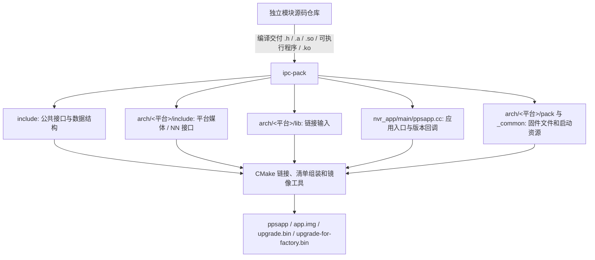
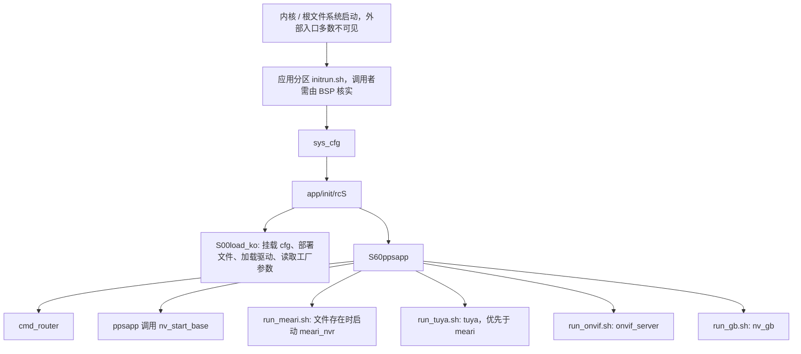
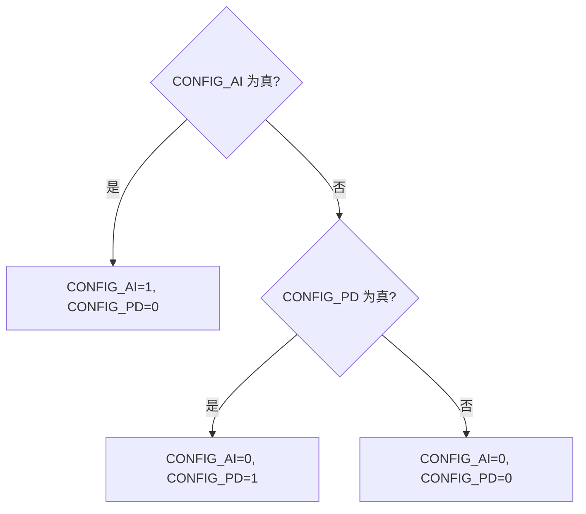
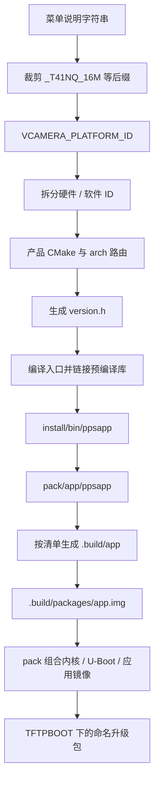
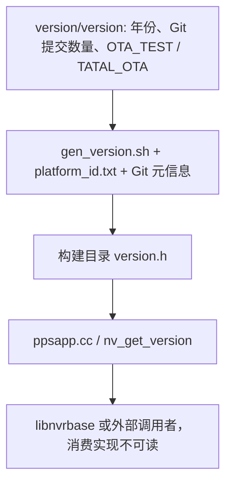

# ipc-pack 仓库深度分析与核验报告

> 分析与核验日期：2026 年 10 月 9 日 | 覆盖范围与可读性复核：2026 年 10 月 10 日  
> 核验对象：`/home/tronlong/lyp/meari/ipc-pack` 的当前文件快照。  
> 结构参照：`/home/tronlong/lyp/perCode/idevelop_md/meari/mpc-base/mpc-base分析报告.md`。  
> Git HEAD：`5dcb7eaad36ccc2156bcc0cf07e45b5b9665e525`，提交日期 2025-03-04，提交说明“[BUGFIX] 修复T31L单卡打包有误”。

本报告保留参考报告的十二章结构，但按本仓库的实际职责组织内容。`ipc-pack` 主要是 **IPC 产品的应用入口、SDK 交付物集成和固件打包工程**；大量业务模块只有头文件、静态库或可执行文件。不能把参考仓库中的模块实现、AOV 状态机或线程行为直接套用到这里。

### 阅读导航

这份报告围绕三个问题展开：**仓库怎样构成产品、源码能证明哪些行为、哪些问题已经核验。** 第五章解释各模块，第七章把模块串成流程，第八章核对产品差异和构建条件，第十一章集中列出验证结果。

| 阅读目的 | 建议阅读位置 | 能得到什么 |
|---|---|---|
| 先理解整个工程 | [第一章](#report-chapter-1)、[第三章](#report-chapter-3)、[第四章](#report-chapter-4) | 仓库定位、目录用途、构建与启动架构 |
| 理解模块如何协作 | [第五章](#report-chapter-5)、[第七章](#report-chapter-7) | 模块职责、关键接口、完整流程及实现边界 |
| 核对某个具体产品 | [第二章](#report-chapter-2)、[第八章](#report-chapter-8) | 全部菜单产品、平台映射、宏表、库与打包清单 |
| 查看已确认问题 | [第六章](#report-chapter-6)、[第十章](#report-chapter-10)、[第十一章](#report-chapter-11) | 缺陷机制、复现结果、影响条件和处理顺序 |
| 逐项追溯结论 | 正文源码链接、[覆盖索引](#report-coverage)、[术语说明](#report-glossary) | 实际文件位置、扫描范围及术语含义 |

首次阅读建议按“第一章 → 第四章 → 第七章 → 第十一章”了解主线，再查具体平台和模块。正文中的 **接口存在、文件被打包、设备实际运行成功** 分别需要不同证据；遇到这些表述时，可结合紧邻的源码链接和核验说明阅读。

报告使用三种证据层级：

| 标记 | 含义 | 能支持的结论 |
|---|---|---|
| 源码确认 | 可读实现、构建脚本或配置直接给出 | 实际分支、参数、文件选择及实现中的边界 |
| 实测确认 | 在本机隔离目录执行检查或最小复现 | 该输入、工具版本和运行环境下的具体结果 |
| 接口/产物确认 | 只有声明、归档成员、ELF 信息或数据文件 | 接口存在、符号存在、二进制依赖存在；不证明完整业务行为 |

**核验范围与限制**：全量枚举排除 `.git` 后的 1,589 个文件，包含 294 个 `.build` 历史产物；建立 135 份头文件的接口索引，核对全部 16 个菜单配置、17 份产品 CMake 配置、平台打包清单和启动脚本，阅读全部 3 份 C/C++ 翻译单元及主要头文件内联/模板实现。还进行了脚本语法、入口语法编译、ELF/归档检查、清单展开和语音工具边界复现。没有完成整套交叉编译、真实固件刷写或设备端业务测试；缺少可读实现的库没有被宣称完成了源码级内部核验。

分析前目标仓库有 853 条 Git 修改记录，`git diff --raw` 显示它们全部是 `100755 → 100644` 模式变化，内容增删为零；实际文件模式为 `0664`。本报告基于当前文件内容和权限状态，不回退用户文件，也不将这些状态算作本次修改。

---

## 一、仓库概述

### 1.1 核心定位

该仓库汇总各平台的接口头文件、静态库、动态库、驱动、内核、U-Boot、模型、IQ 参数、提示音和启动脚本，通过一个很薄的 `ppsapp` 入口链接业务库，再组成应用镜像和升级包。README 明确要求各模块在各自源码仓库编译后，把导出头文件和库复制进本仓库。来源：[README.md:3](/home/tronlong/lyp/meari/ipc-pack/README.md:3)。

### 1.2 本仓库能独立确认与不能独立确认的事项

| 事项 | 核验结果 |
|---|---|
| 主进程从哪里进入业务框架 | `main() → nv_start_base()`，随后无限休眠 |
| 如何选择平台、客户和构建类型 | `all.sh → mkprj.sh → CMakeLists.txt`，有完整脚本 |
| 哪些文件进入升级包 | 由 `profile/*.env`、公共资源和 `arch/pack.sh` 确认 |
| 驱动如何装载、应用如何启动 | `S00load_ko`、`S60ppsapp` 和 `run_*.sh` 可读 |
| 视频、AI、录像、RPC 的接口是什么 | 头文件及库符号可查 |
| 模块内部线程、锁、算法和异常恢复 | 大部分只有二进制，无法仅凭本仓库完成源码级确认 |
| 当前所有平台能否编译、启动和工作 | 不能确认；已发现权限、工具链、链接路径和清单问题 |
| 是否具有参考报告中的完整 AOV 行为 | 无对应可读实现和调用链，不作此结论 |

### 1.3 快照规模与交付形态

初始文件统计含隐藏目录和历史构建输出，不含 `.git`：`.a` 215 个、`.so` 180 个、`.ko` 261 个、`.h` 135 个、`.c` 2 个、`.cc` 1 个、`.cmake` 17 个、`.env` 45 个、`.sh` 33 个。数字按文件扩展名统计，例如 `libnl-3.so.200` 不计入 `.so`，无后缀脚本也不计入 `.sh`。

按 ELF 文件头全量识别到 677 个 ELF：350 个 ARM 32 位、322 个 MIPS 32 位、5 个 x86-64 64 位，均为小端；此统计不包含静态归档内部对象，也不表示每个 ELF 都在当前产品清单中。

---

## 二、支持平台

### 2.1 当前菜单实际暴露的产品

菜单来自 `meari_platforms.conf` 11 项、`nkit_platforms.conf` 4 项、`gb_platforms.conf` 1 项，共 16 项。下表使用脚本裁剪说明性后缀后得到的真实 `VCAMERA_PLATFORM_ID`。平台 ID 数值来自 `platform_id.txt`；Flash 和网络描述是菜单标签，不能代替硬件验证。来源：[nvr_app/scripts/buildconf/meari_platforms.conf:1](/home/tronlong/lyp/meari/ipc-pack/nvr_app/scripts/buildconf/meari_platforms.conf:1)、[nvr_app/scripts/buildconf/nkit_platforms.conf:1](/home/tronlong/lyp/meari/ipc-pack/nvr_app/scripts/buildconf/nkit_platforms.conf:1)、[nvr_app/scripts/buildconf/gb_platforms.conf:1](/home/tronlong/lyp/meari/ipc-pack/nvr_app/scripts/buildconf/gb_platforms.conf:1)、[version/pack_info/platform_id.txt:34](/home/tronlong/lyp/meari/ipc-pack/version/pack_info/platform_id.txt:34)。

| 产品配置 | 菜单平台/Flash/网络标签 | 实际 arch 目录 | 数值 ID |
|---|---|---|---|
| `c40ba-m_general` | T41LQ / 16M / POE | `mips-linux-gnu-linux` | 67 |
| `c40ca-m_general` | T41NQ / 16M / POE | `mips-linux-gnu-linux` | 69 |
| `c302b-m_general` | AV100 / 8M / POE | `arm-anycloud-linux-uclibcgnueabi-linux` | 50 |
| `s40eapw-m_general` | T40NN / 16M / POE&WIFI6 / 双目 | `t40nn` | 20200 |
| `s40bapw-m_general` | T41LQ / 16M / POE&WIFI6 | `mips-linux-gnu-linux-wifi` | 20100 |
| `s40capw-m_general` | T41NQ / 16M / POE&WIFI6 | `mips-linux-gnu-linux-wifi` | 20700 |
| `s40dbpg-m_general` | T31L / 8M / POE&4G | `t31l-pg` | 20300 |
| `s40capw_sc450-m_general` | T41NQ / 16M / POE&WIFI6 | `mips-linux-gnu-linux-wifi` | 20400 |
| `s303aw-m_arenti` | AV100N / 16M / WIFI6 | `arm-anycloud-linux-uclibcgnueabi-av100n-linux` | 20500 |
| `s40dbg-m_general` | T31L / 8M / 4G | `t31l-pg` | 20600 |
| `s40dbg_sc18-m_general` | T31L / 8M / 4G | `t31l-pg` | 21002 |
| `c302b-nkit_general` | AV100 / 8M / POE | `arm-anycloud-linux-uclibcgnueabi-linux` | 50 |
| `c95-nkit_vimar` | T31L / 8M / WIFI | `mips-linux-uclibc-gnu-linux` | 37 |
| `c95-nkit_general` | T31L / 8M / WIFI | `mips-linux-uclibc-gnu-linux` | 37 |
| `s303bw-nkit_general` | AV100N / 8M / WIFI6 | `arm-anycloud-linux-uclibcgnueabi-av100n-linux` | 20000 |
| `s40dbpg-gb_general` | T31L / 8M / POE&4G | `t31l-pg` | 20300 |

README 中 `c302b-nkit` 的说明行还写有 WIFI6，GB 产品行的网络说明写有 POE&WIFI6，与菜单存在差异。报告按构建选择、清单和驱动分别核验，不用 README 单行推断实际硬件。

### 2.2 存在分支与可用构建入口的区别

| 目录/分支 | 本快照实际状态 |
|---|---|
| `arm-buildroot-linux-uclibcgnueabihf-linux` / `c7` | 有 SSC337 资源和 CMake 分支；当前三份产品菜单不暴露 c7，缺相应产品配置文件 |
| `x86_64` / `nx86` | 有部分库及旧 HiSilicon 打包树；无 `platform_nx86-s_neutral.cmake`，也无主框架 `libnvrbase.a` |
| `x86` / `x64` | CMake 有 arch 名称分支；当前不存在 `arch/x86`、`arch/x64`，没有对应菜单和产品配置 |
| `arm` | CMake 有 `arm-linux-gnueabi` 分支；对应 arch 和产品配置不在快照中 |
| `s40cag` | 有特殊 CMake/打包分支及部分资源；当前菜单未启用相应产品 |
| `t41wifi` | 主要残留应用和 `.build` 产物，没有配套 `include/lib/profile`，当前路由使用的是另一个 wifi arch |

顶层虽然提供 `x86` 选项，但 `x86_platforms.conf`、`x86_oem.conf` 缺失，不能称为完整 PC 调试构建。实测直接配置 `nx86-s_neutral` 也因缺少产品配置返回失败。来源：[all.sh:25](/home/tronlong/lyp/meari/ipc-pack/all.sh:25)、[nvr_app/mkprj.sh:54](/home/tronlong/lyp/meari/ipc-pack/nvr_app/mkprj.sh:54)、[nvr_app/CMakeLists.txt:207](/home/tronlong/lyp/meari/ipc-pack/nvr_app/CMakeLists.txt:207)。

### 2.3 工具链与 ABI

T41/T40 的脚本路径名称含 `glibc`，但 CMake 又添加 `-muclibc`，且实际 T41 产物的解释器为 `/lib/ld-uClibc-mipsn8.so.0`；T31 为 `/lib/ld-uClibc.so.0`，ARM 产物显示 ARM EABI5。判断 ABI 必须结合实际 ELF 和选项，不能只看工具链目录名。

本机检查：T41、T31、AV100 分支指定的 `/opt/toolchains/...` 编译器均不存在；T41 和 AV100 的 CMake 配置实测失败。`python2` 可用，实际版本 2.7.18；`mksquashfs` 和 `mkfs.cramfs` 可用。缺工具链属于当前环境限制，不等价于证明供应商环境也无法构建。

---

## 三、目录结构总览

~~~text
ipc-pack/
├── README.md                   仓库交付与产品菜单说明
├── CHANGELOG.md                当前为空
├── all.sh                      构建命令选择、OTA 测试组合
├── super_pack.sh               向兄弟 nvr-super_pack 工程转交素材
├── sound_pack.sh               中英文提示音包生成/复制
├── core_show.sh                各工具链 GDB 的 core 分析入口
├── nvr_app/
│   ├── CMakeLists.txt          平台映射、宏、库链接、ppsapp/backup
│   ├── mkprj.sh                配置、编译、安装、打包、符号备份
│   ├── main/ppsapp.cc          唯一主应用源码
│   ├── *_oem.conf             general / vimar 等客户选择
│   └── scripts/buildconf/     菜单和 17 份产品配置
├── include/
│   ├── nvrbase/mod/           base、用户、事件、存储结构
│   ├── nvrbase/rpcclient/     RPC、环形缓冲、共享数据接口
│   ├── nvrbase/netclient/     登录、预览、回放、参数控制接口
│   ├── nvrbase/util/          工具头文件和部分模板/宏实现
│   ├── nvrecord/              录像、磁盘、回放、OTA 文件接口
│   ├── prtp/                  TCP、发现、无线、串口协议接口
│   ├── onvif/                 ONVIF 服务端/客户端接口
│   ├── rtsp/                  RTSP 客户端接口
│   ├── version/               版本结构及遗留生成头文件
│   ├── wpa_cli/               wpa_ctrl 接口
│   └── zbar/                  条码扫描 API 头文件
├── arch/
│   ├── pack.sh                主固件打包实现
│   ├── pack / sound_pack      主机工具二进制
│   ├── uallsyms / bsp_secure  符号工具/安全启动工具二进制
│   ├── _common/               公共 init、usr、etc、sound、profile
│   └── <平台>/
│       ├── include/media/     平台媒体接口
│       ├── include/nn/        部分平台的 NN 接口
│       ├── lib/               .a 与 backup/libnvrbase.a
│       └── pack/
│           ├── app/bin/lib/   应用、工具和动态依赖
│           ├── boot/ko/       内核、U-Boot、驱动
│           ├── model/iqfile/  模型及 ISP 参数
│           ├── profile/etc/   文件清单与运行配置
│           ├── init/logo/     平台启动脚本与品牌图片
│           └── .build/        部分平台的历史镜像/组装结果
├── tools/sound_pack/           语音包 C 实现与格式定义
└── version/
    ├── version                按年份/提交数量计算版本
    ├── gen_version.sh         生成 version.h
    └── pack_info/             平台/应用/厂商数值映射
~~~

**目录核验要点**：

- 根目录没有 Makefile；主应用使用 CMake，不能套用参考报告的 `make all` 命令。
- 根 `include/media` 并不存在，媒体头文件在平台目录。当前入口只用 base/util/version 头文件，入口语法检查因此可以通过；这不证明媒体 SDK 的独立编译路径完整。
- `.build` 中的旧 `ppsapp`、镜像和组装结果不是本次重新生成的验证结果。
- `arch/x86_64/pack/rootfs` 中有 ARM ELF 和 HiSilicon 驱动；目录名不代表内部所有文件都是 x86 程序。
- `_common` 修改会影响使用公共回退文件的产品，但平台本地同名文件优先，不能理解为无条件覆盖所有平台。[arch/_common/README.md:1](/home/tronlong/lyp/meari/ipc-pack/arch/_common/README.md:1)、[arch/pack.sh:232](/home/tronlong/lyp/meari/ipc-pack/arch/pack.sh:232)。

---

## 四、核心架构设计

### 4.1 构建期架构

~~~mermaid
flowchart TD
    A[all.sh 选择应用与命令] --> B[mkprj.sh 产品 客户 构建类型]
    B --> C[CMake 平台映射与产品配置]
    C --> D[编译 ppsapp.cc]
    E[平台 lib 及部分显式动态库] --> F[链接 ppsapp]
    D --> F
    F --> G[安装到 .ppstrong]
    G --> H[复制到平台 pack/app]
    H --> I[备份原文件并 strip]
    J[平台清单 + 公共资源] --> K[arch/pack.sh]
    I --> K
    K --> L[应用镜像 app.img]
    M[预编译 U-Boot 内核 可选 rootfs] --> N[pack 二进制]
    L --> N
    N --> O[升级包与工厂包]
~~~

这是一条交付物集成链。当前 CMake 编译 `main/ppsapp.cc`，没有 `add_subdirectory` 把媒体、AI 或业务框架源码编译进来；这些能力由已有库承接。来源：[nvr_app/CMakeLists.txt:443](/home/tronlong/lyp/meari/ipc-pack/nvr_app/CMakeLists.txt:443)、[nvr_app/CMakeLists.txt:513](/home/tronlong/lyp/meari/ipc-pack/nvr_app/CMakeLists.txt:513)。

### 4.2 运行期架构

`ppsapp` 和外围服务是多个进程。RPC 头文件定义 Unix 域套接字路径，动态库 `librpcclient.so` 的符号/依赖也存在；共享缓冲接口供跨进程数据交换。接口足以说明集成契约，但不能仅从接口断定每个生产进程何时、怎样取流。

### 4.3 四类配置共同决定产品

| 配置来源 | 控制对象 | 不能混淆的边界 |
|---|---|---|
| `platform_*.cmake` | 新编译入口的宏、部分链接库 | 不会重新编译已存在的 `libnvrbase.a` |
| `profile/*.env` | 镜像装入哪些文件 | 文件存在不一定被装入 |
| `S00load_ko` | 设备端加载的模块与传感器分支 | 镜像装入的驱动不一定都加载 |
| `ppsconfig`/工厂参数 | 运行时型号、sensor、硬件标识等 | 本仓库未给出完整解析实现或真实设备参数 |

因此，“配置 ON”“库文件存在”“镜像包含”“设备成功执行”是不同层级的证据，报告分别描述。

---

## 五、核心模块深度解析

### 5.1 ppsapp —— 主应用入口与版本回调

**实现来源**：`nvr_app/main/ppsapp.cc`，86 行。

`main()` 在 `CONFIG_MEM_TRACE` 定义时初始化内存跟踪，使用固定路径 `/app/app/ppsapp_sym.bin`，并关闭分配排序；随后记录构建信息，调用 `nv_start_base()`，再循环 `sleep(10000)`。`argc/argv` 不参与业务分支，没有可读的信号处理或停止调用。[nvr_app/main/ppsapp.cc:69](/home/tronlong/lyp/meari/ipc-pack/nvr_app/main/ppsapp.cc:69)。

`nv_start_base()` 声明返回 `void`。八个平台的 `libnvrbase.a` 都能查到其定义；初始化步骤、内部失败处理和资源回收不在本仓库可读实现中。不能用入口证明“所有子服务初始化成功”，也不能套用另一个源码快照的启动顺序。

`nv_get_version()` 是本仓库明确实现的业务回调：空指针返回 -1，其他情况填充 `pps_firmware_opt_t` 并返回 0。它输出构建时间、Git 信息、平台/应用/厂商 ID、版本、调试标记和功能宏。`config_ai_body` 的位排列是 bit0 人、bit1 车、bit2 宠物、bit3 包裹、bit4 火灾。[nvr_app/main/ppsapp.cc:22](/home/tronlong/lyp/meari/ipc-pack/nvr_app/main/ppsapp.cc:22)、[include/version/get_version.h:9](/home/tronlong/lyp/meari/ipc-pack/include/version/get_version.h:9)。

`firmware_ver` 使用 `ppstrong-<CONFIG_PLATFORM_ID>-<APP_VERSION>.<Git提交日期>`，最后强制 `firmware_ver[63]='\0'`。其他字符串采用 `strncpy(..., sizeof-1)`，但未统一清零结构或补尾；当前短字符串通常不触发截断，超长分支名/作者等输入下不能假定调用方缓冲区已终止。日期解析的返回值也未检查。此处列为输入契约问题，没有宣称当前快照的版本回调已经崩溃。

### 5.2 libnvrbase —— 集成框架，只有接口与归档实现

`include/nvrbase/mod/nv_base.h` 提供设备信息、启停、重启/关机、灯、MIC、翻转、OSD、日夜、侦测、PIR、门铃及工作模式接口。[include/nvrbase/mod/nv_base.h:48](/home/tronlong/lyp/meari/ipc-pack/include/nvrbase/mod/nv_base.h:48)。

归档检查给出更具体的组成证据：

| arch | `libnvrbase.a` 成员数 | `nv_start_base` 定义 |
|---|---:|---|
| AV100N | 87 | 存在 |
| AV100 | 83 | 存在 |
| SSC337 | 70 | 存在 |
| T41 有线 | 83 | 存在 |
| T41 WiFi | 87 | 存在 |
| T31 WiFi | 81 | 存在 |
| T31 POE/4G | 83 | 存在 |
| T40 | 85 | 存在 |

T41 有线归档含 `nvipcm`、`nvfactory`、`nvlocal`、`nvparam`、`preview`、`playback`、`nvRpcManager`、`nvRpcApiServer`、`nvwatchdog`、`nv_lte_at/ctl/upgrade`、`nvencode`、`nvmd`、`nvIntelligence`、`hwl_mtd`、`pps_device_encryption` 等对象。它证实业务逻辑被预编译交付，但对象名不证明算法正确性、完整功能或对象最终一定被链接器保留。

**与 mpc-base 的关系**：名称、接口和模块职责存在相似性；当前归档对象列表与参考报告中的 AOV/任务组织不能直接等同。本仓库未给出这些库的源代码提交、完整编译宏或构建清单，无法证明“此库恰好由参考报告对应源码构建”。应把跨仓库关系理解为待版本锁定的依赖关系。

### 5.3 媒体 SDK —— 多平台 API 与二进制

每个实际媒体平台有 7 份媒体头文件；接口版本和正文存在差异。`pps_media_api.h` 的 T41 有线/WiFi 文件哈希相同，T31 WiFi/POE4G 相同，而 AV100、AV100N、SSC337、T40 与它们不同。不能无条件互换平台头文件。

以 T41 为例，API 分组为：

| 分组 | 代表接口 | 可确认的契约 |
|---|---|---|
| 初始化/内存 | `pps_media_init/deinit`、pool、cache 操作 | SDK 生命周期及硬件内存接口 |
| VI/ISP | `pps_media_vi_recv_frame[_v2]`、orientation、image_param | 原始图像、翻转、ISP 参数入口 |
| 编码 | `pps_media_venc_init/start/stop`、callback、recv_packet | 编码通道与编码帧输出接口 |
| 解码/显示 | `vdec_*`、`vo_*` | 解码、视频层、窗口和 GUI 层接口 |
| 音频 | `ai_*`、`aenc_*`、`adec_*`、`ao_*` | 音频输入、编码、解码、播放、AEC 控制 |
| 扩展 | JPEG、提示音播放、矩形叠加、barcode | 抓图、播放和辅助处理接口 |

来源：[arch/mips-linux-gnu-linux/include/media/pps_media_api.h:26](/home/tronlong/lyp/meari/ipc-pack/arch/mips-linux-gnu-linux/include/media/pps_media_api.h:26)、[arch/mips-linux-gnu-linux/include/media/pps_media_api.h:72](/home/tronlong/lyp/meari/ipc-pack/arch/mips-linux-gnu-linux/include/media/pps_media_api.h:72)、[arch/mips-linux-gnu-linux/include/media/pps_media_api.h:118](/home/tronlong/lyp/meari/ipc-pack/arch/mips-linux-gnu-linux/include/media/pps_media_api.h:118)。

`pps_media_video_packet_t`、`pps_media_video_frame_t` 使用 packed 布局，回调携带 `dev_id` 等索引。这里的 `AI` 还可能指 Audio Input，不能把 `pps_media_ai_set_volume` 解释为智能检测。

版本头文件只是 SDK 交付信息：T41 为 5.1.196，T31 POE/4G 为 4.6.229，T40 为 6.0.0。它们不是应用固件版本，也未独立证明 `.a/.so` 与头文件完全同源。[arch/mips-linux-gnu-linux/include/media/pps_media_version.h:5](/home/tronlong/lyp/meari/ipc-pack/arch/mips-linux-gnu-linux/include/media/pps_media_version.h:5)。

**媒体配置核验**：8 个平台的 `media.mconf` 中，7 个由 `file` 识别为二进制 data，T40 为 JSON。不能因扩展名是 mconf 就宣称它们都是可编辑 JSON，也不能未经格式解码把二进制内容称为已核验的码率或分辨率。

T40 JSON 的 default 中有日间 20 fps、夜间 10 fps、`ChnCnt=2`、`2304x1296` 和 `640x360`；音频为 16 kHz、每帧 640 点，并有 default 与型号项。它说明配置字段和值存在，实际选中哪个型号项、运行时是否覆盖，需要 SDK 和设备参数验证。[arch/t40nn/pack/etc/media.mconf:6](/home/tronlong/lyp/meari/ipc-pack/arch/t40nn/pack/etc/media.mconf:6)。

### 5.4 AI/PD/MD —— 配置表达能力与实际执行能力

部分 arch 提供 `include/nn`，共 5 份 NN 头文件，暴露检测器、分类器、模型配置、矩阵和检测结果；T41/T31 的 `hl_pps_nn.h` 相同，T40 不同。高层检测器有 `process/status_process`、ROI、参数设置、标签转换和销毁函数指针；结果最多 20 个框，接口最大通道数为 32。这些是 SDK 接口上限，不是某个 IPC 设备的实际通道数量。[arch/t31l-pg/include/nn/hl_pps_nn.h:26](/home/tronlong/lyp/meari/ipc-pack/arch/t31l-pg/include/nn/hl_pps_nn.h:26)。

`CONFIG_AI` 与 `CONFIG_PD` 在入口编译中按优先级生成：

`MD` 是独立宏。模型大小默认 3，可显式设置 4；标签宏分别生成 0/1。源码未证明模型大小数字等同于模型文件大小或通道数。[nvr_app/CMakeLists.txt:344](/home/tronlong/lyp/meari/ipc-pack/nvr_app/CMakeLists.txt:344)、[nvr_app/CMakeLists.txt:407](/home/tronlong/lyp/meari/ipc-pack/nvr_app/CMakeLists.txt:407)。

**关键限制**：产品 CMake 宏只重新编译 `ppsapp.cc` 并改变版本回调/条件代码，不会把既有 `libnvrbase.a` 内部宏重新编译一次。必须结合该预编译库消费 `nv_get_version` 的方式，才能证明宏如何控制真实检测。单独改 `CONFIG_AI_PERSON` 后不能据此宣称库中的人形路径已被裁剪。

模型打包还有不同条件：普通包始终尝试复制模型目录，T41 根据 LQ/NQ 路由选择；备用包跳过模型复制。模型选择不是在这里直接由 `CONFIG_AI` 控制。因此“宏 OFF”不意味着镜像里一定没有模型文件。[arch/pack.sh:239](/home/tronlong/lyp/meari/ipc-pack/arch/pack.sh:239)。

### 5.5 录像、存储与回放

`include/nvrecord` 的接口覆盖数据服务启动、磁盘信息、格式化、录像搜索、日志、回放任务、备份、循环覆盖、手动/计划录像及 OTA 文件。`libdataRecord.a`、`libexfat.a`、`libcstorage.a`、`libmp4.a` 在多平台交付，主 CMake 明确链接 dataRecord/exfat，并非所有存在的库都显式链接。[include/nvrecord/nvDataService.h:21](/home/tronlong/lyp/meari/ipc-pack/include/nvrecord/nvDataService.h:21)、[nvr_app/CMakeLists.txt:448](/home/tronlong/lyp/meari/ipc-pack/nvr_app/CMakeLists.txt:448)。

可确认的接口例子：

- `nv_diskm_SearchRecord` 按时间和通道位图检索。
- `nv_diskm_FormatDevice` 与 `nv_diskm_GetFormatProgress` 提供格式化和进度入口。
- `nv_playback_createPlaybackTask`、`AddPlaybackTask`、模式设置、时间定位、停止组成回放控制契约。
- `nv_data_ota_file_write/read/size` 接受平台 ID 和数据缓冲，声明了 OTA 文件操作；验签和分区写入实现不可见。

**不能由本仓库确认**：录像底层落盘布局、掉电一致性、循环覆盖原子性、媒体断流修复、文件系统损坏恢复、升级写入校验及磨损策略。日志/事件结构和搜索接口存在也不证明人脸、车牌等识别算法在产品中启用。

### 5.6 RPC 与跨进程缓冲

`StorageRPCInner.h` 定义请求/响应、命令和 Unix socket 路径；`StorageRPC.h` 提供 C++ 客户端，`nvbaserpc.h` 提供大量 C 风格控制接口。参数覆盖网络、时间、用户、视频、云台、侦测、4G 双 SIM、云存储、日志和工厂测试。[include/nvrbase/rpcclient/StorageRPCInner.h:8](/home/tronlong/lyp/meari/ipc-pack/include/nvrbase/rpcclient/StorageRPCInner.h:8)、[include/nvrbase/rpcclient/nvbaserpc.h:1](/home/tronlong/lyp/meari/ipc-pack/include/nvrbase/rpcclient/nvbaserpc.h:1)。

`CRingBuf` 的头文件描述生产者/消费者、请求读写与 Commit、帧索引、I 帧跳转和缓冲信息。`RINGBUF_USING_FILE_LOCK` 被定义，成员有共享内存指针、文件描述符和锁描述符，但锁操作的实现不在头文件中，不能宣称所有同步细节已核验。[include/nvrbase/rpcclient/CRingBuf.h:11](/home/tronlong/lyp/meari/ipc-pack/include/nvrbase/rpcclient/CRingBuf.h:11)。

`CShareDataBuf` 接口包含磁盘、通道连接状态、搜索结果和时区。`MAX_DISK_NUM=8`、`MAX_CHAN_NUM=32`、`MAX_PB_USER_NUM=1`；后者旁的“16 个缓冲区”注释与当前数值不同，应以宏和实际实现核查，不能照搬注释数量。[include/nvrbase/rpcclient/shareDataBuf.h:9](/home/tronlong/lyp/meari/ipc-pack/include/nvrbase/rpcclient/shareDataBuf.h:9)。

`nv_memfd_*` 提供共享对象读写打开/关闭；`nvnetbuf.h` 是网络帧缓冲接口。仅这些声明不能证明控制消息格式兼容、消费者崩溃恢复、权限隔离或零拷贝端到端实现。

### 5.7 netclient、私有协议与网络接入

`netclient.h` 暴露初始化、登录/登出、实时预览、回放、下载、系统参数、用户/组、网络和日志接口，回调提供码流、异步消息和断线通知。`libnetclient.a` 和部分 `netclientapp` 是交付物；主 `ppsapp` 的显式链接列表没有 netclient，不能描述为“主进程统一通过 netclient 访问”。[include/nvrbase/netclient/netclient.h:141](/home/tronlong/lyp/meari/ipc-pack/include/nvrbase/netclient/netclient.h:141)。

`include/prtp` 分为四组：

| 组别 | 接口证据 | 实现边界 |
|---|---|---|
| TCP 客户端/服务端 | create/connect/start/send、连接/数据回调 | 超时常量和回调约束可见，收发线程实现不可见 |
| 设备发现 | hello/bye/bind、按接口发现及设置 IP/密码 | 发现过程 API 可见，报文鉴权实现不可见 |
| 无线套装控制 | start/stop/restart、wifi apply、callback | 无线协议接口与库存在 |
| UART/串口 | open/setattr/read/write、组包/解包、同步请求响应 | 串口协议的函数指针契约存在 |

来源：[include/prtp/pps_client.h:27](/home/tronlong/lyp/meari/ipc-pack/include/prtp/pps_client.h:27)、[include/prtp/pps_server.h:27](/home/tronlong/lyp/meari/ipc-pack/include/prtp/pps_server.h:27)、[include/prtp/pps_prtp_dis_api.h:124](/home/tronlong/lyp/meari/ipc-pack/include/prtp/pps_prtp_dis_api.h:124)、[include/prtp/pps_uart.h:61](/home/tronlong/lyp/meari/ipc-pack/include/prtp/pps_uart.h:61)。

公共 DHCP 脚本会设置地址、替换默认路由、重建 DNS 并附加 8.8.8.8；默认路由 metric 对 `eth0` 为 241，`wlan0` 为 251，同一接口的多个 router 逐次增加。它提供具体配置行为，不证明系统完整的多网切换、断网检测或 4G 选路策略。[arch/_common/etc/udhcpc.script:24](/home/tronlong/lyp/meari/ipc-pack/arch/_common/etc/udhcpc.script:24)。

### 5.8 ONVIF、RTSP、GB 与 App 外围进程

`CONFIG_ONVIF_SERVICE` 在所有 17 份产品 CMake 文件中都为 OFF，但一些 meari 打包配置仍装入独立 `onvif_server` 和运行脚本。它们控制不同集成路径，不能因该宏 OFF 就说整机没有 ONVIF。[nvr_app/CMakeLists.txt:424](/home/tronlong/lyp/meari/ipc-pack/nvr_app/CMakeLists.txt:424)、[arch/mips-linux-gnu-linux/pack/profile/meari_default.env:1](/home/tronlong/lyp/meari/ipc-pack/arch/mips-linux-gnu-linux/pack/profile/meari_default.env:1)。

`s40dbg` 和 `s40cag` 路径会在打包时跳过 ONVIF 程序与启动脚本；`s40dbpg` 不匹配 `s40dbg`，不会因该规则被过滤。GB 配置追加 `meari_nvr`、`nv_gb` 和 `run_gb.sh`，公共脚本以 `nv_gb 1` 启动；源码菜单 `gb28281` 是文字拼写，接口使用 `gb28181`。[arch/pack.sh:227](/home/tronlong/lyp/meari/ipc-pack/arch/pack.sh:227)、[arch/t31l-pg/pack/profile/gb_default.env:1](/home/tronlong/lyp/meari/ipc-pack/arch/t31l-pg/pack/profile/gb_default.env:1)。

ONVIF 头文件包含服务端配置/鉴权和客户端发现、取流、编码、图像、时间、云台等接口；RTSP 客户端回调可表达 H264/H265、PCMU/AAC/G726/PCMA/PCM。这些声明没有把客户端库自动接入主程序。`CONFIG_ONVIF_SERVICE` 分支的 `LIST_LIBS` 中 ONVIF 库追加语句为空，打开此开关也不能直接解释为已完成服务端链接。

`tuya_default.env` 存在，公共启动脚本也支持 tuya，但主 `arch/pack.sh` 按应用类型只显式追加 meari/gb 配置，没有对应 tuya 菜单/分支。`run_factory.sh`、`run_wlan.sh` 有脚本，`S60ppsapp` 并未直接调用；是否由业务库启动另需实现证据。

### 5.9 固件组装模块

`arch/pack.sh` 接受 6 个位置参数：arch、产品 profile、镜像格式、tar 模式、安全启动开关、备用系统开关。普通路径由 `mkprj.sh` 传入 `0 0 0 <backup>`，即 SquashFS、无外层 tar、安全开关关闭；c7 特殊路径为 `1 2 0 <backup>`。[arch/pack.sh:3](/home/tronlong/lyp/meari/ipc-pack/arch/pack.sh:3)、[nvr_app/mkprj.sh:294](/home/tronlong/lyp/meari/ipc-pack/nvr_app/mkprj.sh:294)。

清单组装的目录层次与用途：

| 子目录 | 来源 | 文件查找方式 |
|---|---|---|
| `appfiles` | app、usr、etc、提示音等 | 平台优先，缺失后到 `_common` |
| `initfiles` 对应的 app 根目录 | rcS、S00、S60、部分 config.tar | 平台优先，再公共回退 |
| `binfiles` | 设备工具 | 平台优先，再公共回退 |
| `libfiles` | 动态库 | 仅按平台清单复制 |
| `kofiles` | 驱动模块 | 仅按平台清单复制 |
| `iqfiles` | ISP 参数 | 仅按平台清单复制 |
| `logofiles` | 客户品牌图 | 仅按平台清单复制 |
| `appfiles/app` 中的模型 | 平台 model 目录 | 按产品路由复制，不由列表统一管理 |

清单 source 顺序是 default → sensor/OEM 补充 → meari/gb 补充 → OEM 提示音；替换和追加语义不同，例如 sensor env 会替换 `iqfiles` 并追加 `kofiles`。虽然脚本计算 `PACK_PROFILE` 和 `DEFAULT_PROFILE`，主流程没有 source 这两个变量对应的产品文件，不能据变量名声称“自动读取逐产品 profile”。[arch/pack.sh:369](/home/tronlong/lyp/meari/ipc-pack/arch/pack.sh:369)。

`pack_init` 加入 `initrun.sh/sys_cfg`，生成应用镜像；普通 SquashFS 使用 xz 压缩。然后选择 U-Boot、复制内核，若 boot 目录有 `rootfs.img` 则追加；当前 8 个主要平台 boot 目录未发现独立 `rootfs.img`，所以这是条件分支，不能说当前每个包都有 rootfs 分区镜像。

普通升级包包含内核和应用镜像，工厂包再加 U-Boot；备用模式再加 `backup.img`。`arch/pack` 是无源码的本机工具，实测帮助文字解释 `-d 1` 为允许降级，主脚本确实传入这个参数。包头/完整性/加密算法无法仅从调用参数证明。[arch/pack.sh:181](/home/tronlong/lyp/meari/ipc-pack/arch/pack.sh:181)、[arch/pack.sh:202](/home/tronlong/lyp/meari/ipc-pack/arch/pack.sh:202)。

### 5.10 设备启动与平台驱动

`initrun.sh` 默认使用 `/opt/pps`，也接受 `/tmp/meari.runpath` 覆盖；如果存在 `app.tar.xz` 则解包到根目录，把运行根前缀置为空，随后执行 sys_cfg 和 rcS。rcS 按 `S*` 顺序用 `sh` 执行初始化脚本。[arch/_common/init/initrun.sh:5](/home/tronlong/lyp/meari/ipc-pack/arch/_common/init/initrun.sh:5)、[arch/_common/init/rcS:4](/home/tronlong/lyp/meari/ipc-pack/arch/_common/init/rcS:4)。

主要平台的 `S00load_ko` 都部署 `/app/app`、`/bin`、`/lib`、传感器参数和 `/home/cfg`；多数字段通过符号链接指向 `/opt/pps/app`，但 `ppsapp/cmd_router/librpcclient.so` 会复制到运行文件系统。传感器由 `ppsconfig -S` 读出，硬件标识由 `ppsconfig -h` 读出，不能仅由打包配置认定最终加载分支。

| 平台 | 源码中的主要区别 |
|---|---|
| T41 有线/4G | DDR devmem 设置、16 MiB zram、USB 串口/网卡、AVPU/ISP/NNA、按硬件码区分 ISP 参数 |
| T41 WiFi | DDR/zram 同类设置；USB VID/PID 选择 atbm603x 或 ATBM606x；普通清单只包含后者 |
| T31 WiFi | 8 MiB zram、mac80211、sc3338、atbm603x |
| T31 POE/4G | 16 MiB zram、USB 4G 相关模块；sc3338/sc3338p 两条 sensor 分支 |
| T40 双目 | DDR devmem 设置、两颗 sensor 模块；zram 设置被注释 |
| AV100 | ak_* 模块及有线网卡，读取 mis4001 sensor |
| AV100N | ak_* 模块及 USB WiFi，支持 mis4001/mis4001f 标识 |
| SSC337/c7 资源 | 分类 tar 解包、mi_* 媒体模块、IQ 文件移动、卸载应用分区，属于另一套部署方式 |

来源：[arch/mips-linux-gnu-linux/pack/init/S00load_ko:3](/home/tronlong/lyp/meari/ipc-pack/arch/mips-linux-gnu-linux/pack/init/S00load_ko:3)、[arch/mips-linux-gnu-linux-wifi/pack/init/S00load_ko:128](/home/tronlong/lyp/meari/ipc-pack/arch/mips-linux-gnu-linux-wifi/pack/init/S00load_ko:128)、[arch/t31l-pg/pack/init/S00load_ko:91](/home/tronlong/lyp/meari/ipc-pack/arch/t31l-pg/pack/init/S00load_ko:91)、[arch/t40nn/pack/init/S00load_ko:88](/home/tronlong/lyp/meari/ipc-pack/arch/t40nn/pack/init/S00load_ko:88)。

公共 `S60ppsapp` 将线程栈限制设为 512 KiB、允许 core、设置 `/tmp/core-%e-%p-%t`，启动主应用和外围服务。`noapp` 启动参数使其进入 `ppsconfig 9999` 分支。外部服务脚本在进程退出后等待 1 秒重新启动；`ppsapp` 本身在此脚本中没有同样的 shell 重启循环。15 秒后 cleanup 删除非符号链接的 `/app/app/ppsapp` 副本，正在运行的 Linux 进程不因此自动退出，但该路径不能直接用于再次 exec。[arch/_common/init/S60ppsapp:7](/home/tronlong/lyp/meari/ipc-pack/arch/_common/init/S60ppsapp:7)。

### 5.11 公共配置、工厂参数与品牌资源

`sys_cfg` 设置内存 overcommit、socket 缓冲、TCP 内存、脏页比例、swappiness、最低空闲页；部分平台 S00 又覆盖 swappiness 并启用 zram。最终值按执行顺序决定，不能只看一个配置文件。[arch/_common/init/sys_cfg:4](/home/tronlong/lyp/meari/ipc-pack/arch/_common/init/sys_cfg:4)。

`general/vimar` 控制提示音列表；`arenti_default.env` 追加不同分辨率 logo。软件平台里 `m_arenti` 和独立 `VCAMERA_OEM_ID` 是不同维度：选择 Arenti 软件配置时，客户菜单仍可选择 general 提示音，不应混为一个变量。

运行配置还包括 DHCP、WiFi AP、syslog、mdev、webrtc、媒体、IQ 和工厂参数二进制。它们以文件交付，本仓库没有完整配置 schema 校验器。`ppsconfig`、`cmd_router`、`nvrfactory` 的主要实现也不可读。

### 5.12 备用系统与历史打包路径

备用目标 `ppsapp_backup` 复用同一入口，优先插入 `lib/backup/libnvrbase.a`，从链接列表移除部分媒体/NN 依赖；原 `nvrbase` 名称仍在列表中，因此具体对象提取要以完整链接结果为准，不能称为经过证明的完全独立最小系统。[nvr_app/CMakeLists.txt:529](/home/tronlong/lyp/meari/ipc-pack/nvr_app/CMakeLists.txt:529)。

备用清单减少应用/驱动，镜像使用 cramfs，临时加入 `uImage_backup`；普通包与备用包在最后一起形成升级/工厂包。只有具有 `config_backup.env`、备用库、备用内核和足够 Flash 布局的产品才具备输入资源。当前菜单没有限制所有产品使用 `package_backup`；AV100、T31 WiFi、T31 POE/4G 缺该清单/内核，不能承诺备用打包通用。

`super_pack.sh` 向兄弟 `../nvr-super_pack/super_pack/IPC/<8M|16M>` 转交 U-Boot、内核、app 和可选 backup。兄弟工程不属于此次核验范围；该脚本也没有在这里完成最终整 Flash 产物的验证。

`arch/x86_64/pack` 保留较旧 HiSilicon `app.tar.gz/cramfs` 路径、rootfs init 和分区工具。它与主 `arch/pack.sh` 的 `appfiles/binfiles` 布局不同；当前主菜单没有调用它。旧资源应单列说明，不与当前 IPC 菜单的默认流程混写。

---

## 六、工具库详解

### 6.1 sound_pack —— 可完整核查的语音包实现

`tools/sound_pack/src/sound_pack.c` 是本仓库主要可读 C 实现。它不是 tar/gzip 工具：`sound_pack.sh` 虽然给输出取 `.tar.gz` 后缀，实际调用的是私有二进制封包工具。[sound_pack.sh:30](/home/tronlong/lyp/meari/ipc-pack/sound_pack.sh:30)、[tools/sound_pack/inc/sound_pack.h:21](/home/tronlong/lyp/meari/ipc-pack/tools/sound_pack/inc/sound_pack.h:21)。

在本机 ABI 下，其格式为：

~~~text
packet header，32 字节
  magic          uint32  0x56565099
  header_checksum uint32
  version        uint32  0
  length         uint32  32 + 48 × file_num
  file_num       uint32
  reserved       12 字节
file headers，每项 48 字节
  file_name      32 字节
  checksum       uint32
  file_offset    uint32
  file_size      uint32
  reserved       4 字节
payload
  各文件原始字节，按目录遍历顺序连接
~~~

校验是逐字节累加，头校验从 offset 8 开始，文件校验覆盖各文件数据；不是密码学签名或防篡改鉴权。结构直接写出，没有显式字节序转换；本快照六个成品包按小端格式解析成功。

打包会扫描目录的非 `DT_DIR` 项，计算头部长度，读取各文件并记录名字、偏移和校验。解包检查 magic、头长关系、头校验、文件校验，再将文件写入输出目录。没有递归遍历子目录的实现，也没有 gzip 压缩步骤。

**实测确认的结果**：

| 输入/检查 | 结果 | 结论范围 |
|---|---|---|
| 小文件打包 → 解包 → 字节比较 | 通过 | 普通场景的格式往返有效 |
| 仓库六个 `ipc-sounds_4g_*.tar.gz` | magic、头长、头校验、payload 范围与校验全部通过 | 当前成品包结构有效，不是标准 tar.gz |
| 打包 1 MiB + 1 字节文件 | AddressSanitizer 报 heap-buffer-overflow | 固定 1 MiB 数据缓冲未检查文件长度 |
| 解包 payload 为 1 MiB + 1 字节的合法校验包 | 同类越界 | 解包同样缺少长度上限 |
| 打包 40 字符加 `.pcm` 的文件名 | 进程异常终止，提示 buffer overflow detected | 写入 32 字节文件名字段没有长度保护 |
| 解包文件名为 `../escaped.pcm` 的合法校验包 | 返回成功，文件写到输出目录外 | 文件名未限制为目录内相对路径 |

这些测试使用本源码单独构建的 ASan/UBSan 工具，输入和输出全在 `/tmp/ipc-pack-audit`，没有写入设备或仓库资源。复现的是可读源码；没有宣称所有出厂二进制都一定与这份源码完全一致。

其他源码边界包括：`MAX_FILE_CNT=16` 只定义未执行数量限制；文件数采用两次目录遍历，输出文件若预先存在于输入目录会造成计数与实际记录不一致；`d_type` 不是通用的文件类型保证；读写失败分支有未 fclose 的路径；文件大小错误返回 -1 却使用 unsigned 接收。后几项为源码确认，未逐一做设备侧影响复现。[tools/sound_pack/src/sound_pack.c:26](/home/tronlong/lyp/meari/ipc-pack/tools/sound_pack/src/sound_pack.c:26)、[tools/sound_pack/src/sound_pack.c:307](/home/tronlong/lyp/meari/ipc-pack/tools/sound_pack/src/sound_pack.c:307)、[tools/sound_pack/src/sound_pack.c:351](/home/tronlong/lyp/meari/ipc-pack/tools/sound_pack/src/sound_pack.c:351)、[tools/sound_pack/src/sound_pack.c:469](/home/tronlong/lyp/meari/ipc-pack/tools/sound_pack/src/sound_pack.c:469)。

### 6.2 nvrtools、日志、线程与配置辅助

`include/nvrbase/util` 提供日志、线程、互斥锁、文件、时间、磁盘、OTA、音频转换、JSON/XML 和命令接口。实际函数多数在 `libnvrtools.a`、`libauth.a`、`libcjson.a`、`libxml.a` 等交付库中。

`nvthreadhelp.h` 声明线程启动、命名和 CPU 亲和；`nvmutexhelp.h` 声明锁辅助类；`nvfile.h` 声明读写、追加和文件长度。这里没有对应 `.cc`，不能据头文件评价锁实现或文件写入原子性。

公共 `run_syslog` 支持 buffer/file/remote，读取 `/etc/syslog-startup.conf` 后设置日志轮转、大小、等级和远端地址，再启动 syslogd，条件启动 klogd。无配置文件时设置 `-C`，但后面仍读取只在配置分支赋值的 `LOG_LOCAL/LOG_REMOTE`，存在空值整数比较问题；是否打印错误取决于实际 shell/环境。[arch/_common/bin/run_syslog:17](/home/tronlong/lyp/meari/ipc-pack/arch/_common/bin/run_syslog:17)。

### 6.3 ThreadQueue —— 实际为单消息槽

该头文件有完整模板实现。虽然成员声明 `std::queue<T> queue_`，真正 `push` 只写 `message_`、`size_=1`；连续 push 覆盖旧消息，pop/try_pop 清空同一槽，不能把它描述为 FIFO 队列。[include/nvrbase/util/ThreadQueue.h:15](/home/tronlong/lyp/meari/ipc-pack/include/nvrbase/util/ThreadQueue.h:15)、[include/nvrbase/util/ThreadQueue.h:75](/home/tronlong/lyp/meari/ipc-pack/include/nvrbase/util/ThreadQueue.h:75)。

实测 `push(1); push(2); try_pop` 得到 `size=1, value=2, remaining=0`，与代码一致。`pop_wait` 用 `if` 加无谓词等待，`pop` 无条件等待，存在虚假唤醒和等待前消息已经到达时的契约问题。模板用 `%d` 打印 T，也不能视为任意类型的通用安全容器。当前主入口没有实例化这个类，不能因此认定当前业务已丢消息。

### 6.4 事件/日志头文件中的可读实现

`IFSEvent.h` 内联实现事件类型到长度/图片类型的映射、格式化以及人脸、人体、车辆、非机动车、车牌、ANR 属性匹配。其职责是 **事件数据表达与搜索过滤**，不是检测模型实现；不能据这里的人脸/车牌结构宣称产品支持对应识别功能。[include/nvrbase/mod/IFSEvent.h:273](/home/tronlong/lyp/meari/ipc-pack/include/nvrbase/mod/IFSEvent.h:273)。

这些函数大多信任输入结构完整、字段取值合法，例如属性匹配直接按字段值执行 `1 << value`；`Event2Str` 返回 snprintf 的结果，需要调用者按其标准语义处理截断。未见统一的输入长度参数和范围校验。这里是接口使用条件，实际外部输入能否到达这些内联函数需由调用实现判断。

`IFSLog.h`、`nvApiStorage.h` 中有枚举转字符串辅助。`s2jdef.h` 是 JSON/结构转换宏；`cJSON.h`、`zbar.h`、`wpa_ctrl.h` 是依赖接口交付，不能当作对应第三方库完整实现。

### 6.5 符号、内存追踪与 core 工具

内存跟踪开启时 CMake 添加 malloc/calloc/realloc/free 等 `--wrap` 参数，链接 `mem_trace`；否则链接 `mem_trace_weak`。[nvr_app/CMakeLists.txt:518](/home/tronlong/lyp/meari/ipc-pack/nvr_app/CMakeLists.txt:518)。

`uallsyms` 是 x86-64 主机工具，读取 nm map 生成符号二进制；`core_show.sh` 选择 GDB 和 solib 路径，执行 sharedlibrary 与 `bt full`。这些工具可帮助定位运行错误，但当前预编译库并不都保持相同调试信息和 ABI。

两个集成缺陷需要特别区分：

1. `Memtrace` 构建类型开启内存跟踪，符号生成函数却只对 `Debug` 生效。
2. `memtrace_build` 在复制本次 install/bin 到 pack/app **之前** 对 pack/app 的 `ppsapp` 执行 nm，可能使用旧应用或不存在的文件。

这会影响符号文件与当前主进程的一致性；尚未在目标设备实际启动 Memtrace 验证。[nvr_app/mkprj.sh:46](/home/tronlong/lyp/meari/ipc-pack/nvr_app/mkprj.sh:46)、[nvr_app/mkprj.sh:269](/home/tronlong/lyp/meari/ipc-pack/nvr_app/mkprj.sh:269)、[nvr_app/mkprj.sh:310](/home/tronlong/lyp/meari/ipc-pack/nvr_app/mkprj.sh:310)。

---

## 七、关键数据流分析

### 7.1 从源码入口到固件镜像

`.ppstrong` 按产品/构建类型分隔主应用输出，`arch/<平台>/pack/app` 却是同 arch 产品共享的 staging 目录。顺序打包不同产品会覆盖同名应用，脚本没有并发锁；不应同时对同一 arch 的产品执行打包。

### 7.2 版本信息流

CMake 的版本任务在构建目录生成头文件，该目录在 include 搜索路径中，优先于后面配置的公共版本目录；安装脚本再复制到 `include/version/version.h`。当前公共版本头是遗留 `6.5.239`、2025-03-14，不应拿它当此次构建后的版本。[nvr_app/CMakeLists.txt:293](/home/tronlong/lyp/meari/ipc-pack/nvr_app/CMakeLists.txt:293)、[nvr_app/CMakeLists.txt:508](/home/tronlong/lyp/meari/ipc-pack/nvr_app/CMakeLists.txt:508)、[nvr_app/mkprj.sh:254](/home/tronlong/lyp/meari/ipc-pack/nvr_app/mkprj.sh:254)。

### 7.3 视频、音频、预览和录像

本仓库能画出接口层的数据连接关系：

其中 SDK 具体调用时序、生产者提交缓冲步骤和外围服务实际消费过程没有可读实现。图是交付接口关系，**不是已验证的端到端运行时序**。不能从它推出总带宽、实际帧率、延迟、零拷贝、存储吞吐或无丢帧。

### 7.4 AI 事件流

可确认接口关系是 NN 图像输入/结果框 → 业务检测对象 → `nvevent` 事件类型/携带数据 → 对应推送或录像接口。`nvevent.h` 有人、宠物、车、包裹、火灾枚举及布防查询/声光触发接口。[include/nvrbase/mod/nvevent.h:110](/home/tronlong/lyp/meari/ipc-pack/include/nvrbase/mod/nvevent.h:110)。

实际结果过滤阈值、连续帧确认、报警间隔、云存储策略、推送限流和漏报条件不在可读调用链中。产品宏和模型资源只能给出条件证据，不能证明这些策略怎样运行。

### 7.5 网络和服务启动流

驱动装载提供接口设备 → DHCP 脚本配置地址/路由/DNS → 主框架和外围进程进行业务接入。`S60ppsapp` 的服务启动按脚本文件是否存在判断，故最终镜像清单会直接影响启动。

例如：`s40dbg-m_general` 打包排除 ONVIF 的两项；`s40dbpg-gb_general` 追加 GB 的两项；单纯切换 CMake 的 ONVIF 开关不能替代这些清单变化。这是经过清单展开确认的差异。

### 7.6 普通与备用升级流

普通路径先生成 app.img；备用路径另生成 backup.img，在组合包时带上两个镜像。备用镜像中的 `ppsapp_backup` 被改名为 `ppsapp`，因此运行脚本仍以同名主进程启动。[arch/pack.sh:250](/home/tronlong/lyp/meari/ipc-pack/arch/pack.sh:250)。

升级后如何切换分区、失败后如何启动备用系统、写 Flash 时如何恢复属于 U-Boot/内核/升级库职责，本仓库只有相关镜像和接口。不能由“备用镜像存在”推导出经过验证的 A/B 升级、掉电安全或自动回滚。

---

## 八、编译构建体系

### 8.1 命令、构建目录与输出

| 命令 | 源码行为 |
|---|---|
| `config` | 选择参数，生成 build.env，运行 CMake |
| `build/b` | 先配置再编译，尝试复制输出到 TFTP/NFS |
| `package/p/pr` | 编译、安装、生成符号、备份/strip staging 文件、生成固件 |
| `package_backup` | 设置备用目标，普通/备用镜像一起打包 |
| `clean/c` | CMake clean 当前构建目录 |
| 顶层 `all.sh c` | 直接删除整个 `nvr_app/.ppstrong` |
| 顶层 `all.sh ota` | 按标志组合执行四次构建/打包 |

来源：[nvr_app/mkprj.sh:319](/home/tronlong/lyp/meari/ipc-pack/nvr_app/mkprj.sh:319)、[all.sh:42](/home/tronlong/lyp/meari/ipc-pack/all.sh:42)。

默认构建目录：

~~~text
nvr_app/.ppstrong/<platform>/<Release|Debug|Memtrace>/build/
nvr_app/.ppstrong/<platform>/<Release|Debug|Memtrace>/install/
~~~

`build.env` 保存平台、客户、构建类型供后续命令复用；`config` 忽略自动加载。配置文件的条件赋值允许用户环境覆盖，但文件中变量没有统一 shell 安全引用，含空格或特殊字符的自定义路径/值可能破坏命令；通常菜单值本身不含这些字符。

当前 `all.sh/mkprj.sh/arch工具` 都没有执行位，README 的 `./all.sh` 无法直接工作；`bash all.sh` 内部又使用 `./mkprj.sh`，也不能绕过其执行位问题。报告只确认状态，没有修改目标源码权限或运行清理/打包命令。

### 8.2 所有菜单产品的宏表

下表按 **干净 CMake 状态下的最终入口宏** 展示。未设置的布尔项在当前逻辑中为 0；模型大小未设置时取 3；预先定义的 cache/外部参数可能改变没有显式 set 的项。

| 产品 | ENC | AI | PD | MD | WIFI 配置 | 模型数字 | 人/车/宠物/包裹/火 | 云存储 |
|---|---:|---:|---:|---:|---:|---:|---|---:|
| c40ba-m_general | 1 | 1 | 0 | 1 | 0 | 3 | 1/1/0/0/0 | 0 |
| c40ca-m_general | 1 | 0 | 0 | 1 | 0 | 3 | 1/1/0/0/0 | 0 |
| c302b-m_general | 1 | 1 | 0 | 1 | 0 | 3 | 0/0/0/0/0 | 0 |
| s40eapw-m_general | 0 | 0 | 1 | 1 | 1 | 3 | 1/1/0/0/0 | 0 |
| s40bapw-m_general | 1 | 1 | 0 | 1 | 1 | 3 | 1/1/0/0/0 | 0 |
| s40capw-m_general | 1 | 1 | 0 | 1 | 1 | 3 | 1/1/0/0/0 | 0 |
| s40dbpg-m_general | 1 | 0 | 1 | 0 | 0 | 4 | 1/0/0/0/0 | 0 |
| s40capw_sc450-m_general | 1 | 1 | 0 | 1 | 1 | 3 | 1/1/0/0/0 | 0 |
| s303aw-m_arenti | 1 | 0 | 0 | 1 | 1 | 3 | 0/0/0/0/0 | 0 |
| s40dbg-m_general | 1 | 0 | 1 | 0 | 0 | 4 | 1/0/0/0/0 | 1 |
| s40dbg_sc18-m_general | 1 | 0 | 1 | 0 | 0 | 4 | 1/0/0/0/0 | 1 |
| c302b-nkit_general | 1 | 0 | 0 | 1 | 0 | 3 | 0/0/0/0/0 | 0 |
| c95-nkit_vimar | 1 | 0 | 0 | 1 | 1 | 3 | 0/0/0/0/0 | 0 |
| c95-nkit_general | 1 | 0 | 0 | 1 | 1 | 3 | 0/0/0/0/0 | 0 |
| s303bw-nkit_general | 1 | 0 | 0 | 1 | 1 | 3 | 0/0/0/0/0 | 0 |
| s40dbpg-gb_general | 1 | 0 | 1 | 0 | 0 | 4 | 1/0/0/0/0 | 0 |

所有菜单产品 `ONVIF_SERVICE=OFF`、`NORECOVER=OFF`。第 17 份配置 `s303aw-m_general` 不在当前菜单中，其配置和 Arenti 的主要功能宏相同。来源：[nvr_app/scripts/buildconf/platform_c40ca-m_general.cmake:1](/home/tronlong/lyp/meari/ipc-pack/nvr_app/scripts/buildconf/platform_c40ca-m_general.cmake:1)、[nvr_app/scripts/buildconf/platform_s40eapw-m_general.cmake:1](/home/tronlong/lyp/meari/ipc-pack/nvr_app/scripts/buildconf/platform_s40eapw-m_general.cmake:1)、[nvr_app/scripts/buildconf/platform_s40dbg-m_general.cmake:1](/home/tronlong/lyp/meari/ipc-pack/nvr_app/scripts/buildconf/platform_s40dbg-m_general.cmake:1)。

**明确的不一致**：c40ca 有人/车标签却没有 `CONFIG_AI` 或 `CONFIG_PD`；c302b-m_general 开启 AI 却未设置标签宏。是否是产品意图不能由本仓库说明，但入口宏结果可以明确核验。`CONFIG_ENC=0` 被 base 头注释解释为编码格式切换支持，不能直接把 s40eapw 解释为“不进行任何视频编码”。[include/nvrbase/mod/nv_base.h:53](/home/tronlong/lyp/meari/ipc-pack/include/nvrbase/mod/nv_base.h:53)。

### 8.3 编译/链接选项与库输入

共同选项包含 `_FILE_OFFSET_BITS=64`、`_GNU_SOURCE`、`-g -Wall -Werror -Os`、函数/数据分节与链接 GC；C++ 为 C++11。`-muclibc` 无条件追加到 C/C++ 选项，不适合直接当作标准宿主 gcc 项目使用。`-fstack-protector-all` 在公共逻辑中加到 C flags，主入口是 C++，因此不能声称该选项自动覆盖所有入口/预编译库。[nvr_app/CMakeLists.txt:273](/home/tronlong/lyp/meari/ipc-pack/nvr_app/CMakeLists.txt:273)。

CMake 用 `arch/<平台>/lib` 作为库搜索目录，`librpcclient.so` 通过完整路径显式加入；很多其他库只位于 `pack/lib`，没有相应 `-L`。核验出的 **仓库显式搜索路径缺口** 为：

| 产品组 | 指定链接名在 `arch/<平台>/lib` 中缺失 |
|---|---|
| c40ba / c40ca | drivers、ppsnn、venus、aip |
| s40bapw / s40capw / s40capw_sc450 | ppsmedia_barcode、drivers、ppsnn、venus、aip |
| s40eapw | ppsmedia_barcode、ppsnn |
| s40dbpg / s40dbg / s40dbg_sc18，含 GB | ppsnn、jzdl.m、imp |
| s303aw / s303bw | ppsmedia_barcode |
| c95 两种客户配置 | zbar、imp |
| c302b 两种配置 | 上述直接链接清单未发现此类缺口 |

许多文件存在于 `pack/lib`，所以不是“仓库完全没有库”，而是当前 CMake 显式搜索路径不覆盖；供应商工具链默认路径、环境 flags 或外部安装可能补足，当前没有完整链接实测，报告不把它等价成所有环境下必然失败。[nvr_app/CMakeLists.txt:432](/home/tronlong/lyp/meari/ipc-pack/nvr_app/CMakeLists.txt:432)、[nvr_app/CMakeLists.txt:443](/home/tronlong/lyp/meari/ipc-pack/nvr_app/CMakeLists.txt:443)、[nvr_app/CMakeLists.txt:463](/home/tronlong/lyp/meari/ipc-pack/nvr_app/CMakeLists.txt:463)。

实际预编译 ppsapp 的 DT_NEEDED 与这些动态库名字吻合：T41 包含 drivers/ppsnn/venus/aip，T31 POE/4G 包含 ppsnn/jzdl.m/imp。其他 libc/libstdc++/libpthread 等依赖由目标根文件系统/工具链提供，当前主打包树没有把整个运行系统纳入构建，不能宣称运行依赖闭包已验证。

### 8.4 版本与 OTA 测试模式

`version/version` 按当前年份计算 major=年份-2019；2025 特殊统计全历史提交，其他年份统计当年提交；minor=数量/255、revision=数量%255。`OTA_TEST=1` 使计数 +1，`TATAL_OTA=1` 再 +2。[version/version:1](/home/tronlong/lyp/meari/ipc-pack/version/version:1)。

同一个 Git 提交在不同年份重建可能得到不同版本。此规则与编译时间、最近提交日期共同参与命名，不能称为完全可复现的内容寻址版本体系。这里未把按年递增等同为设备升级策略正确。

版本生成中，应用 ID 固定 999、厂商 ID 固定 100；主封包工具传应用 ID 34。两处字段不同是确定事实，但包头 ID 与应用运行 ID 是否本来分属不同编号域，需要升级端实现，不能直接判定为导致拒绝升级的 bug。[version/gen_version.sh:100](/home/tronlong/lyp/meari/ipc-pack/version/gen_version.sh:100)、[arch/pack.sh:202](/home/tronlong/lyp/meari/ipc-pack/arch/pack.sh:202)。

Git dirty 判断匹配中文 `git status` 固定句子，在其他语言环境会把干净目录也标成 P；作者来自 `git config user.name`，不一定是最新提交作者。当前仓库确实存在权限修改，因此 P 并非这个快照下的假阳性。[version/gen_version.sh:108](/home/tronlong/lyp/meari/ipc-pack/version/gen_version.sh:108)。

### 8.5 全部产品的打包清单核验

清单核验只 source 已阅读的 env 赋值文件，不执行 pack.sh 的 rm/strip/镜像命令；按真实 source 顺序展开，再检查平台优先/公共回退和 ONVIF 过滤。

| 配置/分支 | 已确认问题或条件 |
|---|---|
| c40ba/c40ca | default 的 `bin/logcat \ ` 多出字面反斜杠，被 shell 分词成单独的 `\` 清单项 |
| c302b-m_general | `app/meari_nvr` 在平台与公共回退位置都不存在；属于外部资源缺口 |
| c95 两种配置 | `bin/netctrl` 在平台和公共位置都不存在 |
| T41 WiFi/T40 的 Release/Memtrace | 清单含 `app/ppsapp_sym.bin`，新生成条件只覆盖 Debug |
| 多数其他产品 | `app/ppsapp` 是正常构建产物，打包前缺失不等于永久缺资源 |
| s40dbpg/s40dbg 系列 | 当前已有 ppsapp 和历史产物，不能据存在证明与此次配置匹配 |
| 所有 16 个菜单配置 | 除上述非生成项外，展开的普通文件清单未发现其他路径缺口 |

来源：[arch/mips-linux-gnu-linux/pack/profile/config_default.env:31](/home/tronlong/lyp/meari/ipc-pack/arch/mips-linux-gnu-linux/pack/profile/config_default.env:31)、[arch/arm-anycloud-linux-uclibcgnueabi-linux/pack/profile/meari_default.env:1](/home/tronlong/lyp/meari/ipc-pack/arch/arm-anycloud-linux-uclibcgnueabi-linux/pack/profile/meari_default.env:1)、[arch/mips-linux-uclibc-gnu-linux/pack/profile/config_default.env:33](/home/tronlong/lyp/meari/ipc-pack/arch/mips-linux-uclibc-gnu-linux/pack/profile/config_default.env:33)。

这里的“未发现其他路径缺口”仅针对清单列出的文件。没有包括所有间接动态依赖、设备内置 rootfs 文件、sensor 全部分支或内核兼容性，也不表示整包可启动。

### 8.6 错误传播、输出路径与备用流程问题

`mkprj.sh/pack.sh` 没有全局失败即停止；多个 cp/source/strip/镜像命令没有检查返回值。`config_project` 的 CMake 后还执行 cd，可能掩盖前面的错误；`package_project` 主要检查 install 目录存在，不检查本次构建的产物是否完整。这允许旧产物或缺文件继续流入后续步骤，属于源码上的错误传播缺陷。[nvr_app/mkprj.sh:234](/home/tronlong/lyp/meari/ipc-pack/nvr_app/mkprj.sh:234)、[nvr_app/mkprj.sh:276](/home/tronlong/lyp/meari/ipc-pack/nvr_app/mkprj.sh:276)。

输出路径也存在继承问题：`mkprj.sh` 设置默认 `TFTPBOOT=/tftpboot`，没有 export；若调用者没有预先导出此变量，子进程 `arch/pack.sh` 不会继承，而它在代码后段才设置默认值，较早的 tar 拷贝已使用该变量。定义统一、已导出的输出路径是现有流程的必要使用条件。

备用流程 source `config_backup.env` 只替换其中列出的变量，未统一清空先前的 `logofiles` 等状态。例如 Arenti 正常包加入的 logo 可继续沿用至备用包，必须按实际展开结果判断；“备用清单较小”不等于所有原配置项都已重置。

`super_pack.sh` 的 `for file in 'ls'` 实际只循环字符串 ls，并没有枚举 TFTP 目录；故后续所谓匹配文件检查没有按预期工作。它还用产物名字片段判断是否要备份，未验证兄弟工程分区方案。来源：[super_pack.sh:83](/home/tronlong/lyp/meari/ipc-pack/super_pack.sh:83)。

---

## 九、接口设计规范

### 9.1 C/C++ 接口边界

大量 C 风格 API 用 `extern "C"` 包装便于跨语言链接，RPC/缓冲部分是 C++ 类。并非所有头文件都能被纯 C 使用，例如 `IFSEvent.h` 含 C++ 标准库和 inline 实现，`StorageRPC.h` 包含 vector。`ppsapp.cc` 使用 C++11；接口名称中的 nvr、channel 不自动代表当前产品是多路 NVR。

### 9.2 返回值和句柄不能统一解释

| 接口族 | 源码/声明中的返回约定 |
|---|---|
| `nv_get_version` | 0 成功、-1 空指针 |
| `nv_start_base` | void，无入口层成功返回值 |
| netclient | 错误枚举同时有 0 和 1 表达正常/成功，还使用 long 句柄 |
| CRingBuf | 地址或编码错误指针，须使用 `CRB_VALID_ADDRESS` |
| NN | `PPS_NN_OK=0`、`PPS_NN_FAIL=-1` |
| 存储 | 多个 -1000、-2000、-5000 等错误码域 |

来源：[include/nvrbase/netclient/netclient.h:53](/home/tronlong/lyp/meari/ipc-pack/include/nvrbase/netclient/netclient.h:53)、[include/nvrbase/rpcclient/CRingBuf.h:21](/home/tronlong/lyp/meari/ipc-pack/include/nvrbase/rpcclient/CRingBuf.h:21)、[include/nvrbase/rpcclient/common.h:19](/home/tronlong/lyp/meari/ipc-pack/include/nvrbase/rpcclient/common.h:19)。

回调耗时和句柄所有权也有不同要求：TCP loop 回调声明不能耗时；CRingBuf Request 得到的地址需 Commit；NN destroy 后调用方需自行置 NULL。外部使用应按对应头文件处理，不能给这些库编造统一“0 成功/负值失败”的规范。

### 9.3 通道、流和能力上限

RPC 参数 `MODC_MAX_CHAN_NUM=32`，共享缓冲 `MAX_CHAN_NUM=32`，NN 接口最大通道 32；帧的 `FRAME_CHAN` 宏注释可编码 64 通道与 4 流。这是不同协议层的上限，不证明当前单摄/双目产品实际有 32 或 64 路编码。

能力结构包括低功耗、LTE、双 SIM、云台和检测等字段。字段存在只能说明协议可以表达它，具体产品是否支持须核对能力填充实现、硬件和运行返回值。

### 9.4 帧结构与版本兼容

`FsFrame_t` 带 tag、流、帧类型、通道、序号、payload 长度、PTS、UTC ms 和视频/音频/图像 union，是存储/缓冲协议的数据结构。

两个帧头文件不是完全相同：`nvrecord/nvFsFrame.h` 多出 `ENCODE_TYPE_G711A`，ImageHead 首字段为 `PixelFormat`；`nvrbase/mod/FsFrame.h` 对应为保留枚举 `rsv0`。布局相似不意味着枚举/语义完全兼容，也不宜在同一翻译单元无选择地包含两套同名定义。[include/nvrbase/mod/FsFrame.h:20](/home/tronlong/lyp/meari/ipc-pack/include/nvrbase/mod/FsFrame.h:20)、[include/nvrecord/nvFsFrame.h:18](/home/tronlong/lyp/meari/ipc-pack/include/nvrecord/nvFsFrame.h:18)。

packed 结构、枚举大小、long 句柄和宿主字节序属于 ABI 契约，不能把 x86-64 本机 sizeof 结果无验证地当作所有目标 ABI。头文件替换必须与库、客户端和固件版本一起锁定。

---

## 十、安全与加密

### 10.1 能确认的安全机制与边界

| 证据 | 可确认事实 | 不能据此断言 |
|---|---|---|
| `libauth/libcrypto/libssl`、归档 aes/xxtea/encryption 对象 | 有相关依赖或对象 | 所有网络链路都加密，或所有密钥管理安全 |
| `nvuser.h` basic/digest 接口 | 有用户校验 API | 默认密码、密码存储算法及抗暴力破解策略已核验 |
| netclient `NONE/MD5` 登录枚举 | 协议可选择两种字段值 | MD5 的实际计算方式、TLS 或挑战响应流程 |
| ONVIF `set_authinfo` | 有鉴权配置入口 | 独立服务器实际默认要求鉴权 |
| secure 参数及 bsp_secure AES 调用 | 打包代码存在安全分支 | 当前普通打包启用了安全启动或升级验签 |
| 语音包累加校验 | 可检测部分数据损坏 | 能抵抗伪造或恶意路径 |

来源：[include/nvrbase/mod/nvuser.h:73](/home/tronlong/lyp/meari/ipc-pack/include/nvrbase/mod/nvuser.h:73)、[include/nvrbase/netclient/netclient.h:72](/home/tronlong/lyp/meari/ipc-pack/include/nvrbase/netclient/netclient.h:72)、[include/onvif/pps_onvif_api.h:62](/home/tronlong/lyp/meari/ipc-pack/include/onvif/pps_onvif_api.h:62)、[arch/pack.sh:118](/home/tronlong/lyp/meari/ipc-pack/arch/pack.sh:118)。

主菜单打包传 `secure=0`；当前 boot 目录未发现 `secureboot` 子目录。所以安全分支存在不能转述为“产品已有安全启动保护”。`bsp_secure` 二进制可执行帮助命令，但无源码，本次没有执行签名/加密固件生成。

### 10.2 已复现的安全缺陷

语音工具的超大文件越界与目录穿越是确定缺陷，证据和适用范围见第六章。目录穿越包同时具有正确 magic、长度和累加校验，说明该校验不能替代路径约束。若此源码被用于处理外部语音包，需优先补充尺寸、文件名、文件范围与数量校验。

### 10.3 配置和运维入口

公共 hostapd 配置给出短示例口令；是否被运行时生成参数覆盖不可见，不应把它直接认定为设备实际默认密码。旧 HiSilicon rootfs 有 `S22telnetd`，但当前主清单不装入该旧 init 路径；不能把“旧脚本存在”描述为“全部现售产品开放 Telnet”。[arch/_common/etc/hostapd.conf:16](/home/tronlong/lyp/meari/ipc-pack/arch/_common/etc/hostapd.conf:16)、[arch/x86_64/pack/rootfs/home/init.d/S22telnetd:1](/home/tronlong/lyp/meari/ipc-pack/arch/x86_64/pack/rootfs/home/init.d/S22telnetd:1)。

当前脚本将 core 写到 /tmp，运行日志可以写磁盘或远端；这些内容可能携带业务参数，实际权限、保留周期和上传机制未做设备端核验。根文件系统、工厂参数、密钥烧录流程和 SDK 漏洞状态均不在此次静态源码结论范围内。

### 10.4 降级与全量升级

实测 `arch/pack -h` 明确写 `-d: debug code, 1=enable downupgrade`，主脚本使用 `-d 1`。能确认的是打包端请求允许降级；设备端是否还另有策略拒绝降级，以及此标记怎样被验证，必须看升级库/引导实现。

工厂包包含 U-Boot，普通升级包不包含 U-Boot；这是一项可确认的内容区别，不自动证明普通升级不会修改引导相关状态。

---

## 十一、典型使用场景与核验记录

### 11.1 正常配置和打包操作的真实步骤

在已备齐对应工具链、执行位、链接路径和资源的环境中，从仓库根选择 `all.sh → meari/nkit/gb → config/package`。例如 `s40capw_sc450-m_general` 会路由到 T41 WiFi arch，加载 sc450 IQ/sensor 补充，meari 服务清单和客户提示音；它没有使用 `t41wifi` 残留目录。

非交互参数可以从现有脚本读取：

~~~bash
# 示例：变量为脚本现有接口；执行前须修复/满足第八章列出的缺口。
export VCAMERA_PLATFORM_ID=s40capw_sc450-m_general
export VCAMERA_OEM_ID=general
export VCAMERA_BUILD_TYPE=Release
export TFTPBOOT=/tmp/ipc-firmware-output
cd nvr_app
bash mkprj.sh config meari
~~~

这不是本次已成功运行的整包构建命令记录。选择 config 仍需要平台编译器；package 会修改 staging 库/程序权限及内容、清理输出备份目录，不属于本次只读分析执行的操作。

### 11.2 语音包生成与解包

`sound_pack.sh pack` 扫描 sounds_cn/sounds_en，以日期命名私有格式包；`copy` 复制整个 sounds_packet 目录。usage 字符串却写 `sound_copy|sound_pack`，与实际接受的 `copy|pack` 不一致。[sound_pack.sh:43](/home/tronlong/lyp/meari/ipc-pack/sound_pack.sh:43)。

本次源码核验的可复现命令形式：

~~~bash
gcc -std=gnu11 -g -O1 -fsanitize=address,undefined \
  -fno-omit-frame-pointer -fno-pie -no-pie -Wall -Wextra \
  /home/tronlong/lyp/meari/ipc-pack/tools/sound_pack/src/sound_pack.c \
  -o /tmp/ipc-pack-audit/sound_pack_san

# 在临时输入目录准备小文件后：
/tmp/ipc-pack-audit/sound_pack_san -p -i <输入目录> -o <私有格式包>
/tmp/ipc-pack-audit/sound_pack_san -i <私有格式包> -o <输出目录>
~~~

实际普通样本为 765 字节；解包后逐字节相等。大文件样本为 1,048,577 字节；ASan 在打包和解包的 fread 写入阶段分别报告 heap-buffer-overflow。所有结果来自原源码单独编译，编译警告另见核验日志。

### 11.3 本次执行过的核验

| 核验项 | 实际结果 | 边界 |
|---|---|---|
| 初始文件/头文件/平台清单枚举 | 完成 | 含隐藏历史输出，统计定义已说明 |
| Git 跟踪内容与 index blob 逐文件比对 | 1,287 个跟踪文件内容全部一致 | 853 条差异为权限变化 |
| 96 份带 shell shebang 或 .sh 脚本 `bash -n` | 全部通过 | 只证明语法，不证明运行成功 |
| `dash -n` 与 sh 条件片段检查 | Bash 专用脚本部分不兼容；T41 的 `[[` 片段在 dash 实际报错 | 不证明目标 BusyBox ash 相同失败 |
| 全部 16 个普通产品的 env/清单展开 | 完成；发现第八章的缺口 | 只执行配置赋值，不生成固件 |
| ELF 文件头扫描 | 677 个文件的架构/端序已分类 | 未执行 ARM/MIPS 应用 |
| 8 个 `libnvrbase.a` 的 ar/nm | 完成，入口定义存在 | 不等于完整库语义验证 |
| 主要应用/RPC 库 `readelf -d` | 获取 DT_NEEDED 和解释器 | 根文件系统依赖闭包未完成 |
| 入口 `g++ -std=c++11 -Wall -Werror -fsyntax-only` | 在提供所需配置宏后通过 | 未链接业务库 |
| T41 / AV100 CMake configure | 失败：指定交叉编译器不存在 | 当前机器环境限制 |
| nx86 CMake configure | 失败：对应平台配置缺失 | 同时存在 arch/lib 输入缺口 |
| sound_pack 本机源码编译 | 成功，有符号比较/无效 NULL 检查等警告 | 独立编译未使用主应用 -Werror |
| 语音普通往返与六个成品包校验 | 通过 | 不证明恶意输入安全 |
| 语音超限/长文件名/路径穿越 | 复现第六章缺陷 | 所有写入限于 /tmp |
| ThreadQueue 两次 push 后读取 | value=2、size=1 | 证明单槽语义，不证明产品调用该类 |

测试目录 `/tmp/ipc-pack-audit` 中保留 `manifest.json`、`header-index.json`、`elf-inventory.json`、`shell-syntax.json`、CMake/入口编译日志、归档/符号索引、语音复现日志和初始快照 SHA-256。它们是本次过程材料；关键结论及参数已写入报告，报告本身不依赖这些临时文件才能阅读。

### 11.4 已确认问题与优先处理顺序

以下优先级是基于已见代码/复现影响提出的处理建议，不是修改已完成的声明。

| 优先级 | 问题 | 证据层级 | 可确认影响 |
|---|---|---|---|
| 高 | sound_pack 固定 1 MiB 缓冲缺长度上限 | 实测 | 超限输入打包/解包越界 |
| 高 | 语音包名字可带 ../ | 实测 | 可写到指定解包目录外 |
| 高 | 语音记录文件名 strcpy 到 32 字节字段 | 源码+实测 | 长名字异常终止/越界 |
| 高 | 当前执行位丢失 | 快照+Git 比对 | README 命令及外围可执行程序不能直接执行 |
| 高 | 清单有不存在的非生成项且不严格停错 | 展开+源码 | c302b/c95/T41 部分资源缺口可能继续流入后续组装 |
| 中 | 多平台动态库不在 CMake 显式搜索路径 | 清单+文件核验 | 干净环境链接缺口，需工具链/flags 或路径补足 |
| 中 | Debug 符号生成顺序早于新应用复制，Memtrace 不生成符号 | 源码 | 符号可能过期或缺失，影响跟踪/定位 |
| 中 | c40ca 缺 AI/PD 开关、c302b AI 标签全为 0 | 配置+分支 | 入口宏/能力元信息不一致；实际产品意图需确认 |
| 中 | 备用命令不校验产品资源可用性 | 源码+文件核验 | 部分产品缺备用配置和内核，不能普遍打备用包 |
| 中 | shell 的 #!/bin/sh 与 [[/let 等扩展混用 | 源码+片段实测 | POSIX sh 不保证支持，必须限定目标 shell |
| 中 | 输出目录未统一 export、错误状态传播薄弱 | 源码 | 子脚本继承和失败流程不可靠 |
| 中 | 当前打包传允许降级标记 | 源码+工具帮助 | 打包端请求允许降级，需产品策略审查 |
| 低/维护 | ThreadQueue 实为覆盖槽，无谓词等待 | 源码+实测 | API 名称/等待契约易被误用，当前使用点不明 |
| 低/维护 | 版本随年份/提交数量变，dirty 判断依赖中文 | 源码 | 重建版本与元信息可靠性不足 |
| 低/维护 | 旧 HiSilicon 资源/分区定义并存 | 源码 | 不宜复用为当前平台权威分区 |
| 低/维护 | super_pack 的字面 ls 循环、sound usage 不一致 | 源码 | 校验/使用提示未按表面意图工作 |

### 11.5 后续验证所需的具体证据

要从“源码与资源核验”推进到“产品已验证”，还需要：

1. 每个业务库的源码提交、工具链版本、宏配置和头文件/库哈希对应关系。
2. 对全部菜单产品在正确交叉工具链下做干净配置与完整链接，保留 link 命令和 map。
3. 对实际最终镜像提取清单、执行位、动态依赖、sensor/model/IQ 对应关系，并检查镜像大小与设备真实 Flash 分区。
4. 真机验证主进程/外围进程启动、能力返回、视频音频、侦测、录像回放、配网/4G/双 SIM、升级及备用系统恢复。
5. 若要求评估 AI 精度、低功耗或性能，补充模型版本、测试样本、功耗状态和运行测量；本报告不从静态资源推出这些数值。

---

## 十二、总结

### 12.1 已核验的工程特点

`ipc-pack` 的核心价值在多产品集成：统一主应用入口和版本回调，用菜单/CMake 选择平台库，用 env 清单组织资源，再由平台 init 部署文件并启动业务进程。平台媒体/NN 接口、RPC/帧协议、录像/网络 API 和大量预编译产物构成其交付契约。

它保留公共资源回退、客户提示音/logo、特定 sensor 配置、普通/备用镜像、调试符号备份及多种封包路径。上述特点有源码和文件依据，但不能因此跳过当前快照的缺资源、权限、链接路径和错误传播问题。

### 12.2 结论的边界

本快照 **不能被证明是可直接复现、所有菜单产品均可启动的完整产品源码工程**：主要业务只有预编译实现，本机缺指定工具链，仓库还存在明确的资源与集成问题。独立语音工具的普通路径有效，但恶意/边界输入有已复现缺陷。

同样不能据这些问题反向断言全部出厂设备不可用；供应商构建环境可能补足依赖，出厂权限、库版本、rootfs 和实际配置也可能与本快照不同。当前报告能可靠交付的是 **本快照的工程结构、实际选择链、接口/产物边界、可复现核验结果及具体问题证据**。

---

## 附录 A：全量头文件覆盖索引

此索引说明扫描覆盖范围，不能把声明扫描等同于不可见库的内部源码审计。

| 分组 | 数量 | 文件及职责 |
|---|---:|---|
| `nvrbase/mod` | 8 | FsFrame、IFSEvent、IFSLog、IFsApiStorage、nv_base、nvevent、nvuser、pps_cmd_cli：帧/事件/日志/存储/base/用户/命令 |
| `nvrbase/netclient` | 2 | netclient、nettypedef：外部客户端函数及请求/响应结构 |
| `nvrbase/rpcclient` | 8 | CRingBuf、StorageRPC、StorageRPCInner、common、nvbaserpc、nvmemfd、nvnetbuf、shareDataBuf |
| `nvrbase/util` | 18 | ThreadQueue、cJSON、mem_trace、nv_disk_manage、nv_media_audio、nv_record_ota、nv_storage_com、nvcommon、nvdebughelp、nvfile、nvmutexhelp、nvsysloghelp、nvthreadhelp、pps_cmd_cli、pps_device_time、s2j、s2jdef、xml_export |
| `nvrecord` | 4 | nvApiStorage、nvDataOtaFile、nvDataService、nvFsFrame |
| `onvif` | 5 | pps_onvif_api、client、common、define、version |
| `prtp` | 8 | pps_client、pps_server、pps_prtp_dis_api、pps_prtp_wlan_api、pps_prtp_log、pps_uart、prot、serial-port |
| `rtsp` | 1 | pps_rtsp_client |
| `version` | 2 | get_version、遗留 version |
| `wpa_cli` | 1 | wpa_ctrl |
| `zbar` | 1 | zbar |
| 各平台 media | 56 | 8 平台各 7 份：api、audio_resample、common、errno、print、type、version |
| 各平台 nn | 20 | T41 有线/WiFi、T31 POE/4G、T40 各 5 份：hl_pps_nn、pps_nn、definition、mat、model_cfg |
| sound 工具 | 1 | sound_pack 格式与函数 |
| **合计** | **135** | 合计 30,646 行，行数为接口交付规模，非主应用实现规模 |

## 附录 B：源文件、脚本与历史资源覆盖

三份翻译单元分别为 `ppsapp.cc`、`sound_pack.c`、`arch/x86_64/pack/rootfs/partion.c`。最后一份仅有分区结构/静态表，缺少独立编译所需的若干宏且没有入口，不在当前 CMake 目标中。

脚本覆盖包括顶层 4 个 sh、mkprj、版本生成/版本计算、主 pack、8 个平台 S00、公共 init/usr/network/logging 及旧 HiSilicon rootfs 初始化/工具脚本；带 .sh 后缀或 shell shebang 的 96 份中还包含历史 .build 重复副本。45 份 env 的物理数量同样不能当作 45 个产品。

旧 HiSilicon 分区数据本身存在不同版本：`partion.c` 的 16M sys 为 56×64 KiB、app 为 104×64 KiB，而 `partition_info-16M.txt` 为 sys 0x580000、app 0x480000。`buildimg.sh` 按后者位置写内核/应用，初始填充 9 MiB，写满 app 时会把文件扩展到约 10.5625 MiB，且未验证输入是否被 count 截断。它们没有被当前产品菜单接入，不能套用为 T41/T31 的真实分区。[arch/x86_64/pack/rootfs/partion.c:118](/home/tronlong/lyp/meari/ipc-pack/arch/x86_64/pack/rootfs/partion.c:118)、[arch/x86_64/pack/mtd/buildimg.sh:36](/home/tronlong/lyp/meari/ipc-pack/arch/x86_64/pack/mtd/buildimg.sh:36)。

`eraseall.sh` 直接擦除多个 /dev/mtd 分区，本次仅阅读未执行。对底层分区表、旧网页/P2P/TLS 配置和第三方二进制的存在做了覆盖，但未把旧资源的行为推定为当前所有产品行为。

## 附录 C：核验材料与阅读原则

源码引用均指向本次实际检查的 `/home/tronlong/lyp/meari/ipc-pack` 文件。对于二进制，以原文件路径加 ar/nm/readelf 结果作为证据，没有为二进制捏造源码行号。

复查时应先看产品菜单和配置，再看主 CMake/pack 路由，最后检查实际镜像与运行脚本；发现“头文件支持”和“产品功能表现”不一致时，优先索取与该固件匹配的库源码/宏和设备能力返回，不能仅凭接口名称补全实现。

## 附录 D：关键术语与文件类型

| 术语/文件 | 在本报告中的含义 |
|---|---|
| IPC | 网络摄像机；本仓库集成的产品类别 |
| NVR | 网络录像机；本仓库保留此类接口命名，具体产品形态按平台配置判断 |
| SDK | 模块交付的开发接口与依赖；在这里常由头文件、库和配套资源组成 |
| 预编译库 | 已经编译好的模块实现；消费它的工程通常只能看到接口和二进制 |
| `.h` | 头文件，描述接口、常量和数据结构；部分文件还含模板、宏或内联实现 |
| `.a` | 静态库归档；链接器从中选择所需对象加入可执行程序 |
| `.so` / `.so.*` | 动态库；链接与设备运行时都要满足其依赖和兼容性 |
| `.ko` | Linux 内核模块；启动脚本按硬件条件加载，如媒体、传感器和网络驱动 |
| ELF / DT_NEEDED | Linux 二进制格式及其中记录的动态库依赖；可以读取这些信息而不运行程序 |
| ABI | 二进制接口约定，包含架构、数据布局、调用规则等；名字相同不保证二进制兼容 |
| 交叉编译 | 在本机使用面向 ARM/MIPS 等目标设备的工具链生成程序 |
| CMake / 配置宏 | 构建系统及其生成的编译条件；具体作用要看使用位置和被重新编译的代码 |
| profile / env 清单 | 在本工程中主要指用 shell 变量列出待打包文件的配置 |
| staging 目录 | 打包前暂存和整理程序、库与资源的位置，本工程使用平台的 `pack/` 路径 |
| strip / 符号表 | strip 去除部分符号或调试信息；符号表帮助把地址对应到函数等信息 |
| VI / VENC / AENC | 视频输入、视频编码、音频编码接口；媒体 API 的 AI 还可表示音频输入 |
| AI / PD / MD | 本工程分别设置的智能检测、人形检测、移动侦测条件；真实运行效果还取决于库实现 |
| sensor / IQ | 图像传感器及其 ISP 图像调校参数；型号、驱动、参数需要配套 |
| RPC | 进程间调用接口，供不同业务进程请求操作或查询状态 |
| ring buffer / Commit | 环形数据缓冲及读写请求的提交接口；本工程具体锁和恢复机制多数位于库内 |
| Flash / MTD | 设备非易失存储及 Linux 的相关访问接口；分区容量与位置应以真实设备为准 |
| app.img / rootfs.img | 应用或根文件系统镜像；是否进入升级包由实际打包分支决定 |
| U-Boot / uImage | 引导程序和内核镜像相关交付物；本仓库主要提供它们的已生成文件 |
| OTA / backup | 固件升级及备用系统相关路径；资源存在不等于已完成回滚或掉电恢复验证 |
| ASan / UBSan | 本机复现所用的内存错误和未定义行为检查工具；测试覆盖限于实际执行的输入 |

