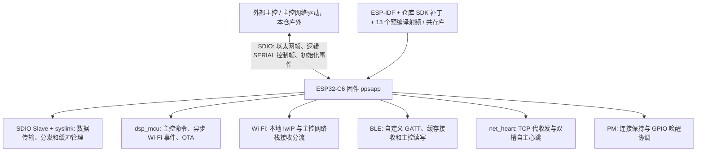
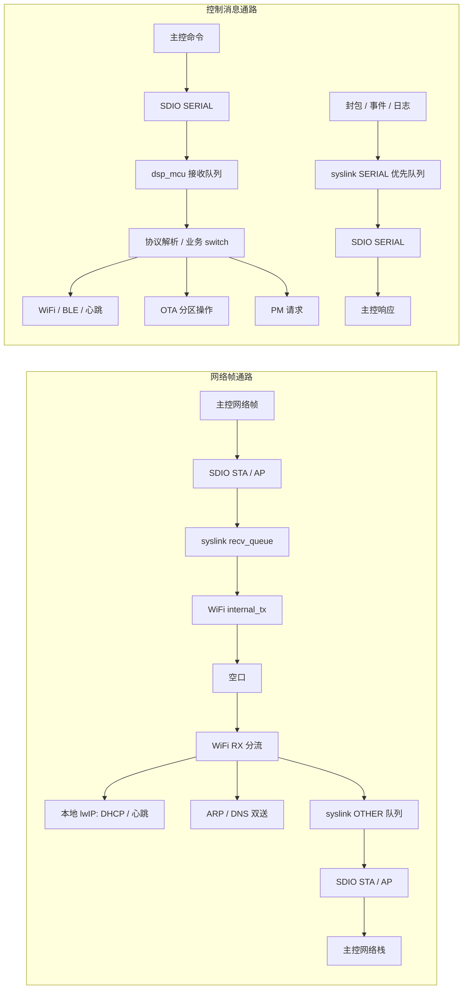
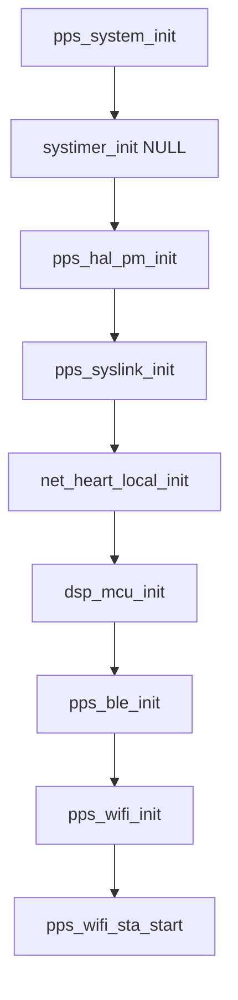
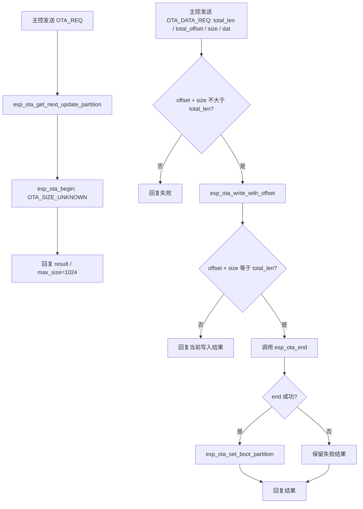
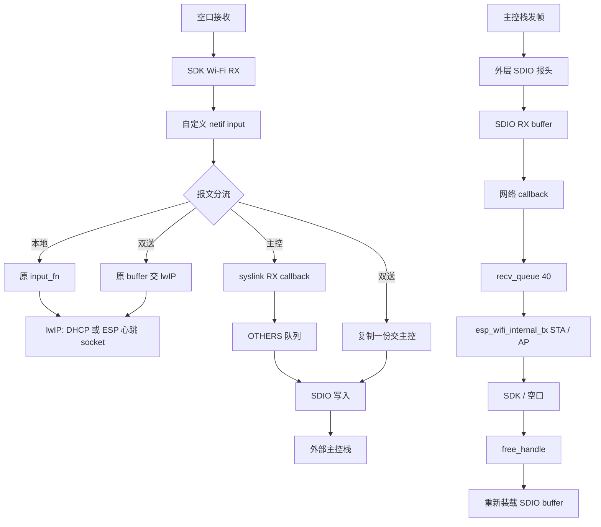
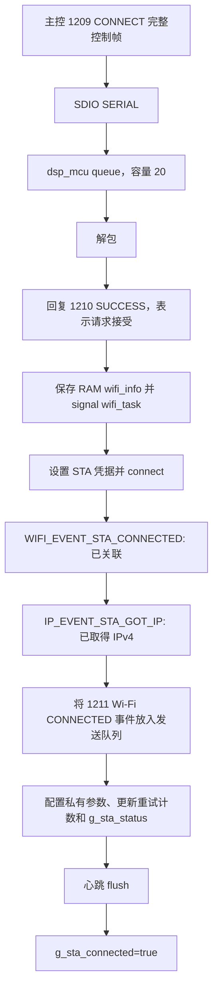
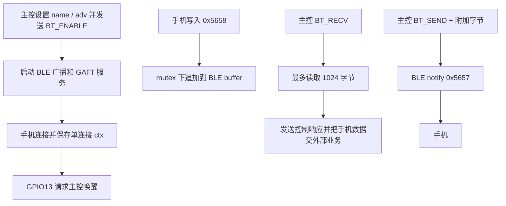
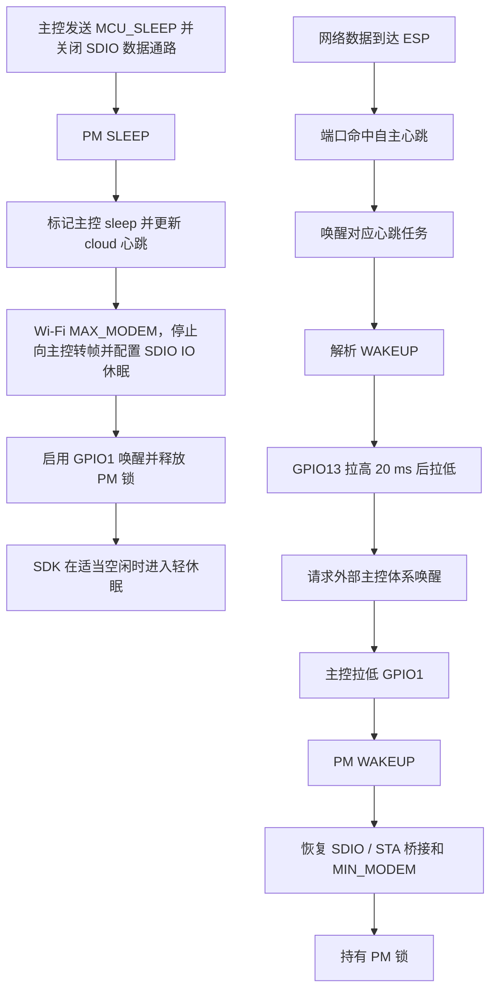
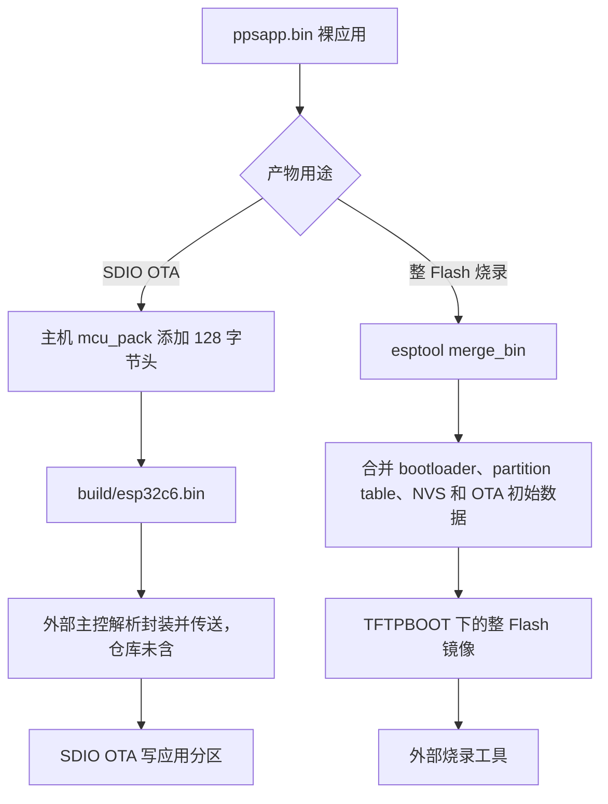
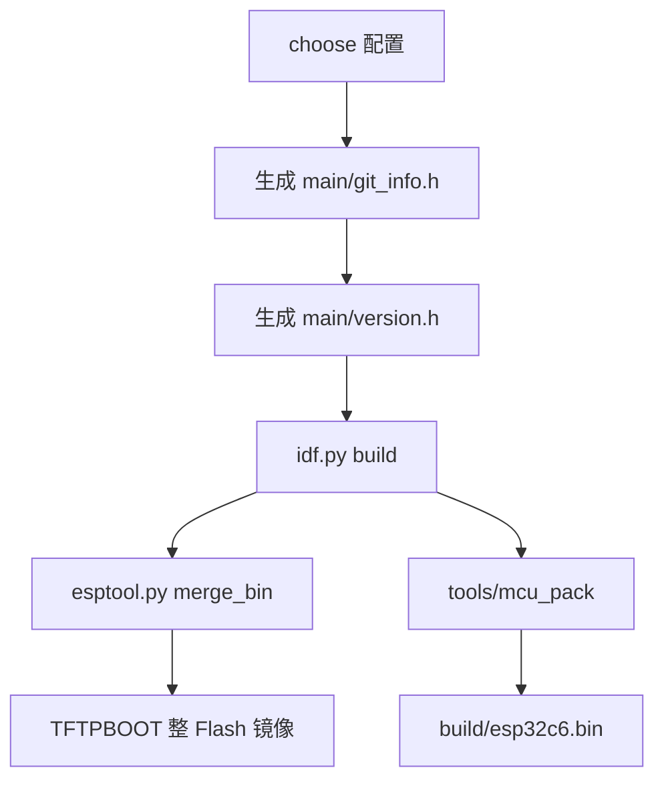

# mpc-esp32 仓库深度分析报告

> 初稿日期：2026 年 10 月 8 日；复核与补全日期：2026 年 10 月 9 日。  
> 核验源码：`/home/tronlong/lyp/meari/mpc-esp32`。  
> 对照结构：[mpc-base分析报告.md](/home/tronlong/lyp/perCode/idevelop_md/meari/mpc-base/mpc-base分析报告.md)。  
> 源码提交：`254044dec7f45307415ef8b6d454e8ae030be6e6`，提交时间 `2025-03-06 11:14:47 +0800`。

本报告分析 ESP32-C6 网络协处理固件的职责、实现路径和关键问题。正文保留源码定位，覆盖全部可读应用模块、控制协议、构建配置和 SDK 补丁；分析范围与主机核验记录集中在附录。

<a id="overview"></a>

## 一页概览

| 关注点 | 主要结论 | 详细位置 |
|---|---|---|
| 工程定位 | ESP32-C6 网络协处理固件，主控通过 SDIO 交换网络帧和控制命令 | 第一、四章 |
| 默认启动 | STA 与控制链路启动；BLE 初始化接收锁，自主心跳初始化事件，实际启用由主控命令触发 | 5.1、5.5、5.8 |
| 网络与控制 | 网络帧经过 syslink 桥接；控制帧经过 dsp_mcu 分发，SERIAL 为 SDIO 逻辑接口 | 5.2、5.3、5.7 |
| 本地业务 | WiFi 连接、BLE 字节通道、TCP 代收发/自主心跳、GPIO 唤醒、自动轻休眠协调及应用 OTA | 第五、七章 |
| 实现范围 | 91 项共享命令具备编解码分支，26 项请求具备入站业务 case；视频、PIR、电池等整机业务依赖外部模块 | 5.7、附录 A |
| 重点问题 | 控制长度/索引检查、失败路径内存释放、PM 事件覆盖、心跳残包处理及 OTA 会话管理 | 第十二章 |
| 构建与发布 | 依赖固定 ESP-IDF 5.2.1、SDK 补丁和替换库；裸应用、封装包、整 Flash 镜像用途各异 | 第八章 |
| 核验边界 | 已记录静态分析和主机复现；未完成 C6 目标编译、SDK 全量审查和实机验收 | 附录 B、C |

### 阅读路线

- **首次了解工程**：先读一页概览，再读第一、四、七、十一章，掌握职责、架构与使用流程。
- **接手开发或联调**：按第五章查模块，再读第八、九章，核对构建、返回值、长度和所有权约束。
- **评估问题或核验证据**：先读第十二章的问题汇总，再查对应模块与附录 A、B、C。

### 证据口径

“有声明”“有编解码”“业务已处理”“默认启动”和“实际设备验证”分别表示不同完成程度。正文中的源码结论来自调用与分支检查；ASan/UBSan 结果来自已记录的主机复现，设备行为仍以目标构建和实机数据为准。原始核验脚本、日志和摘要附件已按要求删除，本文保留分析结果与方法摘要，不再提供附件执行入口。

### 常用术语

| 术语 | 本报告中的含义 |
|---|---|
| 主控 / MCU | 与 ESP 交换命令、网络帧或唤醒信号的外部控制体系；具体分工依赖板级和主控实现 |
| SDIO Slave | ESP 面向外部主控的数据传输接口 |
| SERIAL / PRIV | SDIO 帧中的逻辑接口类型，分别用于控制消息与初始化等私有事件 |
| STA / AP | WiFi 客户端 / 接入点模式；当前默认启动 STA |
| netif / lwIP | 网络接口对象 / ESP 本地 TCP/IP 协议栈 |
| BLE / GATT | 低功耗蓝牙 / 属性服务协议；本应用提供通知和写入特征 |
| PM / GPIO | 电源管理 / 通用输入输出引脚；GPIO1 接收入站唤醒，GPIO13 发出唤醒脉冲 |
| OTA | 更新 ESP 应用分区；主控输送数据，后续真实重启依赖外部流程 |
| NVS | ESP 的键值存储，本工程读取 hardware_param/support_reset |
| TLV | 类型、长度、值组成的字段，用于 startup event 等消息 |
| ABI | 编译器、数据布局及库接口约定，包含 char 符号性、位域和结构布局 |
| ASan / UBSan | 主机内存错误 / 未定义行为检测工具；检测结果不代表实机故障发生率 |

<a id="contents"></a>

## 目录

- [一页概览](#overview)
- [一、仓库概述](#chapter-1)
- [二、支持平台](#chapter-2)
- [三、目录结构总览](#chapter-3)
- [四、核心架构设计](#chapter-4)
- [五、核心模块深度解析](#chapter-5)
- [六、工具库详解（common/ 与主机工具）](#chapter-6)
- [七、关键数据流分析](#chapter-7)
- [八、编译构建体系](#chapter-8)
- [九、接口设计规范](#chapter-9)
- [十、安全与加密](#chapter-10)
- [十一、典型使用场景](#chapter-11)
- [十二、总结](#chapter-12)
- [附录 A：源码覆盖清单与证据范围](#appendix-a)
- [附录 B：已记录的主机核验方法与结果](#appendix-b)
- [附录 C：仍不能由当前材料核验的项目](#appendix-c)
- [附录 D：修订记录与源码状态](#appendix-d)

---

<a id="chapter-1"></a>

## 一、仓库概述

`mpc-esp32` 是面向 **ESP32-C6 的网络协处理固件工程**。应用在 ESP-IDF / FreeRTOS 上运行，通过 SDIO Slave 与外部主控交换网络帧及控制消息；本地负责 WiFi STA 连接、BLE GATT 数据通道、TCP 心跳、GPIO 唤醒、自动轻休眠协调以及自身应用分区 OTA。

工程定位的直接依据是入口与网络桥接调用：`app_main()` 明确初始化 SDIO、协议、心跳、BLE 和 WiFi；`pps_syslink` 把主控帧送到 `esp_wifi_internal_tx()`，反方向通过 WiFi 自定义输入回调把帧送往 SDIO。依据：[入口:58](/home/tronlong/lyp/meari/mpc-esp32/main/pps_app.c:58)、[主控发网:367](/home/tronlong/lyp/meari/mpc-esp32/main/drivers/pps_syslink.c:367)、[WiFi 收帧:343](/home/tronlong/lyp/meari/mpc-esp32/main/drivers/pps_hal_wifi.c:343)。

### 核心定位



当前目录没有摄像头采集、视频编码、AI 检测或录像存储实现。它能转发来自主控的网络载荷，但没有对视频帧作解析或媒体处理的业务代码。协议里存在 PIR、电池、白灯和 AOV 模式字段，主要体现共享协议范围；对应请求在本工程多数进入不支持分支，不能据此称本工程实现了完整电池相机 MCU 功能。

---

<a id="chapter-2"></a>

## 二、支持平台

| 核验对象 | 当前文件证据 | 实际边界 |
|---|---|---|
| ESP32-C6 | 两份配置均为 `CONFIG_IDF_TARGET="esp32c6"`、RISC-V、`CONFIG_IDF_INIT_VERSION="5.2.1"` | 唯一明确的固件目标 |
| `common` 配置 | `config/esp32c6_common_sdkconfig` + `nvs_config_common.cvs/.bin` | 通用产品配置标签 |
| `t32` 配置 | `config/esp32c6_t32_sdkconfig` + `nvs_config_t32.cvs/.bin` | 名称关联主控产品；ESP 固件目标仍是 C6 |
| PC 主机工具 | `tools/mcu_pack` 为 x86-64 ELF；`tools/parse_bin.c` 可用 GCC 编译 | 打包工具可在主机运行，不等于固件有 x86 平台 |
| Windows 烧录工具 | `tools/flash_download_tool_3.9.4_0.zip` | 烧录工具附件；未运行 GUI 或验证烧录 |

两份 sdkconfig **逐字节一致**，两份 NVS 文本和两份 NVS 二进制也分别一致。当前不能从 `t32/common` 名称推断两套硬件参数或功能裁剪差异。NVS 文本只有 `hardware_param/support_reset=1`。

README 同时出现 v4.4.2、release/v5.1、ESP32-S3 的旧说明；安装脚本实际指定 v5.2.1 并固定 SDK 提交 `a322e6bdad4b6675d4597fb2722eea2851ba88cb`，配置也记录 5.2.1。

**当前工程环境依据应以脚本、配置和补丁为准；本次未验证这些补丁能在全新 SDK 上完整应用和链接。** [配置:349](/home/tronlong/lyp/meari/mpc-esp32/config/esp32c6_common_sdkconfig:349)、[安装脚本:16](/home/tronlong/lyp/meari/mpc-esp32/idf-env-create/auto_idf_env.sh:16)、[README:33](/home/tronlong/lyp/meari/mpc-esp32/README.md:33)。

---

<a id="chapter-3"></a>

## 三、目录结构总览

```text
mpc-esp32/
├── CMakeLists.txt                 # ESP-IDF 工程 ppsapp
├── README.md                      # 开发环境及构建说明，含旧版本信息
├── all.sh                         # 选择配置、生成版本头、编译、合并及打包
├── config/                        # common / t32 sdkconfig；内容相同
├── main/
│   ├── CMakeLists.txt             # 组件目录与 OS 宏
│   ├── pps_app.c                  # app_main 入口
│   ├── drivers/
│   │   ├── pps_system.[ch]        # NVS 与默认事件循环
│   │   ├── pps_sdio_slave.[ch]    # SDIO 传输、头部、接收回调
│   │   ├── pps_syslink.[ch]       # SDIO 与 WiFi 桥接、发送队列
│   │   ├── pps_hal_wifi.[ch]      # STA、接收分流、扫描与省电切换
│   │   ├── pps_hal_ble.[ch]       # 自定义 GATT 从设备
│   │   ├── pps_hal_pm.[ch]        # PM 事件任务、轻休眠锁
│   │   ├── pps_hal_io_pm.[ch]     # GPIO1 入站唤醒、GPIO13 出站唤醒
│   │   └── mempool.[ch]           # SDIO DMA 内存块缓存
│   ├── prot/
│   │   ├── dsp_mcu.[ch]           # 业务命令分发与 OTA
│   │   ├── dsp_mcu_prot.[ch]      # 共享协议封包、解包
│   │   ├── dsp_mcu_prot_def.h     # 命令及数据结构
│   │   ├── prot.h                # 请求/响应与回调类型
│   │   └── n2s.h / s2n.h          # 逐字段大端编解码
│   ├── app/inc/                   # 心跳 API（4 个头文件）
│   ├── app/src/
│   │   ├── net_heart.c            # 单连接 TCP 代收发
│   │   ├── net_heart_local.c      # 两槽位自主心跳与网络唤醒
│   │   ├── net_heart_cloud.c      # 云端心跳协议
│   │   └── net_heart_nkit.c       # NVR 套装注册/心跳协议
│   └── common/
│       ├── log.[ch]               # 分级日志与 SDIO 日志上送
│       ├── thread-pool.[ch]       # 通用线程池；未发现业务创建调用
│       ├── systimer.c             # 多 OS 定时器；业务仅调用 init
│       ├── port/systimer.h        # 定时器 API
│       ├── sockutil.h             # 网络超时/收发等辅助 API
│       └── sys/                   # event / locker / thread / system / sock
├── idf-env-create/
│   ├── auto_idf_env.sh            # 克隆 SDK、固定提交、应用补丁、替换库
│   ├── Readme.md                  # 环境脚本说明
│   └── idf_patch/
│       ├── 24-05-15.patch         # SDIO、PM、FreeRTOS、ADC 等补丁
│       └── lib/                   # esp_coex、phy、wifi：13 个 .a
├── partition_table/               # 4 MiB Flash 双 OTA 分区表
├── nvs_config/                    # 两份 .cvs 与两份预生成 .bin
├── nvs_generate.sh                # 生成 0x4000 大小 NVS 分区
├── version/                       # Git 信息和计数版本号生成脚本
├── tools/                         # 打包 ELF、对应 C 源、Windows 工具 ZIP
└── doc/                           # C6 数据手册与技术参考手册 PDF
```

81 个受跟踪文件中，C 文件 19 个、头文件 27 个，合计 12,142 个文本行（包括无换行的末行、空行、注释和通用平台分支；若按 `wc -l` 的换行符口径则为 12,133）；其中 `main/` 下 C 文件 18 个，另一个 C 文件是主机打包工具。两份 sdkconfig 各 2,521 个换行，SDK 补丁 249 个换行。数字是当前快照的文件计数，不是有效业务代码量。

`build/`、根目录 `sdkconfig`、完整 `idf-env-create/esp-idf/`、`main/version.h` 和 `main/git_info.h` 均不在本次源码快照中；部分是构建生成物。组件脚本声明收集 `. / drivers / prot / common / app/src`，并提供相应 include 路径。目标构建尚未生成，因此 18 个 C 文件表示目录范围内的候选编译源，最终清单需由构建日志确认。[组件配置:7](/home/tronlong/lyp/meari/mpc-esp32/main/CMakeLists.txt:7)。

---

<a id="chapter-4"></a>

## 四、核心架构设计

### 4.1 两条 SDIO 通路与本地协议栈



这里的 `SERIAL` 是 **SDIO 内的逻辑接口类型**。虽然函数仍名为 `uart_prot_*`，实际发送调用 `pps_syslink_send()`，没有当前业务的物理 UART 初始化或读写链路。[协议发送回调:47](/home/tronlong/lyp/meari/mpc-esp32/main/prot/dsp_mcu.c:47)。

ESP 保留本地 lwIP 用于 DHCP、心跳等，而主控也通过桥接收发网络帧；这不是纯粹把所有 IP 包交给一个网络栈。ARP/DNS 双送通过复制帧实现，其他主控帧则转移原 WiFi 接收缓冲区的释放责任。分流是按报文字段和端口作有限识别，见 5.4，不能视作完整协议分类器。

### 4.2 并发模型和所有权

| 执行单元 | 创建位置 | 请求栈大小 | 主要职责 |
|---|---|---:|---|
| `pm_thread` | `pps_hal_pm_init` | 3 KiB | 唤醒、休眠、向主控发脉冲 |
| `sdio_slave_recv` | `pps_sdio_slave_init` | 2 KiB | 从 SDK 收缓冲，分发网络/控制 |
| `syslink_interface` | `pps_syslink_init` | 2 KiB | 把主控网络帧送入 WiFi |
| `syslink_send` | `pps_syslink_init` | 3 KiB | 发送初始化事件、响应和网络帧 |
| `dsp_mcu` | `dsp_mcu_init` | 3 KiB | 控制协议解析、串行命令处理 |
| `wifi_task` | `pps_wifi_init` | 3 KiB | 异步连接/断开、重试 |
| `net_heart_local` × 至多 2 | 主控启动心跳请求 | 各 5 KiB | 自主连接、心跳与唤醒解析 |

表中是 `thread_create3()` 的请求参数；封装在 FreeRTOS 分支统一使用优先级 16 和 `xTaskCreate()`。SDK 内部 WiFi、lwIP、BLE、定时器等任务另计，不能由上表得出整机任务总数或总栈开销。[线程封装:158](/home/tronlong/lyp/meari/mpc-esp32/main/common/sys/thread.h:158)。

异步队列通常保存指针、长度、句柄和 `free_handle`。接收端处理完成后调用释放回调，将 SDK SDIO buffer 重新加载，或释放 WiFi buffer / malloc 副本；不是每个队列都复制全部载荷。完整控制封包先复制为待发块，SDIO 写函数再复制到 DMA 块，因此控制发送不是端到端零拷贝。

---

<a id="chapter-5"></a>

## 五、核心模块深度解析

各模块按“职责与启动 → 正常流程 → 关键约束 → 已知问题”组织。先读前两节理解运行过程，再查约束和问题定位。

- [5.1 app_main 与 system —— 启动和参数](#module-5-1)
- [5.2 pps_sdio_slave —— SDIO 传输层](#module-5-2)
- [5.3 pps_syslink —— 桥接、优先队列与启动通知](#module-5-3)
- [5.4 WiFi —— 连接、分流与状态](#module-5-4)
- [5.5 BLE —— 主控控制的 GATT 数据通道](#module-5-5)
- [5.6 PM 与 GPIO —— 轻休眠和唤醒协调](#module-5-6)
- [5.7 dsp_mcu 与 prot —— 控制协议和功能边界](#module-5-7)
- [5.8 心跳模块 —— 两种执行方式、两类业务协议](#module-5-8)
- [5.9 OTA —— 经主控输送的应用分区更新](#module-5-9)

<a id="module-5-1"></a>

### 5.1 app_main 与 system —— 启动和参数

#### 5.1.1 职责与启动

`app_main()` 负责组织各模块初始化；`pps_system_init()` 负责 NVS 和默认事件循环。

#### 5.1.2 正常流程

启动先打印版本、芯片和堆信息，然后按以下顺序执行：



`pps_system_init()` 调用 NVS 初始化和默认事件循环创建，在只读命名空间 `hardware_param` 读取 `support_reset`。

#### 5.1.3 关键约束

启动并不自动配置 WiFi 凭据，不会自动启动自主心跳连接，也不自动开启 BLE 控制器：`pps_ble_init()` 只创建接收互斥量，真正 BLE 启动由主控命令触发。

`support_reset` 只有存储、打印和 getter，仓库内未发现 getter 的业务调用；不能说明已经实现“配置控制硬件复位”。[system:20](/home/tronlong/lyp/meari/mpc-esp32/main/drivers/pps_system.c:20)。

主控协议开始接收早于 WiFi 初始化，命令下发时机需要外部主控协调，代码本身没有统一的“全部模块 ready”屏障。

#### 5.1.4 已知问题

所有启动返回值在 `app_main()` 中被忽略；单个初始化失败后仍会继续初始化依赖模块。`esp_flash_get_size()` 失败时也只是打印，之后仍使用未预先初始化的 `flash_size`。这属于启动错误处理缺口，而非所有启动都必然失败。[入口:35](/home/tronlong/lyp/meari/mpc-esp32/main/pps_app.c:35)。

NVS 初始化、事件循环创建、单项读取结果未完整处理；`nvs_open` 失败才直接返回 -1。

<a id="module-5-2"></a>

### 5.2 pps_sdio_slave —— SDIO 传输层

#### 5.2.1 职责与启动

该模块初始化 SDIO Slave，维护收发缓冲和底层状态。

传输使用 `SDIO_SLAVE_SEND_STREAM`；SDK 发送队列参数 20，静态接收缓冲 40 × 1,536 字节，共 **61,440 字节**。源码要求 `BUFFER_NUM=40` 与主控驱动 `ESP_MAX_BUF_CNT` 一致，主控侧需配合核对。[SDIO 参数:16](/home/tronlong/lyp/meari/mpc-esp32/main/drivers/pps_sdio_slave.c:16)。

#### 5.2.2 正常流程

主控中断 `OPEN_DATA_PATH` 将状态设 READY，`CLOSE_DATA_PATH` 设 INACTIVE 并通知 PM 休眠；`RESET` 调 SDK stop/reset/start。重新恢复 STA 时调用带补丁的 `sdio_slave_reinit()`。**WiFi 已连接与 SDIO READY 是不同条件**：前者由 DHCP/事件决定，后者由主控开数据通路决定。

接收线程从 SDK 获取 buffer/handle，读 `offset/len` 定位载荷。SERIAL 交给 `dsp_mcu`，其余接口在有 handler 时都交给网络回调。最终 `free_handle` 调 `sdio_slave_recv_load_buf()`，把缓冲归还 SDK。

发送从缓存池取 DMA 块，加入外层头，再调用 SDK transmit；返回后回收块。当前源码不能独立核验外部 SDK transmit 的完成语义，是否可在此时复用块需匹配实际 SDK。控制载荷分块上限为 `1536-100=1436` 字节；这是为头部预留空间的应用分块策略，不是 BLE MTU 或控制协议总帧上限。[分块上限:383](/home/tronlong/lyp/meari/mpc-esp32/main/drivers/pps_sdio_slave.c:383)。

#### 5.2.3 关键约束

外层报头是 packed 结构，当前字段总计 12 字节：

| 字段 | 宽度 | 当前行为 |
|---|---:|---|
| `if_type / if_num` | 同一字节各 4 位 | STA/AP/SERIAL/PRIV 等接口 |
| `flags` | 1 字节 | 发送头清零，未从 handle 填入 |
| `len` | 2 字节 | 载荷长度，小端 |
| `offset` | 2 字节 | 载荷偏移，小端；发送为 12 |
| `checksum` | 2 字节 | 由 `CONFIG_ESP_SDIO_CHECKSUM` 控制 |
| `seq_num` | 2 字节 | 发送头未写入，实际保持零 |
| `reserved2` + union | 各 1 字节 | 保留 / HCI / 私有类型 |

`syslink_send()` 虽递增 `seq_num`，`pps_sdio_slave_write()` 未把它填入报头，因此不能宣称当前协议通过此序号保证包排序或丢包恢复。两份配置未定义 SDIO/SPI checksum 开关，最终启用状态需以目标构建为准。内层控制协议的累加校验另行实现，不受此开关控制。[外层头:27](/home/tronlong/lyp/meari/mpc-esp32/main/drivers/pps_sdio_slave.c:27)、[写头:418](/home/tronlong/lyp/meari/mpc-esp32/main/drivers/pps_sdio_slave.c:418)。

#### 5.2.4 已知问题

- 接收未先核验实际 `sdio_read_len ≥ 12`，也未验证 `offset ≥ 12`、`offset+len ≤ 实际收到的长度`；开启 checksum 时仍用头中声明的长度计算校验。
- 非 SERIAL 接口都进入网络回调，而网络回调未严格拒绝 HCI/PRIV/TEST；不支持的接口可能作为默认 STA 接口发送。
- callback 未注册时没有统一归还分支；启动早期串行 callback 尚未注册时收到 buffer，存在归还缺口。
- 写函数未检查载荷加头是否超过池块容量，直接 memcpy。正常控制分块限制能覆盖这条控制路径，但通用写 API / 网络帧路径没有统一尺寸保护。
- `g_mp_buf` 销毁后未置 NULL；deinit 不停止接收任务，也没有完整解除回调、注销 buffer。不能把这些 API 当成已验证可反复启停的完整生命周期。

上述缺口的静态源码依据：[接收长度:157](/home/tronlong/lyp/meari/mpc-esp32/main/drivers/pps_sdio_slave.c:157)、[接收分发:204](/home/tronlong/lyp/meari/mpc-esp32/main/drivers/pps_sdio_slave.c:204)、[销毁:63](/home/tronlong/lyp/meari/mpc-esp32/main/drivers/pps_sdio_slave.c:63)、[写入:410](/home/tronlong/lyp/meari/mpc-esp32/main/drivers/pps_sdio_slave.c:410)。

<a id="module-5-3"></a>

### 5.3 pps_syslink —— 桥接、优先队列与启动通知

#### 5.3.1 职责与启动

该模块连接 SDIO、控制协议和 WiFi，组织主控方向的发送及网络输入队列。

向主控发送有两条各 128 深度的队列：SERIAL 优先、OTHERS 普通；元队列深度 256。SERIAL 的队列类型标记插入元队列头部，普通流量插入尾部。网络输入队列深度 40；控制输入队列深度 20，后者由 `dsp_mcu` 管理。

#### 5.3.2 正常流程

READY 后发 PRIV 初始化事件，TLV 包含 firmware chip id、capability、raw throughput 标记。实际 capability 设置的是 WLAN over SDIO，可条件加入 checksum；虽然枚举定义 BT/UART/SPI 标志，本函数未宣告这些能力。[初始化通知:235](/home/tronlong/lyp/meari/mpc-esp32/main/drivers/pps_syslink.c:235)。

主控网络帧由 `syslink_interface` 调 `esp_wifi_internal_tx()`；失败最多做 5 次调用，失败间隔 20 ms，之后归还 buffer。控制发送先 malloc/复制，按 1,436 字节切块入队，返回成功表示入队成功，不能代表主控已经收到。

#### 5.3.3 关键约束

发送入队使用 `portMAX_DELAY`，WiFi RX callback 本身可以阻塞。主控长时间不消费、队列拥塞或控制日志密集时，不能保证业务不会被反压；持续 SERIAL 流量也可能推迟普通帧发送。接收入队使用零等待，队列满时释放当前 buffer 并丢弃，没有应用重传机制。[入队:93](/home/tronlong/lyp/meari/mpc-esp32/main/drivers/pps_syslink.c:93)、[网络入队:176](/home/tronlong/lyp/meari/mpc-esp32/main/drivers/pps_syslink.c:176)。

#### 5.3.4 已知问题

可确认的问题包括：

1. `syslink_recv_cb` 的 `send` 初值为 true，连接条件失败后没有改为 false，预期的连接状态过滤未落实。
2. 创建 `syslink_interface` 后检查的是旧 `retval`，没有检查刚得到的 `ret`，线程创建失败可能漏报。
3. startup event 发送失败时，`syslink_send()` 已释放 payload，调用方又 `free(event)`，同一失败路径存在重复释放。
4. syslink 初始化先启动 SDIO，再创建发送队列和 event；主控过早开启通路存在初始化窗口。
5. `pps_syslink_reinit()` 实际只塞入空 SERIAL handle 唤出队列等待，既不重新创建模块，也不等价于底层 SDIO reinit；`pps_syslink_deinit()` 未停止两个任务、删除队列或重置 `sdio_init`。

依据：[状态过滤:176](/home/tronlong/lyp/meari/mpc-esp32/main/drivers/pps_syslink.c:176)、[线程检查:438](/home/tronlong/lyp/meari/mpc-esp32/main/drivers/pps_syslink.c:438)、[发送失败释放:165](/home/tronlong/lyp/meari/mpc-esp32/main/drivers/pps_syslink.c:165)、[通知失败释放:290](/home/tronlong/lyp/meari/mpc-esp32/main/drivers/pps_syslink.c:290)、[reinit:476](/home/tronlong/lyp/meari/mpc-esp32/main/drivers/pps_syslink.c:476)。

<a id="module-5-4"></a>

### 5.4 WiFi —— 连接、分流与状态

#### 5.4.1 职责与启动

初始化建立 STA/AP 两个 netif，替换各自 lwIP input 函数，然后启动 **STA 模式**，使用 `WIFI_STORAGE_RAM` 和 `WIFI_PS_MIN_MODEM`，注册 WiFi/IP 事件，启动连接工作任务。虽然 AP netif、AP 接收分支、AP syslink mode 存在，当前入口和控制命令未提供完整的 AP 配置/启用链，不能直接宣称产品已支持 AP 配网。[WiFi 初始化:570](/home/tronlong/lyp/meari/mpc-esp32/main/drivers/pps_hal_wifi.c:570)。

#### 5.4.2 正常流程

`pps_wifi_connect()` 在锁内保存 `pps_wifi_info_t`，把失败重试计数设 3，signal 工作任务，然后返回。工作任务停扫描、断开旧连接，设置 SSID/密码/auth/channel/listen interval，再调连接 API。工作任务每 3 分钟超时检查：已连接或没有凭据时继续等待，否则重连；断线事件在计数未耗尽时 signal 立即重试，耗尽后才向主控上送失败事件。

SDK 配置还有 `failure_retry_cnt=3`，不能简单把所有层次合并为“只重试三次”。[工作任务:501](/home/tronlong/lyp/meari/mpc-esp32/main/drivers/pps_hal_wifi.c:501)、[断线分支:193](/home/tronlong/lyp/meari/mpc-esp32/main/drivers/pps_hal_wifi.c:193)。

连接状态在 `IP_EVENT_STA_GOT_IP` 中才置 CONNECTED。**该分支的实际顺序是先调用 `dsp_mcu_event(CONNECTED)` 上送，再配置私有 WiFi 参数、更新重试计数和 `g_sta_status`，flush 心跳，最后写 `g_sta_connected=true`。** 因此事件进入发送队列不等于两个内部状态已同时更新。`WIFI_EVENT_STA_CONNECTED` 只打印 AP 关联信息。连接命令收到的 SUCCESS 是请求接受，不是完成 DHCP 或证明公网可达。`g_sta_connected` 是内部布尔，`g_sta_status` 是对外三态；LOST_IP 只直接清布尔并唤出重连，对外状态可能存在事件间的暂时差异。

扫描是同步主动扫描，不显示隐藏 SSID，每频道配置 150～300 ms，命令最多回 100 条结果。它在同一个 `dsp_mcu` 工作线程里执行，扫描期间会延迟其他控制命令。

**接收分流**

| 顺序/条件 | 处理方向 | 源码边界 |
|---|---|---|
| 包长不足以太网头 + 最小 IPv4 头 | 本地 lwIP | 一般短包先交本地 |
| ARP | 本地 + 主控 | malloc 副本用于双送 |
| IPv4 | 使用 IHL × 4 找端口 | 没有完整 IHL/分片/协议号校验 |
| IPv6 | 固定 40 字节后读端口 | 不处理扩展头 |
| 目的端口 67/68 | 本地 lwIP | 没有先确认是 UDP |
| 源或目的端口 53 | 本地 + 主控 | 端口识别，不是 DNS 消息语义校验 |
| 已注册心跳 callback 命中源端口 | 本地 lwIP | 调用 callback 时 IP 参数为 NULL |
| 其他 | 主控路径 | 若主控 RX callback 为空，统一回本地 lwIP |

所以“ESP 留下心跳，其余给主控”是正常业务意图的概括；准确实现还有 ARP/DNS 双送、DHCP 特例及 callback 为空时的回落。没有核验协议号和心跳五元组，其他流量可能因相同端口被误分类。[分流:279](/home/tronlong/lyp/meari/mpc-esp32/main/drivers/pps_hal_wifi.c:279)。

#### 5.4.3 关键约束

协议 CONNECT 只有 SSID、password、auth；dispatcher 将内部结构的 BSSID/channel 等保持零，不能把底层结构具备这些成员解释成主控可以通过该命令指定 BSSID/频道。WiFi task 只在 `bssid_set=true` 时赋 SDK 配置，未在 false 时显式清旧值；当前主控路径始终不置该标志，旧值问题只适用于未来或其他直接调用者。

工程替换 netstack input，包含 lwIP 内部头与 `esp_private/wifi.h`，在 GOT_IP 中调用 `esp_wifi_config_edca`、`set_per_param`、`esp_wifi_config_trc`。对仓库 `.a` 的符号检查确认这三个函数在 `wifi/esp32c6/libpp.a` 中有定义；只声明未调用的 `set_cca`、msdu、ampdu 调参 API 不计为当前使用能力。

#### 5.4.4 已知问题

`pps_wifi_sta_start()` 是入口最后一次调用；如果 `WIFI_EVENT_STA_START` 已将 started 设真，就直接返回，因此该函数中设置的 6 秒 inactive timeout 未必每次启动都执行。该参数需结合实际事件时序确认。[STA start:689](/home/tronlong/lyp/meari/mpc-esp32/main/drivers/pps_hal_wifi.c:689)。

RSSI 转“信号值”用 `(rssi+110)*100/70`，达到 70 时置 100，未对很低 RSSI 统一作下限钳制。信息响应中 `sta_signal` 是 uint8_t，而读取失败返回 -1，会转换为 255；不是有效百分比。WiFi6 状态来自 AP 信息 `phy_11ax`，不是初始化默认开启的产品保证。[信号查询:818](/home/tronlong/lyp/meari/mpc-esp32/main/drivers/pps_hal_wifi.c:818)、[响应:153](/home/tronlong/lyp/meari/mpc-esp32/main/prot/dsp_mcu.c:153)。

**扫描结果与响应**

返回填了 ssid/open/signal，却未赋结构中的 `auth`；静态缓冲也未逐次完整清空，失败路径没有重置历史 `nums`。编码器按 `nums` 取 AP 数组而不检查 `lreq`，所以一次成功扫描后再扫描失败，仍可把旧 AP 条目带在 FAILED 响应内；不是只返回四字节失败头。单条线上结构 40 字节，100 条完整响应为 `10+4+100×40=4014` 字节，会被 syslink 分成 1436、1436、1142 字节三个载荷。

不能把扫描响应 auth 当成当前 AP 的真实鉴权类型。[扫描命令:370](/home/tronlong/lyp/meari/mpc-esp32/main/prot/dsp_mcu.c:370)、[扫描编码:492](/home/tronlong/lyp/meari/mpc-esp32/main/prot/dsp_mcu_prot.c:492)。

STA 双送在 malloc 失败时回落本地；AP 双送 malloc 失败直接返回，没有相同回落。AP 分支还在验证完整帧长前比较目标 MAC。由于默认 AP 启用链未接入，这些是已存在代码分支的问题，不能冒充默认 STA 的运行故障。

`pps_wifi_set_event_callback()` 只保存回调指针，未发现 event handler 调用它；实际通知主控用 `dsp_mcu_event()`。deinit 没有终止 `wifi_task` 或删除 WiFi info lock/event，也没有完整释放自定义 netstack 存储。产品若需要卸载再初始化，需补生命周期管理，不能从 API 名称推断可安全热重启。

<a id="module-5-5"></a>

### 5.5 BLE —— 主控控制的 GATT 数据通道

#### 5.5.1 职责与启动

采用 Bluedroid GATT Server，service UUID `0x5656`，通知特征 `0x5657`，写入特征 `0x5658`，含 CCC 描述符。应用维护一个全局连接上下文，当前应按单活动连接使用；配置里的多连接上限不等于应用实现了多连接隔离。[GATT 定义:80](/home/tronlong/lyp/meari/mpc-esp32/main/drivers/pps_hal_ble.c:80)。

#### 5.5.2 正常流程

主控设名称/广播内容，再发 BT_ENABLE，才初始化控制器、Bluedroid、回调和属性表。注册事件把用户广播内容放到 manufacturer specific AD，名称放到 scan response，两个 raw data 配置完成后开始广播。断线后重新广播；连接事件调用 PM 向主控发唤醒脉冲。名称/广播 setter 只改内存，**不直接更新已在广播的内容**。[注册事件:192](/home/tronlong/lyp/meari/mpc-esp32/main/drivers/pps_hal_ble.c:192)、[启动:343](/home/tronlong/lyp/meari/mpc-esp32/main/drivers/pps_hal_ble.c:343)、[setter:507](/home/tronlong/lyp/meari/mpc-esp32/main/drivers/pps_hal_ble.c:507)。

普通 GATT 写入在 mutex 下追加到 10 KiB buffer；超出容量时打印并丢弃这次写入。主控 BT_RECV 通过协议轮询，单次最多取 1,024 字节，剩余内容 memmove 到开头。

#### 5.5.3 关键约束

MTU 的三处数字要区分：向 SDK 请求 local MTU 500；应用初始/上限记录 255；协商事件取 `min(实际 MTU,255)`。协议字段 `mtu` 又只有 uint8_t。因此不能把查询值解释为“总能发送 500 字节通知”或“255 字节有效载荷”。[MTU 事件:276](/home/tronlong/lyp/meari/mpc-esp32/main/drivers/pps_hal_ble.c:276)、[local MTU:403](/home/tronlong/lyp/meari/mpc-esp32/main/drivers/pps_hal_ble.c:403)。

当前代码把 BLE 收到的字节交由主控读取，没有本地解析 SSID/密码、App 配对或设备绑定的完整流程。可确认它为外部业务提供 BLE 传输通道，不能单独断言已完成 BLE 配网。

GATT 权限使用普通 READ/WRITE，未见本应用主动配置强制加密或鉴权；SDK 启用 SMP 是能力配置，不能替代实际访问策略核验。

#### 5.5.4 已知问题

接收不保留每次 GATT write 的消息边界，也没有在断开/停用时清理缓存，跨连接保留旧数据的行为需要业务处理。

Prepare write 仅应答，EXEC_WRITE 也仅应答，没有分段暂存和提交实现，所以不能宣称支持可靠长写入。`pps_ble_send()` 调 `esp_ble_gatts_send_indicate(..., false)`，即不要求确认的通知路径；没有在应用层按协商 MTU 分块，也未维护每连接订阅状态来控制发送。[写事件:248](/home/tronlong/lyp/meari/mpc-esp32/main/drivers/pps_hal_ble.c:248)、[send/recv:458](/home/tronlong/lyp/meari/mpc-esp32/main/drivers/pps_hal_ble.c:458)。

`pps_ble_set_adv_data()` 未检查 len 是否在 0～32 内，直接 memmove 到 32 字节成员；主控请求传入的 `adv_data_len` 可超出固定字段长度。**广播启动时再截断为合法 AD 长度，不能补救 setter 之前已发生的越界复制。** [广播 setter:521](/home/tronlong/lyp/meari/mpc-esp32/main/drivers/pps_hal_ble.c:521)。

<a id="module-5-6"></a>

### 5.6 PM 与 GPIO —— 轻休眠和唤醒协调

#### 5.6.1 职责与启动

初始化配置 CPU 最大频率取 sdkconfig（160 MHz）、最小频率取晶振（40 MHz），允许 light sleep，并建立 `ESP_PM_NO_LIGHT_SLEEP` 锁。PM 任务开始先持锁，接收事件后切换业务状态。

#### 5.6.2 正常流程

| 事件 | 当前处理 |
|---|---|
| SLEEP | 通知云端心跳设备睡眠，等待 100 ms；WiFi 改 MAX_MODEM；关闭主控桥接回调和 SDIO IO；唤出 syslink 发送等待；配置 GPIO1 低电平唤醒；释放 NO_LIGHT_SLEEP 锁 |
| WAKEUP | 恢复 STA syslink/必要 SDIO reset，WiFi 改 MIN_MODEM，再持有 NO_LIGHT_SLEEP 锁 |
| WAKEUPMCU | GPIO13 拉高 20 ms，再拉低，向外部 MCU/主控体系请求唤醒 |

#### 5.6.3 关键约束

这是一条 **自动轻休眠许可路径**：应用释放锁，把真正入睡交给 ESP-IDF PM/空闲调度；代码没有调用 deep sleep，定时 30 秒唤醒代码也已注释。释锁不是“此时芯片已睡”，心跳、BLE、WiFi/SDK 任务仍可能影响睡眠时长。主控 GPIO1 拉低是恢复桥接的路径；网络心跳命中则使用 GPIO13 请求外部设备唤醒，后续主控再协调 ESP 恢复。[PM 主循环:37](/home/tronlong/lyp/meari/mpc-esp32/main/drivers/pps_hal_pm.c:37)、[GPIO 定义:13](/home/tronlong/lyp/meari/mpc-esp32/main/drivers/pps_hal_io_pm.c:13)。

#### 5.6.4 已知问题

PM 有单个全局 `pm_ev`，生产者执行 `pm_ev = EVENT_*` 后 signal 同一个 event，而不是消息队列或原子累加。多个事件在任务处理前到来会覆盖；事件组的通知位不能保存被覆盖的业务类型。这是源码可确认的并发设计缺口，丢失频率和现场后果仍需时序测试。

PM 初始化和休眠处理大量 SDK/GPIO 调用未检查错误，GPIO 唤醒配置失败仍可能释放锁；WAKEUP 恢复网络本身不把 `dev_sleep` 改 false，状态改回在线要靠主控 LOCAL_HEART_CTRL 或接收到网络唤醒命令。源码没有本地 PIR、电池 ADC 或完整整机 AOV 调度器。[事件写入:86](/home/tronlong/lyp/meari/mpc-esp32/main/drivers/pps_hal_pm.c:86)。

<a id="module-5-7"></a>

### 5.7 dsp_mcu 与 prot —— 控制协议和功能边界

#### 5.7.1 职责与启动

该模块接收 SDIO SERIAL 控制载荷，按命令分发 WiFi、BLE、心跳、PM 和 OTA 操作；封包/解包由共享协议层完成。

#### 5.7.2 正常流程

控制请求依次经过 SDIO SERIAL 接收、dsp_mcu 队列、解包和业务 switch；响应经封包与 syslink SERIAL 队列返回主控。异步 WiFi 事件和日志也使用这条发送路径。

共享命令枚举共 91 项（包含请求、响应和 DEBUG）；编码与解码各有 91 个 case；`uart_prot_recv_cb()` 实际有 **26 个请求 case**。全部 ID 逐项列于[附录 A 的命令覆盖矩阵](#command-matrix)。已记录的 91 项零值结构封包/解包均获得一次回调，覆盖各 case 的基本可达性；非零字段与边界输入的检查范围见附录 B。业务处理矩阵如下，响应 ID 通常是请求 ID+1：

| 请求 ID | 当前处理 | 成功的含义或边界 |
|---|---|---|
| 3 GET_VER | 查询生成版本/Git 信息 | `app=1`，应用阶段 |
| 21 WAKEUP_MCU | 回复 SUCCESS | 该 case 没有恢复 PM 状态；GPIO 唤醒另有链路 |
| 23 MCU_SLEEP | 先应答再投递 PM 休眠 | 不是同步等待入睡完成 |
| 1001 / 1003 OTA | 创建 OTA 会话 / 偏移写入与结束 | 见 5.9 |
| 1201 WiFi CAPS | SUCCESS + 零初始化保留区 | 没有填有意义的功能能力位 |
| 1203 WiFi INFO | STA 信息、地址、信号、WiFi6 | 查询失败部分未映射到 result |
| 1205 hostname | 设置 hostname | 缓存最多 31 字节；协议请求字段为 64 |
| 1207 disconnect | 清凭据并唤出工作任务 | 异步执行 |
| 1209 connect | 先成功应答，再保存连接请求 | 连接完成另发 1211 事件 |
| 1213 scan | 同步扫描，最多 100 条 | auth 未填；占用控制工作线程 |
| 1401 / 1403 BT CAPS/INFO | 查询 BLE | CAPS 保留区零；INFO 中 result 先赋再 memset 清掉 |
| 1405 BT ENABLE | 启停 BLE 控制器及协议栈 | 内部异步广播完成另看 SDK 事件 |
| 1407 / 1409 | 设置名称 / 广播字节 | setter 不实时重配置广播；len 缺界限 |
| 1411 / 1413 | 通知发送 / 读取缓存 | RECV 每次最多 1,024 字节 |
| 1601 / 1603 | 单连接 TCP connect/disconnect | connect 使用请求 timeout |
| 1605 / 1607 | 单连接发送/接收 | 默认 200 ms；RECV 最多 1,024 字节 |
| 1609 | 单连接状态 | 保存的 connected 状态 |
| 1611 | 启停指定自主心跳槽位 | 支持两个数组槽；第二槽成功被误报失败 |
| 1613 | 设置主控 sleep 状态 | 同时促使 cloud 心跳更新 |
| 1615 | 查询自主心跳槽位状态 | 接口需严格控制索引 |

除版本、唤醒应答、休眠外，基础请求 1、5～19 的奇数、25～41 的奇数（共 18 项）没有本工程业务实现，包括 MCU 心跳、网络电源、整机重启、PIR、电池、AOV 阈值、白灯等；入站 1211 WiFi event 也没有接收业务 case，因为正常路径是 ESP 向主控发送它。已成功编解码且 ID≤2000 的未处理奇数命令进入 NO_SUPPORT 应答。

未知命令可能在编解码层先被拒绝，**不是所有任意 ID 都保证有不支持回复**。[业务 switch:301](/home/tronlong/lyp/meari/mpc-esp32/main/prot/dsp_mcu.c:301)、[默认应答:488](/home/tronlong/lyp/meari/mpc-esp32/main/prot/dsp_mcu.c:488)。

#### 5.7.3 关键约束

```text
56 56 50 99 │ cmd:BE16 │ body_len:BE16 │ 逐字段编码的 body │ sum:BE16
  4 字节       2 字节       2 字节          N 字节          2 字节
```

总帧长 `N+10`；校验是对头与载荷逐字节累加的 16 位和。`s2n/n2s` 逐字段编解码，uint16/uint32 为大端，定长字符串按成员长度拷贝。它与小端的 SDIO 外层头、主机本地写出的打包文件头是三种不同格式，不应混用。[封包:54](/home/tronlong/lyp/meari/mpc-esp32/main/prot/dsp_mcu_prot.c:54)、[s2n:25](/home/tronlong/lyp/meari/mpc-esp32/main/prot/s2n.h:25)。

控制模块有 10 KiB 发送 buffer、10 KiB 解码结构 buffer，发送通过 mutex 串行封包。日志另用独立静态 1 KiB buffer，经 DEBUG=2000 发往主控；正常日志框架持有输出锁，但公开 `dsp_mcu_send_log()` 自身没有同样的互斥保护。

`prot_req_t.lreq` 是调用者提供的结构长度，但序列化分支主要检查**发送输出空间**，未统一验证输入结构长度。`prot_rsp_t.lrsp` 在解码前表示输出 buffer 容量，解码后变成结构大小；若把它当成收到的 body 长度，容易造成错误检查。源码中已经存在这种混用，详见本模块已知问题。

**控制帧交付与重组**

解包扫描起始码，可在同一次输入内处理多帧；但没有跨次输入缓存。`dsp_mcu_thread()` 对每个 SDIO payload 独立解包后直接归还 buffer，也没有使用返回值保留残包。主机把一个正常 WiFi connect 帧切成两次输入后，回调次数为 0；完整输入回调次数为 1。**主控发往 ESP 的控制帧必须按实际驱动约束完整交付，或外部/本地补重组机制**。

ESP 发往主控的扫描响应可超过 1,436 字节并被 syslink 切块，主控是否重组不在本次核验范围内。[解包:1355](/home/tronlong/lyp/meari/mpc-esp32/main/prot/dsp_mcu_prot.c:1355)、[调用方:504](/home/tronlong/lyp/meari/mpc-esp32/main/prot/dsp_mcu.c:504)。

#### 5.7.4 已知问题

NO_SUPPORT 实现另有实际缺陷：`dsp_mcu_no_support_resp()` 只给一个 uint16 result，序列化却按响应 ID 选择完整结构。例如 GET_INFO_RSP 继续读电量/电压等字段，越过这两个字节的输入对象。主机复现已捕获 stack-buffer-overflow，不能把该路径描述成安全的统一错误响应。[错误应答:296](/home/tronlong/lyp/meari/mpc-esp32/main/prot/dsp_mcu.c:296)、[GET_INFO 编码:220](/home/tronlong/lyp/meari/mpc-esp32/main/prot/dsp_mcu_prot.c:220)。

已复现五类边界问题：

| 测试输入/调用 | 实际观测 | 源码原因 |
|---|---|---|
| 有效校验、WiFi connect、body_len=0 的 10 字节帧 | ASan 输入越界读 | 固定字段解码只检查输出容量，未检查实际 body 长度 |
| 12 字节输入，起始码只在最后 4 字节 | ASan 输入越界读 | 找到起始码后没有再次检查剩余完整报头长度 |
| GET_VER_RSP，输出空间恰好为响应结构大小 | ASan 输出越界写 | 解包末尾在 `prsp[lrsp]` 额外写一个零 |
| GET_VER_REQ，封包输出空间只给 8 字节 | ASan 输出越界写 | 不预留末尾 2 字节 checksum |
| GET_INFO_RSP，输入对象仅 2 字节 NO_SUPPORT | ASan 栈越界读 | 序列化未验证 preq 输入对象长度 |

源码依据：[找包:134](/home/tronlong/lyp/meari/mpc-esp32/main/prot/dsp_mcu_prot.c:134)、[WiFi 解码:1057](/home/tronlong/lyp/meari/mpc-esp32/main/prot/dsp_mcu_prot.c:1057)、[补零:1389](/home/tronlong/lyp/meari/mpc-esp32/main/prot/dsp_mcu_prot.c:1389)、[尾校验:86](/home/tronlong/lyp/meari/mpc-esp32/main/prot/dsp_mcu_prot.c:86)。

复现直接编译原始 `dsp_mcu_prot.c`，日志输出用空函数替代，未修改协议实现。它证明这些输入/容量条件下存在越界；**不意味着正常主控报文必定触发，也不等同于设备上已发生的崩溃统计**。主流程给解码结构预留 10 KiB，因此“恰好容量”是公开 API 边界问题；输入短帧与不支持响应则还能追到主流程调用条件。核验条件和结果摘要见[附录 B](#appendix-b)。

复核另确认：封包附加 `dat` 的 memmove 未核对剩余输出空间，12 字节输出缓冲搭配 BT_SEND 的 32 字节附加数据复现越界写；`n2s.h` 的 U32 宏把 uint8_t 提升为 int 后左移，OTA total_len=`0x80000000` 复现 UBSan 的 `128 << 24` 有符号移位错误。

GET_INFO_RSP 编码包含 `res[9]`，解码却未复制该字段；将保留区填 `0x55`，解码所得仍为零。最后一项当前无业务用途证据，不能据此声称电量等前置字段也都解错。[附加数据:76](/home/tronlong/lyp/meari/mpc-esp32/main/prot/dsp_mcu_prot.c:76)、[U32 宏:28](/home/tronlong/lyp/meari/mpc-esp32/main/prot/n2s.h:28)、[GET_INFO 解码:788](/home/tronlong/lyp/meari/mpc-esp32/main/prot/dsp_mcu_prot.c:788)。

定长 `string` 宏只是复制全部成员字节，不保证字符串末尾为 NUL。解包最后在整个响应结构后补零，不能保证 SSID、password、IP、name 等每个成员各自终止；业务随后用 `%s`/snprintf 读取时可越过字段边界。例如 64 字节 SSID 全非零时，读取可以进入后续 password。准确结论是缺少逐字段字符串约束，具体是否越过整个分配区还取决于后续字段和缓冲内容。[字符串解码:47](/home/tronlong/lyp/meari/mpc-esp32/main/prot/n2s.h:47)。

其他已确认差异：LOCAL_HEART_INFO_RSP 的 `status` 声明 uint8_t，编解码却用 uint16_t，主机测试 body 实际为 4 字节（result 2 + status 2），不是声明字段之和的 3 字节。WiFi connect 的旧包兼容、EVENT cnt 的可选解析依据 `lrsp` 输出容量判断，而不是 `msglen`，并不能正确按输入报文是否包含字段决定兼容行为。[status 编码:681](/home/tronlong/lyp/meari/mpc-esp32/main/prot/dsp_mcu_prot.c:681)、[兼容判断:1058](/home/tronlong/lyp/meari/mpc-esp32/main/prot/dsp_mcu_prot.c:1058)、[EVENT:824](/home/tronlong/lyp/meari/mpc-esp32/main/prot/dsp_mcu_prot.c:824)。

<a id="module-5-8"></a>

### 5.8 心跳模块 —— 两种执行方式、两类业务协议

#### 5.8.1 职责与启动

心跳分为主控代收发和 ESP 自主保活两种执行方式。自主保活支持 cloud 与 NVR 两类协议。

有两个静态槽位。启动参数由主控给出：index、IP、port、cloud/NVR 类型、周期秒数和扩展身份。`net_heart_local_init()` 只创建事件；每个有效 start 才创建对应工作任务。

#### 5.8.2 正常流程

**主控代收发**

该模块保存一条 TCP 连接。主控逐项下发 connect/send/recv/disconnect，ESP 不在这里自动生成周期心跳，也没有自主重连任务。接收超时返回 0，断开或非超时错误则关闭连接。`net_heart_send()` 返回单次发送结果，dispatcher 通过比较返回字节数与请求长度判断是否完整发送。

接收分流命中这条连接的**源端口**时立刻请求 GPIO13 唤醒主控，然后将该帧留在本地 lwIP 等待主控读取。IP 参数未使用，也未校验本地目的端口，因此不是严格的连接五元组匹配。connect 失败时已记录的 port 没有立即清空，可能继续影响分流。[代收发:21](/home/tronlong/lyp/meari/mpc-esp32/main/app/src/net_heart.c:21)、[端口 callback:74](/home/tronlong/lyp/meari/mpc-esp32/main/app/src/net_heart.c:74)。

**ESP 自主保活**

工作循环等事件或周期超时，检查心跳超时 `(cycle+1)*3 秒`，必要时重新 TCP 连接；连接成功会唤醒主控。连续未连接时按本地失败计时条件请求主控检查地址；成功连接之后再次失败会立即报告，再按一小时节流。首次启动的失败计时已经设为当前时间，初次失败的唤醒时机取决于该计时条件。周期本身也没有校验非零。

cloud 模式：在线心跳不带 UUID body；sleep 心跳带 `{"uuid":"..."}`。NVR 模式：每个更新周期发注册包，再发保活包。收到有效 heartbeat 更新接收时间；收到 wakeup 请求则向主控发 GPIO13 脉冲、将设备状态置在线，并向 cloud/NVR 发送回复。“连接正常”反映此 TCP 连接与保活状态，整机唤醒结果见附录 C 的验证范围。 [自主循环:71](/home/tronlong/lyp/meari/mpc-esp32/main/app/src/net_heart_local.c:71)。

#### 5.8.3 关键约束

| 协议 | 本地编码/解析 |
|---|---|
| cloud | 8 字节头 + body + 1 字节 body 累加和 + `0x9d` 尾；头标记 `0xe6`；cmd `0xd0` 保活、`0xd1` 唤醒；body 长度低字节在前 |
| NVR/nkit | `56 56 50 99` + BE16 cmd + BE16 body_len + body + BE16 累加和；`0x0006` 注册、`0xffff` 保活、`0x0007` 唤醒；注册 device_type 为低功耗 IPC MCU，token 固定字符串 `OTHER` |

NVR 心跳协议虽与内层 MCU 控制帧共用起始码和类似头，但命令空间和承载连接不同，不能拿其中一个 dispatcher 解释另一个。[cloud:52](/home/tronlong/lyp/meari/mpc-esp32/main/app/src/net_heart_cloud.c:52)、[NVR:54](/home/tronlong/lyp/meari/mpc-esp32/main/app/src/net_heart_nkit.c:54)。

#### 5.8.4 已知问题

两个网络解析器使用 `char*` 读取起始标记和长度，再与 ≥0x80 的常量比较或移位，没有统一转成 uint8_t。主机分别按 unsigned/signed char 编译原始代码：unsigned 下两种 10 字节有效保活都识别成功；signed 下两种都不识别。

**这是已复现的编译 ABI 依赖；本次缺少目标编译器，未判定实际 C6 固件的 char 默认符号性。** 应使用目标工具链确认并消除这种依赖。[cloud 解析:100](/home/tronlong/lyp/meari/mpc-esp32/main/app/src/net_heart_cloud.c:100)、[NVR 解析:100](/home/tronlong/lyp/meari/mpc-esp32/main/app/src/net_heart_nkit.c:100)。

1. **第二槽误报失败**：start 成功返回 index，dispatcher 只把 `ret==0` 当成功，index=1 即使任务创建成功也回 FAILED。[start:193](/home/tronlong/lyp/meari/mpc-esp32/main/app/src/net_heart_local.c:193)、[响应判断:468](/home/tronlong/lyp/meari/mpc-esp32/main/prot/dsp_mcu.c:468)。
2. **start 索引缺检查**：直接访问 `net_heart[index]`，主控 uint8 index 可超过 1。stop/status 有基于 sizeof 数组的上界检查，负值与无符号 sizeof 比较时也被拒绝。[start:201](/home/tronlong/lyp/meari/mpc-esp32/main/app/src/net_heart_local.c:201)。
3. **TCP 分包接收覆盖残包**：接收位置始终为 `recv_buf`，容量却是 `sizeof(recv_buf)-recv_len`；随后累加 recv_len，第二段覆盖第一段而没有接到末尾。网络有拆包时会损坏解析输入。重连时也未显式清掉旧 recv_len。[接收:138](/home/tronlong/lyp/meari/mpc-esp32/main/app/src/net_heart_local.c:138)。
4. **单个分流 callback 被覆盖**：`net_heart_connect()` 和自主心跳线程都注册同一个 `is_heart_callback` 字段。两种执行方式同时使用时，后注册者覆盖前者，不能保证二者同时被正确分类。[注册字段:684](/home/tronlong/lyp/meari/mpc-esp32/main/drivers/pps_hal_wifi.c:684)。
5. **stop 无显式 socket close**：线程退出及 stop 收尾清状态，却未在这条正常停止路径关闭已建立 socket，可能泄漏连接资源。[退出:186](/home/tronlong/lyp/meari/mpc-esp32/main/app/src/net_heart_local.c:186)。
6. **短发送未补发**：自主心跳只判断 `socket_send_by_time()<0`，helper 实际只做一次 send，返回正数但小于报文长度时未继续补发。代收发命令会报告这类未完整发送；自主心跳则缺同样校验。[helper:420](/home/tronlong/lyp/meari/mpc-esp32/main/common/sockutil.h:420)。
7. **共享状态缺统一同步**：dev_sleep、stop、connected、update_heart 与连接参数在多个执行上下文读写，只有事件通知，没有同一锁保护整个状态变化。发生概率和实机影响未测。
8. **cloud 格式化缺完整长度保障**：封包用 sprintf 写结构里的 `data[128]`，只检查调用者容量至少 136 字节；主控身份通过 `ext[256]` 存入 union，最多保留 255 字节。两种缓冲条件的结果如下。

| 输入与容量 | 已记录的主机观测 | 结论 |
|---|---|---|
| 255 字节 UUID，136 字节调用缓冲 | ASan 越界写 | 公共 API 的最低容量检查不足 |
| 同 UUID，当前线程的 1024 字节缓冲 | 生成 276 字节报文，未检测到越过该分配区 | 此输入下未越过 backing buffer；写入仍超出声明的 data 成员 |

实现需要按实际容量限长，且 UUID 中的引号、反斜杠没有 JSON 转义，任意身份输入不能保证生成合法 JSON。[扩展复制:208](/home/tronlong/lyp/meari/mpc-esp32/main/app/src/net_heart_local.c:208)、[cloud sprintf:59](/home/tronlong/lyp/meari/mpc-esp32/main/app/src/net_heart_cloud.c:59)。

<a id="module-5-9"></a>

### 5.9 OTA —— 经主控输送的应用分区更新

#### 5.9.1 职责与启动

处理的是 ESP 自身应用 OTA；源码没有本地从 HTTP/MQTT 下载固件的流程。

#### 5.9.2 正常流程



#### 5.9.3 关键约束

结束后不主动 `esp_restart()`；主控整机重启命令本工程也未实现。下一次真实重启怎样触发属于外部主控/电源管理路径。本地没有处理主机打包文件的 128 字节头，因此主控若使用 `build/esp32c6.bin`，须按外部约定提取应用载荷，不能把该封装文件直接视为与裸 `ppsapp.bin` 相同的 OTA 数据。[OTA case:317](/home/tronlong/lyp/meari/mpc-esp32/main/prot/dsp_mcu.c:317)。

#### 5.9.4 已知问题

当前 OTA 控制层没有严格强制 `size≤1024`，没有会话级总长度一致性、所有块已齐的覆盖表、超时取消、错误后的统一 abort/状态复位。它用“当前块的末端等于 total_len”决定结束；这不足以证明此前每个区间均被完整接收。`total_offset+size` 是有限宽度算术，存在溢出绕过边界比较的输入条件。协议解析虽对可变数据剩余长度作了检查，但固定 OTA 头的读取仍受 5.7 的输入长度问题影响。

最终镜像检查依赖 `esp_ota_end` 和所用 SDK，内部校验范围仍需对应 SDK 源码确认。当前控制层没有额外签名验证调用，配置未启用 Secure Boot / Flash Encryption，也未接入应用自检后确认回滚的业务调用。双 OTA 分区能存放两份镜像，**不能仅凭双分区称已实现自动回滚和断电可靠升级**。

---

<a id="chapter-6"></a>

## 六、工具库详解（common/ 与主机工具）

### 6.1 OS 适配封装

| 文件 | 当前 FreeRTOS 路径 | 需区分的边界 |
|---|---|---|
| `sys/thread.h` | `TaskHandle_t`，xTaskCreate，统一优先级 16；thread_destroy 对应 vTaskDelete | 名称叫 pthread_t 不代表主业务走 POSIX pthread |
| `sys/locker.h` | xSemaphoreCreateMutex / Take / Give | 是普通 mutex；Linux 分支的递归锁注释不适用于本分支 |
| `sys/event.h` | EventGroup 的一个共享标志；wait 自动清除 | signal 可合并，不是计数消息队列；ISR set 返回值未传播 |
| `sys/system.h` | xTaskGetTickCount 计时，vTaskDelay 休眠，tick_t 为 uint32 | 当前 1 kHz tick 时约 49.7 天回绕，应检查所有跨回绕计算 |
| `sys/sock.h` | BSD/lwIP socket、地址、选项、select 封装 | 同文件有多 OS 分支；不是这些 OS 的固件适配承诺 |
| `sockutil.h` | nonblocking connect，select 超时，单次和完整收发 helper | 单次 send 的正值可小于请求长度；调用者须处理 |

当前连接 helper 设置 nonblocking 后没有恢复 blocking。心跳流程用 select + 单次 send/recv；地址构造结果也未全面检查。通用头文件还提供 UDP、多播、IPv6 等辅助 API，当前主业务明确创建的是 IPv4 TCP socket；WiFi 分流出现 IPv6 不等于自主心跳已支持 IPv6 全链路。[系统计时:183](/home/tronlong/lyp/meari/mpc-esp32/main/common/sys/system.h:183)、[连接 helper:69](/home/tronlong/lyp/meari/mpc-esp32/main/common/sockutil.h:69)。

`socket_select_connect()` 的 **OS_RTOS 分支**在 select 返回 1 且 socket 可写时直接报告成功，没有像 Linux 分支那样先读取 SO_ERROR。可写事件本身在本封装中没有与连接失败状态再核对，因此不能把所有 `connect ret=0` 当成已经由 SO_ERROR 确认；实际 lwIP 事件表现需目标验证。

`socket_addr_from()` 用 getaddrinfo 的首条地址且不限定 IPv4，和业务固定 PF_INET socket 不完全匹配；DNS 解析失败也被业务忽略，connect 的 1000 ms 或请求 timeout 不覆盖此前解析耗时。[连接确认:541](/home/tronlong/lyp/meari/mpc-esp32/main/common/sys/sock.h:541)、[地址转换:1171](/home/tronlong/lyp/meari/mpc-esp32/main/common/sys/sock.h:1171)。

### 6.2 log —— 本地打印与主控日志

默认运行过滤级别 INFO，单行 buffer 256 字节，支持颜色、标签、时间、文件行号；输出先 printf，再调用 `dsp_mcu_send_log()`，作为 DEBUG 控制帧上送主控。SDIO 未 ready 时，上送可以失败，但本地打印仍发生；源码没有完整日志持久化默认路径。LOG_FILE_ENABLE 下的文件轮转属于条件代码，当前组件配置未定义该宏。[默认日志:113](/home/tronlong/lyp/meari/mpc-esp32/main/common/log.c:113)、[双输出:659](/home/tronlong/lyp/meari/mpc-esp32/main/common/log.c:659)。

日志上送最终也会阻塞在 SERIAL 队列，且输出 mutex 覆盖了这次发送；主控不消费时日志可能拖住调用者。WiFi 连接日志在 INFO 级直接打印 SSID 和密码，所以它不是只打印匿名连接状态。[凭据日志:560](/home/tronlong/lyp/meari/mpc-esp32/main/drivers/pps_hal_wifi.c:560)。

`LOG_LVL_*` 用 C enum 定义，但 `log.h` 又在预处理 `#if` 中比较这些名字。未转成数值宏时，预处理器不认识枚举值，不能依赖这套判断完成预期的编译期裁剪；运行时 `filter_level` 检查仍存在。该项为语言层静态检查，不是当前日志全部失效的结论。

### 6.3 systimer 与 thread-pool —— 已存在但非主业务调度器

`systimer` 的 FreeRTOS 分支用 xTimerCreate/Start/Stop/Delete，提供一次性和周期定时器；`systimer_init(NULL)` 在当前 FreeRTOS 分支仅返回 0。业务未调用 systimer_start/oneshot；自主心跳周期通过 event_timewait 实现。

因此不能把心跳、PM 的调度归因于此定时器模块。[定时器 init:142](/home/tronlong/lyp/meari/mpc-esp32/main/common/systimer.c:142)、[FreeRTOS 创建:260](/home/tronlong/lyp/meari/mpc-esp32/main/common/systimer.c:260)。

thread-pool 提供任务链表、节点复用、空闲线程计数与扩容，push 在链表头部插入，按此实现是后进先处理，不是 FIFO。`thread_count_min` 和 threshold 被存储却没有实际执行下限/阈值控制；扩容使用 max 条件，待执行任务链表没有容量上限，destroy 等待工作线程退出后释放尚未执行的节点。

仓库业务没有创建池的调用；systimer 中调用 thread_pool_push 的路径是 Windows 定时器分支。定时器回调类型在 FreeRTOS 分支声明 `TimerHandle_t*`，需与实际 SDK 的 TimerCallbackFunction_t 检查一致性；本次未做目标编译，未把潜在类型诊断当作已发生构建错误。[线程池 push:281](/home/tronlong/lyp/meari/mpc-esp32/main/common/thread-pool.c:281)。

### 6.4 mempool —— 按需增长的 DMA 块复用

组件编译选项显式定义 `CONFIG_ESP_CACHE_MALLOC`。池头保存空闲块 SLIST 和临界区锁；alloc 有空闲块则复用，没有则 heap_caps_malloc(MALLOC_CAP_DMA)；free 只塞回空闲列表，destroy 才释放。它不是预分配固定数量块、也没有池容量上限。块大小按 4 字节对齐宏计算，该宏对已对齐值也多加 4，所以 `1536` 配成 `1540`；这 4 字节不能代替 SDIO 帧尺寸检查。[内存池头:43](/home/tronlong/lyp/meari/mpc-esp32/main/drivers/mempool.h:43)、[alloc/free:81](/home/tronlong/lyp/meari/mpc-esp32/main/drivers/mempool.c:81)。

可明确计数的常驻数组至少有 SDIO RX 60 KiB、控制发送/解码合计 20 KiB、BLE RX 10 KiB，共 **90 KiB**。此外还有扫描静态数组、日志、队列、任务栈与 SDK 内存；总占用需结合 map 文件和运行 heap 统计。

### 6.5 mcu_pack / parse_bin —— 固件封装

`tools/parse_bin.c` 实际是打包程序源，而非仅解析器。它在裸应用前写 128 字节主机原生结构头：

| 字段 | 当前 x86-64 小端主机验证的宽度 |
|---|---:|
| magic / check_sum / head_size / date_size | 各 4 字节 |
| version | 64 字节 |
| dev_type / packver | 各 4 字节 |
| res | 40 字节 |

magic=`0x56565099`，packver=1，`-c 1` 表示 ESP32-C6（usage 文本仍写 snap/bell，和结构注释不一致）。checksum 对头中第 8 字节开始的剩余头部及应用数据累加，排除 magic 和 checksum 本身。[格式头:20](/home/tronlong/lyp/meari/mpc-esp32/tools/parse_bin.c:20)。

2026 年 10 月 9 日在 `/tmp` 用 256 字节样本，分别运行 GCC 编译的源程序和仓库 `mcu_pack` 的临时可执行副本，得到 384 字节输出；头长128、数据长256、类型1、校验一致，两份输出逐字节相同。这证明该样本下二者格式一致，不能证明所有输入/版本字符串都一致。样本条件与结果见[附录 B](#appendix-b)。

源程序仍有输入路径/版本字符串 strcpy 无界、10 MiB 静态输入数组未对文件大小限长、默认输出路径 sprintf 可能超过256字节、未严格检查整文件读写完成等问题。GCC `-Wall -Wextra` 已对默认输出路径给出 format-overflow 警告。这是主机工具边界，不应与设备控制协议内存问题混为一谈。

---

<a id="chapter-7"></a>

## 七、关键数据流分析

### 7.1 网络双向转发



单个接收 buffer 的处理完成与应用对端收到包是不同事件。发送/接收队列满、tx 重试用完、SDIO inactive 都存在丢弃或失败路径；不能由队列桥接推导无损网络传输。

### 7.2 WiFi 连接与事件回报



失败事件按断线原因映射“找不到 AP / 密钥错误 / 未知”，有重试节流；AP 关联和 DHCP 完成不可合并成同一成功条件。主控 WiFi 事件 ACK 已有编解码，但本地没有等待 ACK/重发的确认状态机。

### 7.3 BLE 字节通道



源码没有把手机数据直接解析成 WiFi connect，也没有证明 App 与该通道的端到端业务契约。数据缓存存在容量、消息边界和跨连接残留的约束。

### 7.4 主控休眠与网络唤醒



代收发心跳的端口命中会直接请求唤醒主控；自主心跳要先解析消息，只有 WAKEUP 命令等条件才请求。BLE 连接和心跳重连/长失败也可请求 GPIO13。外部 MCU 怎样处理脉冲、主控是否最终醒来、本次是否达成目标功耗，都没有实机证据。

### 7.5 固件更新与发布产物



这两类产物用途不同。SDIO OTA case 写的是应用分区；合并镜像含 bootloader/分区/NVS，不应直接作为同一应用 OTA 载荷。包头解析和实际烧录地址校验仍要在主控/烧录端完成。

---

<a id="chapter-8"></a>

## 八、编译构建体系

### 8.1 工程、组件和 SDK 环境

根 CMake 文件要求最低 CMake 3.16，通过 `$IDF_PATH/tools/cmake/project.cmake` 引入 ESP-IDF 工程，工程名为 `ppsapp`。主组件用 `register_component()` 及 `COMPONENT_SRCDIRS` 收集源文件；显式定义 `OS_RTOS / OS_FREERTOS / CONFIG_ESP_CACHE_MALLOC`，并用 `-Wno-format` 关闭 format 类诊断。

通用 OS 代码因此取 FreeRTOS 路径；主机协议测试显式取 OS_LINUX，二者的线程、计时和 select 分支不同。[工程入口](/home/tronlong/lyp/meari/mpc-esp32/CMakeLists.txt:4)、[组件定义](/home/tronlong/lyp/meari/mpc-esp32/main/CMakeLists.txt:7)。

`auto_idf_env.sh` 以**运行时当前目录**为基准创建 `esp-idf`，应在 `idf-env-create` 下运行。流程为克隆 v5.2.1、reset 到固定提交、同步子模块、应用 SDK 补丁、遍历可选子模块补丁、替换 13 个库。它没有执行 install.sh/export.sh；后两步只在 Readme 中要求手工进行。

当前快照也没有 `idf_patch/submodule/` 目录，不能称脚本已经为 lwIP/mbedTLS 应用了独立源码补丁。[环境流程](/home/tronlong/lyp/meari/mpc-esp32/idf-env-create/auto_idf_env.sh:167)、[环境说明](/home/tronlong/lyp/meari/mpc-esp32/idf-env-create/Readme.md:1)。

脚本在已有 SDK 目录中执行 reset/clean，实际运行会改动该 SDK 工作区。本次仅阅读、检查 shell 语法，没有运行环境安装脚本。`copy_and_apply_patch()` 在 git apply 后先 rm 补丁，再检查 `$?`，检查到的是 rm 状态；因此“Patch applied successfully”日志不能证明 git apply 成功。

补丁含两个 `Subproject commit ...-dirty` 记录，它们也不提供子模块内部改动内容。必须在匹配 SDK 上单独检查应用结果和最终 diff，不能用脚本打印代替核验。[错误状态检查](/home/tronlong/lyp/meari/mpc-esp32/idf-env-create/auto_idf_env.sh:68)。

### 8.2 SDK 补丁逐项分析

| 修改对象 | 补丁明确做的事 | 当前应用关系与证据限制 |
|---|---|---|
| driver/sdio_slave | 增加 deinit_io/reinit；控制 GPIO sleep/pullup，停/重建 SDIO 硬件及 reset | pps_sdio_slave 直接调用，属于构建依赖；没有完整 SDK 代码核对 context 生命周期 |
| esp_adc/adc_oneshot | 每次 read 先强制 SAR 电源开启 | 本工程应用没有 ADC 采样调用，不能说已实现电池测量 |
| hal/adc_hal_common | 从“参数改变才写”改成每次写校准参数 | SDK 行为变更，未测校准精度和功耗 |
| esp_phy/Kconfig | WiFi 最大功率可选范围从 10～20 改为 10～23 | 当前配置选 22；范围和配置不能证明实际射频输出就是 22 dBm |
| esp_pm/pm_impl | 声明私有布局 g_pm_cfg，入轻休眠前写 intr_early=1000 | 依赖替换库的结构布局；仅符号存在不足以证明布局匹配 |
| C6 ROM linker script | 注释 rcTxUpdatePer、rcUpdateTxDone、TRC_PER_IS_GOOD 三个 ROM 绑定 | 改变链接符号解析；最终实现来源须 map 文件确认 |
| FreeRTOS tasks.c | 定义 LWIP_SLEEP_DELAY；计算空闲时间时跳过名为 `tiT` 的队首任务；关闭两处相关 assert | 确认改变调度时间依据；功耗收益、lwIP 定时器延迟及回绕正确性未实测 |
| modem_clock | gate domain 从 WIFI 改为 WIFIPWR | SDK 时钟路径变更；当前文件不能单独证明硬件修复效果 |
| wifi/lib、mbedtls 子模块记录 | 记录 dirty 状态 | 不含内部源码 diff，不能反推改了哪些协议或加密功能 |

全部依据来自[249 行补丁](/home/tronlong/lyp/meari/mpc-esp32/idf-env-create/idf_patch/24-05-15.patch:1)。13 个 `.a` 是预编译边界：本次检查摘要及被应用实际调用的私有函数符号，不把库文件名、strings 或 nm 当作库内部算法与可靠性的完整审计。

### 8.3 配置选择、版本生成和失败路径

`all.sh` 无参数时 `select` 选择配置，**仅当根 sdkconfig 不存在时复制**。已有 sdkconfig 时，重新选 t32/common 只更新 `soft_config` 和所用 NVS/输出名，并未切换实际编译配置。当前两配置相同使该问题暂不产生内容差异，但后续两文件分化时会影响构建一致性。[选择逻辑](/home/tronlong/lyp/meari/mpc-esp32/all.sh:58)。



脚本依赖 Bash（select、关联数组、+=）、Git、idf.py、esptool.py、grep/cut 和 Linux x86-64 打包程序。`TFTPBOOT` 默认为 `~/tftpboot`，输出路径还拼接未在脚本内赋值的 `version_folder`。没有确保目标目录存在，也没有可靠路径引用；构造字符串后 eval 执行，包含空格或 shell 特殊字符的路径不具备可靠处理。`file_mapping` 定义未被使用。IDF_PATH 为空时直接 exit，没有明确非零错误码。

脚本没有 set -e，也没有对各步骤逐一检查返回值。版本脚本、idf.py build 或 merge_bin 失败后仍能继续执行后续打包，最后退出码可能来自成功的末尾命令；存在把历史 build/ppsapp.bin 重新封装的条件。`all.sh c` 是删除 sdkconfig* 和 fullclean 的清理分支，本次没有执行。[构建与合并](/home/tronlong/lyp/meari/mpc-esp32/all.sh:13)、[打包与清理](/home/tronlong/lyp/meari/mpc-esp32/all.sh:36)。

版本号按可见 Git 提交数量 N 生成：major=`N/65535+1`，minor=`N/255`，revision=`N%255`，extra=0；VERSION_FULL 只含前三项。它不是手工发布版本，也不与 t32/common 参数绑定。浅克隆、不同分支历史会改变该值。Git 信息脚本的 build_date 实际取最后提交日期，作者取当前 Git user.name；dirty 判定依赖中文 git status 固定文本，其他语言环境即使干净也可能被标记 P。[版本公式](/home/tronlong/lyp/meari/mpc-esp32/version/gen_version.sh:46)、[Git 信息](/home/tronlong/lyp/meari/mpc-esp32/version/gen_git_info.sh:47)。

### 8.4 Flash 布局及产物地址

| 区域 | 起始地址 | 长度 | 当前用途 |
|---|---:|---:|---|
| bootloader（合并输入） | 0x0000 | 由构建产物决定 | 初次启动；CSV 不定义其长度 |
| partition table（合并输入） | 0x8000 | 由构建产物决定 | 自定义分区描述 |
| nvs | 0x9000 | 0x4000 / 16 KiB | hardware_param/support_reset |
| otadata | 0xd000 | 0x2000 / 8 KiB | OTA 启动选择数据 |
| phy_init | 0xf000 | 0x1000 / 4 KiB | 预留；未启用 PHY_INIT_DATA_IN_PARTITION，脚本未合并该区域输入 |
| ota_0 | 0x10000 | 0x1c0000 / 1.75 MiB | 合并时写裸 ppsapp.bin |
| ota_1 | 0x1d0000 | 0x1c0000 / 1.75 MiB | 另一应用槽位 |

ota_1 结束边界为 0x390000，距离配置的 4 MiB 上界 0x400000 还剩 0x70000，即 448 KiB；CSV 未把这段划为文件系统。没有 factory、SPIFFS 或 LittleFS 分区。各区间在表中不重叠，合并地址与表中的对应地址一致；实际 bootloader/应用是否装得下仍要检查构建产物，不能仅从 CSV 判定。[分区表](/home/tronlong/lyp/meari/mpc-esp32/partition_table/esp32c6_common_partition.csv:6)、[PHY 配置](/home/tronlong/lyp/meari/mpc-esp32/config/esp32c6_common_sdkconfig:1220)。

NVS 生成脚本遍历 `.cvs` 文件，调用 IDF nvs_partition_gen.py，大小 0x4000、格式版本 2。本次确认两份预生成二进制一致，没有运行缺失 SDK 下的生成器，也没有独立解码并确认二进制里确有与文本完全一致的键值；文本/二进制“互相一致”不能仅由 common/t32 成对相同推出。[生成器调用](/home/tronlong/lyp/meari/mpc-esp32/nvs_generate.sh:10)。

### 8.5 关键配置与实际生效范围

| 配置证据 | 取值 | 可确认内容 |
|---|---|---|
| target / CPU / XTAL | esp32c6、160 MHz、40 MHz | 构建目标与 PM 配置输入 |
| Flash | DIO、80 MHz、4 MiB | 与合并命令一致；硬件 Flash 规格未核验 |
| FreeRTOS | UNICORE、1000 Hz、TICKLESS_IDLE | 本地调度和毫秒换算依据 |
| PM | ENABLE、CPU light-sleep power-down | 应用允许自动轻休眠；不证明实际睡眠占比 |
| WiFi buffer | 静态 RX 16、动态 RX 32、动态 TX 48 | SDK 配置数目；不等于总内存测量 |
| WiFi AMPDU | RX/TX 均未启用 | 不应从芯片 WiFi6 名称推导聚合吞吐能力 |
| BLE | Bluedroid、GATTS、GATTC、SMP；controller sleep | 应用使用 GATTS；未发现 GATTC 业务链 |
| lwIP | MAX_SOCKETS=10、IPv6 enabled | socket 配置限额和栈能力；业务仍固定 IPv4 TCP 创建 |
| console | UART0 115200，次控制台 USB Serial/JTAG | 控制台配置，不是主控 UART 控制协议 |
| security / rollback | Secure Boot、Flash Encryption、NVS Encryption、APP_ROLLBACK 均未启用 | 当前构建配置的明确状态 |

这些取值来自仓库保存的 sdkconfig，重新配置后的最终值尚未核验。2026 年 10 月 9 日检查时 PATH 没有 idf.py/riscv32-esp-elf-gcc，源码树没有 SDK/build/生成头。**五个 shell 脚本 bash -n 通过；目标固件构建未执行，不能报告“编译通过”。**

---

<a id="chapter-9"></a>

## 九、接口设计规范

### 9.1 C 接口及实现完整性

19 个源码文件均为 C；多个公共头有 extern "C"，用于 C++ 调用兼容，不说明应用是 C/C++ 混合工程。组件依赖 SDK 类型，WiFi 公共 API 暴露 wifi_ap_record_t，不是独立于 ESP-IDF 的完全抽象 HAL。

头文件与实现存在实际差异：`pps_sdio_slave.h` 声明 `pps_sdio_slave_read()`，C 文件实现的是内部 static `sdio_slave_read()`，未发现该公开名称的定义或调用。当前内部接收线程可用，不意味着外部使用公开名称也能链接。`pps_hal_pm.h` 使用 bool，却只 include stdint.h，依赖包含者预先引入 bool 定义；当前调用顺序不能替代头文件自包含检查。[SDIO 声明](/home/tronlong/lyp/meari/mpc-esp32/main/drivers/pps_sdio_slave.h:65)、[PM 头文件](/home/tronlong/lyp/meari/mpc-esp32/main/drivers/pps_hal_pm.h:4)。

### 9.2 返回值语义与异步应答

| API / 消息 | 实际返回或状态 | 调用者应如何理解 |
|---|---|---|
| pps_sdio_slave_write | 成功为载荷字节数，失败 -1 | SDK transmit 调用结果；不是远端业务确认 |
| pps_syslink_send | 分块入队结果，通常 0/-1 | 主控尚可能未消费；多个分块可部分入队 |
| dsp_mcu_send_msg | 返回封包回调的入队结果 | 不包含等待配对响应 |
| pps_wifi_connect/disconnect | 保存 RAM 状态并通知 task 后返回 0 | 无完成等待；连接另有 1211 事件 |
| pps_ble_send | SDK notify 调用成功返回 0 | 没有应用收到消息的确认 |
| net_heart_send | 单次 socket send 的字节数或负数 | 调用者需检查完整长度 |
| net_heart_recv | 超时映射 0；关闭时也能返回 0 | 仅靠返回值不能区分，需结合 connected 状态 |
| net_heart_local_start | 成功返回 index，失败 -1 | 当前 dispatcher 仅接受 0，导致槽 1 误报 |
| net_heart_local_connect_status | 索引越界返回 0 | 查询响应仍填 SUCCESS，与合法槽位断开不可区分 |
| event_signal / event_signal_isr | FreeRTOS 封装返回 0 | ISR 版本未传播底层 set 失败；也不保证每次通知分别处理 |

协议 result 0/1/2/3/4/5 定义为 SUCCESS/FAILED/NO_SUPPORT/OTA_SUM_ERROR/OTA_DAT_ERROR/OTA_BAT_ERROR；当前 OTA 实际没有把独立 checksum/电量检查映射成后两类业务实现。`dsp_mcu_prot_is_rsp()` 只判 `req+1==rsp`，未发现事务 ID、等待响应表、超时重发机制。

不要由成对 ID 推导可靠 RPC。[result 枚举](/home/tronlong/lyp/meari/mpc-esp32/main/prot/dsp_mcu_prot_def.h:115)、[响应匹配](/home/tronlong/lyp/meari/mpc-esp32/main/prot/dsp_mcu_prot.c:1396)。

### 9.3 数据宽度、索引与长度契约

自主心跳 index 的数组合法范围是 0～1；控制协议字段 uint8_t 的可表示范围是 0～255，解包成功不会自动限制到数组范围。start 必须由业务层补检查，现实现缺失；stop/status 的上界检查与 start 不同。heart_cycle 字段为 uint8_t，源码按秒乘 1000 使用，范围可到 255 秒，0 未拒绝，不能当作有默认周期兜底。

内层协议使用逐字段编码；大多数 C 结构未 packed，结构 sizeof 可能含末尾填充，和线上的逐字段长度不同。`lrsp` 表示输出结构容量再变成 sizeof，`msglen` 才表示线上 body 长度。WiFi INFO 线上总帧 687 字节、BT INFO 624 字节、自主心跳请求 304 字节，来自本次封包结果；不要按结构内存直接 memcpy 代替这些编码。

主控指令中可变附加数据包括 OTA_DATA、BT_SEND、NET_HEART_SEND；解析成功后 dat 指向原 SDIO 载荷，只有当前回调期间有效。BT_RECV/NET_HEART_RECV 响应各由大小不超过 1024 的静态缓冲承载，编码后复制入队；这些大小与 BLE MTU、SDIO 1436 分块、OTA max_size 是不同层的限制。

### 9.4 内存所有权与并发约束

| 数据来源 | 入队内容 | 结束处理 |
|---|---|---|
| SDK SDIO RX | payload 指针 + SDK handle + reload 回调 | 消费后重新 load buffer；不能调用 free(payload) |
| SDK WiFi RX 主控专用帧 | buffer + eb + SDK free_rx_buffer | SDIO 发送线程消费后归还 SDK |
| ARP/DNS 双送副本 | malloc 指针，同时作为私有 handle | 发送完成后 free |
| 控制封包分块 | malloc 副本 + free 回调 | SDK transmit 后释放队列副本；DMA 块另回池 |
| pps_wifi_scan 返回数组 | malloc 的 AP records | dispatcher 编完扫描响应后 free |

运行分支存在缺 callback、不完整初始化、重复释放等缺口，详见第五章；表格表达正常路径所有权，不能作为“全部路径无泄漏”的证明。发送队列阻塞与日志输出锁、协议发送锁之间存在依赖，主控休眠/恢复需要配合流控；本次没有证明所有事件交错下都无死锁。FreeRTOS 不同任务/ISR 并发，即使配置单核也不代表共享状态可以不受保护。

---

<a id="chapter-10"></a>

## 十、安全与加密

### 10.1 已启用能力与实际调用

WiFi 安全配置由主控 auth/密码驱动；源码将它们用于 SDK STA 配置，SDK 配置启用了 WPA3 SAE/OWE 和 Enterprise 支持。但应用没有独立的企业认证凭据、证书配置流程，也没有充分验证所有 auth 输入；不能将 SDK 能力称为每种模式已接入产品。

BLE 属性用普通 READ/WRITE 权限，广告允许任意扫描和连接；未发现应用主动调用 esp_ble_set_encryption/security_param 或针对安全事件实现强制配对鉴权。SMP/LE encryption 在 sdkconfig 中开启，只能证明可用能力，不能证明当前 0x5658 数据写入被强制鉴权。[属性权限](/home/tronlong/lyp/meari/mpc-esp32/main/drivers/pps_hal_ble.c:105)、[广播策略](/home/tronlong/lyp/meari/mpc-esp32/main/drivers/pps_hal_ble.c:63)。

自主 cloud/NVR 心跳直接用 TCP send/recv，没有应用 TLS 握手、证书校验或消息 MAC；NVR token 固定 OTHER，cloud 唤醒以起始码、长度、累加和和命令判断。**应用层 TCP 心跳在当前代码中是明文协议**。这不否定 WiFi 空口加密，也不代表被桥接的所有主控业务都为明文；主控上的 HTTPS 等协议内容不在本工程分析范围。[连接与发送](/home/tronlong/lyp/meari/mpc-esp32/main/app/src/net_heart_local.c:44)、[固定 token](/home/tronlong/lyp/meari/mpc-esp32/main/app/src/net_heart_nkit.c:64)。

### 10.2 校验与信任边界

内层控制帧的 16 位累加和、cloud 的 8 位 body 累加和、NVR 的 16 位和、主机包的 32 位和，都属于校验机制，代码未使用它们实现密码学鉴权。SDIO 外层 checksum 还是条件分支；序号实际未写头，也没有应用防重放状态机。对于主控提供的长度、index、广播数据、字符串、OTA 偏移，代码需要分别检查；校验通过不等于参数安全。

SDIO 是本地物理接口，手机 BLE 与网络 socket 是另一类输入来源。当前源码可证明缺少哪些验证，但攻击可达性、外部主控权限、网络隔离和 SDK 自身行为没有证据；本报告不把每个边界问题都宣称为已证实远程攻击。

### 10.3 凭据、固件与存储

WiFi 凭据保存在应用 RAM 并以 WIFI_STORAGE_RAM 使用，没有当前业务持久化保存路径；SDK 的 ESP_WIFI_NVS_ENABLED=y 不能替代应用的 storage 选择。连接日志以 INFO 级打印密码，并经 DEBUG 帧上送主控，形成明确的凭据泄露到日志路径；本次没有读取或打印真实用户密码。

仓库配置关闭 Secure Boot、Flash Encryption、NVS Encryption 和 OTA rollback。应用 OTA 控制层没有额外签名、设备型号匹配、版本防降级或用户授权校验；SDK esp_ota_end 的镜像检查属于外部依赖，未作全量审查。预编译射频库和打包 ELF 通过源码快照摘要固定版本，摘要本身不证明来源可信或二进制与源码所有输入等价。[安全配置](/home/tronlong/lyp/meari/mpc-esp32/config/esp32c6_common_sdkconfig:404)、[NVS 加密配置](/home/tronlong/lyp/meari/mpc-esp32/config/esp32c6_common_sdkconfig:1958)。

---

<a id="chapter-11"></a>

## 十一、典型使用场景

以下是依据现有代码整理的使用顺序和限制，**没有把步骤描述当成实机成功记录**。

### 场景一：上电与主控 WiFi 接入

1. ESP 启动 system/PM/SDIO/协议/心跳事件/BLE 缓存/WiFi；WiFi 未持有凭据，BLE 未主动开启广播。
2. 外部主控建立 SDIO 并发 OPEN_DATA_PATH，ESP 状态变 READY，发送 PRIV startup event。
3. 主控可查询版本及 WiFi 信息，再发 CONNECT；立即收到 SUCCESS 只代表命令被接收。
4. WiFi task 执行连接，获得 IP 后上送 1211；内部连接状态按 5.4 的顺序更新。
5. 普通帧在 SDIO 与 WiFi 间双向转发；ARP/DNS 还送本地栈，DHCP 由本地处理。

主控开数据通路必须避开 SDIO event/队列尚未创建的窗口；仓库没有主控驱动，未验证 40 个 buffer 配置及帧重组约定。也没有证明主控与本地 lwIP 同时使用地址时的全部协同策略。

### 场景二：手机 BLE 传输及主控业务读取

1. 主控设置 BLE name/adv data，再使能 BT；广播 raw 配置事件完成后开始 advertising。
2. 手机连接后 ESP 请求 GPIO13 唤醒主控；手机写入特征 0x5658，普通 write 数据追加到共享缓存。
3. 主控使用 BT_RECV 拉取字节，自行解析外部业务；回复手机时以 BT_SEND 触发 notify。
4. 断开后应用重启广播；旧缓存未自动清除，重新连接的业务要处理残留。

当前链路没有本地把 BLE 字节转换为 CONNECT 的代码。名称/广播 setter 在已启动时不实时刷新，prepare write 没有真正提交，通知未按协商 MTU 自动切片；这些边界不能被“支持 BLE”概括掩盖。

### 场景三：主控睡眠、ESP 保活与网络唤醒

1. 主控用 LOCAL_HEART 启动合法槽位 0 或 1，给出地址、协议类型、周期和身份；当前槽 1 的响应误报问题需纳入联调。
2. TCP 建立后 ESP 发送相应心跳；主控以 MCU_SLEEP 或关闭 SDIO 通路请求 PM sleep。
3. PM 标记 cloud sleep，切换 WiFi 省电、关闭桥接/SDIO IO、配置 GPIO1、释放轻休眠锁；本地 socket 继续承担保活。
4. 自主心跳的网络 wakeup 帧通过解析后请求 GPIO13 脉冲，标记在线并回复；代收发方式则端口命中即请求唤醒。
5. 主控拉 GPIO1 低，ESP 恢复 STA 桥接、SDIO 和 PM 锁。WAKEUP 分支本身不改 dev_sleep，外部恢复流程还需协调状态。

两个自主槽位按源端口匹配时相同端口会先命中前一个槽并立即返回；不能保证两个同端口服务的通知归属。主控端怎样确认 GPIO13 脉冲、完成整机唤醒与后续录像，不在此仓库；没有待机电流、唤醒延迟或长时间连接成功率数据。

### 场景四：经主控更新 ESP 应用

1. 构建得到裸 ppsapp.bin。若发布的是 esp32c6.bin 封装，主控按外部约定解析 128 字节头，提取裸应用。
2. 主控发 OTA_REQ；ESP 调 SDK begin 并报告 max_size=1024。
3. 主控分块给出 total_len/offset/size/data，接收每块响应；现控制层不保证断点续传或完整覆盖。
4. 末块满足 offset+size==total_len 时执行 end 和 set_boot_partition，结果通过响应返回。
5. 真实重启由仓库外的控制流程触发；应用没有此处 restart，也没有新镜像自检后确认回滚的实现。

初始烧录使用含 bootloader/分区表/NVS/otadata 的合并镜像，是另一条发布路径。本次打包样本验证没有涵盖 SDK 镜像签名、烧录设备、OTA 中断或重启后的启动行为。

---

<a id="chapter-12"></a>

## 十二、总结

### 12.1 源码已能支持的结论

本工程的主要职责是 ESP32-C6 网络协处理：将主控网络帧接到 WiFi、通过 SDIO SERIAL 处理主控命令、维护本地 TCP 心跳，并提供 BLE 字节通道、自动轻休眠协调及应用 OTA。它与 mpc-base 的媒体/AI/AOV 业务层职责不同，协议字段的复用不能扩大为本工程独立实现了视频、PIR、电量或整机电源管理。

当前可确认的设计包括控制与网络两路 SDIO 分发、SERIAL 优先队列、接收缓冲归还回调、本地栈与主控栈有限分流、两种心跳执行方式，以及 GPIO1/GPIO13 双向唤醒协调。是否达到吞吐、功耗、可靠性和安全性指标，需要目标构建与设备数据；本次没有这些指标的证据。

### 12.2 问题与证据强度汇总

| 问题 | 证据层次 | 影响条件及正文位置 |
|---|---|---|
| 控制解码固定字段/找头长度缺检查 | 原始协议源主机 ASan 复现 + 主流程调用追踪 | 畸形或短帧；5.7 |
| 输出补零、封包尾校验、附加数据容量缺检查 | 主机 ASan 复现 | 公开 API 小容量输入；常规 10 KiB buffer 不自动触发全部情况；5.7 |
| NO_SUPPORT 响应只提供 uint16 对象 | 主机 ASan 复现 + dispatcher 默认分支 | 请求需额外字段的未处理命令，如 GET_INFO；5.7 |
| U32 高位左移、心跳 char 符号依赖 | 主机 UBSan / signed 与 unsigned 对照 | 前者输入最高字节≥0x80，后者依目标 ABI；5.7、5.8 |
| SDIO 外层长度、callback 归还、发送容量 | 静态分支/所有权检查 | 短头、声明长度不一致、异常启停或超长帧；5.2 |
| BLE 广播 setter 缺 len≤32 | 静态调用与成员尺寸检查 | 主控输入过长 adv_data_len；5.5 |
| PM 事件覆盖、共享状态缺统一锁 | 静态并发关系检查 | 多任务/ISR 交错；丢失频率未测；5.6、5.8 |
| 自主心跳槽 1 误报、start 越界索引 | 静态返回值及数组访问检查 | index=1 或 index≥2；5.8 |
| TCP 残包覆盖、短发送未补发、stop 未关闭 socket | 静态循环/调用关系检查 | 拆包、部分写入、停止已建立连接；5.8 |
| cloud 长身份封包缺实际容量检查 | 公共 API ASan 复现；当前 1024 buffer 对照 | 255 字节 UUID / 136 字节容量已越界；不能等同业务 buffer 必然溢出；5.8 |
| 启动错误返回忽略、生命周期清理不完整 | 静态入口/失败分支检查 | 分配/SDK/线程失败或重复启停；5.1～5.5 |
| 密码日志、BLE 权限、明文自主心跳 | 配置及实际调用链 | 安全能力与策略应分别核对；第十章 |
| 配置选择不覆盖、构建失败继续、patch 状态误判 | shell 静态检查，bash -n 通过 | 构建流程与发布一致性；第八章 |

表格不表示所有问题已在硬件触发，也不承诺已经找到全部缺陷。优先修正输入长度/索引、内存所有权和失败状态，再核验队列流控、PM 事件及 OTA 会话；修改后需重新运行边界测试及主控联调。这里的顺序来自当前缺口的调用位置，不是经过实机风险打分的排序。

### 12.3 与参考报告结构及完成边界的对照

| 参考章节 | 本报告覆盖 | 状态 |
|---|---|---|
| 一～四：概述、平台、目录、架构 | 定位、C6、81 文件、两栈桥接和并发 | 静态核验已写明 |
| 五：核心模块 | system/SDIO/syslink/WiFi/BLE/PM/协议/心跳/OTA | 模块实现、启动状态、正常和异常路径均列出 |
| 六：工具库 | OS 封装/log/timer/thread-pool/mempool/pack | 区分使用路径与未调用能力 |
| 七：数据流 | 网络、连接事件、BLE、低功耗、OTA 与烧录 | 路径及外部依赖已列出 |
| 八：构建 | SDK/补丁/脚本/版本/配置/分区/产物 | 静态检查及主机工具复现；目标构建未做 |
| 九：接口 | C API、返回值、长度、索引、所有权 | 语义差异和声明缺口已列出 |
| 十：安全 | WiFi/BLE/TCP/校验/日志/OTA/存储 | 基于配置与调用，未宣称全面安全认证 |
| 十一：场景 | 上电、BLE、睡眠保活、OTA | 源码路径示例；实机成功未核验 |
| 十二：总结 | 结论、问题证据和完成边界 | 结论与证据范围已汇总 |

---

<a id="appendix-a"></a>

## 附录 A：源码覆盖清单与证据范围

### A.1 文件覆盖与分析深度

核验对象固定为 81 个受跟踪文件。2026 年 10 月 9 日的内容比对与 SHA256 核对均一致，摘要文件已删除；版本依据保留在报告开头，工作区状态记录见附录 D。范围包括全部 19 个 C、27 个头文件、两份 sdkconfig、构建/版本/NVS 脚本、自定义分区及 SDK 补丁；以下分组说明分析深度，避免把“纳入清单”称为“运行验收通过”。

| 文件组 | 内容核验方式 | 报告对应位置 |
|---|---|---|
| main/pps_app.c；drivers/pps_system.[ch] | 入口顺序、返回值、NVS 调用和 getter 使用关系 | 5.1 |
| drivers/pps_sdio_slave.[ch] | 外层字段、收发、状态、缓冲归还、生命周期及 SDK 依赖 | 5.2、8.2、9.1 |
| drivers/pps_syslink.[ch] | 队列、接口分发、startup TLV、控制分包、优先级及失败分支 | 5.3、7.1、9.4 |
| drivers/pps_hal_wifi.[ch] | init/事件/连接任务/扫描/分流/查询/deinit，交叉追踪协议与桥接调用 | 5.4、7.2、10.1 |
| drivers/pps_hal_ble.[ch] | 属性表、GAP/GATTS、启停、缓存、长度、通知及安全配置 | 5.5、7.3、10.1 |
| drivers/pps_hal_pm.[ch]、pps_hal_io_pm.[ch] | 锁、事件、GPIO/ISR、休眠恢复顺序和调用结果 | 5.6、7.4 |
| prot/dsp_mcu.[ch] | 全部 26 业务 case、默认回复、OTA、队列和发送/事件接口 | 5.7、5.9、9 |
| prot/dsp_mcu_prot.[ch]、def/prot/n2s/s2n 头 | 全部 91 编解码分支与定义对照；原始源主机复现 | 5.7、附录 B；[完整矩阵](#command-matrix) |
| app/src 与 app/inc 的四组心跳文件 | 两种执行模型、两种网络格式、生命周期/超时/残包/分流 | 5.8、7.4、10.1 |
| common/sys 的五个头与 sockutil.h | 当前 FreeRTOS、OS_RTOS、socket 业务所用路径及其他平台分支区分 | 6.1、9 |
| common/log.[ch] | 输出、过滤、懒初始化、锁、DEBUG 上送，文件输出宏范围 | 6.2、10.3 |
| common/systimer.c、port/systimer.h、thread-pool.[ch] | 实现和调用搜索；当前业务不创建 timer/pool 的范围 | 6.3 |
| drivers/mempool.[ch] | 宏配置、DMA 分配、空闲列表、容量及释放 | 6.4、9.4 |
| tools/parse_bin.c、mcu_pack | 主机源码边界；预编译 ELF 与源程序的单样本字节对照 | 6.5、附录 B |
| config、partition_table、nvs_config | 配置差异、分区算术、NVS 文本/预生成文件，未解码 NVS bin | 二、8.4、8.5 |
| CMakeLists、all/version/nvs 脚本、README、.gitignore | 内容和脚本语法、产物与生成依赖、旧说明差异 | 八 |
| auto_idf_env.sh、24-05-15.patch | 环境构建分支及补丁逐项静态审查；未安装 SDK | 8.1、8.2 |
| idf_patch/lib 的 13 个 .a | SHA256、所用私有函数定义符号 | 5.4、8.2；未全面反汇编 |
| doc/两份 PDF、Windows flash ZIP | 附件存在及摘要；没有用芯片手册能力替代固件实现 | 二、三；未完整审阅 PDF 或运行 GUI |

通用库的非当前平台分支不等于被设备路径执行；主机协议测试又没有覆盖 WiFi/BLE/FreeRTOS/SDIO 线程。这里的全面性指应用模块、编解码命令、构建配置和相互调用均纳入核验，**不等同每个可能输入或事件交错已经穷尽**。

<a id="command-matrix"></a>

### A.2 完整命令覆盖矩阵

“编码/解码分支有”表示命令已纳入协议 switch；“入站业务 case 有”表示 ESP 的接收分发器处理该请求。响应、DEBUG 和向主控发送的 WiFi 事件没有入站业务 case，并不等同于缺少对应出站功能。矩阵保留全部 91 项；正常业务和不支持应答见 5.7。

| ID | 命令 | 编码分支 | 解码分支 | 入站业务 case |
|---:|---|---|---|---|
| 1 | `DSP_PROT_HERAT_REQ` | 有 | 有 | 无 |
| 2 | `DSP_PROT_HERAT_RSP` | 有 | 有 | 无 |
| 3 | `DSP_PROT_GET_VER_REQ` | 有 | 有 | 有 |
| 4 | `DSP_PROT_GET_VER_RSP` | 有 | 有 | 无 |
| 5 | `DSP_PROT_NET_PWR_REQ` | 有 | 有 | 无 |
| 6 | `DSP_PROT_NET_PWR_RSP` | 有 | 有 | 无 |
| 7 | `DSP_PROT_REBOOT_REQ` | 有 | 有 | 无 |
| 8 | `DSP_PROT_REBOOT_RSP` | 有 | 有 | 无 |
| 9 | `DSP_PROT_PIR_CTRL_REQ` | 有 | 有 | 无 |
| 10 | `DSP_PROT_PIR_CTRL_RSP` | 有 | 有 | 无 |
| 11 | `DSP_PROT_PIR_LEVEL_REQ` | 有 | 有 | 无 |
| 12 | `DSP_PROT_PIR_LEVEL_RSP` | 有 | 有 | 无 |
| 13 | `DSP_PROT_GET_INFO_REQ` | 有 | 有 | 无 |
| 14 | `DSP_PROT_GET_INFO_RSP` | 有 | 有 | 无 |
| 15 | `DSP_PROT_SHUTDOWN_REQ` | 有 | 有 | 无 |
| 16 | `DSP_PROT_SHUTDOWN_RSP` | 有 | 有 | 无 |
| 17 | `DSP_PROT_SET_AOV_THRESHOLD_REQ` | 有 | 有 | 无 |
| 18 | `DSP_PROT_SET_AOV_THRESHOLD_RSP` | 有 | 有 | 无 |
| 19 | `DSP_PROT_EVENT_REQ` | 有 | 有 | 无 |
| 20 | `DSP_PROT_EVENT_RSP` | 有 | 有 | 无 |
| 21 | `DSP_PROT_WAKEUP_MCU_REQ` | 有 | 有 | 有 |
| 22 | `DSP_PROT_WAKEUP_MCU_RSP` | 有 | 有 | 无 |
| 23 | `DSP_PROT_MCU_SLEEP_REQ` | 有 | 有 | 有 |
| 24 | `DSP_PROT_MCU_SLEEP_RSP` | 有 | 有 | 无 |
| 25 | `DSP_PROT_WAKEUP_DSP_REQ` | 有 | 有 | 无 |
| 26 | `DSP_PROT_WAKEUP_DSP_RSP` | 有 | 有 | 无 |
| 27 | `DSP_PROT_WAKEUP_SRC_REQ` | 有 | 有 | 无 |
| 28 | `DSP_PROT_WAKEUP_SRC_RSP` | 有 | 有 | 无 |
| 29 | `DSP_PROT_SET_HEART_REQ` | 有 | 有 | 无 |
| 30 | `DSP_PROT_SET_HEART_RSP` | 有 | 有 | 无 |
| 31 | `DSP_PROT_READ_PIR_REQ` | 有 | 有 | 无 |
| 32 | `DSP_PROT_READ_PIR_RSP` | 有 | 有 | 无 |
| 33 | `DSP_PROT_SET_BAT_REQ` | 有 | 有 | 无 |
| 34 | `DSP_PROT_SET_BAT_RSP` | 有 | 有 | 无 |
| 35 | `DSP_PROT_GET_BAT_REQ` | 有 | 有 | 无 |
| 36 | `DSP_PROT_GET_BAT_RSP` | 有 | 有 | 无 |
| 37 | `DSP_PROT_GET_CAPS_REQ` | 有 | 有 | 无 |
| 38 | `DSP_PROT_GET_CAPS_RSP` | 有 | 有 | 无 |
| 39 | `DSP_PROT_SET_LIGHT_REQ` | 有 | 有 | 无 |
| 40 | `DSP_PROT_SET_LIGHT_RSP` | 有 | 有 | 无 |
| 41 | `DSP_PROT_SET_PIR_ADC_REQ` | 有 | 有 | 无 |
| 42 | `DSP_PROT_SET_PIR_ADC_RSP` | 有 | 有 | 无 |
| 1001 | `DSP_PROT_OTA_REQ` | 有 | 有 | 有 |
| 1002 | `DSP_PROT_OTA_RSP` | 有 | 有 | 无 |
| 1003 | `DSP_PROT_OTA_DATA_REQ` | 有 | 有 | 有 |
| 1004 | `DSP_PROT_OTA_DATA_RSP` | 有 | 有 | 无 |
| 1201 | `DSP_PROT_WIFI_GET_CAPS_REQ` | 有 | 有 | 有 |
| 1202 | `DSP_PROT_WIFI_GET_CAPS_RSP` | 有 | 有 | 无 |
| 1203 | `DSP_PROT_WIFI_GET_INFO_REQ` | 有 | 有 | 有 |
| 1204 | `DSP_PROT_WIFI_GET_INFO_RSP` | 有 | 有 | 无 |
| 1205 | `DSP_PROT_WIFI_SET_HOSTNAME_REQ` | 有 | 有 | 有 |
| 1206 | `DSP_PROT_WIFI_SET_HOSTNAME_RSP` | 有 | 有 | 无 |
| 1207 | `DSP_PROT_WIFI_DISCONNECT_REQ` | 有 | 有 | 有 |
| 1208 | `DSP_PROT_WIFI_DISCONNECT_RSP` | 有 | 有 | 无 |
| 1209 | `DSP_PROT_WIFI_CONNECT_REQ` | 有 | 有 | 有 |
| 1210 | `DSP_PROT_WIFI_CONNECT_RSP` | 有 | 有 | 无 |
| 1211 | `DSP_PROT_WIFI_EVENT_REQ` | 有 | 有 | 无 |
| 1212 | `DSP_PROT_WIFI_EVENT_RSP` | 有 | 有 | 无 |
| 1213 | `DSP_PROT_WIFI_SCAN_REQ` | 有 | 有 | 有 |
| 1214 | `DSP_PROT_WIFI_SCAN_RSP` | 有 | 有 | 无 |
| 1401 | `DSP_PROT_BT_GET_CAPS_REQ` | 有 | 有 | 有 |
| 1402 | `DSP_PROT_BT_GET_CAPS_RSP` | 有 | 有 | 无 |
| 1403 | `DSP_PROT_BT_GET_INFO_REQ` | 有 | 有 | 有 |
| 1404 | `DSP_PROT_BT_GET_INFO_RSP` | 有 | 有 | 无 |
| 1405 | `DSP_PROT_BT_ENABLE_REQ` | 有 | 有 | 有 |
| 1406 | `DSP_PROT_BT_ENABLE_RSP` | 有 | 有 | 无 |
| 1407 | `DSP_PROT_BT_SET_NAME_REQ` | 有 | 有 | 有 |
| 1408 | `DSP_PROT_BT_SET_NAME_RSP` | 有 | 有 | 无 |
| 1409 | `DSP_PROT_BT_SET_ADV_DATA_REQ` | 有 | 有 | 有 |
| 1410 | `DSP_PROT_BT_SET_ADV_DATA_RSP` | 有 | 有 | 无 |
| 1411 | `DSP_PROT_BT_SEND_REQ` | 有 | 有 | 有 |
| 1412 | `DSP_PROT_BT_SEND_RSP` | 有 | 有 | 无 |
| 1413 | `DSP_PROT_BT_RECV_REQ` | 有 | 有 | 有 |
| 1414 | `DSP_PROT_BT_RECV_RSP` | 有 | 有 | 无 |
| 1601 | `DSP_PROT_NET_HEART_CONNECT_REQ` | 有 | 有 | 有 |
| 1602 | `DSP_PROT_NET_HEART_CONNECT_RSP` | 有 | 有 | 无 |
| 1603 | `DSP_PROT_NET_HEART_DISCONNECT_REQ` | 有 | 有 | 有 |
| 1604 | `DSP_PROT_NET_HEART_DISCONNECT_RSP` | 有 | 有 | 无 |
| 1605 | `DSP_PROT_NET_HEART_SEND_REQ` | 有 | 有 | 有 |
| 1606 | `DSP_PROT_NET_HEART_SEND_RSP` | 有 | 有 | 无 |
| 1607 | `DSP_PROT_NET_HEART_RECV_REQ` | 有 | 有 | 有 |
| 1608 | `DSP_PROT_NET_HEART_RECV_RSP` | 有 | 有 | 无 |
| 1609 | `DSP_PROT_NET_HEART_INFO_REQ` | 有 | 有 | 有 |
| 1610 | `DSP_PROT_NET_HEART_INFO_RSP` | 有 | 有 | 无 |
| 1611 | `DSP_PROT_LOCAL_HEART_REQ` | 有 | 有 | 有 |
| 1612 | `DSP_PROT_LOCAL_HEART_RSP` | 有 | 有 | 无 |
| 1613 | `DSP_PROT_LOCAL_HEART_CTRL_REQ` | 有 | 有 | 有 |
| 1614 | `DSP_PROT_LOCAL_HEART_CTRL_RSP` | 有 | 有 | 无 |
| 1615 | `DSP_PROT_LOCAL_HEART_INFO_REQ` | 有 | 有 | 有 |
| 1616 | `DSP_PROT_LOCAL_HEART_INFO_RSP` | 有 | 有 | 无 |
| 2000 | `DSP_PROT_DEBUG` | 有 | 有 | 无 |

<a id="appendix-b"></a>

## 附录 B：已记录的主机核验方法与结果

以下保留 2026 年 10 月 9 日的主机核验条件和结果摘要。本轮编辑只整理报告，未重新执行这些用例。原始脚本、测试源码、日志和 SHA256 清单已删除；需要重新复现时，应依据对应源码位置与输入条件重新建立测试程序。

**清单与静态检查**：核对 81 个受跟踪文件的 HEAD 内容及 SHA256，比较 common/t32 配置与 NVS 文件；五个 shell 脚本通过 `bash -n`。另以 `nm --defined-only` 检查应用所用私有 WiFi 函数的定义符号。

**协议与心跳核验**：在 `/tmp` 编译原始 `dsp_mcu_prot.c`、`net_heart_cloud.c`、`net_heart_nkit.c`，以空日志函数替代日志输出。编译使用 `-DOS_LINUX -fsanitize=address,undefined`，分别指定 `-funsigned-char` 与 `-fsigned-char`；按命令枚举执行 91 项零值结构封包/解包，并独立运行表中的边界用例。

**主机打包核验**：用 GCC 编译 `tools/parse_bin.c`，与仓库 `mcu_pack` 的临时可执行副本分别处理 `00` 至 `ff` 的 256 字节输入，版本字符串为 `probe-1.0`、设备类型参数为 `-c 1`，比较输出头、校验和及载荷。

这些核验不涉及目标固件编译、网络连接、SDK 安装或烧录。

| 用例 | 10 月 9 日重新执行结果 | 核验限度 |
|---|---|---|
| normal | 139 字节 CONNECT 帧，回调 1 次 | 一个正常样本 |
| fragments | 分两次输入后回调 0 次 | 无外部重组；不模拟主控驱动 |
| short_payload / tail_head | ASan heap-buffer-overflow | 短载荷和尾部不完整报头 |
| exact_output / small_send | ASan heap-buffer-overflow | 输出恰好容量和八字节封包容量 |
| no_support | ASan stack-buffer-overflow | 模拟 dispatcher 的两字节输入对象 |
| local_status | status 字段 1 字节，线上 body 4 字节 | result2 + status2，与声明不同 |
| unsigned / signed heart_parsers | unsigned consumed=10/cmd=HEART；signed consumed=1/cmd=-1 | ABI 依赖；未判目标默认 char |
| all_commands | 91 项均回调 1 次 | 零值结构、变量数据长度零；没有比较全部非零字段或业务 |
| extra_data_output | ASan heap-buffer-overflow | 12 字节容量配 BT_SEND 32 字节 data |
| u32_high_bit | UBSan 有符号左移错误；仍打印回调 1 次 | 测试默认 UBSan 会继续，exit=0 不等于无错误 |
| info_reserved | 输入 res[0]=85，解码 res[0]=0 | GET_INFO 保留区未复制 |
| cloud_long_min | 136 字节缓冲 + 255 字节 UUID，ASan 越界 | 公共封包 API 最低容量检查不足 |
| cloud_long_business | 同 UUID + 1024 字节缓冲，输出 276 字节，无 sanitizer 报错 | 当前 backing buffer 对照；不证明 JSON 任意内容合法 |
| pack 样本 | 输入 256、输出 384、头 128、类型1、版本1、校验33495、源/ELF输出一致 | 一个有界样本，未覆盖大输入/长版本 |

边界用例中的越界和未定义行为属于已记录的错误检测结果，不能概括为“测试全部通过”。原始日志与测试程序不再随本文提供；上表保留当时的观测和限度。

<a id="appendix-c"></a>

## 附录 C：仍不能由当前材料核验的项目

| 项目 | 当前缺失证据 | 可补充的验证材料 |
|---|---|---|
| 完整目标构建及链接 | SDK、目标工具链、生成头、最终 sdkconfig、build/map | 固定 SDK 下的干净构建日志、map 和镜像尺寸 |
| SDK 补丁及替换库 ABI | 完整 SDK diff、私有结构布局、底层完成语义 | 补丁应用日志、SDK 源码版本、库发布对应说明 |
| 主控 SDIO 契约 | host 驱动与控制帧重组实现 | buffer 数量、外层头、拆包、reset/睡眠恢复的主控源码或抓包 |
| 上电 NVS 实际值 | 未解码预生成 bin、无启动读取日志 | NVS dump 或启动日志；确认与 CSV 相符 |
| WiFi/BLE 功能兼容 | 实际 AP/手机/射频测试、最终鉴权行为 | 连接/扫描/MTU/订阅/广播更新及异常路径数据 |
| 芯片 char/位域/结构 ABI | 目标编译器默认值与 sizeof 验证 | 编译器宏、目标单元测试或反汇编证据 |
| 真实功耗与唤醒时序 | 板级原理图、GPIO 波形、电流、状态日志 | 睡眠电流、WiFi/心跳/BLE组合场景与唤醒确认 |
| 长稳、拥塞与并发 | 无真实任务调度、流控、heap 高水位数据 | 长时间运行、主控暂停消费、双槽同端口、重复启停及事件交错测试 |
| OTA 中断/重启可靠性 | 无断电矩阵、整块覆盖、实际启动/回滚记录 | 错序/缺块/重复/中止/掉电/重启后的完整升级记录 |
| 整机功能 | 缺主控、App、云端、NVR、外部 MCU 的实现与联调 | 对应模块源码和端到端业务证据 |

本报告的结论适用于列明的静态分析和已记录的主机核验范围。目标编译、底层 SDK 与库匹配以及整机验收，需补充上表对应材料。


<a id="appendix-d"></a>

## 附录 D：修订记录与源码状态

| 日期 | 修订内容 |
|---|---|
| 2026-10-08 | 初稿形成，原文件 569 行，内容截至第七章 |
| 2026-10-09 复核 | 补齐第八至十二章、覆盖清单与主机结果；纠正事件顺序和缓冲区边界表述 |
| 2026-10-09 阅读整理 | 增加一页概览、目录、阅读路线、术语表；第五章统一模块阅读顺序，拆分密集段落；命令矩阵并入附录 A，删除全部核验附件文件及失效执行入口 |

2026 年 10 月 9 日核验时，被分析源码的 Git 工作区有 33 项修改标记。逐一比较全部 81 个受跟踪文件与 HEAD，内容均一致，修改均为 `100755 → 100644` 权限位变化；重算的 SHA256 与初稿记录一致。本轮阅读整理未修改被分析源码。

现有脚本和打包程序的直接执行权限需在实际构建前处理。原始摘要、清单和日志文件已删除，本文仅保留当时的核对结论。
