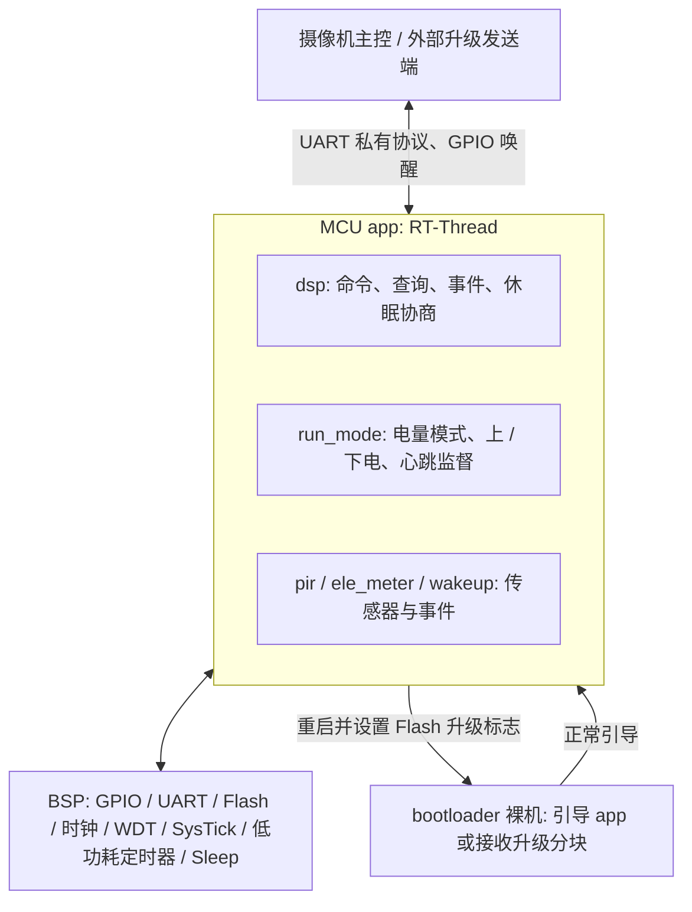
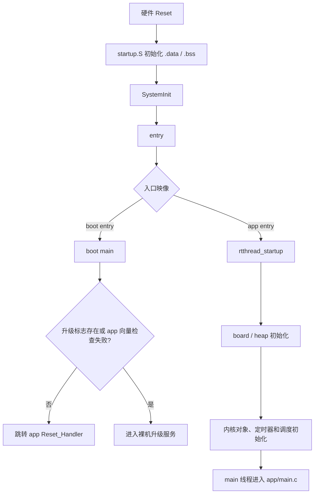
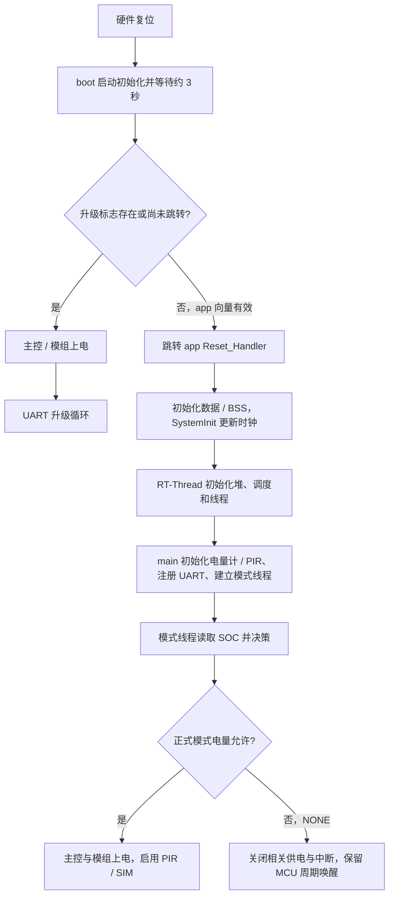
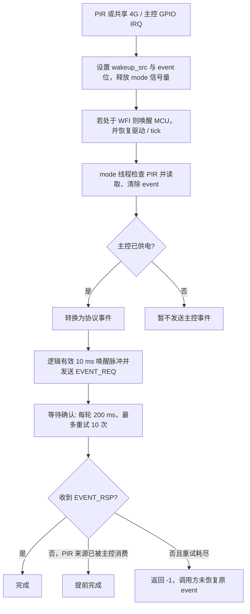
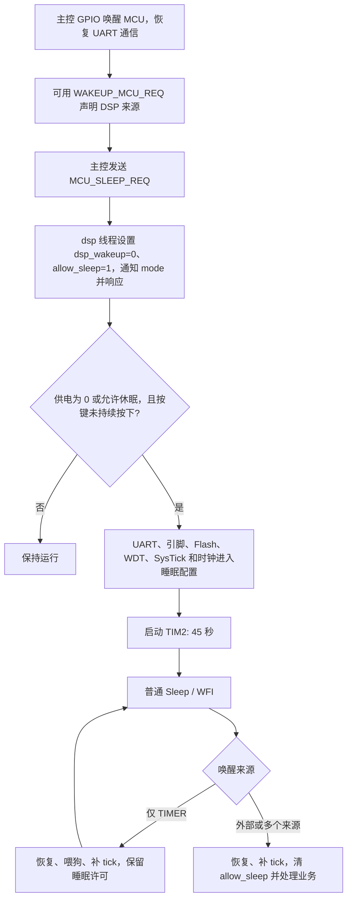
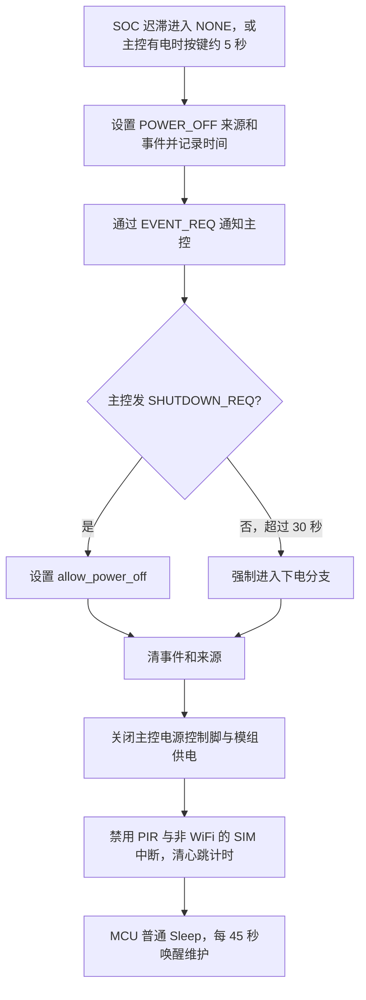
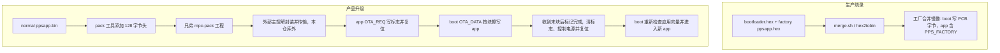

# mpc-mcu 仓库深度分析报告

> 首轮分析：2026 年 10 月 9 日；逐项复核与详细补充：2026 年 10 月 10 日  
> 核验源码：`/home/tronlong/lyp/meari/mpc-mcu`。  
> 结构参考：`/home/tronlong/lyp/perCode/idevelop_md/meari/mpc-base/mpc-base分析报告.md`。  
> Git HEAD：`e201ff1843ccd55eed488b8fb0427c6fe990e29d`，提交日期 2025-02-13，提交说明“去除mcu中升级时的电量判断”。

本报告按参考报告的十二章组织，但模块、流程和结论全部以本仓库为准。核验同时包含目录/源码清单、实际 Makefile 源集合、所有自有应用与公共组件、bootloader、两套 BSP 的板级驱动/启动/链接配置、RT-Thread 接入路径、打包工具，以及针对关键边界的主机复现。全文将“源码直接确认”“条件性风险”“主机复现”“旧产物观察”分别标明；未执行完整 ARM 固件重编译或上板联调。

**快照说明**：源码工作区不是 Git 显示的干净状态。`git diff --summary` 的172项均为文件模式变化；本次将全部172个变更路径的文件字节与 `git cat-file blob HEAD:<路径>` 比较，均相同，故二进制项的 `-/-` 不能认定为内容变化。脚本和两个已附带工具当前均无执行权限。已有 `build/` 文件不属于本次重新构建结果。本轮检查前后重新盘点665个文件并比较SHA256，文件集合与内容未变。正式报告位于当前文档工作区；用户在核验完成后删除了核验脚本和证据附件，现存材料与复核限制见12.5节。核验时的完整临时输出目录为 `/tmp/mpc_mcu_final_audit_20261010`，临时目录不作为长期可用证据。

**证据与阅读方式**：主体仍按参考报告的十二章排列。代码链接指向本次现场的真实文件和行号；宏、调用顺序、返回值和边界判断可直接回查。主机检查替代GPIO、UART、Flash等硬件依赖，其结论只覆盖所保留的逻辑；旧ELF/map/DWARF是资源与产物证据，不能替代重编译；功耗、电路作用、调度时序与器件性能没有上板测量。本轮补齐全部实际构建C单元的语法核验、动态堆预算、协议失败路径、零长度升级、SysTick忙等数学边界、工具异常输入和增量构建依赖，并修正了核验脚本的时间戳干扰。64条编译/查询/运行命令均符合预设结果；其中故障用例预期失败，不能写成“64项功能测试全部通过”。核验方法、历史结果摘要及附件删除后的复核限制见12.5节。

---

## 一、仓库概述

`mpc-mcu` 是面向电池摄像机的 **MCU 电源、唤醒、传感器和升级固件工程**。README 将它称为“4G微功耗项目MCU代码仓库”；实际业务代码还按 PCB 类型适配普通板、黑光板和 WiFi 板。应用运行在 RT-Thread 上，bootloader 则以裸机循环和串口中断执行。[Readme.md:1](/home/tronlong/lyp/meari/mpc-mcu/Readme.md:1)、[app/main.c:25](/home/tronlong/lyp/meari/mpc-mcu/app/main.c:25)、[boot/main.c:49](/home/tronlong/lyp/meari/mpc-mcu/boot/main.c:49)。

这里的 `dsp` 表示与摄像机主控的通信端，主要处理 UART 控制协议；本仓库的 `app/dsp.c` 不承担视频编码、音频处理或 AI 检测。摄像机主控、4G 模组、充电电路、电量计和 PIR 是 MCU 管理或交互的对象。4G 相关实现是电源时序、状态和唤醒，未找到 MCU 内部 AT 拨号、TCP/IP、WiFi 配网或云端业务实现。

### 核心定位



**能力边界**：可以从源码确认控制逻辑和接口，不能据此确认功耗数值、实际续航、PIR 检出率、所有板卡可用、升级掉电可靠性或完整产品链路成功。尤其工厂模式绕过真实电量进行模式决策，工厂固件正常运行不能证明正式固件的低电量路径正常。

---

## 二、支持平台

### 2.1 平台配置与实际实现状态

| 配置 | 可确认的构建/板级信息 | 当前核验结论 |
|---|---|---|
| `hc32f005_config` | Cortex-M0+、`-mthumb`、`HC32F005`、对应 BSP；Flash 定义 32 KiB，RAM 链接定义 4 KiB | 当前 `.config` 选用此平台；主机语法检查通过，但本次没有完整 ARM 编译/运行证据 |
| `hc32f030_config` | Cortex-M0+、`HC32F030`、`RT_USING_FINSH`；Flash 定义 64 KiB，RAM 链接定义 8 KiB | BSP 存在，但与当前应用接口不一致；正常/工厂两条应用语法检查均报错，不能称为已完整支持 |
| `linux_x86_64_config` | 本机编译器，`OS_LINUX` | 只是通用构建模板配置；业务源清单仍依赖 MCU BSP/ARM 汇编，不构成完整 PC 模拟器 |
| `windows_config` | 指定 Windows MinGW 路径，`OS_WINDOWS` | 同上；没有独立 Windows 板级模拟后端 |
| `windows32_config` | `i686-w64-mingw32-`，Windows 宏和归档后缀配置 | 同上，不能由配置文件存在推导成可编译 MCU 应用的 Windows 仿真平台 |

上述存储容量取自本工程宏和链接脚本，不是本次对所有芯片型号的数据手册参数验证。[configs/hc32f005_config:1](/home/tronlong/lyp/meari/mpc-mcu/configs/hc32f005_config:1)、[configs/hc32f030_config:1](/home/tronlong/lyp/meari/mpc-mcu/configs/hc32f030_config:1)、[rt-thread/bsp/hc32f005/board/drivers/drv_flash.h:6](/home/tronlong/lyp/meari/mpc-mcu/rt-thread/bsp/hc32f005/board/drivers/drv_flash.h:6)、[rt-thread/bsp/hc32f030/board/drivers/drv_flash.h:6](/home/tronlong/lyp/meari/mpc-mcu/rt-thread/bsp/hc32f030/board/drivers/drv_flash.h:6)。

### 2.2 PCB 类型与引脚复用

工厂构建菜单用 1/2/3 选择 `normal/sc450/wifi`；bootloader 实际保存 `CONFIG_PCB_VERSION - 1`，应用从绝对地址 `0x15F8` 读取该字节。不要混淆菜单序号和运行时 PCB 值。

| 运行时值 | README 命名 | 已确认的行为差异 |
|---|---|---|
| `0` 或 `0xFF` | 普通板 `normal` | 上电 4G 后执行 BOOT 脉冲；协议把 `0xFF` 归一化报告为 0 |
| `1` | 黑光板 `sc450` | 不执行普通板的 4G BOOT 脉冲；能力响应中的弱补光位为 1；F005 的 `PIN_LIGHT` 与 `PIN_4G_BOOT` 共用引脚 |
| `2` | WiFi 板 `wifi` | 不启用 SIM 检测回调/中断；PIR 使用 WiFi 参数表；仍调用公共 `ctrl_4g_power()` 控制同名电源引脚 |

WiFi 分支沿用 `4G_PWR` 命名，源码不足以确认这一引脚在该板上实际给哪种模组供电。普通板也能收到 `SET_LIGHT` 命令，命令处理没有检查 PCB 类型；需要由主控结合能力位避免对共用引脚发出不合适的控制。[all.sh:55](/home/tronlong/lyp/meari/mpc-mcu/all.sh:55)、[boot/main.c:20](/home/tronlong/lyp/meari/mpc-mcu/boot/main.c:20)、[app/run_mode.c:41](/home/tronlong/lyp/meari/mpc-mcu/app/run_mode.c:41)、[app/run_mode.c:43](/home/tronlong/lyp/meari/mpc-mcu/app/run_mode.c:43)、[app/dsp.c:264](/home/tronlong/lyp/meari/mpc-mcu/app/dsp.c:264)、[rt-thread/bsp/hc32f005/board/drivers/drv_pin.h:23](/home/tronlong/lyp/meari/mpc-mcu/rt-thread/bsp/hc32f005/board/drivers/drv_pin.h:23)。

### 2.3 F030 与当前应用不匹配的依据

F030 缺少 `PIN_LIGHT` 定义、`drv_usart_enable()` 实现及 `drv_clear_wakeupsrc()` 接口；它的 `drv_clear_event(void)` 与应用使用的带掩码参数版本不兼容。F030 的唤醒回调还保留在 `drv_sleep_init()` 中，当前应用则通过 `wakeup_init()` 注册；两者不是同一套已经同步的实现。

另外，应用仍固定读 `0x15F8`，而 F030 boot 链接脚本没有 F005 那样的固定 `.readonly` 区域。不能宣称换配置后 PCB 字节地址会自动适配。第八章给出语法检查结果。[rt-thread/bsp/hc32f030/board/drivers/drv_sleep.h:24](/home/tronlong/lyp/meari/mpc-mcu/rt-thread/bsp/hc32f030/board/drivers/drv_sleep.h:24)、[rt-thread/bsp/hc32f030/board/drivers/drv_sleep.c:91](/home/tronlong/lyp/meari/mpc-mcu/rt-thread/bsp/hc32f030/board/drivers/drv_sleep.c:91)、[rt-thread/bsp/hc32f030/board/linker_scripts/boot_link.lds:6](/home/tronlong/lyp/meari/mpc-mcu/rt-thread/bsp/hc32f030/board/linker_scripts/boot_link.lds:6)。

---

## 三、目录结构总览

```text
mpc-mcu/
├── .config                当前选择的配置（F005 / factory / normal）
├── Makefile               通用编译、生成版本、安装规则
├── src_objs.mk            正式固件：board + ppsapp
├── factory_objs.mk        工厂固件：board + bootloader + ppsapp
├── all.sh                 交互选择、构建、工厂镜像合并与复制
├── copy.sh                app 封装后复制到兄弟 mpc-pack 工程
├── merge.sh               合并 Intel HEX 记录
├── app/
│   ├── main.c             RTOS 应用入口、定期喂狗
│   ├── dsp.c              UART 协议、查询/控制/事件/OTA 入口
│   ├── run_mode.c/.h      电量模式、电源、按键、心跳、休眠循环
│   ├── ele_meter.c/.h     电量计寄存器、64 字节电池参数
│   ├── pir.c/.h           PIR 单线位时序、灵敏度、ADC/触发模式
│   ├── wakeup.c/.h        GPIO 中断到事件/唤醒位的转换
│   └── inc/               线程、锁、信号量、系统与序列化封装
├── boot/
│   ├── main.c             选择引导/升级、PCB 字节、升级后复位
│   ├── dsp.c              裸机串口解析与分块 Flash 写入
│   └── log.h              以协议 DEBUG 命令发送简单日志
├── components/
│   ├── drv_soft_iic.c     位操作 I²C
│   ├── log.c              应用日志格式化后通过协议发送
│   └── inc/               公共 dsp 协议、日志声明
├── configs/               2 个 MCU 配置 + 3 个桌面构建模板
├── rt-thread/
│   ├── src/               内核、调度、线程、IPC、内存、定时器
│   ├── include/           内核公开头文件和 libc 兼容头
│   ├── components/        device 与 finsh
│   ├── libcpu/            多种 CPU 移植源码；本工程选 cortex-m0
│   └── bsp/
│       ├── hc32f005/      板级驱动、CMSIS/DDL、启动、链接、rtconfig
│       └── hc32f030/      对应 F030；存在应用适配缺口
├── tools/                 hex2tobin.c / parse_bin.c 及已有工具二进制
├── version/               Git 信息和版本生成脚本
├── docs/                  电量计/PIR/MCU PDF、流程图、厂商 ZIP
├── build/                 已有 ELF/bin/hex/map/库/对象/依赖/栈文件
└── install/               安装规则产物；当前仅有 .tar.gz 文件
```

### 3.1 文件规模与覆盖口径

排除 `.git` 后共 **665 个文件**。统计扩展名 `.c/.h/.S/.lds` 且排除 `build/`，共 **330 个文件、92,600 行**，包含注释和空行。文件数不能解释为最终全部进入固件。

| 部分 | 上述口径文件数 | 行数 | 本次核验方式 |
|---|---:|---:|---|
| `app/` | 18 | 3,211 | 6 个业务 C 文件和全部头文件逐项阅读，追踪状态与接口 |
| `boot/` | 3 | 310 | 全部阅读，核对引导和升级行为 |
| `components/` | 4 | 511 | 全部阅读，核对 I²C、日志及公共协议 |
| `tools/` 的 C 源 | 2 | 380 | 全部阅读，主机编译及正常输入产物核验 |
| `rt-thread/` | 303 | 88,188 | 完整文件清单/构建归属；阅读实际启动/调度/时钟/IPC接入、两套板级驱动及链接/配置；厂商 DDL 按本工程调用追踪 |

RT-Thread 各部分中，内核 `src` 15 文件，公开头文件 15，CPU 移植代码 97，两套 BSP 的板级部分各 23，厂商库分别 52/66，组件 10，另有两份 `rtconfig.h`。大量厂商外设和其他 CPU 移植文件属于通用底层资源，不能据此宣称业务使用了 ADC/AES/SPI/RISC-V 等全部功能。

**覆盖边界**：本报告全面覆盖本工程的业务模块、硬件适配、构建和工具链路；不是对 88,188 行 RT-Thread/CMSIS/厂商驱动逐函数进行形式化验证。厂商 ZIP 内示例、PDF 全文没有逐页审计，也没有将文档名当成实际实现证据。对第三方通用内核不作“没有缺陷”的结论。

---

## 四、核心架构设计

### 4.1 应用与 bootloader 的双阶段架构

同一工程构建两个独立映像：bootloader 处于 Flash 起始地址；app 位于应用分区。二者使用同一公共命令枚举和板级库，但各自拥有 `dsp.c` 和入口；boot 不链接 RT-Thread 内核，app 链接内核和 Cortex-M0 上下文切换代码。[factory_objs.mk:21](/home/tronlong/lyp/meari/mpc-mcu/factory_objs.mk:21)、[factory_objs.mk:32](/home/tronlong/lyp/meari/mpc-mcu/factory_objs.mk:32)、[factory_objs.mk:48](/home/tronlong/lyp/meari/mpc-mcu/factory_objs.mk:48)。



F005 的 `SystemInit()` 只更新核心时钟变量；实际时钟、看门狗、Flash、GPIO、UART 初始化发生在 boot。app 的板级初始化重新配置 SysTick 和堆，没有重新调用上述驱动初始化。因此 **app 依赖已有 bootloader 的引导/硬件状态**，单独把 `ppsapp.bin` 烧到地址 0 不能形成正确的本工程启动流程。[rt-thread/bsp/hc32f005/libraries/common/gcc/startup.S:62](/home/tronlong/lyp/meari/mpc-mcu/rt-thread/bsp/hc32f005/libraries/common/gcc/startup.S:62)、[rt-thread/bsp/hc32f005/libraries/common/system_hc32f005.c:81](/home/tronlong/lyp/meari/mpc-mcu/rt-thread/bsp/hc32f005/libraries/common/system_hc32f005.c:81)、[boot/main.c:49](/home/tronlong/lyp/meari/mpc-mcu/boot/main.c:49)、[rt-thread/bsp/hc32f005/board/board.c:39](/home/tronlong/lyp/meari/mpc-mcu/rt-thread/bsp/hc32f005/board/board.c:39)、[rt-thread/src/components.c:213](/home/tronlong/lyp/meari/mpc-mcu/rt-thread/src/components.c:213)。

boot 跳转前将 CONTROL 设为 0、屏蔽中断、设置 VTOR 和 MSP，再调用 app 向量中的入口。RT-Thread 首次上下文切换的汇编最后执行 `CPSIE I`，所以不能仅因 boot 屏蔽中断就认定 app 永远不能接收中断。[boot/main.c:24](/home/tronlong/lyp/meari/mpc-mcu/boot/main.c:24)、[rt-thread/libcpu/arm/cortex-m0/context_gcc.S:148](/home/tronlong/lyp/meari/mpc-mcu/rt-thread/libcpu/arm/cortex-m0/context_gcc.S:148)。

### 4.2 线程、中断与共享数据

| 执行上下文 | F005 栈/优先级 | 主要行为 |
|---|---|---|
| app main 线程 | 从RT堆动态申请384字节；创建优先级10，进入业务main后改为0 | 初始化模块；每10,000ms请求喂狗/等待 |
| `dsp_thread` | 动态申请 512 字节；创建时 15，线程开始改为 0 | 从信号量取字节通知、组帧、校验、同步处理命令 |
| `mode_thread` | 动态申请 512 字节；默认 15 | 电量轮询、按键、电源、事件重试、进入 MCU 睡眠 |
| idle | 静态256字节；31 | 线程回收等；当前没有通过 idle hook 实现统一低功耗 |
| GPIO 中断 | 共享主栈 | 写 `event/wakeup_src` 位，释放 mode 信号量 |
| UART 中断 | 共享主栈 | app 中保存一个字符并释放信号量；boot 中直接解析/执行协议 |
| SysTick | 共享主栈 | 100 Hz 内核 tick、时间片和定时器检查 |
| TIM2（F005） | 共享主栈 | 写定时器唤醒位；不向业务设置定时器事件 |

RT-Thread 的优先级数值越小越先调度；本表是代码设定，不是调度延迟实测。线程封装给两个业务线程相同名字 `thread`，不能靠线程名区分职责。[app/inc/thread.h:29](/home/tronlong/lyp/meari/mpc-mcu/app/inc/thread.h:29)、[app/inc/thread.h:94](/home/tronlong/lyp/meari/mpc-mcu/app/inc/thread.h:94)、[app/main.c:25](/home/tronlong/lyp/meari/mpc-mcu/app/main.c:25)、[app/dsp.c:443](/home/tronlong/lyp/meari/mpc-mcu/app/dsp.c:443)、[app/run_mode.c:417](/home/tronlong/lyp/meari/mpc-mcu/app/run_mode.c:417)、[rt-thread/src/idle.c:210](/home/tronlong/lyp/meari/mpc-mcu/rt-thread/src/idle.c:210)。

**线程栈口径修正**：`idle.c` 在启用堆时选择256字节，当前F005定义了 `RT_USING_HEAP`；旧map也显示 `rt_thread_stack=0x100`。128字节属于没有堆/idle hook时的另一分支。main栈同样来自动态堆，不能只把两个业务栈计入堆预算。main时间片为20tick，两个业务线程创建时为10tick，按100Hz分别是名义200ms/100ms；优先级变更不会把时间片自动变成微秒级。GPIO/UART IRQ的实际响应与抢占仍受NVIC和内核共同影响。详见5.9.1。 [rt-thread/src/idle.c:32](/home/tronlong/lyp/meari/mpc-mcu/rt-thread/src/idle.c:32)、[rt-thread/src/components.c:193](/home/tronlong/lyp/meari/mpc-mcu/rt-thread/src/components.c:193)、[build/ppsapp.map:1887](/home/tronlong/lyp/meari/mpc-mcu/build/ppsapp.map:1887)。

协议发送由 `g_lock` 序列化，电量计和 PIR 各有互斥锁。模式字段部分受 `run_mode.lock` 保护，但事件位的读/清、部分全局标志和日志缓冲不是完整的原子操作或全程互斥。不能从“存在锁”推导出整个固件没有竞态。

### 4.3 RTOS 与硬件低功耗的协作方式

低功耗由 `mode_thread` 直接调用板级 `drv_sleep_into()`，不是 RT-Thread 通用 PM 组件对全部线程投票后执行。进入前关闭 UART 中断/外设时钟、处理引脚、暂停 SysTick、切到低速时钟，然后以硬件定时器或外部 GPIO 唤醒。退出后手工增加 RTOS tick。

`rt_tick_set()` 只设置 tick 值，不调用 `rt_timer_check()`；定时器到期处理要等后续 tick。模式线程进入睡眠时也没有全局调度锁、原子检查与执行屏障或串口完成状态确认。因此“主控允许休眠”是当前软件的主要业务许可，不能等同于所有 MCU 线程/外设都已经无工作。[app/run_mode.c:330](/home/tronlong/lyp/meari/mpc-mcu/app/run_mode.c:330)、[rt-thread/bsp/hc32f005/board/drivers/drv_sleep.c:50](/home/tronlong/lyp/meari/mpc-mcu/rt-thread/bsp/hc32f005/board/drivers/drv_sleep.c:50)、[rt-thread/src/clock.c:54](/home/tronlong/lyp/meari/mpc-mcu/rt-thread/src/clock.c:54)。

---

### 4.4 锁、优先级和错误路径的交叉关系

当前共有4个业务互斥对象：协议发送锁、电量计锁、PIR锁、模式锁，均静态嵌入全局数据；两个业务信号量也静态存储。RT-Thread互斥实现有同线程递归和优先级继承，所以不能把同一线程重复调用发送锁直接判为死锁。不过递归能力不解决跨线程锁顺序反转。[locker.h:40](/home/tronlong/lyp/meari/mpc-mcu/app/inc/locker.h:40)、[ipc.c:685](/home/tronlong/lyp/meari/mpc-mcu/rt-thread/src/ipc.c:685)、[ipc.c:740](/home/tronlong/lyp/meari/mpc-mcu/rt-thread/src/ipc.c:740)。

存在一条具体的条件性等待环：协议线程执行GET_BAT时先持发送锁，再等待电量计锁；模式线程读取电量计时持电量计锁，软件I²C发生发送/时钟错误后可调用日志，再等待发送锁。若第二条错误路径与第一条交错，可形成双方永久等待。该路径需要I²C异常及相应调度交错，本次没有用真实RTOS故障注入复现，故登记为条件性死锁风险，而非已发生事故。主线程独立喂硬件WDT，因此业务线程同时等待时，WDT不一定立即复位；心跳监督也位于模式线程内。[dsp.c:248](/home/tronlong/lyp/meari/mpc-mcu/app/dsp.c:248)、[ele_meter.c:189](/home/tronlong/lyp/meari/mpc-mcu/app/ele_meter.c:189)、[drv_soft_iic.c:119](/home/tronlong/lyp/meari/mpc-mcu/components/drv_soft_iic.c:119)、[log.c:16](/home/tronlong/lyp/meari/mpc-mcu/components/log.c:16)。

模式锁覆盖4G上电约3秒的等待；协议GET_INFO取阈值时也会等待该锁。这可以让查询延迟，并在等待期间增加单字符接收缓存的积压风险。UART驱动优先级为IrqLevel1，GPIO和低功耗定时器为IrqLevel3，SysTick/PendSV在首次上下文切换设为最低优先级；这些是配置层事实，无法据此给出最大响应延迟或丢包率。[drv_usart.c:93](/home/tronlong/lyp/meari/mpc-mcu/rt-thread/bsp/hc32f005/board/drivers/drv_usart.c:93)、[drv_pin.c:138](/home/tronlong/lyp/meari/mpc-mcu/rt-thread/bsp/hc32f005/board/drivers/drv_pin.c:138)、[context_gcc.S:162](/home/tronlong/lyp/meari/mpc-mcu/rt-thread/libcpu/arm/cortex-m0/context_gcc.S:162)。

## 五、核心模块深度解析

### 5.1 main —— 系统应用入口

app 的初始化顺序是：调整主线程优先级 → 将 UART TX 切为不使能状态 → 电量计初始化 → PIR 锁初始化 → 默认灵敏度 9 的写入/回读检查 → PIR 触发模式 → 协议线程 → 模式线程。

初始化返回值在 `main()` 中均未检查；`dsp_init()` 和 `run_mode_init()` 也没有向上返回线程/锁/信号量创建失败。后续主线程仍可喂看门狗，所以看门狗持续被喂不证明协议线程和电源管理线程启动成功。[app/main.c:25](/home/tronlong/lyp/meari/mpc-mcu/app/main.c:25)、[app/dsp.c:485](/home/tronlong/lyp/meari/mpc-mcu/app/dsp.c:485)、[app/run_mode.c:417](/home/tronlong/lyp/meari/mpc-mcu/app/run_mode.c:417)。

**初始化时序风险**：电量计初始化先于 `dsp_init()`；软件 I²C 的异常日志可经 `log_output → dsp_print` 使用尚未初始化的协议发送互斥锁。正常无日志路径不必触发，不能把它表述为每次开机必然失败；应在错误注入时验证启动错误路径。[app/ele_meter.c:402](/home/tronlong/lyp/meari/mpc-mcu/app/ele_meter.c:402)、[components/drv_soft_iic.c:119](/home/tronlong/lyp/meari/mpc-mcu/components/drv_soft_iic.c:119)、[components/log.c:35](/home/tronlong/lyp/meari/mpc-mcu/components/log.c:35)、[app/dsp.c:322](/home/tronlong/lyp/meari/mpc-mcu/app/dsp.c:322)。

### 5.2 run_mode —— 电量、供电和休眠状态机

#### 5.2.1 三个不同的状态维度

| 状态 | 含义 | 使用位置 |
|---|---|---|
| `run_mode.mode` | 电量算法得到 NONE / NOR_SLEEP / MICRO_POWER | 对外查询、模式变化事件、是否允许开机 |
| `g_dsp_power_on_off` | MCU 记录的主控供电状态 | 开关机、事件发送、心跳监督、休眠许可 |
| `run_mode.allow_sleep` | 主控通过 `MCU_SLEEP_REQ` 许可 MCU 睡眠 | 主控仍有供电时的睡眠条件 |
| `run_mode.dsp_wakeup` | 主控以协议声明“由主控唤醒 MCU” | 对外区分 DSP 与共享引脚上的 4G 唤醒 |

它们不能合并成一个“设备运行/休眠”的布尔值。手动关机后电量模式可能仍是 MICRO_POWER；另一方面内部 NONE 状态在 `GET_INFO` 的模式字段中也被映射成协议 NOR_SLEEP，并没有输出协议 NONE。[app/run_mode.c:19](/home/tronlong/lyp/meari/mpc-mcu/app/run_mode.c:19)、[app/run_mode.h:11](/home/tronlong/lyp/meari/mpc-mcu/app/run_mode.h:11)、[app/dsp.c:148](/home/tronlong/lyp/meari/mpc-mcu/app/dsp.c:148)。

#### 5.2.2 电量采样与迟滞

模式线程每次循环检查采样时间，约每 1,000 ms 请求采样一次；实际周期受按键等待、事件重试、4G 时序和睡眠影响。`get_percent()` 唤醒电量计，连续读 10 次整数 SOC，各次请求等待 5 ms，排除一个最小值和一个最大值，再平均所有非零项。

注意它不是固定“余下 8 项平均”：所有零样本都被排除；10个相同的50会让最小/最大落在同一索引，实际只删去1项，再平均余9项。**所有采样为零时 `num=0`，执行 `per / num`，已在主机 UBSan 复现除零；“1个50、9个0”的输入也会在删除最大值后除零。** 单次 I²C 读取失败则立即返回 -1，保持此前电量/电压；初始缓存为零，失败不带明确的“未知电量”状态。[app/run_mode.c:126](/home/tronlong/lyp/meari/mpc-mcu/app/run_mode.c:126)、[app/run_mode.c:183](/home/tronlong/lyp/meari/mpc-mcu/app/run_mode.c:183)。

默认 AOV 阈值为 10；停止工作的低电量门限为 2，恢复到普通低电量模式的门限严格大于 5；回到 MICRO_POWER 要严格大于 `threshold + 5`。算法通过前一次电量的升降和前一次模式实现迟滞，不读取充电引脚来判定“充/放电”。

| 条件 | 算法结果 |
|---|---|
| 首次计算或 threshold 改变 | 重置历史电量为 `UINT16_MAX`、历史模式为 MICRO_POWER，按下降分支计算 |
| 电量下降，历史模式为 NOR_SLEEP/MICRO_POWER，当前 ≤2 | NONE |
| 电量下降，历史为 MICRO_POWER，当前 ≤threshold 且未先命中 ≤2 | NOR_SLEEP |
| 电量上升，历史为 NONE/NOR_SLEEP，当前 >threshold+5 | MICRO_POWER |
| 电量上升，历史为 NONE，当前 >5，且上一条件不满足 | NOR_SLEEP |
| 电量不变或其他条件 | 保持历史模式 |

主机调用原函数的序列 `100 → 10 → 2 → 5 → 6 → 15 → 16`，得到 `MICRO_POWER → NOR_SLEEP → NONE → NONE → NOR_SLEEP → NOR_SLEEP → MICRO_POWER`。这验证算法边界，不是实际电池测试。阈值设置接收任意 `uint8_t`，未限制到合理百分比区间。[app/run_mode.c:90](/home/tronlong/lyp/meari/mpc-mcu/app/run_mode.c:90)、[app/run_mode.c:383](/home/tronlong/lyp/meari/mpc-mcu/app/run_mode.c:383)。

`PPS_FACTORY` 下传给算法的电量固定为 **100**；真实 SOC 仍被读取并用于 `GET_INFO`，但不参与模式决策。因此“协议显示低电量”与“工厂模式仍不下电”可以同时出现。极端阈值设置仍能改变工厂模式，并非无条件强制开机。[app/run_mode.c:198](/home/tronlong/lyp/meari/mpc-mcu/app/run_mode.c:198)。

#### 5.2.3 上电与下电协商

普通板的 `ctrl_4g_power(true)` 先拉供电有效，等待 50 ms，再拉 BOOT 有效 3,000 ms 后释放；非普通板跳过 BOOT 脉冲。电源状态检查和整个等待过程处于模式锁内，串口处理相应命令时也会同步等待。关闭 4G 只改变供电脚，没有 AT 关机或状态确认。[app/run_mode.c:43](/home/tronlong/lyp/meari/mpc-mcu/app/run_mode.c:43)。

主控上电时分别使能 `PIN_DSP_POWER_EN`、`PIN_DSP_RTC_DDR_PWR`，设置唤醒脚无效，并记录 `g_dsp_power_on_off=1`；下电时先改变唤醒脚，再关闭这两个控制脚。GPIO 驱动把逻辑有效/无效转换为物理电平，尤其 `PIN_WKUP_DSP` 是低有效，不能把所有 `true` 都解释成输出高。[app/run_mode.c:65](/home/tronlong/lyp/meari/mpc-mcu/app/run_mode.c:65)、[rt-thread/bsp/hc32f005/board/drivers/drv_pin.c:169](/home/tronlong/lyp/meari/mpc-mcu/rt-thread/bsp/hc32f005/board/drivers/drv_pin.c:169)。

运行中电量进入 NONE，或检测到手动关机长按时，先产生 POWER_OFF 事件并启动 30 秒等待窗口；主控发送 `SHUTDOWN_REQ` 后置允许下电标志，模式线程下一轮执行下电。主控不配合时，超过 30,000 ms 也执行下电。首次启动直接进入 NONE 则不等待主控协商。窗口判断是 `>30,000`，不能写成精确第 30 秒硬件立即断电。[app/run_mode.c:251](/home/tronlong/lyp/meari/mpc-mcu/app/run_mode.c:251)、[app/run_mode.c:289](/home/tronlong/lyp/meari/mpc-mcu/app/run_mode.c:289)、[app/dsp.c:421](/home/tronlong/lyp/meari/mpc-mcu/app/dsp.c:421)。

下电同时禁用 PIR 和非 WiFi 板的 SIM 中断，清事件/唤醒位并复位心跳计时。模式转为非 NONE 或手动长按再次开机时重启供电、PIR 和 SIM 检测。模式不是仅由用户按键维护：低电量恢复导致模式变化时也可以重新上电。

**需要板上确认的电源行为**：`dsp_prot()` 每个命令分发结束都会额外执行 `drv_pin_set(PIN_DSP_POWER_EN, false)`，包括查询、心跳和未知命令，却不更新 `g_dsp_power_on_off`。软件状态与这一控制脚可能不一致；另一个 `RTC_DDR_PWR` 引脚仍可保持使能。代码行为已确认，但它对主控电源/唤醒电路的实际影响需要原理图和测量，不能直接断言“收到任意命令就整机断电”。[app/dsp.c:440](/home/tronlong/lyp/meari/mpc-mcu/app/dsp.c:440)。

#### 5.2.4 按键、SIM 与充电检测

按键按逻辑有效状态检查，首次按下后最多循环 10 次、每次请求等待 500 ms；中途释放再等 50 ms 确认；持续按下才产生开关机切换。这个过程阻塞模式线程，电量检查和事件处理也随之延后；它不是非阻塞按键状态机。释放和无按键分支会清 KEY 位，短按不等同于开关机命令。[app/run_mode.c:221](/home/tronlong/lyp/meari/mpc-mcu/app/run_mode.c:221)。

SIM 检测先读逻辑状态，变化时请求等待 50 ms 后再读确认，通过才更新状态和事件；WiFi 板跳过。共享 PIN 中断先设置 SIM 位，业务线程还会按状态变化进行过滤，不能把每个 GPIO 边沿都认定为最终有效插拔事件。[app/run_mode.c:302](/home/tronlong/lyp/meari/mpc-mcu/app/run_mode.c:302)、[app/wakeup.c:26](/home/tronlong/lyp/meari/mpc-mcu/app/wakeup.c:26)。

充电变化的 GPIO 回调已注册，但回调内“设置唤醒源/事件/信号量”的代码全部被注释；GPIO 中断本身仍可能唤醒正在 WFI 的 MCU。`GET_INFO` 读取充电引脚，电量算法按 SOC 变化工作，因此仍有充电状态查询，但没有完整的主动 CHG 业务上报链。[app/wakeup.c:19](/home/tronlong/lyp/meari/mpc-mcu/app/wakeup.c:19)、[app/dsp.c:142](/home/tronlong/lyp/meari/mpc-mcu/app/dsp.c:142)。

#### 5.2.5 两种监督机制

1. **硬件 WDT**：配置 `WdtT52s4`、复位使能。app main 每次喂狗后请求休眠 10 秒；进入/退出 MCU 睡眠也各喂一次。boot 循环每约 200 ms 喂狗。该枚举表示工程选择的看门狗档位，本次没有测量实际超时时间。
2. **主控协议心跳**：收到 `HERAT_REQ` 后设置标志，由模式线程读走并更新 `g_heart_ms`。主控有供电且心跳监督开启、间隔严格超过 310 秒时，红灯闪 5 次后复位 MCU。代码注释“150秒发送一次”不是这里的超时阈值；心跳开关可由命令修改。

协议心跳检查跟随模式线程运行，睡眠、按键和同步重试都可能推迟检查；没有证明它对所有线程卡死都能立即恢复。[rt-thread/bsp/hc32f005/board/drivers/drv_wdt.c:25](/home/tronlong/lyp/meari/mpc-mcu/rt-thread/bsp/hc32f005/board/drivers/drv_wdt.c:25)、[app/run_mode.c:207](/home/tronlong/lyp/meari/mpc-mcu/app/run_mode.c:207)、[app/dsp.c:339](/home/tronlong/lyp/meari/mpc-mcu/app/dsp.c:339)。

#### 5.2.6 MCU 睡眠条件与时间补偿

进入条件为 `(主控供电状态=0 或 allow_sleep=1) 且 key_press≠1`。调用固定 `drv_sleep_into(DRV_SLEEP_MODE_NORMAL, 45000)`，并不是内部 mode=NONE 就调用 DEEP 休眠。45 秒定时醒来是为了周期喂狗；它只写 TIMER 唤醒位，不生成要主动发送给主控的 TIMER 事件。[app/run_mode.c:330](/home/tronlong/lyp/meari/mpc-mcu/app/run_mode.c:330)。

退出后按驱动返回的毫秒数补偿 tick；若唤醒原因不是“只有 TIMER”，清除 `allow_sleep`，从而要求主控重新许可睡眠。包括多个位同时出现时，也不满足 `wakeup_src == WAKEUP_FOR_TIMER`。

F005 在 Sleep 前切换到 32,768 Hz，TIM2 按 PCLK/32 计数；45,000 ms 对应约 46,080 计数，处于 16 位计数器限制内。恢复切回约 22.12 MHz。硬件定时器启动和各外围睡眠返回值都未检查；并发 IRQ 与清唤醒位/进入 WFI 之间缺少原子衔接，存在事件丢失或休眠竞态条件，需运行验证其概率和影响。[rt-thread/bsp/hc32f005/board/drivers/drv_clock.c:21](/home/tronlong/lyp/meari/mpc-mcu/rt-thread/bsp/hc32f005/board/drivers/drv_clock.c:21)、[rt-thread/bsp/hc32f005/board/drivers/drv_hwtimer.c:7](/home/tronlong/lyp/meari/mpc-mcu/rt-thread/bsp/hc32f005/board/drivers/drv_hwtimer.c:7)、[rt-thread/bsp/hc32f005/board/drivers/drv_sleep.c:50](/home/tronlong/lyp/meari/mpc-mcu/rt-thread/bsp/hc32f005/board/drivers/drv_sleep.c:50)。

#### 5.2.7 调度粒度、计时来源和真实循环周期

`system_sleep(ms)` 走 `rt_thread_mdelay → rt_tick_from_millisecond`，内核按正毫秒值**向上取整**：当前 `system_sleep(5)` 是1tick，并非5ms高精度等待。信号量封装则使用整数除法 `timeout/10` 向下取整；这两个接口不是同一换算规则。100ms模式等待为10tick，事件每轮10ms等待为1tick。 [app/inc/system.h:65](/home/tronlong/lyp/meari/mpc-mcu/app/inc/system.h:65)、[app/inc/sema.h:200](/home/tronlong/lyp/meari/mpc-mcu/app/inc/sema.h:200)、[rt-thread/src/clock.c:101](/home/tronlong/lyp/meari/mpc-mcu/rt-thread/src/clock.c:101)、[rt-thread/src/thread.c:604](/home/tronlong/lyp/meari/mpc-mcu/rt-thread/src/thread.c:604)。

| 时间机制 | 源码用途 | 可确认的计时边界 |
|---|---|---|
| RT tick ×10ms | SOC采样间隔、30秒关机窗口、310秒心跳 | 含MCU睡眠后的手工补偿；不是RTC绝对时间 |
| `system_sleep(5)` ×10 | SOC采样之间等待 | 每次请求转换为1tick；不能报告“总采样时间固定50ms” |
| `drv_delay_us/ms` | PIR位时序、boot延时、app重启等待 | 基于SysTick计数器的忙等，通常不主动释放CPU |
| 低速TIM2 | MCU Sleep计时 | 固定45,000ms设置，外部提前唤醒由计数差估算 |

`system_clock()` 返回64位毫秒数，但 `percent_ms/g_heart_ms/g_need_power_off_ms` 是32位。心跳/关机比较显式转32位，形成模2³²毫秒差；约49.7天发生毫秒低32位回绕。SOC比较则用64位 `system_clock()-percent_ms`，越过32位存储范围后，可能失去原先“至少间隔1秒”的节流效果。该差异是源码算术边界；未运行49.7天稳定性试验，不能认定所有定时逻辑都已验证长期运行。 [app/inc/system.h:170](/home/tronlong/lyp/meari/mpc-mcu/app/inc/system.h:170)、[app/run_mode.c:178](/home/tronlong/lyp/meari/mpc-mcu/app/run_mode.c:178)、[app/run_mode.c:184](/home/tronlong/lyp/meari/mpc-mcu/app/run_mode.c:184)、[app/run_mode.c:210](/home/tronlong/lyp/meari/mpc-mcu/app/run_mode.c:210)、[app/run_mode.c:252](/home/tronlong/lyp/meari/mpc-mcu/app/run_mode.c:252)。

#### 5.2.8 供电与模式的组合行为

| 输入/当前状态 | 实际分支 | 协作含义 |
|---|---|---|
| 首次模式为MICRO_POWER或NOR_SLEEP | 都会打开主控、模组、PIR和非WiFi的SIM IRQ | NOR_SLEEP不等于此刻已断电；主控仍需处理自己的低功耗策略 |
| 首次正式SOC读取失败，缓存仍为0 | 按0计算NONE并直接下电 | 查询结果缺少“采样未知”标识；不能把它当成已确认真实0% |
| 手动下电，电量模式未变 | 后续不会仅因mode非NONE就自动上电 | 上电还需长按或后续非NONE模式变化 |
| 主控有电时发送SHUTDOWN | 下一轮允许下电，不要求已有POWER_OFF请求 | 是独立有效命令，未校验关机请求关联 |
| `WAKEUP_MCU_REQ` 到达 | 只将dsp_wakeup置1 | 不直接清allow_sleep；它与完整外部GPIO唤醒流程需配合 |
| 关机协商尚未结束时电量恢复到非NONE | 可以执行非NONE模式变化的上电分支，但不撤销g_need_power_off | 旧请求超过窗口仍可导致下电；是否需要取消策略须由产品约定确认 |

这些是同一循环内的条件组合，不能用“低电量就睡、高电量就醒”替代。最后一项是控制流分析，未声称真实电池在指定时间内必然恢复。当前没有另一个充电引脚分支自动取消待关机请求。 [app/run_mode.c:251](/home/tronlong/lyp/meari/mpc-mcu/app/run_mode.c:251)、[app/run_mode.c:269](/home/tronlong/lyp/meari/mpc-mcu/app/run_mode.c:269)、[app/run_mode.c:289](/home/tronlong/lyp/meari/mpc-mcu/app/run_mode.c:289)、[app/run_mode.c:367](/home/tronlong/lyp/meari/mpc-mcu/app/run_mode.c:367)、[app/run_mode.c:398](/home/tronlong/lyp/meari/mpc-mcu/app/run_mode.c:398)。

### 5.3 dsp —— 主控 UART 协议

#### 5.3.1 帧格式与组帧

```text
偏移     长度        内容
0        4           56 56 50 99
4        2           cmd，大端
6        2           payload_len，大端
8        len         payload
8+len    2           前 8+len 字节累加和（uint16_t），大端
总长度               len + 10
```

该校验是加和，不是 CRC、MAC 或数字签名。应用和 boot 都按前四字节逐字匹配头，然后等完整长度才校验。应用接收缓冲 276 字节，boot 为 `512+20=532` 字节；超容量后重置接收索引，没有独立的帧超时和立即拒绝非法长度的逻辑。[app/dsp.c:12](/home/tronlong/lyp/meari/mpc-mcu/app/dsp.c:12)、[app/dsp.c:63](/home/tronlong/lyp/meari/mpc-mcu/app/dsp.c:63)、[app/dsp.c:443](/home/tronlong/lyp/meari/mpc-mcu/app/dsp.c:443)、[boot/dsp.c:12](/home/tronlong/lyp/meari/mpc-mcu/boot/dsp.c:12)、[boot/dsp.c:157](/home/tronlong/lyp/meari/mpc-mcu/boot/dsp.c:157)。

应用 UART 回调只覆盖一个 `g_chr` 并释放信号量，工作线程每次消费一份通知再读这个共享字符；没有字节环形队列。若两个接收回调发生在消费前，信号量计数可以保留两次通知，但前一个字符值已被覆盖。这个丢字节条件由代码直接确认，现场是否发生、发生频率则取决于中断/线程调度和业务负载，不能仅凭 115200 波特率断言实际通信必失败。[app/dsp.c:73](/home/tronlong/lyp/meari/mpc-mcu/app/dsp.c:73)、[app/dsp.c:451](/home/tronlong/lyp/meari/mpc-mcu/app/dsp.c:451)。

#### 5.3.2 完整命令矩阵

下表采用源码实际拼写 `HERAT`。未特别注明的 app 控制响应一般为 2 字节结果码；响应并不总是在硬件操作成功后发送。

| 请求/响应 ID | 名称 | app 行为/载荷约束 | boot 行为 |
|---|---|---|---|
| 1/2 | HERAT | 标记心跳并响应 | 未实现，走不支持 |
| 3/4 | GET_VER | 44 字节版本响应，阶段=1 | 44 字节版本响应，阶段=0 |
| 5/6 | 4G_PWR | 读 `dat[0]` 控制电源 | 未实现 |
| 7/8 | REBOOT | 可选 1 字节延迟秒数；响应后下电再复位 | 响应后 500 ms 复位；响应结果传 `true=1`，与 SUCCESS=0 不一致 |
| 9/10 | PIR_CTRL | 读 1 字节开关；先成功响应再执行 | 未实现 |
| 11/12 | PIR_LEVEL | 读 1 字节灵敏度；没有 1～10 范围保护 | 未实现 |
| 13/14 | GET_INFO | 24 字节状态响应 | 未实现 |
| 15/16 | SHUTDOWN | 成功响应后置允许下电标志 | 未实现 |
| 17/18 | SET_AOV_THRESHOLD | 读 1 字节阈值并更新 RAM | 未实现 |
| 19/20 | EVENT | MCU主动请求：2字节事件+2字节计数；收到 RSP 仅置确认标志 | 未实现 |
| 21/22 | WAKEUP_MCU | 设置“主控唤醒”标志 | 未实现 |
| 23/24 | MCU_SLEEP | 设置睡眠许可并通知模式线程 | 未实现 |
| 25/26 | WAKEUP_DSP | app 可主动发请求；收到 RSP 置确认标志 | 未实现 |
| 27/28 | WAKEUP_SRC | 结果码+2字节唤醒掩码；读取后清驱动唤醒位 | 未实现 |
| 29/30 | SET_HEART | 读 1 字节开关并重置计时 | 未实现 |
| 31/32 | READ_PIR | 结果码+12个 PIR 字段，共14字节 | 未实现 |
| 33/34 | SET_BAT | 从 payload 取64字节参数，写入/读回校验，再 quick-start | 未实现 |
| 35/36 | GET_BAT | 结果码+64字节参数，共66字节；存在发送缓冲越界 | 未实现 |
| 37/38 | GET_CAPS | 共67字节；弱补光、PIR ADC 能力与保留区；存在越界 | 未实现 |
| 39/40 | SET_LIGHT | 读1字节开关，操作复用引脚 | 未实现 |
| 41/42 | SET_PIR_ADC | 读1字节，改变 PIR 工作模式 | 未实现 |
| 1001/1002 | OTA | 写升级标志、响应最大块512、成功后复位 | 写升级标志并响应最大块512，但忽略写标志结果 |
| 1003/1004 | OTA_DATA | 未实现；app 本身不写升级数据 | 接收总长/偏移/块长/块数据并写应用分区 |
| 2000 | DEBUG | MCU 日志的发送命令 | MCU 日志的发送命令 |

未知且 `cmd≤2000` 的奇数命令响应 `cmd+1, NO_SUPPORT`；其他未知命令没有统一错误回应。协议声明不代表两个阶段均支持同一能力。[components/inc/dsp.h:11](/home/tronlong/lyp/meari/mpc-mcu/components/inc/dsp.h:11)、[app/dsp.c:336](/home/tronlong/lyp/meari/mpc-mcu/app/dsp.c:336)、[boot/dsp.c:116](/home/tronlong/lyp/meari/mpc-mcu/boot/dsp.c:116)。

多数需要参数的 app 命令直接访问 `dat[0]`，`SET_BAT` 固定访问 64 字节；没有检查各命令最小长度。零长包也能通过外层帧校验，此时 `dat[0]` 实际对应帧校验区；短电池参数会读到非载荷或此前残留数据。外层“完整帧”不等于命令载荷合法。

#### 5.3.3 版本、信息和能力响应

响应 payload 都先放 2 字节结果码，随后字段如下，偏移相对 payload 起点：

| 响应 | payload 偏移 | 字段 |
|---|---|---|
| GET_VER | 2～17 | 16字节版本字符串 |
| GET_VER | 18～33 | 16字节日期，工厂 app 替换为 `fact_<PCB名>` |
| GET_VER | 34～41 | 8字节提交 ID；boot 未填充这一字段 |
| GET_VER | 42 / 43 | dirty 标志 / 阶段0或1 |
| GET_INFO | 2 / 3 / 4 | 充电状态 / 整数电量低8位 / 4G电源状态 |
| GET_INFO | 5 / 6 / 7 | AOV阈值 / SIM状态 / 协议运行模式 |
| GET_INFO | 8 / 9 | PIR使能 / 灵敏度 |
| GET_INFO | 10～11 | 电压，大端 |
| GET_INFO | 12 / 13 / 14 | 心跳使能 / PCB值 / 能力协议支持=1 |
| GET_INFO | 15～23 | 9字节保留区，清零 |
| GET_CAPS | 2 / 3 | PCB=1时弱补光=1 / PIR ADC支持=1 |
| GET_CAPS | 4～66 | 63字节保留区，清零 |

版本响应长度44，理论帧长54，可容纳在64字节发送缓冲中；GET_INFO 帧长34，也能容纳。GET_BAT 和 GET_CAPS 的理论帧长分别76和77，无法容纳。

**已确认的越界**：GET_BAT在电池读取成功的路径从 `send_buff[10]` 写64字节，访问到索引73；GET_CAPS 从索引12清63字节，访问到74；随后加和/校验字节和发送又访问更远位置。主机 ASan 分别复现。已有 app map 也显示 `dsp_send_buff` 大小为 `0x40`，问题没有因为旧固件链接就自然消失。[app/dsp.c:17](/home/tronlong/lyp/meari/mpc-mcu/app/dsp.c:17)、[app/dsp.c:248](/home/tronlong/lyp/meari/mpc-mcu/app/dsp.c:248)、[app/dsp.c:264](/home/tronlong/lyp/meari/mpc-mcu/app/dsp.c:264)、[build/ppsapp.map:1860](/home/tronlong/lyp/meari/mpc-mcu/build/ppsapp.map:1860)。

**失败路径同样越界**：电池读取返回-1时，GET_BAT仍传 `len=66` 给 `dsp_send()`；即使mock完全不写数据，累加和函数仍越界读取，之后校验字节写入和76字节发送也超过64字节。10月10日ASan已分别复现成功路径的越界写和失败路径的越界读。通用DEBUG发送的安全payload上限是54；54字节检查通过，55字节已在校验尾字节索引64触发UBSan，不能仅检查 `memmove` 本身是否在数组内。 [app/dsp.c:80](/home/tronlong/lyp/meari/mpc-mcu/app/dsp.c:80)、[app/dsp.c:248](/home/tronlong/lyp/meari/mpc-mcu/app/dsp.c:248)、[app/dsp.c:322](/home/tronlong/lyp/meari/mpc-mcu/app/dsp.c:322)。

**固定宽字符串并未完整清零**：app GET_VER用 `snprintf` 写字符串和终止符，但未清整段16/16/8字节槽。正常空缓冲初次查询可能看起来全零，先发送DEBUG等其他响应后，字符串终止符之外仍可保留旧载荷。隔离检查先把发送缓冲填为0x41，调用原GET_VER后，版本槽末字节仍为0x41。boot的提交ID槽根本未赋值，亦不保证每次响应都为零。主控解析应按各固定槽限长读取字符串；若要求保留区或填充区全零，当前构造代码未兑现。这里确认的是历史响应字节复用，不推断有账户密钥泄漏。 [app/dsp.c:114](/home/tronlong/lyp/meari/mpc-mcu/app/dsp.c:114)、[boot/dsp.c:93](/home/tronlong/lyp/meari/mpc-mcu/boot/dsp.c:93)。

#### 5.3.4 主动事件、唤醒和重试

驱动 `WAKEUP_FOR_*` 与协议 `DSP_PROT_EVENT_*` 的位位置不完全一致；`dsp_event()` 显式转换，不能原样把驱动掩码发给主控。

MCU 主动事件增加16位计数，发一个10 ms逻辑有效唤醒脉冲后发送 EVENT_REQ，再等待确认。宏设 `retry_cnt=10`，初次发送后最多再试10次，总计最多11次；每轮按10 ms等待、200 ms超时计算，另外还包含脉冲/串口发送耗时。不能简写成“总共10次、精确2秒”。[app/dsp.c:24](/home/tronlong/lyp/meari/mpc-mcu/app/dsp.c:24)、[app/dsp.c:43](/home/tronlong/lyp/meari/mpc-mcu/app/dsp.c:43)、[app/dsp.c:277](/home/tronlong/lyp/meari/mpc-mcu/app/dsp.c:277)。

EVENT_RSP 只设置标志，不核对载荷结果和事件计数。只有 PIR 事件、并且主控已清空驱动唤醒源时，等待条件也可完成，以避免重复 PIR 唤醒。模式线程发送前已清事件位，且不处理 `dsp_event()` 的失败结果，因此不是带持久化/无限重试的可靠事件队列。[app/dsp.c:283](/home/tronlong/lyp/meari/mpc-mcu/app/dsp.c:283)、[app/dsp.c:377](/home/tronlong/lyp/meari/mpc-mcu/app/dsp.c:377)、[app/run_mode.c:322](/home/tronlong/lyp/meari/mpc-mcu/app/run_mode.c:322)。

WAKEUP_SRC 响应读取并清除唤醒位；有其他唤醒原因时去掉 DSP 位；POWER_OFF 与 KEY 采用二选一优先关系，DSP 与共享4G来源也采用二选一。模式线程也会清唤醒位，故这是具有消费语义的瞬时查询，不是跨线程保留的完整历史。[app/dsp.c:166](/home/tronlong/lyp/meari/mpc-mcu/app/dsp.c:166)。

#### 5.3.5 接收容量、最小载荷与协议恢复

| 接口层 | 容量或最低需要 | 当前强制检查 |
|---|---|---|
| app整帧 | 缓冲276，最多266字节payload | 满容量后重置索引；没有立即拒绝超长声明 |
| boot整帧 | 缓冲532，最多522字节payload | 同类逐字节机制；522正好是10字节OTA元数据+512字节块 |
| 单字节设置请求 | 4G/PIR开关、级别、阈值、心跳、补光、ADC模式至少1字节 | 没有对应 `len>=1` 判断 |
| SET_BAT | 至少64字节 | 未校验；固定访问64字节 |
| OTA_DATA | 至少10字节元数据，且剩余字节至少size | boot未校验，未强制size≤512或size>0 |
| REBOOT | app允许0字节，若有则首字节是等待秒数 | 这是少数显式依据len处理参数的命令 |
| EVENT_RSP / WAKEUP_DSP_RSP | 当前只需命令号即可置确认 | 未检查结果码、事件计数、是否存在对应待确认请求 |

两种解析器的头匹配失败会直接归零，不保留可能重叠的头前缀；checksum错误后同样丢弃已缓存帧，不在其中搜索下一帧。因此残包、噪声、插入重复0x56或过大长度声明可能影响后续组帧。缓冲满后在下一字节重新开始，故不应表述为“非法长度必然直接索引到任意地址”；确定的问题是缺少主动长度拒绝、帧间超时和可靠重新同步。超出容量的声明无法在该缓存中组成完整正常帧。 [app/dsp.c:443](/home/tronlong/lyp/meari/mpc-mcu/app/dsp.c:443)、[boot/dsp.c:157](/home/tronlong/lyp/meari/mpc-mcu/boot/dsp.c:157)。

需要分清载荷边界和数组边界：长度为0的有效帧中，`dat[0]` 读到的是checksum字节；短SET_BAT可读到接收数组内的旧内容；更大的OTA size则可能真正读出数组。不能将这几种行为笼统都称为同一种“缓冲越界”。控制命令由dsp线程同步执行，包括3秒模组BOOT等待和忙等重启；没有另一个命令执行队列。GPIO唤醒脉冲在发送锁之外执行，也没有建立全局收发事务锁。

#### 5.3.6 事件/唤醒位的完整转换与可见状态

| 来源 | 驱动掩码 | EVENT_REQ掩码 | WAKEUP_SRC_RSP掩码 |
|---|---:|---:|---:|
| PIR | 0x0001 | 0x0001 | 0x0001 |
| 共享4G/主控GPIO | 0x0002 | 0x0002，按4G事件发送 | DSP标志为真时0x0004，否则共享位映射0x0002 |
| KEY | 0x0004 | 0x0008 | 0x0008 |
| SIM | 0x0008 | 0x0010 | 0x0010 |
| CHG | 0x0010 | 0x0020，当前回调不产生 | 0x0020，当前回调不产生 |
| TIMER | 0x0020 | 不映射 | 不映射 |
| RUNMODE | 0x0040 | MICRO_POWER为0x0040；NOR_SLEEP为0x0080；NONE不映射 | 同左 |
| POWER_OFF | 0x0080 | 0x0100，覆盖同包KEY | 0x0100，覆盖同包KEY |

EVENT和WAKEUP枚举的同类值在此快照相同，但它们仍是两个接口；`DSP_PROT_EVENT_DSP`声明为0x0004，注释写“无该事件”，当前发送逻辑也不生成它。TIMER唤醒在板级掩码中有记录，串口来源响应没有相应位；不能仅据来源响应0推导“没有过定时唤醒”。来源查询还会在存在其他已映射位时去掉DSP位，因此表列映射仍需经过5.3.4所述优先规则。[dsp.h:79](/home/tronlong/lyp/meari/mpc-mcu/components/inc/dsp.h:79)、[dsp.c:174](/home/tronlong/lyp/meari/mpc-mcu/app/dsp.c:174)、[dsp.c:287](/home/tronlong/lyp/meari/mpc-mcu/app/dsp.c:287)。

`run_mode.dsp_wakeup`不会因一次来源查询自动清零，只在MCU_SLEEP请求中清零。GET_INFO内部NONE仍报告协议NOR_SLEEP；PCB能力位固定宣称PIR ADC支持，不取决于 `pir_is_exist()`。这些字段分别描述算法状态、协议标志或实现能力，不能作为外设存在、供电正常、设备已睡眠的统一证明。[run_mode.c:367](/home/tronlong/lyp/meari/mpc-mcu/app/run_mode.c:367)、[run_mode.c:374](/home/tronlong/lyp/meari/mpc-mcu/app/run_mode.c:374)、[dsp.c:270](/home/tronlong/lyp/meari/mpc-mcu/app/dsp.c:270)。

### 5.4 ele_meter —— 电量计与电池参数

寄存器定义和仓库 `CW2015.pdf` 指向 CW2015 电量计接入；本文的换算以实际源码为依据。使用软件 I²C，7位地址 `0x62`，读寄存器先写地址再读数据；没有应用中的硬件 I²C 控制器调用。[app/ele_meter.c:7](/home/tronlong/lyp/meari/mpc-mcu/app/ele_meter.c:7)、[app/ele_meter.c:118](/home/tronlong/lyp/meari/mpc-mcu/app/ele_meter.c:118)、[app/ele_meter.c:129](/home/tronlong/lyp/meari/mpc-mcu/app/ele_meter.c:129)。

| 接口/寄存器 | 已确认处理 |
|---|---|
| VERSION 0x00 | 读1字节版本 |
| VCELL 0x02/03 | 2字节大端组合后乘0.305，结果截断到uint16；单位为mV，符合本地手册305µV/LSB |
| SOC 0x04/05 | 2字节值 /256 得到整数百分比，无浮点小数输出 |
| RRT/ALRT 0x06/07 | 高位低电量告警、低13位剩余时间值；主模式循环未调用这些查询 |
| CONFIG 0x08 | update位；0～31低电量阈值配置接口 |
| MODE 0x0A | sleep、quick-start、reset寄存器操作 |
| BAT_INFO 0x10起 | 64字节参数，逐字节写、整块读回比较 |

初始化创建锁、唤醒电量计并读取 update 位；已置位则直接跳过配置，未置位则写固定 `config_info_4g_9600ma`，复位电量计后轮询有效 SOC，成功后设置 update 位。源码还定义多个其他容量名称的数组，但当前没有自动根据 PCB/容量选择它们的调用路径。数组名称不能证明硬件实际装有该容量电池。[app/ele_meter.c:25](/home/tronlong/lyp/meari/mpc-mcu/app/ele_meter.c:25)、[app/ele_meter.c:289](/home/tronlong/lyp/meari/mpc-mcu/app/ele_meter.c:289)、[app/ele_meter.c:402](/home/tronlong/lyp/meari/mpc-mcu/app/ele_meter.c:402)。

`SET_BAT` 写入/读回比较后 quick-start，不调用初始化 helper，也没有同步执行该 helper 的 reset/有效SOC轮询；参数持久性由电量计寄存器行为决定，不能说写入 MCU Flash。更新标志的设置结果、唤醒操作结果等未在所有调用路径检查。`write_reg()` 虽有 `size` 参数，实际只发送寄存器地址加第一个数据字节，当前参数写入通过外层64次循环完成。

若编译时没有电量计引脚，文件末尾多数接口返回-1，但缺少部分已声明/被调用函数的替代实现；不能把这个条件分支当作已经完整验证的可裁剪配置。当前两套 BSP 都定义了电量计引脚。[app/ele_meter.c:147](/home/tronlong/lyp/meari/mpc-mcu/app/ele_meter.c:147)、[app/ele_meter.c:418](/home/tronlong/lyp/meari/mpc-mcu/app/ele_meter.c:418)。

#### 5.4.1 配置、缓存和电量计工作状态

初始化helper在64字节写入失败时最多尝试3次；写入成功后执行reset并等待2,000ms，再做最多9次SOC检查，每次要求 `0<SOC<=100`。该阶段接受条件与运行采样不同：运行中没有把SOC强制限制在0～100，异常寄存器高字节可被当作101～255参与模式判断。初始化失败也不会阻止main继续启动。 [app/ele_meter.c:289](/home/tronlong/lyp/meari/mpc-mcu/app/ele_meter.c:289)、[app/ele_meter.c:189](/home/tronlong/lyp/meari/mpc-mcu/app/ele_meter.c:189)、[app/main.c:29](/home/tronlong/lyp/meari/mpc-mcu/app/main.c:29)。

`get_percent()` 每次先请求 `ele_meter_set_sleep(false)`，但没有对应“采样后使电量计睡眠”的运行调用；MCU睡眠只改变I²C引脚配置，并未主动写MODE=0xC0。不能把MCU Sleep等同于电量计也进入sleep。`ele_meter_set_sleep()` 虽先读取MODE，实际写入0x00/0xC0整字节，会覆盖其他控制位；quick-start/reset则保留读值再设置/清位。 [app/run_mode.c:136](/home/tronlong/lyp/meari/mpc-mcu/app/run_mode.c:136)、[app/ele_meter.c:334](/home/tronlong/lyp/meari/mpc-mcu/app/ele_meter.c:334)、[app/ele_meter.c:354](/home/tronlong/lyp/meari/mpc-mcu/app/ele_meter.c:354)、[rt-thread/bsp/hc32f005/board/drivers/drv_pin.c:220](/home/tronlong/lyp/meari/mpc-mcu/rt-thread/bsp/hc32f005/board/drivers/drv_pin.c:220)。

查询使用缓存：GET_INFO不会当场重新读SOC和电压。SOC读取失败时保持旧值；SOC成功而电压读取失败时，电压也可仍是旧值，因为更新返回值未检查。充电引脚则在响应时现读，故同一响应的字段不构成同一时刻的原子快照。电量计读锁按单次调用持有，十次采样期间SET_BAT/quick-start仍可插入，未证明十个SOC样本来自固定不变的参数周期。 [app/run_mode.c:183](/home/tronlong/lyp/meari/mpc-mcu/app/run_mode.c:183)、[app/dsp.c:134](/home/tronlong/lyp/meari/mpc-mcu/app/dsp.c:134)、[app/ele_meter.c:189](/home/tronlong/lyp/meari/mpc-mcu/app/ele_meter.c:189)。

#### 5.4.2 本地器件资料的交叉核对

本地 [CW2015.pdf](/home/tronlong/lyp/meari/mpc-mcu/docs/CW2015.pdf) 第5～8页确认：7位地址0x62（写0xC4、读0xC5），VCELL分辨率305µV，SOC整数/小数各8位，RRT低13位单位为分钟，CONFIG含UFG和0～31%告警门限，MODE含sleep/quick-start/POR控制位。这与源码寄存器地址及换算相符。MCU的AOV阈值是另一RAM参数，并不是CONFIG的硬件低电量告警阈值；正常循环也没有使用RRT来决定续航。

资料印刷页码与PDF页一致。本次仅核对相关章节；资料中的测量精度、器件电流和典型曲线不是本产品实测结果，不能移作整机续航或电量误差承诺。

### 5.5 pir —— PIR 参数、触发与 ADC 模式

PIR 用两根 GPIO 完成参数写入和读取：`PIN_PIR_SENS` 输出配置位时序，`PIN_PIR_OUT` 同时用于触发输入和参数读回。写配置为9个字段、合计25位；读配置为12个字段、合计40位，字段在 C 中各占一个 `uint8_t`，不是直接把整个结构体按25/40位上总线。[app/pir.c:8](/home/tronlong/lyp/meari/mpc-mcu/app/pir.c:8)、[app/pir.c:29](/home/tronlong/lyp/meari/mpc-mcu/app/pir.c:29)、[app/pir.h:11](/home/tronlong/lyp/meari/mpc-mcu/app/pir.h:11)。

| 字段 | 写位宽 | 作用（源码字段/配置层） |
|---|---:|---|
| sens | 8 | 灵敏度参数 |
| blind | 4 | 盲区参数 |
| pulse | 2 | 脉冲参数 |
| window | 2 | 窗口参数 |
| motion | 1 | 触发/运动配置位 |
| intr | 1 | 中断/数据模式配置位 |
| volt | 2 | 字段名为volt；本地资料对应ADC信号源选择 |
| supp | 1 | 字段名为supp；本地资料对应稳压器输出使能 |
| resv | 4 | 保留字段 |

读配置另含 `pir_out` 的1位、`data_h` 的6位和 `data_l` 的8位。它提供 PIR 芯片数据回读，不是 MCU 通用 ADC 的采样服务；当前没有连续采样线程或基于 ADC 波形的检测算法。芯片精确灵敏度、时序容差与检测性能仍需硬件验证，不能把参数表直接换算成探测距离。

#### 5.5.1 灵敏度与存在性检查

普通板和 WiFi 板各有10项表，索引为 `level-1`；两表只有第6项灵敏度值不同：普通为 `0x1E`，WiFi 为 `0x0A`。普通表sens逐项递减；WiFi表第6项0x0A、第7项0x14，因此WiFi表不保证逐级单调。开机调用 level=9 对应 `{0x08, 0x01}`。两套 setter **均不检查 level 为1～10**，协议又允许任意字节进入，因此 level=0、11等会访问表外。[app/pir.c:19](/home/tronlong/lyp/meari/mpc-mcu/app/pir.c:19)、[app/pir.c:148](/home/tronlong/lyp/meari/mpc-mcu/app/pir.c:148)、[app/main.c:23](/home/tronlong/lyp/meari/mpc-mcu/app/main.c:23)。

`pir_set_and_check_sensitivity()` 写完后最多读3次，仅比较 sens/pulse 两项；匹配才将 `g_pir_is_exist=1`。3次都未匹配仍返回0，其他字段也未验证，所以“函数返回成功”不等于 PIR 存在或所有配置一致。`wakeup_init()` 只在 `pir_is_exist()` 为真时注册 PIR 事件回调。[app/pir.c:166](/home/tronlong/lyp/meari/mpc-mcu/app/pir.c:166)、[app/wakeup.c:56](/home/tronlong/lyp/meari/mpc-mcu/app/wakeup.c:56)。

#### 5.5.2 模式与使能关系

`pir_set_mode(true)` 设置 `intr=1, motion=0`，不重新使能触发中断；false 设置 `intr=0, motion=1`，在 PIR 使能时恢复中断。读取配置、释放触发会暂时关闭中断，释放高电平的方法是把 OUT 拉低1 ms后恢复输入。

**一致性缺口**：`pir_read()` 和带检查的 setter 恢复中断时判断 `enable && !adc`，但 `pir_enable(true)` 与普通 `pir_set_sensitivity()` 只判断 enable，会在 ADC 模式也打开中断。`pir_read()` 返回共享静态配置指针，没有创建独立快照。需要按调用序列验证模式/使能是否符合主控预期。[app/pir.c:199](/home/tronlong/lyp/meari/mpc-mcu/app/pir.c:199)、[app/pir.c:216](/home/tronlong/lyp/meari/mpc-mcu/app/pir.c:216)、[app/pir.c:236](/home/tronlong/lyp/meari/mpc-mcu/app/pir.c:236)、[app/pir.c:258](/home/tronlong/lyp/meari/mpc-mcu/app/pir.c:258)。

#### 5.5.3 默认参数、实际位时序和裁剪边界

初始写配置为 `{sens=30, blind=3, pulse=0, window=0, motion=1, intr=0, volt=0, supp=0, resv=0}`；开机level9会把sens/pulse改成0x08/0x01，其余沿用。写入按最高位先行：每bit请求低1µs、高1µs，再按值保持80µs；配置发送前等待10,000µs，完成后拉低SENS并等待1,000µs。读前先请求OUT高300µs，再逐bit切输出/输入读取，结束再拉低300µs。GPIO操作返回值基本未累积为有效错误结果，存在性检查只比sens/pulse。 [app/pir.c:31](/home/tronlong/lyp/meari/mpc-mcu/app/pir.c:31)、[app/pir.c:39](/home/tronlong/lyp/meari/mpc-mcu/app/pir.c:39)、[app/pir.c:62](/home/tronlong/lyp/meari/mpc-mcu/app/pir.c:62)、[app/pir.c:91](/home/tronlong/lyp/meari/mpc-mcu/app/pir.c:91)、[app/pir.c:122](/home/tronlong/lyp/meari/mpc-mcu/app/pir.c:122)。

相关位操作没有全程屏蔽中断或进入内核临界区。互斥锁避免另一任务同时操作PIR，却不能保证SysTick/UART/GPIO中断不延长某个脉冲。源码写出的1/2/80/300µs是请求值，实际脉宽受忙等整数换算、指令耗时、抢占影响；不能据此宣称已满足传感器所有时序容差。F005时钟22.12MHz时，微秒换算使用整数22，单次10ms等待有理论可达窗口；F03032MHz则有不可达门限，见5.8.5。

本地文件名为 [GC8601PA_cn.pdf](/home/tronlong/lyp/meari/mpc-mcu/docs/GC8601PA_cn.pdf)，内页主要标为IM8601PA（预发布Rev0.1）。第6～11页的25位写/40位读布局与源码字段顺序匹配；`volt`实际上是ADC源选择，`supp`对应2.2V稳压器使能，`resv`四位在文档中还有自检/滤波/钳位/计数设置，并非四位都没有含义。第8页文字存在重复位值等不一致，本文用布局对应关系解释源码，不据文件名确认实装料号。ADC模式仅改motion/intr，不改变volt；READ_PIR把14位原始数据分成6位高部和8位低部发出，没有做物理电压、符号或温度换算。

没有PIR引脚时的 `#else` 也不是完整可用替代：`pir_read`定义为返回int，与头文件指针返回类型不符，且缺少 `pir_init/pir_enable` 定义；无电量计引脚分支缺少 `ele_meter_set_meter_update/set_batinfo/get_batinfo`。这是未选中的裁剪分支缺口，不能当作当前F005已经触发的故障。 [app/pir.c:277](/home/tronlong/lyp/meari/mpc-mcu/app/pir.c:277)、[app/pir.h:46](/home/tronlong/lyp/meari/mpc-mcu/app/pir.h:46)、[app/ele_meter.c:418](/home/tronlong/lyp/meari/mpc-mcu/app/ele_meter.c:418)。

### 5.6 wakeup —— GPIO 中断与事件分发

该模块将共享4G/主控唤醒、SIM、PIR和按键中断转为两个掩码：`wakeup_src` 供来源查询/睡眠退出判断，`event` 供主动上报。释放模式线程信号量用来缩短业务轮询等待。CHG 回调只保留中断进入/退出调用，没有业务标志操作。

| 驱动位 | 位位置 | 业务入口与处理 |
|---|---:|---|
| PIR | 0 | PIR存在时注册回调；可唤醒主控并发PIR事件 |
| 4G_OR_DSP | 1 | 共享唤醒脚；协议另用 DSP 标志区分来源 |
| KEY | 2 | 中断置位；模式线程根据按下/释放与长按处理 |
| SIM | 3 | 非WiFi注册/使能；业务做50ms状态确认 |
| CHG | 4 | 枚举存在，当前回调不设置该位 |
| TIMER | 5 | 硬件定时器只写唤醒位，用于周期喂狗 |
| RUNMODE | 6 | 模式线程在非首次的模式切换中设置 |
| POWER_OFF | 7 | 模式线程低电量/手动关机请求 |

位操作使用 `volatile int` 加读改写，读取与清除不是一次原子消费。中断若插在 `drv_get_event()` 和 `drv_clear_event()` 之间，新位可能被清掉；设置/清除掩码也可能相互覆盖。这是源码层面的并发窗口，实际损失频率未测。[app/wakeup.c:12](/home/tronlong/lyp/meari/mpc-mcu/app/wakeup.c:12)、[rt-thread/bsp/hc32f005/board/drivers/drv_sleep.h:7](/home/tronlong/lyp/meari/mpc-mcu/rt-thread/bsp/hc32f005/board/drivers/drv_sleep.h:7)、[rt-thread/bsp/hc32f005/board/drivers/drv_sleep.c:19](/home/tronlong/lyp/meari/mpc-mcu/rt-thread/bsp/hc32f005/board/drivers/drv_sleep.c:19)、[app/run_mode.c:322](/home/tronlong/lyp/meari/mpc-mcu/app/run_mode.c:322)。

### 5.7 bootloader —— 引导与应用分区升级

#### 5.7.1 正常引导

boot 依次初始化时钟、WDT、Flash、GPIO、UART、SysTick，并请求忙等3秒。没有升级标志时检查应用向量首字的掩码 `0x2FFE0000` 是否符合 `0x20000000`，通过才重设 MSP/VTOR 并跳转。

该检查只是粗略 SRAM 地址特征，不检查4/8 KiB实际 RAM上界、栈对齐、复位向量是否处于 app 区域、Thumb 位、整个映像校验或版本。app 缺失或向量不通过时，跳转函数返回，boot 继续给主控/模组上电并启动升级服务，这形成基本串口恢复入口。[boot/main.c:24](/home/tronlong/lyp/meari/mpc-mcu/boot/main.c:24)、[boot/main.c:49](/home/tronlong/lyp/meari/mpc-mcu/boot/main.c:49)。

#### 5.7.2 Flash 布局

| 区域 | F005 | F030 | 用途/核验说明 |
|---|---|---|---|
| Flash总范围（宏定义） | `0x0000～0x7FFF`，32KiB | `0x0000～0xFFFF`，64KiB | `FLASH_PAGE × 512` |
| boot预留分区 | `0x0000～0x17FF`，6KiB | `0x0000～0x2FFF`，12KiB | 包含末尾配置/升级标志扇区 |
| boot链接ROM | `0x0000～0x15F7` | `0x0000～0x2DFF` | 与预留分区不是同一长度 |
| PCB只读字节 | `0x15F8`，链接区域8字节 | 没有对应固定地址链接定义 | 应用仍固定读 `0x15F8` |
| 升级标志/CFG扇区 | `0x1600～0x17FF` | `0x2E00～0x2FFF` | 每次写标志都擦该512字节扇区 |
| app | `0x1800～0x7FFF`，26KiB | `0x3000～0xFFFF`，52KiB | 链接脚本与宏对应 |
| RAM（链接定义） | `0x20000000～0x20000FFF` | `0x20000000～0x20001FFF` | app堆位于 `__bss_end` 到 RAM_END |

`link.lds` 是无分区的完整Flash链接脚本，但两份实际源清单均为 app 选择 `app_link.lds`，工厂 boot 选 `boot_link.lds`；不能把 `link.lds` 当成当前正式固件的链接布局。[rt-thread/bsp/hc32f005/board/linker_scripts/boot_link.lds:6](/home/tronlong/lyp/meari/mpc-mcu/rt-thread/bsp/hc32f005/board/linker_scripts/boot_link.lds:6)、[rt-thread/bsp/hc32f005/board/linker_scripts/app_link.lds:6](/home/tronlong/lyp/meari/mpc-mcu/rt-thread/bsp/hc32f005/board/linker_scripts/app_link.lds:6)、[rt-thread/bsp/hc32f030/board/linker_scripts/app_link.lds:6](/home/tronlong/lyp/meari/mpc-mcu/rt-thread/bsp/hc32f030/board/linker_scripts/app_link.lds:6)、[rt-thread/bsp/hc32f005/board/drivers/drv_flash.h:11](/home/tronlong/lyp/meari/mpc-mcu/rt-thread/bsp/hc32f005/board/drivers/drv_flash.h:11)。

#### 5.7.3 升级请求和分块格式

app 收到 OTA_REQ 后将 `0x56565099` 写到 CFG；根据写结果回应，成功才复位。当前没有电量判断，虽还定义 `DSP_OTA_PERCENT=10` 和 `OTA_BAT_ERROR`，二者不参与此入口判断。不能因为常量存在就报告“10%以上才允许升级”。[app/dsp.c:28](/home/tronlong/lyp/meari/mpc-mcu/app/dsp.c:28)、[app/dsp.c:400](/home/tronlong/lyp/meari/mpc-mcu/app/dsp.c:400)。

boot 接收 OTA_DATA 的 payload：

```text
0～3    total_len       大端uint32，整个app原始映像长度
4～7    total_offset    大端uint32，映像内偏移
8～9    size            大端uint16，本块字节数
10起    data            本块数据
```

接收端只判断 `total_len > MCU_APP_SIZE` 或 `total_offset+size > total_len`，通过后写 `MCU_APP_BASE+total_offset`。当本块末尾刚好等于 total_len 且数据写成功时，写 `0xFFFFFFFF` 清升级标志、响应成功并设置完成标记。boot 主循环随后等待、控制主控电源和唤醒脚并复位。[boot/dsp.c:131](/home/tronlong/lyp/meari/mpc-mcu/boot/dsp.c:131)、[boot/main.c:77](/home/tronlong/lyp/meari/mpc-mcu/boot/main.c:77)。

#### 5.7.4 已核验的可靠性边界

| 条件/缺口 | 接收端实际行为 | 可以得出的结论 |
|---|---|---|
| 收到最后一个分块，之前分块未发送 | 只要本块写成功就设置升级成功 | 主机 mock 已复现；“已完成”不证明整个映像写齐 |
| `size` 与实际payload长度不一致 | 没有 `len≥10`、`len≥10+size` 检查 | 可消费残留数据；更大 size 还可能读出接收缓冲范围 |
| 不是512字节对齐的分块或同扇区多次写 | 每次 Flash 写先擦起始扇区 | 后写块可以擦掉前块；接收端未强制分块约束 |
| `total_offset+size` 发生uint32回绕 | 边界比较可能通过 | 普通主机构建以offset=`0xFFFFFF00`、size=512复现写地址=`0x1700`，落在app起始地址之前 |
| 高字节≥0x80的32位解码 | 宏将提升后的有符号int左移24位 | UBSan复现移位未定义行为；不能把非sanitizer结果当作所有编译器必然行为 |
| 清升级标志失败 | 该返回值未检查，仍按数据写成功设置完成 | 下一次重启是否再次进boot取决于实际标志；源码没有完整补救 |
| 升级期间断电 | 保留boot和升级标志可再次接收，但app已被覆盖 | 有基本恢复入口；没有A/B映像、完整性确认和回滚承诺 |

boot 没有维护已写分块位图、连续偏移、固定总长或会话状态，没有最终全映像CRC/哈希/签名。`OTA_SUM_ERROR` 在这里用于 Flash 写失败响应，并不代表计算了整包校验和。`drv_flash_write()` 只擦起始扇区，不是处理任意跨扇区区域的通用写接口。[boot/dsp.c:136](/home/tronlong/lyp/meari/mpc-mcu/boot/dsp.c:136)、[rt-thread/bsp/hc32f005/board/drivers/drv_flash.c:18](/home/tronlong/lyp/meari/mpc-mcu/rt-thread/bsp/hc32f005/board/drivers/drv_flash.c:18)、[rt-thread/bsp/hc32f030/board/drivers/drv_flash.c:19](/home/tronlong/lyp/meari/mpc-mcu/rt-thread/bsp/hc32f030/board/drivers/drv_flash.c:19)。

升级主机 mock 保留原协议分发函数，只替换 Flash/响应/复位等硬件接口；它确认判断逻辑及调用参数，**没有在实际 MCU 擦写配置扇区**。即使发送端正常总是逐扇区顺序发送，接收端缺少保护仍然是它自己的边界，不应被描述成支持任意分块或已验证掉电安全。

#### 5.7.5 零长度升级、会话缺口与实际擦除调用

除“只发末块”外，接收端还允许以下输入：

| 输入 | 分发逻辑的结果 | 本轮证据 |
|---|---|---|
| total=offset=size=0 | 写app起始地址、size=0，清标志，设置成功 | 分发mock；又将checksum有效的20字节帧逐字节送入原boot解析器，均得到成功 |
| total=1024、offset=1024、size=0 | 无映像数据写入，仍满足末块条件并设置成功 | 分发mock |
| 最后一块写成功、清标志失败 | 响应SUCCESS并设置成功 | 清标志返回-1的故障注入 |
| boot收到OTA_REQ、写标志失败 | 仍响应SUCCESS | 原分发函数的故障注入 |

**零size不等于无副作用**：原F005 `drv_flash_write()`在检查/写入循环前就调用 `Flash_SectorErase()`；size=0只让后续循环跳过。保留该驱动函数、仅替代厂商擦写函数的主机检查，确认 `drv_flash_write(0x1800, NULL, 0)`调用一次0x1800扇区擦除并返回0。未实际擦写MCU；但这足以确认零长度输入可能触发破坏性擦除，而非仅错误地回复成功。[drv_flash.c:18](/home/tronlong/lyp/meari/mpc-mcu/rt-thread/bsp/hc32f005/board/drivers/drv_flash.c:18)。

OTA_DATA没有要求先收到OTA_REQ，也不记录本会话的total_len。因此零尾块、重复块、总长变化都没有会话层约束。size=0且offset等于完整app容量时，计算地址可等于Flash末端后一字节，现有判断仍可通过；这属于源码范围检查缺口，未进行该地址的板上写入。正常发送端若约定512字节对齐顺序写，仍需要接收端明确验证：非末块为完整扇区、末块只允许覆盖该扇区、真实载荷够长、偏移与会话一致、最终映像完整。此处是改进约束建议，当前代码尚未实现。[boot/dsp.c:126](/home/tronlong/lyp/meari/mpc-mcu/boot/dsp.c:126)。

### 5.8 BSP —— GPIO、UART、Flash、时钟与计时

#### 5.8.1 F005 GPIO 映射

下表中的“有效电平”对应驱动表，不等于电路输出电压实测；TX/RX的有效电平主要服务驱动内部控制。

| 逻辑名 | F005引脚 | 有效电平 | 主要用途 |
|---|---|---|---|
| RLED | P3.4 | 高 | 提示与心跳异常闪灯 |
| CHG_STAT | P3.5 | 高 | 定义为MCU-STAT；主业务状态响应用另一充电引脚 |
| WAKEUP_MCU | P3.6 | 低 | 共享4G/主控唤醒，下降沿 |
| DSP_RTC_DDR_PWR | P0.3 | 高 | 主控电源控制之一 |
| CHGING_STAT | P3.1 | 高 | 充电状态，双沿；业务回调不置位 |
| PIR_SENS | P2.7 | 高 | PIR配置输出 |
| WKUP_DSP | P2.6 | 低 | MCU唤醒主控 |
| SIM_DET_STAT | P2.5 | 低 | SIM状态，双沿 |
| 4G_PWR | P2.4 | 高 | 模组供电 |
| PIR_OUT | P2.3 | 高 | PIR触发/配置读回，上升沿 |
| 4G_BOOT / LIGHT | P1.4 | 高 | 普通板BOOT；黑光板补光复用 |
| DSP_POWER_EN | P1.5 | 高 | 主控电源/唤醒供电控制之一 |
| SW_ON_OFF | P0.0 | 低 | 开关按键，双沿 |
| ELE_VOL_SDA / SCL | P0.1 / P0.2 | 高 | 电量计软件I²C |
| UART1_TX / RX | P3.2 / P3.3 | 低 | GpioAf5；源码注释提示与手册复用说明不一致 |

驱动中引脚编号在 `.h` 和 `.c` 重复定义，当前对应一致，但未来修改需同步。F005 GPIO 初始化还把 RST/SWD 设为 IO 功能；实际烧录/调试是否受影响需要板卡和烧录器操作验证。[rt-thread/bsp/hc32f005/board/drivers/drv_pin.c:24](/home/tronlong/lyp/meari/mpc-mcu/rt-thread/bsp/hc32f005/board/drivers/drv_pin.c:24)、[rt-thread/bsp/hc32f005/board/drivers/drv_pin.c:237](/home/tronlong/lyp/meari/mpc-mcu/rt-thread/bsp/hc32f005/board/drivers/drv_pin.c:237)。

#### 5.8.2 UART和时钟

F005 使用 UART1、115200、模式1，TIM1产生波特率；F030使用 UART0、115200，配置1停止位/无校验。F005 正常时钟为工程定义的约22.12 MHz内部RCH；F030设计使用32 MHz外部XTH，二者睡眠切到32,768 Hz RCL。时钟切换均有等待目标频率循环，没有软件超时。

F005 的 `drv_usart_enable(false)` 主要把 TX 改成输入并控制 console输出开关，不直接关闭 UART RX；真正睡眠时 `drv_usart_sleep()` 才关闭 UART 外设时钟/中断。`drv_usart_send()` 每字节轮询带超时，但忽略底层返回值，最终返回请求长度；因此发送返回长度并不证明硬件每字节成功发出。[rt-thread/bsp/hc32f005/board/drivers/drv_usart.c:31](/home/tronlong/lyp/meari/mpc-mcu/rt-thread/bsp/hc32f005/board/drivers/drv_usart.c:31)、[rt-thread/bsp/hc32f005/board/drivers/drv_usart.c:61](/home/tronlong/lyp/meari/mpc-mcu/rt-thread/bsp/hc32f005/board/drivers/drv_usart.c:61)、[rt-thread/bsp/hc32f005/board/drivers/drv_usart.c:119](/home/tronlong/lyp/meari/mpc-mcu/rt-thread/bsp/hc32f005/board/drivers/drv_usart.c:119)、[rt-thread/bsp/hc32f030/board/drivers/drv_usart.c:60](/home/tronlong/lyp/meari/mpc-mcu/rt-thread/bsp/hc32f030/board/drivers/drv_usart.c:60)。

boot 的协议解析发生在 UART ISR 回调中，包括轮询回包、Flash 擦写和 REBOOT 请求的500 ms忙等；不是将完整包移交线程。中断期间能否承接发送端紧接着发来的新字节要结合 UART 硬件缓存和发送节奏验证，源码没有更深的接收队列。

#### 5.8.3 Flash与低功耗外围

F005 Flash写先擦起始512字节扇区，最多重试擦除并检查目标范围为0xFF，然后逐字节写、逐字节比较；板级wrapper没有应用分区范围/空指针/跨扇区保证。F030用 `Flash_Write8()` 后比较，仍只擦起始扇区。F005初始化在 WDT 初始化之后进行，这也在头文件注释中明确要求。[rt-thread/bsp/hc32f005/board/drivers/drv_flash.c:18](/home/tronlong/lyp/meari/mpc-mcu/rt-thread/bsp/hc32f005/board/drivers/drv_flash.c:18)、[rt-thread/bsp/hc32f005/board/drivers/drv_flash.h:24](/home/tronlong/lyp/meari/mpc-mcu/rt-thread/bsp/hc32f005/board/drivers/drv_flash.h:24)。

**厂商层不能遗漏**：F005 `Flash_SectorErase/Flash_WriteByte`确实检查芯片Flash末地址，并有BUSY/操作模式轮询超时；因此“整个Flash实现毫无范围检查”不准确。但厂商检查不限制boot/app分区；0x1700仍是芯片内合法地址，无法替OTA避免破坏CFG。F005 wrapper忽略这些厂商返回值；size=0时也忽略擦除失败并直接返回0。F030 wrapper检查擦除结果，却忽略Write8返回值，再逐字节比较。应分别看接收协议、板级wrapper、厂商驱动三层保护及其错误传播。[F005/flash.c:290](/home/tronlong/lyp/meari/mpc-mcu/rt-thread/bsp/hc32f005/libraries/drivers/src/flash.c:290)、[F005/flash.c:502](/home/tronlong/lyp/meari/mpc-mcu/rt-thread/bsp/hc32f005/libraries/drivers/src/flash.c:502)、[F030/flash.c:292](/home/tronlong/lyp/meari/mpc-mcu/rt-thread/bsp/hc32f030/libraries/drivers/src/flash.c:292)。

休眠时F005设置LED/PIR配置脚等状态，把UART RX和电量计SCL/SDA改为模拟输入，退出时重新配置这些引脚；F030的引脚睡眠处理只关闭LED。两套功耗优化程度不同，不能从同名 `drv_sleep_into()` 推断行为完全等价。[rt-thread/bsp/hc32f005/board/drivers/drv_pin.c:220](/home/tronlong/lyp/meari/mpc-mcu/rt-thread/bsp/hc32f005/board/drivers/drv_pin.c:220)、[rt-thread/bsp/hc32f030/board/drivers/drv_pin.c:187](/home/tronlong/lyp/meari/mpc-mcu/rt-thread/bsp/hc32f030/board/drivers/drv_pin.c:187)。

SysTick 微秒忙等按计数器差计算，单次循环只能表达一个reload范围内的差；app tick为10 ms，PIR配置里有一次请求 `drv_delay_us(10000)`，已接近一个reload周期。具体是否可能持续等不到目标取决于时钟整数换算和计数器状态，本次未进行板上时序测量；不据此直接判定必然死循环。[rt-thread/bsp/hc32f005/board/drivers/drv_systick.c:4](/home/tronlong/lyp/meari/mpc-mcu/rt-thread/bsp/hc32f005/board/drivers/drv_systick.c:4)、[app/pir.c:104](/home/tronlong/lyp/meari/mpc-mcu/app/pir.c:104)。

#### 5.8.4 F030板级差异和外围调用边界

F030使用另一套引脚表：LED/共享唤醒为PD5/PD4，两路主控电源为PA3/PB5，PIR为PC7/PC3，主控唤醒为PC6，SIM/模组电源为PC5/PC4，BOOT为PB4，按键为PA0，I²C为PA1/PA2，UART引脚为PA9/PA10；引脚常量仍用UART1命名，实际驱动选择UART0。共享唤醒F005为下降沿，F030为双沿；F030充电/SIM/PIR初始中断均未使能，充电回调注册本身也不自动使能中断。[F030/drv_pin.c:24](/home/tronlong/lyp/meari/mpc-mcu/rt-thread/bsp/hc32f030/board/drivers/drv_pin.c:24)、[F030/drv_usart.c:5](/home/tronlong/lyp/meari/mpc-mcu/rt-thread/bsp/hc32f030/board/drivers/drv_usart.c:5)。

| 功能 | F005 | F030 | 结论边界 |
|---|---|---|---|
| 主时钟 | RCH约22.12MHz | XTH32MHz | 都需核对时钟稳定和实际波特率 |
| UART发送 | 带100000次轮询上限，忽略底层错误 | `Uart_SendDataPoll`等待完成，没有这层超时参数 | 不能给两平台统一的“100ms超时”结论 |
| 低功耗计时 | BT/TIM2 | TIM3 | API相似，寄存器/时钟门控不同 |
| 唤醒位设置 | 睡眠/清醒均OR位 | 仅sleep=true时OR位 | 清醒事件查询语义不同 |
| 引脚休眠 | UART RX与I²C改模拟输入等 | 只关LED | 未测两者功耗等价性 |
| Flash写 | 擦起始扇区，逐字节写/比对 | 擦起始扇区，Write8/比对 | 都不是跨扇区写管理器 |

F005底层 `Uart_SendDataPollTimeOut()`计的是循环次数，`100*1000`不是微秒；等待耗时受核心时钟/编译优化影响。F005 `drv_flash_init()`和两平台时钟切换都含无软件超时的循环，启动失败时依赖WDT等外部恢复条件，不能报告为每个驱动均有完整超时/错误传播。[uart.c:435](/home/tronlong/lyp/meari/mpc-mcu/rt-thread/bsp/hc32f005/libraries/drivers/src/uart.c:435)、[drv_flash.c:63](/home/tronlong/lyp/meari/mpc-mcu/rt-thread/bsp/hc32f005/board/drivers/drv_flash.c:63)。

#### 5.8.5 SysTick忙等的可达性和恢复顺序

两平台 `rt_hw_us_delay()`的差值表达式相同：`start>now ? start-now : LOAD+start-now`。在 `start/now∈[0,LOAD]` 时，delta最大为LOAD；它没有记录跨过多少次reload，计数回绕后也不会累积完整周期。因此可以直接判断某些请求门限是否可达，不必臆测实际脉宽。

| 配置 | LOAD=`clock/100-1` | 10000µs门限=`floor(clock/1e6)*10000` | 源码数学结论 |
|---|---:|---:|---|
| F005，22,120,000Hz | 221199 | 220000 | 未超过最大delta；仍不保证每次轮询捕获退出窗口 |
| F030，32,000,000Hz | 319999 | 320000 | 超出最大delta，若保持该配置，循环无法满足退出条件 |

PIR配置写入确实调用10000µs忙等。F030因此还有一个独立于编译接口缺口的移植问题：即使补齐接口，保留32MHz/100Hz配置仍会在该等待陷住，直到其他机制改变状态或WDT复位。这里确认的是原表达式的上界与不可达门限，没有声称已在F030板上观察到死循环；F005也没有测量配置脉冲容差。[drv_systick.c:4](/home/tronlong/lyp/meari/mpc-mcu/rt-thread/bsp/hc32f030/board/drivers/drv_systick.c:4)、[pir.c:105](/home/tronlong/lyp/meari/mpc-mcu/app/pir.c:105)。

SysTick休眠用异或翻转ENABLE/TICKINT/CLKSOURCE三个bit，而非清位；这依赖入口时三位处于预期状态，重复调用不具备幂等性。退出驱动先恢复时钟、UART和引脚，再启SysTick/Flash/WDT；业务在整个驱动返回后才补偿tick。ISR可在外设重新使能与tick补偿之间到来。F030的恢复顺序另有不同，且停止TIM3时先关闭门控再读取计数；当前没有对此寄存器读取可用性做板级证明。[F005/drv_sleep.c:50](/home/tronlong/lyp/meari/mpc-mcu/rt-thread/bsp/hc32f005/board/drivers/drv_sleep.c:50)、[F030/drv_hwtimer.c:39](/home/tronlong/lyp/meari/mpc-mcu/rt-thread/bsp/hc32f030/board/drivers/drv_hwtimer.c:39)。

### 5.9 RT-Thread 内核的实际使用范围

仓库 `rtdef.h` 定义版本3.1.5。当前 F005 配置32级优先级、100Hz tick、动态堆、小内存/tiny配置、信号量和互斥锁，禁用通用事件对象、消息队列、邮箱、软件定时器线程、console、自动组件初始化、栈溢出检查和内核debug。业务自己的 `event` 位掩码不等同于启用 `RT_USING_EVENT`。[rt-thread/include/rtdef.h:50](/home/tronlong/lyp/meari/mpc-mcu/rt-thread/include/rtdef.h:50)、[rt-thread/bsp/hc32f005/rtconfig.h:19](/home/tronlong/lyp/meari/mpc-mcu/rt-thread/bsp/hc32f005/rtconfig.h:19)。

| 内核来源 | 本工程关联 |
|---|---|
| components.c | entry、main线程、内核启动顺序 |
| thread.c / scheduler.c / Cortex-M0移植 | 动态业务线程、优先级调度、上下文切换 |
| ipc.c | 静态初始化的信号量、互斥锁；互斥支持持有计数/同线程递归 |
| clock.c / timer.c | SysTick时间片、线程睡眠超时；手工tick补偿 |
| mem.c / object.c / kservice.c | 小内存堆、对象与字符串/格式化等基础服务 |
| idle.c | 静态idle线程、清理已结束线程；默认路径没有WFI |
| mempool.c / memheap.c / slab.c / cpu.c | 被源清单收集，但对应功能受配置宏裁剪；不能据此认定全部运行 |
| components/device/device.c | 源清单存在，具体实现受 `RT_USING_DEVICE` 控制；F005未启用 |
| components/finsh | F005默认不收集；F030的编译宏使Makefile加入cmd/msh/shell |
| 其他 libcpu 架构 | 存在于仓库，没有进入两份目标源清单 |

F005剩余堆以旧map计算为 `0x20001000-0x20000890=1904` 字节，业务线程栈还要从这里动态分配；不能把链接脚本 `_system_heap_size=0` 理解为 RTOS 没有堆。旧产物有 `.su/.ci` 栈/调用图文件，但未进行全调用链最坏栈深计算，本次不宣称栈空间已充分验证。[rt-thread/bsp/hc32f005/board/board.c:51](/home/tronlong/lyp/meari/mpc-mcu/rt-thread/bsp/hc32f005/board/board.c:51)、[build/ppsapp.map:1946](/home/tronlong/lyp/meari/mpc-mcu/build/ppsapp.map:1946)、[app/inc/thread.h:96](/home/tronlong/lyp/meari/mpc-mcu/app/inc/thread.h:96)。

F030配置启用事件、自动组件初始化和finsh相关配置，主线程栈512；它与F005不只是Flash/RAM大小不同，应用移植问题应整体处理，不能只替换宏和链接地址。

#### 5.9.1 旧映像的动态堆预算与栈验证边界

从旧app ELF的DWARF读取到 `sizeof(rt_thread)=120`、`sizeof(rt_semaphore)=32`、`sizeof(rt_mutex)=36`、`sizeof(heap_mem)=12`。这些是旧ARM ABI尺寸，不能用本机64位 `sizeof`代替。结合map和当前分配实现，可以计算正常创建3个动态线程、没有额外分配时的理论预算：

| 项目 | 字节 | 来源/归属 |
|---|---:|---|
| RT堆区间 | 1904 | RAM_END减 `__bss_end`，不是尚未使用的业务容量 |
| 堆初始化首/尾元数据 | 24 | 2×12 |
| main/dsp/mode栈 | 1408 | 384+512+512，均动态申请 |
| 3个线程对象 | 360 | 3×120，内含线程定时器等结构 |
| 6次分配的分块元数据 | 72 | 每线程对象/栈各一次，6×12 |
| 理论剩余自由块payload | **40** | 1904−24−1408−360−72 |

idle线程对象及256字节栈、4个业务锁、2个业务信号量和heap信号量已经在静态区口径内，不应重复从动态堆扣除。剩余40字节也不是能无条件申请40字节的承诺，实际还受最小分块、尾块判断及碎片影响。此计算显示旧布局余量很小；没有测量运行堆高水位，也没有证明当前源码重新链接后必然只剩40字节。[mem.c:204](/home/tronlong/lyp/meari/mpc-mcu/rt-thread/src/mem.c:204)、[mem.c:316](/home/tronlong/lyp/meari/mpc-mcu/rt-thread/src/mem.c:316)、[thread.c:375](/home/tronlong/lyp/meari/mpc-mcu/rt-thread/src/thread.c:375)、[components.c:194](/home/tronlong/lyp/meari/mpc-mcu/rt-thread/src/components.c:194)。

app的MSP仅256字节，boot为1024字节；业务线程使用PSP，GPIO/UART/SysTick等异常使用MSP。`.su`中的单函数用量不能直接当线程最坏峰值，必须累加实际调用链并考虑异步中断、递归日志和库函数。越界或未定义行为也会破坏静态栈分析前提。当前禁用栈溢出检查，未作完整调用图计算和上板水位检测，不能给出“512字节足够”的肯定结论。

#### 5.9.2 tick补偿、定时器和内核支持边界

硬件Sleep期间SysTick停止；模式线程按返回毫秒数/10取整增加tick。`rt_tick_set()`本身不逐个触发过期定时器，后续SysTick的 `rt_tick_increase→rt_timer_check`才处理到期等待。因此main的10秒喂狗等待可跨过45秒硬件Sleep，不能按普通调度中的10秒周期解释睡眠期间实际喂狗间隔；睡前/睡后WDT各喂一次以及45秒定时唤醒才是该路径的维护机制。[clock.c:54](/home/tronlong/lyp/meari/mpc-mcu/rt-thread/src/clock.c:54)、[timer.c:522](/home/tronlong/lyp/meari/mpc-mcu/rt-thread/src/timer.c:522)、[drv_wdt.c:15](/home/tronlong/lyp/meari/mpc-mcu/rt-thread/bsp/hc32f005/board/drivers/drv_wdt.c:15)。

100Hz的32位tick本身约497.1天回绕；业务32位毫秒变量则约49.7天回绕，二者不是同一周期。内核timer用模差比较并假定间隔小于半个tick范围，45秒补偿处于这一数值范围内；这不解决业务混用64位时钟和32位缓存的采样问题，也不构成长稳试验结果。GPIO/UART回调显式enter/leave中断，TIM2回调只设置位；当前它不操作IPC/调度，不能直接按“未调用enter”推断其一定破坏调度。

---

## 六、工具库详解（components、app/inc 与 tools）

### 6.1 位操作 I²C

`drv_soft_iic.c` 实现起始/重复起始/停止、地址、字节读写、ACK/NACK，支持7/10位地址和若干flags；地址重试常量为3，循环 `i≤retries`，最多4次尝试。电量计只使用7位地址和常规读写。

**核验到的返回类型问题**：`i2c_waitack()` 返回bool，SCL超时时返回-1，转换成true；`i2c_send_bytes()`/`i2c_recv_bytes()` 返回size_t却可能返回负值，上层接到int32再判断，其错误编码依赖转换。这些不是清晰一致的错误契约。[components/drv_soft_iic.c:93](/home/tronlong/lyp/meari/mpc-mcu/components/drv_soft_iic.c:93)、[components/drv_soft_iic.c:156](/home/tronlong/lyp/meari/mpc-mcu/components/drv_soft_iic.c:156)、[components/drv_soft_iic.c:192](/home/tronlong/lyp/meari/mpc-mcu/components/drv_soft_iic.c:192)、[components/drv_soft_iic.c:222](/home/tronlong/lyp/meari/mpc-mcu/components/drv_soft_iic.c:222)。

电量计ops的 `delay_us=0, timeout=0`，延时helper因此不主动等待；SCL拉高等待的比较实际上用tick差而非头文件注释所写的us。时序受GPIO操作和100Hz tick支配，不能报告为已验证的标准固定频率I²C，也不能按“timeout=0”推导成即时超时。SCL卡低通常要等tick变化才满足 `差>0`。[app/ele_meter.c:118](/home/tronlong/lyp/meari/mpc-mcu/app/ele_meter.c:118)、[components/drv_soft_iic.c:23](/home/tronlong/lyp/meari/mpc-mcu/components/drv_soft_iic.c:23)、[components/drv_soft_iic.c:38](/home/tronlong/lyp/meari/mpc-mcu/components/drv_soft_iic.c:38)、[rt-thread/bsp/hc32f005/board/drivers/drv_iic.h:15](/home/tronlong/lyp/meari/mpc-mcu/rt-thread/bsp/hc32f005/board/drivers/drv_iic.h:15)。

软件I²C的最终返回值表示**完成的消息数**，不是读写字节数：电量计读寄存器发两条消息，要求返回2；写寄存器一条消息，要求返回1。正常读取采用写寄存器地址→repeated START→读数据→STOP，与本地CW2015资料的读链路一致；最后一个读字节产生NACK。start/restart/stop中的若干SCL_H结果未传递，GPIO操作也没有统一错误汇总；不能把所有总线故障都当作可准确定位的错误码。[drv_soft_iic.c:284](/home/tronlong/lyp/meari/mpc-mcu/components/drv_soft_iic.c:284)、[ele_meter.c:129](/home/tronlong/lyp/meari/mpc-mcu/app/ele_meter.c:129)。

### 6.2 应用日志与 boot 日志

应用六种日志宏全部调用同一 `log_output()`，没有按级别过滤。格式为毫秒时钟、文件名和行号，然后发 `DSP_PROT_DEBUG=2000`。boot日志直接发送字符串，没有应用的时间/格式化链路。

**两层长度问题**：应用实际静态缓冲为128字节，格式化第二段却用 `LINE_BUFFER_SIZE=256` 计算可写长度；长日志会写超过128字节。之后 `dsp_print()` 又把文本复制到64字节发送缓冲，payload安全上限为54字节；没有截断/分段/长度检查。因此“前端日志不超过128字节”仍不足以安全发送。全局 `pLineBuf` 也没有覆盖整个格式化过程的锁，发送锁只保护后续发送。[components/log.c:14](/home/tronlong/lyp/meari/mpc-mcu/components/log.c:14)、[components/log.c:28](/home/tronlong/lyp/meari/mpc-mcu/components/log.c:28)、[app/dsp.c:80](/home/tronlong/lyp/meari/mpc-mcu/app/dsp.c:80)、[app/dsp.c:322](/home/tronlong/lyp/meari/mpc-mcu/app/dsp.c:322)。

本轮保留原日志函数，并链接本仓库 `kservice.c`的 `rt_snprintf/rt_vsnprintf`：短文本检查退出0；200字节文本触发ASan全局缓冲越界。发送层另用54/55字节边界检查确认：54正常，55在数组尾索引64越界。这两项分别确认格式化缓冲和协议帧缓冲，既没有用glibc格式化替代目标实现来直接下结论，也没有把长日志故障当成短日志必然故障。boot发送缓冲为276字节，当前固定日志较短；其发送函数仍无通用容量校验，但不能套用app的64字节容量。

### 6.3 操作系统、线程和同步封装

| 文件 | 当前RT-Thread分支 | 需要区分的边界 |
|---|---|---|
| `thread.h` | `pthread_t`实际为rt_thread_t，动态创建、默认priority15 | 并非链接POSIX pthread库；两个业务线程创建失败未向上处理 |
| `locker.h` | 内嵌rt_mutex，FIFO方式初始化，永久等待 | 初始化顺序和共享数据范围仍需自行保证 |
| `sema.h` | 内嵌rt_semaphore，FIFO；timeout按ms转tick | `sema_timewait(100)`为10tick；更短超时会受10ms粒度影响 |
| `system.h` | `system_sleep`用rt_thread_mdelay，时钟为tick×10ms | 计时含手动睡眠补偿，非独立高精度硬件时钟 |
| `stdafx.h` | 内存/字符串/printf系列宏映射到rt_* | 外观上是C标准函数，实际执行RT-Thread实现 |
| `event.h` | RT事件封装 | F005没有启用该内核功能；业务C文件未发现使用该头的运行链 |
| `n2s.h / s2n.h` | 结构/网络缓冲转换宏，大端整数 | 当前业务C文件使用各自局部宏，未发现接入这两头的实际调用 |

多平台分支是封装层可表达的能力，不是本工程Linux/Windows整套业务可运行证据。部分封装返回契约也不统一：RT分支 `thread_getpriority()` 返回priority而不写传入指针，Windows优先级setter成功返回1；调用者需按分支处理。[app/inc/thread.h:159](/home/tronlong/lyp/meari/mpc-mcu/app/inc/thread.h:159)、[app/inc/thread.h:180](/home/tronlong/lyp/meari/mpc-mcu/app/inc/thread.h:180)、[app/inc/system.h:65](/home/tronlong/lyp/meari/mpc-mcu/app/inc/system.h:65)、[app/inc/system.h:170](/home/tronlong/lyp/meari/mpc-mcu/app/inc/system.h:170)、[app/inc/stdafx.h:17](/home/tronlong/lyp/meari/mpc-mcu/app/inc/stdafx.h:17)。

### 6.4 hex2tobin 与 merge.sh

`merge.sh` 复制boot HEX，删除其中EOF记录，再追加app HEX；没有验证记录校验、地址覆盖或输入存在。`hex2tobin.c` 把两份HEX按记录地址转成BIN，中间填0xFF；支持普通数据/EOF，显式不支持扩展段地址0x02和扩展线性地址0x04，也不核验输入记录checksum。

**本次实测**：把工具源码原样用主机GCC编译，再处理仓库已有两份HEX；独立解析器逐条验证HEX checksum/记录长度、按地址重建参考BIN。所有已有数据记录内容一致，但工具和已有 `hc32f005.bin` 都为37,612字节，正确最高数据地址加一为31,480字节。额外6,132字节均为0xFF，合并BIN超过32,768字节工程Flash容量；没有发现当前输入的数据记录内容损坏。

其原因与 `hex_to_bin()` 的输出长度计算有关：在部分分支把绝对记录起始地址当成输出长度，没有统一为 `最高记录末端-首地址`。此结果证明当前样本有多余填充，不代表所有HEX输入都只会安全多填0xFF。源码还缺少fopen/malloc/realloc错误退出保护，主函数错误时仍可能返回0。[tools/hex2tobin.c:33](/home/tronlong/lyp/meari/mpc-mcu/tools/hex2tobin.c:33)、[tools/hex2tobin.c:88](/home/tronlong/lyp/meari/mpc-mcu/tools/hex2tobin.c:88)、[tools/hex2tobin.c:136](/home/tronlong/lyp/meari/mpc-mcu/tools/hex2tobin.c:136)、[merge.sh:1](/home/tronlong/lyp/meari/mpc-mcu/merge.sh:1)。

#### 6.4.1 HEX工具的其他已复现边界

本轮用两个仅含一个数据字节、checksum正确的小HEX复现：boot记录在0，app记录在0x10。app输入文件26个字符，分配13字节，但分支把输出长度设为绝对地址16，最终 `fwrite(...,16)`读取13字节分配块之外，ASan报heap-buffer-overflow。这确认工具不只是当前大样本的尾部填充不准，也存在有效小输入导致越界读的路径。[hex2tobin.c:57](/home/tronlong/lyp/meari/mpc-mcu/tools/hex2tobin.c:57)、[hex2tobin.c:96](/home/tronlong/lyp/meari/mpc-mcu/tools/hex2tobin.c:96)、[hex2tobin.c:174](/home/tronlong/lyp/meari/mpc-mcu/tools/hex2tobin.c:174)。

另外，给已有HEX样本指定目标40000字节，实际产物为38806字节：填充循环每写一字节又重新用 `ftell`缩小上界，所以只补了差值约一半。两份输入若覆盖/乱序，工具也没有检查区间关系；减法使用无符号offset，不能假设总能正确补间隙。realloc新增区域未统一填0xFF，错误/扩展地址返回时main仍返回0。以上机制与已复现两项应分开阅读，未对全部异常HEX组合进行穷举。

### 6.5 mcu_pack 的封装格式

源码文件叫 `parse_bin.c`，功能实际是给原始app加128字节头；`copy.sh` 调用已有二进制 `tools/mcu_pack`，`all.sh` 只重编译hex工具，不会重编译这个pack工具。不能自动认定附带pack二进制与当前C源逐字一致。

| 头字段 | 本地主机通常偏移 | 内容 |
|---|---:|---|
| magic | 0 | `0x56565099` |
| check_sum | 4 | 头的偏移8至末尾 + app数据 的32位字节和 |
| head_size | 8 | `sizeof(mcu_bin_header)`，本次实测128 |
| date_size | 12 | 原始app长度；源码实际拼写date_size |
| version[64] | 16 | 调用方提供版本字符串 |
| dev_type | 80 | `-c` 参数，copy脚本传0 |
| packver | 84 | 当前为1 |
| res[40] | 88 | 清零保留 |

该结构以本机原生整数和结构布局直接写文件，源码没有显式字节序转换。本次x86-64输出为小端；它与串口帧的大端格式不同。类型注释称0=hc32f005、1=esp32c6，而usage仍称0=snap、1=bell，工具文字说明存在不一致，不能由注释推导本仓库实现了ESP32固件。

源码主机编译后封装已有25,336字节 `ppsapp.bin`，得到25,464字节文件，头size128、数据长25,336，重新计算累加和一致。这个结果是封装正常样本验证，不是升级接收端完成验证。MCU boot不解析128字节头，需要外部主控解封装后传原始app数据；本仓库中没有该外部发送端。[tools/parse_bin.c:20](/home/tronlong/lyp/meari/mpc-mcu/tools/parse_bin.c:20)、[tools/parse_bin.c:158](/home/tronlong/lyp/meari/mpc-mcu/tools/parse_bin.c:158)、[copy.sh:27](/home/tronlong/lyp/meari/mpc-mcu/copy.sh:27)、[boot/dsp.c:133](/home/tronlong/lyp/meari/mpc-mcu/boot/dsp.c:133)。

工具还使用无长度保护的strcpy/sprintf、固定10MiB缓冲却未限制输入文件长度，文件读写只检查“>0”而非完整长度。它们属于主机工具输入边界，不能与MCU运行时协议缓冲问题混为同一缺陷。[tools/parse_bin.c:54](/home/tronlong/lyp/meari/mpc-mcu/tools/parse_bin.c:54)、[tools/parse_bin.c:111](/home/tronlong/lyp/meari/mpc-mcu/tools/parse_bin.c:111)。

---

## 七、关键数据流分析

### 7.1 上电与系统服务启动



boot正常跳转发生在boot“主控上电”代码之前，所以正常启动的供电由app模式线程决定；升级入口才由boot给主控上电。首次等待、驱动初始化和PIR/电量计耗时都影响上电延迟，本次未测量总启动时间。

### 7.2 PIR/共享网络唤醒与主控事件



网络硬件如何产生共享唤醒脚属于外部模组/主控实现；本仓库只负责响应该引脚。不能画成 MCU 接收TCP消息、解析云命令再唤醒摄像头的链路。

### 7.3 主控许可睡眠与周期恢复



UART在睡眠时被关闭，因此不能把任意UART字节描述成独立可靠唤醒源；需要外部GPIO唤醒协作。这里也没有控制摄像机视频采集间隔、主控媒体suspend或录像帧率的算法，MCU与参考报告中的主控AOV调度器职责不同。

### 7.4 低电量/长按关机



长按关机不是直接断MCU电源。恢复电量导致模式转为非NONE或允许条件下长按，可走重新上电；实际充电曲线和恢复等待需上板测量。

### 7.5 OTA 与生产烧录/升级包



正式源清单不构建bootloader，但正式app仍依赖已烧录boot。app更新不重写 `0x15F8`，所以正常流程下保留原PCB值；异常offset若越过接收检查则不能作此保证。工厂/正式app需要区分使用，不能把生产工厂镜像等同于部署后的电量策略。

---

## 八、编译构建体系

### 8.1 当前配置与两份源清单

现场 `.config` 选择F005工具链路径、`CONFIG_SOURCE_MK=factory_objs.mk`、`CONFIG_PCB_VERSION=1`、`CONFIG_PCB_NAME="normal"`、静态库、主控打包路径`t41zm`。因此当前默认请求是工厂普通板，不是正式app构建。[.config:1](/home/tronlong/lyp/meari/mpc-mcu/.config:1)。

| 清单 | 库/目标 | 编译差异 | 链接 |
|---|---|---|---|
| src_objs.mk | libboard.a + ppsapp | 无PPS_FACTORY，无PCB名称宏 | app_link.lds |
| factory_objs.mk | libboard.a + bootloader + ppsapp | app加PPS_FACTORY/PCB_NAME；boot加PCB_VERSION | app_link.lds、boot_link.lds |

板级库通过find收集启动汇编、8个板级C驱动和所有厂商库C；app收集全部6个app C、2个公共组件C、RT内核15个C、device C、board C、CPU C和context汇编。归档进库不等于每个厂商外设函数最终被链接，`--gc-sections`也会清理未用函数。

本次使用 `make -qp targets` 查询展开后的 `_board_objs/_ppsapp_objs/_bootloader_objs`，不执行构建recipe；`-q` 返回1表示目标需要更新，不是构建失败。按实际平台宏补齐的源数为：

| 平台 | board对象来源数 | app对象来源数 | 工厂boot来源数 |
|---|---:|---:|---:|
| F005 | 31 | 27 | 2 |
| F030（RT_USING_FINSH） | 38 | 30 | 2 |

F030多出的app3项为cmd/msh/shell；关闭finsh时为27。只改 `CONFIG_ARCH_PATH` 而不替换平台宏得出的源集合不是完整F030配置，本文最终表使用其配置宏。[src_objs.mk:13](/home/tronlong/lyp/meari/mpc-mcu/src_objs.mk:13)、[src_objs.mk:33](/home/tronlong/lyp/meari/mpc-mcu/src_objs.mk:33)、[factory_objs.mk:55](/home/tronlong/lyp/meari/mpc-mcu/factory_objs.mk:55)。

### 8.2 Makefile 目标与实际动作

| 命令目标 | 实际行为 |
|---|---|
| `make all` | 生成git信息，版本头若不存在才生成，然后递归targets |
| `make targets` | 编译board和清单中的bin目标；不自动先生成版本头 |
| `make test` | `make all` 后 `make all_tests`；本工程两清单均未定义test-y |
| `make run` | all后以IF_TEST_RUN调用all_tests；当前没有实际测试目标 |
| `make install` | 删除/重建install目录，按安装清单复制并打tar |
| `make clean` | 清build目录内容 |
| `make distclean` | 删除build目录和.config |

**“make test通过”不能证明有回归测试**：这里只是复用通用模板目标，未发现工程自有测试源或 `test-y` 定义。安装清单也全部为空，实际 `.tar.gz` 可能只包含空目录；它不是生产固件打包的主要出口。[Makefile:286](/home/tronlong/lyp/meari/mpc-mcu/Makefile:286)、[Makefile:325](/home/tronlong/lyp/meari/mpc-mcu/Makefile:325)、[Makefile:334](/home/tronlong/lyp/meari/mpc-mcu/Makefile:334)、[Makefile:382](/home/tronlong/lyp/meari/mpc-mcu/Makefile:382)、[src_objs.mk:52](/home/tronlong/lyp/meari/mpc-mcu/src_objs.mk:52)。

编译使用 `-Wall -Os -g`、函数/数据分节、GNU99；MCU另加 `OS_RTOS`、栈使用和调用图输出。链接静态、nano.specs并打印内存占用。一般配置项自动转 `-D` 的逻辑没有实际启用，所需宏由 EXTRA_CFLAGS 和单目标cflags显式提供。[Makefile:53](/home/tronlong/lyp/meari/mpc-mcu/Makefile:53)、[Makefile:67](/home/tronlong/lyp/meari/mpc-mcu/Makefile:67)、[Makefile:72](/home/tronlong/lyp/meari/mpc-mcu/Makefile:72)。

### 8.3 构建和发布脚本核验

`all.sh` 在缺少 `.config` 时才执行交互选择，先编译hex工具，再 `make test`、`make install`，只在进程变量 `src_type` 包含factory时合并/复制工厂镜像。

**已确认脚本缺口**：如果 `.config` 已存在，`choose()` 不执行，`src_type/pcb/mcu` 没有从配置重新加载；常规新shell运行脚本时，factory合并分支可被跳过，输出命名变量也未恢复。不能因为Makefile正在构建factory就认定all脚本一定合并factory镜像。[all.sh:29](/home/tronlong/lyp/meari/mpc-mcu/all.sh:29)、[all.sh:43](/home/tronlong/lyp/meari/mpc-mcu/all.sh:43)、[all.sh:73](/home/tronlong/lyp/meari/mpc-mcu/all.sh:73)。

脚本没有 `set -e`，关键命令后也不检查退出码，编译/工具失败后还可能继续安装或复制旧文件。`copy.sh` 直接调用已有pack二进制并复制到兄弟 `mpc-pack/arch/<配置>/pack/mcu/mcu.bin`；它不先构建app，也不核验app属于正式/工厂或哪种MCU。F030配置未定义 `CONFIG_COPY_ARCH_PATH`，该复制入口不能直接沿用。[copy.sh:9](/home/tronlong/lyp/meari/mpc-mcu/copy.sh:9)、[copy.sh:27](/home/tronlong/lyp/meari/mpc-mcu/copy.sh:27)。

当前脚本、version脚本和工具二进制权限均为0664，直接 `./all.sh`/`./copy.sh`/`./tools/mcu_pack` 会遇到执行权限问题。`bash all.sh` 也不能解决其内部Makefile直接执行version脚本、脚本直接执行merge/pack的问题。该权限是当前工作区事实，不能把它说成上游仓库原始权限设计。

### 8.4 版本信息和缓存

Makefile根据本地Git历史条数计算 `major=count/65535+1`、`minor=count/255`、`revision=count%255`。版本头只在不存在时生成，所以增量构建可能沿用旧版本。`gen_version.sh` 的部分宏是带引号字符串形式，其调用在Makefile中被注释；实际输出以Makefile规则为准。[Makefile:86](/home/tronlong/lyp/meari/mpc-mcu/Makefile:86)、[Makefile:303](/home/tronlong/lyp/meari/mpc-mcu/Makefile:303)、[version/gen_version.sh:48](/home/tronlong/lyp/meari/mpc-mcu/version/gen_version.sh:48)。

Git信息每次all会重新生成，但dirty判断匹配中文 `git status` 的固定句子，受语言环境影响；不能把dirty字段当成不受locale影响的精确状态证明。版本脚本仅输出提交日期，没有实际构建日期字段。[version/gen_git_info.sh:45](/home/tronlong/lyp/meari/mpc-mcu/version/gen_git_info.sh:45)。

已有版本头为 `1.1.78`，已有Git头为 `e201ff1 / 2025-02-13 / dirty空`。它们说明旧产物旁的元数据，不能证明当前工作区按现有配置重新编译后仍是相同映像。[build/version.h:5](/home/tronlong/lyp/meari/mpc-mcu/build/version.h:5)、[build/git_info.h:3](/home/tronlong/lyp/meari/mpc-mcu/build/git_info.h:3)。

### 8.5 本次编译核验的实际范围

配置指定的 `/opt/toolchains/xhsc/gcc-arm-11.2-2022.02-x86_64-arm-none-eabi/bin/arm-none-eabi-gcc` 本机不存在，PATH中也未找到arm-none-eabi-gcc。本次没有下载工具链，也没有修改源码或强行以旧对象文件代替重编译结果。

使用主机GCC13.3执行GNU99 `-fsyntax-only`，保留 `OS_RTOS/OS_RTTHREAD/HC32Fx/__VTOR_PRESENT=1`、真实头路径、F030的finsh宏和工厂差异宏，先检查6个app C及2个公共组件C，再扩展到实际源清单的全部C单元（包含两套BSP、厂商库、RT内核、CPU C移植，以及工厂模式boot）：

| 检查 | 结果 | 解释 |
|---|---|---|
| F005正常app | 退出0 | C语法/包含层面通过，不涵盖ARM汇编和完整链接 |
| F005工厂app | 退出0 | 同上；没有认定固件无越界或运行正常 |
| F030正常app | 退出1，7项error | PIN_LIGHT缺失，drv_clear_event参数不匹配；另有缺失接口声明warning |
| F030工厂app | 退出1，7项error | 同样失败，PPS_FACTORY不能解决板级接口差异 |
| F005正式清单全部C | 56个单元，退出0 | 包含30个board C和26个app C；另2份汇编未纳入主机语法检查 |
| F005工厂清单全部C | 58个单元，退出0 | 上述56个加boot/main、boot/dsp |
| F030正式/工厂全部C | 66/68个单元，均退出1 | 同样7项error；不是整个厂商库均无法解析 |
| 两个主机工具源码 | 编译通过 | 正常样本产物已核验；pack工具有输出长度相关warning |
| 5份shell脚本的 `bash -n` | 通过 | 只是语法检查，不验证变量恢复、权限或错误控制 |

这些结果为本次实执行证据，不是“预计可以编译”。F030错误涉及源码接口本身，不会因换成ARM编译器自动补齐。完整F005链接、内存布局重新生成、boot/application联调仍未完成。

主机编译器与ARM ABI不同，会出现指针/整数宽度相关warning；`-fsyntax-only`不会验证ARM内联汇编能否汇编、链接符号是否齐全、最终空间是否溢出。全部C单元检查通过不能证明完整固件构建通过。本轮完整检查加入真实配置里的 `__VTOR_PRESENT=1`，避免误把缺少检查宏造成的 `SCB_Type.VTOR`错误算作项目本身缺陷。

### 8.6 已有产物观察

| 文件 | 现场尺寸/布局 | 证据解释 |
|---|---|---|
| bootloader.bin | 5,628字节；PCB字节位于0x15F8且为0 | 对应普通板旧映像；不是本次编译 |
| ppsapp.bin | 25,336字节；HEX起始0x1800 | 小于26KiB分区容量，余1,288字节；不代表业务运行验证通过 |
| hc32f005.bin | 37,612字节 | 额外0xFF尾填充，超32KiB；有效HEX记录一致 |
| ppsapp.map | `.data=0x17C`、主栈`0x100`、`.bss=0x614`，`__bss_end=0x20000890` | 动态RT堆约1,904字节，栈与线程对象继续从堆申请 |
| bootloader.map | `.readonly`位于0x15F8，`.data=0x8C`、主栈`0x400`、`.bss=0x348` | 旧链接资源信息；没有证明新版本仍满足同样余量 |

已有app/boot均为ARM EABI5 ELF；`tools/` 两工具为Linux x86-64 ELF。产物架构与用途有实物依据，但“存在ELF”不等于当前源码能在此环境一键构建。[build/ppsapp.map:1754](/home/tronlong/lyp/meari/mpc-mcu/build/ppsapp.map:1754)、[build/ppsapp.map:1828](/home/tronlong/lyp/meari/mpc-mcu/build/ppsapp.map:1828)、[build/bootloader.map:768](/home/tronlong/lyp/meari/mpc-mcu/build/bootloader.map:768)。

---

### 8.7 增量依赖、配置切换与版本重建的实际缺口

三种构建模板都用 `_$1_deps := $(_$1_objs:%.o=$(PROJECT_BUILD_DIR)/%.d)`。对象已含build前缀，替换时又加一次，实际展开为 `./build/./build/app/main.c.d`；GCC `-MMD`生成的文件却是 `./build/app/main.c.d`。默认 `-include`静默忽略不存在的依赖文件，头文件变更无法正常让旧对象失效。[Makefile:136](/home/tronlong/lyp/meari/mpc-mcu/Makefile:136)、[Makefile:190](/home/tronlong/lyp/meari/mpc-mcu/Makefile:190)、[Makefile:236](/home/tronlong/lyp/meari/mpc-mcu/Makefile:236)。

源文件时间戳在现场比旧对象新，直接 `make -q`会因主C文件过期而返回1，无法单独证明版本头或配置参与依赖。因此本轮只用 `--assume-old=app/main.c`抑制这一项，既不touch源码，也不执行recipe：

| 查询 | 退出码 | 隔离后的结果 |
|---|---:|---|
| 仅查询main对象，抑制主C时间戳 | 0 | 基线认为对象无需更新 |
| 同上并 `--assume-new=build/version.h` | 0 | 版本头更新未使对象失效 |
| 同上切 `CONFIG_SOURCE_MK=src_objs.mk` | 0 | 工厂→正式宏变化未使对象失效 |

对象/库/ELF目录没有按芯片、清单和PCB隔离，也没有把.config、编译参数或源清单纳入对象依赖。工厂→正式不清理时存在复用PPS_FACTORY旧对象的风险；改变PCB名/版本也有同类风险。切换芯片时BSP路径变化会生成另一批board对象，但app路径仍相同。board作为PHONY库目标会重归档，却不能替代重新编译正确的app对象；`ppsapp`目标也没有把board库作为显式依赖，不能宣称所有并行构建的链接顺序都可靠。版本头缓存与错误头依赖叠加，可能使Git头已更新而固件中的版本仍旧。以上为Make依赖图和只读查询证据，未进行错误固件发布实验。

构建可复现性还受本地Git历史长度、locale、时间和硬编码工具链影响。建议纠正dep路径、隔离构建输出、纳入配置/命令变化依赖，再用真实ARM工具链干净构建；这是改进建议，不是本次已经修复目标工程。

## 九、接口设计规范

### 9.1 C 接口与命名

业务接口多数用头文件和 `extern "C"` 保护导出；实现主体为C。boot/app共用协议枚举，但有不同支持子集和返回内容。`drv_usart_regsister_irq_callback` 的拼写是源码实际拼写，不应按英语拼写自行替换为另一个不存在的函数。

`run_mode.h` 声明 `run_mode_into_sleep()`、`run_mode_ctrl_4g_power()`，当前C源码未找到对应定义；真正实现的接口是 `run_mode_dsp_into_sleep()`、`ctrl_4g_power()`。这些未使用声明目前不会自动导致链接错误，但不能作为可调用且已实现的外部API列出。[app/run_mode.h:17](/home/tronlong/lyp/meari/mpc-mcu/app/run_mode.h:17)、[app/run_mode.c:374](/home/tronlong/lyp/meari/mpc-mcu/app/run_mode.c:374)。

### 9.2 返回值契约

| 场合 | 结果含义 |
|---|---|
| 协议结果码 | SUCCESS=0、FAILED=1、NO_SUPPORT=2、OTA_SUM_ERROR=3、OTA_DAT_ERROR=4、OTA_BAT_ERROR=5 |
| 多数电量计/PIR/Flash控制接口 | 0表示正常路径、-1表示失败；部分PIR函数实际无有效失败反馈 |
| drv_usart_send | 返回请求发送长度；底层错误未传播 |
| dsp_event / dsp_wakeup_dsp | 0表示等待条件满足，-1表示超时耗尽 |
| drv_sleep_into | 返回测得或定时设定的睡眠毫秒，不是普通0/-1布尔结果 |
| 初始化接口 | 常返回0，但可能忽略内部创建/硬件失败 |

协议响应成功有时只是接收请求或设置软件标志。PIR_CTRL/SET_HEART/SHUTDOWN等先回应再动作；boot REBOOT回应 `true=1`，却表示FAILED枚举。不能宣称工程统一遵守“0成功且说明全部硬件动作完成”。[components/inc/dsp.h:63](/home/tronlong/lyp/meari/mpc-mcu/components/inc/dsp.h:63)、[app/dsp.c:362](/home/tronlong/lyp/meari/mpc-mcu/app/dsp.c:362)、[boot/dsp.c:121](/home/tronlong/lyp/meari/mpc-mcu/boot/dsp.c:121)。

### 9.3 长度、字节序与数据生命周期

串口帧/多字节payload采用大端编码；MCU Flash升级标志使用本机32位内存布局写入；主机pack头使用原生结构小端布局。它们是三个不同边界，不能合称“全工程网络字节序统一”。

接口接收指针但一般不携带缓冲容量：电量计batinfo固定64字节，PIR回读返回共享静态对象，UART回调是一字节即时值，事件/唤醒查询涉及读取后清空。调用者必须理解固定长度和消费语义；当前接收分发未替调用者保证全部载荷合法。

### 9.4 配置持久化与生命周期

| 配置/状态 | 所在位置 | 复位后的行为 |
|---|---|---|
| PCB类型 | boot只读Flash字节 | app升级正常不改写，保留生产板型 |
| OTA标志 | CFG Flash扇区 | 重启后boot据此选择升级 |
| AOV阈值 | MCU RAM全局，默认10 | 当前没有持久化写入，复位恢复默认 |
| PIR开关/级别/模式 | MCU RAM + PIR寄存器 | app开机重新写默认level9和触发模式 |
| 心跳开关、主控唤醒标志、事件位 | RAM | 重新初始化/归零 |
| 64字节电池参数/update位 | 电量计寄存器 | 是否保持由电量计硬件决定；本工程以update位判断是否跳过默认配置 |

没有 JSON/文件系统配置数据库或通用参数持久化模块。应用服务为常驻固件，未提供完整模块stop/重复init生命周期；调用示例应遵循实际一次启动流程，而不能按桌面库随意重复启动。[app/run_mode.c:31](/home/tronlong/lyp/meari/mpc-mcu/app/run_mode.c:31)、[app/main.c:29](/home/tronlong/lyp/meari/mpc-mcu/app/main.c:29)、[app/ele_meter.c:402](/home/tronlong/lyp/meari/mpc-mcu/app/ele_meter.c:402)。

---

## 十、安全与加密

### 10.1 实际使用机制

| 边界 | 已确认的保护 | 不应据此推导的能力 |
|---|---|---|
| UART帧 | 固定帧头、16位字节加和 | 不是密码鉴权、加密或防重放 |
| app控制命令 | 命令枚举与部分结果回应 | 没有源码中的用户/主控身份认证、会话鉴权或统一长度验证 |
| OTA块 | 总长度/末端比较、Flash写后比较 | 没有全映像完整性、安全启动、签名验证或完整分块记录 |
| 主机pack | 128字节头、32位累加和 | 不提供真实性认证；MCU boot也不读取这个包头 |
| 正常app引导 | 栈顶值的粗掩码判断 | 不能代替完整映像校验或严格跳转目标范围判断 |
| F030厂商库 | 有aes/rng等外设源码 | 未发现业务OTA/协议接入密码算法的调用链 |

本仓库可确认的UART端是设备内部主控通信，不能直接把这些缺口描述为互联网远程可利用漏洞；是否能由网络或外设攻击面进入，需要外部主控、硬件访问权限和产品流程证据。本报告只指出本地接口自身的输入和升级保护边界。[app/dsp.c:63](/home/tronlong/lyp/meari/mpc-mcu/app/dsp.c:63)、[app/dsp.c:336](/home/tronlong/lyp/meari/mpc-mcu/app/dsp.c:336)、[boot/dsp.c:131](/home/tronlong/lyp/meari/mpc-mcu/boot/dsp.c:131)、[tools/parse_bin.c:171](/home/tronlong/lyp/meari/mpc-mcu/tools/parse_bin.c:171)。

### 10.2 关键问题登记与证据等级

优先级按本工程数据破坏/失去控制/升级可靠性的影响排序，不是CVSS评分。**“复现”均为主机隔离调用或产物对照，未在板上制造故障。**

| 编号 | 优先级 | 结论与触发条件 | 证据等级/位置 |
|---|---|---|---|
| R01 | 高 | GET_CAPS写63字节到64字节缓冲的offset12；后续还发送77字节 | 源码确定 + ASan复现；5.3.3 |
| R02 | 高 | GET_BAT成功读取64字节到send buffer offset10；发送76字节 | 源码确定 + 64字节读mock/ASan复现；5.3.3 |
| R03 | 高 | 10次SOC都为0时平均除0 | 源码确定 + UBSan复现；5.2.2 |
| R04 | 高 | 日志前缓冲128却按256容量格式化；日志payload也可超过54字节 | 原日志函数+实际rt格式化实现的ASan；发送54/55边界复现；6.2 |
| R05 | 高 | OTA仅发送末块就标记成功，无完整写齐证明 | 原分发函数 + Flash mock复现；5.7.4 |
| R06 | 高 | OTA offset加size可回绕；32位解码含有符号移位UB | UBSan复现移位UB；普通主机构建复现写调用到0x1700；5.7.4 |
| R07 | 高 | OTA长度/块size/扇区对齐不受强制保护，Flash只擦起始扇区 | 源码确定；真实损坏依输入/发送端顺序；5.7.4 |
| R08 | 中 | PIR level=0或>10访问参数表外 | 原setter/表在0、11输入下UBSan复现；未上板；5.5.1 |
| R09 | 中 | 参数型app命令未检查payload长度，短包消费非载荷/残留字节 | 源码确定；5.3.2 |
| R10 | 中 | app以单个g_chr承载多次ISR通知，积压时前字节被覆盖 | 条件性并发风险；未测实际丢包率；5.3.1 |
| R11 | 中 | 事件读/清非原子、先清再发送且失败不恢复，确认不匹配计数 | 源码确定的机制 + 条件性丢事件；5.3.4/5.6 |
| R12 | 中 | PIR ADC、使能与灵敏度命令的恢复中断条件不一致 | 源码确定；具体传感器影响待测；5.5.2 |
| R13 | 中 | 协议分发尾部统一清DSP_POWER_EN，不同步软件供电状态 | 代码确定；实际电路后果待原理图/板上确认；5.2.3 |
| R14 | 中 | 初始化失败被忽略；电量计初始化异常日志可用未初始化发送锁 | 失败路径源码确认；故障注入/资源耗尽未测；5.1 |
| R15 | 中 | Sleep入口未统一线程/IRQ工作许可，timer启动结果忽略 | 条件性竞态/错误处理缺口；4.3/5.2.6 |
| R16 | 中 | I²C超时-1转换为bool真、size_t错误编码不一致 | 源码确定；总线故障影响待测；6.1 |
| R17 | 构建阻断 | F030应用存在缺失接口/参数不一致/PCB地址未适配 | 主机语法检查失败 + 源码地址核验；2.3/8.5 |
| R18 | 产物风险 | 当前合并BIN超32KiB，hex工具有错误长度计算 | 源码工具实执行 + 独立HEX解析对照；6.4 |
| R19 | 构建/发布 | 权限缺失、all脚本不恢复已有配置变量、失败后仍可继续复制 | 当前权限/控制流事实；未执行部署脚本；8.3 |
| R20 | 元数据风险 | 版本头缓存、dirty依赖中文locale，test目标没有测试集 | Makefile/脚本确定；8.2/8.4 |
| R21 | 高 | 零长度/零尾块升级可完成；F005零size写仍擦扇区；清标志失败仍成功 | 原解析器有效空升级帧、分发故障注入、原Flash wrapper的mock；5.7.5 |
| R22 | 构建/发布 | dep路径重复build；头更新和工厂→正式切换不让对象失效 | 展开依赖图+抑制主C时间戳后的make -q复现；8.7 |
| R23 | 资源风险 | 旧ARM映像下3线程和分配元数据扣除后理论自由块仅40字节 | 旧map/DWARF+当前分配源码计算；非上板测量；5.9.1 |
| R24 | F030移植 | 32MHz/100Hz配置下10000µs忙等门限超过delta上界 | 表达式数学核验；未上板；5.8.5 |
| R25 | 条件性并发 | GET_BAT与电量计异常日志的发送锁/电量计锁顺序相反 | 两条实际调用链+永久等待契约；未故障注入RTOS；4.4 |
| R26 | 主机工具 | 合法小HEX导致fwrite越界读；目标40000字节只输出38806 | 原工具源码ASan/正常执行复现；6.4.1 |

本表不表示其余代码全部安全，也不将条件性风险升级成已发生现场事故。高优先问题应优先处理缓冲/采样/OTA边界，再补硬件时序、竞态和完整构建/运行验证。

---

## 十一、典型使用场景

以下按源码实际能力描述产品协作，不提供可能触发已确认越界或破坏Flash的随意发包示例。

### 场景一：正常产品运行与低电量策略

生产阶段写入与PCB对应的boot；通过正式app替换工厂app后，MCU读取真实SOC并应用默认阈值10/迟滞。主控通过GET_INFO读取电量、模式、供电和PIR状态，按自身媒体/网络任务决定何时发送MCU_SLEEP许可。阈值设置只改变本次运行RAM状态，重启后主控如需自定义阈值，应重新下发。

```c
// 本仓库app内部调用片段；不是外部应重复调用的SDK初始化。
ele_meter_init();
pir_init();
pir_set_and_check_sensitivity(9);
pir_set_mode(false);
dsp_init();
run_mode_init();
```

此片段原入口没有检查返回值，作为调用顺序说明，不作为完整可靠初始化示范。工厂 `PPS_FACTORY` 固件固定用100参与模式决策，调试时要明确烧的是哪一种app。[app/main.c:29](/home/tronlong/lyp/meari/mpc-mcu/app/main.c:29)、[app/run_mode.c:198](/home/tronlong/lyp/meari/mpc-mcu/app/run_mode.c:198)。

### 场景二：PIR唤醒摄像机主控

PIR必须在开机回读中确认存在，并且触发中断已启用。OUT触发使MCU醒来/通知模式线程；MCU释放PIR高电平，通过唤醒脚和EVENT通知主控。主控取得来源后继续做视频/AI/录像任务，这些处理不在MCU工程中。主控回复EVENT_RSP参与确认；单一PIR源还可通过来源消费避免重复唤醒。

ADC模式下不应仅依“PIR使能=1”认定触发中断状态正确；命令顺序需避开5.5.2列出的不一致，直到相关实现修复验证。

### 场景三：主控与MCU休眠协商

主控先通过硬件GPIO确保MCU已恢复，查询来源/状态，再发送MCU_SLEEP_REQ。MCU只据软件许可决定自己进入普通Sleep，不会在此接口自动完成主控视频资源收尾。外部业务唤醒后许可被清，需要下次重新协商。

这一路能解释45秒周期维护，但不能据此承诺指定录像帧间隔、网络在线时长、唤醒延迟或某个微安功耗值。

### 场景四：低电量与用户关机

正式app在电量下降到2及以下时进入NONE，或用户长按约5秒发起关机。MCU发POWER_OFF，主控完成自身关机后回应SHUTDOWN；超30秒时MCU不再永久等待主控。MCU自身仍周期唤醒维护，看门狗继续工作。电量回升或手动开机受迟滞与mode许可共同限制。

### 场景五：固件升级与工厂生产

工厂合并镜像包含boot和factory app，正式升级包原则上只封装app。发送端须解析pack头，并按目标app起始地址对应的原始映像发送OTA块；MCU端当前没有完成全包真实性和完整性检查。本次不把该流程列为已验证可生产部署的安全升级流程。

在源码缺口修复后，至少应验证：整映像比较、重复/乱序/缺块/短包、扇区边界、断电中断与重新传输、配置扇区保护、真实PCB字节和主控供电。它们对应已发现的具体缺口，而不是泛泛的“建议多测一下”。

---

## 十二、总结

### 12.1 可确认的设计特点

1. **双阶段固件**：boot处理引导/升级，app承担常驻RTOS业务；正常app依赖生产boot和固定PCB元数据。
2. **电量迟滞与主控协作**：电量模式、主控供电、许可MCU睡眠和唤醒来源分开维护，有低电量/手动关机协商及超时下电。
3. **主控协议聚合**：UART统一查询电量/PIR/板型、控制电源/补光、传递事件和进入OTA；GPIO承担实际睡眠唤醒协作。
4. **传感器本地适配**：电量计软件I²C、64字节参数回读校验，PIR位时序/两种参数表和存在性检测均有实际源码。
5. **构建用途区分**：正式与工厂app源清单/宏不同，工厂包含boot；pack与HEX合并服务不同交付路径。

以上描述的是已经找到实现的设计，不等价于所有边界已达到可靠生产标准。

### 12.2 当前限制与具体改进方向

必须优先修复确定的发送/日志缓冲越界和零样本除零；统一命令长度与PIR级别校验。OTA需要在无回绕的地址范围检查之外，约束真实payload大小、分块与扇区边界、完整映像完成条件、清标志结果及目标向量验证。

通信侧需要字节队列和错误恢复，把事件读取/清除变为原子消费或受保护队列，确认匹配事件计数，并明确超时失败处理。低功耗侧需要梳理所有线程/IRQ到Sleep入口的协作条件，检查定时器/外围返回值，并用原理图确认DSP_POWER_EN与RTC_DDR_PWR的真实含义。

F030不能按现有配置直接视为可用移植；应同步GPIO、睡眠、串口接口、PCB存储地址、SysTick忙等和工厂脚本，再执行交叉编译和上板验证。构建交付应恢复正确执行权限、纠正dep路径并按配置隔离对象、在已有.config时重新加载脚本变量、在失败后停止发布、约束合并BIN尺寸，更新版本生成和dirty检测逻辑，并增加实际回归测试。旧映像的动态堆预算及条件性跨锁等待也需要独立处理。

本次缺少的验证包括完整ARM编译/链接、硬件电平/时序、功耗与续航、PIR性能、UART满负载丢包、所有PCB上电/掉电流程，以及升级断电/重试联调。报告不为这些未测能力给出肯定结论，也没有修改目标源码来掩盖问题。

### 12.3 核验执行记录

| 工作 | 本次实际动作 | 结果/限度 |
|---|---|---|
| 参考结构 | 读取参考报告十二章与子节组织 | 沿用顶层结构，按MCU工程重写模块与场景 |
| 全文件盘点 | 对指定工程递归清单，排除.git；区分源/文档/产物 | 665文件；330代码/头/启动/链接文件 |
| 快照确认 | Git HEAD、diff summary、172变更路径与HEAD blob逐字节比对 | 全部为模式变化，字节内容相同；665文件核验前后未变 |
| 构建归属 | make -qp，检查展开对象清单和真实平台宏 | F005 board31/app27；F030 board38/app30；factory另boot2 |
| C包含/语法 | 主机gcc13.3、GNU99、真实include与平台差异宏；业务8C及清单全部C分别检查 | F00556/58C检查退出0；F03066/68C均7项error；不含汇编/链接 |
| SOC迟滞 | 原 `_get_run_mode()`，调用边界序列 | 与5.2.2表一致 |
| 零SOC | 原 `get_percent()`；10次读mock均为0；UBSan | division by zero，进程退出1 |
| GET_BAT / CAPS | 原响应构造/发送函数，锁/UART/电池读mock；ASan | 两个global-buffer-overflow，退出1 |
| GET_BAT失败 / DEBUG边界 | 电池读返回-1；DEBUG分别54/55字节 | 失败响应仍越界读；54退出0，55索引64越界 |
| PIR非法参数/不存在 | 原参数表和setter；0/11级别；回读全零 | 两个UBSan表越界；有效level9回读不匹配却ret=0/exists=0 |
| 日志格式化 | 原日志函数+本仓库RT格式化；200字节消息 | ASan越界；短消息正常，未测并发日志 |
| OTA末块 | 原boot分发，模拟1024字节映像只发offset512/size512 | 写0x1A00、清0x1600标志，success=1 |
| OTA极端偏移 | total_len512、offset0xFFFFFF00、size512 | UBSan移位UB；普通主机构建写0x1700调用通过判断 |
| 空升级 / 零尾块 / 清标志失败 | 原分发函数故障注入；有效20字节空升级帧送原解析器 | 均错误地设置成功；Flash接口为mock |
| 零size Flash | 原F005 Flash wrapper，厂商操作记录函数 | size0仍调用一次0x1800扇区擦除、ret=0；未擦真实Flash |
| HEX产物 | 原hex工具源码编译/运行；独立checksum/地址解析 | 有效记录全部一致；工具多6,132字节0xFF填充 |
| HEX小输入 / 指定填充尺寸 | 有效单字节记录；已有样本指定40000字节 | ASan越界读；填充结果38806字节 |
| pack产物 | 原parse_bin源码编译，使用现有app作输入 | 128字节头、总长25,464、sum一致 |
| shell语法 | bash -n检查all/copy/merge/两个version脚本 | 语法通过，未执行烧录/复制/安装 |
| 增量依赖 | make -q，抑制主C时间戳；头更新/清单切换分别查询 | 基线/两变体均0，对象未因头或宏变化失效 |
| 内存/计时 | 旧ELF DWARF、map、当前分配规则；SysTick差值上界 | 旧布局理论剩余40字节；F03010000µs门限不可达；非运行测量 |
| 板上运行 | 未执行 | 不输出实测功耗、延迟、丢包率或升级可靠性结论 |

针对已确认问题采用隔离主机调用，**不执行源码工程里的清理、安装、复制发布或Flash操作**。ASan的硬件替代函数只提供锁/UART/读电池等依赖；逻辑函数按原源码连续行提取，未改条件或长度。模拟返回成功只验证接收端后续判断是否正确，不证明真实Flash必然写成功。

关键复现输出（地址为MCU调用参数或主机检测信息，非实际MCU损坏记录）：

```text
mode: 100→2, 10→1, 2→0, 5→0, 6→1, 15→1, 16→2
      2=MICRO_POWER，1=NOR_SLEEP，0=NONE
zero SOC: runtime error: division by zero
GET_BAT: AddressSanitizer: global-buffer-overflow (64-byte write)
GET_CAPS: AddressSanitizer: global-buffer-overflow (63-byte write)
tail-only OTA:
  write address=0x1a00 size=512
  write address=0x1600 size=4
  response cmd=1004 result=0
  writes=2 success=1
overflow OTA（普通主机构建）:
  write address=0x1700 size=512
  response cmd=1004 result=0
  writes=1 success=0
HEX comparison: output=37612, address-derived length=31480,
                differing data-record bytes=0, extra=6132 × FF
pack header: magic=0x56565099, head_size=128, date_size=25336,
             output_size=25464, recomputed sum matches
```

### 12.4 核验复现口径与定位清单

下表保留首轮主要复现的原逻辑提取口径；本轮完整脚本及持久化结果见12.5节。早期临时目录不是交付依赖；可从原文件、以下范围和持久化脚本重建检查：

| 主机检查 | 原源码保留范围 | 替代依赖/输入 |
|---|---|---|
| mode | run_mode.c第90～168行（算法/采样）及门限定义 | SOC读返回指定整数，sleep为空操作；正常序列和十个0分开运行 |
| send | dsp.c第17行、31～32、63～71、80～102、248～275行 | 使用真实dsp.h命令枚举；锁/UART为空操作；电池read写满64字节；PCB=1 |
| OTA | boot/dsp.c第26～28行、116～155行 | MCU_APP_BASE=0x1800，APP_SIZE=26KiB；Flash写记录addr/size并返回0；响应和reset替代 |
| HEX | tools/hex2tobin.c原样 | 输入build/bootloader.hex、build/ppsapp.hex；输出仅到/tmp |
| pack | tools/parse_bin.c原样 | 输入build/ppsapp.bin、version=audit、dev_type=0；输出仅到/tmp |

Sanitizer编译参数为 `gcc -O0 -g -fsanitize=address,undefined -fno-sanitize-recover=all -fno-pie -no-pie`。极端偏移另以不带sanitizer的 `-O0` 编译运行，以观察普通构建下的边界比较；必须与UB结果一起理解，不把该地址表现推广为所有优化/架构上的确定结果。

主机语法检查采用 `gcc -fsyntax-only -std=gnu99 -DOS_RTOS -DOS_RTTHREAD -D__VTOR_PRESENT=1`，再选 `-DHC32F005` 或 `-DHC32F030 -DRT_USING_FINSH`。include为 `build`、`app`、`app/inc`、`components/inc`、`rt-thread/include`、`rt-thread/include/libc`、`rt-thread/components/finsh`，以及所选BSP根、board、board/drivers、libraries/common、libraries/drivers/inc；工厂模式再加入 `-DPPS_FACTORY -DCONFIG_PCB_NAME="normal"`，boot增加 `-DCONFIG_PCB_VERSION=1`。各include为独立 `-I`参数，目录均相对于源码根。

独立HEX参考解析检查每行总和mod256=0、记录长=数据长+5，支持数据/段地址/线性地址，并按最大有效数据地址生成0xFF填充参考镜像；比较仅针对真实数据记录地址，随后单独统计多余填充。这避免把“文件尺寸不同”误报成“有效固件内容不同”。

完整330文件源清单按相对路径排序，以每行 `SHA256  相对路径`（两个空格）生成；此清单文本的SHA256为：

```text
1f2b5ac46483e54aa7fff4ecf369228415a4f8c6bb6cf2cbf61b5c9d241f6794
```

口径为 `.c/.h/.S/.lds`、排除 `.git/build`；构建脚本、配置及旧二进制不在该330文件哈希清单中，但已单独分析。后续源码变更后应重新核验，不能直接把本报告套用到不同快照。

自有与适配代码的阅读定位汇总：

| 范围 | 文件/内容 | 报告对应位置 |
|---|---|---|
| app业务 | main、dsp、run_mode、ele_meter、pir、wakeup及各自头文件 | 4、5、7、9、10 |
| app公共头 | stdafx/thread/locker/sema/system/event/n2s/s2n | 4.2、6.3、9 |
| boot | main/dsp/log | 4.1、5.7、7.5、10 |
| components | dsp.h/log.h/log.c/drv_soft_iic.c | 5.3、6.1、6.2 |
| 两套BSP board | board.c/h、drv.h、8个驱动及头、3套链接脚本、rtconfig | 2、4、5.8、5.9、8 |
| 两套BSP common/厂商库 | startup、system、CMSIS、GPIO/UART/BT/TIM3/Flash/WDT/时钟/LPM调用 | 4.1、5.7～5.9；其他外设确认构建归属，未作逐函数安全审计 |
| RTOS实际接入 | entry/init、调度/线程、tick/timer、IPC、heap/object、idle、Cortex-M0移植、device/finsh开关 | 4、5.9、6.3、8 |
| configs/构建 | .config、5份平台配置、Makefile、2清单、all/copy/merge | 2、8 |
| version/tools | 2脚本、2工具C源码及附带工具属性 | 6.4、6.5、8 |
| 文档与旧产物 | README、docs清单、build ELF/bin/hex/map/元数据/.su/.ci、install归属 | 1、3、8.6、12.3 |
| 其他资源 | .clang-format/.gitignore、RTOSREADME/LICENSE/变更记录、其他CPU移植 | 目录/构建范围核对；不作为业务运行或平台可用性证据 |

### 12.5 本轮核验方法、历史结果与附件保留状态

用户在核验完成后删除了本报告目录下的 `audit/` 和 `核验附件/`。本目录现在仅保留分析报告，不再附带核验脚本、模拟C源码、原始日志及逐文件哈希清单。因此，以下内容是本轮已执行核验的历史记录摘要，不能视为仍可直接运行的复现包。源码链接和报告内记录的输入、现象、计算过程仍可用于人工复核；重新执行主机检查需重新准备模拟依赖和检查脚本。

本轮64条执行记录对应当时更新后的主核验脚本，未混用早期脚本结果。脚本只读取目标工程，在独立/tmp子目录写主机模拟C源码、工具、日志、结果JSON；未输出到目标源码树，未运行工程all/clean/distclean/install/copy，也未运行ARM固件。它按原函数连续行提取关键逻辑；重新核验时应按实际源码重新确认提取范围。坏输入预期sanitizer退出非零，符合这一预期才被标为匹配；预期退出码不是“所有业务运行成功”。

环境：Python3.12.3、x86-64、GCC13.3.0、GNU Make4.3；指定ARM编译器不存在，PATH也未找到。日志检查包括特征匹配，避免把任意崩溃都记成期望缺陷；独立HEX校验、pack数据/头/校验和比较、源码前后哈希比较另有assert。最终脚本退出0，64条命令全部匹配预设结果。

核验结束时曾整理88个文本证据文件，约481KB，包括模拟C源码、主要运行/编译日志、完整结果命令、展开源集合、665文件快照和330代码文件哈希，以及旧映像尺寸、忙等门限和交付工具比对结果。上述附件现已删除；本报告不再提供其文件链接，也不声称完整原始证据仍随报告保存。

精简结果（地址是记录下来的MCU调用参数，不是真实硬件写入）：

```text
source_files=330  files=665  source_unchanged=True  checks=64
F005 all C: normal=56 units/exit0, factory=58 units/exit0
F030 all C: normal=66 units/exit1, factory=68 units/exit1 (7 errors each)
mode_zero / mode_one_nonzero: division by zero
send_bat / send_bat_fail / send_caps: global-buffer-overflow
send_54: exit0; send_55: index64 out of bounds
pir_level0 / pir_level11: table index out of bounds
pir_missing: ret=0 exists=0 level=0
log_long (actual rt_vsnprintf): global-buffer-overflow
boot_wire_empty: writes=2 success=1
flash_empty: erase=0x1800 ret=0 erases=1
ota_clear_fail: success=1 result=0
ota_request_fail: request result=0
make object baseline / new version header / switch to normal: exit0 / 0 / 0
old ARM heap budget: remaining payload=40 (conditional calculation)
HEX: output37612 reference31480; data differences0; extra6132 allFF
HEX padding request40000: output38806
tiny valid HEX: heap-buffer-overflow at fwrite
pack: head128 + data25336 = total25464; sum and data match
```

本轮纠正了两类容易误导结论的核验方法：增量对象检查先抑制主C时间戳再观察头/宏变化；全构建C检查补上真实VTOR配置宏。报告采用修正后的结果，早期核验材料的不完整判定未被继续采用。

### 12.6 覆盖矩阵、结论边界与后续验收对象

| 对象/组合 | 已核验 | 尚无证据支持的结论 |
|---|---|---|
| app六业务模块、所有公共头、boot、components、tools | 源码职责、关键分支、接口数据/长度、调用关系；关键故障主机复现 | 全部代码无缺陷、所有并发交错安全 |
| F005正式/工厂 | 源集合、全部C主机语法；正式/工厂电量策略差异；旧产物布局 | 当前ARM完整构建成功、板上稳定、功耗达标 |
| F030正式/工厂 | 真实宏/include下7项编译错误；接口/PCB/SysTick差异 | 通过换配置即可部署、与F005行为等价 |
| normal/sc450/wifi | PCB存储值、引脚复用、SIM和PIR分支逐项核对 | 每种实板均联调通过；WiFi板同名电源引脚的实际模组归属 |
| RTOS内核和CPU移植 | 实际使用的初始化/调度/IPC/heap/tick路径、配置裁剪、全部实际C语法 | RTOS/CMSIS/DDL全行形式化审计；其他CPU平台已可运行 |
| 其他厂商外设、其他CPU目录 | 全文件哈希、构建归属；使用到的厂商驱动向下追踪 | ADC/AES/SPI/RISC-V等都有业务功能、全部驱动充分测试 |
| docs及旧产物 | 器件相关寄存器/位布局交叉核对；ELF/map/HEX/bin相互对照 | 手册性能即产品性能；旧产物即当前源码重建证明 |
| 外部主控/mpc-pack链路 | 本仓库的包格式和复制/串口边界 | 外部主控正确解包、安全鉴权、网络可利用性、OTA端到端成功 |

后续验收应对应具体证据缺口：使用真实ARM工具链分别干净构建正式/工厂及三种PCB；对修正后的协议长短包、无效PIR级别和电量无效样本回归；在板上记录UART积压、I²C异常/锁等待、栈/堆水位和睡眠GPIO时序；对升级首/中/末块、重复/乱序/总长变化、零块、写/清标志失败及掉电恢复逐项验证。功耗、续航、探测距离和器件精度另需测试条件与测量数据。这里列的是尚待补齐的验收对象，不能反过来记为本轮已执行测试。

*本报告以指定现场快照为依据，全面覆盖工程业务、适配、构建、工具与交付边界，保留源码定位、核验方法与历史结果摘要；原始核验附件已由用户删除。对第三方通用代码、实际硬件、电路、时序、性能和外部系统的验证范围明确列出；源码机制、主机复现、旧映像观察、数学推导和待测条件没有相互替代。*
