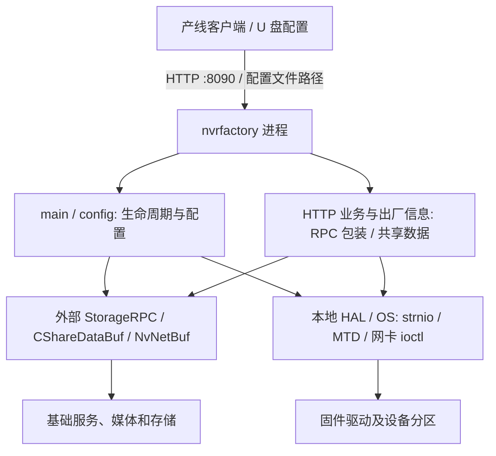
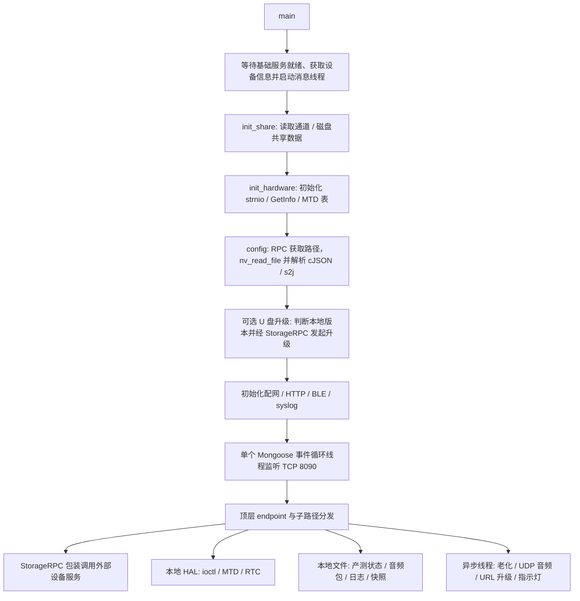
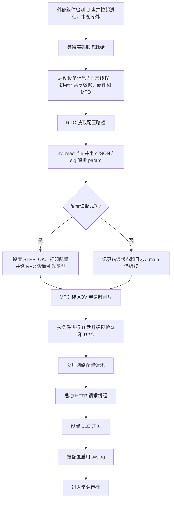
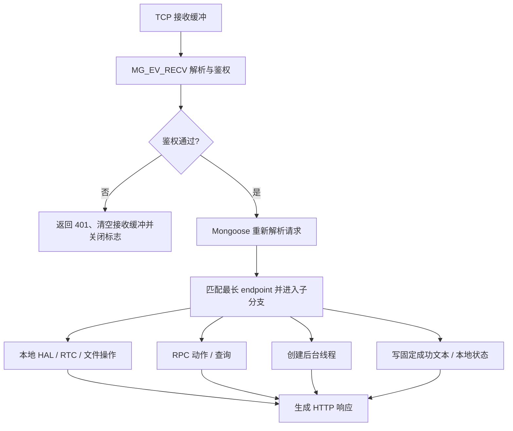
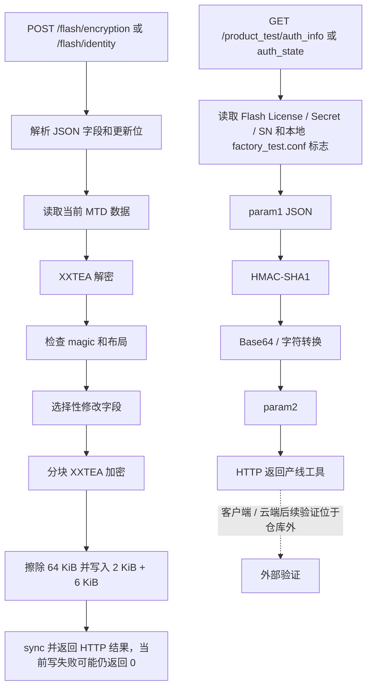
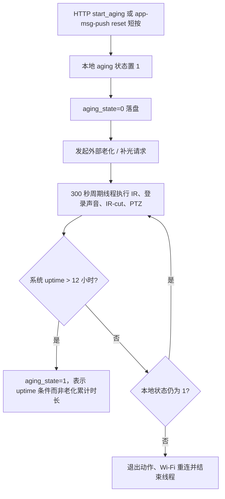

# nvr-factory 仓库深度分析报告

> 核验日期：2026 年 10 月 10 日  
> 分析源码：`/home/tronlong/lyp/meari/nvr-factory`  
> 参考结构：`/home/tronlong/lyp/perCode/idevelop_md/meari/mpc-base/mpc-base分析报告.md`  
> 源码 HEAD：`213c28e2184ba942a483ad63484578e0a3d68aa8`  
> 复核状态：已完成第二轮源码、平台宏、接口契约与隔离复现核验  
> 输出目录：`/home/tronlong/lyp/perCode/idevelop_md/meari/nvr-factory`

本报告沿用参考报告的十二章结构，按本工程实际职责调整模块和数据流。分析依据是磁盘上的当前源码，而不是文件名、接口名或注释表达的预期功能。`git status` 有 32 项修改；进一步核对发现这些是 `100755 → 100644` 的权限变化，文本文件没有内容增删，不能表述为存在未提交的业务修订。预编译程序与本次源码的对应关系未验证。

**结论采用三类证据**：①静态确认：代码、编译条件、调用和错误分支可直接核对；②隔离复现：在主机上运行原函数或源码片段，硬件/RPC操作用明确的模拟接口替换；③待整机验证：依赖目标固件、驱动、基础服务、产测客户端或云端，本次没有运行证据。原始核验材料已在报告交付后删除。本报告保留当时的检查范围、结果摘要及源码位置；原始日志与复现脚本不再随报告提供，详见附录C。

---

## 一、仓库概述

`nvr-factory` 是面向嵌入式 NVR、IPC、MPC 产品的**生产测试、出厂信息写入与工厂模式控制进程**，构建输出为 `nvrfactory`。README称其为“生产测试 加密工具”，要求在U盘中放置 `$OpenNvrFactory.txt`，由设备启动程序。

本程序主要完成以下工作：等待基础服务就绪；取得工厂配置路径和共享状态；读取硬件信息；启动工厂看门狗喂狗线程；按配置尝试升级、配网、补光与蓝牙设置；提供8090端口HTTP产测接口；经RPC控制媒体、云台、存储、PIR、电池等；经MTD与私有驱动接口读写出厂身份及授权数据。**媒体采集编码、完整录像存储、RPC服务端、USB插入检测和进程拉起均不在本工程中实现。**

### 核心定位



这里的“加密”有两种含义，必须区分：一是写入序列号、License、Secret、产品型号等出厂信息并用XXTEA处理Flash内容；二是HTTP摘要鉴权及授权状态签名。它不等于整个生产网络启用了加密传输，也不等于生产测试结果已由云端校验。

依据：[README.md:1](/home/tronlong/lyp/meari/nvr-factory/README.md:1)、[main:170](/home/tronlong/lyp/meari/nvr-factory/mod/main/src/nv_factory_main.cc:170)、[mod/Makefile:30](/home/tronlong/lyp/meari/nvr-factory/mod/Makefile:30)。

---

## 二、支持平台

当前存在12份平台环境脚本。下表说明的是**脚本提供的构建配置**，不是12个平台均已成功构建或完成整机测试。

| 脚本 | `NV_CPU_ARCH` | 工具链/平台配置 | 产品宏 | 配套工程 |
|---|---|---|---|---|
| `IPC_621` | `sigmastar` | ARM Buildroot uClibc hard-float | `NV_SIGMASTER_IPC`, `NV_DEV_IPC` | ipc-pack |
| `IPC_av100n` | `ANYKA` | Anyka AV100 ARM工具链 | `ANYKA_IPC`, `NV_DEV_IPC` | ipc-pack |
| `IPC_t31` | `INGENIC_A1` | Ingenic MIPS GCC 4.7.2路径 | `NV_INGENIC_IPC`, `NV_DEV_IPC` | ipc-pack |
| `IPC_t31pg` | `INGENIC_T31L` | 同上；另设t31l-pg输出路径 | 同上，加`SUPPORT_4G` | ipc-pack |
| `IPC_t40` | `INGENIC_t40` | T40 MIPS GCC 7.2.0，`-muclibc` | `NV_INGENIC_IPC`, `NV_DEV_IPC` | ipc-pack |
| `IPC_t41` | `INGENIC_A1` | T41 MIPS GCC 7.2.0，`-muclibc` | 同上 | ipc-pack |
| `MPC_t32zmc` | `INGENIC_t32zmc` | T32 MIPS GCC 5.4.0，`-muclibc` | `NV_DEV_MPC`及4G/BLE/WiFi/C6宏 | mpc-pack |
| `MPC_t41` | `INGENIC_t41` | T41_zm GCC 7.2.0，`-muclibc` | 同上 | mpc-pack |
| `MPC_t41w` | `INGENIC_t41` | 同上 | 同上，但不定义`SUPPORT_4G` | mpc-pack |
| `MTK7628` | `MTK7628` | MIPS little-endian MTK工具链 | `NV_MTK7628`, `NV_DEV_BASE` | nvr-pack |
| `ss661q` | `sigmastar` | ARM Buildroot工具链 | `NV_SIGMASTER`, `NV_DEV_NVR` | nvr-pack |
| `x86` | `x86` | 主机gcc/g++ | `NV_CPU_x86`, `NV_DEV_NVR` | nvr-pack |

**核验后的平台边界**：

- `MPC_t41`和`MPC_t41w`的`NV_DEV_TYPE`实际写成`ipc`，但编译宏为`NV_DEV_MPC`；本地Makefile没有用`NV_DEV_TYPE`选择源文件，业务分支以宏为准。
- `IPC_t31`与`IPC_t41`共享`INGENIC_A1`输出目录；`IPC_621`与`ss661q`共享`sigmastar`；两份MPC T41脚本也共享输出目录。切换脚本可能复用旧对象文件，不能通过输出目录名确定平台。
- `x86`仍调用`/dev/strnio`及MTD，且依赖外部RPC，不是无需设备的完整模拟程序；该脚本未设置`NV_LIBDIR_D`、`NV_BINDIR`，在干净环境下还会影响链接与复制命令。
- 当前相邻路径只有`ipc-pack`存在，脚本引用的`nvr-pack`、`mpc-pack`不存在。用现有`ipc-pack`头文件做兼容性探测发现RPC接口不匹配，不能用它替代匹配的NVR/MPC SDK。

依据：[MPC_t41:1](/home/tronlong/lyp/meari/nvr-factory/build/MPC_t41:1)、[MPC_t41w:1](/home/tronlong/lyp/meari/nvr-factory/build/MPC_t41w:1)、[x86:1](/home/tronlong/lyp/meari/nvr-factory/build/x86:1)。全部脚本通过`bash -n`；构建清单查询结果见第八章。

---

## 三、目录结构总览

```text
nvr-factory/
├── README.md                   # 简要用途与编译说明
├── $OpenNvrFactory.txt          # U盘JSON配置样例
├── Makefile                    # 环境检查、递归构建、摘要输出
├── build/                      # 12份平台环境脚本
├── bin/                        # 3份MIPS预编译nvrfactory
└── mod/
    ├── Makefile                # 全部本地源文件编译、链接及复制
    ├── bin/nvrfactory          # 已有MIPS程序
    ├── main/                   # main入口、推送消息缓冲读取
    ├── config/                 # 工厂JSON配置及getter
    ├── rpc/                    # StorageRPC包装、共享数据、配网监控
    ├── http/                   # Mongoose、产测路由、设备适配、授权、升级
    ├── hal/                    # strnio驱动、MTD、网卡MAC私有ioctl
    └── tool/                   # JSON、网络、摘要、CPU/内存、时间、带宽工具
```

按扩展名统计，排除`.git/`后共有133个实际文件，包含**33个C/C++源文件、45个头文件**。源文件物理行数为28,505，头文件7,008行，包含注释和空行。`http`包括第三方网络代码和业务代码，不能把其全部行数视为自研产测逻辑。

| 模块 | C/C++源文件数 | 物理行数 | 核验重点 |
|---|---:|---:|---|
| main | 2 | 317 | 启动、退出、消息读取 |
| config | 1 | 190 | 默认值、字段消费者、失败状态 |
| rpc | 1 | 824 | RPC转发、条件实现、网络/磁盘/共享数据 |
| http | 17 | 18,687 | 实际路由、HTTP鉴权、授权写入、下载、上传 |
| hal | 3 | 1,262 | 驱动调用、分区定位、MTD初始化/读写 |
| tool | 9 | 7,225 | 网络及算法工具、接入边界 |

源码目录内还有33份`.o`文件及`mod/bin/nvrfactory`。这意味着“目录已有程序”不能证明当前源码能干净构建。`file`确认4份已有程序均为MIPS 32位小端ELF，使用uClibc解释器且保留调试信息；本次未执行这些程序。

本次核验曾逐文件计算大小与SHA-256；原始文件及哈希清单已删除。附录A保留33个源文件的职责和核验层次。

---

## 四、核心架构设计

### 4.1 整体分层与真实调用边界



HTTP端口的日志写“multi-threaded server”，但实际只有一个`mg_mgr_poll(...,500)`事件循环。其他工作线程独立存在，并不意味着每个HTTP请求有独立线程。LED测试中的0.5秒睡眠、RTC测试中的1.5秒等待、CPU利用率采样的1秒等待及同步RPC都可能阻塞其他HTTP请求。

### 4.2 控制面、状态面与数据面

| 路径 | 当前实现 | 边界 |
|---|---|---|
| 控制面 | HTTP业务 → `nv_factory_*` → `StorageRPC::*` | 服务端实际执行结果须另验 |
| 状态面 | `CShareDataBuf`查询通道/磁盘；`NvNetBuf`读取App事件；本地JSON标志 | 共享内存协议及写入者在外部 |
| 数据面 | URL固件分片经RPC；UDP音频经RPC；HTTP返回快照；音频包本地解包 | 没有本地视频编码/完整录像实现 |
| 驱动面 | strnio、MTD、网卡私有ioctl、RTC | 固件驱动ABI与分区布局决定可用性 |

### 4.3 线程及生命周期

| 线程入口 | 创建点与用途 | 停止/失败边界 |
|---|---|---|
| `thread_msg_proc` | 基础服务就绪后，读取reset短按事件 | 无限循环；创建结果未处理 |
| `nv_factory_feed_watch_dog_task` | 硬件初始化后，RPC喂工厂看门狗 | 无限循环；周期来自外部宏 |
| `net_status_task` | 应用网络配置时，读取carrier | 无限循环；失败仅在创建时报告 |
| `init_8090_port_service` | 启动HTTP入口 | bind失败线程退出，未传回main |
| `infrared_ircut_cycle_switching` | 老化启动时 | 检查老化状态后退出 |
| `mpc_send_audio` | `/sound_play` | 全局标志停止UDP接收 |
| `pps_firmware_url_upgrade_task` | URL升级请求 | 等待升级到100%；没有总期限 |
| `log_done_task` | `/age_log_done` | 无限闪灯；重复请求可重复创建 |

main没有统一的线程join、HTTP服务释放、共享数据释放或HAL关闭流程。SIGINT/SIGTERM退出仅尝试释放MPC时间片后`exit`；其他初始化失败分支没有统一回滚。信号处理器内执行锁、RPC和日志，并非可据此确认安全的异步信号退出机制；注册SIGKILL处理函数也不能使不可捕获的SIGKILL执行清理。

依据：[main:73](/home/tronlong/lyp/meari/nvr-factory/mod/main/src/nv_factory_main.cc:73)、[main:115](/home/tronlong/lyp/meari/nvr-factory/mod/main/src/nv_factory_main.cc:115)、[HTTP线程:7502](/home/tronlong/lyp/meari/nvr-factory/mod/http/src/restful_server.c:7502)、[CPU采样:164](/home/tronlong/lyp/meari/nvr-factory/mod/tool/src/pps_cpu_mem_usage.c:164)。

---

## 五、核心模块深度解析

### 5.1 main模块——进程总入口

实际启动顺序为：

1. 打印Git构建信息，设置`NV_TRACE`日志等级并注册信号。
2. 每2秒调用`StorageRPC::is_nvr_start()`，直到就绪，再等待3秒；取得设备信息并创建推送消息线程。
3. 构造只读共享数据对象，读取运行时通道数。main未检查`nv_factory_init_share()`返回值。
4. 初始化strnio，取得`g_hw_info`，初始化MTD表；strnio初始化或GetInfo失败则退出。MTD初始化返回void，其内部失败不能通过本层返回值传回main。
5. 创建工厂看门狗喂狗线程，失败则退出。
6. 读取工厂配置。失败仅通过`NV_CHECK(...,空动作)`记录，不阻止后续启动。
7. 非AOV的MPC分支申请编码、磁盘、播放、4G四类时间片。
8. 若`upgrade_auto`开启，调用U盘升级。成功时只打印“app exit”日志，**没有退出、return或等待升级完成**，随后仍继续配网和HTTP启动。
9. 启动网络状态线程，按条件调整AP/桥接/WiFi；启动HTTP线程；请求蓝牙开关。
10. MPC且`syslog_flag`开启时，从配置路径中寻找`$`截断并提交syslog目录、全量使能和等级；main无限睡眠。

MPC时间片类型传入固定数字2/3/4/5，本仓库不定义其服务端含义；名称分别为`factory_rt_enc/disk/speak/4g`。`aov_mode`非零时跳过这四次申请，**没有本地AOV调度器或功耗测量**。申请失败未检查，释放仅检查ID大于0；ID有效范围需由配套RPC契约确定。

消息线程在硬件初始化前已经创建。它可能读取`g_hw_info.pro_no`并据此启动老化，因此这段代码存在启动顺序与共享状态初始化的竞争窗口；是否在现场触发需要运行调度证据，不能认定每次启动必然发生。

依据：[main:170](/home/tronlong/lyp/meari/nvr-factory/mod/main/src/nv_factory_main.cc:170)、[等待与消息线程:178](/home/tronlong/lyp/meari/nvr-factory/mod/rpc/src/nv_factory_rpc.cc:178)。

### 5.2 config模块——U盘JSON配置

配置路径由`StorageRPC::nv_get_factory_config_path`提供。本地既不遍历USB挂载点，也不检测插入事件。`nv_read_file`、`cJSON`和`s2j`来自外部工具库；HTTP业务另外使用本仓库的`pps_cJSON`。

| 字段 | JSON解析成功且字段缺省时的值 | 本仓库可确认的消费者 |
|---|---|---|
| `upgrade_auto` | 1 | main是否尝试U盘升级 |
| `eth0_dhcp` | 1 | 仅解析与打印 |
| `eth0_ipv4_addr` | `192.168.0.18` | 仅解析与打印 |
| `eth0_ipv4_mask` | `255.255.255.0` | 仅解析与打印 |
| `eth0_ipv4_gw`、`dns0` | `192.168.0.1` | 仅解析与打印 |
| `wlan0_ssid`、`wlan0_pass` | `NVR_00000000`、`00000000` | WiFi连接请求 |
| `p2p0_channel` | 6 | NVR AP和MTK连接脚本参数 |
| `p2p0_better` | 1 | NVR AP是否强制信道14 |
| `p2p0_ssid`、`p2p0_pass` | 空串 | NVR AP设置；非空检查 |
| `aov_mode` | 0 | main是否申请MPC四类时间片 |
| `syslog_flag` | 0 | MPC启动日志设置 |
| `filllight_type` | 0 | RPC设置补光类型 |
| `ble_onoff` | 1 | main请求蓝牙开关 |

**默认值只在成功进入JSON解析宏后生效。** 全局`param{}`最初全为零。路径或读取失败时不会自动加载上表默认值；main却继续启动，因而此时升级关闭、BLE关闭、WiFi字符串为空等行为与“成功解析空对象”不同。部分解析失败路径还未释放已读取的`pConfig`。

配置入口未做字段类型校验、范围校验或完整性校验；getter使用`strncpy(...,len-1)`而没有统一补终止符，依赖调用方预先清零。当前可读的`ipc-pack/s2jdef.h`虽限制复制长度，但直接使用`valuestring`，数字字段替代字符串会导致空指针复制。隔离验证使用本地`pps_cJSON`并映射为cJSON接口，配合这份实际s2j宏，输入`{"wlan0_ssid":123}`触发ASan空指针崩溃；这是**现有外部宏组合的复现**，不是对尚未提供的mpc-pack宏版本作推断。

源码会打印整个配置JSON和两类WiFi密码。样例配置提供的是示例凭据，本报告不将它们视为现场网络配置。

依据：[解析:108](/home/tronlong/lyp/meari/nvr-factory/mod/config/src/nv_factory_config.cc:108)、[初始化:142](/home/tronlong/lyp/meari/nvr-factory/mod/config/src/nv_factory_config.cc:142)、[s2j宏:63](/home/tronlong/lyp/meari/ipc-pack/include/nvrbase/util/s2jdef.h:63)。

### 5.3 rpc模块——外部基础服务适配

`nv_factory_rpc.cc`包装`StorageRPC`，不实现RPC监听、序列化协议或服务端业务。可确认的转发类别如下：

| 类别 | 本地包装/处理 | 实现边界 |
|---|---|---|
| 系统 | 就绪、配置路径、状态、默认恢复、重启、关机、喂狗 | 依赖基础服务 |
| 媒体 | 抓图、日夜切换、录音测试、文件播放、媒体发送、音量、镜像 | 真正媒体处理在外部 |
| PTZ | 方向、参数、转向、动作 | 无本地完整云台控制器 |
| 设备状态 | 固件版本、报警灯、按钮次数、能力集 | 查询多忽略RPC返回码 |
| 网络 | WiFi连接、C6信号与断开、BLE MAC/开关 | 存在条件编译及成功桩 |
| 4G | LTE信息 | `SUPPORT_4G`条件实现 |
| MPC | 时间片、电量/充电、PIR、syslog、电池参数、优先SIM、音频包 | 多数实现限`NV_DEV_MPC` |
| AOV参数/资源版本 | 能耗等级、事件持续时间、间隔、电池/音频版本 | 包装存在，实际服务端接口需匹配 |

特别需要区分三个返回层次：HTTP响应是否生成；本地函数是否提交RPC；设备端是否执行并完成。大量查询预置`0`或`-1`、忽略RPC返回码后返回该变量；失败可能看起来像“零电量”“未开启”或“无按钮事件”。`nv_factory_get_firmware_info()`也没有检查RPC调用，固定返回`NV_SUCCESS`，不能凭该函数返回值确认数据有效。

另有一类更直接的问题：`nv_factory_ptz_param_get()`、`nv_factory_turn_param_get()`、`nv_factory_get_alarm_light_status()`、`nv_factory_get_mic_vol()`、`nv_factory_get_speak_vol()`使用**未初始化的局部整数**作为RPC输出，忽略RPC结果后返回它。如果服务端调用失败且没有写输出，返回值不是可靠的默认值。固件查询的局部`firmware_info`也未清零，输出结构不统一补字符串终止；未开`SUPPORT_C6`时没有填`c6mcu_ver`，而HTTP层部分调用未预先清零该结构。这是静态确认的失败处理缺口，未测试外部RPC在失败时是否改写输出。

依据：[版本输出:96](/home/tronlong/lyp/meari/nvr-factory/mod/rpc/src/nv_factory_rpc.cc:96)、[PTZ输出:562](/home/tronlong/lyp/meari/nvr-factory/mod/rpc/src/nv_factory_rpc.cc:562)、[报警灯/音量输出:590](/home/tronlong/lyp/meari/nvr-factory/mod/rpc/src/nv_factory_rpc.cc:590)。版本查询中的MCU复制长度写成`sizeof(firmware_ver)-1`；当前本地`version_info_t`四个数组同为64字节，因此**不能把这一写法单独认定为当前确定越界**，但结构变化后应修正。

条件编译不是完全对称的：

- 不定义`SUPPORT_WIFI`时，`nv_factory_connect_wifi()`直接返回0，未执行连接。`NV_DEV_IPC`触发上层调用并不能绕过这个条件。
- 不定义`SUPPORT_BLUETOOTH`时，BLE MAC包装返回0但不填输出；BLE开关包装反而无条件转发。
- `nv_factory_get_ipc_capa_info()`声明可由`SUPPORT_4G`暴露，实际实现却在`NV_DEV_MPC`中，影响IPC 4G分支。
- UDP音频包装只在MPC实现，但HTTP音频入口不受同一宏保护；SIM、电池参数入口也有类似保护不对齐。非MPC源码清单仍包含这些调用。

不能把这些问题归纳成“所有平台不能使用”；正确结论是**平台能力与声明/定义条件需要逐项对齐，现有配置没有提供完整的闭合证据**。

依据：[RPC源文件:96](/home/tronlong/lyp/meari/nvr-factory/mod/rpc/src/nv_factory_rpc.cc:96)、[WiFi包装:140](/home/tronlong/lyp/meari/nvr-factory/mod/rpc/src/nv_factory_rpc.cc:140)、[MPC保护:676](/home/tronlong/lyp/meari/nvr-factory/mod/rpc/src/nv_factory_rpc.cc:676)、[接口声明:90](/home/tronlong/lyp/meari/nvr-factory/mod/rpc/inc/nv_factory_rpc.h:90)。

### 5.4 网络配置与状态监控

`nv_factory_set_nvr_config()`启动carrier监控；NVR分支在支持网络值等于0时等待hostapd PID文件，再尝试改AP；若`br0`存在则关闭并移除桥及接口；若`wlan0`存在则尝试连接配置AP。

NVR AP配置通过shell改`/etc/hostapd.conf`第7/14/9行，分别写SSID、密码、信道。信道参数检查1～14；`p2p0_better != 0`强制14。依赖配置文件固定行号、hostapd命令和PID文件；等待没有超时，hostapd启动失败可导致流程长期停留。代码中的去双引号命令使用相邻字符串拼接，实际得到`sed -i 's///g' ...`，不能按注释认定已正确清除双引号。

WiFi连接通常转交RPC；MTK额外拼接`/sbin/factory_connect.sh SSID PASS CHANNEL &`。这些shell命令没有可靠转义SSID/密码，也未逐条传播命令返回值。hostap配置和WiFi连接的结果在外层被忽略，最终仍发送“STEP_OK”。

carrier线程每轮先按上轮缓存状态报告再读取新状态，读取周期2秒；wlan或eth为1时提前`continue`，其他接口可能保留旧状态；wlan/eth文件打开失败时也没有统一清零，`meari0`失败才清零。`SUPPORT_C6`时wlan读值强制忽略。**carrier为1仅表示链路层状态，不能证明已取得IP、DNS正常或能连云端。**

最重要的配置边界是：**本地没有把解析出的eth DHCP/IP/掩码/网关/DNS参数用于网络设置的调用链**。`netconfig.c`存在相关工具函数，并不能证明这些配置已生效；外部服务是否另行读取同一文件本次未验证。

依据：[网络配置:299](/home/tronlong/lyp/meari/nvr-factory/mod/rpc/src/nv_factory_rpc.cc:299)、[carrier:368](/home/tronlong/lyp/meari/nvr-factory/mod/rpc/src/nv_factory_rpc.cc:368)、[应用配置:433](/home/tronlong/lyp/meari/nvr-factory/mod/rpc/src/nv_factory_rpc.cc:433)。

### 5.5 HTTP服务——实际开放条件、鉴权与路由

#### 5.5.1 服务启动与端口

端口实际为**TCP 8090**，文件头注释中的80端口不是实现值；`nv_factory_https.cc`名称也不代表服务启用HTTPS。监听使用`mg_bind(...,"8090",...)`，没有配置证书或TLS选项；本地平台脚本未定义Mongoose SSL宏。

`open_8090_flag`初始为0，未出厂序列号前缀`056565099`会立即置1；其他设备在循环调用`pps_device_in_factory_mode()`返回1后也置1，而该函数**当前固定返回1**。因此程序启动后不会凭本地“已经加密”状态持续关闭端口，也没有在此实现生产工具登录成功才开端口的门槛。

`nv_factory_start_http_sever()`发送“等待授权”状态、调用返回void的线程启动包装，随后立即发送STEP_OK并返回成功。线程创建结果未检查；bind失败不能反映到main。HTTP服务“启动请求成功”不能等同于端口监听成功。

#### 5.5.2 Basic与Digest鉴权

全局`MG_EV_RECV`处理器解析当前接收缓冲，再处理Authorization；失败时发送401并清空接收缓冲。Mongoose之后重新解析缓冲并分发endpoint；这是实际鉴权接入点，不能只看到handler中没有鉴权就认定所有请求完全无鉴权。

- **Basic分支有确定的鉴权缺陷**：Base64解码、找到冒号、复制用户名密码后，最后无条件返回0，没有调用`pps_device_user_auth()`或其他凭据比较。隔离运行原函数及Mongoose原解码函数，未注册用户配错误密码得到0。
- Digest分支确实取本地用户密码并计算MD5响应，不能与Basic缺陷混为一谈。但nonce生成使用十进制`%ld`，检查使用`strtoul(...,16)`，且`now < val`直接通过。主机固定时间验证：过期两小时的正确十六进制nonce被拒绝，未来一天的nonce与当前十进制challenge均通过。
- 没有看到服务端持有并核对已签发nonce、绑定固定realm、记录nonce-count并拒绝重复请求的机制。`uri`字段虽被解析，响应计算使用实际请求URI。不能据现有代码宣称提供完整防重放。
- `/tvclient`、`/search`前缀跳过鉴权，但当前顶层endpoint表没有这两类服务。它们是鉴权例外，不能据此声称存在本地发现服务。
- 凭据解析中Base64输出、用户名和密码复制缺少相应容量约束。接收分片和multipart事件还需要针对性集成测试；本次没有对真实8090监听发起攻击测试。

依据：[Basic:236](/home/tronlong/lyp/meari/nvr-factory/mod/http/src/restful_server.c:236)、[nonce:339](/home/tronlong/lyp/meari/nvr-factory/mod/http/src/restful_server.c:339)、[鉴权入口:466](/home/tronlong/lyp/meari/nvr-factory/mod/http/src/restful_server.c:466)、[Mongoose事件顺序:4100](/home/tronlong/lyp/meari/nvr-factory/mod/http/src/mongoose.c:4100)。

#### 5.5.3 顶层注册与旧分支范围

| 注册endpoint | 实际处理 | 主要边界 |
|---|---|---|
| `/`、`/index.html` | 默认页handler | `/`先被全局鉴权入口返回404；不是完整网页UI |
| `/sys` | 系统信息、重启页面、异常重启日志、iperf等 | 部分操作只有应答或开关标志 |
| `/dsp` | ISP调试适配 | `pps_media_isp_debug`为空inline，当前无真实ISP处理 |
| `/proc` | 把URI当文件路径打开，最多读4KiB | 无路径规范化/白名单；参见安全章节 |
| `/media/audio/` | 旧音量查询/设置 | 调用固定返回值桩；输入/输出GET长度检查有偏差 |
| `/flash/identity` | 流水线identity读写 | POST复制缺长度约束 |
| `/suite/voicenote/download` | multipart音频包上传/解包 | 最大缓冲256KiB，包内边界检查不完整 |
| `/suite/voicenote/clear` | 删除声音目录并清版本 | shell/RPC结果未核对 |
| `/product_test` | 产测子命令 | 设备执行、文件标志和常量回应混合 |
| `/flash/encryption` | NVR/非NVR出厂信息JSON读写 | 条件布局、MTD错误传播须特别核对 |
| `/devices` | 固件、PTZ、音量、镜像、AOV参数等 | 配套RPC及宏保护不对齐 |
| `/battery_config` | 电池配置multipart | 实际调用MPC专属包装，却无对应入口保护 |

Mongoose按最长匹配前缀选择endpoint；业务子路由又普遍使用`memcmp(uri+offset,固定字符串,固定长度)`，不是统一的“URI长度相等”检查。`/infrared_led`仅比较6字节，`/day_night_cut`比较长度漏掉斜杠。部分短/扩展路径会被意外匹配；不能把文档列出的路径视为严格路由约束。

用实际头文件预处理两组宏后，NVR组的子分支为`/product_test`44、`/devices`24、`/sys`5；MPC组为54、24、5。源码另有33条受`CONFIG_MEARI_SUPPORT`等旧宏保护的`/devices`分支，不在这两组清单中，所有12份本地脚本均未定义这些旧功能宏。其中部分被调函数未在仓库定义，不能把旧分支表述为当前已提供的录像、云服务或完整设备设置。

完整子路由核验表见附录B，包含源码位置、处理函数、预处理参与情况。**预处理参与不代表该配置能链接或设备端动作有效。**

依据：[endpoint表:7483](/home/tronlong/lyp/meari/nvr-factory/mod/http/src/restful_server.c:7483)、[devices分发:3413](/home/tronlong/lyp/meari/nvr-factory/mod/http/src/restful_server.c:3413)、[product分发:7123](/home/tronlong/lyp/meari/nvr-factory/mod/http/src/restful_server.c:7123)。

### 5.6 产测执行与结果含义

| 功能组 | 代码实际动作 | 不能直接推出的结论 |
|---|---|---|
| 连通性`/test` | 固定200回应 | 所有硬件已通过测试 |
| LED/补光/IR-cut | 部分直接HAL，部分RPC；`day_night_cut`固定通道0 | 每次HTTP OK均等于实际亮灯/切换成功 |
| RTC | 两次RTC读取间隔1.5秒，秒差1/2且年非1970则通过 | RTC长时精度、掉电保持均合格 |
| RTC半成品分支 | 系统年为1970时设置2021年并写RTC，随后关闭时间同步 | 只是只读时间查询 |
| SD/磁盘信息 | 读共享数据，按type统计容量并生成JSON | 做过坏块、读写压力或文件系统检查 |
| `diskformat` | 对type0设备执行`dd bs=4096 count=100`清零前409,600字节 | 正规格式化、完成文件系统重建 |
| 按钮 | RPC启测试、清计数、读次数；reset短按也可切换老化 | 按键电气/中断/防抖全面验证 |
| WiFi | 信号与网络状态查询、RPC提交连接 | 外网连通性与吞吐均通过 |
| 子设备列表 | 读取`/home/cfg/nvipcmonfig.bin`，提取`serial`数组 | 当前全部子设备在线 |
| PTZ | RPC方向/参数与老化动作 | 步数准确、校准完成、机械寿命达标 |
| 音频 | RPC录放控制、UDP音频包转发 | 自动测量音质/音量/失真完成 |
| 4G | LTE信息/RSSI、SIM数据，检查usb0存在 | 已通过基站/公网数据通信验证 |
| 电池 | RPC读百分比和充电状态 | 容量校准、充电曲线、续航得到验证 |
| PIR | 部分RPC开关/噪声与状态，部分仅响应 | 完整PIR开关/灵敏度控制都已实现 |

尤其`/pir_close`和`/pir_level`当前**只打印HTTP OK/Content-Type，没有设置PIR开关或灵敏度**。`/4grssi`的`4g_net`字段由`/sys/class/net/usb0`是否存在决定，ping逻辑已注释。`/sys/iperf`启动命令同样注释，只更新局部静态running标志；`/sys/factory_reset`只有成功文本，和`/product_test/factory_default`实际RPC恢复路径不同。

原两组配置的83条子分支并集逐项方法检查、请求字段、动作及响应边界见附录D；顶层入口另列。源码中的116条分支及宏参与情况见附录B。

二次复核补充了以下具体契约问题：

- `/devices/set_mirror`的判断为`valueint != 0 || valueint != 1`，对任何整数均为真。只要`mirror`字段存在就返回500且不提交RPC；字段缺省反而200且不动作。原handler隔离复现确认0、1、-1、2全部拒绝，空对象成功但RPC调用次数为0。
- `/product_test/rs_btn_start`只返回200，不设置本地测试状态，也不调用按钮RPC；真正开始reset测试的路径是`rs_btn_zero`。`rs_btn_times`在读次数之前先清本地测试标志，成功生成响应时再通知服务端关闭测试。
- `/product_test/ptz`与`ptz_set`实际都传`PPS_PTZ_CTRL_ALL_PARAM`，与老化线程传`PPS_PTZ_CTRL_ALL`不同；参数名/注释不能替代服务端动作契约。
- 音量、能耗、AOV间隔、优先SIM等多项setter在字段缺省时仍返回200；部分只检查`valueint`而不检查JSON类型、部分范围错误提前返回时不释放JSON。`set_zone`用`if (it && it->valueint)`，因此0不会写入，却仍应答成功。
- `set_model`操作`custom_model`，但NVR版`all_encrypt_info`只有`ipc_model`，当前调用点未按产品宏保护；这是本地结构与调用不一致，已在NVR语法检查中报错，不能全部归因于外部SDK。
- 网络信息生成忽略wlan/eth子查询失败，仍可200返回空子对象；`network_supported`来自固定`*capa |= 3`，并非驱动能力探测。`deviceinfo`在neutral固件分支可能添加一次`licence_id`，随后又添加同名Flash字段，JSON可能出现重复键；本地未定义消费者如何选择该值。
- `deviceinfo`混用本次Flash读取和启动时取得的`g_hw_info`，本地没有在出厂字段写入后刷新该全局结构；因此写入后的model/serialno/pid与Flash字段可能不是同一时刻的数据。`get_wifi_info`调用外部接口返回ssid/pass明文JSON并打印日志，未检查查询结果，也未先清零输出结构；不能把它称为无线链路或凭据有效性验证。

依据：[镜像判断:3358](/home/tronlong/lyp/meari/nvr-factory/mod/http/src/restful_server.c:3358)、[reset开始桩:6248](/home/tronlong/lyp/meari/nvr-factory/mod/http/src/restful_server.c:6248)、[云台动作:6660](/home/tronlong/lyp/meari/nvr-factory/mod/http/src/restful_server.c:6660)、[型号字段:6435](/home/tronlong/lyp/meari/nvr-factory/mod/http/src/restful_server.c:6435)、[网络JSON:640](/home/tronlong/lyp/meari/nvr-factory/mod/http/src/restful_server.c:640)、[重复键:2108](/home/tronlong/lyp/meari/nvr-factory/mod/http/src/restful_server.c:2108)。

依据：[RTC:1238](/home/tronlong/lyp/meari/nvr-factory/mod/http/src/restful_server.c:1238)、[磁盘擦头:39](/home/tronlong/lyp/meari/nvr-factory/mod/rpc/src/nv_factory_rpc.cc:39)、[iperf:3945](/home/tronlong/lyp/meari/nvr-factory/mod/http/src/restful_server.c:3945)、[4G状态:6915](/home/tronlong/lyp/meari/nvr-factory/mod/http/src/restful_server.c:6915)、[PIR桩:7103](/home/tronlong/lyp/meari/nvr-factory/mod/http/src/restful_server.c:7103)。

### 5.7 老化与产测状态持久化

本地`/home/cfg/factory_test.conf`保存`auth_state`、`madeup_state`、`aging_state`等标志。`device_verify_auth`只是将`auth_state`写成1；`finished_product_testing`只是将`madeup_state`写成1；没有在这两个handler内串行执行所有项目、汇总判定或等待云端审批。授权状态应理解为**产线提交的本地状态记录**。

老化可由HTTP启动，也可由共享消息缓冲中的reset短按切换，后者附加“未出厂序列号且不在reset按键测试”条件。启动后设置老化状态、删除`/home/cfg/sys_time`、记录aging_state=0、请求外部老化状态和补光，创建300秒周期线程。线程切换红外灯、播放`/app/sound/login.g711u`、切IR-cut并发起PTZ全动作。

**12小时判定用的是系统`/proc/uptime`，不是从本次老化启动累积的时间**。设备开机已超过12小时后才开始老化，也可在首次周期处理时写aging_state=1。没有按各动作返回值累计合格次数，也没有在写1前核验所有器件。该标志不能作为12小时连续有效老化已完成的充分证据。

退出老化只置本地标志；具体补光关闭、IR关闭、WiFi重连等在线程下一次检查执行，最长会受到其循环时序影响。创建老化线程失败未完整回滚状态。`aging_status`部分路径直接写入，不能从几个mutex包装推导出整个流程无竞争。

状态文件使用`fopen("w")`直接重写，未见统一事务、临时文件rename或统一锁；掉电和并发更新可靠性未验证。成品完成函数在释放`outconfig`后调用`strlen(outconfig)`，是可直接确认的释放后使用；部分函数用`ret < 0`检查`fwrite`，不能可靠识别短写。

读取端`pps_get_test_info`仅有64字节栈缓冲，允许`fread`填满全部64字节后直接作C字符串打印并交给JSON解析，没有预留终止符、处理文件剩余数据或检查完整文件长度。状态字段增加后不能保证文件仍适配此读入口；解析失败时写入端会退回新建空对象，旧字段可能丢失。依据：[状态读取:4290](/home/tronlong/lyp/meari/nvr-factory/mod/http/src/restful_server.c:4290)。

依据：[授权标志:5448](/home/tronlong/lyp/meari/nvr-factory/mod/http/src/restful_server.c:5448)、[成品标志:5593](/home/tronlong/lyp/meari/nvr-factory/mod/http/src/restful_server.c:5593)、[老化:5739](/home/tronlong/lyp/meari/nvr-factory/mod/http/src/restful_server.c:5739)、[12小时:5823](/home/tronlong/lyp/meari/nvr-factory/mod/http/src/restful_server.c:5823)。

### 5.8 出厂信息与Flash授权模块

#### 5.8.1 数据布局与选择性更新

`all_encrypt_info`是HTTP/调用层结构，按`PPS_*_ID`位掩码选择更新字段。底层另有2KiB基础信息和6KiB扩展信息结构，函数用`sizeof`检查基础布局；它们不是JSON的直接磁盘映像。

基础信息包含产品参数、序列号、型号、MAC、生产日期、OEM、授权ID/Secret、流水线identity、TP及kernel args；NVR和非NVR布局不同。NVR扩展包含HomeKit参数；非NVR扩展包含custom_model、platform_id、countryCode。头文件存在字段只说明格式可表达，不能证明HomeKit配对或云端激活已集成。

写接口先读并解密现有内容，读失败则返回失败，再按更新位修改字段并重写。它**不是对完全空白Flash无条件创建出厂结构的通用初始化工具**。HTTP层虽有一些字符串长度判断，但检查不统一，例如identity POST和多处MAC/IP复制没有对应容量限制。

二次复核用原结构定义在主机编译后读取`sizeof/offsetof`，得到基础信息2048字节、扩展6144字节，`BOOT_PARAMS`284字节、`PRODUCT_INFO`512字节。下表偏移均以所属Flash数据块起点计；这是本次主机ABI观察，仍需目标工具链确认，不能把源码注释中的偏移直接视为跨平台格式保证。

| 数据块/字段 | NVR偏移 | 非NVR偏移 | 大小/含义 |
|---|---:|---:|---|
| 基础块`product_info` | 0 | 0 | 512字节 |
| `identity_card` | 512 | 512 | 32字节 |
| `ipc_model / ipc_pid` | 544 / 576 | 不在该基础结构 | 各32字节 |
| `tp / oem_id` | 608 / 736 | 544 / 672 | 128字节 / 4字节 |
| `band_width / freq_point` | 不在该基础结构 | 676 / 681 | 5字节 / 128字节 |
| `kernel_args` | 1024 | 1024 | 1024字节，含magic和长度 |
| 扩展块`pps_encrypt_info2` | 0 | 0 | 1024字节 |
| HomeKit参数 | 4 | 不在该结构 | 398字节 |
| `custom_model / platform_id / countryCode` | 不在该扩展结构 | 4 / 68 / 72 | 64字节 / 4字节 / 16字节 |
| `pps_license_enc_info / res` | 1024 / 2048 | 1024 / 2048 | 1024字节 / 4096字节 |

选择性更新也存在字段组边界：两个MAC共用`PPS_ETHMAC_ID`，只提交一个MAC会让另一个从HTTP层清零结构进入更新；七个HomeKit字段共用`PPS_HOMEKIT_ID`，只提交其中一个仍会处理全部七个字段。`oem_uuid`与`licence_id`若同时出现，按源码固定解析顺序由后者覆盖并把switch设为1，不按JSON书写先后决定。

对`ss661q`对应的NVR/Sigmastar组合，底层读取扩展块后没有设置ENC2能力位；NVR写函数因该位未设置会清零整个扩展结构再构造magic。故“合并现有数据”不能推广到该分支的全部扩展字段：没有在本次请求提供的HomeKit等扩展内容会被重置。这一判断来自读取能力位与写入分支的交叉核对，未执行真实Flash测试。

#### 5.8.2 实际分区与读写流程

| 分支 | 读分区 | 写分区/依据 |
|---|---|---|
| `NV_DEV_NVR` + `NV_MTK7628` | 编号3 | 编号3；但现有MTK脚本定义的是`NV_DEV_BASE`，不会进入NVR布局分支 |
| `NV_DEV_NVR` + `NV_SIGMASTER` | 编号1 | 编号1 |
| NVR函数中的`NV_DEV_IPC`条件 | 编号5 | 写条件为`NV_SIGMASTER_IPC`或`NV_INGENIC_IPC`；单独NV_DEV_IPC通常走非NVR布局 |
| 非`NV_DEV_NVR` | 名称`enc`定位 | 同样按名称`enc`定位 |
| x86 NVR | 无命中读分区宏，fd保持-1 | 写fd没有匹配赋值；无法视为可用出厂写入路径 |

2KiB和6KiB数据以1KiB块执行XXTEA，使用源码固定密钥；写时擦除64KiB，再写基础信息及扩展信息并`sync`。基础magic参与读取判定，非NVR扩展magic参与enc2能力判定；NVR扩展能力置位与MTK条件相关。不能仅凭扩展数据读入就认定所有NVR均返回完整HomeKit字段。

**确定的错误传播缺陷**：两类`dev_info_encrypt_write()`在基础块或扩展块写失败时`goto exit`，最后仍返回0。隔离故障注入分别模拟擦除失败、第一次写失败、第二次写失败：擦除失败返回-1，两个写失败均返回0。底层没有统一写后读回或掉电原子更新机制；**NVR的`/flash/encryption` POST上层另有读回**，等待1秒后读取全部信息，但只用`strncmp(...,strlen(info.sn))`比较此次请求的SN，并未逐项比较其他字段。请求不含SN时比较长度为0；请求SN为前缀时也不是严格全值相等。非NVR的该POST及identity等路径没有同样读回。不能笼统写成“全工程无读回”，也不能把局部SN检查说成完整写入验证。

NVR该POST成功应答后调用`nv_factory_set_default(0)`请求恢复默认；非NVR分支的同类调用被注释。读回与恢复默认实际位置见[restful_server.c:4711](/home/tronlong/lyp/meari/nvr-factory/mod/http/src/restful_server.c:4711)。本次没有实际擦写Flash。

`open_flash_encryption_partition()`调用的`pps_hal_set_mtd_partition_rw()`当前为空成功桩，不能确认真正改变了分区写权限。SD卡`ppsEncrypt.txt`相关解析/声明保留，但完整`pps_encrypt_device()`实现被注释；main没有调用这套SD自动加密流程。

依据：[布局与分支:208](/home/tronlong/lyp/meari/nvr-factory/mod/http/src/pps_device_encryption.c:208)、[NVR读写:492](/home/tronlong/lyp/meari/nvr-factory/mod/http/src/pps_device_encryption.c:492)、[非NVR读写:637](/home/tronlong/lyp/meari/nvr-factory/mod/http/src/pps_device_encryption.c:637)、[选择性更新:823](/home/tronlong/lyp/meari/nvr-factory/mod/http/src/pps_device_encryption.c:823)、[权限桩:771](/home/tronlong/lyp/meari/nvr-factory/mod/hal/src/pps_hal_strnio.c:771)。

#### 5.8.3 授权信息签名与云端边界

`auth_info/auth_state`读取出厂信息及本地测试标志，构造`param1` JSON，再用设备Secret执行HMAC-SHA1，Base64编码并对`=`、`+`做字符转换，返回`param1/param2/wifi_freq_check`。这是**本地生成签名材料**，代码没有在该handler内向云端提交和等待验证结果。

`CONFIG_MEARI_IPC_SDK`下另有`/v10/devices/validation`请求参数构造代码，但实际`rest_req_process()`调用和结果复制被注释；`pps_make_device_activation()`也被注释。不能据URL常量宣称实现在线云激活。

HMAC调用把`int len`地址强转成`size_t*`；在64位主机上类型大小不同，HMAC末尾实际按`size_t`读写它。二次复核直接链接原HMAC/SHA1实现，保持调用处的`int len=128`与强转方式，ASan在HMAC第89行确认8字节读取越过4字节`len`对象。该复现只确认LP64调用ABI问题；已有二进制是32位MIPS，不能据此认定32位设备必然发生同样越界。

依据：[授权签名:5155](/home/tronlong/lyp/meari/nvr-factory/mod/http/src/restful_server.c:5155)、[HMAC调用:5272](/home/tronlong/lyp/meari/nvr-factory/mod/http/src/restful_server.c:5272)、[云端占位:1992](/home/tronlong/lyp/meari/nvr-factory/mod/http/src/pps_device_encryption.c:1992)。

### 5.9 hal模块——设备驱动与MTD

strnio优先打开`/dev/strnio`，不存在时改用`/dev/Strnio`，然后通过私有ioctl控制/查询按钮、LED、红外、IR-cut、硬件信息、看门狗、PIR等。驱动实现不在仓库，头文件命令和结构ABI须与固件一致。RF、部分电源/AXP、SD电压和分区权限等接口中有返回0的桩，不能把全部HAL声明列为已实现硬件能力。

| HAL函数族 | 本地实际实现 | 本工程使用边界 |
|---|---|---|
| LED/HDDLED、INFR、IRCUT、硬件/PCB信息 | 组装结构后调用相应strnio ioctl | 产测HTTP直接使用其中多项 |
| Motor初始化/退出 | 固定成功；Move/Stop另有真实ioctl | 当前HTTP云台动作走RPC，不能把本地Motor初始化成功当作电机已初始化 |
| CMT211XA | Init/Deinit/Send/Test全部固定0 | 无真实RF发送实现 |
| CMT2300A | Init/Deinit/Send调用ioctl；`PPS_HAL_CMT22300A_Test`固定0 | 不应将所有RF函数归为同一种实现 |
| SD电源/分区权限 | `PPS_HAL_SD_PWR_Ctrl`与`PPS_HAL_MTD_SET_PERMISSION`有ioctl；小写`pps_hal_set_sd_vol/pps_hal_set_mtd_partition_rw`是桩 | 出厂开权限调用的是后者桩 |
| Watchdog | 当前`PPS_HAL_WATCH_DOG_Ctrl`走strnio；旧`/dev/watchdog`函数被注释 | main实际喂工厂狗走外部RPC包装 |
| AXP228、WiFi电源、通用小写电源包装 | 固定0，不填输出或不动作 | 未证明电源硬件支持 |
| 按钮listener | 100ms轮询事件位，4秒后开始回调，后续约1秒重复，释放时再回调 | 当前main没有启动此listener；reset短按走消息缓冲 |

其他静态边界：strnio把有效fd判断写成`>0`，打开失败改存0，Exit用非零判断关闭；fd=0这个合法值不能被正确处理。`PPS_HAL_PIR_GetStatus`先赋`id`再memset整个结构，导致提交id被清成0；当前枚举仅有`PIR_ID_1=0`，不能因此宣称现有第一路PIR读取必然错误。listener停止函数在listener未运行时会等待没有人设置的停止确认标志；这些工具函数是否被外部库调用本次未确认。

MTD模块读取`/proc/mtd`建立最多10项的表，提供open/read/write/erase等包装，但存在以下源码可确认的问题：

1. **初始化越界写**：循环对`&pps_mtd_info[i]`清零时使用`sizeof(pps_mtd_info)`整个数组长度。第一次是全表大小，第二次起越过表尾。直接编译原`hwl_mtd.c`、仅替换日志宏后调用init，ASan在141行报告global-buffer-overflow；错误发生在读取`/proc/mtd`前，与主机是否有MTD无关。
2. 分区名查询返回循环索引`i`，而不是表项中的真实`mtd_num`；设备编号非连续或顺序不同的场景可能选错分区。另一个查询函数使用固定数组下标映射固件名，也依赖布局假设。
3. 索引检查漏负数，`index > pps_mtd_num`没有拒绝等于数量的位置；输出指针缺少检查。分区解析的若干错误路径返回`printf()`字数而不是负值，与调用方的`ret < 0`约定不一致。
4. 擦除offset/size不对齐时只打印，并向下取整。读写只有单次pread/pwrite或seek+read/write，不补偿中断/短读写。

初始化缺陷处于正常启动主链，是应优先修复并重新验证的问题；本报告没有改动源码。

依据：[HAL初始化:130](/home/tronlong/lyp/meari/nvr-factory/mod/hal/src/pps_hal_strnio.c:130)、[MTD初始化:133](/home/tronlong/lyp/meari/nvr-factory/mod/hal/src/hwl_mtd.c:133)、[分区索引:313](/home/tronlong/lyp/meari/nvr-factory/mod/hal/src/hwl_mtd.c:313)、[擦写:235](/home/tronlong/lyp/meari/nvr-factory/mod/hal/src/hwl_mtd.c:235)。

### 5.10 升级——U盘预检查与URL下载

#### 5.10.1 U盘路径

本地从工厂配置文件所在目录找`upgrade-for-factory.bin`，读64字节头，XOR还原并检查magic、文件数1～10、头长度与格式版本，返回整数版本值。再与RPC返回的`soft_ver`三段版本比较。

**实际条件是“非零版本相同则不升级，其他情况允许继续”**，不是“只允许新版本”。`pps_firmware_header_parse()`失败返回-1，但被存入`uint32_t va`；`va == 当前版本`不成立便返回`NV_SUCCESS`。全零无效固件头的隔离测试得到`nv_version_cmp()==0`，确认预检查失效。是否真的刷入坏固件还取决于外部RPC服务端后续校验，不能由本地漏洞直接推断设备必然变砖。

头结构虽定义`header_check_sum`，当前解析没有校验该校验和，也没有在此校验固件payload或签名。旧格式设备类型不匹配只日志、不拒绝。另有`memset(pbuf,0,sizeof(firmware_header_L+1))`清零长度错误；该路径成功读取64字节会覆盖所需头内容，因此不能把它与无效头放行的直接原因混同。

#### 5.10.2 URL路径

`/devices/firmware_upgrade`和`firmware_flash_upgrade_all`解析`url`、`firmwareversion`，后者传flag=1，但底层未使用这个flag选择不同流程。版本名要求`ppstrong-平台-...`，平台字符串与本机版本名一致，URL仅检查前4字符`http`。

异步线程申请升级锁，HTTP HEAD取得总长度，经Range GET按最多64KiB读取，调用`nv_factory_send_ota_package(-1,buf,ret,total,offset)`，全部读取后发`sys_updatefw_do(-1)`，每2秒等进度到100%。

错误边界包括：URL/版本拷贝缺少统一长度上限、缺字段时局部数组未初始化；本机版本缓存没有可靠清零/终止；分片RPC发送返回值未检查；HTTP 206与Content-Range未在`http_fread`核对；声明响应长度被当成实际读取字节；下载0返回的循环无总期限；升级开始及进度等候没有统一失败/超时释放路径。互斥锁在工作线程trylock并释放，但全局升级标志的其他读取未同步。

本地HTTP client SSL路径受`CONFIG_ENABLE_SSL`控制，平台脚本未开启，仓库也无`pps_ssl.h`实现。在默认分支中，即便URL为https也选普通TCP适配，不能认定此工程已提供可用HTTPS下载或证书校验。

依据：[U盘版本比较:170](/home/tronlong/lyp/meari/nvr-factory/mod/http/src/upgrade.c:170)、[头解析:90](/home/tronlong/lyp/meari/nvr-factory/mod/http/src/upgrade.c:90)、[URL升级:238](/home/tronlong/lyp/meari/nvr-factory/mod/http/src/nv_device.cc:238)、[HTTP Range:177](/home/tronlong/lyp/meari/nvr-factory/mod/http/src/pps_http_file.c:177)、[SSL选择:332](/home/tronlong/lyp/meari/nvr-factory/mod/http/src/pps_requests.c:332)。

### 5.11 媒体、快照、声音包与电池配置

**媒体发送**：`av_play`接受IP、主视频端口、音频端口、可选第二视频端口和type，先HTTP返回200，再提交RPC。第二视频端口不为-1时会第二次调用同一发送接口并覆盖第一次返回值。视频帧实际封包、传输协议、码率和接收端解码不在本仓库，不能把该接口描述成完整RTSP或特定RTP实现。

**音频发送到设备**：`sound_play`创建UDP 6765接收线程，监听任意本地地址，只转发长度刚好320字节的包到RPC；代码没有验证发送方或音频包鉴权。codec不能只凭320字节确认，需配套媒体协议。`sound_stop`请求停止音频文件并置接收标志0，线程稍后关闭socket；标志并未使用一致的锁。非MPC构建的音频包装定义缺口见5.3。

**录音回放测试**：`audio_input`持有`audio_mutex`，经RPC开启输入测试，每0.5秒轮询状态，计数大于50时退出等待；随后关闭测试并请求播放`/var/audio0.g711u`，再等待2秒、列出`/var`并删除文件。超时分支仍进入播放和200应答，没有形成失败判定。该同步handler可以使单个HTTP循环等待约27.5秒，外部RPC额外耗时另计。设备端如何生成文件、播放前文件是否已完整写入未在本仓库验证；不能仅由扩展名或成功文本确认录音质量。

**快照**：按运行时通道数逐通道RPC抓图，再从统一`/tmp/snapshot_test.jpg`读取。返回长度固定为`128KiB × 通道数`，没有使用各次文件实际字节数，且把多个JPEG片段拼成单个`image/jpeg`响应；失败路径未统一释放图像缓冲。没有本地四路采集能力证明，通道数量来自共享服务。

**声音包上传**：multipart缓冲最多256KiB，校验magic及头长表达式，累加校验和后写包内文件到`/home/cfg/sound`。解包未完整验证header长度≤接收长度、文件offset/size在包内、整数溢出和文件名路径约束。handler先返回200，再解包，忽略解包返回值仍提交版本。没有证据证明坏包不会更新版本或路径始终限定在声音目录。

**电池配置**：头magic为`0x56565099`，声明size=64，取头后64字节按8位累加和检查并RPC提交参数及版本。handler直接在`MG_EV_HTTP_PART_DATA`把当前片段当完整包，没有先检查该片段长度≥头+64，也没有跨片段组包；对multipart的不同事件还统一把`ev_data`当`http_message`取头，类型契约不一致。代码有校验和不等于上传边界安全。

依据：[媒体发送:6573](/home/tronlong/lyp/meari/nvr-factory/mod/http/src/restful_server.c:6573)、[UDP音频:6138](/home/tronlong/lyp/meari/nvr-factory/mod/http/src/restful_server.c:6138)、[快照:4313](/home/tronlong/lyp/meari/nvr-factory/mod/http/src/restful_server.c:4313)、[音频包:7312](/home/tronlong/lyp/meari/nvr-factory/mod/http/src/restful_server.c:7312)、[电池配置:3607](/home/tronlong/lyp/meari/nvr-factory/mod/http/src/restful_server.c:3607)。

声音和电池上传均在识别事件前把事件数据当`http_message`读取`config_version`；multipart片段事件的数据实际为`mg_http_multipart_part`，需要按事件区分类型。版本缓冲`sound_filename`和`battery_filename`是全局变量，不属于单连接状态，未提供新版本头时也没有按请求清零；不同上传请求交错或缺头时可能使用另一请求/上次请求的版本。该问题由本地存储方式确认，具体并发触发与客户端分片方式本次没有网络运行证据。位置见[声音上传:7366](/home/tronlong/lyp/meari/nvr-factory/mod/http/src/restful_server.c:7366)、[全局版本缓冲:111](/home/tronlong/lyp/meari/nvr-factory/mod/http/src/restful_server.c:111)。

### 5.12 推送消息与共享数据

`CShareDataBuf(SDATA_READONLY)`用于通道/磁盘读取；`NvNetBuf("app-msg-push",rb_size,100*1000,true,it_size)`用于读取基础服务的推送事件，容量和item大小来自外部设备信息。消费者初始化读索引为`UINT32_MAX`，循环读帧；无消息时睡10ms，当前只处理reset短按。

环形缓冲的读写协议、映射范围、覆盖/同步和`true`参数语义由外部类实现决定，本仓库不足以证明零拷贝、永不丢消息或线程安全。`nv_factory_msg_push_create()`忽略内部创建返回值后固定成功；共享对象分配成功也未见对映射有效性的本地检查。

磁盘查询先给输出指针成员赋零再判空，空指针调用会在检查前解引用。多块硬盘只保留最后一块的容量字段，U盘最多2项，不是完整逐盘清单；硬盘计数和容量不能混读。

依据：[共享数据:26](/home/tronlong/lyp/meari/nvr-factory/mod/rpc/src/nv_factory_rpc.cc:26)、[磁盘查询:59](/home/tronlong/lyp/meari/nvr-factory/mod/rpc/src/nv_factory_rpc.cc:59)、[消息缓冲:20](/home/tronlong/lyp/meari/nvr-factory/mod/main/src/nvr_factory_pushmsg.cc:20)。

---

## 六、工具库详解（tool/与http/辅助代码）

本仓库没有参考工程中的独立`util/`目录。这里区分本地工具与外部工具库，以免把外部实现当成本仓库内容。

### 6.1 本地工具集

| 源文件/组件 | 可确认职责 | 接入与限制 |
|---|---|---|
| `pps_cJSON.c` | 本地JSON解析、打印、树操作、allocator hooks | HTTP业务大量调用；配置入口用外部cJSON |
| `netconfig.c` | IPv4/IPv6、网卡地址/掩码、路由、DNS、MAC、无线signal/SSID等 | 查询用于HTTP；工具存在不等于工厂配置已应用 |
| `net_base_operate.c` | 地址转换、socket创建/连接/超时、发送/接收、readn/writen | 网络适配调用；POSIX/Linux相关 |
| `pps_md5.c` | MD5与可变参数摘要接口 | HTTP Digest实际使用 |
| `pps_crypt.c` | UUID字符串字符替换及B后缀编码/解码 | 本仓库未找到其他源文件调用；不是通用强加密 |
| `pps_device_c911.c` | 固定编码字符串核对 | 保留SD加密判断调用，判断使用硬编码示例字符串 |
| `pps_cpu_mem_usage.c` | `/proc/stat`与`/proc/meminfo`采样 | HTTP系统信息；CPU采样阻塞1秒且0改为1 |
| `pps_uptime.c` | 系统运行/空闲时间读取 | 系统信息与12小时老化判定 |
| `pps_wifitest_client.c` | 自定义TCP双向传输、计数和JSON结果 | 本仓库没有业务调用点，不等于标准iperf3客户端 |

带宽工具含并发共享计数、等待接收数据的无期限循环，以及第二次`pthread_create`后仍判断第一次ret的问题。DNS工具部分路径未核对文件打开/内存分配成功。它们属于工具级边界；未接入当前产测链的函数问题应与正常启动路径问题区分，不能因此断言所有HTTP网络功能都会触发。

### 6.2 Mongoose

本地版本宏为`MG_VERSION "6.4"`，含项目修改。实际使用TCP监听、HTTP解析、endpoint分派、缓冲与流式multipart事件。源码包含WebSocket、DNS和其他辅助实现，但当前工厂服务没有注册完整WebSocket业务；库内有能力不等于产品启用。不能直接拿上游同版本行为替代本地修改的事件顺序。

### 6.3 HTTP下载工具链

`pps_uri`拆URL，`pps_http_msg`解析响应与chunk，`pps_requests`构造并发送请求，`pps_net`提供socket适配，`pps_http_file`提供HEAD/Range风格文件读接口。请求对象有4KiB发送/接收头缓冲及1KiB host/query空间，API并非无限长输入容器。

当前下载调用链选用的是`pps_tcp_connect`：先设非阻塞，通过`socket_connect`等待至多10秒，再切回阻塞；读取使用60秒单次等待，DNS解析没有在本地设统一期限。**不能把另一套未找到业务调用点的`pps_net_connect`中的阻塞connect当成当前下载路径。** 后者确有连接失败关闭fd却返回旧fd的缺陷，但前者向上返回负值，问题不能混同。前者连接首个候选失败也直接break，没有尝试其余地址；上层连接失败后释放对象而没有再次close，已关闭fd的值不等于本路径连接成功。

TCP写适配是单次`send`，上层检查负值而非短写。HTTP Range wrapper没有核对状态码206及实际响应范围，返回值来自声明长度。`http_fwrite`本身固定返回0、没有上传实现；`http_fseek`的SEEK_END表达式通常直接赋`f->length`，不是通用文件定位语义。响应chunk解析通过完整`Transfer-Encoding: chunked`字符串比较来识别特定排版，处理完整缓存的chunk列表；请求层复制chunk时没有按调用者输出容量统一截断。`snprintf`返回的所需长度被持续加到`hlen`而未在每次截断后停止，也需要长头/长URL测试。这些协议与容量边界不能由正常一次Range请求成功排除。

### 6.4 密码算法与内存适配

XXTEA参与出厂Flash读写；HMAC-SHA1/SHA1与Base64参与授权信息输出；MD5参与Digest。`pps_osal_mem`是malloc/calloc/free薄包装，global init/free和debug为空，`pps_mem_all_freed()`固定返回1；不能称其提供实际泄漏追踪或内存池验证。

### 6.5 外部基础工具

`nvcommon/nvdebughelp/nvthreadhelp/nvfile/nvsysloghelp/cJSON/s2j/pps_cmd_cli`、`StorageRPC/nvbaserpc/shareDataBuf/nvnetbuf`与部分媒体/录像声明来自pack include和外部库。本次读取现有ipc-pack用于类型与编译兼容性核验，未把它的RPC服务端、缓冲区实现或媒体行为并入本工程功能结论。

依据：[Mongoose版本:27](/home/tronlong/lyp/meari/nvr-factory/mod/http/src/mongoose.h:27)、[带宽工具:263](/home/tronlong/lyp/meari/nvr-factory/mod/tool/src/pps_wifitest_client.c:263)、[网络连接:68](/home/tronlong/lyp/meari/nvr-factory/mod/http/src/pps_net.c:68)、[内存适配:18](/home/tronlong/lyp/meari/nvr-factory/mod/http/src/pps_osal_mem.c:18)。

---

## 七、关键数据流分析

### 7.1 启动与U盘配置流



本流程不包含本地自动搜U盘、检测UI页面或读取配置后完整验证网络；这些能力不能由main注释补出。

### 7.2 HTTP命令与产测结果流



响应生成位置随handler而不同，媒体发送和声音包上传甚至先应答再动作。生产客户端应把响应接受、动作完成和质量判定视为独立事件；当前代码没有统一的完成回执协议。

### 7.3 出厂信息写入与授权材料流



### 7.4 老化与按键事件流



### 7.5 媒体与升级数据流

```mermaid
flowchart TD
    A[av_play JSON] --> B[RPC 发送设置]
    B --> C[外部编码 / 发流]
    C --> D[产线接收端]
    E[UDP :6765] --> F[要求恰好 320 字节]
    F --> G[RPC 音频包]
    G --> H[外部播放系统]
    I[抓图 HTTP] --> J[逐通道 RPC]
    J --> K[/tmp/snapshot_test.jpg]
    K --> L[固定容量 HTTP 响应]
    M[URL 升级] --> N[HEAD 获取长度]
    N --> O[Range GET，每次不超过 64 KiB]
    O --> P[分片 RPC]
    P --> Q[updatefw RPC]
    Q --> R[轮询外部刷写进度]
    R --> S{进度达到 100?}
    S -->|是| T[释放锁]
    S -->|否| R
```

图中“外部”环节未在本仓库完成端到端验证，视频编码格式、发流协议、音频codec、固件签名校验和刷写原子性均须配套源码/运行证据。

---

## 八、编译构建体系

### 8.1 Makefile目标与产物

| 命令/目标 | 实际效果 |
|---|---|
| `source build/<平台>` | 导出工具链、宏、pack路径并创建本仓库lib/bin架构目录 |
| 顶层`make all` | 检查架构、递归`mod`、打印摘要 |
| 顶层默认`make` | 第一个目标为`demo`；UTIL_DIRS为空，不编译主体 |
| `make demo` | 环境检查及摘要，不等同于产测程序构建 |
| `make -C mod` | 默认`all`链接`mod/bin/nvrfactory`，并复制到架构bin及pack app |
| `make clean` | 删除对象、mod程序及所选架构bin；本次未执行 |

顶层摘要打印lib目录，但`TARG`为空且没有实际库构建目标。主要产物是可执行程序，不应按摘要写成“导出自研libnvrfactory库”。`NV_STRIP/NV_RANLIB`由脚本导出，当前mod构建没有执行strip/ranlib。

### 8.2 源清单与条件裁剪

Makefile通配收集6个`.cc`、27个`.c`，所有平台使用相同源文件名单，能力裁剪主要发生在源文件内部`#ifdef`。本次逐份脚本提取环境并执行`make -qp -C mod`查询，12组均得到6+27个对象；`-q`返回1表示目标需要更新，不是构建失败证据。没有执行compile、copy或clean recipe。

编译C使用CFLAGS，C++使用CFLAGS+CPPFLAGS并要求C++11。链接顺序包括`rpcclient/nvrbase/nvrtools/cjson/pthread/stdc++/rt/dl/m`，外部库由本仓库lib、pack lib和pack/lib目录检索；本地未提供这四个业务/工具库实现。

构建规则没有自动生成头依赖，也没有将宏/工具链变化作为对象依赖。已有`.o`在源码mtime不变时可被复用，即使切换平台宏或编译器；干净构建与跨平台隔离输出需要额外流程。本次为保护源目录，不在其内执行clean或重编译。

### 8.3 编译宏与实际边界

| 宏 | 当前主要影响 | 限制 |
|---|---|---|
| `NV_DEV_NVR` | NVR AP、Flash布局、部分LED/磁盘响应 | 不等于所有NVR都拥有匹配分区/驱动 |
| `NV_DEV_MPC` | 时间片、电池/PIR/日志/SIM/音频包装 | HTTP调用保护不完全一致 |
| `NV_DEV_IPC` | IPC产品路径及部分连接条件 | WiFi具体操作还要求SUPPORT_WIFI |
| `NV_MTK7628`、`NV_SIGMASTER` | 平台脚本、NVR分区编号等 | 与产品宏组合决定最终分支 |
| `SUPPORT_WIFI` | WiFi RPC连接实现 | IPC脚本大多未定义 |
| `SUPPORT_C6` | WiFi信号/断开、carrier处理、C6 MCU版本 | 外部RPC版本须匹配 |
| `SUPPORT_BLUETOOTH` | BLE MAC读取和设备信息字段 | 开关包装未按同一宏裁剪 |
| `SUPPORT_4G` | LTE信息HTTP及包装 | IPC 4G能力包装条件不闭合 |
| `CONFIG_MEARI_SUPPORT`等 | 旧设备、存储/报警/云接口分支 | 本地12脚本未定义，部分实现缺失 |
| `CONFIG_ENABLE_SSL` | URL下载SSL适配 | 默认不开，依赖pps_ssl缺失 |
| `MG_ENABLE_SSL` | Mongoose TLS编译路径 | 本地脚本未开，服务未配证书 |

### 8.4 本次实际编译核验

对33个原始源文件分别运行主机`gcc/g++ -fsyntax-only -Wall`；C用gnu11、C++用C++11，提供真实本地include目录及**当前可读ipc-pack**四类include，构建Git宏设为audit。没有使用硬件、RPC模拟替换源文件，也没有链接目标固件。

| 检查组 | 宏组合 | 结果与解释 |
|---|---|---|
| NVR兼容性探测 | `NV_DEV_NVR + NV_CPU_x86` | 31/33无语法error；restful缺`LED_ID_LIGHT`且NVR结构没有`custom_model`成员，RPC缺MCU字段及多项方法 |
| MPC兼容性探测 | `NV_DEV_MPC + NV_INGENIC_IPC + SUPPORT_4G/BLE/WIFI/C6` | 31/33无语法error；main缺pthread声明，RPC接口与ipc-pack不匹配 |
| 脚本语法 | 12份`bash -n` | 全通过；不证明工具链/pack存在或可链接 |
| Make数据库 | 12组`make -qp` | 同一33源清单；只查询，不构建 |

“31/33”只是逐编译单元没有语法error，**不是31个模块完全正确或两配置可成功构建**。源文件仍有警告，原平台部分使用`-Werror`，主机探测也没有验证交叉编译器的`-muclibc`、目标ABI和外部库符号。

二次核验进一步取**全部12份脚本的实际`-D/-U`宏**，每组对同一33个原源文件作主机语法探测，共396次。其余编译条件沿用上述主机检查，目标工具链专有选项没有移植到主机编译器。还逐组预处理HTTP文件；结果如下：

| 脚本 | 无语法error单元/33 | 报错单元 | product/devices/sys分支数 |
|---|---:|---|---|
| IPC_621 | 32 | rpc | 44 / 24 / 5 |
| IPC_av100n | 32 | rpc | 44 / 24 / 5 |
| IPC_t31 | 32 | rpc | 44 / 24 / 5 |
| IPC_t31pg | 32 | rpc | 48 / 24 / 5 |
| IPC_t40 | 32 | rpc | 44 / 24 / 5 |
| IPC_t41 | 32 | rpc | 44 / 24 / 5 |
| MPC_t32zmc | 31 | main、rpc | 54 / 24 / 5 |
| MPC_t41 | 31 | main、rpc | 54 / 24 / 5 |
| MPC_t41w | 31 | main、rpc | 50 / 24 / 5 |
| MTK7628 | 32 | rpc | 44 / 24 / 5 |
| ss661q | 31 | restful、rpc | 44 / 24 / 5 |
| x86 | 31 | restful、rpc | 44 / 24 / 5 |

原两组66次检查也重新执行，结果一致。应把错误按来源分开：①本地NVR结构缺`custom_model`及本地LED枚举没有`LED_ID_LIGHT`；②MPC主入口没有直接包含pthread声明；③使用当前ipc-pack探测时RPC类缺方法或固件结构缺字段。①不依赖服务端运行，②可能受匹配SDK传递include影响，③不能在没有匹配pack时归结为目标版本必然不能构建。本节保留当时的诊断分类与平台结果摘要；原始逐文件诊断、执行命令和宏/路由核验JSON已随核验材料删除。

本次不能声称完整编译成功。可明确指出：匹配nvr-pack/mpc-pack缺失；现有ipc-pack不具备所需版本字段、BLE/关机/AOV/资源版本等RPC接口；MPC入口没有直接包含pthread头，依赖传递声明；非MPCHTTP仍调用部分MPC专属包装。上文已区分依赖版本错误与本地逻辑错误；原始执行命令和完整diagnostics现已删除，重新验证需按匹配的依赖与编译条件重建检查。

依据：[顶层Makefile:20](/home/tronlong/lyp/meari/nvr-factory/Makefile:20)、[源清单:53](/home/tronlong/lyp/meari/nvr-factory/mod/Makefile:53)、[编译/复制:74](/home/tronlong/lyp/meari/nvr-factory/mod/Makefile:74)。

---

## 九、接口设计规范

### 9.1 C/C++混合风格

模块头多使用`extern "C"`导出C链接名，内部RPC/共享对象为C++11类、unique_ptr等。该形式只约束链接名，不保证任意头都可纯C包含，也不证明服务端二进制ABI一致。`NV_*`成功/失败值、线程函数类型和RPC传输结构来自外部头，必须使用匹配的SDK。

### 9.2 返回值与状态码

本地多数流程使用`NV_SUCCESS`和`NV_FAILURE`，HTTP另有200/400/401/404/500/501/503。有些函数返回布尔/百分比/次数，不能统一按“非0失败”；`pir_noise`明确把RPC返回1视为成功，具体服务端契约本次未确认。

工厂状态定义中，升级与等待授权共用STEP=4、ERROR=-4，常规成功为0；没有独立阶段ID+错误结构，若外部消费者只看数值，就不能独立区分这两类阶段。`nv_factory_start_http_sever`实际发送等待授权STEP，OPEN_HTTP_STEP=3没有在这个启动路径使用。

HTTP reason phrase、数值状态与动作经常不一致：500文本也含“SNAPSHOT OK”，按键等无关状态返回“BUTTON ZERO”。这些字符串不能作为测试结果解析的唯一依据。

### 9.3 通道、设备和长度约定

通道数来自共享数据，本地部分操作遍历它，部分PIR/能力操作固定chan0。不能沿用参考mpc-base的静态通道上限或AI能力；本工程没有对应采集/AI模块。升级chan=-1转发至服务端，但其“全部通道/本机”含义应由RPC契约确认。

MTD接口的index、数组位置与实际设备编号没有统一语义；part文件依赖本机字节序和结构布局；`int`与`size_t`、整数与`void*`之间的转换在32/64位有不同结果。JSON很多字段复制没有同时使用body/URI显式长度和目标容量，不能认定字符串总是安全终止。

### 9.4 失败可观测性

本地错误处理以日志+提前返回为主，没有统一RPC错误透传、动作完成回执或初始化回滚。查询默认值、后台线程提前退出、HTTP先成功回应和Flash吞错误都削弱产测结果可信度；报告因此逐功能注明“请求”“返回值”“实际完成”的界限。

依据：[工厂状态定义:13](/home/tronlong/lyp/meari/nvr-factory/mod/main/inc/nv_factory_com.h:13)、[PIR返回契约:7050](/home/tronlong/lyp/meari/nvr-factory/mod/http/src/restful_server.c:7050)。

---

## 十、安全与加密

### 10.1 实际使用的机制

| 机制 | 已确认调用用途 | 结论范围 |
|---|---|---|
| Base64 | Basic凭据解码、HMAC输出编码 | 编码不提供传输保密 |
| MD5 | Digest响应计算 | Basic未接凭据检查；Digest防重放不完整 |
| HMAC-SHA1 | 授权材料签名 | 不等于已做云端认证 |
| XXTEA固定密钥 | 出厂Flash 1KiB块加/解密 | 密钥在源码，不是逐设备安全密钥系统 |
| 字符移位 | 内置用户名密码的可逆表示 | 不属于安全密码存储 |
| UUID字符替换 | 工具编码/解码 | 未找到产测链接入 |
| XOR固件头 | U盘固件头还原 | 不等于固件签名验证 |
| TLS条件代码 | 两套网络库均有条件路径 | 默认构建/服务没有可用TLS证据 |

本地默认用户配置解码为admin/admin，与main注释中的admin/admin12345不一致；还包含另一个硬编码服务用户。报告不复述其密码，但源码可直接还原。Basic绕过问题使“存在Digest用户表”无法覆盖整套HTTP鉴权。

### 10.2 可确认的输入与权限边界问题

- HTTP出厂信息GET在factory mode下返回License Secret或OEM AuthKey等字段，而factory mode固定1；结合Basic缺陷，凭据边界需要优先修复。当前程序以何种系统用户运行、8090是否被网络隔离，本次未测，不能声称实际公网暴露。
- `/proc`把请求URI直接交给`fopen`，没有限制`..`或规范化后的目录。静态上存在路径穿越读取面，实际可读范围取决于进程权限和路径；未在真实服务利用。
- `av_play` IP、identity、WiFi MAC、升级URL等输入有不带目标容量的memcpy/strcpy；`/dsp`还把URI/body长度直接用于固定数组复制。存在越界路径，不应只做“JSON格式正确”的校验。
- hostapd的sed、MTK连接脚本、磁盘dd等shell命令拼接未可靠引用外来文本。危险面取决于字段来源与运行权限，但代码层面缺转义可确认。
- 声音包filename/offset/size和电池multipart片段长度没有完整检查；断线时Mongoose可带status=-1派发PART_END，handler没有统一检查它，仍可能应答和更新版本。
- 原始HTTP请求、Digest用户密码、配置WiFi密码、Flash出厂数据都有日志输出路径。日志是否可被读取及保存位置由部署决定，但“只用摘要不会泄露明文”与源码不符。

### 10.3 核心问题与证据分级

下表排序是按本仓库影响路径给出的修复优先级，不是未经测试的CVSS评级。

| 优先级 | 问题 | 证据 | 影响边界 |
|---|---|---|---|
| 优先 | 正常启动MTD初始化清零越界 | 原文件ASan复现 | 主机确定越界；整机结果需验 |
| 优先 | Basic不校验凭据 | 原函数+原解码复现 | 该分支放行错误凭据；实际监听联调待验 |
| 优先 | Flash写失败被成功返回 | NVR/非NVR故障注入复现 | 本地错误传播确定；实际写失败率未测 |
| 优先 | 无效固件头版本检查放行 | 原upgrade.c隔离复现 | 服务端是否再拒绝需另验 |
| 优先 | HTTP/上传输入边界缺失 | 长度和复制语句静态确认 | 各路径触发输入/权限需专项测试 |
| 较高 | nonce进制与未来值接受 | 原nonce函数固定时间复现 | 不足以提供可靠过期/重放检查 |
| 较高 | 配置错误类型空指针 | 现有s2j宏+本地JSON映射ASan复现 | 具体pack版本限定 |
| 较高 | 成品标志落盘后释放后使用 | 5631释放、5633 strlen静态确认 | 未运行该真实落盘handler |
| 较高 | 按系统uptime判老化完成 | 条件与调用链确认 | 不证明实际老化持续12h |
| 较高 | 多个成功桩/忽略返回值/先应答 | 分支和调用顺序确认 | 假阳性范围需产线用例量化 |
| 较高 | 镜像setter恒拒绝、缺字段却成功 | 原handler隔离复现 | 本地不提交RPC，非设备动作失败 |
| 较高 | HMAC长度指针ABI不匹配 | 原算法在LP64下ASan复现 | 不推广为32位MIPS同样越界 |
| 较高 | NVR字段/LED枚举不一致及宏/SDK边界 | 12组预处理/396次语法核验 | 本地定义问题与外部版本不匹配分别记录 |

上述问题是本次针对主链、权限和结果可信度的核验发现；不是声称对第三方全部算法、网络库和每条异常路径完成形式化证明或渗透测试。

---

## 十一、典型使用场景

### 场景一：产线工厂模式进入

设备的外部启动组件发现带`$OpenNvrFactory.txt`的U盘并启动程序。程序等待基础服务，取得路径并加载配置，随后启动网络和产测HTTP。操作步骤还依赖匹配pack、驱动节点、MTD布局及运行文件。本次确认该用户态主链，没有验证USB自动拉起和UI展示。

README的构建方式是从源码根目录`source build/ss661q`后`make all`。当前环境缺匹配nvr-pack，且存在第八章所列编译边界，这组命令不能作为“现在复制执行即可成功”的保证。

### 场景二：只读产测状态查看

客户端可请求`/devices/deviceinfo`、`/sys/info`、`/product_test/auth_info`等已登记路径，按其各自方法读取信息。设备信息来自RPC与HAL，系统信息来自proc，授权信息混合Flash与本地标志。这些来源、错误含义和日志敏感性不同，不应直接归并成统一“自检全部通过”。

### 场景三：出厂身份写入

客户端通过`/flash/encryption` POST提交字段，或`/flash/identity` POST写流水线身份。程序按更新位读取现存加密信息、修改并擦写Flash；客户端应在问题修复后进行读回核对与失败断电用例验证。当前代码写失败可能应答成功，本报告没有实际执行任何Flash擦写。

### 场景四：媒体与器件人工检查

`av_play`向基础服务提交目的IP/端口；`sound_play`开启UDP音频；LED/IR/PTZ/按钮等接口提供各自操作。需要产线客户端接收、观察与判定，源码没有完整自动声学/光学测量系统。记录“命令返回200”和“器件质量通过”应分别保存。

### 场景五：MPC老化与AOV参数

MPC分支提供电量、PIR、时间片、AOV间隔和事件持续时间包装。`aov_mode`配置只影响此进程是否申请持续资源时间片；真正休眠、编码调度和电源控制在外部。老化由5分钟循环动作与系统uptime标志组成，不能由本工程推出功耗、续航或12小时有效老化合格结论。

---

## 十二、总结

### 已确认的设计特点

1. 以独立进程承接工厂产测，HTTP业务与基础设备服务通过RPC分离。
2. 出厂信息采用更新位掩码与既有Flash数据合并，按产品宏区分数据布局。
3. 除控制接口外，提供消息事件读取、状态文件、音频包、电池配置及固件分片传递等产线配套路径。
4. 12份脚本覆盖多个平台的配置，但最终同编译33个源文件，功能主要由内部宏控制。

### 需要优先处理的实现问题

应先修复MTD初始化越界、Basic凭据绕过、Flash写错误丢失和固件头校验放行，再统一输入边界与错误回执，校正老化累计时间及状态文件可靠性，补齐平台宏/SDK接口。随后在匹配固件上验证成功、设备动作失败、RPC中断、网络/上传分片、掉电恢复、线程重复启动和退出等场景。该顺序基于代码及复现证据，不是对修复工期或现场故障概率的猜测。

### 本次核验已完成与未覆盖的边界

**已完成**：源码/头文件与产物清单、全部Makefile和平台脚本检查、主启动链及模块交互核对、HTTP登记和条件分支核对、关键配置消费者检索、出厂写入/升级/老化/媒体/共享状态链检查、原两组33文件语法检查及重跑、12平台宏组合共396次原源文件语法探测、12组HTTP预处理，以及原7组隔离验证的重跑、镜像/HMAC两组新增验证和两种Flash布局测量。附录按文件和路由交代覆盖范围。

**未完成整机验证**：没有匹配的nvr-pack/mpc-pack和目标固件运行环境；没有执行完整交叉链接、上板、真实HTTP攻防、Flash写入、升级刷写、USB/UI联调、12小时老化、功耗、云端认证或媒体质量测试。第三方工具代码做了构建、接口与关键路径检查，没有逐函数算法证明。报告不会把这些未验证事项写成已支持、已通过或必然失败。

本次没有改动分析目标目录中的源码、对象和预编译程序；报告与证据另存于文档目录。

---

## 附录A：逐文件核验清单

以下清单覆盖全部33个编译源文件。行数为当前文件物理行数；“接口/构建检查”表示检查接口、实际引用与逐文件语法，不表示已逐行审计其整个算法。

| 源文件 | 行数 | 职责 | 核验层次 |
|---|---:|---|---|
| [mod/config/src/nv_factory_config.cc](/home/tronlong/lyp/meari/nvr-factory/mod/config/src/nv_factory_config.cc:1) | 190 | 工厂配置解析与getter | 全部字段默认值/消费者/失败路径；宏组合复现；语法检查 |
| [mod/hal/src/hwl_mtd.c](/home/tronlong/lyp/meari/nvr-factory/mod/hal/src/hwl_mtd.c:1) | 327 | MTD表、分区、擦读写 | 完整初始化/查询/IO分支；ASan复现；语法检查 |
| [mod/hal/src/hwl_net.c](/home/tronlong/lyp/meari/nvr-factory/mod/hal/src/hwl_net.c:1) | 108 | MAC读取与私有设置 | 两个ioctl入口/参数与驱动边界；语法检查 |
| [mod/hal/src/pps_hal_strnio.c](/home/tronlong/lyp/meari/nvr-factory/mod/hal/src/pps_hal_strnio.c:1) | 827 | strnio HAL | 设备节点/命令族/主要调用与桩范围；语法检查 |
| [mod/http/src/mongoose.c](/home/tronlong/lyp/meari/nvr-factory/mod/http/src/mongoose.c:1) | 5230 | Mongoose 6.4及本地修改 | 事件顺序/endpoint/multipart/解码与应用接入；语法检查；未逐函数审计 |
| [mod/http/src/nv_device.cc](/home/tronlong/lyp/meari/nvr-factory/mod/http/src/nv_device.cc:1) | 609 | 设备适配/URL升级/网卡查询 | 完整函数族/成功桩/下载状态与失败路径；语法检查 |
| [mod/http/src/nv_factory_https.cc](/home/tronlong/lyp/meari/nvr-factory/mod/http/src/nv_factory_https.cc:1) | 18 | HTTP启动包装 | 完整函数/状态码与返回契约；语法检查 |
| [mod/http/src/pps_base64.c](/home/tronlong/lyp/meari/nvr-factory/mod/http/src/pps_base64.c:1) | 167 | Base64编码解码 | 授权输出调用/容量契约；语法检查；未独立穷举算法 |
| [mod/http/src/pps_device_encryption.c](/home/tronlong/lyp/meari/nvr-factory/mod/http/src/pps_device_encryption.c:1) | 2225 | 出厂Flash布局与字段读写 | 产品分支/数据布局/MTD路径/更新位/云占位；写失败复现；语法检查 |
| [mod/http/src/pps_device_user.c](/home/tronlong/lyp/meari/nvr-factory/mod/http/src/pps_device_user.c:1) | 217 | 内置用户与可逆凭据 | 用户初始化/编解码/鉴权调用关系；语法检查 |
| [mod/http/src/pps_hmac_sha1.c](/home/tronlong/lyp/meari/nvr-factory/mod/http/src/pps_hmac_sha1.c:1) | 91 | HMAC-SHA1 | 授权调用/输出长度类型；语法检查；未算法证明 |
| [mod/http/src/pps_http_file.c](/home/tronlong/lyp/meari/nvr-factory/mod/http/src/pps_http_file.c:1) | 236 | HEAD/Range文件读 | 全部文件API/声明长度/状态校验边界；语法检查 |
| [mod/http/src/pps_http_msg.c](/home/tronlong/lyp/meari/nvr-factory/mod/http/src/pps_http_msg.c:1) | 289 | HTTP消息/chunk解析 | 接口/缓冲结构/下载接入；语法检查；未穷举协议输入 |
| [mod/http/src/pps_net.c](/home/tronlong/lyp/meari/nvr-factory/mod/http/src/pps_net.c:1) | 464 | HTTP socket适配 | 连接/关闭/读写/超时主路径；语法检查 |
| [mod/http/src/pps_osal_mem.c](/home/tronlong/lyp/meari/nvr-factory/mod/http/src/pps_osal_mem.c:1) | 52 | 内存薄包装 | 完整函数/固定成功桩；语法检查 |
| [mod/http/src/pps_requests.c](/home/tronlong/lyp/meari/nvr-factory/mod/http/src/pps_requests.c:1) | 656 | HTTP请求层 | URL/IO选择/发送与响应处理主链；语法检查 |
| [mod/http/src/pps_sha1.c](/home/tronlong/lyp/meari/nvr-factory/mod/http/src/pps_sha1.c:1) | 342 | SHA1实现 | HMAC依赖/接口；语法检查；未算法证明 |
| [mod/http/src/pps_uri.c](/home/tronlong/lyp/meari/nvr-factory/mod/http/src/pps_uri.c:1) | 243 | URI拆解/端口 | 接口/调用与输入容量边界；语法检查 |
| [mod/http/src/pps_xxtea.c](/home/tronlong/lyp/meari/nvr-factory/mod/http/src/pps_xxtea.c:1) | 69 | XXTEA实现 | Flash分块调用/密钥与类型；语法检查；未算法证明 |
| [mod/http/src/restful_server.c](/home/tronlong/lyp/meari/nvr-factory/mod/http/src/restful_server.c:1) | 7557 | HTTP鉴权、路由、产测业务 | 全部登记及子路由/主业务与异常分支；关键函数复现；语法检查 |
| [mod/http/src/upgrade.c](/home/tronlong/lyp/meari/nvr-factory/mod/http/src/upgrade.c:1) | 222 | U盘固件头/版本预检查 | 完整头解析与比较；坏头放行复现；语法检查 |
| [mod/main/src/nv_factory_main.cc](/home/tronlong/lyp/meari/nvr-factory/mod/main/src/nv_factory_main.cc:1) | 236 | 进程启动/信号/喂狗/时间片 | 主调用链、失败与退出分支；语法检查 |
| [mod/main/src/nvr_factory_pushmsg.cc](/home/tronlong/lyp/meari/nvr-factory/mod/main/src/nvr_factory_pushmsg.cc:1) | 81 | NvNetBuf消息读取 | 创建/读取/失败返回与外部边界；语法检查 |
| [mod/rpc/src/nv_factory_rpc.cc](/home/tronlong/lyp/meari/nvr-factory/mod/rpc/src/nv_factory_rpc.cc:1) | 824 | RPC适配、配网、共享状态 | 全部包装类别/条件定义/错误传递；语法检查 |
| [mod/tool/src/net_base_operate.c](/home/tronlong/lyp/meari/nvr-factory/mod/tool/src/net_base_operate.c:1) | 1177 | socket/地址转换工具 | API族/实际引用/读写与超时接口；语法检查；未逐函数审计 |
| [mod/tool/src/netconfig.c](/home/tronlong/lyp/meari/nvr-factory/mod/tool/src/netconfig.c:1) | 3444 | 网卡/IP/路由/DNS/无线工具 | 全部API族及实际引用/关键错误边界；语法检查；未网络整机测试 |
| [mod/tool/src/pps_cJSON.c](/home/tronlong/lyp/meari/nvr-factory/mod/tool/src/pps_cJSON.c:1) | 1444 | 本地JSON库 | HTTP与配置复现接入/类型契约；语法检查；未逐函数审计 |
| [mod/tool/src/pps_cpu_mem_usage.c](/home/tronlong/lyp/meari/nvr-factory/mod/tool/src/pps_cpu_mem_usage.c:1) | 187 | CPU/内存采样 | proc路径/1秒阻塞/统计定义；语法检查 |
| [mod/tool/src/pps_crypt.c](/home/tronlong/lyp/meari/nvr-factory/mod/tool/src/pps_crypt.c:1) | 129 | UUID字符映射 | 完整编码/解码/输出约定/未引用；语法检查 |
| [mod/tool/src/pps_device_c911.c](/home/tronlong/lyp/meari/nvr-factory/mod/tool/src/pps_device_c911.c:1) | 121 | 固定字符串校验 | 接口/SD占位调用/未接主链；语法检查 |
| [mod/tool/src/pps_md5.c](/home/tronlong/lyp/meari/nvr-factory/mod/tool/src/pps_md5.c:1) | 309 | MD5摘要 | Digest调用/接口；语法检查；未算法证明 |
| [mod/tool/src/pps_uptime.c](/home/tronlong/lyp/meari/nvr-factory/mod/tool/src/pps_uptime.c:1) | 73 | 系统uptime | 读取接口与老化调用；语法检查 |
| [mod/tool/src/pps_wifitest_client.c](/home/tronlong/lyp/meari/nvr-factory/mod/tool/src/pps_wifitest_client.c:1) | 341 | 自定义TCP带宽测试 | 完整控制流程/线程计数/未接入产测事实；语法检查 |

## 附录B：全部子路由与条件参与情况

表中路径是源码中比较字符串构成的路径，匹配普遍是前缀比较，并非精确URI匹配。NVR/MPC列仅针对第8.4节两组宏预处理结果；“旧条件分支”表示这两组未包含，不能视为当前脚本默认可用。method须以handler的具体判断为准，不统一假设GET/POST。

| 子路径 | handler | NVR组 | MPC组 | 原始位置 |
|---|---|---|---|---|
| `/product_test/test` | 分发函数内直接返回200，无独立handler | 参与 | 参与 | [L7130](/home/tronlong/lyp/meari/nvr-factory/mod/http/src/restful_server.c:7130) |
| `/product_test/led` | `ev_handler_led` | 参与 | 参与 | [L7132](/home/tronlong/lyp/meari/nvr-factory/mod/http/src/restful_server.c:7132) |
| `/product_test/sdcard` | `ev_handler_sdcard` | 参与 | 参与 | [L7134](/home/tronlong/lyp/meari/nvr-factory/mod/http/src/restful_server.c:7134) |
| `/product_test/rtc_complete` | `get_rtc_time_complete` | 参与 | 参与 | [L7136](/home/tronlong/lyp/meari/nvr-factory/mod/http/src/restful_server.c:7136) |
| `/product_test/rtc` | `get_rtc_time_semi` | 参与 | 参与 | [L7139](/home/tronlong/lyp/meari/nvr-factory/mod/http/src/restful_server.c:7139) |
| `/product_test/wifi` | `ev_handler_wifi` | 参与 | 参与 | [L7147](/home/tronlong/lyp/meari/nvr-factory/mod/http/src/restful_server.c:7147) |
| `/product_test/sound_play` | `ev_handler_sound_play` | 参与 | 参与 | [L7149](/home/tronlong/lyp/meari/nvr-factory/mod/http/src/restful_server.c:7149) |
| `/product_test/sound_stop` | `ev_handler_sound_stop` | 参与 | 参与 | [L7151](/home/tronlong/lyp/meari/nvr-factory/mod/http/src/restful_server.c:7151) |
| `/product_test/nvr_subdev_list` | `ev_handler_nvr_subdev_list` | 参与 | 参与 | [L7153](/home/tronlong/lyp/meari/nvr-factory/mod/http/src/restful_server.c:7153) |
| `/product_test/finished_product_testing` | `ev_handler_test_ok` | 参与 | 参与 | [L7155](/home/tronlong/lyp/meari/nvr-factory/mod/http/src/restful_server.c:7155) |
| `/product_test/start_aging` | `ev_handler_start_aging` | 参与 | 参与 | [L7157](/home/tronlong/lyp/meari/nvr-factory/mod/http/src/restful_server.c:7157) |
| `/product_test/auth_info` | `ev_handler_flash_authinfo` | 参与 | 参与 | [L7159](/home/tronlong/lyp/meari/nvr-factory/mod/http/src/restful_server.c:7159) |
| `/product_test/auth_state` | `ev_handler_flash_authinfo` | 参与 | 参与 | [L7161](/home/tronlong/lyp/meari/nvr-factory/mod/http/src/restful_server.c:7161) |
| `/product_test/device_verify_auth` | `ev_handler_auth_ok` | 参与 | 参与 | [L7163](/home/tronlong/lyp/meari/nvr-factory/mod/http/src/restful_server.c:7163) |
| `/product_test/network` | `ev_handler_get_network` | 参与 | 参与 | [L7165](/home/tronlong/lyp/meari/nvr-factory/mod/http/src/restful_server.c:7165) |
| `/product_test/set_wifimac` | `ev_handler_set_wifimac` | 参与 | 参与 | [L7167](/home/tronlong/lyp/meari/nvr-factory/mod/http/src/restful_server.c:7167) |
| `/product_test/set_wifi_bind` | `ev_handler_set_wifi_bind` | 参与 | 参与 | [L7169](/home/tronlong/lyp/meari/nvr-factory/mod/http/src/restful_server.c:7169) |
| `/product_test/get_wifi_info` | `ev_handler_get_wifi_info` | 参与 | 参与 | [L7171](/home/tronlong/lyp/meari/nvr-factory/mod/http/src/restful_server.c:7171) |
| `/product_test/rs_btn_start` | `ev_handler_reset_button_test_start` | 参与 | 参与 | [L7173](/home/tronlong/lyp/meari/nvr-factory/mod/http/src/restful_server.c:7173) |
| `/product_test/rs_btn_zero` | `ev_handler_reset_button_zero` | 参与 | 参与 | [L7175](/home/tronlong/lyp/meari/nvr-factory/mod/http/src/restful_server.c:7175) |
| `/product_test/rs_btn_times` | `ev_handler_reset_button_times` | 参与 | 参与 | [L7177](/home/tronlong/lyp/meari/nvr-factory/mod/http/src/restful_server.c:7177) |
| `/product_test/btn_times` | `ev_handler_button_times` | 参与 | 参与 | [L7179](/home/tronlong/lyp/meari/nvr-factory/mod/http/src/restful_server.c:7179) |
| `/product_test/btn_zero` | `ev_handler_button_zero` | 参与 | 参与 | [L7181](/home/tronlong/lyp/meari/nvr-factory/mod/http/src/restful_server.c:7181) |
| `/product_test/simple_default` | `ev_handler_simple_default` | 参与 | 参与 | [L7183](/home/tronlong/lyp/meari/nvr-factory/mod/http/src/restful_server.c:7183) |
| `/product_test/diskformat` | `ev_handler_diskformat` | 参与 | 参与 | [L7185](/home/tronlong/lyp/meari/nvr-factory/mod/http/src/restful_server.c:7185) |
| `/product_test/factory_default` | `ev_handler_factory_default` | 参与 | 参与 | [L7187](/home/tronlong/lyp/meari/nvr-factory/mod/http/src/restful_server.c:7187) |
| `/product_test/light_ctrl` | `ev_handler_light_ctrl` | 参与 | 参与 | [L7189](/home/tronlong/lyp/meari/nvr-factory/mod/http/src/restful_server.c:7189) |
| `/product_test/ircut` | `ev_handler_ircut` | 参与 | 参与 | [L7191](/home/tronlong/lyp/meari/nvr-factory/mod/http/src/restful_server.c:7191) |
| `/product_test/snapshot` | `ev_handler_snapshot` | 参与 | 参与 | [L7193](/home/tronlong/lyp/meari/nvr-factory/mod/http/src/restful_server.c:7193) |
| `/product_test/day_night_cut` | `ev_handler_day_night_cut` | 参与 | 参与 | [L7195](/home/tronlong/lyp/meari/nvr-factory/mod/http/src/restful_server.c:7195) |
| `/product_test/audio_input` | `ev_handler_audio_input` | 参与 | 参与 | [L7197](/home/tronlong/lyp/meari/nvr-factory/mod/http/src/restful_server.c:7197) |
| `/product_test/av_play` | `ev_handler_av_play` | 参与 | 参与 | [L7199](/home/tronlong/lyp/meari/nvr-factory/mod/http/src/restful_server.c:7199) |
| `/product_test/av_stop` | `ev_handler_av_stop` | 参与 | 参与 | [L7201](/home/tronlong/lyp/meari/nvr-factory/mod/http/src/restful_server.c:7201) |
| `/product_test/infrared_led` | `ev_handler_infrared_led` | 参与 | 参与 | [L7203](/home/tronlong/lyp/meari/nvr-factory/mod/http/src/restful_server.c:7203) |
| `/product_test/set_model` | `ev_handler_set_dev_name` | 参与 | 参与 | [L7205](/home/tronlong/lyp/meari/nvr-factory/mod/http/src/restful_server.c:7205) |
| `/product_test/set_zone` | `ev_handler_set_time_zone_idx` | 参与 | 参与 | [L7207](/home/tronlong/lyp/meari/nvr-factory/mod/http/src/restful_server.c:7207) |
| `/product_test/age_log_done` | `ev_handler_factory_log_done` | 参与 | 参与 | [L7209](/home/tronlong/lyp/meari/nvr-factory/mod/http/src/restful_server.c:7209) |
| `/product_test/ptz_set` | `ev_handler_ptz_test_debug_param` | 参与 | 参与 | [L7211](/home/tronlong/lyp/meari/nvr-factory/mod/http/src/restful_server.c:7211) |
| `/product_test/ptz` | `ev_handler_ptz` | 参与 | 参与 | [L7213](/home/tronlong/lyp/meari/nvr-factory/mod/http/src/restful_server.c:7213) |
| `/product_test/set_tp` | `ev_handler_set_tp` | 参与 | 参与 | [L7215](/home/tronlong/lyp/meari/nvr-factory/mod/http/src/restful_server.c:7215) |
| `/product_test/status_led` | `ev_handler_status_led` | 参与 | 参与 | [L7217](/home/tronlong/lyp/meari/nvr-factory/mod/http/src/restful_server.c:7217) |
| `/product_test/iccid` | `ev_handler_get_iccid` | 未参与 | 参与 | [L7220](/home/tronlong/lyp/meari/nvr-factory/mod/http/src/restful_server.c:7220) |
| `/product_test/4grssi` | `ev_handler_get_4grssi` | 未参与 | 参与 | [L7222](/home/tronlong/lyp/meari/nvr-factory/mod/http/src/restful_server.c:7222) |
| `/product_test/4gmodule_name` | `ev_handler_get_4gmodule_name` | 未参与 | 参与 | [L7224](/home/tronlong/lyp/meari/nvr-factory/mod/http/src/restful_server.c:7224) |
| `/product_test/4gimei` | `ev_handler_get_4gimei` | 未参与 | 参与 | [L7226](/home/tronlong/lyp/meari/nvr-factory/mod/http/src/restful_server.c:7226) |
| `/product_test/battery` | `ev_handler_battery` | 未参与 | 参与 | [L7230](/home/tronlong/lyp/meari/nvr-factory/mod/http/src/restful_server.c:7230) |
| `/product_test/pir_noise` | `ev_handler_pir_noise` | 未参与 | 参与 | [L7232](/home/tronlong/lyp/meari/nvr-factory/mod/http/src/restful_server.c:7232) |
| `/product_test/pir_open` | `ev_handler_pir_open` | 未参与 | 参与 | [L7234](/home/tronlong/lyp/meari/nvr-factory/mod/http/src/restful_server.c:7234) |
| `/product_test/pir_status` | `ev_handler_pir_status` | 未参与 | 参与 | [L7236](/home/tronlong/lyp/meari/nvr-factory/mod/http/src/restful_server.c:7236) |
| `/product_test/pir_close` | `ev_handler_pir_close` | 未参与 | 参与 | [L7238](/home/tronlong/lyp/meari/nvr-factory/mod/http/src/restful_server.c:7238) |
| `/product_test/pir_level` | `ev_handler_pir_level` | 未参与 | 参与 | [L7240](/home/tronlong/lyp/meari/nvr-factory/mod/http/src/restful_server.c:7240) |
| `/product_test/set_oemid` | `ev_handler_set_oemid` | 参与 | 参与 | [L7243](/home/tronlong/lyp/meari/nvr-factory/mod/http/src/restful_server.c:7243) |
| `/product_test/audio_output` | `ev_handler_audio_output` | 参与 | 参与 | [L7245](/home/tronlong/lyp/meari/nvr-factory/mod/http/src/restful_server.c:7245) |
| `/product_test/shutdown` | `ev_handler_shutdown` | 参与 | 参与 | [L7247](/home/tronlong/lyp/meari/nvr-factory/mod/http/src/restful_server.c:7247) |
| `/devices/reboot` | `ev_handler_device_reboot` | 参与 | 参与 | [L3419](/home/tronlong/lyp/meari/nvr-factory/mod/http/src/restful_server.c:3419) |
| `/devices/setptzparam` | `ev_handler_ptz_param` | 参与 | 参与 | [L3421](/home/tronlong/lyp/meari/nvr-factory/mod/http/src/restful_server.c:3421) |
| `/devices/set_mic_vol` | `ev_handler_set_mic_vol` | 参与 | 参与 | [L3423](/home/tronlong/lyp/meari/nvr-factory/mod/http/src/restful_server.c:3423) |
| `/devices/set_speak_vol` | `ev_handler_set_speak_vol` | 参与 | 参与 | [L3425](/home/tronlong/lyp/meari/nvr-factory/mod/http/src/restful_server.c:3425) |
| `/devices/set_energy_level` | `ev_handler_set_energy_level` | 参与 | 参与 | [L3427](/home/tronlong/lyp/meari/nvr-factory/mod/http/src/restful_server.c:3427) |
| `/devices/set_event_duration` | `ev_handler_set_event_duration` | 参与 | 参与 | [L3430](/home/tronlong/lyp/meari/nvr-factory/mod/http/src/restful_server.c:3430) |
| `/devices/set_aov_interval` | `ev_handler_set_aov_interval` | 参与 | 参与 | [L3433](/home/tronlong/lyp/meari/nvr-factory/mod/http/src/restful_server.c:3433) |
| `/devices/get_energy_level` | `ev_handler_get_energy_level` | 参与 | 参与 | [L3436](/home/tronlong/lyp/meari/nvr-factory/mod/http/src/restful_server.c:3436) |
| `/devices/get_event_duration` | `ev_handler_get_event_duration` | 参与 | 参与 | [L3439](/home/tronlong/lyp/meari/nvr-factory/mod/http/src/restful_server.c:3439) |
| `/devices/get_aov_interval` | `ev_handler_get_aov_interval` | 参与 | 参与 | [L3442](/home/tronlong/lyp/meari/nvr-factory/mod/http/src/restful_server.c:3442) |
| `/devices/get_mic_speak_vol` | `ev_handler_get_mic_speak_vol` | 参与 | 参与 | [L3445](/home/tronlong/lyp/meari/nvr-factory/mod/http/src/restful_server.c:3445) |
| `/devices/set_priority_sim` | `ev_handler_set_priority_sim` | 参与 | 参与 | [L3448](/home/tronlong/lyp/meari/nvr-factory/mod/http/src/restful_server.c:3448) |
| `/devices/get_priority_sim` | `ev_handler_get_priority_sim` | 参与 | 参与 | [L3451](/home/tronlong/lyp/meari/nvr-factory/mod/http/src/restful_server.c:3451) |
| `/devices/set_mirror` | `ev_handler_set_mirror` | 参与 | 参与 | [L3454](/home/tronlong/lyp/meari/nvr-factory/mod/http/src/restful_server.c:3454) |
| `/devices/get_mirror` | `ev_handler_get_mirror` | 参与 | 参与 | [L3456](/home/tronlong/lyp/meari/nvr-factory/mod/http/src/restful_server.c:3456) |
| `/devices/setptzmove` | `ev_handler_ptz_move` | 参与 | 参与 | [L3458](/home/tronlong/lyp/meari/nvr-factory/mod/http/src/restful_server.c:3458) |
| `/devices/change_tilt_dir` | `ev_handler_change_tilt_dir` | 参与 | 参与 | [L3460](/home/tronlong/lyp/meari/nvr-factory/mod/http/src/restful_server.c:3460) |
| `/devices/change_pan_dir` | `ev_handler_change_pan_dir` | 参与 | 参与 | [L3462](/home/tronlong/lyp/meari/nvr-factory/mod/http/src/restful_server.c:3462) |
| `/devices/firmware_upgrade` | `ev_handler_firmware_upgrade` | 参与 | 参与 | [L3464](/home/tronlong/lyp/meari/nvr-factory/mod/http/src/restful_server.c:3464) |
| `/devices/firmware_flash_upgrade_all` | `ev_handler_firmware_flash_upgrade_all` | 参与 | 参与 | [L3467](/home/tronlong/lyp/meari/nvr-factory/mod/http/src/restful_server.c:3467) |
| `/devices/upgradeprecent_flash_all` | `ev_handler_get_upgrade_percent_flash_all` | 参与 | 参与 | [L3470](/home/tronlong/lyp/meari/nvr-factory/mod/http/src/restful_server.c:3470) |
| `/devices/upgradeprecent` | `ev_handler_get_upgrade_percent` | 参与 | 参与 | [L3473](/home/tronlong/lyp/meari/nvr-factory/mod/http/src/restful_server.c:3473) |
| `/devices/deviceinfo` | `ev_handler_device_info` | 参与 | 参与 | [L3476](/home/tronlong/lyp/meari/nvr-factory/mod/http/src/restful_server.c:3476) |
| `/devices/led` | `ev_handler_led` | 未参与 | 未参与 | [L3479](/home/tronlong/lyp/meari/nvr-factory/mod/http/src/restful_server.c:3479) |
| `/devices/charm/pair` | `ev_handler_charm_pair` | 未参与 | 未参与 | [L3482](/home/tronlong/lyp/meari/nvr-factory/mod/http/src/restful_server.c:3482) |
| `/devices/charm/unpair` | `ev_handler_charm_unpair` | 未参与 | 未参与 | [L3484](/home/tronlong/lyp/meari/nvr-factory/mod/http/src/restful_server.c:3484) |
| `/devices/mirror` | `ev_handler_mirror` | 未参与 | 未参与 | [L3487](/home/tronlong/lyp/meari/nvr-factory/mod/http/src/restful_server.c:3487) |
| `/devices/settings` | `ev_handler_settings` | 未参与 | 未参与 | [L3489](/home/tronlong/lyp/meari/nvr-factory/mod/http/src/restful_server.c:3489) |
| `/devices/timezone` | `ev_handler_timezone` | 未参与 | 未参与 | [L3491](/home/tronlong/lyp/meari/nvr-factory/mod/http/src/restful_server.c:3491) |
| `/devices/snapshot` | `ev_handler_snapshot` | 未参与 | 未参与 | [L3493](/home/tronlong/lyp/meari/nvr-factory/mod/http/src/restful_server.c:3493) |
| `/devices/runcmd` | `ev_handler_run_cmd_return_val` | 未参与 | 未参与 | [L3495](/home/tronlong/lyp/meari/nvr-factory/mod/http/src/restful_server.c:3495) |
| `/devices/wifi` | `ev_handler_wifi_cfg` | 未参与 | 未参与 | [L3498](/home/tronlong/lyp/meari/nvr-factory/mod/http/src/restful_server.c:3498) |
| `/devices/alarm/get` | `ev_handler_get_alarm_info` | 未参与 | 未参与 | [L3500](/home/tronlong/lyp/meari/nvr-factory/mod/http/src/restful_server.c:3500) |
| `/devices/alarm/close` | `ev_handler_set_alarm_info` | 未参与 | 未参与 | [L3502](/home/tronlong/lyp/meari/nvr-factory/mod/http/src/restful_server.c:3502) |
| `/devices/alarm/open` | `ev_handler_set_alarm_info` | 未参与 | 未参与 | [L3504](/home/tronlong/lyp/meari/nvr-factory/mod/http/src/restful_server.c:3504) |
| `/devices/reset_config` | `ev_handler_devices_reset_config` | 未参与 | 未参与 | [L3506](/home/tronlong/lyp/meari/nvr-factory/mod/http/src/restful_server.c:3506) |
| `/devices/factoryreset` | `ev_handler_device_factory_reset` | 未参与 | 未参与 | [L3508](/home/tronlong/lyp/meari/nvr-factory/mod/http/src/restful_server.c:3508) |
| `/devices/soft_interrupts` | `ev_handler_get_soft_interrupts` | 未参与 | 未参与 | [L3510](/home/tronlong/lyp/meari/nvr-factory/mod/http/src/restful_server.c:3510) |
| `/devices/setpasswd` | `ev_handler_set_password` | 未参与 | 未参与 | [L3512](/home/tronlong/lyp/meari/nvr-factory/mod/http/src/restful_server.c:3512) |
| `/devices/music` | `ev_handler_music_play` | 未参与 | 未参与 | [L3515](/home/tronlong/lyp/meari/nvr-factory/mod/http/src/restful_server.c:3515) |
| `/devices/home` | `ev_handler_home_mode` | 未参与 | 未参与 | [L3519](/home/tronlong/lyp/meari/nvr-factory/mod/http/src/restful_server.c:3519) |
| `/devices/away` | `ev_handler_away_mode` | 未参与 | 未参与 | [L3521](/home/tronlong/lyp/meari/nvr-factory/mod/http/src/restful_server.c:3521) |
| `/devices/temp_humidity/value` | `ev_handler_humidity` | 未参与 | 未参与 | [L3524](/home/tronlong/lyp/meari/nvr-factory/mod/http/src/restful_server.c:3524) |
| `/devices/setptzstop` | `ev_handler_ptz_stop` | 未参与 | 未参与 | [L3527](/home/tronlong/lyp/meari/nvr-factory/mod/http/src/restful_server.c:3527) |
| `/devices/sd_event` | `ev_handler_sd_event` | 未参与 | 未参与 | [L3530](/home/tronlong/lyp/meari/nvr-factory/mod/http/src/restful_server.c:3530) |
| `/devices/network` | `ev_handler_get_network` | 未参与 | 未参与 | [L3533](/home/tronlong/lyp/meari/nvr-factory/mod/http/src/restful_server.c:3533) |
| `/devices/storage` | `ev_handler_get_storage_info` | 未参与 | 未参与 | [L3536](/home/tronlong/lyp/meari/nvr-factory/mod/http/src/restful_server.c:3536) |
| `/devices/record/search_by_day` | `ev_handler_record_search_by_day` | 未参与 | 未参与 | [L3538](/home/tronlong/lyp/meari/nvr-factory/mod/http/src/restful_server.c:3538) |
| `/devices/record/search_by_time` | `ev_handler_record_search_by_json` | 未参与 | 未参与 | [L3541](/home/tronlong/lyp/meari/nvr-factory/mod/http/src/restful_server.c:3541) |
| `/devices/record/search_by_month` | `ev_handler_record_search_by_month` | 未参与 | 未参与 | [L3544](/home/tronlong/lyp/meari/nvr-factory/mod/http/src/restful_server.c:3544) |
| `/devices/private-cloud/setptzmove` | `ev_handler_ptz_move` | 未参与 | 未参与 | [L3549](/home/tronlong/lyp/meari/nvr-factory/mod/http/src/restful_server.c:3549) |
| `/devices/private-cloud/setptzstop` | `ev_handler_ptz_stop` | 未参与 | 未参与 | [L3552](/home/tronlong/lyp/meari/nvr-factory/mod/http/src/restful_server.c:3552) |
| `/devices/private-cloud/get_stream_url` | `ev_handler_get_stream_url` | 未参与 | 未参与 | [L3555](/home/tronlong/lyp/meari/nvr-factory/mod/http/src/restful_server.c:3555) |
| `/devices/private-cloud/bind` | `ev_handler_private_cloud_bind` | 未参与 | 未参与 | [L3558](/home/tronlong/lyp/meari/nvr-factory/mod/http/src/restful_server.c:3558) |
| `/devices/private-cloud/unbind` | `ev_handler_private_cloud_unbind` | 未参与 | 未参与 | [L3561](/home/tronlong/lyp/meari/nvr-factory/mod/http/src/restful_server.c:3561) |
| `/devices/private-cloud/timesyn` | `ev_handler_private_cloud_timesyn` | 未参与 | 未参与 | [L3564](/home/tronlong/lyp/meari/nvr-factory/mod/http/src/restful_server.c:3564) |
| `/devices/alarm_sensitivity` | `ev_handler_alarm_sensitivity` | 参与 | 参与 | [L3569](/home/tronlong/lyp/meari/nvr-factory/mod/http/src/restful_server.c:3569) |
| `/sys/info/reboot` | `ev_handler_sys_info_reboot` | 参与 | 参与 | [L3987](/home/tronlong/lyp/meari/nvr-factory/mod/http/src/restful_server.c:3987) |
| `/sys/info` | `ev_handler_sys_info` | 参与 | 参与 | [L3989](/home/tronlong/lyp/meari/nvr-factory/mod/http/src/restful_server.c:3989) |
| `/sys/reboot` | `ev_handler_sys_reboot` | 参与 | 参与 | [L3991](/home/tronlong/lyp/meari/nvr-factory/mod/http/src/restful_server.c:3991) |
| `/sys/factory_reset` | `ev_handler_devices_factory_reset` | 参与 | 参与 | [L3993](/home/tronlong/lyp/meari/nvr-factory/mod/http/src/restful_server.c:3993) |
| `/sys/iperf` | `ev_handler_iperf` | 参与 | 参与 | [L3995](/home/tronlong/lyp/meari/nvr-factory/mod/http/src/restful_server.c:3995) |

## 附录C：核验执行摘要与材料状态

报告交付后的原始核验材料已删除，包括文件哈希清单、平台宏/对象清单、逐文件编译诊断、路由核验JSON、隔离复现脚本和原始输出。因此本报告移除了这些文件的链接，保留核验结果摘要及直接指向源码的引用。

当时完成的检查包括：133个文件的清单与哈希核对、12组构建清单查询、原两组各33文件语法检查及重跑、12平台宏组合共396次语法探测、12组HTTP预处理、116条源码子分支和83条当前分支并集的契约核对，以及下述隔离复现。原始记录已不可从文档目录直接追溯；这些摘要不替代完整原始执行证据。若需独立复跑，应对当前源码重新建立快照、编译命令和明确模拟范围的验证程序。

隔离验证结果摘要：

```text
Basic：未注册用户 + 错密码 → return 0
nonce：过期hex → 0；未来hex → 1；生成用十进制形式 → 1
MTD init：原hwl_mtd.c:141 → ASan global-buffer-overflow
NVR Flash：擦除失败 → -1；第一次/第二次写失败 → 0
非NVR Flash：同上
全零64字节固件头：nv_version_cmp → 0（允许继续）
现有s2j宏 + 错误类型配置：ASan空指针SEGV
```

模拟RPC/Flash没有真实读写硬件；配置复现仅将本地pps_cJSON映射到cJSON名称，并使用当前ipc-pack的真实s2j宏。ASan异常用例退出1是发现问题的证据，不是通过测试。报告中的源码位置对应本次核验时的文件；源码变化后应重新核对。原始抽取脚本及哈希清单已删除，复跑需重新建立验证程序与替换范围。

第二轮新增复现：`mirror`为0/1/-1/2均500、RPC次数0，空对象200、RPC次数0；LP64的HMAC长度指针强转触发ASan栈越界；两产品宏下的Flash结构测量均成功输出尺寸与偏移。原7组复现重跑与原结论一致；上述文字为当时执行结果摘要，完整原始结果现已删除。

## 附录D：当前分支的HTTP方法、输入与动作核验

下表覆盖原两组配置的83条子分支并集；12个平台的实际裁剪摘要见第8.4节。“未检查”指业务handler没有对HTTP方法作限制，**不是建议用GET调用这些写入动作**。列出的JSON键是源码读取的字段，不能据此认定全部为必填、全部已校验类型，或字段缺省会返回错误；单位未在本地定义的字段不猜测单位。方法比较多是前缀比较，也不是完整的严格请求方法验证。位置链接指向handler定义，而非仅路由比较处。

| 子路径 | 方法检查 | 读取的请求JSON键 | 本地动作/响应边界 | handler位置 |
|---|---|---|---|---|
| `/product_test/test` | 未检查 | 无JSON请求字段 | 直接200；不执行器件测试 | [L7130](/home/tronlong/lyp/meari/nvr-factory/mod/http/src/restful_server.c:7130) |
| `/product_test/led` | 未检查 | 无JSON请求字段 | 读红/蓝灯状态；设红灯1、蓝灯0；NVR另切HDD灯；控制结果未统一核对 | [L1211](/home/tronlong/lyp/meari/nvr-factory/mod/http/src/restful_server.c:1211) |
| `/product_test/sdcard` | 未检查 | 无JSON请求字段 | 共享数据容量JSON；无读写/坏块测试 | [L1363](/home/tronlong/lyp/meari/nvr-factory/mod/http/src/restful_server.c:1363) |
| `/product_test/rtc_complete` | 未检查 | 无JSON请求字段 | RTC两次采样判秒差；成功时开启时间同步 | [L1357](/home/tronlong/lyp/meari/nvr-factory/mod/http/src/restful_server.c:1357) |
| `/product_test/rtc` | 未检查 | 无JSON请求字段 | 必要时设置2021年并写RTC；两次采样后关闭时间同步 | [L1333](/home/tronlong/lyp/meari/nvr-factory/mod/http/src/restful_server.c:1333) |
| `/product_test/wifi` | 未检查 | 无JSON请求字段 | 读取当前连接SSID和信号，生成JSON；不测吞吐 | [L5531](/home/tronlong/lyp/meari/nvr-factory/mod/http/src/restful_server.c:5531) |
| `/product_test/sound_play` | 未检查 | 无JSON请求字段 | 置播放标志并创建UDP6765线程；创建失败不清标志 | [L6217](/home/tronlong/lyp/meari/nvr-factory/mod/http/src/restful_server.c:6217) |
| `/product_test/sound_stop` | 未检查 | 无JSON请求字段 | RPC停止文件声音，清UDP接收标志；忽略RPC结果 | [L6239](/home/tronlong/lyp/meari/nvr-factory/mod/http/src/restful_server.c:6239) |
| `/product_test/nvr_subdev_list` | 未检查 | 无JSON请求字段 | 外部isNewSystem为0则拒绝；否则读nvipcmonfig.bin的serial数组，不查实时在线状态 | [L6079](/home/tronlong/lyp/meari/nvr-factory/mod/http/src/restful_server.c:6079) |
| `/product_test/finished_product_testing` | 未检查 | 无JSON请求字段 | 写madeup_state=1；释放后strlen；不执行成品测试 | [L5593](/home/tronlong/lyp/meari/nvr-factory/mod/http/src/restful_server.c:5593) |
| `/product_test/start_aging` | 未检查 | 无JSON请求字段 | 本地状态/线程与外部老化请求；应答后断WiFi | [L5900](/home/tronlong/lyp/meari/nvr-factory/mod/http/src/restful_server.c:5900) |
| `/product_test/auth_info` | 未检查 | 无JSON请求字段 | 返回Flash身份、本地测试标志与HMAC材料；Flash读取失败也用HTTP200错误文本 | [L5155](/home/tronlong/lyp/meari/nvr-factory/mod/http/src/restful_server.c:5155) |
| `/product_test/auth_state` | 未检查 | 无JSON请求字段 | 同一handler的result=1分支，返回auth_state签名材料 | [L5155](/home/tronlong/lyp/meari/nvr-factory/mod/http/src/restful_server.c:5155) |
| `/product_test/device_verify_auth` | 未检查 | 无JSON请求字段 | 直接写auth_state=1；没有本地云验证步骤 | [L5448](/home/tronlong/lyp/meari/nvr-factory/mod/http/src/restful_server.c:5448) |
| `/product_test/network` | 未检查 | 无JSON请求字段 | 接口信息JSON；子查询失败未统一传回，能力值固定置位3 | [L699](/home/tronlong/lyp/meari/nvr-factory/mod/http/src/restful_server.c:699) |
| `/product_test/set_wifimac` | POST | `wifi_mac` | 解析MAC后提交网卡SIOCDEVPRIVATE/ATBM EFUSE命令；字符串及段数无完整边界 | [L5322](/home/tronlong/lyp/meari/nvr-factory/mod/http/src/restful_server.c:5322) |
| `/product_test/set_wifi_bind` | POST | `wifi_ssid`、`wifi_psw` | RPC提交连接；忽略结果；SUPPORT_WIFI关闭时包装不动作 | [L5392](/home/tronlong/lyp/meari/nvr-factory/mod/http/src/restful_server.c:5392) |
| `/product_test/get_wifi_info` | 未检查 | 无JSON请求字段 | 调用外部nv_get_wifi_info，返回ssid/pass明文JSON并打印；未检查外部调用结果 | [L6112](/home/tronlong/lyp/meari/nvr-factory/mod/http/src/restful_server.c:6112) |
| `/product_test/rs_btn_start` | 未检查 | 无JSON请求字段 | 只有200文本；无测试开关/RPC动作 | [L6248](/home/tronlong/lyp/meari/nvr-factory/mod/http/src/restful_server.c:6248) |
| `/product_test/rs_btn_zero` | 未检查 | 无JSON请求字段 | 本地reset测试标志=1；RPC按钮测试=1 | [L6255](/home/tronlong/lyp/meari/nvr-factory/mod/http/src/restful_server.c:6255) |
| `/product_test/rs_btn_times` | 未检查 | 无JSON请求字段 | 先清本地标志，取reset次数；响应生成成功后RPC测试=0 | [L6264](/home/tronlong/lyp/meari/nvr-factory/mod/http/src/restful_server.c:6264) |
| `/product_test/btn_times` | 未检查 | 无JSON请求字段 | 读取alarm按钮次数；响应成功后RPC测试=0 | [L6291](/home/tronlong/lyp/meari/nvr-factory/mod/http/src/restful_server.c:6291) |
| `/product_test/btn_zero` | 未检查 | 无JSON请求字段 | RPC alarm按钮测试=1；忽略结果 | [L6316](/home/tronlong/lyp/meari/nvr-factory/mod/http/src/restful_server.c:6316) |
| `/product_test/simple_default` | 未检查 | 无JSON请求字段 | RPC set_default(1)，包装void；随后200 | [L6323](/home/tronlong/lyp/meari/nvr-factory/mod/http/src/restful_server.c:6323) |
| `/product_test/diskformat` | 未检查 | 无JSON请求字段 | 共享数据type0盘执行dd擦前409600字节；无文件系统格式化 | [L6343](/home/tronlong/lyp/meari/nvr-factory/mod/http/src/restful_server.c:6343) |
| `/product_test/factory_default` | 未检查 | 无JSON请求字段 | MPC/IPC set_default(1)，其余set_default(0)；未核验恢复完成 | [L6331](/home/tronlong/lyp/meari/nvr-factory/mod/http/src/restful_server.c:6331) |
| `/product_test/light_ctrl` | 未检查 | 无JSON请求字段 | 静态亮度0/100切换；关闭红外后操作补光LED；检查该LED控制结果 | [L6350](/home/tronlong/lyp/meari/nvr-factory/mod/http/src/restful_server.c:6350) |
| `/product_test/ircut` | 未检查 | 无JSON请求字段 | 按现有模式切日/夜；检查控制返回值 | [L6389](/home/tronlong/lyp/meari/nvr-factory/mod/http/src/restful_server.c:6389) |
| `/product_test/snapshot` | 未检查 | 无JSON请求字段 | 逐通道抓图并读取统一文件；返回固定128KiB×通道数 | [L4313](/home/tronlong/lyp/meari/nvr-factory/mod/http/src/restful_server.c:4313) |
| `/product_test/day_night_cut` | 未检查 | 无JSON请求字段 | RPC daynight_switch(0)；不是逐通道切换 | [L6509](/home/tronlong/lyp/meari/nvr-factory/mod/http/src/restful_server.c:6509) |
| `/product_test/audio_input` | 未检查 | 无JSON请求字段 | 同步轮询约25.5秒上限后仍播放/var/audio0.g711u，等待2秒、删文件、200 | [L6522](/home/tronlong/lyp/meari/nvr-factory/mod/http/src/restful_server.c:6522) |
| `/product_test/av_play` | 未检查 | `ip`、`v_port`、`a_port`、`v_port_s1`、`type` | 输入IP/端口，先200后RPC；双流第二次覆盖第一次返回值 | [L6573](/home/tronlong/lyp/meari/nvr-factory/mod/http/src/restful_server.c:6573) |
| `/product_test/av_stop` | 未检查 | 无JSON请求字段 | 传媒体开关0；第二视频端口参数为0，包装仍会再调用一次；忽略返回值 | [L6652](/home/tronlong/lyp/meari/nvr-factory/mod/http/src/restful_server.c:6652) |
| `/product_test/infrared_led` | 未检查 | 无JSON请求字段 | 读红外状态并取反控制；getter错误值未独立判定 | [L6491](/home/tronlong/lyp/meari/nvr-factory/mod/http/src/restful_server.c:6491) |
| `/product_test/set_model` | 未检查 | `model` | model长度≤31；写custom_model并用ALL_ID；忽略读写返回；NVR成员不一致 | [L6414](/home/tronlong/lyp/meari/nvr-factory/mod/http/src/restful_server.c:6414) |
| `/product_test/set_zone` | 未检查 | `zone` | 仅valueint非0才更新；用ALL_ID且忽略读写结果 | [L6445](/home/tronlong/lyp/meari/nvr-factory/mod/http/src/restful_server.c:6445) |
| `/product_test/age_log_done` | 未检查 | 无JSON请求字段 | 创建永久闪灯线程，重复请求可重复创建；没有日志归档动作 | [L6483](/home/tronlong/lyp/meari/nvr-factory/mod/http/src/restful_server.c:6483) |
| `/product_test/ptz_set` | 未检查 | 无JSON请求字段 | RPC PPS_PTZ_CTRL_ALL_PARAM；不判断动作完成 | [L6660](/home/tronlong/lyp/meari/nvr-factory/mod/http/src/restful_server.c:6660) |
| `/product_test/ptz` | 未检查 | 无JSON请求字段 | 同样提交PPS_PTZ_CTRL_ALL_PARAM；忽略返回值 | [L6671](/home/tronlong/lyp/meari/nvr-factory/mod/http/src/restful_server.c:6671) |
| `/product_test/set_tp` | 未检查 | `tp` | 读取现有信息、截取TP_LEN-1写tp，以ALL_ID重写；忽略读写结果 | [L6679](/home/tronlong/lyp/meari/nvr-factory/mod/http/src/restful_server.c:6679) |
| `/product_test/status_led` | POST/GET | `mode` | GET读mode；POST范围0..100提交RPC；缺字段也200 | [L1851](/home/tronlong/lyp/meari/nvr-factory/mod/http/src/restful_server.c:1851) |
| `/product_test/iccid` | 未检查 | 无JSON请求字段 | RPC LTE信息；返回双SIM iccid/iccid2，忽略查询结果 | [L6742](/home/tronlong/lyp/meari/nvr-factory/mod/http/src/restful_server.c:6742) |
| `/product_test/4grssi` | 未检查 | 无JSON请求字段 | 返回rssi/rssi2；4g_net只是usb0存在标志，未ping | [L6915](/home/tronlong/lyp/meari/nvr-factory/mod/http/src/restful_server.c:6915) |
| `/product_test/4gmodule_name` | 未检查 | 无JSON请求字段 | RPC LTE module_name字段；忽略查询结果 | [L6844](/home/tronlong/lyp/meari/nvr-factory/mod/http/src/restful_server.c:6844) |
| `/product_test/4gimei` | 未检查 | 无JSON请求字段 | RPC LTE imei字段；忽略查询结果 | [L6879](/home/tronlong/lyp/meari/nvr-factory/mod/http/src/restful_server.c:6879) |
| `/product_test/battery` | GET | 无JSON请求字段 | GET输出capacity与charging_state；不做容量校准 | [L6973](/home/tronlong/lyp/meari/nvr-factory/mod/http/src/restful_server.c:6973) |
| `/product_test/pir_noise` | 未检查 | `pluse`、`threshold`、`timeout` | 数字字段缺省0；RPC返回1时才应答200 | [L7019](/home/tronlong/lyp/meari/nvr-factory/mod/http/src/restful_server.c:7019) |
| `/product_test/pir_open` | 未检查 | 无JSON请求字段 | RPC通道0 PIR开关=1；忽略结果后200 | [L7061](/home/tronlong/lyp/meari/nvr-factory/mod/http/src/restful_server.c:7061) |
| `/product_test/pir_status` | 未检查 | 无JSON请求字段 | RPC返回PIR触发值；JSON status为字符串 | [L7067](/home/tronlong/lyp/meari/nvr-factory/mod/http/src/restful_server.c:7067) |
| `/product_test/pir_close` | 未检查 | 无JSON请求字段 | 仅200与Content-Type；未关闭PIR，头未统一结束 | [L7103](/home/tronlong/lyp/meari/nvr-factory/mod/http/src/restful_server.c:7103) |
| `/product_test/pir_level` | 未检查 | 无JSON请求字段 | 仅200与Content-Type；未设置level，头未统一结束 | [L7109](/home/tronlong/lyp/meari/nvr-factory/mod/http/src/restful_server.c:7109) |
| `/product_test/set_oemid` | 未检查 | `oemid` | Number字段写oem_id，用ALL_ID且忽略读写结果 | [L6704](/home/tronlong/lyp/meari/nvr-factory/mod/http/src/restful_server.c:6704) |
| `/product_test/audio_output` | 未检查 | 无JSON请求字段 | RPC播放登录音文件；忽略返回值 | [L6729](/home/tronlong/lyp/meari/nvr-factory/mod/http/src/restful_server.c:6729) |
| `/product_test/shutdown` | 未检查 | 无JSON请求字段 | 提交RPC关机；立即200，不等关机完成 | [L6735](/home/tronlong/lyp/meari/nvr-factory/mod/http/src/restful_server.c:6735) |
| `/devices/reboot` | 未检查 | 无JSON请求字段 | RPC重启；按本地返回值200/500，无method检查 | [L1144](/home/tronlong/lyp/meari/nvr-factory/mod/http/src/restful_server.c:1144) |
| `/devices/setptzparam` | POST/GET | `pansteps`、`tiltsteps`、`pantps`、`tilttps`、`panhomeset`、`tilthomeset` | GET返回步数/速度/home/翻转；POST选择有效字段逐项RPC并200，未汇总失败 | [L2925](/home/tronlong/lyp/meari/nvr-factory/mod/http/src/restful_server.c:2925) |
| `/devices/set_mic_vol` | 未检查 | `mic_vol` | mic_vol范围0..100；缺字段也200，未校验JSON类型；忽略RPC结果 | [L2980](/home/tronlong/lyp/meari/nvr-factory/mod/http/src/restful_server.c:2980) |
| `/devices/set_speak_vol` | 未检查 | `speak_vol` | speak_vol范围0..100；缺字段也200，忽略RPC结果 | [L3009](/home/tronlong/lyp/meari/nvr-factory/mod/http/src/restful_server.c:3009) |
| `/devices/set_energy_level` | 未检查 | `energy_level` | 读valueint提交能耗等级；没有类型/范围/结果核验 | [L3038](/home/tronlong/lyp/meari/nvr-factory/mod/http/src/restful_server.c:3038) |
| `/devices/set_event_duration` | 未检查 | `event_duration` | 读valueint提交事件持续时间；未定义单位/范围契约 | [L3062](/home/tronlong/lyp/meari/nvr-factory/mod/http/src/restful_server.c:3062) |
| `/devices/set_aov_interval` | 未检查 | `aov_interval` | 读valueint提交AOV间隔；未定义单位/范围契约 | [L3086](/home/tronlong/lyp/meari/nvr-factory/mod/http/src/restful_server.c:3086) |
| `/devices/get_energy_level` | 未检查 | 无JSON请求字段 | RPC值生成energy_level JSON | [L3110](/home/tronlong/lyp/meari/nvr-factory/mod/http/src/restful_server.c:3110) |
| `/devices/get_event_duration` | 未检查 | 无JSON请求字段 | RPC值生成event_duration JSON | [L3151](/home/tronlong/lyp/meari/nvr-factory/mod/http/src/restful_server.c:3151) |
| `/devices/get_aov_interval` | 未检查 | 无JSON请求字段 | RPC值生成aov_interval JSON | [L3192](/home/tronlong/lyp/meari/nvr-factory/mod/http/src/restful_server.c:3192) |
| `/devices/get_mic_speak_vol` | 未检查 | 无JSON请求字段 | 生成mic_vol/speak_vol；RPC输出局部值未初始化 | [L3233](/home/tronlong/lyp/meari/nvr-factory/mod/http/src/restful_server.c:3233) |
| `/devices/set_priority_sim` | 未检查 | `priority_sim` | 读valueint提交SIM优先级；包装仅MPC定义 | [L3278](/home/tronlong/lyp/meari/nvr-factory/mod/http/src/restful_server.c:3278) |
| `/devices/get_priority_sim` | 未检查 | 无JSON请求字段 | 返回priority_sim JSON；包装仅MPC定义 | [L3302](/home/tronlong/lyp/meari/nvr-factory/mod/http/src/restful_server.c:3302) |
| `/devices/set_mirror` | 未检查 | `mirror` | mirror字段存在时恒500，无RPC；缺字段200但不动作 | [L3343](/home/tronlong/lyp/meari/nvr-factory/mod/http/src/restful_server.c:3343) |
| `/devices/get_mirror` | 未检查 | 无JSON请求字段 | RPC镜像值JSON；默认-1，未传回RPC错误 | [L3372](/home/tronlong/lyp/meari/nvr-factory/mod/http/src/restful_server.c:3372) |
| `/devices/setptzmove` | POST | `ps`、`ts` | ps/ts正负选方向，二者0提交STOP；回显JSON；未传回动作结果 | [L2574](/home/tronlong/lyp/meari/nvr-factory/mod/http/src/restful_server.c:2574) |
| `/devices/change_tilt_dir` | 未检查 | 无JSON请求字段 | 读tilt翻转后取反提交；读输出未初始化，按set返回值200/500 | [L2965](/home/tronlong/lyp/meari/nvr-factory/mod/http/src/restful_server.c:2965) |
| `/devices/change_pan_dir` | 未检查 | 无JSON请求字段 | 同上，pan方向 | [L2949](/home/tronlong/lyp/meari/nvr-factory/mod/http/src/restful_server.c:2949) |
| `/devices/firmware_upgrade` | 未检查 | `url`、`firmwareversion` | 解析URL/版本后创建后台线程；提交成功200不是升级成功 | [L2336](/home/tronlong/lyp/meari/nvr-factory/mod/http/src/restful_server.c:2336) |
| `/devices/firmware_flash_upgrade_all` | 未检查 | `url`、`firmwareversion` | 同一URL路径，flag=1但底层未使用 | [L2401](/home/tronlong/lyp/meari/nvr-factory/mod/http/src/restful_server.c:2401) |
| `/devices/upgradeprecent_flash_all` | 未检查 | 无JSON请求字段 | 同一进度算法，60%刷写+40%下载，含%101取模；负下载时总percent=-1 | [L2518](/home/tronlong/lyp/meari/nvr-factory/mod/http/src/restful_server.c:2518) |
| `/devices/upgradeprecent` | 未检查 | 无JSON请求字段 | JSON含percent/upgrade_percent/download_percent；RPC负进度被包装映射0 | [L2466](/home/tronlong/lyp/meari/nvr-factory/mod/http/src/restful_server.c:2466) |
| `/devices/deviceinfo` | 未检查 | 无JSON请求字段 | 硬件、Flash、固件、MAC、声音/电池版本JSON；查询失败与重复键未统一处理 | [L2062](/home/tronlong/lyp/meari/nvr-factory/mod/http/src/restful_server.c:2062) |
| `/devices/alarm_sensitivity` | POST/GET | `md_alarm_sensitivity` | GET固定0；POST调用成功桩且0值跳过；未实现实际MD灵敏度 | [L2737](/home/tronlong/lyp/meari/nvr-factory/mod/http/src/restful_server.c:2737) |
| `/sys/info/reboot` | 未检查 | 无JSON请求字段 | 读取异常重启计数/日志，手工拼JSON；无method检查 | [L3863](/home/tronlong/lyp/meari/nvr-factory/mod/http/src/restful_server.c:3863) |
| `/sys/info` | GET | 无JSON请求字段 | GET输出cpu/mem/uptime/异常重启计数；CPU采样同步等待1秒 | [L3796](/home/tronlong/lyp/meari/nvr-factory/mod/http/src/restful_server.c:3796) |
| `/sys/reboot` | GET | 无JSON请求字段 | GET返回提交到/devices/reboot的HTML表单，不直接重启 | [L3896](/home/tronlong/lyp/meari/nvr-factory/mod/http/src/restful_server.c:3896) |
| `/sys/factory_reset` | 未检查 | 无JSON请求字段 | 只返回成功文本；实际恢复调用被注释 | [L3925](/home/tronlong/lyp/meari/nvr-factory/mod/http/src/restful_server.c:3925) |
| `/sys/iperf` | 未检查 | 无JSON请求字段 | /on、/off切静态标志；启动/停止iperf命令被注释 | [L3945](/home/tronlong/lyp/meari/nvr-factory/mod/http/src/restful_server.c:3945) |

其余顶层入口不是上述三分发函数的子分支，契约补充如下：

| 入口 | 方法/事件与输入 | 本地行为与边界 |
|---|---|---|
| `/`、`/index.html` | HTTP_REQUEST；handler未查method | `/`全局接收鉴权入口先404；index默认handler仅200空body |
| `/dsp` | HTTP_REQUEST；URI≤64/请求body≤1024实际未统一限制 | 调空ISP inline；通常200空输出；复制越界风险见第十章 |
| `/proc`前缀 | GET；URI直接作文件名，最多127字节路径 | 读取首4KiB；非proc规范化路径白名单；错误用500 |
| `/media/audio/` | GET/POST；设置值放在URI后缀而非JSON | 旧音量固定0/成功桩；GET及POST的比较长度/偏移均比字面路径多1，正常路径不能据注释认定可命中；volume[4]复制可能不终止 |
| `/flash/identity` | GET读取、POST JSON `identity` | POST只设IDENTITY位，按当前Flash合并写；底层吞错误仍可应答成功 |
| `/flash/encryption` | GET与POST JSON字段；产品宏决定布局 | GET返回身份及授权字段；POST字段映射及读回差异详见下表；不支持的方法返回500 |
| `/suite/voicenote/download` | 流式multipart；HTTP头`config_version` | 256KiB包缓冲、PART_END先200再解包与提交声音版本；包内路径/长度及事件类型问题见5.11 |
| `/suite/voicenote/clear` | handler未查method/事件 | shell删除声音目录、版本置空后200；未核验删除/RPC结果 |
| `/battery_config` | multipart片段；HTTP头`config_version` | 每个PART_DATA当完整头+64byte参数；校验和后提交参数/版本，PART_END200；无片段最小长度/完整组包验证 |

`/flash/encryption` POST字段按当前源码拆分如下，名称保留源码拼写`licence_*`，不擅自统一成其他API名称：

| 字段类别 | 两分支共同读取 | NVR额外读取 | 非NVR额外读取 |
|---|---|---|---|
| 产品与版本 | `sysinfo/model/devType/prodNo/prodDate/p2p_factory_type/p2p_id`，`lens_info/language/deviceClass/oemCode/encryptVer` | — | — |
| 授权 | `oem_uuid/oem_authkey/licence_type/licence_id/licence_key` | — | — |
| 身份/地区/客户 | `macAddr/macAddr2/identity/custom_model/zone/tp/oem_id` | `ipc_pid` | `countryCode/platform_id` |
| 扩展 | — | `homekit_uuid/homekit_setup_id/homekit_setup_code/homekit_manufacturer/homekit_device_model/homekit_product_data/homekit_token` | 旧`CONFIG_BABY_SERIAL`下`bandwidth/freq_rang`，当前12脚本未开 |

两分支GET并非完全对称：都固定返回`madeup_state=0`，没有在该接口读取成品标志；非NVR有MCU/C6版本及countryCode，NVR GET未返回HomeKit全套字段，platform_id也未在非NVR GET成对导出。MAC和HomeKit共用更新位导致部分字段请求可能覆盖同组其他字段；NVR上层读回仅比较SN，详情见5.8。不能将GET输出直接作为全部POST字段的无损往返模板。

*本报告基于指定源码及明确记录的本地主机验证；全部功能结论均限定于已核验分支和依赖边界。*
