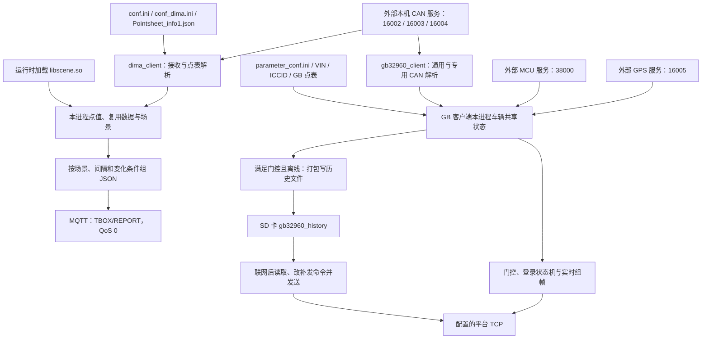

# Dima 源码分析总览

> 更新：2026-10-15。本文综合参考[RTMS SDK 源码分析总览](../源码分析总览.md)与 `electric_station_truck_cn/源码分析总览.md`，提供 Dima 两份源码报告及交接报告的导航、架构、跨应用关系、核心模块与核验结论。源码分析基线为 `rtms_sdk` 提交 `bc60961e64325d7448012097f92dc7214795a35f`；设备运行状态与交接资料结论分别说明。

## 文档目录

- [1. 分析基线与项目入口](#overview)
- [2. 文档位置与阅读方法](#documents)
- [3. 源码目录总览](#source)
- [4. 核心架构设计](#architecture)
- [5. 两个应用的实际差异](#differences)
- [6. 跨应用关键关系核验](#relationships)
- [7. 逐文档主结论复核](#conclusions)
- [8. 核心模块深度分析](#modules)
- [9. 构建与运行边界](#build)
- [10. 核验方法与版本处理](#verification)
- [11. 本轮发现与纠正记录](#changes)
- [12. 验证结果与尚缺证据](#results)

<a id="overview"></a>

## 1. 分析基线与项目入口

本目录收录迪马项目的两份应用源码分析和一份交接资料复核报告。`dima_client` 接收本机 CAN 数据，依点表和场景生成 JSON，经 MQTT 上报；`gb32960_client_for_dima` 接收 CAN、GPS、MCU 数据，组织 GB 32960 相关报文，经 TCP 上报并处理离线历史文件。两者的 `main.c` 各自启动线程和维护进程内状态，未见一个客户端必须先经过另一个客户端才能上报的调用链。

源码仓库：`/home/tronlong/lyp/code/rtms_sdk/`。两个子目录是同一 SDK 仓库中的应用，文档目录 `Dima/` 不对应独立源码仓库或独立 Git 分支。

| 报告 | 源码目录（相对 SDK 根目录） | 基线与主要用途 |
| --- | --- | --- |
| [dima_client 源码分析](dima_client/dima_client_app源码分析.md) | `apps/dima_client/` | `bc60961e`；CAN 点表、复用数据、场景与 MQTT JSON 上报 |
| [GB 32960 客户端源码分析](gb32960_client_for_dima/gb32960_client_for_dima_app源码分析.md) | `apps/gb32960_client_for_dima/` | `bc60961e`；CAN/GPS/MCU、平台 TCP 状态机、分帧与补传 |
| [重庆迪马项目交接资料复核报告](重庆迪马项目交接资料复核报告.md) | 报告记录的外部交接资料目录 | 点表、固件、测试、出货和待确认事项；不能直接归属于上述源码提交 |

两份源码报告记录的分支为 `develop/rtms_sdk_v1.3_20240408`。本轮核对时该分支 HEAD 已为 `b7323a76053e9daec26eb97af1dbba106a358918`，但两个应用子树与 `bc60961e` 完全相同；SDK 其余内容已有变化，不能把整仓视为未变。

**原 `dima_client` 报告关于 VIN 缓冲区“非静态、不能跨调用保存”的结论有误。** 本轮已从固定提交源码和最小探针核实，纠正说明见[第 11 节](#changes)。本次整理仅修改本总览，原详细报告保留原文；阅读其中 VIN 风险与排查描述时，应结合此处纠正。

<a id="documents"></a>

## 2. 文档位置与阅读方法

```text
Dima/                                      # 本文档目录
├── 源码分析总览.md                         # 总入口、应用差异与本轮核验
├── 重庆迪马项目交接资料复核报告.md         # 交接资料审查及待确认事项
├── dima_client/
│   ├── AGENTS.md                           # 项目速览
│   ├── dima_client_app源码分析.md           # MQTT 客户端详细分析
│   ├── flow_startup.png                    # 启动与线程
│   ├── flow_can.png                        # CAN 接收与解析
│   ├── flow_mqtt.png                       # MQTT 筛选与发布
│   └── flow_troubleshoot.png               # 故障定位
└── gb32960_client_for_dima/
    ├── AGENTS.md
    └── gb32960_client_for_dima_app源码分析.md
```

两份详细报告均有“项目概述、源码目录总览、核心架构设计、核心模块深度分析、关键流程与数据流”五个导读章节，再进入各自编号正文。下面完整列出两份报告的 19 个编号章节，编号仅在各自报告内有效。

| 正文序号 | dima_client | GB 32960 客户端 |
| --- | --- | --- |
| 1 | [程序边界和组成](dima_client/dima_client_app源码分析.md#analysis-1) | [项目边界和构建](gb32960_client_for_dima/gb32960_client_for_dima_app源码分析.md#analysis-1) |
| 2 | [启动和进程生命周期](dima_client/dima_client_app源码分析.md#analysis-2) | [总体流程图与启动](gb32960_client_for_dima/gb32960_client_for_dima_app源码分析.md#analysis-2) |
| 3 | [外部文件和接口](dima_client/dima_client_app源码分析.md#analysis-3) | [数据采集与共享状态](gb32960_client_for_dima/gb32960_client_for_dima_app源码分析.md#analysis-3) |
| 4 | [点表加载与内部数据结构](dima_client/dima_client_app源码分析.md#analysis-4) | [平台 TCP 状态机](gb32960_client_for_dima/gb32960_client_for_dima_app源码分析.md#analysis-4) |
| 5 | [CAN 接收、特殊报文与场景](dima_client/dima_client_app源码分析.md#analysis-5) | [报文组织与分帧](gb32960_client_for_dima/gb32960_client_for_dima_app源码分析.md#analysis-5) |
| 6 | [复用数据项](dima_client/dima_client_app源码分析.md#analysis-6) | [离线保存与历史补传](gb32960_client_for_dima/gb32960_client_for_dima_app源码分析.md#analysis-6) |
| 7 | [MQTT 发布条件与消息格式](dima_client/dima_client_app源码分析.md#analysis-7) | [配置与外部依赖清单](gb32960_client_for_dima/gb32960_client_for_dima_app源码分析.md#analysis-7) |
| 8 | [构建和部署事实](dima_client/dima_client_app源码分析.md#analysis-8) | [核查结论与验证点](gb32960_client_for_dima/gb32960_client_for_dima_app源码分析.md#analysis-8) |
| 9 | [实现边界与验证清单](dima_client/dima_client_app源码分析.md#analysis-9) | [设备故障定位](gb32960_client_for_dima/gb32960_client_for_dima_app源码分析.md#analysis-9) |
| 10 | [设备故障排查手册](dima_client/dima_client_app源码分析.md#analysis-10) | 正文至第 9 节 |

初次阅读先看本文第 1～5 节，再进入对应报告的导读与主流程；按模块查入口可直接看本文第 8 节。定位 MQTT 字段缺失先看 `dima_client` 的场景、`mtyp`、间隔和变化阈值；定位 GB 平台无数据先看 MCU/充电门控、登录状态、分帧数与发送结果。交接验收则结合资料复核报告第 10 节逐项取得证据。返回其他产品的报告导航可看[上层 SDK 总览](../源码分析总览.md)。

<a id="source"></a>

## 3. 源码目录总览

```text
rtms_sdk/                                  # 源码仓库
└── apps/
    ├── CMakeLists.txt                     # 两个应用各有独立开关，默认 OFF
    ├── dima_client/
    │   ├── CMakeLists.txt / main.c
    │   └── src/
    │       ├── can_mng/                   # 配置、共享对象、场景库加载
    │       ├── can_server/                # 三路 CAN 订阅与保留发送逻辑
    │       ├── data_process/              # 点表、特殊帧、复用项、JSON
    │       ├── mosquitto/                 # MQTT 连接与发布调度
    │       ├── scene/ / scene_lib/        # 动态加载与 judge_scene 实现
    │       └── list/                      # 链表容器
    └── gb32960_client_for_dima/
        ├── CMakeLists.txt / main.c
        └── src/
            ├── can_mng/ / can_server/     # 共享状态、CAN 订阅与活跃时间
            ├── data_process/             # 通用点表及 Dima/远锦专用解析
            ├── app_server/               # GPS 订阅、MCU 请求和状态解析
            ├── new_energy/               # GB 组帧、TCP 状态机、保存与补传
            ├── common/ / list/           # 配置、时间、文件与容器辅助
            └── scene/ / scene_lib/       # 保留实现；主流程未加载场景库
```

上述路径标明应用自己的源码职责。两个应用的同名目录分别保存各自实现，未由目录名推定它们共用同一管理对象、解析规则或配置文件。

<a id="architecture"></a>

## 4. 核心架构设计



图中两组共享状态各自在进程内，CAN/GPS/MCU 服务的生产端实现不在这两个应用目录。两者都有多线程直接访问状态的路径；GB 客户端的 `io_mutex` 用于部分历史文件操作，不能据此推定整车状态快照或 TCP 发送都受同一把锁保护。本地发布或 `send()` 成功也不等于平台业务接受。

两个应用各自构建 `scene` 目标、安装同名 `libscene.so`，但只有 `dima_client` 当前启动链调用 `load_libscene()`。同时纳入一次 CMake 配置会发生目标重名，见第 9、11～12 节；分别构建后安装到同一前缀，也须核对同名库的来源。

### 4.1 线程、启动顺序与状态边界

| 应用与入口 | 启动与职责 | 需要区分的边界 |
| --- | --- | --- |
| Dima `main.c:120–122` | 显式请求创建保活、CAN 接收、MQTT 业务三个线程 | `pthread_create()` 返回值未检查；同一个 `tid` 被覆盖，最后只 join MQTT 业务线程 |
| Dima `start_mqtt_task()` | 建立连接后调用 `mosquitto_loop_start()`，由库运行网络循环；业务线程扫描间隔列表并生成 JSON | 不能把三个显式线程当作进程运行时总线程数；网络回调、CAN 更新与发布筛选存在并发 |
| GB `main.c:80–87` | 先创建保活、CAN、本机 GPS/MCU 消息三个线程；主线程等待 10 秒，再创建实时上报、历史补传、历史保存三个线程 | 10 秒是固定等待，不检查电芯数据是否收齐；创建返回值未检查，最后只 join 历史保存线程 |
| GB `app_server.c:27–79` | 本机消息线程建立 `SIGEV_THREAD` 定时器，每 5 秒触发一次 MCU 请求回调，同时接收 GPS/MCU 响应 | 定时器回调不包含在主函数六次 `pthread_create()` 中；定时器创建或启动失败会 `exit(-1)` |
| 两边的 CAN 接收循环 | nanomsg 消息按完整 `can_frame_t` 切帧后解析；剩余不足一帧的尾部字节不进入循环 | poll 或非 `EAGAIN` 接收错误可使线程退出；保活仍可能继续，进程存在不能证明持续采集 |

上述入口分别见两个 `main.c`、Dima `src/mosquitto/client_mosquitto.c:104–172`、GB `src/app_server/app_server.c:27–123` 及两边的 `src/can_server/can_server.c`。CAN 点值与场景、GB 车辆状态及电压温度列表均有跨线程访问；当前代码未提供覆盖整个业务状态的统一快照保证。

### 4.2 典型业务路径

1. **一项 CAN 数据进入 MQTT：** 点表加载建立规则 → 三路 CAN 接收循环处理特殊帧和普通点表规则 → 场景库更新当前场景 → MQTT 业务线程扫描到期间隔 → 数据项满足场景、已接收值及变化条件 → 生成 JSON 并发布。无合格项时可以不产生载荷；构造时更新上次发布状态，后续发布失败不自动恢复这些状态。
2. **车辆进入 GB 实时上报：** CAN/GPS/MCU 更新状态 → ACC 开启或充电加 CAN 活跃度条件成立 → 解析平台域名并连接 TCP → 根据本地状态先登出或直接登录 → 登录分支收到正字节后进入 REPORT → 按周期及分帧数打包发送。`_splitFrameNum==0` 时发送循环没有帧可处理；首次 REPORT 的 `pre_timer` 未初始化，不能保证首次按严格 10 秒触发。
3. **GB 断线保存与恢复：** DNS/TCP 连接失败或实时发送失败等分支设置离线标记 → 保存线程在门控和离线条件成立时打包写文件 → 联网且离线标记清除后补传线程读取历史记录、改命令并重算 BCC → 调用发送后删除所选文件。首次连接成功但一直未收到登录正字节时，登录等待分支未主动置离线，不能把“未登录”直接等同于“必有缓存”。

<a id="differences"></a>

## 5. 两个应用的实际差异

以下比较 `bc60961e` 的活动路径。GB 列主要按 `GB32960_DEVICE_DIMA` 分支描述；远锦专用解析仍有 TODO。

| 项目 | dima_client | gb32960_client_for_dima |
| --- | --- | --- |
| 程序名 / CMake 版本 | `dima_client` / 1.5 | `gb32960_client` / 1.1 |
| SDK 顶层构建开关 | `WITH_DIMA_CLIENT=ON` | `WITH_GB32960_CLIENT_FOR_DIMA=ON` |
| 额外构建条件 | `NOT_USED_SCHEMA` 默认 ON | 必须选择 Dima 或远锦设备选项；两者默认 OFF，同时 ON 时优先 Dima |
| 本机输入 | CAN 三路 SUB | CAN 三路 SUB、GPS SUB、MCU REQ |
| 解析主线 | 点表提取、特殊软件版本/VIN、复用项组合 | 通用点表与 Dima 硬编码车辆/电池解析共同更新状态 |
| 场景库 | 启动时加载 `/usr/lib/libscene.so`，每帧调用 `judge_scene()` | 虽然构建库，初始化中的加载调用已注释 |
| 上报格式与连接 | JSON；Mosquitto 发布 `TBOX/REPORT`，QoS 0 | GB 相关二进制报文；TCP socket |
| 上报条件 | MQTT 已连接，`mtyp=0`，数据项满足场景、间隔、已接收值和变化条件 | MCU 状态存在且 ACC 开启，或充电且 `check_can_active()` 成立；再由状态机推进登录/上报 |
| 常规周期 | 点表 `scems` 与 `udif` 决定，无统一固定 10 秒周期 | 实时门限 10000 ms，三级告警 1000 ms；首次计时使用未初始化的 `pre_timer` |
| VIN 来源与输出 | TP.BAM/TP.DT `0x18ECFFEE/0x18EBFFEE` 重组，匹配时包含扩展帧标志，写应用项 `Sr0002` | 启动读取 `/opt/machine_vin`；Dima `0x18E1F3EF` 三段 VIN 更新后可写回文件 |
| 点表更新 | 保活线程发现 `st_mtime` 改变后 `exit(0)`，重启依赖外部管理器 | 当前 `main.c` 启动链未见相同的点表 mtime 监测 |
| 离线保存 | 未见当前发布链的持久化离线队列 | 门控成立且 `network_offline==1` 时保存；普通门限 9990 ms，三级告警 990 ms |
| 补传与确认 | 无当前源码定义的持久化补传保证 | 历史帧改为命令 `0x03` 发送；未等待业务确认即删除所选文件 |
| 登录/发送成功的含义 | MQTT 发布返回值不证明服务端业务收到 | 登录/登出按 `recv()>0` 推进，未完整校验应答；实时成功日志仅反映一次完整长度 `send()` 返回 |
| 保活 | 约 5 秒更新，登记超时 10 秒 | 约 10 秒更新，登记超时 20 秒 |

GB 的 `check_can_active()` 使用指定解析分支更新的时间戳，并有 15 秒判断；不是“任意 CAN 帧到达就活跃”，也不负责设置总线波特率。Dima 专用解析每帧都尝试名为 `500k` 与 `250k` 的两组函数，再由 CAN ID 分支匹配，不能仅凭函数名判断现场总线配置。

| 配置或资源 | dima_client | GB 32960 客户端 |
| --- | --- | --- |
| `/opt/conf.ini` | `dev:id` 用于 MQTT 客户端与 JSON `body.id` | 读取 `dev:id/secret`；设备 ID 用于自定义 `0x80` 数据段 |
| 远端配置 | `/opt/conf_dima.ini` 的 `remote:ip/port/username/password` | `/opt/parameter_conf.ini` 的 `server:domain/port` |
| 点表 | `/opt/Pointsheet_info1.json`；配置或点表加载失败时主函数退出 | `/opt/Pointsheet_info1_gb32960.json`；主函数未检查平台配置及点表加载返回值 |
| VIN / ICCID / 登录状态文件 | VIN 应用项来自 CAN 特殊帧；未见同类平台登录状态文件主链 | `/opt/machine_vin`、`/opt/sim_info`、`/opt/conf_loginout.ini` |
| 动态场景库 | 固定加载 `/usr/lib/libscene.so` | 当前主流程未加载 |
| 历史目录 | 未见 MQTT 主链使用同类历史目录 | `/media/sdcard/gb32960_history`；超过 5,000,000 字节轮换，启动保存线程时检查总量并按条件删除两个旧文件 |
| 定位回退与报文观察 | 无对应活动路径 | `/opt/gps_data.txt` 用于有效坐标保存与无效定位时回退；`/tmp/log_print.flag` 存在时，实时发送成功分支可打印报文十六进制 |
| 单实例资源 | `/tmp/dima_client.pid` 用于 `flock`，不写入 PID 数值 | 当前 `main.c` 未见相同的单实例锁 |

仓库里的其他设备点表样例不能代替上述设备实际文件；交接资料中的 `Pointsheet_info.json` 等名称也不能直接等同于源码要求的加载路径。应核对包内安装位置、实际点表、程序版本和平台字段映射。

### 5.1 输出协议、身份与校验

| 项目 | 源码可确认的约定 | 判断边界 |
| --- | --- | --- |
| MQTT JSON | 顶层 `body`，其中 `id` 来自 `dev:id`，`items[]` 含毫秒时间戳 `ts` 和动态点名组成的 `properties` | 时间戳来自实时时钟，调度使用单调时钟；字段集合由实际点表和当时数据决定 |
| MQTT 连接参数 | 设备 ID 作为客户端 ID，用户名和密码来自 Dima INI；连接调用传入 keepalive 30 秒，发布 QoS 0、retain=false | `mqtt_cfg.keepalive=60` 的赋值未作为实际连接参数使用；配置读取会打印凭据，本文不复制具体值 |
| GB 外层帧 | `##`、命令字、应答标志、17 字节 VIN、加密标志、两字节大端数据长度、数据体、BCC | 当前命令值为登录 `0x01`、实时 `0x02`、补发 `0x03`、登出 `0x04`；源代码布局及调用事实不等同于完整标准符合性 |
| GB 普通组包 | 当前登录、登出和实时组包调用普通 `gb4_frame_pack_full()`，加密方式写 `0x01`；BCC 对起始符后的指定区间异或 | AES128 实现虽保留，当前这些路径未调用；BCC 不提供身份认证或加密 |
| GB 身份数据 | VIN 来自本地文件及 CAN；ICCID 先读 `/opt/sim_info`，再尝试模组 API，仍为空时回退到占位串；设备 ID 进入 `0x80` 自定义段 | 占位串不能代表有效 SIM 信息；读取了 `dev:secret` 也不能单独证明平台鉴权已完成 |

GB 实时数据包含整车、电机、位置、极值、告警、电压、温度及设备 ID 等组包入口，各段有自己的数量和有效性条件；分帧时各帧内容也不同，不能默认每帧带齐全部数据。详细字段和分帧问题见 GB 报告第 5 节。

本小节依据 Dima `src/mosquitto/client_mosquitto.c:104–217`、`src/data_process/data_process.c:84–103,1483–1522`，以及 GB `main.c:52–72`、`src/new_energy/new_energy_frame_pack.h:9–20,142–167` 和同目录 `.c:27–59,113–207,1394–1423,1972–1975`。

### 5.2 点表加载与筛选前提

| 检查项 | 已核对的实现条件 |
| --- | --- |
| Dima 消息类型 | `mtyp=0` 对应 JSON；当前 MQTT 的 CBOR、JSONGZ 发布分支位于 `#if 0`，不能仅调整点表就认定这两类上报可用 |
| Dima 应用项 | `app[].nm` 必须匹配 `dima_client`；默认 `NOT_USED_SCHEMA=ON` 时，已进入解析的应用参数缺少 `cbidx` 会 `exit(-1)`；软件版本/VIN 项需配置 `Sr0001/Sr0002` |
| 通道与位提取 | 通用规则按通道、顶层 CAN ID 匹配，偏移从整个 `can_frame_t` 起算；位段经字节序、有符号解释、比例与偏移换算，再按上下限裁剪，不能直接按 CAN `data[0]` 起算全部 `ofs` |
| Dima 子规则与复用项 | 命中顶层规则后，子 `rls[]` 递归遍历未再次用 `val` 过滤；复用项引用、数量和帧数组需匹配，且 `skip_pub` 置位可能影响同列表后续项 |
| 配置容量 | `SCENE_MAX=10`、CAN 规则数组 3 路、复用单元数组 8 项等是实现中的固定容量；数组和字段长度检查不完整，应依据真实点表核对，不能把可解析 JSON 等同于业务配置有效 |

依据为 Dima `src/data_process/data_process.h:9–27` 和 `.c:307–430,745–859,1205–1332`；GB 通用解析器的位提取入口位于其 `src/data_process/data_process.c:435` 起。

<a id="relationships"></a>

## 6. 跨应用关键关系核验

本节按 SDK 总览的方式，单独列出两个应用之间容易混淆的接口和资源。表内源码路径相对 `rtms_sdk/apps/`，行号对应固定提交 `bc60961e`。接口相同只能支持代码层面的对应关系；是否同机部署、是否使用同一配置包仍需设备证据。

| 关系或边界 | 已核对的源码依据 | 对阅读与部署的影响 |
| --- | --- | --- |
| 两个客户端各自订阅同一组三路本机 CAN 端口 | `dima_client/src/can_server/can_server.h:11–13`；`gb32960_client_for_dima/src/can_server/can_server.h:9–11` 均定义 16002/16003/16004 | 是两个订阅方分别处理上游帧；未见 Dima MQTT 载荷转交 GB 客户端的主链路 |
| 同读设备 ID，各自保存和使用 | `dima_client/src/can_mng/can_mng.c:23`；`gb32960_client_for_dima/src/can_mng/can_mng.c:27` 均读取 `dev:id` | 同一设备标识可进入不同协议载荷，不表示进程共享内存或拥有相同登录状态 |
| 点表路径和应用项名称均有区别 | 两个 `main.c` 分别加载 `Pointsheet_info1.json` 与 `Pointsheet_info1_gb32960.json`；两个 `src/data_process/data_process.c:312 / 141` 分别匹配 `app[].nm` 为 `dima_client` / `can_client` | 通用 CAN 规则与应用层参数要分别核对；直接复制点表或仅改文件名，不能保证应用项被加载 |
| 场景库的构建、安装和活动调用不同 | 两个 `CMakeLists.txt:48 / 54` 声明 `scene`；`dima_client/src/can_mng/can_mng.c:96` 调用加载，GB 对应文件第 104 行注释该调用 | 同时构建有目标冲突；安装同名库需确认来源，GB 构建了库也不表示启动后使用场景筛选 |
| 远端出口各自建立连接 | `dima_client/main.c:122` 启动 MQTT 任务，`src/mosquitto/client_mosquitto.c:104–254` 负责连接和发布；GB `main.c:85` 启动 `gb32960_data_report()` | MQTT Broker 与 GB TCP 平台应分别排查；一条链路连接正常不证明另一条也正常 |
| 两边的发送成功均需平台证据补足 | Dima 构造 JSON 后以 QoS 0 发布；GB 补传发送返回值未控制文件删除，见各报告发布与补传章节 | 核对同一时间段的输入、载荷、发送记录及服务端接收，不能用一侧成功日志代替另一侧结果 |

<a id="conclusions"></a>

## 7. 逐文档主结论复核

下表把每份文档的核心结论、证据和待确认项放在一起。源码报告按固定提交核验；交接报告本轮只核对其正文记载与结论边界，没有复查外部原件。

| 文档 | 主结论与证据 | 阅读时须保留的边界 |
| --- | --- | --- |
| [dima_client 源码分析](dima_client/dima_client_app源码分析.md) | `main.c` 启动 CAN、MQTT 和保活线程；`src/can_mng/can_mng.c:83–98` 加载场景库但忽略结果；发布链只启用 JSON。VIN 静态缓冲及后续会话问题已由最小探针复核，详见本文第 11～12 节 | 点表、场景库、原始帧和 Broker 接收尚需设备证据；原报告关于“VIN 缓冲不跨调用保存”的推断应按本文纠正 |
| [GB 32960 客户端源码分析](gb32960_client_for_dima/gb32960_client_for_dima_app源码分析.md) | 采集 CAN/GPS/MCU 后由 TCP 状态机上报；`src/new_energy/gb32960.c:987–1139` 的发送结果与业务确认未控制历史文件删除；双分帧首帧长度问题有静态源码依据 | 已链接 Mosquitto 或存在场景库不证明主上报使用它们；平台接受、分帧实际影响和补传丢数范围尚未实机验证 |
| [交接资料复核报告](重庆迪马项目交接资料复核报告.md) | 正文整理点表和固件版本差异、测试证据缺口、设备记录及联网问题；第 10 节列出交接确认清单，第 11 节说明原审查范围 | 报告记载的后续固件合并、文件数量及哈希不等于本轮重新核实；需建立原件、发布包、源码提交和设备批次之间的对应关系 |

<a id="modules"></a>

## 8. 核心模块深度分析

本节提供从业务问题进入函数和详细章节的入口，源码路径相对各自应用目录。具体字段、信号单位和错误分支仍以详细报告及固定提交源码为准。

| 模块 | 核心入口与关键判断 | 深入阅读 |
| --- | --- | --- |
| 初始化、配置与进程生命周期 | 两个 `main.c`、`src/can_mng/can_mng.c`；Dima 检查配置和点表加载结果，GB 主函数未完整检查；保活间隔、mtime 退出机制也不同 | [Dima 启动](dima_client/dima_client_app源码分析.md#analysis-2)、[GB 启动](gb32960_client_for_dima/gb32960_client_for_dima_app源码分析.md#analysis-2) |
| CAN 接收与通用点表 | `start_can_server()` → `parse_common_msg()`；`load_pointsheet_json()` 建立通道规则。位提取输入是整个 `can_frame_t`，应用项匹配名分别为 `dima_client` 和 `can_client` | [Dima 点表](dima_client/dima_client_app源码分析.md#analysis-4)、[GB 采集](gb32960_client_for_dima/gb32960_client_for_dima_app源码分析.md#analysis-3) |
| Dima 场景、特殊帧与复用项 | `load_libscene()`、`judge_scene()`、`parse_special_msg()`、`set_multiplex_data_item()`；场景和复用关系影响发布，VIN 会话问题按本文纠正说明阅读 | [CAN 与场景](dima_client/dima_client_app源码分析.md#analysis-5)、[复用数据项](dima_client/dima_client_app源码分析.md#analysis-6) |
| MQTT 筛选与 JSON 输出 | `start_mqtt_task()`、`json_work_data_generate()`、`check_data_item_value_json()`；依 `mtyp`、场景、间隔和变化条件生成数据，构造时更新本地上次发布状态 | [MQTT 条件和格式](dima_client/dima_client_app源码分析.md#analysis-7) |
| GB 专用采集与运行门控 | `parse_500k_vehicle_data_msg()`、`parse_250k_vehicle_data_msg()`、`app_msg_task()`；CAN、GPS 和 MCU 更新状态，ACC 或充电加活跃度决定连接及保存门控 | [GB 数据采集](gb32960_client_for_dima/gb32960_client_for_dima_app源码分析.md#analysis-3)、[TCP 状态机](gb32960_client_for_dima/gb32960_client_for_dima_app源码分析.md#analysis-4) |
| GB 登录、组帧与分帧 | `gb32960_data_report()`、`gb4_frame_pack_real_data()`；本地登录状态、应答读取、告警周期和电芯数影响发送，分帧逐分支核对长度与复制 | [状态机](gb32960_client_for_dima/gb32960_client_for_dima_app源码分析.md#analysis-4)、[报文与分帧](gb32960_client_for_dima/gb32960_client_for_dima_app源码分析.md#analysis-5) |
| GB 离线保存与历史补传 | `pthread_save_history_data()`、`history_data_to_transparent()`、`read_history_file_to_sent_loop()`；门控、离线标记、文件写入、发送与删除分别检查 | [离线保存和补传](gb32960_client_for_dima/gb32960_client_for_dima_app源码分析.md#analysis-6) |
| 现场故障取证 | 对齐程序和配置版本、输入帧、进程状态、发送载荷及服务端记录，按相应报告的症状表逐段缩小范围 | [Dima 排查](dima_client/dima_client_app源码分析.md#analysis-10)、[GB 排查](gb32960_client_for_dima/gb32960_client_for_dima_app源码分析.md#analysis-9) |

### 8.1 常见现象的最短定位路径

| 现象 | 先检查什么 | 深入入口 |
| --- | --- | --- |
| Dima 进程退出或收到 CAN 后异常 | INI、点表、默认宏下的 `cbidx`、场景库加载日志、mtime 退出日志与外部守护器 | Dima 报告第 2、4、9～10 节；VIN 问题结合本文第 11 节 |
| Dima MQTT 已连接但不发布 | `mtyp=0`、CAN 规则是否命中、已接收值、当前场景、`scems`、`udif` 与复用项排列 | Dima 报告第 4～7、10 节 |
| GB 一直不连接或不登录 | 平台 INI、DNS/TCP、MCU 的 ACC 状态，或充电与指定 CAN 活跃度条件；核对本地登录状态 | GB 报告第 4、7、9 节 |
| GB 登录后无帧、缺字段或分帧异常 | `_splitFrameNum`、电芯/温探数、组包返回长度、告警周期；双分帧首帧另外检查长度与复制问题 | GB 报告第 3～5、9 节 |
| 历史目录清空但平台缺数据 | 保存触发条件、原始历史文件、读取长度、发送返回值、删除时间及平台接收记录 | GB 报告第 6、9 节；目录清空本身不证明补传成功 |
| 源码行为与交接说明不同 | 运行二进制、点表和共享库哈希、构建选项、发布包说明与 Git 提交对应关系 | 本文第 9～12 节及交接报告第 10～11 节 |

<a id="build"></a>

## 9. 构建与运行边界

顶层选项决定应用是否进入构建，应用 CMake 决定目标与宏，安装文件和设备启动配置再决定运行内容。应分别记录每个阶段，避免把源码中存在的功能直接当作现场能力。

| 阶段 | 已确认条件 | 仍需核对 |
| --- | --- | --- |
| 顶层应用选择 | 两个应用开关默认 OFF；GB 还要求选择 Dima 或远锦设备宏 | 实际 CMakeCache、构建命令及镜像采用的目标 |
| 两应用联合构建 | 当前两个目录都声明 `scene`，同时加入一次配置会报重名；分别配置时应关闭另一个应用选项 | 若需联合构建，先解决目标命名和同名库安装；当前结构不能直接视为双应用构建方案 |
| 目标平台与依赖 | 两目录 CMake 最低版本 3.11、C99；交叉编译分支识别 EC200A、EG25G、MCIMX6Y2CVM08AB，并声明 nanomsg、cJSON、Mosquitto 等依赖 | 工具链、SDK 头文件、库版本和链接结果；平台分支存在不代表已编译验证 |
| 安装与场景库 | 可执行文件分别安装到前缀下 `usr/bin`，两边都安装 `libscene.so`；Dima 运行时固定加载 `/usr/lib/libscene.so` | 安装前缀与设备路径、同名库来源和 `judge_scene` 符号；加载失败的返回值处理不完整 |
| 设备服务与文件 | 两边都依赖 CAN 本机服务；GB 另依赖 GPS/MCU 服务和历史目录；点表与远端配置各有固定路径 | 服务启动顺序、文件权限、真实点表内容、SD 卡挂载及设备守护配置 |
| 启动与上报结果 | Dima 有文件锁和点表 mtime 退出路径；GB 由 ACC/充电门控和登录状态机驱动 | 实际运行二进制、进程重启策略、平台业务接收与故障恢复结果 |

源码分支或交接固件包变化后，应重新确认这条构建与运行链，再复用本文模块关系和排查结论。

<a id="verification"></a>

## 10. 核验方法与版本处理

本轮阅读两份参考总览、本目录两份 `AGENTS.md`、两份源码分析及交接报告，再对照本地 SDK。首次参照换电总览建立报告入口、应用差异与验证记录；补充参照 SDK 总览，把核心架构独立成节，增加跨应用关系、逐文档结论、模块入口与构建运行边界。新增关系再次以固定提交的端口、配置读取、点表应用名、CMake 和主入口核对，没有仅按参考文档照搬结论。

通过 `git show bc60961e:<路径>` 固定读取关键实现，并以应用子树对象和提交差异核对当前检出文件的可复用范围；没有切换分支或访问远端。

```sh
git -C /home/tronlong/lyp/code/rtms_sdk rev-parse bc60961e HEAD
git -C /home/tronlong/lyp/code/rtms_sdk ls-tree bc60961e apps/dima_client apps/gb32960_client_for_dima
git -C /home/tronlong/lyp/code/rtms_sdk ls-tree HEAD apps/dima_client apps/gb32960_client_for_dima
git -C /home/tronlong/lyp/code/rtms_sdk diff bc60961e HEAD -- apps/dima_client apps/gb32960_client_for_dima
git -C /home/tronlong/lyp/code/rtms_sdk diff bc60961e HEAD -- apps/CMakeLists.txt
git -C /home/tronlong/lyp/code/rtms_sdk show bc60961e:apps/dima_client/src/data_process/data_process.c
```

| 应用子树 | `bc60961e` 与本轮 HEAD 的共同 Git tree ID |
| --- | --- |
| `apps/dima_client/` | `14ea3280bce8ef7ec94a661c62d0af473fa33282` |
| `apps/gb32960_client_for_dima/` | `8281e0dbffe0795caffa1eee561d70d2106a59c9` |

这只说明两个应用目录的已提交内容一致。顶层 `apps/CMakeLists.txt` 已有其他应用增补等变化；本轮另核对的两个应用开关仍默认 OFF。SDK 公共库、工具链、设备点表或固件二进制是否对应该基线，不能由应用子树哈希单独证明。

下表行号均相对固定提交 `bc60961e64325d7448012097f92dc7214795a35f`；后续源码变动时应按提交重新定位。

| 核查内容 | 固定提交中的源码定位 |
| --- | --- |
| 两个应用的构建入口、版本与重名库 | `apps/CMakeLists.txt`；`apps/dima_client/CMakeLists.txt:1–77`；`apps/gb32960_client_for_dima/CMakeLists.txt:1–83` |
| Dima 启动、点表检查、mtime 与保活 | `apps/dima_client/main.c:21–129` |
| 场景库加载与调用 | `apps/dima_client/src/can_mng/can_mng.c:83–98`；`src/scene/scene.c:7–43`；`src/can_server/can_server.c:31–40`（后两项同属该应用） |
| Dima VIN 缓冲、包条件与应用项写入 | `apps/dima_client/src/data_process/data_process.c:967–1028` |
| 复用来源项连带跳过、JSON 筛选 | `apps/dima_client/src/data_process/data_process.c:1205–1332` |
| 活动 MQTT 发布分支与主题 | `apps/dima_client/src/mosquitto/client_mosquitto.c:176–240`；同目录 `client_mosquitto.h:4–12` |
| GB 初始化、采集及线程启动 | `apps/gb32960_client_for_dima/main.c:31–90`；该应用 `src/can_server/`、`src/app_server/` |
| GB 设备解析与门控 | `apps/gb32960_client_for_dima/src/data_process/dima_data_process.c:8–22,49–732`；同目录 `yuanjin_data_process.c:27–39` |
| TCP 登录、上报与首轮计时 | `apps/gb32960_client_for_dima/src/new_energy/gb32960.c:1321–1498` |
| 历史写入、补传和删除 | 同应用 `src/new_energy/gb32960.c:846–1139` |
| 双分帧首帧长度与复制 | 同应用 `src/new_energy/new_energy_frame_pack.c:1606–1645` |
| MCU 定时请求及附加回调 | `apps/gb32960_client_for_dima/src/app_server/app_server.c:27–79` |
| MQTT JSON 结构与时间戳 | `apps/dima_client/src/data_process/data_process.c:84–103,1483–1522` |
| 点表应用项的默认宏要求 | `apps/dima_client/src/data_process/data_process.c:307–430`，其中第 414～419 行读取 `cbidx` 并在缺失时退出 |
| 普通 GB 帧与校验区间 | `apps/gb32960_client_for_dima/src/new_energy/new_energy_frame_pack.c:27–59`；同目录 `.h:142–167` |

交接报告记录的原件目录为 `D:\Work\Everyday\1Aproblem\Chongqing_Dima`。本轮读取了该报告，没有重新取得和逐项复核其原始 Word、Excel、镜像、CAN 日志与 PCAP。因此其中的数量、哈希、固件合并记录和联网现象均应作为“交接报告记载”阅读，不作为本轮独立复验结果。

<a id="changes"></a>

## 11. 本轮发现与纠正记录

| 范围 | 本轮核验后的结论 |
| --- | --- |
| 文档组织 | 综合两份参考总览扩充为十二节，保留目录树、架构图、应用差异和验证记录，补充跨应用关系、逐文档主结论、函数入口与详细章节链接、构建运行边界 |
| 完整性复核补充 | 两份源码报告的 19 个编号章节均列入跳转表；补线程启动顺序、典型业务路径、协议和身份、点表加载前提、故障入口与对应源码证据 |
| 点表应用名差异 | 固定提交中，Dima 通用解析器匹配 `app[].nm=dima_client`，GB 通用解析器匹配 `app[].nm=can_client`；不能只按程序名猜测应用项名称，详见第 6 节 |
| 源码版本 | 原报告基线仍为 `bc60961e`；本轮 HEAD 为 `b7323a76`，两个应用子树相同；不声称整仓、设备或发布包相同 |
| 原报告 VIN 结论纠正 | `dima_client` 的 `curr_vin[18]` 实际声明为 `static`（源码第 975 行），可跨调用保留。原报告第 5 节、第 9 节及第 10 节相关排查表中的“局部缓冲不能跨调用保存”推断不成立；本轮最小探针确认首次按序三帧可以组合出完整 VIN |
| VIN 的实际剩余问题 | 新 BAM 到达时未清理 `curr_vin`，也没有已收包位图等完整会话校验；曾收齐一组后，下一组只收到第 1 包也可能产生新旧内容混合的 17 字节字符串并调用应用项写入。已由最小探针确认该输入序列；未验证实际点表和平台输出 |
| 两应用同时构建 | 两个 CMake 文件分别在第 48、54 行创建同名 `scene` 目标；隔离配置确认第二次声明报错。应分别使用构建目录，或先修改目标命名与安装规则再讨论合并构建；本轮未改源码 |
| Dima 场景库与复用项 | 加载返回值未向上检查、接收处直接调用函数指针；`skip_pub` 在数据项循环外初始化，置位后可跳过同列表后续项。均有源码依据，未在设备复现 |
| GB 分帧问题 | `splitTotal==2` 的首帧长度计入告警段和一次电压段，复制却遗漏告警、重复电压；固定提交的真实结构与长度公式主机探针得到电压段 412 字节、告警段 10 字节，复制比计入长度多 402 字节。保留原报告的长度问题结论；尚未执行实际组包函数的 ASan 或设备验证 |
| GB 补传可靠性 | 历史读取正文只检查 `rc>0`，发送返回值未作为成功条件，外层删除文件未等待业务确认。保留“可能丢失尚未可靠送达数据”的结论，不把目录清空当作平台已收到 |
| 交接版本关系 | 交接报告记载部分后续固件说明有客户端合并等变化，当前分析基线仍含两个独立入口；未建立发布包到 Git 提交的对应关系，不能用这些说明替换当前源码事实 |

VIN 的跨会话、丢包、乱序、多通道交错及应用项更新仍需分别验证。探针中的应用项写入使用记录替身，实际 `Sr0002` 是否存在、能否按点表发布仍需单独核对。

本次工作新增并继续完善本文，未改写两份原分析、子目录项目说明、交接报告及两份参考总览，也未修复或部署设备程序。

<a id="results"></a>

## 12. 验证结果与尚缺证据

以下为本轮实际完成的核验；静态检查、主机探针与设备验证分别列明。

| 项目 | 方法与结果 | 适用范围 |
| --- | --- | --- |
| 应用版本比对 | 固定提交与 HEAD 的两个 tree ID 一致，针对两个应用目录的 `git diff` 为空 | 证明应用目录已提交内容一致；不证明 SDK 其他部分和设备版本一致 |
| VIN 首次按序输入 | 从固定提交直接抽取实际 `parse_special_msg()` 及 `can_frame_t`，以主机 C99 编译；输入 BAM 与 DT 1/2/3，捕获到一次完整的 `123456789ABCDEFGH`，断言通过 | 验证该输入下跨调用保存和重组成立；未运行完整点表解析器 |
| VIN 后续会话 | 同一进程再输入新 BAM 和下一 VIN `ABCDEFGH123456789` 的 DT1，捕获到混合值 `ABCDEFG89ABCDEFGH`，断言通过 | 确认旧缓冲参与新组拼接且提前写入；不代表已在真实设备发生 |
| CMake 目标重名 | 用临时父工程加入两个原始应用目录，替代 `find_package()` 跳过外部依赖发现，选择 Dima 宏；配置阶段按预期失败，报 `scene` 目标已存在 | 仅隔离验证目标声明冲突；未证明单独应用可完成 SDK 配置或编译 |
| GB 结构与分帧长度 | 使用固定提交的真实头文件编译主机布局探针，测得外层帧固定开销 25 字节、实时数据时间头 6 字节；双分帧首帧电压段 412、告警段 10，差值 402，断言通过 | 只验证本机布局和真实源码长度公式；未运行实际组包函数或 ASan |
| CAN 帧偏移 | 从固定提交抽取实际 `can_frame_t`，同一布局探针测得结构 20 字节、`data` 偏移 8 字节，断言通过 | 为整个结构体起算的位偏移提供主机证据；设备端 ABI 仍须另核 |
| 补传与删除 | 逐项对照读取条件、发送返回值、退出条件和删除调用 | 静态源码核验；未进行网络故障注入或设备测试 |
| 新增跨应用关系 | 再次从固定提交核对三路 CAN 端口、设备 ID 配置键、点表应用名、场景库声明和调用、主线程启动入口 | 证明源码中的对应关系；未验证两应用实际同机部署 |
| 逐项源码复核 | 固定提交的 16 个文件中，115 处关键源码标记与行号断言通过；另检查 20 处写明完整路径的源码行号区间均在文件范围内 | 检查入口、宏、字段、调用、条件及引用位置；未穷举全部业务输入 |
| 文档完整性 | 两份源码报告 19 个编号章节均有跳转；本总览及两份源码报告合计 104 处本地链接与锚点（含 4 张图片）有效；十二节编号、代码围栏和表格结构检查通过 | 核对文档覆盖及结构；未进行 Markdown 阅读器的页面截图检查 |

VIN 探针编译同时报告未使用的 `can_port` 参数和非 `void` 函数末尾无返回值警告；探针及当前调用方均不使用该返回值。临时探针位于 `/tmp/dima_overview_verify_kj3w4vy8/`，包含 `vin_probe.c`、隔离 CMake 工程及 `layout_check/` 中的布局探针；它们是本轮验证材料，不是部署产物。

完整性核验以总览的导航范围和上述关键实现结论为界；两份详细报告中的全部信号位、缩放系数、所有配置输入及每条异常路径，本轮没有逐项重新运行或穷举验证。原 `dima_client` 报告的 VIN 错误推断仍保留在原文，本文已在入口、逐文档复核和第 11 节明确纠正。

尚未完成的验证及所需证据：

- **完整目标构建：** 匹配的 EC200A、EG25G 或 MCIMX6Y2CVM08AB 工具链、SDK 头文件和依赖库；分别核对两个应用的配置、链接与安装结果。CMake 识别平台选项不代表所有平台已经可构建。
- **设备配置与点表：** 实际 INI、两个固定路径的点表、场景库、二进制哈希与构建宏，重点确认 `mtyp`、应用名、`Sr0001/Sr0002`、复用字段和位偏移。源码中的偏移按整个 `can_frame_t` 起算，不能直接当作 CAN 数据区偏移。
- **端到端行为：** 同一时间窗口的原始 CAN、GPS、MCU 状态、客户端载荷或 TCP 报文以及平台接收记录，验证场景、缩放、告警周期、分帧与实际业务接受。
- **离线与并发：** 断网前后历史文件、发送返回值、平台补发记录及高负载字节流，验证保存门控、半记录读取、删除时机和共享 socket 的发送行为。
- **交接闭环：** 经批准的生产点表与固件包、包到源码提交和设备批次的映射、平台字段约定，以及交接报告所述 2026-09 联网问题的根因、修复版本和复测证据。

本轮没有连接真实设备或平台，没有执行固件升级或修改生产配置；完整标准符合性、现场运行版本和长期稳定性仍需上述证据支持。
