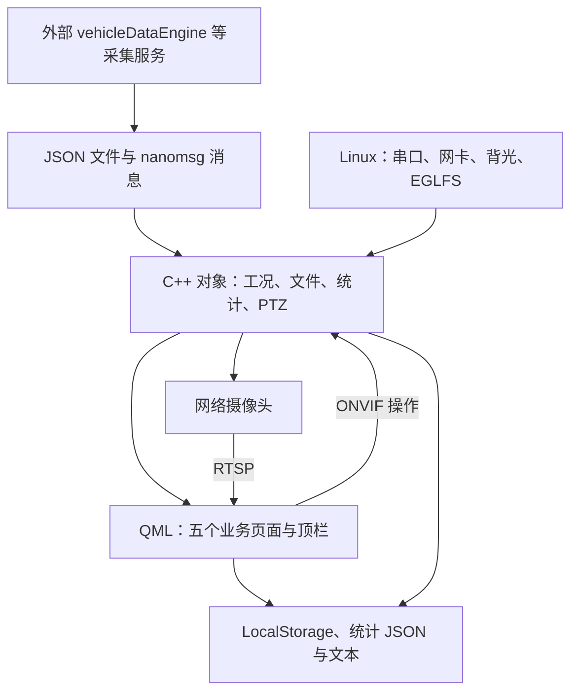
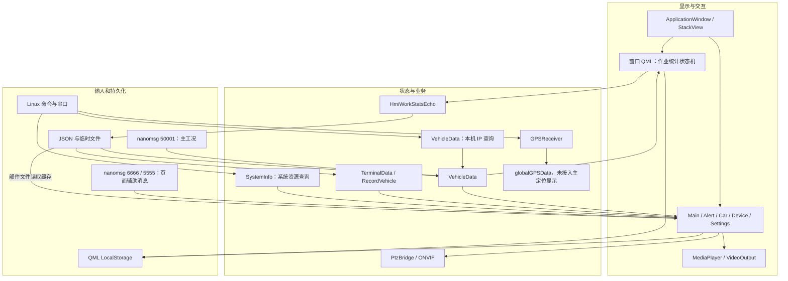
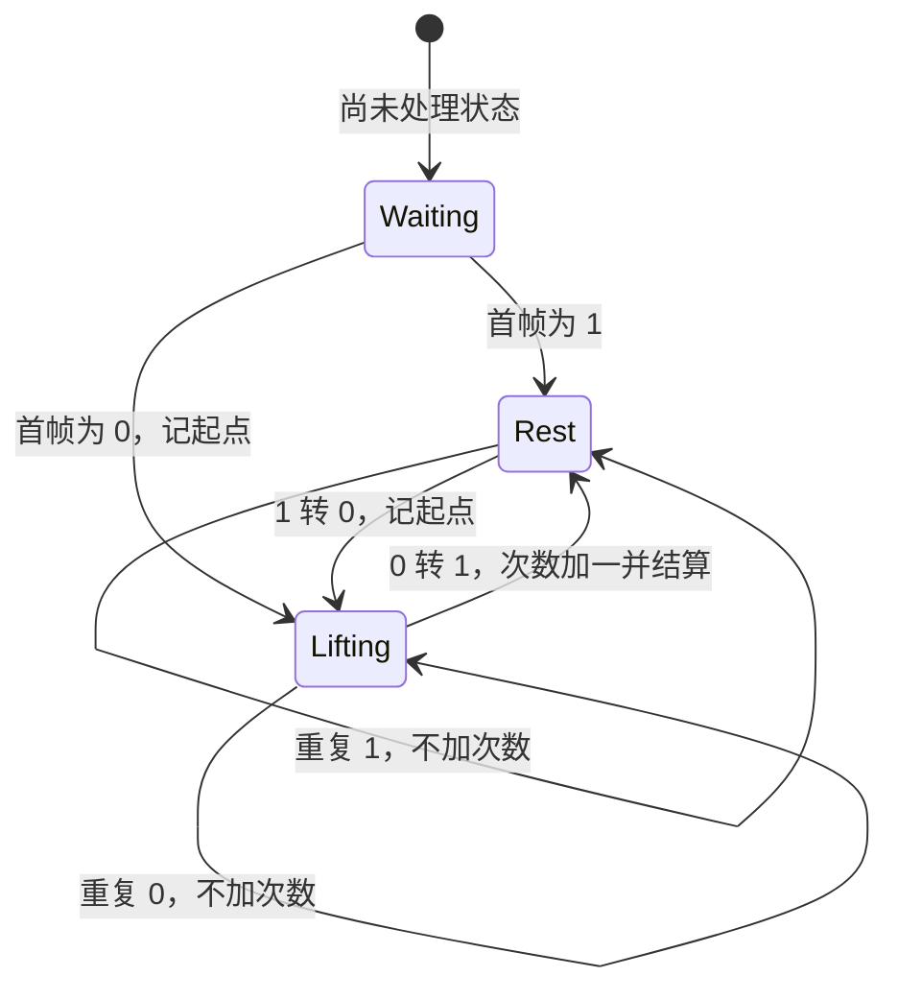
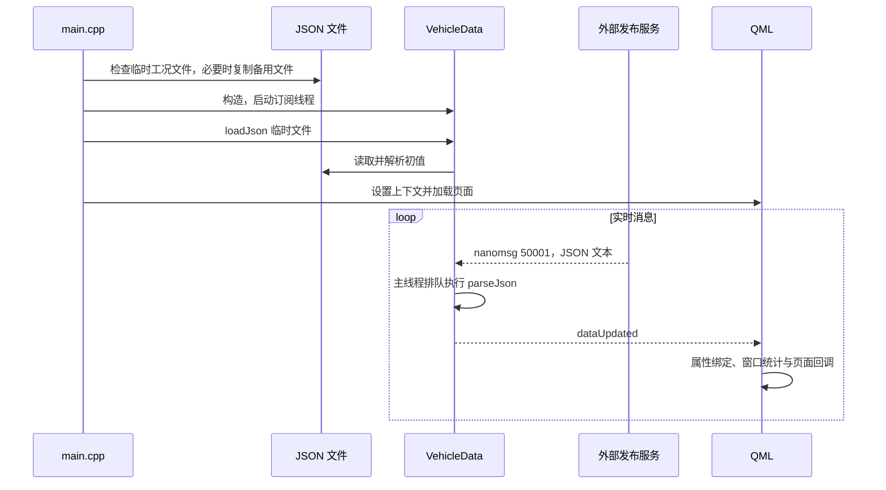
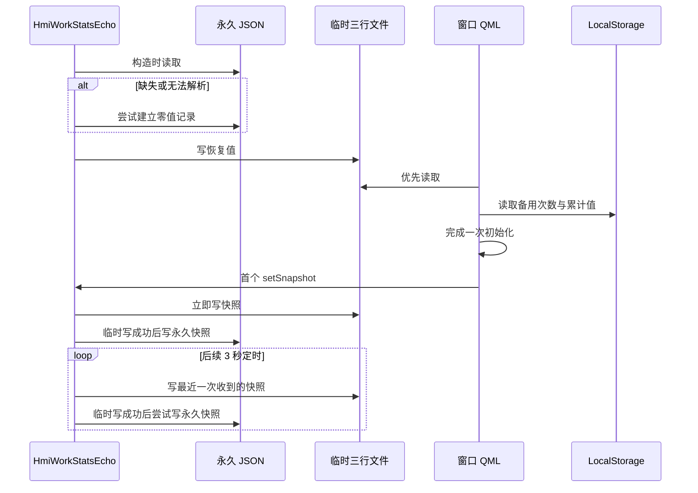
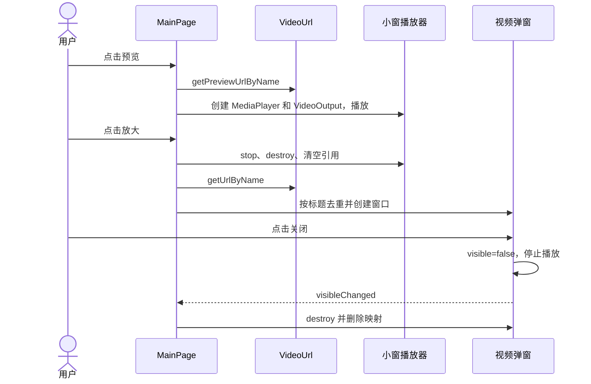

# doubiche_car_fei_3d 仓库深度分析报告

> 分析与源码核验时间：2026 年 10 月 15 日。
> 核验源码：`/home/tronlong/lyp/code/doubiche_car_fei_3d`。
> 结构参考：[mpc-base 仓库深度分析报告](/home/tronlong/lyp/perCode/idevelop_md/meari/mpc-base/mpc-base分析报告.md)。
> 报告保存于文档工作区；源码、文档和设备部署目录分别管理。本文以源码静态分析为主，并对窗口统计 JavaScript 做了隔离函数验证；未执行完整编译或板端运行。

### 阅读导航

初次了解项目，可先读第一、四、七章；开发时查第五、八、九章；排障与评审重点看第十至十二章。第九章的长表是查询用的接口字典，不必按顺序通读。

| 章节 | 主要解决的问题 |
| --- | --- |
| [一、仓库概述](#一仓库概述) | 应用做什么，哪些功能已经接入 |
| [二、支持平台](#二支持平台) | 目标架构、Qt 和工具链有哪些证据 |
| [三、目录结构总览](#三目录结构总览) | 代码在哪里，哪些是历史文件或产物 |
| [四、核心架构设计](#四核心架构设计) | 对象怎样装配，线程和页面怎样协作 |
| [五、核心模块深度解析](#五核心模块深度解析) | 工况、统计、视频、云台等如何实现 |
| [六、工具库详解](#六工具库详解) | 文件、系统命令、数据库和第三方库怎样使用 |
| [七、关键数据流分析](#七关键数据流分析) | 消息从哪里来，经过什么处理，最后写到哪里 |
| [八、编译构建体系](#八编译构建体系) | 怎样准备构建和部署，哪些条件尚缺 |
| [九、接口设计规范](#九接口设计规范) | 查询属性、字段、状态码、配置和数据库结构 |
| [十、安全与加密](#十安全与加密) | 凭据、权限、输入和持久化有什么边界 |
| [十一、典型使用场景](#十一典型使用场景) | 开发验证场景，以及按故障现象逐步排查、判读和验收 |
| [十二、总结](#十二总结) | 维护优先级、核查结果与待验证项 |

本报告用三种表述区分证据：“源码可确认”指能定位到当前代码；“存在风险/可能”指根据实现推断的影响；“需板端验证”指需要实际运行才能判断。后两者不作为已经发生的故障结论。

---

## 一、仓库概述

`doubiche_car_fei_3d` 是一套面向海德馨车辆的 **Qt Quick/C++ 车载人机界面应用**。程序名为 `car_fei`，主窗口标题为“车载物联网智能终端”，界面组织为主界面、告警、车辆、终端和设置五个页面。

它把车辆工况、动作状态、环境数据、网络状态、作业次数与时长、车辆档案和视频集中展示，并提供维保录入、部分本地参数设置和摄像头云台操作。采集服务、摄像头、操作系统和显示驱动共同组成完整设备，当前目录主要负责终端显示和交互。

### 术语速查

| 术语 | 本报告中的含义 |
| --- | --- |
| HMI / QML | HMI 是人机界面；QML 是本项目描述界面和交互的语言 |
| QObject / 属性通知 | Qt 对象及其数据绑定机制；C++ 发通知后，QML 可更新绑定值 |
| nanomsg PUB/SUB | 消息发布/订阅通信；虽使用 TCP 地址，但有自己的协议 |
| RTSP / ONVIF / PTZ | RTSP 用于视频取流；ONVIF 用于摄像头控制；PTZ 指转动、俯仰和变焦 |
| LocalStorage / SQLite | QML 本地数据库接口及底层数据库；数据库名不是源码文件名 |
| QRC / EGLFS / DRM | QRC 是 Qt 资源打包；EGLFS 是 Qt 全屏显示插件；DRM 是 Linux 显示管理的一部分 |
| ABI / 单调时钟 | ABI 决定二进制接口兼容性；单调时钟用于计时，不随人工校时或 NTP 墙钟跳变 |

### 核心定位



该图表示职责关系，不表示所有数据必须经过同一 C++ 通道。主工况由 VehicleData 接收，而 MainPage 和 DevicePage 另有 QML 实例化的 nanomsg 订阅；DevicePage 还读取 `/tmp/SensorStatus`，但当前未见控件消费其缓存对象。视频交给 Qt Multimedia 播放，不经过 VehicleData。

### 当前快照规模

| 项目 | 静态核查结果 |
| --- | --- |
| 主工程 | `car_fei.pro`，qmake 工程 |
| 主工程 C++ 源文件 | 14 个，共 2713 行，含空行和注释 |
| 主工程项目头文件 | 17 个，共 1161 行，不含厂商 HCNetSDK.h 与生成文件 |
| 全目录 QML | 18 个，其中 HMI 目录 15 个，包含备用页面 |
| JavaScript | 5 个，其中 4 个在 HMI 下，根目录另有旧告警脚本 |
| VehicleData 公开属性 | 96 个 Q_PROPERTY：4 个聚合属性、92 个标量属性 |
| QRC 资源引用 | 66 项：15 个 QML、4 个 JS，其余为图像和字体；引用均存在 |
| JSON 文件 | 11 个，均可解析；包含 8 个 data 文件及根目录 3 个配置/样例 |
| 测试与 CI | 未发现测试入口、CI 配置、README 或构建/部署 shell 脚本 |
| 版本依据 | 源码目录无可用 Git 元数据，不能关联到具体 commit 或发布标签 |

规模按当前实际文件统计；生成的 `moc_*.cpp`、约百 MB 的 `qrc_qml.cpp`、SDK 头文件和目标文件不计作自主业务代码。主工程源清单见 [car_fei.pro:20](/home/tronlong/lyp/code/doubiche_car_fei_3d/car_fei.pro:20)。

### 功能参与边界

| 功能 | 当前证据与边界 |
| --- | --- |
| 实时工况展示 | 已接入 50001 nanomsg 订阅和 QML 属性更新；外部发布者不在本目录 |
| 作业统计 | 窗口层按起升→降落计算，C++ 导出与持久化 |
| 视频预览 | 当前主页只显示一路“车前”；配置解析保留六个方向名的映射 |
| ONVIF 云台 | 当前主页按钮接入；同步请求可能阻塞 UI |
| 海康 SDK 云台 | 源码参与编译和链接，但 main.cpp 的实例化/登录路径在 #if 0 中 |
| 告警检测与记录 | 存储和查询实现存在；C++ 阈值检测函数未发现活动调用，不能认定告警自动生成闭环完整 |
| 参数设置 | 多数保存到本地数据库；未发现阈值和定位开关自动下发采集服务的路径 |
| CAN/Modbus 采集 | 存在样例配置，当前主程序未发现直接消费；真实采集需外部组件 |
| “3D”效果 | 有二维图片与粒子组件；未发现可据以认定主程序使用 Qt Quick 3D 的模型/渲染链 |

---

## 二、支持平台

### 2.1 已确认的平台与工具链线索

| 维度 | 确认结果 | 证据解释 |
| --- | --- | --- |
| 操作系统 | 面向 Linux | /proc、sysfs、串口、popen、shell、pthread 和 EGLFS 运行线索 |
| 保存的程序架构 | ARM64 / AArch64 | `file car_fei` 显示 ELF 64-bit、ARM aarch64、动态链接 |
| 厂商库样本 | ARM64 | libhcnetsdk.so、libssl.so.1.1 的 file 结果与程序一致 |
| 历史 Qt 环境 | Qt 6.5.3，qmake 3.1 | 保存的 Makefile 顶部及 Qt6 库路径 |
| 历史编译器环境 | GCC 13.3，默认 C++17 | .qmake.stash 中的编译器宏和 ARM64 搜索目录 |
| 图形格式请求 | OpenGL ES 3.2 | main.cpp 的 QSurfaceFormat 设置，不等于硬件已验证支持 |
| 主窗口设计尺寸 | 1280 × 800 | main.qml 的 ApplicationWindow |
| 既有部署位置 | /root/car_fei_3d | 档案、图片、字体和统计文件多处使用绝对路径 |

依据：[Makefile:1](/home/tronlong/lyp/code/doubiche_car_fei_3d/Makefile:1)、[.qmake.stash:1](/home/tronlong/lyp/code/doubiche_car_fei_3d/.qmake.stash:1)、[main.cpp:240](/home/tronlong/lyp/code/doubiche_car_fei_3d/main.cpp:240)、[main.qml:8](/home/tronlong/lyp/code/doubiche_car_fei_3d/main.qml:8)。

这些证据能说明保存产物的目标架构和一套历史开发环境，不能确认所有部署设备使用同一 SoC、同一固件或相同 Qt 插件。旧路径含 rk356x/rk3568 字样，也不足以证明当前运行板卡型号。

### 2.2 Qt 版本与标准的实际关系

- 主视频页面导入 `QtMultimedia 6.0`，而基础控件仍大量使用 QtQuick/Controls 2.14、2.15 导入号，不能仅按 2.x 导入号将项目认定为 Qt 5。
- `car_fei.pro` 声明 c++11，但保存的 Qt6 工程实际来自默认 C++17 的工具链。独立复现时需要核查 Qt、编译器和有效编译参数，而不是只照搬 c++11 文本。
- `.pro` 中的 `CONFIG += static` 与保存程序实际动态链接并存，不代表已得到静态可执行文件。
- `only_video_main.qml` 的 QtMultimedia 5.15 和旧 GStreamer 工程属于历史路径，不能代表主工程当前兼容 Qt 5。

### 2.3 当前分析环境的限制

当前环境未找到 qmake、qmake6、qmllint、qmlformat、rcc，也未发现保存 Makefile 指向的 `/usr/local/Qt-6.5.3` 安装。本报告核验了文件、配置、链接指向和调用关系，未取得 ARM64 编译、媒体播放、EGLFS、摄像头或串口运行结果。

---

## 三、目录结构总览

```text
doubiche_car_fei_3d/
├── car_fei.pro                       # 当前主工程
├── main.cpp                         # 应用入口和对象装配
├── main.qml                         # 窗口、导航、全局作业统计
├── VehicleData.h/.cpp                # 工况结构、解析和状态订阅
├── HmiWorkStatsEcho.h/.cpp           # 时钟、统计导出和恢复
├── CppNanoMsg.h/.cpp                 # QML 的 nanomsg 封装
├── VideoUrl.h/.cpp                   # 视频源和预览 URL
├── PtzBridge.h/.cpp                  # QML 与 ONVIF 控制器桥接
├── OnvifPtzController.h/.cpp         # SOAP / curl / OpenSSL
├── CameraHkController.h/.cpp         # 旧海康 SDK 控制实现
├── CameraLoginWorker.h              # 旧登录 worker
├── PingHelper.h                     # 摄像头连通性监测
├── GPSReceiver.h/.cpp               # GPS 串口接收
├── TerminalData.h/.cpp              # 终端档案
├── RecordVehicle.h/.cpp             # 车辆档案
├── SystemInfo.h/.cpp                # CPU、内存、磁盘查询
├── FileReader.h/.cpp                # 文件访问
├── AlarmDatabaseHandler.h/.cpp      # C++ 到 QML 的告警信号
├── AppController.h                 # 应用退出接口
├── precompiled.h                   # 公共 Qt include
├── qml.qrc                         # 嵌入资源清单
│
├── HMI/
│   ├── MainPage.qml                 # 当前主界面
│   ├── AlertDisplay.qml             # 告警查询
│   ├── CarPage.qml                  # 车辆档案和维保
│   ├── DevicePage.qml               # 终端、动作和通信状态
│   ├── SettingsPage.qml             # 本地参数设置
│   ├── Dialog.qml                   # 自定义视频 Item
│   ├── Dashboard.qml               # 顶栏、信号和时间
│   ├── NavButton.qml                # 导航按钮
│   ├── Meter.qml / SpeedMeter.qml   # 仪表
│   ├── EnvDisplay.qml              # 环境显示
│   ├── DatePicker.qml              # 日期组件
│   ├── ThresholdControl.qml         # 独立阈值组件
│   ├── FontSettings.qml             # 字号数据库组件
│   ├── AlarmDatabase.js             # 当前告警数据库实现
│   ├── maintenanceDatabase.js       # 维保数据库
│   ├── AlarmThresholdManager.js     # 阈值数据库
│   ├── NetworkIPManager.js          # 网络 IP 本地数据库
│   ├── MainPage2.qml                # 备用页面
│   └── *.md                        # 历史数据清单与稳定性记录
│
├── CAR/
│   ├── CarWithSmoke.qml             # 二维车辆和粒子/音频组件
│   ├── CarWithSmoke.qml_bk          # 备份
│   └── assets/                     # 粒子图片
├── data/
│   ├── realtime_status.json         # 工况启动备用样例
│   ├── sources.json                # 当前视频配置，一路
│   ├── hdx_sources.json             # 六路视频样例
│   ├── org_sources.json             # 六路视频样例
│   ├── test_sources.json            # 六路视频样例
│   ├── terminal_info.json           # 终端档案
│   ├── vehicleRecord.json           # 车辆档案
│   └── hmi_work_stats.json          # 持久化统计样例
├── can_config.json                  # 根数组，11 项
├── modbus_config.json               # 根数组，2 项
├── sensor_val.json                  # 传感器值样例
├── image/ / images/ / fonts/        # 两套图片目录与字体
├── sounds/motor.mp3                 # 音频文件，未列入当前 QRC
├── Databases/                       # 保存的 SQLite 与元信息
├── HCNetSDK.h                      # 厂商大头文件
├── HCNetSDKCom/                    # 厂商运行组件
├── lib*.so*                        # ARM64 动态库，需核对 ABI
├── SDKLOG/ / HCNetSDK_Log_Switch.xml # SDK 日志与开关
│
├── qml_gstreamer.pro                # 历史视频工程
├── playercontroller.h/.cpp          # 历史 GStreamer 直接控制
├── only_video_main.qml              # 历史视频页面
├── AlarmDatabase.js                 # 根目录旧告警实现
├── Makefile / .qmake.stash           # 保存的生成文件
├── moc_* / qrc_* / *.o / car_fei    # 保存的构建产物
└── *.pro.user / .gitignore          # 本地工程状态与忽略规则
```

### 目录与构建范围

1. 当前程序从磁盘加载 `main.qml`；构建资源并不意味着所有 QML 均从 QRC 执行。
2. MainPage2、only_video_main 和 CarWithSmoke 三个 QML 不在当前 QRC 的 15 个 QML 条目中。当前主页面虽然导入 CAR 目录，但未发现实例化 CarWithSmoke 的路径，不能将粒子演示算作主界面已启用功能。
3. `qml_gstreamer.pro` 只列出 main.cpp 和 playercontroller.cpp，还引用缺失的 VideoSurface.h 及多处旧绝对路径；它不是已经核实可构建的等价入口。
4. 根目录与 HMI 下的 AlarmDatabase.js 不是同一文件。main.qml 使用 HMI 版本，后者时间戳为 INTEGER，旧根版本为 TEXT。
5. `.gitignore` 忽略了大量运行资产和产物，包括动态库、Databases、sounds 等。忽略规则不能代替部署清单，也不能说明这些内容不重要。

依据：[main.cpp:394](/home/tronlong/lyp/code/doubiche_car_fei_3d/main.cpp:394)、[qml.qrc:1](/home/tronlong/lyp/code/doubiche_car_fei_3d/qml.qrc:1)、[qml_gstreamer.pro:1](/home/tronlong/lyp/code/doubiche_car_fei_3d/qml_gstreamer.pro:1)、[AlarmDatabase.js:1](/home/tronlong/lyp/code/doubiche_car_fei_3d/AlarmDatabase.js:1)。

---

## 四、核心架构设计

### 4.1 整体分层架构



图中把三条消息通道和串口 GPS 单独画出：50001 进入 VehicleData，6666/5555 进入页面，串口结果进入 globalGPSData，目前没有继续连到主定位显示。文件箭头表示数据来源，网卡查询框表示 VehicleData 内部职责，不是另一个独立对象。

统计实际位于窗口 QML，数据库业务也位于前端 JS。理解本项目时，应同时查看 C++ 属性、QML 状态和 JS 数据访问；单看其中一层无法完整解释页面行为。

### 4.2 启动顺序与装配

main.cpp 的活动路径可概括为：

1. 设置虚拟键盘输入模块，创建 QGuiApplication，允许 QML XHR 文件读取。
2. 执行背光写入，启动 PingThread。
3. 请求 OpenGL ES 3.2，加载字体，构造 GPSReceiver。
4. 创建 RecordVehicle 并读设备绝对路径档案；创建局部 TerminalData 读相对路径终端档案；读取视频源。
5. 注册 Terminal、NanoMsg 两个 QML 模块，构造引擎及 PTZ 桥接，设置摄像头参数。
6. 创建告警信号桥接；确保临时工况文件有机会从备用文件恢复；构造 VehicleData、启动后台订阅并加载初值。
7. 暴露工况、车辆档案、系统信息、文件访问、统计与视频源对象。
8. 注册 AppController；将离线存储根路径设为当前目录；加载磁盘 main.qml。
9. 请求初始化告警数据库；按环境变量决定是否建立 drop_caches 定时器；进入事件循环。

main.cpp 中的 TerminalData 是启动辅助对象，DevicePage 另外实例化 TerminalData，二者并非同一共享对象。海康登录代码附近的多个辅助线程函数虽然存在，活动 main 路径没有启用它们。[main.cpp:200](/home/tronlong/lyp/code/doubiche_car_fei_3d/main.cpp:200)、[main.cpp:262](/home/tronlong/lyp/code/doubiche_car_fei_3d/main.cpp:262)、[main.cpp:362](/home/tronlong/lyp/code/doubiche_car_fei_3d/main.cpp:362)。

当前入口没有在 engine.load 后检查 rootObjects 是否为空，也没有明确的加载失败退出连接；缺失模块或 QML 组件错误可能表现为进程存在、界面没有出现。启动链中的若干配置失败只写日志后继续，因此“进程已启动”不能作为完整初始化成功的状态。

### 4.3 线程、事件与对象生命周期

| 执行上下文 | 承担工作 | 当前边界 |
| --- | --- | --- |
| Qt 主线程 | QObject 属性更新、JSON 解析、QML、数据库事务、定时器、PTZ 调用 | 同步网络/命令/写文件会拖延 UI 事件处理 |
| VehicleData std::thread | 阻塞接收 50001 消息，投递 QByteArray | detach；没有统一停止与等待接口 |
| CppNanoMsg 创建的 QThread | 每个页面订阅的阻塞接收 | 指针未保存，析构仅关 socket，重启订阅无防重控制 |
| PingThread | 依次 ping 视频源 IP，监测通变断 | 循环无退出标志；检测失联可 SIGKILL 自身 |
| QSerialPort 事件 | readyRead 接收 GPS 文本 | 属于 Qt 事件机制，未单独建立 GPS 工作线程 |
| Qt Multimedia 内部实现 | 媒体解码、网络读取和显示 | 实际后端、插件和硬件解码由设备环境决定 |

50001 的线程不会直接修改 QObject 成员，而是通过 QueuedConnection 将解析投递到主线程，这一设计避免了直接跨线程更新 UI 状态。不过当前无应用层队列长度、丢弃旧帧或快照合并策略，生产速度超过处理能力时仍可能积压。[VehicleData.cpp:532](/home/tronlong/lyp/code/doubiche_car_fei_3d/VehicleData.cpp:532)。

主程序中的多个对象是栈对象；后台线程捕获 this，且没有对称 shutdown。退出、切页销毁订阅对象和将来扩展可重启组件时，需要联动检查 QObject、socket、worker 和 QML 的释放顺序。不能以 QObject 父子销毁代替后台线程回收。

### 4.4 导航与后台页面降载


主界面被保留，避免返回时重建 PTZ、订阅和视频对象。页面切换根据 objectName 更新背景与导航选中态，并调用可选 onPageActivated/onPageDeactivated。

MainPage 的 pageActive 只限制部分高频处理，并不自动销毁播放器。全局作业统计持续监听窗口层的 dataUpdated，避免后台页面不刷新导致漏计。CarPage 的预热只是预加载 Component；不是在启动时提前把该页面业务完整运行一遍。[main.qml:282](/home/tronlong/lyp/code/doubiche_car_fei_3d/main.qml:282)、[main.qml:329](/home/tronlong/lyp/code/doubiche_car_fei_3d/main.qml:329)、[main.qml:386](/home/tronlong/lyp/code/doubiche_car_fei_3d/main.qml:386)。

---

## 五、核心模块深度解析

### 5.1 VehicleData：统一工况对象

**文件**：VehicleData.h/.cpp。它把实时 JSON 映射为 C++ 状态，并以 Q_PROPERTY 提供给多个页面。

#### 5.1.1 数据组织与通知

结构体包括 ChassisInfo、SensorStatus、SensorValues、VehicleStatus、WorkInfo、GPSStatus、NetworkStatus、ACData 和 NetworkInterface。数据类型既有 double/int，也有为了显示保存的 QString。

96 个属性中，4 个返回结构体，其余是标量 getter。chassisInfo 聚合属性标记 CONSTANT，而对应标量属性仍使用 dataUpdated；没有可据以认为结构体成员自动完整反射到 QML 的注册设计，活动页面主要使用标量。

parseJson 成功后发送一次 dataUpdated；订阅投递处没有重复发送，这是已有的减负措施。更新网卡 IP 的定时任务没有单独发通知，因此“3 秒更新缓存”不等于“无工况消息时界面每 3 秒刷新”。[VehicleData.h:139](/home/tronlong/lyp/code/doubiche_car_fei_3d/VehicleData.h:139)、[VehicleData.cpp:526](/home/tronlong/lyp/code/doubiche_car_fei_3d/VehicleData.cpp:526)。

#### 5.1.2 JSON 扁平化机制

递归展开对象时同时存储完整键和短键：

```text
sensorValues.windSpeed → 同时记录 sensorValues.windSpeed 和 windSpeed
vehicleStatus.fuelLevel → 同时记录 vehicleStatus.fuelLevel 和 fuelLevel
```

完整键便于区分来源，短键兼容旧字段，但两个分支出现同名字段时可能互相覆盖。当前风速、风向、水平角和部分告警字段使用了“完整路径优先、短键回退”；其他很多字段仍只按短键查找。

解析只为本次出现的键赋值，所以支持局部更新。与此同时，多数结构体没有全面数值初始化：初始文件失败或只收到部分对象时，其他数值不一定有效。解析成功也不代表字段完整、范围正确或通信新鲜。[VehicleData.cpp:252](/home/tronlong/lyp/code/doubiche_car_fei_3d/VehicleData.cpp:252)。

#### 5.1.3 类型兼容与来源优先级

| 规则 | 实际行为 |
| --- | --- |
| 普通 double/int 读取 | 使用 QJsonValue 的数值读取，不统一兼容数值字符串 |
| assignNumeric / assignDoubleNumeric | 部分字段兼容数字和字符串；转换失败会记录日志，但不是事务式整体回滚 |
| 机油压力 | 先读取 modbus_oilPressure，随后 can_oilPressure 存在时覆盖主显示压力 |
| 转速 | vehicleRPM 来自 modbus_rpm；EngineRPM 来自 can_rpm，保留区分 |
| chassisSpeed | 当前样例 speed 在 sensorValues 下，解析按短键取，不以结构体名决定 JSON 路径 |
| 字符串展示字段 | chassis 多个字段及网络流量通过数值读取再转 QString，不能认为原字符串会无损保留 |

特别需要修复的类型问题是：ACData 四个开关存为 uint8_t，传给 assignNumeric 时却使用 `reinterpret_cast<int&>`。该引用以 int 宽度写入，可能覆盖相邻开关或越过成员边界，并存在对齐/别名等未定义行为，不能当作正常数值转换。[VehicleData.h:129](/home/tronlong/lyp/code/doubiche_car_fei_3d/VehicleData.h:129)、[VehicleData.cpp:383](/home/tronlong/lyp/code/doubiche_car_fei_3d/VehicleData.cpp:383)。

#### 5.1.4 当前订阅与历史 UDP

构造时创建 3 秒网卡定时器，并启动 `tcp://127.0.0.1:50001` 订阅。运行时工况主要来自此订阅，临时 JSON 只在初始化加载。

历史 UDP 函数还保留在同一文件，目标为 127.0.0.1:9001，含请求、分片拼接和 nlohmann JSON 处理，但当前活动主链路不调用它们。无参 UDP 接收函数满缓冲补零存在越界风险；若重新启用，还需检查超时、异常、报文大小和分片约束。[VehicleData.cpp:58](/home/tronlong/lyp/code/doubiche_car_fei_3d/VehicleData.cpp:58)、[VehicleData.cpp:187](/home/tronlong/lyp/code/doubiche_car_fei_3d/VehicleData.cpp:187)。

### 5.2 作业统计：窗口状态机与 C++ 持久化

**文件**：main.qml、HmiWorkStatsEcho.h/.cpp、HMI/MainPage.qml。

#### 5.2.1 业务状态和计数语义

统计位于 ApplicationWindow，标识为 vehicleHmiApplicationRoot。原始状态 `insulatedBucketArmIsLifting` 中，0 表示起升，1 表示未起升/降落，C++ 初始值为 1。



当前并非按收到多少个 0 或多少帧计数，而是每完成一次起升→降落增加一次。历史变量名 hmiWorkCountEdges 已沿用为次数，不能再次除以 2。切换到其他页面时窗口监听仍工作。[main.qml:199](/home/tronlong/lyp/code/doubiche_car_fei_3d/main.qml:199)。

上图描述合法 0/1 输入下的业务流程。实际代码只把 0 或字符串 "0" 识别为起升，其余值都视为非起升，没有严格的状态取值校验。隔离执行源码函数已确认：0 后收到异常值 2，也会结算并增加一次。这是输入校验边界，不表示现场已收到过异常值。

#### 5.2.2 时长计算

```text
本次小时数 = (当前单调时钟毫秒 - 本轮起升起点毫秒) / 3600000
一轮完成时：累计小时数 += 本轮小时数
```

例如原来完成 7 次、累计 12.5 小时，接着起升 90 秒后进入降落：本轮为 90/3600=0.025 小时，次数变成 8，累计变成 12.525 小时。按当前格式导出的三行应为下面的值；这是公式示例，不是板端实测：

```text
8
0.0250
12.5250
```

主要计时使用 C++ steady_clock，避免 NTP 校时改变墙钟后把本次时长异常放大。QML 仍保留 Date.now 起点和少数回退分支，因此不能将全部时间处理都理解成单调时钟。

起升中 MainPage 每秒更新显示；累计总时长在本轮完成时增加。C++ 写的是最近一次 setSnapshot 接收的快照，并不会在每次 3 秒刷新时重新计算起升时长。若工况消息长时间停止，界面本次时长和导出快照可能不同步。[main.qml:62](/home/tronlong/lyp/code/doubiche_car_fei_3d/main.qml:62)、[HmiWorkStatsEcho.cpp:66](/home/tronlong/lyp/code/doubiche_car_fei_3d/HmiWorkStatsEcho.cpp:66)、[HMI/MainPage.qml:517](/home/tronlong/lyp/code/doubiche_car_fei_3d/HMI/MainPage.qml:517)。

#### 5.2.3 三种存储和启动恢复

| 存储 | 内容 | 角色 |
| --- | --- | --- |
| /tmp/hmi_work_stats.txt | 三行：次数、本次小时数、累计小时数 | 界面恢复与外部读取接口 |
| /root/car_fei_3d/data/hmi_work_stats.json | workCountTimes/sessionHours/totalHours/version | 跨重启的永久恢复依据 |
| LocalStorage HmiWorkStats | kv 中的 workCountEdges、cumulativeTotalWorkHours | 次数和累计时长备用恢复 |

C++ 构造先读永久 JSON，必要时建立零值，再写临时文本。QML 启动再从临时文本、LocalStorage、可提供的车端值依次考虑恢复。因此读取优先级不能只看 QML：通常临时文件本身已由永久 JSON 生成。

Component.onCompleted 调用 hmiInitWorkStatsOnce(null)，会提前完成一次初始化；车端值回退虽有分支，不等于首包一定能覆盖本地统计。恢复的本次时长是显示记录，不包含可跨进程继续使用的单调起点；重启后当前仍起升时会从新进程观察到的状态重新建立起点，无法补算断电期间动作。

收到首个快照以前，C++ 定时刷新跳过，避免用构造成员初值覆盖恢复值；首个快照立即写，此后 3 秒周期写。写临时文件成功才写永久 JSON，两次写入均不是跨文件原子事务，截断写入也没有掉电原子替换保证。[HmiWorkStatsEcho.cpp:44](/home/tronlong/lyp/code/doubiche_car_fei_3d/HmiWorkStatsEcho.cpp:44)、[HmiWorkStatsEcho.cpp:140](/home/tronlong/lyp/code/doubiche_car_fei_3d/HmiWorkStatsEcho.cpp:140)、[HmiWorkStatsEcho.cpp:231](/home/tronlong/lyp/code/doubiche_car_fei_3d/HmiWorkStatsEcho.cpp:231)、[main.qml:151](/home/tronlong/lyp/code/doubiche_car_fei_3d/main.qml:151)。

### 5.3 CppNanoMsg：页面消息封装

**文件**：CppNanoMsg.h/.cpp。构造创建 PUB 和 SUB socket，公开 startPublisher、startSubscriber、publishMessage；messageReceived 信号将收到的 UTF-8 文本交给 QML。

| 操作 | 底层行为 |
| --- | --- |
| startPublisher(url) | nn_bind 发布 socket |
| startSubscriber(url) | nn_connect 订阅 socket，空前缀订阅全部主题，建立接收线程 |
| publishMessage(text) | UTF-8 编码后 nn_send |
| listenForMessages() | NN_MSG 分配消息缓冲，转 QString 后发信号并 nn_freemsg |
| 析构 | 关闭两个 socket，未等待 worker 退出 |

它与 VehicleData 自己的 50001 线程并非同一实现。MainPage 使用 6666 辅助工况，DevicePage 使用 5555 辅助 GPS；main.qml 全局统计仍依赖 VehicleData。

页面重建可反复创建 worker，重复 startSubscriber 也没有明确幂等保护。当前接收失败后退出循环，没有统一重启接口；socket 协议内部行为不能代替应用层重连、失联告警和对象生命周期管理。[CppNanoMsg.cpp:6](/home/tronlong/lyp/code/doubiche_car_fei_3d/CppNanoMsg.cpp:6)、[CppNanoMsg.cpp:31](/home/tronlong/lyp/code/doubiche_car_fei_3d/CppNanoMsg.cpp:31)。

### 5.4 VideoUrl 与视频播放

**文件**：VideoUrl.h/.cpp、HMI/MainPage.qml、HMI/Dialog.qml。

VideoUrl 读取 sources 数组，每项支持 name、url、可选 previewUrl。数字字符串 1～6 分别映射车前、车后、车左、车右、车上、车下，再按名称查找。当前 sources.json 和 MainPage.videoCount 都只使用一路。

- 放大窗口取主 URL。
- 小窗优先取 previewUrl；没有时仅对 URL 中 subtype=0 做不区分大小写的 subtype=1 替换。
- 不认识的视频源名返回空字符串；不能把六个映射等同于配置中实际有六路。
- loadJson 会打印所读 URL，排障日志可能包含摄像头凭据。

小窗动态创建 MediaPlayer 与 VideoOutput，连接状态及错误信号，然后播放；15 秒一次性定时器用于解除“加载中”，不代表播放成功或网络重连。放大前停掉并销毁小窗实例，避免同一路同时占用两套管线。

createDialog 以标题去重，关闭后销毁窗口并删除映射。当前没有历史文档所述的 hasAnyDialogOpen 全局保护，因此放大窗口存在时是否又能打开小窗，应按活动代码和设备交互验证。[VideoUrl.cpp:5](/home/tronlong/lyp/code/doubiche_car_fei_3d/VideoUrl.cpp:5)、[VideoUrl.cpp:22](/home/tronlong/lyp/code/doubiche_car_fei_3d/VideoUrl.cpp:22)、[HMI/MainPage.qml:360](/home/tronlong/lyp/code/doubiche_car_fei_3d/HMI/MainPage.qml:360)、[HMI/MainPage.qml:1367](/home/tronlong/lyp/code/doubiche_car_fei_3d/HMI/MainPage.qml:1367)。

MainPage 还保留了另一套 createMediaPlayer 帮助函数，以及 videoContainers/registerContainer/销毁循环；当前未发现 registerContainer 的调用，活动播放按钮主要走内联创建逻辑。不能只看到 Component.onDestruction 调用统一销毁就认定所有播放器都进入了该容器列表；实际释放还依赖父子对象关系、具体创建/关闭路径和媒体后端。[HMI/MainPage.qml:233](/home/tronlong/lyp/code/doubiche_car_fei_3d/HMI/MainPage.qml:233)。

### 5.5 PtzBridge 与 ONVIF 控制

PtzBridge 提供 ready、lastError 属性，以及 initialize/startMove/stopMove 方法和 commandResult 信号；内部调用 OnvifPtzController。

初始化依次尝试 Media 服务地址 `/onvif/Media`、`/onvif/media_service`、`/onvif/device_service`，GetProfiles 得到 token 后，再向 `/onvif/PTZ`、`/onvif/ptz_service`、`/onvif/device_service` 发送 Stop 探测 PTZ 服务。因此初始化本身可能改变摄像头运动状态。

通信采用 HTTP POST SOAP、WS-Security UsernameToken PasswordDigest，并允许 HTTP Digest/Basic。单请求连接上限 5 秒、总请求上限 15 秒；多个端点依次尝试，整个初始化耗时不能按 15 秒封顶。当前请求同步发生在 UI 调用路径。[OnvifPtzController.cpp:130](/home/tronlong/lyp/code/doubiche_car_fei_3d/OnvifPtzController.cpp:130)、[OnvifPtzController.cpp:216](/home/tronlong/lyp/code/doubiche_car_fei_3d/OnvifPtzController.cpp:216)。

| 控制项 | 当前实现 |
| --- | --- |
| 方向 | left/right/up/down/zoomin/zoomout，大小写归一 |
| 输入速度 | 0～1，超出则返回 false |
| 水平方向 | left 负 pan、right 正 pan，倍率 1 |
| 垂直方向 | up 负 tilt、down 正 tilt，倍率 2，最终限制 [-1,1] |
| 页面速度 | 上下 0.8，左右 0.35 |
| 停止时机 | 主界面释放/取消按钮时调用 stopMove |
| 配置来源 | main.cpp 及控制器默认值硬编码；没有从 sources.json 自动同步 |

方向正负是已有现场适配，应与摄像头实际坐标一起验证。控制器用字符串查找 Profile token，移动/停止主要以 HTTP 状态判断结果，未见完整 SOAP Fault 解析；HTTP 2xx 不足以证明设备实际完成动作。桥接 ready 也不是摄像头实时在线状态。[OnvifPtzController.cpp:390](/home/tronlong/lyp/code/doubiche_car_fei_3d/OnvifPtzController.cpp:390)、[PtzBridge.cpp:25](/home/tronlong/lyp/code/doubiche_car_fei_3d/PtzBridge.cpp:25)。

具体而言，桥接 ready 只由显式 initialize 更新；setCameraConfig 会清除底层 token，却不把桥接 ready 重置。底层 move/stop 还可能自行初始化，而桥接状态不会随之同步。startMove/stopMove 成功时也不清除旧 lastError，因此应结合本次返回值和 commandResult 判断，不能只读上次的 ready/lastError。[PtzBridge.cpp:15](/home/tronlong/lyp/code/doubiche_car_fei_3d/PtzBridge.cpp:15)、[PtzBridge.cpp:43](/home/tronlong/lyp/code/doubiche_car_fei_3d/PtzBridge.cpp:43)。

### 5.6 海康 SDK、登录与 PingThread

CameraHkController 封装 NET_DVR_Init、登录、注销和云台，CameraLoginWorker 及 main.cpp 还有历史异步登录辅助。活动 main 中整个 cameraControl 实例化与登录块被禁用，但厂商源码仍编译、库仍链接。

Dialog 的历史触摸控制仍调用 cameraControl.ptzControl，形成“调用保留、上下文对象未启用”的断点。该旧实现还在开始运动后阻塞等待 2 秒才停止，与 ONVIF 按下/释放控制完全不同，不能当作两个等效接口混用。[main.cpp:362](/home/tronlong/lyp/code/doubiche_car_fei_3d/main.cpp:362)、[CameraHkController.cpp:81](/home/tronlong/lyp/code/doubiche_car_fei_3d/CameraHkController.cpp:81)、[HMI/Dialog.qml:172](/home/tronlong/lyp/code/doubiche_car_fei_3d/HMI/Dialog.qml:172)。

PingThread 是当前启用的另一条摄像头逻辑：从 data/sources.json 提取 IP，先测初始状态，然后循环依次 ping。只要曾经可达的 IP 变成不可达，代码会执行 kill -9 杀死自身进程。初始不可达和可达后断开不是同一分支；实际扫描周期还包括串行 ping 耗时，不能简单视为精确每 2 秒检测。[PingHelper.h:35](/home/tronlong/lyp/code/doubiche_car_fei_3d/PingHelper.h:35)。

IP 列表只在 PingThread 构造时读取，没有文件监视或热加载。它通过按 @ 和 : 分割字符串提取地址，未使用完整 URL 解析器；无凭据 URL、IPv6 地址或特殊格式需要另行验证。启动时配置无效还可能形成空列表，不能仅凭 ping 线程已启动认定正在监测摄像头。

### 5.7 告警信号与本地事件记录

AlarmDatabaseHandler 不直接操作 SQLite，保存引擎指针但实际通过 initDatabaseSignal、insertAlarmSignal 通知 main.qml，后者调用 HMI/AlarmDatabase.js。

```text
C++ insertAlarm(timestamp,type,content)
  → insertAlarmSignal
  → main.qml Connections
  → HMI/AlarmDatabase.js
  → LocalStorage AlarmDatabase.alarms
```

表字段为自增 id、整数秒 timestamp、type、content。插入先按同一秒/同类型/同内容查重，再另一个事务插入，没有跨秒抑制和数据库唯一索引的完整防重设计。

VehicleData 定义了噪声 80、温度 60、烟雾状态大于 1 的检测逻辑，但未发现 checkForAlarms 被活动路径调用。UI 读取的阈值库也没有接入此检测，因此可以确认存储桥接存在，不能确认“工况超阈值→自动入库→界面立即刷新”已经完整打通。[AlarmDatabaseHandler.cpp:10](/home/tronlong/lyp/code/doubiche_car_fei_3d/AlarmDatabaseHandler.cpp:10)、[HMI/AlarmDatabase.js:31](/home/tronlong/lyp/code/doubiche_car_fei_3d/HMI/AlarmDatabase.js:31)、[VehicleData.cpp:707](/home/tronlong/lyp/code/doubiche_car_fei_3d/VehicleData.cpp:707)。

### 5.8 车辆档案与终端档案

RecordVehicle 读取 vehicleInfo 对象，标量属性对应车辆名称、车牌、底盘号、启用日期和车型。构造中的周期加载已注释，parseJson 也没有在每次成功后自动发出 dataUpdated；当前主要是引擎加载之前读一次初值。

TerminalData 的五个属性可读写，setter 会发 dataUpdated，loadJson 可由 QML 调用；saveToJson 是普通 C++ 方法，没有 Q_INVOKABLE。DevicePage 读取绝对路径，而 main.cpp 的局部辅助对象读取相对路径，部署时可能访问不同文件。

档案读取缺乏完整的结构和必填值校验；JSON 可解析并不表示设备信息已正确设置。[RecordVehicle.cpp:17](/home/tronlong/lyp/code/doubiche_car_fei_3d/RecordVehicle.cpp:17)、[RecordVehicle.h:22](/home/tronlong/lyp/code/doubiche_car_fei_3d/RecordVehicle.h:22)、[TerminalData.h:19](/home/tronlong/lyp/code/doubiche_car_fei_3d/TerminalData.h:19)、[HMI/DevicePage.qml:137](/home/tronlong/lyp/code/doubiche_car_fei_3d/HMI/DevicePage.qml:137)。

### 5.9 GPSReceiver 与定位展示

GPSReceiver 使用 `/dev/ttyS9`，9600、8N1、无流控。readyRead 后整块 readAll，查找 $GPGGA，以正则取纬度、经度和方向，更新 globalGPSData；每秒定时检查超过 300 秒未更新则无效。

当前实现没有跨接收块的完整句子缓冲、NMEA 校验和、定位质量检查和度分到十进制度转换。它输出的是解析数值加方向符号，不能直接保证是标准十进制度坐标。

此 globalGPSData 不是 DevicePage 的主要显示来源：终端页经纬度来自 vehicleData，5555 消息主要用于日志；定位状态又按 gpsLongitude>1 判断，并未直接采用 gpsLocationStatus 或串口 isValid。[GPSReceiver.h:9](/home/tronlong/lyp/code/doubiche_car_fei_3d/GPSReceiver.h:9)、[GPSReceiver.cpp:44](/home/tronlong/lyp/code/doubiche_car_fei_3d/GPSReceiver.cpp:44)、[HMI/DevicePage.qml:173](/home/tronlong/lyp/code/doubiche_car_fei_3d/HMI/DevicePage.qml:173)、[HMI/DevicePage.qml:904](/home/tronlong/lyp/code/doubiche_car_fei_3d/HMI/DevicePage.qml:904)。

### 5.10 五个页面的业务实现

| 页面 | 主要数据和行为 | 具体边界 |
| --- | --- | --- |
| MainPage | VehicleData、6666 辅助消息、窗口统计、一条视频和 ONVIF 按钮 | 保留实例、后台减负；500ms 单次同步反复 restart 可能被持续消息延后 |
| AlertDisplay | 本地告警库、时间和类型过滤 | 初值减 2400 小时即 100 天，旧注释写 12 小时；无详情/删除控件和插入自动刷新订阅 |
| CarPage | 车辆档案、最近十条告警、四类维保录入 | 告警延后 300ms、维保延后 2000ms；固定 24px；日期只检查非空 |
| DevicePage | 终端信息、动作/报警、定位与网络，另读取部件文件 | 固定 20px；虚腿报警自行推导；内存与运行时长含固定占位；部件文件缓存未见控件消费 |
| SettingsPage | 定位开关、四组阈值、IP 本地存储、隐藏字号控件 | 有历史维保逻辑和缺失 id；本地保存不等于系统设置或采集服务更新 |

终端页虚腿报警公式为“起升原始值为 0，且四个垂直到位中任一为 0”，不直接显示 VehicleData.outriggerVirtualLegAlarm。急停则同样低电平有效：0=按下、1=释放；支腿到位却是 1=到位。这些状态没有可统一套用的布尔含义。[HMI/DevicePage.qml:22](/home/tronlong/lyp/code/doubiche_car_fei_3d/HMI/DevicePage.qml:22)、[HMI/DevicePage.qml:740](/home/tronlong/lyp/code/doubiche_car_fei_3d/HMI/DevicePage.qml:740)。

SettingsPage 的 updateFontSize/applyFontSize/updateMaintenanceText 引用 maintenance_title_txt、preventiveTest 等当前文件未定义 id，可能抛出异常打断初始化。后续虽有“维保库空时插入四条实验数据”分支，是否执行到达必须结合前序错误，不能简单宣称每次打开必插入。[HMI/SettingsPage.qml:47](/home/tronlong/lyp/code/doubiche_car_fei_3d/HMI/SettingsPage.qml:47)、[HMI/SettingsPage.qml:84](/home/tronlong/lyp/code/doubiche_car_fei_3d/HMI/SettingsPage.qml:84)。

此外，HMI/Dialog.qml 自定义类型的根对象是 Item，而 CarPage/SettingsPage 使用未限定名称的 Dialog 及 modal/standardButtons 等 Controls.Dialog API。当前未执行 QML 引擎加载，不能确认同名类型解析结果；若出现 modal、standardButtons 等属性错误，应优先核对导入和组件命名，不能把自定义视频 Item 当作 Controls.Dialog。[HMI/Dialog.qml:6](/home/tronlong/lyp/code/doubiche_car_fei_3d/HMI/Dialog.qml:6)、[HMI/CarPage.qml:85](/home/tronlong/lyp/code/doubiche_car_fei_3d/HMI/CarPage.qml:85)。

主页面 GCB、MCB、负载出线柜、变压器四个状态控件当前均 visible:false；虽然仍有数据解析和颜色表达式，不能据此认为用户当前能看到四个开关指示。[HMI/MainPage.qml:270](/home/tronlong/lyp/code/doubiche_car_fei_3d/HMI/MainPage.qml:270)。

### 5.11 本地设置与显示参数

FontSettings 将“小/中/大”保存为中文档位，读取对应 18/24/28px。SettingsPage 的隐藏滑块却把小字号设为 14px；CarPage 和 DevicePage 各自固定字号，所以不会随本地档位统一变化。

| 阈值主键 | 选项 | 界面默认 |
| --- | --- | --- |
| 车速告警阈值 | 60 / 80 / 100 / 120 | 80 |
| 发动机水温告警阈值 | 90 / 95 / 100 / 105 | 95 |
| 过负荷告警阈值 | 80 / 90 / 100 / 110 | 90 |
| 电压低告警阈值 | 10 / 11 / 12 / 13 | 11 |

这些是 UI 配置项，默认写入及恢复还取决于初始化顺序；尚无代码证据说明它们会改变采集服务的告警判定。定位开关使用 locationEnable 字符串，默认 true，也未接入串口启停。[HMI/FontSettings.qml:9](/home/tronlong/lyp/code/doubiche_car_fei_3d/HMI/FontSettings.qml:9)、[HMI/SettingsPage.qml:226](/home/tronlong/lyp/code/doubiche_car_fei_3d/HMI/SettingsPage.qml:226)。

### 5.12 本机网卡 IP：与工况网络状态分开

本机 IP 由 VehicleData.updateNetworkIPs 查询，不使用工况 JSON 中的网卡信号或流量字段。它每 3 秒同步执行 ip addr show，解析接口名、IPv4 和 master 桥接关系：

1. 为 eth0、eth1、eth2、usb0、usb1 分别生成结果。
2. 接口本身有 IPv4 时使用该地址；没有直接地址但属于桥时，使用已解析到的桥地址。
3. 未找到结果时返回 0.0.0.0。公开 wlan0IP/wlan1IP 实际取 usb0/usb1，不是查询同名 wlan 接口。

当前解析只保存每个接口的一个 IPv4；同接口多个地址会覆盖，不返回地址列表。它没有 IPv6、路由或连通性判断，所以“显示了 IP”不等于接口可访问服务器。命令完成后没有单独发出属性通知，界面更新还可能等到下一条 dataUpdated。[VehicleData.cpp:582](/home/tronlong/lyp/code/doubiche_car_fei_3d/VehicleData.cpp:582)、[VehicleData.h:265](/home/tronlong/lyp/code/doubiche_car_fei_3d/VehicleData.h:265)。

---

## 六、工具库详解

本项目没有参考仓库那样的 util/ 工具库分层，辅助能力分散在根目录类、HMI JS 和第三方库中。

### 6.1 FileReader：文件读写与 shell 回退

readFile 失败返回空 QString，无法区分文件不存在、无法打开和内容为空。writeFile 创建目录并截断写入，QFile 打开失败时用 `/bin/sh -c 'cat > ...'` 回退，内容经 stdin 传输，路径有单引号转义。

回退启动最长等待 3 秒、完成等待 8 秒，都处于调用线程；因此 QML 调用可能阻塞界面。它没有专用业务路径白名单，暴露能力随进程权限扩大。HmiWorkStatsEcho 有相似但独立的写入实现，后续改可靠性时不能只修改其中一处。[FileReader.cpp:9](/home/tronlong/lyp/code/doubiche_car_fei_3d/FileReader.cpp:9)、[FileReader.cpp:34](/home/tronlong/lyp/code/doubiche_car_fei_3d/FileReader.cpp:34)、[HmiWorkStatsEcho.cpp:92](/home/tronlong/lyp/code/doubiche_car_fei_3d/HmiWorkStatsEcho.cpp:92)。

### 6.2 SystemInfo：系统命令适配

构造时立即查询，此后每 10 秒运行 bash 命令读取 CPU、内存和磁盘，输出空时返回 N/A。

- CPU 按一次 /proc/stat 的累计字段计算，并非两次采样差分得出的周期利用率。
- diskUsage 实际使用 df 可用块/总块，表示剩余比例；属性名不能代替公式解释。
- DevicePage 绑定 CPU/磁盘，但内存文字当前固定“0 M”、运行时长固定“—”，不能据此认为界面完整展示全部后端数据。
- shell 管道、环境语言、命令版本和同步 waitForFinished 都会影响结果与卡顿。

依据：[SystemInfo.cpp:5](/home/tronlong/lyp/code/doubiche_car_fei_3d/SystemInfo.cpp:5)、[HMI/DevicePage.qml:425](/home/tronlong/lyp/code/doubiche_car_fei_3d/HMI/DevicePage.qml:425)。

### 6.3 QML JavaScript 数据库工具

| 文件 | 数据库/表 | 主要操作 |
| --- | --- | --- |
| HMI/AlarmDatabase.js | AlarmDatabase / alarms | 初始化、插入、时间/类型查询、单条读取/删除、清空、计数、最新十条 |
| HMI/maintenanceDatabase.js | MaintenanceDatabase / maintenance | 初始化、录入、按类别查询、单条读取/更新/删除、清空、按下次日期取记录 |
| HMI/AlarmThresholdManager.js | AlarmThresholdDatabase / thresholds | upsert、单项/全部查询、单项/全部删除 |
| HMI/NetworkIPManager.js | NetworkIPDatabase / network_ips | IP upsert、查询、初始化和分段组合保存 |

这些函数同步执行 LocalStorage 事务。查空时通常返回空数组/null，写入异常多记录日志，部分写函数没有明确成功返回值。页面不能把“函数已调用”直接当作“业务持久化成功”。

主窗口还直接操作 HmiWorkStats.kv；字号由 FontSettingsDB.FontSizeSettings 保存；定位开关由 SettingsDatabase.settings 保存。共涉及七个数据库名，但它们没有统一版本迁移或统一错误模型。

### 6.4 图形公共组件与资源

Meter 等组件承担刻度、文本和颜色显示；Dashboard 每秒更新时间，信号图标则随 vehicleData.dataUpdated 更新，模拟信号定时器当前关闭；NavButton 提供导航交互。当前大量资源采用 file:///root/car_fei_3d 的绝对路径，资源文件存在不等于目标机器路径可用。

Dashboard 用 UTC 小时加 8 再写回本地 Date，其他页面使用本地时间解析与 toLocaleString；跨时区场景有不一致风险。DatePicker 年份输入还存在固定 2030；当前五个导航页面未发现实例化 DatePicker 或 ThresholdControl 的路径，SettingsPage 的阈值使用其自身的 ComboBox，不能通过修改独立组件就保证改变实际页面。

CarWithSmoke 是二维图片、粒子和音频演示，不是 3D 模型模块。其 audioSource 指向 qrc:/sounds/motor.mp3，而当前 qrc 没有打包该音频；当前主页面也未发现实例化该组件。应区分“磁盘有音频”“资源可引用”“页面已使用”。[HMI/Dashboard.qml:165](/home/tronlong/lyp/code/doubiche_car_fei_3d/HMI/Dashboard.qml:165)、[HMI/DatePicker.qml:74](/home/tronlong/lyp/code/doubiche_car_fei_3d/HMI/DatePicker.qml:74)、[CAR/CarWithSmoke.qml:12](/home/tronlong/lyp/code/doubiche_car_fei_3d/CAR/CarWithSmoke.qml:12)。

### 6.5 第三方依赖与自研逻辑边界

| 依赖 | 本项目用法 | 本次可确认的范围 |
| --- | --- | --- |
| Qt Quick/QML/Controls | UI、绑定、组件生命周期 | 页面源码和对象装配，不含 Qt 内部实现审计 |
| Qt Multimedia | RTSP 播放和视频输出 | 调用链；具体媒体后端和硬解能力需设备验证 |
| Qt SerialPort | GPS 串口 | 配置、readyRead 和超时处理 |
| Qt Concurrent | 旧摄像头并行登录辅助 | 仍在依赖中，活动登录路径关闭 |
| nanomsg | 三个订阅通道及 PUB/SUB 封装 | 本程序调用、地址和消息释放，外部发布者缺失 |
| nlohmann JSON | 历史 UDP 处理 | 头文件依赖仍存在，当前主工况解析实际使用 Qt JSON |
| curl | ONVIF HTTP SOAP | 请求设置和超时，不含远端固件行为 |
| OpenSSL | 随机 nonce、SHA1、Base64 等 | 用户令牌摘要构造；链接 OpenSSL 不等于启用 TLS |
| 海康 SDK | 初始化、登录、PTZ 旧路径 | 源码封装与 ARM64 二进制资产，不含 SDK 内部实现 |
| GStreamer | 历史直接播放控制器；设备媒体后端可能有关 | 旧工程有直接链接，不能反推当前 Qt 插件必用同一后端 |

---

## 七、关键数据流分析

### 7.1 工况初始化与实时更新



代码中“直接改临时 JSON 就能持续刷新”的旧注释已不适用于当前订阅路径。手动修改文件只能影响下次显式读取，不能代替运行时 nanomsg 推送。

消息采用 nanomsg PUB/SUB，而非普通 TCP 字节流协议；本程序主动 connect 外部发布端，订阅空前缀即全部消息。不应使用 nc 发送 JSON 来声称已验证消息链路。

### 7.2 页面辅助工况与传感器状态

| 输入 | 消费者 | 数据含义 | 与主链路的关系 |
| --- | --- | --- | --- |
| tcp://127.0.0.1:50001 | VehicleData | 完整或部分工况 JSON | 当前统一属性来源 |
| tcp://127.0.0.1:6666 | MainPage 的 CppNanoMsg | 功率输出、转速、机油压力、冷却液温度等中文键 | 仍对部分仪表赋值，可能与 50001 竞争显示 |
| tcp://127.0.0.1:5555 | DevicePage 的 CppNanoMsg | 经度、纬度、定位状态等中文键 | 当前主要打印，不直接替换经纬度显示绑定 |
| /tmp/SensorStatus | DevicePage Timer | noise/temp1/temp2/smoke、machine_control/grid_control/chassis | 仅更新 sensorStatuses；当前未见控件消费，与 VehicleData.sensorStatus 分开 |
| /dev/ttyS9 | GPSReceiver | GPGGA 文本 | 写全局结构，当前不直接驱动主要定位显示 |

6666 的更新可直接设置仪表 value，而 50001 又会在 dataUpdated 中更新同一显示。排障应记录字段最终由哪条路径赋值，而不是只看 JSON 中某个值是否正确。[HMI/MainPage.qml:464](/home/tronlong/lyp/code/doubiche_car_fei_3d/HMI/MainPage.qml:464)、[HMI/MainPage.qml:529](/home/tronlong/lyp/code/doubiche_car_fei_3d/HMI/MainPage.qml:529)。

SensorStatus 文件读取失败或 JSON 解析失败时，当前代码保留旧对象；没有统一“数据已过期”状态。更关键的是，当前 DevicePage 中 sensorStatuses 只有声明和赋值，没有发现显示控件消费它；updateSensorText/resetTextValues 也未见活动调用。因此文件更新并不保证页面部件状态变化，排障应继续检查实际绑定。[HMI/DevicePage.qml:186](/home/tronlong/lyp/code/doubiche_car_fei_3d/HMI/DevicePage.qml:186)。

### 7.3 作业统计恢复与写入



LocalStorage 的查询即使在临时文件有效时也会执行，但最终选择优先临时文件。C++ 默认恢复值与 QML 本地库谁优先，必须按整个启动顺序判断；永久文件丢失后若 C++ 成功建立了零值临时文件，QML 不一定再采用旧 LocalStorage 累计值。

导出文本第一行是完整次数，第二、三行分别为本次和累计小时数，小数四位；`0.0001 h` 为 0.36 秒的显示精度，不能据此认定底层时钟只能精确到这个量级。

### 7.4 视频预览、放大与关闭



该链路已经减少同路小窗与大窗同时取流的机会，但未证明所有快速点击、媒体错误和后台切换情形均被覆盖。媒体后端异常与 EGLFS 多实例、DRM 资源冲突也需要分开观察。

### 7.5 告警与维保查询流程

告警写入由信号桥接触发；AlertDisplay 在页面完成或用户查询时读数据库，没有持续订阅插入并刷新列表。CarPage 延迟查询最新十条告警，按时间倒序，而 AlertDisplay 的区间查询没有 ORDER BY，不能假设两处列表顺序相同。

维保录入流程是：选择四种类别之一、填写上次日期与可选下次日期/备注，确认后写入 MaintenanceDatabase，再查询并更新文字。当前没有日期格式/先后关系的完整校验，也没有按类别唯一记录的约束；同类多条记录在未排序查询中循环覆盖文字，不能保证显示最近一条。[HMI/CarPage.qml:84](/home/tronlong/lyp/code/doubiche_car_fei_3d/HMI/CarPage.qml:84)、[HMI/maintenanceDatabase.js:39](/home/tronlong/lyp/code/doubiche_car_fei_3d/HMI/maintenanceDatabase.js:39)。

### 7.6 文件、配置与数据库关系

| 文件/位置 | 读写主体 | 当前契约 |
| --- | --- | --- |
| data/realtime_status.json 的设备绝对路径 | main.cpp | 临时工况缺失时的备用来源 |
| /tmp/realtime_status.json | main.cpp / VehicleData | 启动初值，不是当前持续轮询来源 |
| data/sources.json | VideoUrl、PingThread | 同一文件分别用于视频取流和 IP 监测 |
| data/terminal_info.json | main.cpp | 相对路径的启动诊断读取 |
| /root/car_fei_3d/data/terminal_info.json | DevicePage 的 TerminalData | 页面档案读取 |
| /root/car_fei_3d/data/vehicleRecord.json | RecordVehicle | 车辆档案，顶层 vehicleInfo |
| /tmp/hmi_work_stats.txt | HmiWorkStatsEcho / 窗口 QML | 三行文本，次数和小时 |
| /root/car_fei_3d/data/hmi_work_stats.json | HmiWorkStatsEcho | 永久统计对象，version 当前 1 |
| /tmp/SensorStatus | DevicePage | 独立部件状态对象，路径区分大小写 |
| ./Databases/ | QML LocalStorage | 随运行工作目录变化，不能只按可执行文件位置判断 |
| /dev/shm/car_fei_hmi_debug.log | HmiWorkStatsEcho | 追加日志，未见统一轮转 |
| can_config.json / modbus_config.json | 当前主 UI 无直接消费者 | 根数组；具体协议编码需核对外部采集服务 |
| sensor_val.json | 当前活动 UI 无直接读取路径 | 五个传感器值样例 |

工况样例的层级为：

```text
realtime_status.json：对象
├── chassisInfo：底盘温度、压力、转速、里程等
├── sensorStatus：noise、temp1、temp2、smoke
├── sensorValues：环境、电气、市电、发电机、开关等
├── vehicleStatus：机组、燃油、水平角、载荷等
├── actionStatus：支腿到位、急停、超越权限
├── vehicleAlarmStatus：虚腿、超载、绝缘斗臂起升原始状态
├── latitude / longitude / locationStatus
├── networkCard1Signal / networkCard2Signal
├── networkCard1DataUsage / networkCard2DataUsage
└── workCount / currentWorkDuration / totalWorkDuration
```

### 7.7 定时与负载分布

| 周期/触发 | 逻辑 | 说明 |
| --- | --- | --- |
| 每条 50001 消息 | 主线程 JSON 解析、通知、窗口统计 | 没有统一限频、合并或过期控制 |
| 500ms 单次 | MainPage 统计显示同步 | 消息回调 restart，属于延迟合并，不保证固定频率 |
| 1 秒 | 起升中 MainPage 时长显示 | 页面活动且正在起升时才运行 |
| 1 秒 | Dashboard 时间、GPS 超时检查 | GPS 超时检查只在串口成功打开后开始 |
| 3 秒 | 网卡 IP、统计落盘、部件文件读取 | 三个不同任务，不能视为一次统一采样 |
| 10 秒 | SystemInfo shell 查询 | 同步执行多个命令 |
| 15 秒单次 | 小窗加载提示回退 | 解除提示，不是连接成功判据 |
| 串行 ping 加 2 秒休眠 | 摄像头连通性监测 | 循环耗时取决于 ping，失联可能结束进程 |
| 300ms / 2000ms 单次 | CarPage 初始化 | 分别延后告警与维保查询 |
| 默认 300000ms，可配置 | drop_caches | 默认不启动，显式启用才执行 |

---

## 八、编译构建体系

### 8.1 主工程与生成过程

```text
car_fei.pro
  ├─ 14 个 C++ 源文件 → 对象文件
  ├─ 17 个项目头文件 → 必要的 moc 源和对象
  ├─ qml.qrc → rcc 资源代码和对象
  └─ Qt + nanomsg + curl/OpenSSL + 海康库 → car_fei
```

precompiled.h 是公共 include 文件，当前 .pro 没有 PRECOMPILED_HEADER 配置；文件名不能证明编译器 PCH 已启用。当前工程没有 CMake/Cargo/npm 构建入口。

保存的 Makefile 包含常规 all、clean、distclean、install/uninstall；check 目标仅依赖 first，未附带业务测试 recipe，不能以 make check 成功作为自动化测试通过的证据。[Makefile:1060](/home/tronlong/lyp/code/doubiche_car_fei_3d/Makefile:1060)、[Makefile:1091](/home/tronlong/lyp/code/doubiche_car_fei_3d/Makefile:1091)。

### 8.2 依赖与链接

| 类别 | 构建/运行要求 |
| --- | --- |
| Qt C++ 模块 | Quick、Concurrent、SerialPort，以及生成环境中的 GUI/QML/Network/OpenGL/Core 依赖 |
| QML 运行模块 | Controls、Layouts、Window、LocalStorage、Multimedia、VirtualKeyboard/Settings；使用粒子演示时还需 Particles |
| 头文件 | Qt、nanomsg、nlohmann/json.hpp、curl、OpenSSL、HCNetSDK |
| 第三方链接库 | nanomsg、hcnetsdk、HCCore、hpr、PlayCtrl、curl、ssl、crypto |
| 平台运行环境 | 匹配的 Qt 插件、媒体后端、图形驱动、标准 C/C++ 运行库及厂商运行组件 |
| 外部命令 | bash/sh、ip、ping、free、df、awk 等 |

nanomsg 搜索 /usr/local/include 与 /usr/local/lib，海康链接使用 -L./，curl/OpenSSL 从有效工具链搜索路径取得。主 .pro 即便停用海康登录块，仍编译对应源文件并链接厂商库。[car_fei.pro:36](/home/tronlong/lyp/code/doubiche_car_fei_3d/car_fei.pro:36)、[car_fei.pro:57](/home/tronlong/lyp/code/doubiche_car_fei_3d/car_fei.pro:57)。

保存的程序和厂商库为 ARM64，不能直接交由 x86_64 编译器链接。当前目录没有完整交叉编译 sysroot 或自动工具链选择脚本；需要外部准备一致的 Qt、ABI、编译器和库。

### 8.3 构建命令

以下供具备匹配 ARM64 Qt 6.5.3 与外部依赖的环境执行，本次只核对命令结构，未执行构建。

先确认工具和目标架构：

```bash
cd /home/tronlong/lyp/code/doubiche_car_fei_3d
/usr/local/Qt-6.5.3/bin/qmake -v
file car_fei libhcnetsdk.so libHCCore.so libPlayCtrl.so
```

建议独立构建以避免混用历史对象：

```bash
mkdir -p /tmp/doubiche-car-fei-report-build
cd /tmp/doubiche-car-fei-report-build
/usr/local/Qt-6.5.3/bin/qmake \
  /home/tronlong/lyp/code/doubiche_car_fei_3d/car_fei.pro \
  'LIBS+=-L/home/tronlong/lyp/code/doubiche_car_fei_3d'
make -j2
```

额外库目录用于补足原 .pro 的 -L./ 在独立构建中指向变化的问题；不解决 ABI 或依赖缺失。原目录内也可先 qmake 再 make，但会覆盖当前混存产物。

### 8.4 编译开关与运行环境变量

| 控制项 | 当前含义 |
| --- | --- |
| QT_DEPRECATED_WARNINGS | 开启 Qt 弃用接口诊断 |
| CONFIG c++11/static | 工程文本设置，实际标准/链接形式仍看生成参数和产物 |
| main.cpp 海康块 #if 0 | 不实例化 cameraControl，不启动旧摄像头登录 |
| PingHelper.h #if 1 | 选择当前同步 ping 和常驻线程实现 |
| QT_IM_MODULE | 程序启动时设置为 qtvirtualkeyboard |
| QML_XHR_ALLOW_FILE_READ | 程序设置为 1，允许相关 QML 文件读取 |
| CAR_FEI_DROP_CACHES_ENABLE | 1/true 才显式启用，true 大小写不敏感 |
| CAR_FEI_DROP_CACHES_DISABLE | 1/true 强制关闭，优先于 enable |
| CAR_FEI_DROP_CACHES_INTERVAL_MS | 启用后可设正整数毫秒，默认 300000 |

缓存清理会向 /proc/sys/vm/drop_caches 写 3。源码和历史稳定性记录均把它视为调试选项，不能把定期清缓存当成解决页面卡顿、内存泄漏或媒体资源未释放的替代措施。[main.cpp:414](/home/tronlong/lyp/code/doubiche_car_fei_3d/main.cpp:414)。

### 8.5 部署链与资源缺口

根据源码中的部署路径和历史文档，设备启动示例为：

```bash
cd /root/car_fei_3d
./car_fei -platform eglfs
```

该命令依赖设备准备完成，不是可在当前宿主机直接验证的演示。手动启动前还需要核对现有进程和服务，避免 EGLFS 多实例争用。

qmake 的 unix install 默认目标在 /opt/$TARGET/bin，安装规则主要处理目标程序；这与业务代码硬编码的 /root/car_fei_3d 不一致，也不构成完整资源部署。单独 make install 不保证 main.qml、HMI、data、图片、字体、动态库和插件都到位。

部署需分别核对：

1. 程序与 Qt/厂商动态库能否被目标链接器找到；链接时 -L 不等于运行时查找路径。
2. 启动 WorkingDirectory 能否找到 main.qml、相对 data 和本地数据库。
3. /root/car_fei_3d 中的绝对路径资源是否存在；是否同时更新了磁盘 QML 和嵌入 QRC。
4. 背光、串口和持久化目录的实际访问权限。
5. 外部 50001 发布服务、SensorStatus 生产者和摄像头是否存在。

源码快照不含 systemd 单元或启动脚本；历史文档提到 car_fei 服务，不足以确认其实际环境变量、依赖顺序及重启策略。DISTFILES 还留有 data/vehicleData.json、image/env_inner.png、images/mainPageBg.png 等不存在的旧路径，不能代替实际部署清单。[car_fei.pro:69](/home/tronlong/lyp/code/doubiche_car_fei_3d/car_fei.pro:69)、[car_fei.pro:95](/home/tronlong/lyp/code/doubiche_car_fei_3d/car_fei.pro:95)。

---

## 九、接口设计规范

### 9.1 C++ 与 QML 的对象契约

| 上下文/模块名称 | 对象 | 接口约定 |
| --- | --- | --- |
| vehicleData | VehicleData 实例 | 工况标量属性，以 dataUpdated 通知 |
| RecordVehicleData | RecordVehicle 实例 | 名称首字母大写，车辆档案属性只读 |
| systemInfo | SystemInfo 实例 | cpuUsage/memoryUsage/diskUsage，systemInfoUpdated |
| fileReader | FileReader 实例 | readFile/writeFile |
| hmiWorkStatsEcho | HmiWorkStatsEcho 实例 | setSnapshot/steadyClockMs |
| videoUrl | VideoUrl 实例 | loadJson/getUrlByName/getPreviewUrlByName，dataLoaded |
| ptzBridge | PtzBridge 实例 | 配置、初始化、移动、停止，ready/lastError/commandResult |
| alarmDatabaseHandler | 告警桥接实例 | 数据库初始化与插入信号 |
| Terminal 1.0 / TerminalData | QML 注册类型 | 页面自行实例化，可读写五个档案属性 |
| NanoMsg 1.0 / CppNanoMsg | QML 注册类型 | 页面自行实例化 PUB/SUB |
| AppController 1.0 / AppController | QML 注册类型 | exitApp，目前首先 std::exit(-1) |

cameraControl 和 pingHelper 的上下文注册未启用；VideoSource 模块注册也只是注释。公开 C++ 方法是否能被 QML 调用，要看 Q_INVOKABLE、slot 或属性注册，不能只按 public 判断。例如 VehicleData.loadJson 与 RecordVehicle.loadJson 主要由 C++ 调用，TerminalData.loadJson 和 VideoUrl.loadJson 才显式提供 QML 调用入口。

### 9.2 返回值、错误与有效性

| 接口类别 | 当前结果形式 | 不能据此得出的结论 |
| --- | --- | --- |
| loadJson/parseJson | 多为 bool | true 不保证所有业务字段齐全、范围有效 |
| VideoUrl 查找 | QString，找不到为空 | 非空不保证摄像头可连接 |
| FileReader 读取 | QString，失败也为空 | 空字符串不能区分空文件与错误 |
| PTZ | bool、lastError、commandResult | HTTP 成功不必然证明摄像头动作完成 |
| 数据库写入 JS | 多数捕获异常、记录日志，无统一成功返回 | UI 调用结束不证明写盘成功 |
| 数据库读取 JS | 数组/null/计数或特定对象 | 空记录和数据库未初始化可能呈现相似结果 |
| dataUpdated | 属性批量通知 | 不是服务在线、时间新鲜或所有字段更新的证明 |

当前错误处理没有统一错误码、更新时间、质量标志或重连状态模型。后续可以在保持旧接口兼容的基础上补充状态，而不是仅增加 console.log。

### 9.3 VehicleData 全部属性映射

以下覆盖 96 个公开属性。完整路径用于说明当前样例来源；多数实际赋值仍按短键匹配，只有第五章说明的部分字段具备完整路径优先级。成组名称按顺序对应输入；字段大小写是接口的一部分。

#### 9.3.1 聚合属性、定位和通信信号

| QML 属性 | C++ 类型 | 输入/取得方式 |
| --- | --- | --- |
| `chassisInfo` | ChassisInfo | 底盘聚合 getter，标为 CONSTANT；动态字段优先用下方标量属性 |
| `sensorStatus` | SensorStatus | 传感器状态聚合 getter，使用 dataUpdated 通知 |
| `sensorValues` | SensorValues | 传感器值聚合 getter，使用 dataUpdated 通知 |
| `vehicleStatus` | VehicleStatus | 车辆工况聚合 getter，使用 dataUpdated 通知 |
| `gpsLocationStatus` | QString | 顶层 `locationStatus` |
| `gpsLongitude` | double | 顶层 `longitude` |
| `gpsLatitude` | double | 顶层 `latitude` |
| `networkSignalStrength1`、`networkSignalStrength2` | int | 顶层 `networkCard1Signal`、`networkCard2Signal` |
| `networkDataUsage1`、`networkDataUsage2` | QString | 顶层 `networkCard1DataUsage`、`networkCard2DataUsage`，按数值读取后转 QString |

#### 9.3.2 底盘和环境传感器

| QML 属性 | C++ 类型 | 输入/取得方式 |
| --- | --- | --- |
| `chassisSpeed` | QString | 短键 `speed`；当前样例位于 sensorValues，并非 chassisInfo |
| `chassisEngineRPM` | QString | 短键 `modbus_rpm`，按数值转 QString |
| `chassisAtmosphericPressure` | QString | chassisInfo 下 `atmosphericPressure`，按数值转 QString |
| `chassisOilPressure`、`chassisCoolantTemp` | QString | chassisInfo 下 `can_oilPressure`、`can_coolantTemperature` |
| `chassisOilTemp`、`chassisFuelConsumption`、`chassisTotalMileage` | QString | chassisInfo 下 `oilTemp`、`fuelConsumption`、`totalMileage` |
| `sensorNoise`、`sensorTemp1`、`sensorTemp2`、`sensorSmoke` | int | sensorStatus 下 `noise`、`temp1`、`temp2`、`smoke` |
| `sensorNoiseValue` | double | 短键 `noiseValue`；当前样例位于 vehicleStatus |
| `sensorLeftTemperatureValue`、`sensorRightTemperatureValue` | double | sensorValues 下 `leftTemperatureValue`、`rightTemperatureValue` |
| `sensorLeftHumidityValue`、`sensorRightHumidityValue` | double | sensorValues 下 `leftHumidityValue`、`rightHumidityValue` |
| `sensorWindSpeed`、`sensorWindDirection` | double | 优先完整路径 `sensorValues.windSpeed`、`sensorValues.windDirection`，兼容同名短键 |

#### 9.3.3 车辆工况和车端统计

| QML 属性 | C++ 类型 | 输入/取得方式 |
| --- | --- | --- |
| `vehiclePowerOutput` | double | vehicleStatus 下 `powerOutput` |
| `vehicleRPM` | int | vehicleStatus 下 `modbus_rpm` |
| `EngineRPM` | int | chassisInfo 下 `can_rpm`；属性名首字母大写，返回 int |
| `vehicleOilPressure` | double | `modbus_oilPressure`，有 `can_oilPressure` 时被后者覆盖 |
| `vehicleCoolantTemperature`、`vehicleFuelLevel` | double | vehicleStatus 下 `modbus_coolantTemperature`、`fuelLevel` |
| `vehicleTotalGeneratedPower`、`vehicleRemainingFuelGenerationTime` | double | vehicleStatus 下 `totalGeneratedPower`、`remainingFuelGenerationTime` |
| `vehicleHorizontalX`、`vehicleHorizontalY` | double | 优先完整路径 `vehicleStatus.vehicleHorizontalX`、`vehicleStatus.vehicleHorizontalY`，再兼容短键 |
| `vehicleWorkBucketLoad` | double | vehicleStatus 下 `workBucketLoad` |
| `workCount` | int | 顶层同名字段，车端作业次数，与窗口统计分开 |
| `currentWorkDuration` | double | 顶层同名字段，车端本次时长，与窗口统计分开 |
| `totalWorkDuration` | double | 顶层同名字段，车端累计时长，与窗口统计分开 |

#### 9.3.4 本机网卡地址

| QML 属性 | C++ 类型 | 输入/取得方式 |
| --- | --- | --- |
| `eth0IP`、`eth1IP`、`eth2IP` | QString | 本机 `ip addr show` 查询，不来自工况 JSON |
| `wlan0IP`、`wlan1IP` | QString | 本机 usb0、usb1 的 IP，支持桥接继承 |

#### 9.3.5 电气测量和开关

| QML 属性 | C++ 类型 | 输入/取得方式 |
| --- | --- | --- |
| `acFrequency` | double | sensorValues 下 `ACFrequency` |
| `lineVoltageAB`、`lineVoltageAC`、`lineVoltageBC` | double | sensorValues 下 `LineVoltageAB`、`LineVoltageAC`、`LineVoltageBC` |
| `phaseVoltageA`、`phaseVoltageB`、`phaseVoltageC` | double | sensorValues 下 `PhaseVoltageA`、`PhaseVoltageB`、`PhaseVoltageC` |
| `acCurrent`、`activePower` | double | sensorValues 下 `ACCurrent`、`ActivePower` |
| `batteryVoltage` | double | 短键 `BatteryVoltage`；当前样例位于 vehicleStatus |
| `cityCurrentIa`、`cityCurrentIb`、`cityCurrentIc` | double | sensorValues 下同名字段 |
| `cityInputP`、`cityInputQ` | double | sensorValues 下同名字段 |
| `cityBusUa`、`cityBusUb`、`cityBusUc` | double | sensorValues 下同名字段 |
| `cityBusUab`、`cityBusUbc`、`cityBusUca` | double | sensorValues 下同名字段 |
| `generatorUa`、`generatorUb`、`generatorUc` | double | sensorValues 下同名字段 |
| `generatorUab`、`generatorUbc`、`generatorUca` | double | sensorValues 下同名字段 |
| `generatorIa`、`generatorIb`、`generatorIc` | double | sensorValues 下同名字段 |
| `gcbStatus`、`mcbStatus` | int | sensorValues 下 `gcb`、`mcb` |
| `loadCabinetStatus`、`transformerStatus` | int | sensorValues 下同名字段 |

#### 9.3.6 动作和报警状态

| QML 属性 | C++ 类型 | 输入/取得方式 |
| --- | --- | --- |
| `emergencyStopActive`、`exceedPermission` | int | actionStatus 下同名字段 |
| `leftFrontVerticalInPosition` | int | actionStatus 下同名字段，垂直到位状态 |
| `leftRearVerticalInPosition` | int | actionStatus 下同名字段，垂直到位状态 |
| `rightFrontVerticalInPosition` | int | actionStatus 下同名字段，垂直到位状态 |
| `rightRearVerticalInPosition` | int | actionStatus 下同名字段，垂直到位状态 |
| `leftFrontHorizontalInPosition` | int | actionStatus 下同名字段，水平到位状态 |
| `leftRearHorizontalInPosition` | int | actionStatus 下同名字段，水平到位状态 |
| `rightFrontHorizontalInPosition` | int | actionStatus 下同名字段，水平到位状态 |
| `rightRearHorizontalInPosition` | int | actionStatus 下同名字段，水平到位状态 |
| `outriggerVirtualLegAlarm`、`workBucketOverloadAlarm`、`insulatedBucketArmIsLifting` | int | 优先 vehicleAlarmStatus 下同名完整路径，再兼容短键；界面虚腿报警另有派生计算，见 5.10 |

表中列出了源码声明的 C++ 类型。四个开关公开为 int，内部却为 uint8_t，当前转换风险见 5.1.3。完整声明依据：[VehicleData.h:139](/home/tronlong/lyp/code/doubiche_car_fei_3d/VehicleData.h:139)。

### 9.4 状态码、单位和编号约定

| 项目 | 当前约定 |
| --- | --- |
| 急停 | 0=按下/触发，1=释放，初始 1 |
| 绝缘斗臂起升 | 0=起升，1=未起升/降落，初始 1 |
| 支腿垂直/水平到位 | 1=到位，其他显示未到位；初始 0 |
| 超越权限、工作斗超载 | 1 显示是/报警 |
| 主页电气开关 | 颜色表达式为 0 绿色、其他红色；四个控件当前隐藏，物理分合语义需外部确认 |
| 视频名与编号 | "1"～"6" 映射六方向；主页 model.index 从 0 起，查源时加 1 |
| 告警时间戳 | 整数秒；JS Date 使用毫秒，显示时乘 1000 |
| 作业时长 | 小时；steadyClockMs 返回毫秒，除 3600000 |
| 三行导出次数 | 已是次数，不再除以 2 |
| 网络数据量 | 页面添加 M，输入单位仍需与外部采集契约核对 |
| 燃油显示 | 当前数字四舍五入后加 L；旧百分比显示在注释中，图形高度当前固定 |

原始状态是否有效与状态是否为零要分开。QML 多处使用严格数值比较，字符串兼容应在统一解析处明确；缺失字段、合法零、NaN 和过期数据不能混为一个默认值。

### 9.5 JSON 配置结构

| 配置 | 结构和字段 | 检查重点 |
| --- | --- | --- |
| terminal_info.json | 对象：name/model/programVersion/manufactureDate/deviceId | 五个字符串，相对/绝对读取路径可能不同 |
| vehicleRecord.json | 对象中的 vehicleInfo：name/plateNumber/chassisNumber/startDate/vehicleType | 与当前车辆属性名不完全相同 |
| sources.json 及三个样例 | 对象中的 sources 数组：name/url，可选 previewUrl | 路数、名称唯一性、URL 和摄像头配置一致性 |
| hmi_work_stats.json | workCountTimes/sessionHours/totalHours/version | 当前 version=1，未见独立版本迁移逻辑 |
| can_config.json | 根数组，11 条，含 byte_order/canid/data_type/length/name/offset/offset_value/scale_factor | 具体位序、类型和单位需核对外部消费者 |
| modbus_config.json | 根数组，2 条，含 address/data_length/data_type/function_code/name/offset/scale_factor | 不能据此推断完整串口/从站协议 |
| sensor_val.json | 五个 noiseValue/左右温度/左右湿度字段 | 当前活动 UI 未直接读取 |

CAN 样例中的 coolantTemperature/batteryVoltage 与实时 JSON 的 can_coolantTemperature/BatteryVoltage 等名称不同。可能存在外部字段转换，也可能是样例来自不同历史版本；本目录无法确认具体原因。修改这些名称前，应核对实际采集服务，JSON 合法性检查只能证明文件能解析。

### 9.6 数据库表结构与查询约定

| 数据库 | 表 | 字段/关键约束 |
| --- | --- | --- |
| AlarmDatabase | alarms | id 主键自增、timestamp INTEGER、type TEXT、content TEXT |
| MaintenanceDatabase | maintenance | id 主键自增、category、last_date、next_date、remarks |
| AlarmThresholdDatabase | thresholds | type TEXT 主键、value INTEGER |
| NetworkIPDatabase | network_ips | id 主键自增、interface 唯一、ip |
| FontSettingsDB | FontSizeSettings | key/value 文本；当前 key 字段未声明主键或唯一 |
| SettingsDatabase | settings | key TEXT 主键、value TEXT |
| HmiWorkStats | kv | k TEXT 主键、v TEXT |

queryAlarms 的 BETWEEN 为含边界时间区间；queryLatestAlarms 最多十条按 timestamp 倒序；queryLatestMaintenance 按 next_date 文本升序，不等同按真实日期值排序。更改日期格式、数据库名或 WorkingDirectory 会影响旧数据可见性，表结构变化需补迁移方案。

### 9.7 JavaScript 数据库完整函数清单

| 模块 | 当前函数 |
| --- | --- |
| HMI/AlarmDatabase.js | initDatabase、insertAlarm、queryAlarms、readAlarm、deleteAlarm、deleteAllAlarms、getAlarmCount、queryLatestAlarms |
| HMI/maintenanceDatabase.js | initDatabase、insertMaintenance、queryMaintenance、readMaintenance、updateMaintenance、deleteMaintenance、deleteAllMaintenance、queryLatestMaintenance |
| HMI/AlarmThresholdManager.js | initDatabase、upsertThreshold、queryThreshold、queryAllThresholds、deleteThreshold、deleteAllThresholds |
| HMI/NetworkIPManager.js | initDatabase、upsertIP、queryIP、initializeIPs、queryAllIPs、saveIP、updateIP |

这些是模块接口清单，不是页面功能清单。例如告警数据库可删记录，而当前 AlertDisplay 没有对应删除控件。

---

## 十、安全与加密

本章记录静态源码中可见的凭据、权限、输入和可靠性边界，不对完整产品作安全认证结论。

### 10.1 ONVIF 认证与传输

| 机制 | 当前实现 | 边界 |
| --- | --- | --- |
| WS-Security UsernameToken | nonce + UTC Created + password，SHA1 摘要并 Base64 | 是认证摘要，不是消息体加密 |
| 随机 nonce | RAND_bytes；失败时退回固定可推导序列 | 随机源失败没有直接终止认证请求 |
| HTTP 鉴权 | curl 允许 Digest 或 Basic | 当前服务 URL 为 http://，不具备 TLS 传输保护证据 |
| 凭据存储 | 主程序和控制器默认值有硬编码；视频 URL 可带凭据 | 报告不抄录实际密码；应避免仓库和日志继续暴露 |
| SOAP 解析 | 字符串提取 token，移动/停止主要查 HTTP 状态 | 未见完整 XML/Fault 处理；特殊字符拼接需专门检查 |

源码还会把用户名等值直接拼入 XML。这里可确认缺少统一转义，不能在没有远端和输入控制证据时进一步断言存在某个可远程利用的漏洞。[OnvifPtzController.cpp:70](/home/tronlong/lyp/code/doubiche_car_fei_3d/OnvifPtzController.cpp:70)、[OnvifPtzController.cpp:155](/home/tronlong/lyp/code/doubiche_car_fei_3d/OnvifPtzController.cpp:155)。

### 10.2 本地消息、文件与进程权限

- 三个订阅地址均为回环地址，应用代码未实现消息签名或鉴权；这说明它信任本地发布服务，不等于已经证明外部网络能直接注入。
- QML 主入口从磁盘加载，文件是否可写取决于部署权限；程序还允许相关 QML 文件读取，fileReader 提供通用文件访问。应核对实际进程权限和脚本/配置的修改来源，不能由源码推断设备文件必然可写。
- FileReader 的 shell 回退对路径做了单引号转义，内容由 stdin 传入，不能只看到 sh -c 就断言该处必然命令注入；但同步等待、任意路径和错误区分仍需收敛。
- 部署路径集中于 /root，程序还尝试写 sysfs，显式启用时写 /proc；源码不能证明必须全程 root 运行，设备权限应由实际部署配置决定。
- PingThread 的断网 SIGKILL 会跳过正常清理与最终写盘，属于可用性和统计可靠性问题。AppController 的 std::exit(-1) 同样不是优雅异步关闭。

### 10.3 输入与内存边界

| 位置 | 已观察到的问题 | 影响与确认边界 |
| --- | --- | --- |
| 电气状态解析 | uint8_t 转 int& 再写入 | 可造成相邻内存修改，是优先处理项 |
| 工况对象 | 不完整初始化，缺少统一范围和质量校验 | 初值失败、部分消息和错误类型可能传播无效值 |
| 订阅接收 | 未配置业务层消息上限和过期控制 | 大消息/高频消息可能增加内存和 UI 排队压力，未做压力实测 |
| 旧 UDP | 满 1024 字节后补零越界 | 当前活动路径未启用，重新启用前需修复 |
| 旧海康登录 | strcpy 复制到 SDK 固定数组 | 应核对 SDK 数组长度与输入长度；当前启动登录关闭 |
| 动态 QML | 视频 URL 拼入 QML 字符串 | 特殊引号可能破坏生成代码；能否触发取决于实际配置输入 |

对旧海康 SDK 或随附 OpenSSL 二进制，本次只检查平台和调用边界，未扫描厂商内部缺陷或核验补丁版本，不能据此报告组件无已知漏洞。

### 10.4 数据持久化与隐私

告警、维保、车辆档案、设备编号、统计和视频 URL 都可能包含设备或业务信息。当前数据库与 JSON 未见应用层加密方案；Base64 与 PasswordDigest 不改变这些文件的存储形式。

统计写入没有原子替换、跨文件事务或最终退出保存保证。告警查重分离为查询和插入两个事务，也不是数据库层唯一约束。应分别处理数据完整性、重复规则和凭据保护，不能只把它们概括成“已经用 SQLite/OpenSSL 所以安全”。

---

## 十一、典型使用场景

前半部分说明开发与验证场景；设备现场出现故障时，直接从 [11.2 现场排障入口](#112-现场排障入口) 开始，按现象进入后续步骤。现场命令是操作参考，本次没有连接设备执行。

### 场景一：设备启动后只有初值，工况不再变化

定位顺序是：先确认启动工作目录和 main.qml，接着确认临时工况初始化，再核对外部 50001 发布服务和有效 nanomsg 消息，最后检查 parseJson、dataUpdated 及控件赋值。

在有相应工具的设备上可做只读检查：

```bash
pgrep -af car_fei
ss -lntp
ip addr show
tail -n 80 /dev/shm/car_fei_hmi_debug.log
```

这些命令能观察进程、监听端口、接口和日志，不能替代协议级验证。50001 是否有人监听也不证明持续发送正确 JSON；修改临时文件不应当作运行更新测试。

### 场景二：验证起升→降落的次数与时长

下面是输入序列的期望行为，应在可丢弃的统计数据副本环境验证：

| 输入序列 | 期望 |
| --- | --- |
| 初始 1 → 重复 1 | 次数不增加，不开启新一轮 |
| 1 → 0 → 重复 0 | 建立起点，持续显示本次时长，不重复计次 |
| 0 → 1 | 次数增加 1，结算本次并加入累计 |
| 完成后重复 1 | 次数和本轮结果不重复结算 |
| 起升 0 → 异常值 2 | 当前函数也会结束本轮并计次；属于已确认的异常输入处理缺口 |
| 起升中切换页面，随后回主页 | 窗口层继续计数，显示与快照关系按当前刷新路径核对 |
| 起升中调整系统墙钟 | 单调计时不应按墙钟差异常放大 |
| 起升中消息停止 | 检查界面计时与导出快照是否出现差异 |
| 起升中结束进程并重启 | 检查永久/临时/LocalStorage 优先级，不把未覆盖离线时段当作已恢复 |

用于部分字段解析验证的有效 JSON 示例：

```json
{
  "actionStatus": {
    "emergencyStopActive": 1,
    "leftFrontVerticalInPosition": 1,
    "leftRearVerticalInPosition": 1,
    "rightFrontVerticalInPosition": 1,
    "rightRearVerticalInPosition": 1
  },
  "vehicleAlarmStatus": {
    "insulatedBucketArmIsLifting": 0,
    "workBucketOverloadAlarm": 0
  }
}
```

该对象是部分更新示例，不是完整启动文件；随后把起升状态改为 1 才构成结束边沿。要通过真实网络链路验证，发送端必须使用 nanomsg，且完整初值应先正确加载，避免其他未初始化字段干扰显示。

本次从 main.qml 提取了 9 个实际统计函数，以内存对象替代文件、LocalStorage、C++ 快照接收器和时钟依赖，在 Node.js 隔离环境执行。已核对重复帧、首帧起升、90 秒算例、连续两轮、墙钟双向跳变、恢复优先级及异常值 2；还确认断流时最近快照不会自行重算。该验证没有启动 Qt，也没有验证真实 SQLite、C++ 写盘或线程调度。

### 场景三：更换摄像头、预览正常但云台失败

修改 data/sources.json 后不会自动热加载。重启后，VideoUrl 和 PingThread 才会按新文件初始化；仅显式调用 videoUrl.loadJson 也不会同步重建 ping 列表，更不会自动更新硬编码的 ONVIF 摄像头参数。

需要分别核对：视频方向名、主/子 URL、ONVIF 地址端口与凭据、Profile/服务探测、主页面按下/释放停止，以及视频弹窗仍在使用的历史 cameraControl。

成功播放 RTSP 不能证明 ONVIF 凭据和权限正确；ONVIF 初始化成功也不能证明 Dialog 的旧 SDK 控制可用。若程序在网络波动后直接消失，还需先检查 PingThread 的 SIGKILL，而非只分析媒体错误。

### 场景四：录入维保或设置参数后重新进入页面

数据库路径随 WorkingDirectory，先确认访问的是同一套 Databases。CarPage 的维保初始化延后 2 秒，早期“加载中”不等于查库失败；同类多条记录要确认展示选择规则。

设置页首先检查缺失 id 导致的异常，再确认库初始化和字段保存。定位开关、阈值、IP 的本地保存不能作为采集服务或 Linux 网卡已经改变的证据；字号隐藏控件也不能保证五个页面同时变化。

### 场景五：新增一个工况字段

处理链应包含：外部数据生产契约 → JSON 完整路径和类型 → C++ 成员初始化 → parseJson 映射 → getter/Q_PROPERTY/NOTIFY → QML 绑定 → 缺失/零值/类型错误显示 → 样例与文档更新。

若字段来自外部采集服务，本目录只改 UI 还不能完成端到端能力。已有同名短键时优先使用完整路径；公开名大小写、单位和状态码应与既有接口一致。

### 场景六：黑屏、卡顿与长期运行排查

先确认 EGLFS 单实例，再查看媒体管线数量、窗口重建与销毁、同步 ONVIF 超时、主线程 shell/文件访问、消息积压和缓存清理开关。

若设备确认存在名为 car_fei 的 systemd 服务，可用 `journalctl -u car_fei -n 100 --no-pager` 观察；再结合内核 DRM/KMS/page flip 日志。服务名和启动方式以设备为准，当前目录没有可直接核验的单元。

历史稳定性文档记录了保留主页、pageActive、延迟查询及媒体并发问题，但其中 hasAnyDialogOpen 等描述没有完整对应当前代码。历史文档用于提供排障线索，不能充当当前已经修复的证明。

### 场景七：执行静态完整性核查

以下检查不启动程序、不连接摄像头，也不写运行配置。应在源码根目录执行：

```bash
cd /home/tronlong/lyp/code/doubiche_car_fei_3d
python3 - <<'PY'
import json
from pathlib import Path
import xml.etree.ElementTree as ET

root = Path.cwd()
assert (root / 'car_fei.pro').is_file()
paths = sorted((root / 'data').glob('*.json'))
paths += sorted(root.glob('*_config.json'))
if (root / 'sensor_val.json').is_file():
    paths.append(root / 'sensor_val.json')
for path in paths:
    value = json.loads(path.read_text(encoding='utf-8'))
    if path.name in ('can_config.json', 'modbus_config.json'):
        assert isinstance(value, list), f'{path}: 根节点应为数组'
entries = ET.parse(root / 'qml.qrc').findall('.//file')
missing = [e.text for e in entries if not (root / e.text).is_file()]
assert not missing, missing
print(f'JSON {len(paths)} 个有效；QRC {len(entries)} 项全部存在')
PY
```

本次实际核查得到 JSON 11 个有效、QRC 66 项均存在。这只是配置和引用完整性，不证明 Qt import、QML 类型、媒体解码、数据库迁移或硬件操作正确。

### 11.1 按改动选择回归范围

| 改动 | 必要验证 |
| --- | --- |
| 解析器/新字段 | 完整/部分对象、重复短键、字符串/数值、合法 0、非法 JSON、范围和初值失败 |
| 状态和统计 | 全部动作序列、切页、重启、断流、校时、界面和三种存储的一致性 |
| 数据库 | 空库/旧库、初始化顺序、输入校验、重复规则、排序与错误返回 |
| 视频/PTZ | 主子码流、快速点击、反复放大关闭、网络错误、按下释放取消、缺少 cameraControl |
| 线程与退出 | 页面销毁、反复订阅、关 socket、阻塞接收退出、回调访问寿命 |
| 部署 | 目标架构、动态库、插件、磁盘与资源路径、单实例、数据服务、可写目录 |

源码目前没有测试框架或专门测试目标。静态检查通过后，相关 C++ 改动应在匹配环境构建；QML/媒体/显示及硬件行为仍需板端测试，不能用保存二进制存在代替。

### 11.2 现场排障入口

本节面向本仓库的终端应用及其 Linux、采集服务和摄像头依赖。CAN/Modbus 采集器、整车控制器、摄像头固件和硬件维修的内部步骤不在源码中；定位到这些边界后，需要转交对应组件的维护人员，不能由界面异常直接判断硬件损坏。

先记录故障发生时间、当时页面、是否刚切页/放大视频/断网/校时/升级，以及设备是否仍能通过现有远程或串口通道访问。优先收集进程、日志和运行目录，再决定是否按现场维护流程重启；直接重启可能丢失 /tmp、/dev/shm 和当前起升会话证据。

| 故障现象 | 首要区分 | 进入章节 |
| --- | --- | --- |
| 整机无启动迹象，系统也无法访问 | 供电/系统启动链，还是仅屏幕无显示 | [11.3 启动与无界面](#113-启动与无界面) |
| 进程不存在或反复重启 | 启动失败、应用主动结束、OOM 或外部监督 | [11.4 退出与重启](#114-退出与重启) |
| 进程存在，屏幕黑或触摸无响应 | QML 未加载、显示链故障、主线程阻塞 | [11.5 黑屏与卡顿](#115-黑屏与卡顿) |
| 工况不变、跳回旧值或零值异常 | 发布服务、协议、字段来源、通知和绑定 | [11.6 工况与部件状态](#116-工况与部件状态) |
| 次数、时长或重启恢复不正确 | 状态边沿、快照、三种存储和恢复顺序 | [11.7 作业统计](#117-作业统计) |
| 视频不出图、加载不结束或放大异常 | 配置、网络、码流、解码和资源释放 | [11.8 视频](#118-视频) |
| 视频正常但云台失败，或方向/停止异常 | ONVIF 配置与旧 SDK 调用是否混用 | [11.9 云台](#119-云台) |
| 告警、维保、阈值或设置异常 | 数据库位置、初始化、实际消费者 | [11.10 数据库与设置](#1110-数据库与设置) |
| 定位或网卡显示异常 | 三条定位来源、本机 IP 和显示判据 | [11.11 定位与网络](#1111-定位与网络) |
| 升级后页面、图片、字体或版本不对 | 运行文件、磁盘 QML、QRC 和档案是否一致 | [11.12 资源与版本](#1112-资源与版本) |
| 运行一段时间后卡死、内存或线程增加 | 时间趋势及哪个操作触发增长 | [11.13 长期运行](#1113-长期运行) |

下列检查一般不改变应用配置。设备裁剪可能没有 systemd、journalctl、ss、file、sqlite3 或 Python，BusyBox 工具的选项也可能不同；应使用设备支持的等价命令，不能把诊断工具缺失当作业务故障。

```bash
date '+%F %T %z'
uptime
uname -m
pgrep -x car_fei
df -h
df -i
free -m
```

对查到的每个 PID 分别确认，示例中的 1234 必须替换为现场实际 PID：

```bash
hmi_pid=1234
readlink /proc/"$hmi_pid"/exe
readlink /proc/"$hmi_pid"/cwd
ps -p "$hmi_pid" -o pid,ppid,lstart,etime,stat,%cpu,%mem,rss,comm
grep -E '^(Name|State|VmRSS|VmSize|Threads):' /proc/"$hmi_pid"/status
```

结果判读：没有 PID，先查启动；有多个 PID，核对显示实例是否争用；exe 指向旧目录或带 deleted，说明当前进程可能仍运行旧产物；cwd 不符合部署目录，应优先解释相对 QML、配置和数据库为什么找错。PID 在取证期间改变，表示进程退出或被重启，需重新记录，不能把两次状态当作同一实例。

### 11.3 启动与无界面

**第一步：确认系统是否真正启动。** 若远程和串口均无可用启动信息，先按设备既有维护资料检查系统启动与供电链；本仓库无法区分电源、引导、存储或主板故障。若系统可访问而屏幕无界面，继续应用与显示链排查。

**第二步：检查谁负责启动 car_fei。** 源码没有附带服务文件。只有确认现场使用名为 car_fei 的 systemd 服务时，才执行下面的命令；其他部署方式应查实际启动脚本或监督程序：

```bash
systemctl status car_fei --no-pager
systemctl show car_fei -p MainPID -p WorkingDirectory -p User -p Restart -p NRestarts -p ExecMainCode -p ExecMainStatus
journalctl -u car_fei -b -n 200 --no-pager
```

服务启动失败时，依次核对程序路径、执行权限、WorkingDirectory、目标架构、动态库和 Qt 插件。已有 PID 时先按 11.2 确认它实际运行的是哪一份程序，再查看这份程序的依赖，避免检查了新文件却仍在运行旧文件。

```bash
cd /root/car_fei_3d
file ./car_fei
ldd ./car_fei
ls -ld main.qml HMI data image images fonts Databases
```

file 架构应与设备和配套库一致；ldd 的 not found 优先处理库部署和运行加载路径，不能用任意同名 .so 替换。相对资源缺失先修正部署/工作目录，Qt 插件错误则核对与该 Qt 配套的平台、QML 和媒体插件。

**第三步：区分 QML 加载失败与显示平台失败。** 搜索启动日志中的模块缺失、类型不可用、属性不存在、ReferenceError 和图形平台错误；当前 engine.load 后没有根对象失败退出检查，进程存在不代表窗口创建成功。CarPage/SettingsPage 的 Dialog 类型与设置页缺失 id 还需单独核对。

留存原日志，并按现场维护流程确认没有其他 EGLFS 显示实例后，才可用原启动环境复现；下面仅为增加诊断输出的示例，不作为并行启动命令：

```bash
cd /root/car_fei_3d
QT_DEBUG_PLUGINS=1 QML_IMPORT_TRACE=1 ./car_fei -platform eglfs
```

恢复验收：确认只有预期显示实例，主窗口和五页能实际加载，必需的配置/图片/字体存在，日志中没有新的加载错误。仅看到服务 active 不能结束排查。

### 11.4 退出与重启

先记录每次退出时间、PID 和退出状态，再对照摄像头通断、内核和服务日志：

| 证据 | 可以推断什么 | 后续动作 |
| --- | --- | --- |
| `is now unreachable. Performing user action...` 后退出 | 对应 PingThread 的通变断分支，代码会请求 SIGKILL 自身 | 查摄像头链路和监测目标，不先归因于 QML 崩溃 |
| 服务显示被 signal 9 结束 | 进程遭 SIGKILL | 还需区分自身 ping 分支、OOM、管理员或外部监督；单凭信号不能确定原因 |
| 内核有 OOM/killed process 记录 | 系统内存压力可能参与进程终止 | 关联确切 PID、时间和内存趋势，进入 11.13 |
| 有崩溃转储或异常栈 | 可能存在程序异常 | 保存匹配版本程序、依赖和栈信息，按调用栈定位 |
| 固定周期退出、监督程序重新拉起 | 启动策略或外部组件可能参与 | 核对服务/脚本，不能凭周期认定是本程序看门狗 |

在设备支持且有权限时，可读取内核记录：

```bash
dmesg | tail -n 150
```

SIGKILL 不会给应用正常清理和最终保存的机会，也通常不会产生 core；没有 core 不能排除这种退出路径。修复后按故障触发条件复现，检查 PID 是否持续稳定，以及统计文件和数据库是否保持正常。

### 11.5 黑屏与卡顿

先把“屏幕完全暗”“背景/文字也不显示”“仅视频黑”“界面显示但不响应”分开，避免把所有现象都归为解码问题。

| 现象 | 检查顺序 | 判读与处理方向 |
| --- | --- | --- |
| 整屏暗，但系统可访问 | 背光、连接器/显示模式、显示进程、平台日志 | main.cpp 的背光写入可能失败；不要直接重复写 brightness 掩盖权限/驱动问题 |
| 没有窗口，进程仍在 | QML 错误、cwd、插件、根对象加载 | 按 11.3 排查，不先清缓存 |
| 文字和按钮正常，只有视频黑 | 当前播放器、URL、媒体错误、解码资源 | 进入 11.8，通常与整个屏幕未点亮不是同一层 |
| 切页/进入首页时长时间无响应 | 同步 ONVIF 初始化、shell/文件操作、数据库查询 | 记录操作到恢复的时间及日志，定位主线程阻塞 |
| 播放/放大后整屏异常，伴 page flip 等内核记录 | 多实例、媒体管线数量、DRM/EGLFS、资源释放 | 关联触发操作和显示日志，减少并发验证具体路径 |

可只读检查当前背光节点；节点不存在时按实际板级路径确认：

```bash
ls -l /sys/class/backlight
cat /sys/class/backlight/backlight/brightness
cat /sys/class/backlight/backlight/max_brightness
```

同时核对运行启动环境中的 CAR_FEI_DROP_CACHES_ENABLE/DISABLE/INTERVAL_MS。默认不启用；现场若显式启用，应记录周期与黑屏时间的关系，再按部署流程调整和复验。不要通过手工 drop_caches 或持续重启替代线程、播放器和阻塞问题的定位。

### 11.6 工况与部件状态

按“生产者→消息协议→解析→通知→控件赋值”逐层定位，不用旧文件值代替实际消息证据：

1. 确认 vehicleDataEngine 等实际发布者存在。它不在本目录，进程名和服务方式以设备为准；50001 是本程序连接的发布地址。
2. 通过监听和连接状态核对端口归属。`[StatusSub] Connected to ...` 只是本程序 nn_connect 等调用成功后的日志，不证明已经收到有效消息。
3. 使用已有 nanomsg 诊断工具或生产者日志确认消息时间、次数、原始字段和类型。普通 TCP 文本工具不能代替 PUB/SUB 协议验证。
4. 对照 9.3 的字段名、大小写、完整路径优先级和数值类型；非法 JSON、同名短键覆盖和字符串转换应分开判断。
5. 消息正确但显示异常时，检查 dataUpdated、页面 pageActive、QML 绑定及 6666 辅助赋值。部分仪表可能先被 50001 更新，又被 6666 改回。

```bash
ss -lntp
ss -ntp
stat /tmp/realtime_status.json /tmp/SensorStatus
```

stat 只显示文件信息。`/tmp/realtime_status.json` 用于启动初值，即使文件有新时间，也不能证明 UI 收到新的 50001 消息；反过来文件不再变化，也不能单独证明订阅停止。

对 `/tmp/SensorStatus`，继续确认究竟哪个控件消费 sensorStatuses。当前源码只读入对象，未见实际显示消费者；不要为了“让页面更新”而反复改该文件。急停、起升、支腿、超载和虚腿报警应按 9.4 与 5.10 的原始值/派生规则核对。

恢复验收：用受控的有效消息改变一个已知显示字段，确认它经过解析和通知后更新，并在切页、断流和恢复后保持可解释的行为。记录断流时是否仍显示旧值，不能把旧值当成在线数据。

### 11.7 作业统计

先核对起升原始值是否按 0/1 切换，再同时查看窗口显示、临时三行文本、永久 JSON 和当前工作目录的 HmiWorkStats 数据库，避免只比两张截图。

```bash
stat /tmp/hmi_work_stats.txt /root/car_fei_3d/data/hmi_work_stats.json
cat /tmp/hmi_work_stats.txt
```

永久 JSON 只需检查 workCountTimes/sessionHours/totalHours/version；不应修改文件或清零来验证恢复。三行分别是次数、本次小时、累计小时，次数不再除以 2。

| 症状 | 优先核查 |
| --- | --- |
| 一直为零 | 是否收到合法动作、是否只有起升没有结束、QML 是否完成初始化并发首个快照 |
| 一轮增加多次 | 原始状态是否反复跳变、是否出现异常值 2 等、是否误按 edges 再换算 |
| 界面计时走、导出时长不走 | MainPage 单调显示在更新，而没有新消息触发 setSnapshot；3 秒写文件不等于重新计算时长 |
| 写入时间变化但数值不变 | 可能只是重复写同一快照，不能由 mtime 证明动作或数值持续更新 |
| 重启后清零 | 永久 JSON 是否缺失/损坏；C++ 是否先建立零值临时文件，使 QML 不再采用旧 LocalStorage |
| 总时长少于正在起升的本次时长 | 累计只含已完成轮次，起升中可能正常；恢复代码会另行处理“本次大于总计” |
| 启动文件写入失败 | 父目录、权限、文件系统只读、空间/inode、shell 回退和错误日志 |

日志可搜索 `[HMI_TRACE pid=...]`、`setSnapshot: first snapshot received`、`flushToFile`、`awaiting first QML setSnapshot`、`persistent JSON write failed`。默认关闭部分控制台详细打印，相关 trace 位于 `/dev/shm/car_fei_hmi_debug.log`；有 flush trace 不等于永久 JSON 已写成功。

恢复验收：按场景二完成重复帧、至少两轮动作和重启恢复；将“运行中数值正确”和“重新启动后恢复正确”分别记录。当前单调起点不跨进程，掉电期间动作无法由本应用补算。

### 11.8 视频

**先确认范围。** 当前主页仅一路“车前”；其他样例有六路不代表当前 UI 会显示六路。分别记录小窗、放大窗口、其他文字/触摸是否正常。

**再按顺序检查：**

1. 运行 cwd 下 data/sources.json 是否为期望配置，name 是否与车前/编号映射匹配；修改文件不会自动热加载。
2. 小窗取 previewUrl 或 subtype 替换后的 URL，大窗取主 URL。若只有一者失败，先比对应码流，不笼统判定网络不可达。
3. 核对摄像头地址、路由和网络连通性。ping 成功只证明该探测响应，不证明 RTSP 鉴权、码流或解码成功。
4. 检查实际媒体错误、编码/分辨率/帧率及设备媒体后端能力；不能因旧工程有 GStreamer 链接就假定当前 Qt 必用相同后端。
5. 反复放大/关闭后才失败时，检查小窗 stop/destroy、弹窗引用、重复点击和媒体资源释放；15 秒解除加载提示不是播放成功判据。

以下地址是文档示例，必须替换为实际摄像头 IP：

```bash
camera_ip=192.0.2.1
ip route get "$camera_ip"
ping -c 3 -W 2 "$camera_ip"
```

已有独立视频客户端时，可对照同一码流记录取流、鉴权和解码结果，但不要把完整含密码 URL 贴进故障记录。应用日志本身也可能打印 URL，应先脱敏。

恢复验收：分别验证小窗、大窗、反复开关、切页和网络恢复，观察进程/PID、内存和显示日志；不能以一次成功出图证明长期播放和资源释放正常。

### 11.9 云台

RTSP 播放、ONVIF 主页面按钮、Dialog 旧海康调用是三条不同路径：

| 现象 | 判断顺序 |
| --- | --- |
| 视频正常、主页云台初始化失败 | 对照硬编码 ONVIF 地址/端口/凭据与视频配置；看服务探测、Profile token、鉴权及超时 |
| 主页按钮有效，放大窗口触摸无效 | Dialog 仍调用未启用的 cameraControl，不能用 RTSP 成功证明其可用 |
| 上下方向或速度异常 | 检查 up/down 反向 tilt、倍率 2、限制范围和实际摄像头坐标约定 |
| 移动后不能停止 | 检查释放/取消回调、同步请求阻塞、Stop 返回和网络错误，保留本次 commandResult |
| ready 为真但命令失败，或成功后仍有 lastError | 桥接状态可能滞后，结合本次返回与日志判断，不只看历史属性 |

先只读核对配置与日志；真实运动验证按现场既有维护规程进行，不用诊断脚本盲发移动或初始化请求。初始化探测本身包含 Stop，请求耗时还可能覆盖 UI 事件。

恢复验收包括初始化、四个方向以及释放/取消后的停止，并分别记录主页与弹窗路径。软件返回成功还需与实际动作对应。

### 11.10 数据库与设置

**先确认位置。** 用 11.2 的 cwd 确认正在使用哪套 Databases；不要按源码目录或新安装目录猜。Qt 数据库文件名是散列形式，可通过同目录 .ini 的 General/Name 对应 AlarmDatabase、MaintenanceDatabase 等逻辑名，不要随意改文件名。

```bash
ls -ld /root/car_fei_3d /root/car_fei_3d/Databases
df -h /root/car_fei_3d
df -i /root/car_fei_3d
```

以上路径是当前代码部署约定，实际 cwd 不同时还要检查对应目录。若设备有 sqlite3，并已确认目标文件，可只读检查完整性；下面的文件名对应本快照的 AlarmDatabase 示例，不代表每台设备的实际位置：

```bash
hmi_db=/root/car_fei_3d/Databases/11e9e7e64b8dd92dce4993e1f00ca876.sqlite
sqlite3 -readonly "$hmi_db" 'PRAGMA quick_check;'
```

ok 只表示该数据库检查结果，不证明业务记录完整或选对了数据库。不要以默认可写方式打开不存在的路径，否则可能建立一个新空库，进一步混淆“数据丢失”。一致备份应使用设备已有数据库备份方式；应用运行时直接复制单个 sqlite 文件不保证包含 WAL 中的最新提交。

| 现象 | 核查点 |
| --- | --- |
| 告警页为空 | 时间初值实际为减 100 天、设备时间/时区、类型过滤、当前数据库、是否真的有插入来源 |
| 工况超阈值却没有告警 | checkForAlarms 未接入活动路径；阈值设置库与检测无已确认联动，不先删除数据库 |
| 新告警未立刻出现在列表 | 当前列表不是插入自动刷新，重新查询并核对排序/时间范围 |
| 车辆页维保暂空 | 2 秒延迟初始化、数据库日志；同类别多记录当前未保证取最新 |
| 设置页错误或保存后无变化 | 先查缺失 id 异常和初始化顺序，再查真实写入结果与消费者 |
| 改 IP、定位开关、阈值后硬件无变化 | 目前主要本地保存，未证明配置已下发 Linux 或采集服务 |
| 重新进入页面像换了空库 | 核对 cwd、离线存储路径、逻辑数据库名和权限，不先重建库 |

恢复验收：在可丢弃数据库副本中验证已有页面操作、重进页面和重启恢复；维修生产数据前保留一致备份，并记录哪些记录得到恢复。不能仅凭“库能打开”认定数据已完整。

### 11.11 定位与网络

**定位先分来源。** 主显示来自 VehicleData 的 50001 数据；5555 当前主要打印；GPSReceiver 的 /dev/ttyS9 写 globalGPSData，并未接入主定位显示。应先检查实际显示的 longitude/latitude 字段，再决定是否诊断串口。

对串口只读查看节点、权限和占用情况；不要在应用正在接收时直接 cat 串口，以免与原读取者争抢字节：

```bash
ls -l /dev/ttyS9
fuser /dev/ttyS9
```

没有 fuser 时用设备已有的进程/文件占用检查手段。日志中的 Failed to open serial port 说明串口打开失败；没有该错误也不能证明收到完整有效定位。确认数据生产路径后再核对 9600/8N1、GPGGA、分包、校验和、坐标单位和超时。终端页按 longitude>1 判断正常，未直接使用有效定位标志，海外或特殊坐标区域尤其不能据此判定真实定位质量。

**网络显示也分来源。** 信号/流量来自工况 JSON；本机 IP 来自 ip addr show；wlan0IP/wlan1IP 实际指 usb0/usb1。可先读取：

```bash
ip addr show
ip route show
```

显示 0.0.0.0 时核对接口名、桥接 master、直接 IPv4 和桥的 IPv4；有多个地址时当前实现只留一个。真实网卡地址变化后界面不动，还要检查通知是否等到下一条 dataUpdated，不能只重启网卡来试。显示有 IP、信号图标强、ping 成功各自只能说明对应一层。

### 11.12 资源与版本

先用 /proc/PID/exe、cwd 和启动记录确认当前实例，再比较实际部署文件：

- 磁盘 main.qml/HMI 与新程序是否同时更新；当前入口不用 qrc:/main.qml。
- 图片、字体和档案绝对路径是否仍为 /root/car_fei_3d；image 与 images 是两个目录。
- 新增文件是否进入 qml.qrc 与部署包；DISTFILES 的旧路径不是完整清单。
- 终端页 programVersion 来自终端档案，不是自动读取可执行文件版本；页面显示版本相同也不证明程序相同。
- CarPage 固定 24px、DevicePage 固定 20px，字号调整未覆盖它们；内存 0 M、运行时长 —、燃油图形固定高度和隐藏电气控件也是当前实现，不能全部当成设备采集故障。

恢复验收应包含实际 exe/cwd、发布文件指纹、页面效果和日志。保存的源码、Makefile 或旧二进制时间戳不能单独证明运行版本。

### 11.13 长期运行

在相同负载下记录多个时间点，并标记是否切页、播放、放大或网络故障。单次 RSS 高或 CPU 高不足以确认泄漏。

```bash
hmi_pid=1234
grep -E '^(VmRSS|VmSize|Threads):' /proc/"$hmi_pid"/status
ls /proc/"$hmi_pid"/fd | wc -l
ls /proc/"$hmi_pid"/task | wc -l
```

| 趋势 | 优先关联 |
| --- | --- |
| 每次进入终端页，线程/连接增加且不回落 | CppNanoMsg 创建与销毁、阻塞接收退出、重复订阅 |
| 每次视频开关后资源持续增加 | 内联播放器、弹窗、统一容器列表未登记、媒体后端释放 |
| 消息频繁时 CPU/延迟持续上升 | JSON 主线程排队、重复日志、控件赋值与 500ms restart |
| 固定时段卡顿或黑屏 | SystemInfo、统计落盘、网卡命令、显式 drop_caches 及外部任务的时间关系 |
| /tmp、/dev/shm 或持久化空间不足 | 统计 trace、SDK/系统日志、数据库及设备整体存储使用 |

复杂阻塞需要线程栈/跟踪时，应由开发人员结合匹配二进制和现场条件取证；附加跟踪会改变时序，必须在记录中说明。完成修复后按原负载和原故障复现时长回归，不以短时间运行正常代替长期稳定性证据。

### 11.14 日志判读速查

| 日志/状态 | 本项目中的含义 | 容易误判的地方 |
| --- | --- | --- |
| `[StatusSub] Connected to ...` | 订阅建立调用已通过，进入接收循环 | 不证明真实连接、首包、持续更新或消息正确 |
| `JSON 格式错误` / `JSON 根对象不是 Object` | 对应解析失败 | 需关联文件/通道、时间与 PID；不要把其他进程日志当成本进程 |
| `Failed to open serial port` | GPS 串口无法打开 | 不直接证明主界面 GPS 通道也失败 |
| `[HMI_TRACE pid=...]` / `flushToFile` | 统计路径执行到相应位置 | 不证明永久文件写入成功或快照数值是新的 |
| `persistent JSON write failed` | 永久统计文件写失败 | 临时文件可能仍成功，需分别核对 |
| `drop_caches timer enabled` | 当前进程显式启用清缓存 | 还需核对周期与故障时间，不能直接当成因果结论 |
| `Could not queue DRM page flip` 等显示错误 | 图形提交/显示链有异常证据 | 不能单凭一行日志确定是驱动、并发还是资源问题 |
| QML `ReferenceError` / 属性不存在 | 对象/id/组件接口问题 | 进程与服务仍可能保持运行 |

保留故障前后上下文、启动日志、PID、时间和最近改动。采集服务、HMI、内核和摄像头是不同日志来源；发生校时后还要记录 uptime 和时区，避免只按墙钟排序得出错误因果关系。

### 11.15 处理后的验收与记录

| 记录项 | 至少写清 |
| --- | --- |
| 现象与触发 | 时间、页面、操作、持续时间、系统是否仍可访问 |
| 运行实例 | PID、exe、cwd、发布版本/文件指纹、启动方式 |
| 证据 | 日志、原始状态值/消息时间、统计快照、相关配置差异；凭据先脱敏 |
| 定位结论 | 已证实原因、仍属推断的部分、外部组件待确认项 |
| 实际处理 | 改了什么文件/配置/代码，是否重启，是否恢复了数据 |
| 回归结果 | 原故障条件是否复现，持续观察多久，是否验证重启/断流恢复 |

验收以原故障消失且相关业务链可解释为准：进程在、端口在、文件在、数据库可打开、某次播放成功都只是分层证据。当前报告没有设备接入结果；本节命令和步骤已经核对到源码职责与路径，具体板端结果需现场填写。

---

## 十二、总结

### 12.1 技术特点

1. **围绕统一工况对象组织显示。** 96 个属性把环境、机组、底盘、动作、网络和定位供多个页面使用，主更新通过排队调用回到 Qt 主线程。
2. **统计独立于页面可见性。** 状态机挂在窗口层，采用单调时钟，并通过临时文本、永久 JSON 和本地数据库实现恢复与外部读取。
3. **兼顾页面切换与设备负载。** 保留主页、后台部分回调降载、车辆页延后查库、小窗子码流、放大前释放小窗，均针对嵌入式 UI 的具体负载。
4. **业务展示覆盖较完整。** 车辆档案、维保、终端、告警和视频集中在一个本地应用中；数据库与接口分工可追踪。
5. **保留多种设备适配线索。** 当前 ONVIF 与旧海康 SDK、Qt Multimedia 与历史 GStreamer、实时订阅与旧 UDP 并存，有助于理解演进，也增加维护复杂度。

### 12.2 主要限制与改进优先级

以下优先级针对本代码快照的维护次序，未将静态风险等同于已经发生的现场故障。

| 优先级 | 问题 | 建议方向 | 验证重点 |
| --- | --- | --- | --- |
| 优先处理 | uint8_t 开关转 int& 写入 | 统一存储与解析类型，消除引用重解释 | 相邻成员、全部开关组合、边界值 |
| 优先处理 | 多个工况数值未初始化 | 全面初值与有效标志，区分缺失/过期 | 启动加载失败、部分消息、异常类型 |
| 高 | SettingsPage 缺失 id 与遗留维保逻辑 | 清理实际失效引用，明确业务归属与初始化结果 | 页面加载、空库、旧库、后续初始化 |
| 高 | QML 入口失败无明确状态，Dialog 存在同名类型风险 | 检查根对象与失败退出，明确组件类型 | 缺模块、缺文件、车辆/设置页实际创建 |
| 高 | 线程缺少对称停止和等待 | 管理 worker、socket 和 QObject 寿命 | 切页销毁、重订阅、正常退出 |
| 高 | 摄像头断网直接 SIGKILL | 分离单摄像头故障与应用生命，明确监督策略 | 通变断、初始不通、恢复、最终统计写入 |
| 高 | PTZ 同步网络请求阻塞主线程 | 移至工作线程，明确超时、取消与结果 | 多端点失败、按钮释放、退出 |
| 高 | 统计恢复和落盘不是原子流程 | 明确权威存储、原子替换和故障恢复策略 | 掉电/截断、永久文件损坏、临时写失败 |
| 中 | 50001/6666 双源改同一仪表 | 统一字段来源或设清晰优先级 | 交错消息、断流和恢复 |
| 中 | 低电平状态、异常取值与界面派生报警易混淆 | 校验状态范围，保存原始值、语义值及来源说明 | 急停、支腿、起升、虚腿组合及异常值 2 |
| 中 | JSON 短键冲突、无消息质量模型 | 逐步使用完整路径，加入时间和质量 | 重复字段、合法零值、大消息、积压 |
| 中 | 数据库与设置缺少业务闭环 | 明确参数消费者、写入结果、迁移与排序 | 阈值生效、IP 变更、同类多条维保 |
| 中 | QML 磁盘/QRC 与绝对路径混用 | 建立一致的资源和部署规则 | 完整部署、升级、WorkingDirectory |
| 中 | cameraControl 旧调用仍保留 | 明确启用一种控制路径或做好对象可用性适配 | 视频弹窗触摸、控件加载与错误 |
| 中 | 凭据、HTTP 和日志保护不足 | 独立配置、日志脱敏、按产品能力保护传输 | 特殊字符、鉴权失败、配置权限 |
| 后续 | 占位显示、字号/单位/时间不一致 | 完善各页面显示契约 | 内存、运行时长、燃油、日期和固定字号 |
| 后续 | 缺少复现构建和自动化测试 | 固定依赖、工具链及关键回归输入 | 清洁构建、协议/统计测试、板端用例 |

### 12.3 已核查内容与未验证边界

| 项目 | 本次结论 |
| --- | --- |
| 参考报告结构 | 沿用十二章框架，根据本项目实际模块调整子章节 |
| 主工程清单 | 14 个 C++ 源文件、17 个项目头文件及相关调用入口已核对 |
| 界面和辅助代码 | 当前五个页面、主窗口、视频弹窗、公共组件和 JS 接口已核对主要逻辑 |
| 字段接口 | 96 个 VehicleData 属性在 9.3 的映射表中逐项覆盖 |
| 字段映射复核 | 87 个 JSON 标量按 getter→成员→解析键独立比对；另核对 5 个本机 IP 属性和 4 个聚合属性，并列出全部属性的 C++ 类型 |
| 统计函数隔离验证 | 执行从 main.qml 提取的 9 个函数，依赖均为内存替身；核对计数/时长/恢复逻辑，并确认异常值 2 与断流快照边界；未运行 Qt 或真实持久化 |
| JSON/QRC | 11 个 JSON 可解析，66 项资源引用存在 |
| 产物架构 | 保存程序及所检厂商/OpenSSL 样本为 ARM64 动态链接资产 |
| 文档代码与链接 | 检查示例语法、源码链接目标及行号；不把示例检查当作产品运行结果 |
| 可读性复核 | 补充章节导航和术语速查，字段字典分为六组；图中区分主/辅助消息与未接入主显示的串口 GPS |
| 现场排障 | 11.2–11.15 覆盖故障分流、检查命令、结果判读、日志与验收；已对照源码，未连接设备执行 |
| 文档排版检查 | Markdown 解析及 HTML 转换通过，导航目标和表格列结构有效；Mermaid 做了文本结构检查，未进行浏览器图形渲染 |
| 未执行 | Qt 完整编译、QML GUI、摄像头、GPS 串口、EGLFS、性能/压力、掉电和外部采集联调 |
| 未审计 | 厂商二进制内部实现、Qt/媒体后端内部代码、缺失的外部发布服务及设备服务配置 |

源码目录没有可用 Git commit，以下关键文件 SHA-256 用于标识本报告核验快照，不能证明已部署二进制由这些文件构建：

```text
main.cpp        8cef6874b97dee91e361dff39998fbb66347d183fcdabd1095b5c44c229d6e2a
VehicleData.cpp 39e54c1152bf4dc5b4cfd9a9d913e22cb278898c666eaaa80c912d9f3360b0da
main.qml        1d95a7f64dfe141e1b76e36531fd1c989cae7cf0caf6920568ac40958e3d0ab2
car_fei.pro     e35f2c8a26d665e9b29f9f78201406eb6ec6fde379101acb066750a054893a82
```

*本报告基于指定源码快照，覆盖实际构建入口、主要业务模块、状态与统计、数据库、视频/PTZ、消息与文件链路及部署依赖，并对窗口统计函数做了隔离执行验证。已确认的实现、静态推断的风险和缺少运行证据的能力分别说明；完整设备的采集准确性、播放稳定性、动作响应和掉电可靠性仍需匹配环境验证。*
