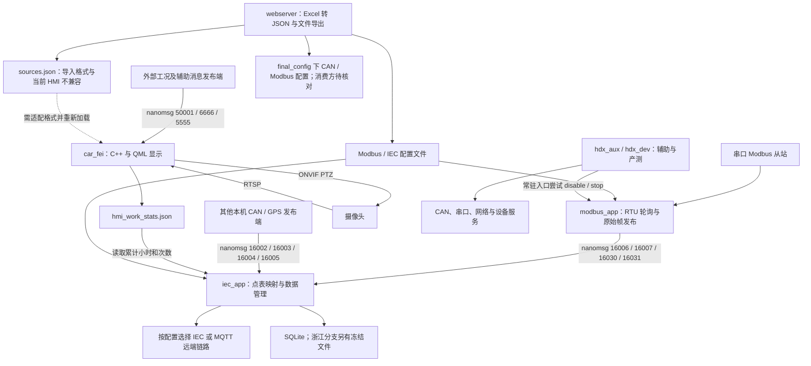

# Haidexin（海德馨）源码分析总览

> 更新：2026-10-15。本文汇总当前目录五份应用分析报告，提供版本基线、阅读入口、应用关系、接口差异和核验结果。组织方式综合参照 [electric_station_truck_cn 源码分析总览](../../electric_station_truck_cn/源码分析总览.md)与[上一级 RTMS SDK 源码分析总览](../源码分析总览.md)，内容按海德馨实际源码核对。

## 文档目录

- [1. 项目与报告入口](#overview)
- [2. 文档目录与章节导航](#documents)
- [3. 源码目录与整体架构](#source)
- [4. 应用分工与跨应用接口核对](#interfaces)
- [5. 逐文档主结论复核](#report-review)
- [6. 核心模块深度分析](#modules)
- [7. 构建与运行边界](#build-runtime)
- [8. 核验方法与版本处理](#verification)
- [9. 本轮整理与复核记录](#changes)
- [10. 验证结果与尚缺证据](#results)

<a id="overview"></a>

## 1. 项目与报告入口

本组文档覆盖海德馨车载终端的串口采集、数据汇聚及平台通信、辅助与产测、网页配置管理和图形显示。四个 C 应用属于 `rtms_sdk`；Qt 显示应用来自另一个源码目录。它们通过本机消息、配置文件和统计文件发生联系，但这些源码快照并不自动组成一套已经验证的生产镜像。

| 报告 | 源码位置 | 报告基线 | 构建产物与版本 |
| --- | --- | --- | --- |
| [Modbus RTU 采集分析](modbus_app/modbus_app_源码分析.md) | `rtms_sdk/apps/modbus_app/` | SDK 固定提交，见下文 | `modbus_app`，CMake 版本 `1.5` |
| [IEC/MQTT 汇聚分析](iec_app/iec_app_源码分析.md) | `rtms_sdk/apps/iec_app/` | 同一 SDK 固定提交 | `iec_app`，CMake 版本 `2.23` |
| [辅助与产测分析](hdx_aux/hdx_aux_app_源码分析.md) | `rtms_sdk/apps/hdx_aux/` | 同一 SDK 固定提交 | `hdx_aux`，CMake 版本 `1.0`；另按调用名进入 `hdx_dev` |
| [设备配置 Web 服务分析](webserver/webserver_app_源码分析.md) | `rtms_sdk/apps/webserver/` | 同一 SDK 固定提交 | `webserver`，CMake 版本 `1.10` |
| [斗臂车显示应用分析](doubiche_car_fei_3d/doubiche_car_fei_3d分析报告.md) | 独立目录 `doubiche_car_fei_3d/` | 2026-10-15 文件快照，无可用 Git 提交 | `car_fei`，qmake 工程 `car_fei.pro`；未建立统一发布版本对应关系 |

SDK 源码仓库为 `/home/tronlong/lyp/code/rtms_sdk/`。四份报告对应本地分支 `rk3568_ubuntu_20241218` 的完整提交 **`dcd34abb4ec5f26529e093ecc4fd3fce5b7e6dff`**。本轮复核该分支仍指向此提交；源码工作区实际检出的是 `develop/rtms_sdk_v1.3_20240408`，HEAD 为 `b7323a76053e9daec26eb97af1dbba106a358918`。因此本轮通过 `git show` 读取固定提交，没有使用当前工作区文件替代报告依据。

显示应用源码为 `/home/tronlong/lyp/code/doubiche_car_fei_3d/`，设备代码约定的部署目录为 `/root/car_fei_3d/`。源码、本文档目录和设备部署目录分别管理。显示应用四个关键文件的 SHA-256 与详细报告末尾记录一致，指纹见第 8 节；这只能标识部分源码文件，不能证明现存可执行文件或现网设备与之匹配。

[海德馨项目交接核验报告](海德馨项目交接核验报告.md) 是补充入口，讨论交接资料、地区状态、版本和待办。该报告依据另一处 Windows 交接资料目录，其文件数量、合同、整改及现场日志结论未在本轮重新访问原件核验，不能作为上述源码版本已部署或已验收的证明。更大范围的 SDK 应用关系见[上一级总览](../源码分析总览.md)。

<a id="documents"></a>

## 2. 文档目录与章节导航

```text
Haidexin/                              # 文档目录，不是源码根目录
├── 源码分析总览.md                      # 本文：入口、接口与核验边界
├── 海德馨项目交接核验报告.md            # 资料与交接状态的补充报告
├── modbus_app/
│   ├── AGENTS.md                       # 项目速览与维护要点
│   └── modbus_app_源码分析.md
├── iec_app/
│   ├── AGENTS.md
│   ├── iec_app_源码分析.md
│   └── *.png                          # 启动、数据流与协议流程图
├── hdx_aux/
│   ├── AGENTS.md
│   └── hdx_aux_app_源码分析.md
├── webserver/
│   ├── AGENTS.md
│   ├── webserver_app_源码分析.md
│   └── *.png                          # 启动、页面、导入与导出图
└── doubiche_car_fei_3d/
    ├── AGENTS.md                       # 显示应用开发与维护指南
    └── doubiche_car_fei_3d分析报告.md
```

四份 SDK 报告已有“项目概述、源码目录总览、核心架构设计、核心模块深度分析、关键流程与数据流”五节导航，后面保留各自编号；显示报告按十二章组织。本轮新增总览，保留原报告结构，下面按阅读问题对应入口。

| 阅读问题 | 对应章节 |
| --- | --- |
| 应用做什么、依据哪个版本 | 各报告的概述与范围；显示报告第一、二章；本总览第 1 节 |
| 配置和采集帧如何生成 | [Modbus 第 5–8 节](modbus_app/modbus_app_源码分析.md#analysis-5) |
| CAN/Modbus/GPS 怎样映射为点值 | [IEC 第 3、4 节](iec_app/iec_app_源码分析.md#analysis-3) |
| IEC、地区 MQTT、浙江冻结如何选择 | [IEC 第 5–7 节](iec_app/iec_app_源码分析.md#analysis-5) |
| 常驻辅助与单项产测怎样区分 | [hdx_aux 第 3–5 节](hdx_aux/hdx_aux_app_源码分析.md#analysis-3) |
| 网页导入哪些文件、登录和重启怎样处理 | [Web 第 3–6 节](webserver/webserver_app_源码分析.md#analysis-3) |
| 显示属性、作业统计、视频/PTZ 与数据库 | [显示报告第五章](doubiche_car_fei_3d/doubiche_car_fei_3d分析报告.md#五核心模块深度解析)、[第七章](doubiche_car_fei_3d/doubiche_car_fei_3d分析报告.md#七关键数据流分析)、[第九章](doubiche_car_fei_3d/doubiche_car_fei_3d分析报告.md#九接口设计规范) |
| 设备上出现异常，先查哪一层 | [Modbus 第 12 节](modbus_app/modbus_app_源码分析.md#analysis-12)、[IEC 第 10 节](iec_app/iec_app_源码分析.md#analysis-10)、[辅助第 9 节](hdx_aux/hdx_aux_app_源码分析.md#analysis-9)、[Web 第 7 节](webserver/webserver_app_源码分析.md#analysis-7)、[显示第 11.2 节起](doubiche_car_fei_3d/doubiche_car_fei_3d分析报告.md#112-现场排障入口) |

初读先看本总览第 1、3、4 节；快速确认每篇报告的主结论看第 5 节；按模块找实现看第 6 节；准备构建和部署先看第 7 节。接口字段、错误路径和现场命令以各报告及匹配版本源码为准。

本总览的覆盖范围包括五个应用的版本、构建入口、主要业务链、跨应用接口、运行副作用、关键风险和排障入口。各篇长表继续作为字段级查询依据：Modbus 的默认采集点与 RTU 格式、IEC 的协议状态机和地区 JSON、辅助程序的 11 项产测命令、Web 的 18 个业务 action、显示应用的 96 个公开属性及数据库接口均有对应正文。交接补充报告单独列出资料层证据；外部发布服务、板端部署和物理设备结果列为待验证项。

<a id="source"></a>

## 3. 源码目录与整体架构

```text
/home/tronlong/lyp/code/
├── rtms_sdk/                          # Git 仓库；此处按 dcd34abb 阅读
│   ├── CMakeLists.txt
│   ├── cross-profiles/                # RK3568 环境与工具链配置
│   ├── 3rdparty/                      # nanomsg、cJSON、GoAhead 等
│   └── apps/
│       ├── CMakeLists.txt             # 纳入下列四个目标及其他 SDK 应用
│       ├── modbus_app/                # main.c、src/、etc/、tool/
│       ├── iec_app/                   # 采集接入、点表、IEC/MQTT、存储
│       ├── hdx_aux/                   # 辅助/产测入口、src/、chs/
│       └── webserver/                 # HTTP 入口、action、www/ 与转换脚本
└── doubiche_car_fei_3d/                # 独立源码快照，qmake 构建
    ├── car_fei.pro、main.cpp、main.qml
    ├── VehicleData.h/.cpp             # 工况 JSON → Qt 属性
    ├── HmiWorkStatsEcho.h/.cpp         # 作业统计导出与恢复
    ├── VideoUrl、PtzBridge、OnvifPtzController 等源文件
    ├── HMI/                          # 五个业务页面、组件与 JS 数据库
    ├── data/、qml.qrc                 # 配置/档案/统计样例与资源清单
    └── HCNetSDKCom/、*.so             # 厂商组件与运行库样本
```

SDK 四个应用采用 CMake，交叉编译分支要求 `QL_MODULE_PLATFORM=RK3568_UBUNTU`；显示应用采用 qmake。显示目录保存的 Makefile 记录 Qt `6.5.3`，现成 `car_fei` 为动态链接 AArch64 ELF；这些是历史构建线索，不能单凭目录名确定现网板卡和 Qt 插件版本。



图表示源码中的消息、文件与控制关系，不表示五个应用应全部同时启动。配置箭头表示读取依赖，不表示动态重载；摄像头虚线表示尚不兼容的接口。**未发现这四个 SDK 应用直接向显示应用的 `50001` 发布工况 JSON 的已核实链路**；外部显示采集服务的完整实现不在本组五份分析范围内，不能把 `iec_app → car_fei` 画成已经成立的实时数据通道。

<a id="interfaces"></a>

## 4. 应用分工与跨应用接口核对

### 4.1 五个应用的实际职责差异

| 应用 | 输入与主要处理 | 输出与运行边界 |
| --- | --- | --- |
| `modbus_app` | 读取固定 JSON；最多四路串口，功能码 1–4；按点表轮询并校验 RTU 响应 | 发布原始 `modbus_frame_t` 数组；业务单位、缩放由下游点表决定；没有 Modbus TCP 服务 |
| `iec_app` | 订阅 CAN、Modbus、GPS，读取 HMI 统计；按点表维护点值和品质 | 一次配置选择 IEC 或 MQTT 一类远端链路；SQLite 历史独立运行，浙江模式另启动冻结任务；常规遥控回调有效代码只记录日志 |
| `hdx_aux` | 根据 `argv[0]` 区分常驻与产测；常驻创建 CAN/RS485/RS422 线程并维护以太网、Wi-Fi | 常驻产测帧应答和网络配置；`hdx_dev` 执行单项命令；虽然编入 IEC/MQTT 等代码，当前主入口未启动相应业务链 |
| `webserver` | GoAhead 分发 HTTP/action，Python 转换 Excel | 注册 18 个业务 action，处理四类配置导入/导出及重启；网页显示成功不能证明下游已加载或硬件动作完成 |
| `car_fei` | `50001` 工况 JSON 转属性；`6666/5555` 页面辅助订阅；本地档案和摄像头配置 | 五个业务页、统计持久化、视频和 PTZ；当前主页显示一路“车前”，海康 SDK 主入口实例化路径被禁用；告警自动生成闭环尚不完整 |

### 4.2 消息端口与串口资源

| 接口 | 发布/提供端 | 接收/调用端 | 已核实的关系与限制 |
| --- | --- | --- | --- |
| `16006/16007/16030/16031` | `modbus_app` 用 PUB 绑定 `0.0.0.0` | `iec_app` 用 SUB 连接 `127.0.0.1` | 对应 `com0/com1/com2/com3`，串口依次为 `/dev/ttyS3/S4/S7/S8`；两端帧字段定义一致，发送的是结构体原始内存 |
| `16002/16003/16004` | 其他 CAN 发布服务 | `iec_app` 订阅三路；`hdx_aux` 常驻订阅前两路 | 两个订阅者并不互为 CAN 发布端；`hdx_aux` 测试应答通过 PUB 连接 `26002/26003`，未在这里绑定端口 |
| `16005` | 其他 GPS 发布服务 | `iec_app` 应用消息线程；`hdx_dev gps` | IEC 解析 `location_info` JSON；不等于 HMI 的 `50001` 或串口 `/dev/ttyS9` 路径 |
| `26008/16008` | 外部 MCU 命令服务 | `hdx_dev rtc` 及 IEC 设时调用 | `26008` 发命令、`16008` 收回复；产测匹配 PID 和命令标记，不能仅据匹配回复证明两个时钟都设置正确 |
| `50001` | 外部工况发布端 | HMI `VehicleData` | nanomsg SUB 接收 JSON，经队列投递到 Qt 主线程解析；不是普通 TCP 文本接口 |
| `6666/5555` | 外部辅助消息发布端 | HMI MainPage / DevicePage | `6666` 仍可改部分仪表，可能与 `50001` 更新竞争；`5555` 当前主要打印定位信息 |
| `/dev/ttyS8` | 硬件串口 | Modbus `com3`、IEC 管理通道、hdx_aux RS485 测试 | Modbus 默认点表未配置 `com3`；启用前需核对占用。IEC 管理通道在远端协议选择之前启动，选 MQTT 也不能据此排除串口占用 |
| `/dev/ttyS5`、`/dev/ttyS9` | 硬件串口 | 前者为辅助 RS422；后者为 HMI GPSReceiver | HMI 串口结果写入 `globalGPSData`，当前主定位显示仍使用 VehicleData 工况；应按实际消费者判断定位故障 |
| `/dev/spidev0.0` | S1161Y 安全芯片 SPI | IEC 安全层初始化、冀北读取芯片序列号；`hdx_dev enc` | 透传配置不能排除芯片初始化依赖；产测会尝试先停止 IEC 服务 |

默认 Modbus 配置只有 `com0/com1/com2`，点数分别为 **12、28、6**。四路端口常量存在，不代表四路默认都有采集数据。生产端与消费端的 `modbus_frame_t` 字段相同，也不等于目标 ABI、端序和实际消息长度已做设备验证。

**辅助程序与采集服务存在明确的生命周期冲突。** `hdx_aux/main.c:81–85` 的 `init_aux_rs485()` 调用 `systemctl disable modbus_app`、`systemctl stop modbus_app`，常驻入口在 `1004–1009` 调用该函数。`hdx_dev rs485` 的 `test_dev_rs485()` 也在 `main.c:303` 调用停止命令。代码未检查这些命令的执行结果；可确认的是“尝试停用或停止”，实际是否成功取决于设备服务。不能把 `hdx_aux` 当作对采集无影响的后台辅助程序。它的四路 RS485 测试也使用上述串口。

### 4.3 配置与统计文件的生产、消费关系

| 文件 | 生产方 | 消费方与已核实的边界 |
| --- | --- | --- |
| `/usr/local/etc/modbus_app_config.json` | SDK 默认配置；Web `xlsx2json1.py` 导入 | `modbus_app` 启动时读取，源码未提供动态重载入口 |
| `/usr/local/etc/iec_app_general.json`、`iec_app_pointsheet.json` | SDK 默认配置；Web `xlsx2json2.py` 导入 | `iec_app` 初始化读取，影响协议选择与采集映射；Web 写入成功不等于进程已采用新配置 |
| `/usr/local/etc/iec_app_idtype.json` | Web IEC 导入同时生成 | `iec_app` 尝试读取；SDK 本应用 CMake 未安装该文件，缺失只警告；网页也没有对应导出 action |
| `/usr/local/etc/iec_app_zj_paras.json` | SDK 安装；浙江参数固化可写回 | 浙江参数与冻结任务使用；Web 现有 IEC 导入未生成该文件 |
| `/opt/conf.ini` | `hdx_dev id_secret` 可覆盖写入 | IEC 读取 `[dev]` 的 `id/secret`，非空 ID 可覆盖通用 JSON 的终端 ID；产测将同一个参数同时写入两个字段 |
| `/root/final_config/modbus_config.json`、`can_config.json` | Web `xlsx2json3.py` | 本组源码尚未建立其到 HMI 实时工况的消费闭环；HMI 根目录存在同名样例不等于主程序会读取这些部署文件 |
| `/root/car_fei_3d/data/sources.json` | Web `xlsx2json4.py`；HMI 随附配置样例 | HMI 从相对路径 `data/sources.json` 加载，工作目录需对应；两份快照的根 JSON 类型不兼容，见下文 |
| `/root/car_fei_3d/data/hmi_work_stats.json` | HMI `HmiWorkStatsEcho` | `iec_app` 读取 `totalHours`、`workCountTimes`，分别写到 `tag_worktime`、`tag_workcount`；远端是否上送仍受点表及所选协议约束 |
| `/tmp/hmi_work_stats.txt` | HMI 统计导出 | 三行依次为次数、本次小时、累计小时；当前 IEC 统计读取链使用永久 JSON，不读取此文本 |
| `/tmp/realtime_status.json` | 外部生产者，缺失时 HMI 尝试从备用样例复制 | HMI 启动初值；持续更新走 `50001`，改文件不能替代实时消息验证 |
| `/root/iec_app.db` | IEC SQLite 存储线程 | `history_table` 存普通历史点值；启动打开/建表失败会退出，与浙江冻结文件相互独立 |
| `/root/iec_app/HISTORY/TASK/` | 浙江冻结任务 | 按任务和日期保存文件，TI 204 历史召测时回放；周期取任务配置，缺少参数管理器时有回退值 |
| HMI 工作目录对应的 LocalStorage | QML 的告警、维保、设置和统计库 | 主程序将离线存储根设为 `./`；更换工作目录可能读到另一套数据，本地设置未证明会下发操作系统或采集服务 |

**摄像头导入存在跨快照格式不兼容。** 固定 SDK 提交的 `xlsx2json4.py:11–39` 返回并直接写出对象数组；当前 HMI 的 `VideoUrl.cpp:54–63` 先要求根 JSON 为对象，再取 `sources` 数组。两者差异可用脱敏样例表示：

```json
[{"name": "车前", "url": "rtsp://camera.invalid/live"}]
```

```json
{"sources": [{"name": "车前", "url": "rtsp://camera.invalid/live"}]}
```

上面第一种是 Web 导出函数的实际结构，第二种是当前 HMI 所需结构。Web C 层将结果直接移动到目标文件，没有增加外层 `sources`；HMI PingThread 也按对象中的 `sources` 取列表。即使文件落到正确目录，第一种结构仍会被当前 `VideoUrl` 拒绝。此结论针对两份指定源码快照，尚未证明现场部署的两端使用相同版本。摄像头配置还存在启动加载、未见统一热更新的问题，不能只改根类型就宣称完整导入链路已经验证。

**作业统计文件是已经定位到两端的连接点。** HMI 持久化 `workCountTimes/sessionHours/totalHours/version`；IEC 只取累计小时和次数，没有把小时再换算为秒，也没有在此处把次数除以 2。IEC `special_item_set()` 以 `curr_time > last_time + 5` 限流，实际读取节奏还受消息线程轮询影响。HMI 使用截断写入，IEC 同时打开读取可能遇到不完整 JSON；这是静态可推导的并发与掉电风险，本轮未复现设备故障。

### 4.4 远端协议与地区选择

`iec_app/main.c:587–655` 按 `remote_proto` 选择一条远端分支，未识别值会记录错误、等待后退出。下表列出全部选择值；它们不会因为相关源码同时编入目标而同时运行。

| 配置值 | 已确认的处理链 | 核验重点 |
| --- | --- | --- |
| `iec101`、`iec104` | 对应 IEC 层、IO 层，经安全层和链路层通信 | 点表、地址长度、链路模式、安全模式及主站响应；遥控执行回调边界另见下节 |
| `iec104_zhejiang` | 浙江 IEC 104，加参数管理、任务冻结和历史召测 | TI 202/203 读写参数、204 召测、209 历史响应；冻结与实时上送各有时间策略 |
| `mqtt` | 四川旧协议、单一设备 ID 的旧 JSON | 与新协议的主题、设备映射、上送节奏分别核对 |
| `mqtt2` | 四川新协议；正常模式先执行 HTTP 登录 | 登录失败每次等待 10 秒后重试，持续失败会阻塞后续 MQTT 启动 |
| `mqtt_jibei` | 冀北分支；正常模式读取芯片序列号并执行 HTTP 登录 | 芯片读取与 HTTP 登录是连接之前的条件；两者失败不能仅按 MQTT 掉线排查 |
| `mqtt_ningxia`、`mqtt_hunan`、`mqtt_fujian`、`mqtt_henan`、`mqtt_xinjiang`、`mqtt_chongqing` | 各自地区的拓扑、设备映射和数据/状态/事件生成 | 逐项核对平台主题和应答；福建使用 `/v1/{termId}/topo/request`、`response` 类型的拓扑接口 |

`TEST_MQTT_JSON` 在此固定提交中是**运行时环境变量**：`src/mqttLayer/mqttLayer.h:12–14` 判断其存在且首字符不是 `0` 即启用，包括空字符串；不是通常意义上的数值解析。测试模式跳过部分正常登录/连接检查并生成测试 JSON，不能作为真实接入证据。独立发布线程则由另一项**编译宏** `ENABLE_MQTT_PUB_TASK` 控制，当前为 `0`，READY 循环中同时处理 MQTT 与发布任务。两类开关需要分别核对。

### 4.5 控制、服务和进程退出的实际影响

| 触发点 | 源码可确认的动作 | 结论边界 |
| --- | --- | --- |
| `hdx_dev enc` | `hdx_aux/main.c:431` 尝试停止 `iec_app` 后访问安全芯片 | 不检查停止命令结果；不能当作无副作用的在线诊断 |
| `hdx_dev touchscreen` | `main.c:985–994` 停 `car_fei` 和 `touch-backlight-c`，运行 Qt 测试，随后尝试启动服务 | 服务命令结果未检查，不能据显示测试返回值断言生产显示已恢复 |
| `hdx_dev id_secret`、`rtc` | 覆盖 INI 或尝试修改系统/MCU 时间 | 多数产测命令正常落到 `main` 的固定 `return 0`；需结合函数打印与读回结果，不能仅看进程退出码 |
| IEC 常规遥控 | `doSpYk/doDpYk/doStYk/doMeNaYk/doMeNbYk/doMeNcYk/doBoYk` 有效代码只记录日志，原修改代码在 `#if 0` 中 | 仅描述这些回调；不能据此断言 IEC 所有命令都无副作用 |
| IEC 对时、复位、浙江参数固化 | 对时尝试执行 `date -s` 并发 MCU 命令；`QRP=1` 的延迟复位最终退出整个 IEC 进程；固化可重写参数 JSON | 主站确认、系统时钟、MCU 读回、配置落盘和服务重新拉起应分别取证 |
| MQTT 恢复分支 | 多次 CONNECT 失败可尝试重启 `Linux_tunnel.service`；宁夏长期底层断线还会调用结束代理进程的命令 | 网络波动可能伴随其他服务操作，不能只观察当前 MQTT 连接 |
| Web `request_reboot` | `src/action_handle.c:661–674` 先返回 `success`，再执行等待 5 秒并重启的命令 | HTTP 响应成功早于实际重启 |
| HMI 摄像头连通性监测 | PingThread 发现某目标由可达变不可达时调用 `kill -9` 结束自身 | 初始不可达并不立即触发同一路径；强制退出会跳过正常清理和最终保存，需与崩溃区分 |

这些关系解释了为什么采集停更、IEC 离线或 HMI 消失可能来自另一应用的调用。关联故障时应保存各进程 PID、退出状态、服务操作和同一时间窗的日志。

<a id="report-review"></a>

## 5. 逐文档主结论复核

参照上一级总览的逐报告核对方式，下表把每份报告的主要结论、源码依据和待确认条件放在同一行。SDK 定位以固定提交 `dcd34abb` 的 `apps/` 为起点，HMI 定位以独立源码目录为起点；完整版本及指纹见第 8 节。

表内省略应用名前缀的 `src/`、`main.c` 和 `CMakeLists.txt` 均相对该行报告对应的应用源码目录。

| 报告 | 已核对的关键结论与源码依据 | 尚需外部证据的边界 |
| --- | --- | --- |
| [Modbus 采集](modbus_app/modbus_app_源码分析.md) | `src/modbus_forward.c:518–543,576–619`：配置计数 `com_count` 与启用通道数不同；线程创建返回值未检查。`src/modbus_forward.h:27–46` 定义四路串口、发布地址及原始帧。 | 初始化返回成功不能证明有可用采集线程；还需串口应答、订阅样本、目标 ABI 和点表单位。 |
| [IEC/MQTT 汇聚](iec_app/iec_app_源码分析.md) | `main.c:534–655`：初始化配置、管理通道、数据库和采集/存储线程，再按 `remote_proto` 选择 IEC 或 MQTT。`src/ioLayer/ioLayer.c:922–1070`：常规遥控回调的有效代码只输出日志。 | 需按设备实际协议检查链路、安全认证、点表与平台响应；遥控应答不能证明物理输出。 |
| [辅助与产测](hdx_aux/hdx_aux_app_源码分析.md) | `main.c:1004–1015` 按调用名分流；`main.c:81–85,303` 会尝试停用或停止 Modbus。当前 CMake 只定义 `hdx_aux` 目标。 | 需确认 `hdx_dev` 名称怎样部署、服务命令是否成功、产测接线及生产采集如何恢复。 |
| [配置 Web](webserver/webserver_app_源码分析.md) | `CMakeLists.txt:48–74` 选择并安装认证/非认证路由；`src/webserver_init.c:33–53` 注册 18 个业务 action。摄像头转换结果与 HMI 根类型要求不一致，见第 4.3 节。 | 路由开关不等于实际认证已验证；还需实际 GoAhead 库、文件权限、导入后的消费与重载结果。 |
| [显示 HMI](doubiche_car_fei_3d/doubiche_car_fei_3d分析报告.md) | `main.cpp:396` 加载磁盘 `main.qml`；`VehicleData.cpp:532–550` 连接 `50001`；`HmiWorkStatsEcho.cpp:19–21,205–211` 写统计文件；`VideoUrl.cpp:54–73` 要求对象中的 `sources` 数组。 | 需确认工作目录、外部发布者、Qt/媒体插件、摄像头和真实持久化；当前源码与保存二进制尚无完整构建对应证据。 |

<a id="modules"></a>

## 6. 核心模块深度分析

本节按业务模块组织源码和阅读入口，便于一次追踪跨应用的生产、传输和消费过程。

| 模块群 | 核心源码与判断 | 深入阅读 |
| --- | --- | --- |
| 串口采集与本机消息 | `modbus_app/src/modbus_forward.c`、`serial.c`、`ipc_pubsub.c` 负责 RTU 请求、响应校验、缓存及发布；`iec_app/src/modbus_server/` 消费原始结构体。 | [Modbus 核心模块](modbus_app/modbus_app_源码分析.md#core-modules)、[IEC 启动与数据流](iec_app/iec_app_源码分析.md#analysis-3) |
| 点表、值与品质 | `iec_app/src/config/`、`data_process/` 将 CAN、Modbus 和应用数据映射为点值及品质；修改映射会影响协议上送和历史存储。 | [IEC 配置与数据入口](iec_app/iec_app_源码分析.md#analysis-4) |
| 远端协议与安全层 | `iec_app/src/linkLayer/`、`secLayer/`、`iecLayer/`、`ioLayer/`、`mqttLayer/`、`http/` 组成所选通信链；HTTP 登录、安全认证、MQTT READY 和平台业务响应分别判断。 | [IEC 链路](iec_app/iec_app_源码分析.md#analysis-5)、[地区 MQTT](iec_app/iec_app_源码分析.md#analysis-6) |
| 历史与作业统计 | IEC 的 `data_store.c`、`db/` 与浙江冻结文件分别存储历史；HMI 的 `main.qml`、`HmiWorkStatsEcho.cpp` 统计并持久化，IEC 再读取其中两个字段。 | [IEC 持久化](iec_app/iec_app_源码分析.md#analysis-7)、[HMI 数据流](doubiche_car_fei_3d/doubiche_car_fei_3d分析报告.md#七关键数据流分析) |
| 网页配置与应用文件 | Web 的 `src/action_handle.c`、`www/scripts/xlsx2json*.py` 负责 Excel 转 JSON 和文件部署；消费者是另一进程，需分别核对格式、路径与加载时机。 | [Web action 与文件去向](webserver/webserver_app_源码分析.md#analysis-5)、本总览第 4.3 节 |
| 工况显示、视频与云台 | HMI 的 `VehicleData`、`HMI/`、`VideoUrl`、`PtzBridge` 和 `OnvifPtzController` 负责属性更新、显示、RTSP 与 ONVIF；统计、辅助消息和视频各有独立路径。 | [HMI 核心模块](doubiche_car_fei_3d/doubiche_car_fei_3d分析报告.md#五核心模块深度解析)、[接口字典](doubiche_car_fei_3d/doubiche_car_fei_3d分析报告.md#九接口设计规范) |
| 辅助网络与产测 | `hdx_aux/main.c`、`src/can_server/`、`src/serial/`、`chs/` 处理实际入口和硬件操作；编入目标的其他协议代码需再确认是否被调用。 | [辅助入口](hdx_aux/hdx_aux_app_源码分析.md#analysis-3)、[单项产测](hdx_aux/hdx_aux_app_源码分析.md#analysis-4)、[未从主入口启动的模块](hdx_aux/hdx_aux_app_源码分析.md#analysis-5) |

### 6.1 三条典型链路的完整追踪顺序

1. **采集到平台：**串口请求与响应 → Modbus 校验和缓存 → nanomsg 原始帧 → IEC 接收并按通道、从站及点表解释 → 点值/品质 → 所选 IEC 或地区 MQTT → 对端响应。每层分别检查输入、输出和时间，串口收到了数据不代表点表匹配，消息发出也不代表平台已保存。
2. **作业统计到上送：**`50001` 工况 → `VehicleData` → 窗口 `hmiTickLiftWorkStats` → `HmiWorkStatsEcho::setSnapshot` → 永久统计 JSON → IEC `special_item_set` → `tag_worktime/tag_workcount` → 点表与协议输出。合法状态中 `0` 为起升，`0→1` 完成一轮、次数加一；时长单位为小时。断流、异常状态和重启恢复需分别验证，当前程序不能补算断电期间动作。
3. **网页配置到生效：**Excel/浏览器表单 → action → Python 转换 → JSON 结构 → 文件依次移动 → 消费进程加载 → 业务输出。需同时验证字段格式、目标目录和重新加载时机；摄像头根类型不匹配、IEC idtype 部署缺口及显示配置消费方未确认，分别见第 4.3 节。

### 6.2 重点实现风险与安全边界

下表汇总影响主链路的主要问题；完整问题清单、触发条件与现场取证步骤继续查详细报告。本轮只记录实现事实及其风险，没有把可能影响写成设备已发生的故障。

| 范围 | 已定位的问题 | 影响及深入入口 |
| --- | --- | --- |
| Modbus 帧校验与串口 | 站号/功能码不匹配比较用 `&&`；单次读取不拼帧；`setup_serial` 的 fd 参数为 `char`，且 `cfmakeraw` 调用顺序影响非默认格式 | 部分错帧可能继续校验、分段应答可能被拒绝；fd 与串口格式需目标复核。[Modbus 第 10 节](modbus_app/modbus_app_源码分析.md#analysis-10) |
| Modbus 传输与存活 | 发送失败仍清空缓存；串口写 0/`EAGAIN` 时无重试截止时间；线程创建结果未检查 | 缺少缓存发送失败重试，通道可能停滞，主进程仍存在。[同节](modbus_app/modbus_app_源码分析.md#analysis-10) |
| 辅助 CAN 与串口 | 两个 `nn_pollfd` 元素却传数量 3；串口短读后仍比较 8 字节；Wi-Fi 初始化检查的 `rc` 未接收命令结果 | 分别存在越界读取风险、不可靠判定和错误返回值。[辅助第 7 节](hdx_aux/hdx_aux_app_源码分析.md#analysis-7) |
| Web 模板与配置落盘 | `load_template` 按文件长度分配、读满后用 `%s` 输出，未留结尾零；导入复用固定临时路径并依次移动多个文件 | 存在字符串越界读取、请求交错及部分更新风险；没有跨文件回滚。[Web 第 5、6 节](webserver/webserver_app_源码分析.md#analysis-5) |
| HMI 工况解析与线程 | 四个 `uint8_t` 状态成员转 `int&` 写入；部分工况值未完整初始化；订阅线程缺少对称停止/等待 | 内存写入、初值有效性、对象寿命及高频消息积压需优先核验。[显示第五章](doubiche_car_fei_3d/doubiche_car_fei_3d分析报告.md#五核心模块深度解析)、[第十章](doubiche_car_fei_3d/doubiche_car_fei_3d分析报告.md#十安全与加密) |
| HMI 页面与业务闭环 | QML 加载后未检查根对象；SettingsPage 有未定义 id；告警检测未见活动调用；部分设置仅在本地保存 | 进程存在不代表界面创建成功；保存阈值不等于采集告警策略生效。[显示第十一章](doubiche_car_fei_3d/doubiche_car_fei_3d分析报告.md#十一典型使用场景) |
| 凭据与认证 | IEC 的 INI/MQTT 初始化日志会输出 secret/password 字段；HMI 存在硬编码凭据与带认证的 URL；Web 默认路由不要求登录，实际认证还受 GoAhead 配置影响 | 总览不复制凭据值；应用层摘要、Base64 或已链接 OpenSSL 均不能证明所有传输和存储已加密。[IEC 第 8 节](iec_app/iec_app_源码分析.md#analysis-8)、[Web 第 6 节](webserver/webserver_app_源码分析.md#analysis-6)、[显示第十章](doubiche_car_fei_3d/doubiche_car_fei_3d分析报告.md#十安全与加密) |
| HMI 视频、云台和统计 | PTZ 在 UI 路径同步请求；PingThread 强制退出；统计文件截断写入且两份输出无跨文件事务 | 卡顿、退出、并发读取和掉电恢复应分开验证。[显示第十二章问题表](doubiche_car_fei_3d/doubiche_car_fei_3d分析报告.md#122-主要限制与改进优先级) |

<a id="build-runtime"></a>

## 7. 构建与运行边界

构建时依次核对顶层目标、子目录 CMake/qmake、最终编译参数、安装文件和设备启动配置。源码参与编译、入口开始执行、线程持续工作和外部设备完成动作，需要各自的证据。

| 项目 | 构建与安装事实 | 运行时还需核对 |
| --- | --- | --- |
| SDK 四个 C 应用 | 固定提交的 `apps/CMakeLists.txt:20–25` 纳入四个目标；交叉编译分支要求 `RK3568_UBUNTU`，依赖由 SDK 提供。Modbus、IEC、辅助程序安装到前缀下 `usr/local/bin`；Web 安装到 `usr/local/www`。 | 安装前缀和镜像打包决定设备上的最终路径；服务启动命令、工作目录和启动顺序需设备记录。 |
| 启动级别 | 四个应用都生成 `startup_level=1` 的 JSON；各自 CMake 未声明安装该 JSON。 | 不能从同一级别推断启动先后或兼容常驻；`hdx_aux` 对 Modbus 的服务操作需单独处理。 |
| `hdx_dev` 产测入口 | 与 `hdx_aux` 共用入口代码，按 `argv[0]` 识别；CMake 没有独立目标或链接安装规则。 | 镜像须提供匹配名称及 `chs/` 资源；产测会访问设备、改网络/时间或操作服务。 |
| Web 登录与配置导入 | `ENABLE_LOGIN_AUTH` 默认 `0`，安装时选择相应路由为 `route.txt`；Python 转换依赖 `/usr/bin/python3` 和 openpyxl。 | 核对实际 GoAhead 认证构建、用户文件、工作目录、目标目录权限；导入完成后再检查消费进程是否采用配置。 |
| Qt 显示工程 | qmake 工程；保存 Makefile 记录 Qt 6.5.3，保存程序为动态链接 AArch64；`main.cpp` 从工作目录加载磁盘 `main.qml`。 | 匹配 Qt、媒体/图形插件、厂商库与资源；核对 `/root/car_fei_3d`、本地数据库位置、外部消息发布端及单实例显示。 |

涉及具体构建命令时，分别查 [Modbus 第 4 节](modbus_app/modbus_app_源码分析.md#analysis-4)、[IEC 第 2 节](iec_app/iec_app_源码分析.md#analysis-2)、[辅助第 2 节](hdx_aux/hdx_aux_app_源码分析.md#analysis-2)、[Web 第 3 节](webserver/webserver_app_源码分析.md#analysis-3)和[显示报告第八章](doubiche_car_fei_3d/doubiche_car_fei_3d分析报告.md#八编译构建体系)。

### 7.1 启动失败与降级条件

| 应用/资源 | 源码中的处理 | 排查时的含义 |
| --- | --- | --- |
| Modbus 主配置 | 文件/解析失败或计入的通道数不大于 0，主程序退出 | JSON 存在还需检查通道键、enable、串口参数与点表；计数成功也不保证启用线程 |
| Modbus 串口/PUB | 启用线程在打开或绑定失败时等待并重试 | 主进程可存在而通道无数据，需查看具体串口和发布端初始化日志 |
| IEC 配置/点表/数据库 | 通用 JSON、点表、管理通道或数据库初始化失败会退出；idtype 缺失只警告 | 区分致命条件与可继续启动的配置缺项 |
| IEC 安全芯片 | ARM/AArch64 的 `startSecLayer()` 会调用 `s1161y_init()`，失败返回 -1；此处未以透传配置为跳过条件 | 即使选择 MQTT 或透传，也需检查管理通道、安全芯片和 SPI 的实际初始化结果 |
| IEC 前置登录/订阅线程 | HTTP 登录可循环等待；本机订阅线程可在错误时退出，主线程不监督其后续存活 | “进程在”可能分别表示登录未完成或工作线程已退出 |
| Web 路由/认证/监听/临时目录 | 主入口按失败分支返回错误或退出；相对路径受工作目录与 `--home` 影响 | 不预设监听 80；核对启动参数、实际端点、路由文件和 GoAhead 编译配置 |
| HMI 初值/QML/资源 | 多项配置失败仅记录日志；没有 QML 根对象失败检查；依赖磁盘 QML 与相对路径 | 进程存活不能证明窗口、配置或数据显示完成初始化 |

### 7.2 线程、时间和历史保留的区别

| 路径 | 当前调度/时间依据 | 核验边界 |
| --- | --- | --- |
| Modbus 发布缓存 | 单调时钟；点请求之前检查，间隔大于 1000 ms 且有数据或将超缓存容量时发送 | 不是独立的一秒精确定时器；串口等待或写入停滞会延后发布 |
| IEC 普通历史 | uptime 差值大于 10 秒时采样，约 0.5 秒轮询；记录时间取系统墙钟 | 不能把采样节奏和记录时间混为一谈；校时会改变时间戳 |
| SQLite 清理 | 启动时超过 15,552,000 行才删除 1,555,200 行 | 是行数阈值，不保证固定保留 30 天，也不是持续按天清理 |
| 浙江冻结/上送 | 墙钟及各任务的 base/period；无参数管理器时冻结回退值为 60 秒 | 冻结可离线执行；保留逻辑按匹配文件数处理，不能只据注释认定所有任务统一五分钟或恰好七天 |
| HMI 本次统计 | 主要用 `steady_clock` 毫秒差换算小时；状态变化由窗口监听 | C++ 每 3 秒写最近快照，不在写盘时重新计算；消息断流、计时显示和导出值可能不同步 |
| HMI 启动恢复 | C++ 先读永久 JSON 并写临时文本，QML 再考虑临时文本/LocalStorage 等来源 | 不能仅按 QML 的读取顺序判断权威来源；单调起点不跨进程 |
| IEC 读取 HMI 统计 | `time(NULL)`、大于 5 秒的限流判断，位于应用消息循环中 | 受墙钟跳变和轮询节奏影响；不是独立的固定五秒定时任务 |

HMI 的 JSON 解析、QML、部分文件/数据库操作和同步 PTZ 调用处于 UI 执行路径；50001 工作线程将解析排队投递到主线程。Modbus 各通道、IEC 各采集/通信线程与 HMI 的后台线程分别管理，当前没有覆盖这些进程的统一健康监督或统一退出协议。

<a id="verification"></a>

## 8. 核验方法与版本处理

本轮先盘点当前目录五份分析报告、五份 `AGENTS.md` 和交接补充报告，核对报告范围及导航，再回到源码核对总览涉及的入口、构建、端口、文件去向和消费格式。采用换电总览的版本与核验记录组织方式，并参照上一级 SDK 总览增加逐文档结论、模块导航和构建运行边界；比较对象是同一 SDK 提交中的四个应用，加一个独立显示源码快照。

SDK 采用固定提交只读核验，未切分支、未修改源码，也未访问远端。复核命令示例：

```sh
git -C /home/tronlong/lyp/code/rtms_sdk rev-parse rk3568_ubuntu_20241218
git -C /home/tronlong/lyp/code/rtms_sdk show dcd34abb4ec5f26529e093ecc4fd3fce5b7e6dff:apps/CMakeLists.txt
git -C /home/tronlong/lyp/code/rtms_sdk show dcd34abb4ec5f26529e093ecc4fd3fce5b7e6dff:apps/iec_app/src/app_server/app_server.c
git -C /home/tronlong/lyp/code/rtms_sdk show dcd34abb4ec5f26529e093ecc4fd3fce5b7e6dff:apps/webserver/www/scripts/xlsx2json4.py
```

下面定位中的 SDK 路径均相对 `apps/`，行号以完整提交 `dcd34abb4ec5f26529e093ecc4fd3fce5b7e6dff` 为准；HMI 路径相对独立源码目录。原报告部分行号存在偏移，追踪时同时按函数名定位，本表按本轮实际读取重新标注。

| 结论 | 固定源码定位 |
| --- | --- |
| 四个 SDK 目标被顶层纳入 | SDK `apps/CMakeLists.txt:20–25`；各应用 `CMakeLists.txt` |
| 原始 Modbus 帧、四个端口与串口对应 | `modbus_app/src/modbus_forward.h:27–46`；`iec_app/src/modbus_server/modbus_server.h:8–28` |
| IEC 接收批量帧并按点表处理 | `iec_app/src/modbus_server/modbus_server.c`：`modbus_msg_process`、`start_modbus_server` |
| IEC 读取 HMI 统计文件与两个字段 | `iec_app/src/app_server/app_server.c:40–101`：`special_item_set` |
| IEC 初始化顺序与唯一远端分支 | `iec_app/main.c:534–655`：`main`；管理串口为 `src/linkLayer/linkLayer.h:16` |
| 常规遥控回调的有效代码边界 | `iec_app/src/ioLayer/ioLayer.c:922–1070`：`doSpYk` 等函数 |
| 辅助常驻入口与单项产测操作 Modbus | `hdx_aux/main.c:81–85,303,1004–1009` |
| 辅助 CAN 轮询长度不一致 | `hdx_aux/src/can_server/can_server.c:109–120`：2 个元素却传入数量 3 |
| Web action 注册与配置目标 | `webserver/src/webserver_init.c:33–53`；`src/action_handle.c:21–33` |
| 摄像头数组生成及直接部署 | `webserver/www/scripts/xlsx2json4.py:11–39`；`src/action_handle.c:603–632` |
| HMI 摄像头对象要求与启动读取 | `VideoUrl.cpp:54–73`：`parseJson`；`main.cpp:280–285`；`PingHelper.h:35–48` |
| HMI 统计路径、字段与截断写入 | `HmiWorkStatsEcho.cpp:19–21,93–103,205–211` |
| HMI 工况订阅与类型风险 | `VehicleData.cpp:384–388,532–550`；`VehicleData.h` 的 `ACData` |
| IEC 安全芯片初始化和前置登录 | `iec_app/src/secLayer/secLayer.c:1980–2010`；`src/http/http_login.c:252–298` |
| MQTT 两种测试/线程开关 | `iec_app/src/mqttLayer/mqttLayer.h:12–16`；`mqttLayer.c`：`mqttLinkProcess`、`startMqttLayer` |
| 产测停止 IEC 和停启显示服务 | `hdx_aux/main.c:423–436,985–994` |
| Web 模板字符串风险、响应后重启 | `webserver/src/action_handle.c:41–68,661–674` |
| IEC 对时、复位与 MQTT 恢复副作用 | `iec_app/src/ioLayer/ioLayer.c:680–698,823–827`；`src/iecLayer/iec104.c:689–694`；`src/mqttLayer/mqttLayer.c:1554–1647` |
| 历史间隔、行数和冻结回退值 | `iec_app/src/data_process/data_store.c:23–40,80–93`、`data_store.h:8–12`；`src/ioLayer/iec_zhejiang.h:39–48` |
| HMI 摄像头通变断退出 | `PingHelper.h:60–78`：`PingThread::run` |

显示报告原有四个指纹本轮均重新计算并匹配；另补充三个接口相关文件的指纹，便于后续复核：

```text
main.cpp             8cef6874b97dee91e361dff39998fbb66347d183fcdabd1095b5c44c229d6e2a
VehicleData.cpp      39e54c1152bf4dc5b4cfd9a9d913e22cb278898c666eaaa80c912d9f3360b0da
main.qml             1d95a7f64dfe141e1b76e36531fd1c989cae7cf0caf6920568ac40958e3d0ab2
car_fei.pro          e35f2c8a26d665e9b29f9f78201406eb6ec6fde379101acb066750a054893a82
VideoUrl.cpp         9d5ed0aaac730621d01f0e2f2c5344418bc30dd54f92a1e7ac0c2f901ec76b42
HmiWorkStatsEcho.cpp 907c1af06ac0c91f9b0987988ed9e82a4041771993fcd439331358e580eb3f34
PingHelper.h         f9df4b8f1df55dbc1e3b13d2cacc88a27b0c46aab51ed762cabdca8782063c9d
```

这些指纹覆盖部分关键文件，不是整个显示目录的发布清单。后续更新源码应重新计算，并另记录设备可执行文件、库、QML 和配置的版本对应关系。

<a id="changes"></a>

## 9. 本轮整理与复核记录

| 范围 | 本轮落实的内容 |
| --- | --- |
| 总入口 | 新增本文，串联五份应用报告、项目速览、交接补充报告与上一级 SDK 总览 |
| 参考结构 | 综合两份参考总览；增加逐文档主结论复核、按业务模块的源码导航及构建与运行边界三节 |
| 版本 | 将 SDK 短提交展开为完整提交；区分当前检出分支、报告分支和无 Git 的显示快照 |
| 架构 | 分开表示采集上送、显示实时消息、统计文件回读、配置导入和辅助产测关系 |
| 应用兼容 | 明确辅助常驻入口会尝试停用 Modbus，串口存在重叠，不能据四个目标都被构建而推断应全部常驻 |
| 文件接口 | 核实 HMI → IEC 的统计字段；补出 Web → HMI 摄像头配置的根类型不兼容 |
| 功能边界 | 保留 IEC 常规遥控仅日志、Web 升级未接通、HMI 实时发布者缺少完整分析等限制 |
| 完整性复核 | 补充全部远端协议选择、产测/主站命令副作用、启动失败与时间调度表、重点风险及三条完整追踪链；明确测试 JSON 为环境开关 |
| 验证表述 | 区分本轮执行检查、原报告历史探针和待做板端验证；本轮没有修改五份原分析报告或业务源码 |

原报告中已列出的 Modbus 响应站号/功能码使用 `&&`、`hdx_aux` 的 `nn_poll` 数量错误、HMI 把 `uint8_t` 成员转成 `int&` 写入等问题，本轮对相关源码位置作了复核。它们属于实现问题或风险，不等同于已在现场复现；具体条件与排查步骤继续查对应详细报告。

<a id="results"></a>

## 10. 验证结果与尚缺证据

| 本轮实际检查 | 结果与可证明的范围 |
| --- | --- |
| SDK Git 基线 | 本地报告分支确实指向完整 `dcd34abb…`；通过固定提交读取；未切换工作区分支，前后工作区均干净 |
| 五应用职责与关键接口 | 对照 CMake、入口、收发端口、结构定义、action、转换函数和 HMI 消费代码；源码定位见第 8 节 |
| Modbus 配置与结构体 | 解析固定提交默认 JSON 得到 12/28/6 点；去除注释并规范空白后，两端 `modbus_frame_t` 字段定义相同；未执行目标 ABI 检查 |
| 摄像头导出函数最小验证 | 从固定提交用 AST 提取并执行真实 `export_camera()`，以内存工作表替身输入一行脱敏数据，输出为 `list`；HMI 要求对象的结论来自静态源码，未启动 Qt 或 Web |
| HMI 配置与资源 | 实际解析源码目录全部 **11 个 JSON**；`qml.qrc` 的 **66 项文件引用均存在**；JSON 能解析不代表符合每个消费方的业务结构 |
| HMI 版本指纹与产物 | 四个原有 SHA-256 均一致，另记录三个文件；`file car_fei` 确认为动态链接 AArch64 ELF，未确认该产物由当前文件构建 |
| 文档导航与资源 | 总览、五份详细报告及五份维护指南共 11 份文档，检查 304 处本地链接/图片引用（其中图片 10 处），目标文件和章节锚点均存在；总览自身含 72 处本地链接 |
| 总览排版与快照 | Markdown 解析、10 个一级编号章节、18 个表格列数、代码围栏及差异空白检查通过；7 个 HMI 文件指纹重新匹配。Mermaid 仅核对文本关系，未进行图形渲染 |

### 10.1 按现场症状选择第一条证据链

| 现象 | 先核对的证据与分界 | 详细入口 |
| --- | --- | --- |
| 串口量全部停更 | Modbus 进程/线程、对应串口、最近产测或辅助服务操作；再查原始应答、PUB 和 IEC 点表 | [Modbus 第 12 节](modbus_app/modbus_app_源码分析.md#analysis-12)、本总览第 4.5 节 |
| 部分点错误或只有平台不更新 | 保留一个点的原始字段、映射、品质和时间；区分无采集、无匹配、未达到上送条件与对端未确认 | [IEC 第 10 节](iec_app/iec_app_源码分析.md#analysis-10) |
| IEC/MQTT 起不来或反复断线 | 区分配置/芯片/数据库初始化、前置 HTTP 登录、底层连接、安全认证和应用 READY；关联代理/隧道服务日志 | [IEC 启动排查](iec_app/iec_app_源码分析.md#analysis-10)、本总览第 7.1 节 |
| Web 导入成功但不生效 | 响应正文、转换结果根类型及字段、实际目标文件、消费进程版本和加载时机 | [Web 第 7 节](webserver/webserver_app_源码分析.md#analysis-7)、本总览第 4.3 节 |
| HMI 消失、反复启动或进程在但黑屏 | PID/exe/cwd、QML 错误、摄像头通变断、自身退出、产测服务操作及显示日志分别比对 | [显示第 11.2–11.5 节](doubiche_car_fei_3d/doubiche_car_fei_3d分析报告.md#112-现场排障入口) |
| 统计、定位或告警异常 | 统计按原始状态边沿与文件字段追；定位区分 50001/5555/串口；告警区分显示派生值与入库检测 | [显示现场排障](doubiche_car_fei_3d/doubiche_car_fei_3d分析报告.md#116-工况与部件状态)、本总览第 6.1 节 |

取证先固定进程版本、工作目录、配置摘要、故障时间窗和一个受影响点；日志中的凭据字段应脱敏。排障入口供现场按实际工具与服务使用，本轮没有在设备执行这些操作。

### 10.2 历史验证与尚缺证据

原 Modbus 报告记录过主机 `sizeof(modbus_frame_t)=16` 和 `cfmakeraw` 最小探针；显示报告记录过从 `main.qml` 提取九个统计函数的 Node.js 隔离验证。**本轮没有重跑这些历史探针**，不能把其结果扩展为目标设备串口行为、Qt 窗口运行或掉电恢复已经验证。

后续完整联调至少还缺以下证据：

| 待确认事项 | 所需证据 |
| --- | --- |
| 源码与现网版本是否对应 | 设备软件台账、可执行文件/库/QML/配置哈希、构建提交与部署记录；显示工程的完整可追溯版本 |
| 四个 SDK 应用和 HMI 能否独立复现构建 | 匹配的 RK3568 SDK/工具链、Qt、媒体与图形插件、厂商库，及各目标实际构建结果 |
| 采集和上数是否正确 | 串口原始请求/响应、nanomsg 订阅样本、帧 ABI、现场点表及单位、IEC 主站或各地区 MQTT 的响应 |
| 显示工况从哪里生成 | `50001/6666/5555` 实际发布者的源码/版本、消息样本与进程服务关系；`final_config` 的真实消费方 |
| 配置导入是否对当前 HMI 可用 | 摄像头两端格式适配、工作目录、权限、重新加载方式以及实际导入/预览结果；Web 成功响应不足以证明这些 |
| 产测与生产服务如何切换 | `hdx_dev` 名称的部署方式、systemd 服务状态、串口资源分配、退出产测后的服务恢复记录 |
| 长期运行和恢复是否可靠 | 并发读写统计文件、掉电恢复、消息断流、视频资源释放、摄像头连通状态变化及长期负载测试 |
| 交接资料中的当前状态 | 回到交接报告列出的原始材料，确认生产版本、地区待办、整改复测与验收证据 |

本轮完成的是文档总览及其关键结论的静态和最小函数核验，未执行目标程序、设备配置导入、升级、重启或真实硬件操作。
