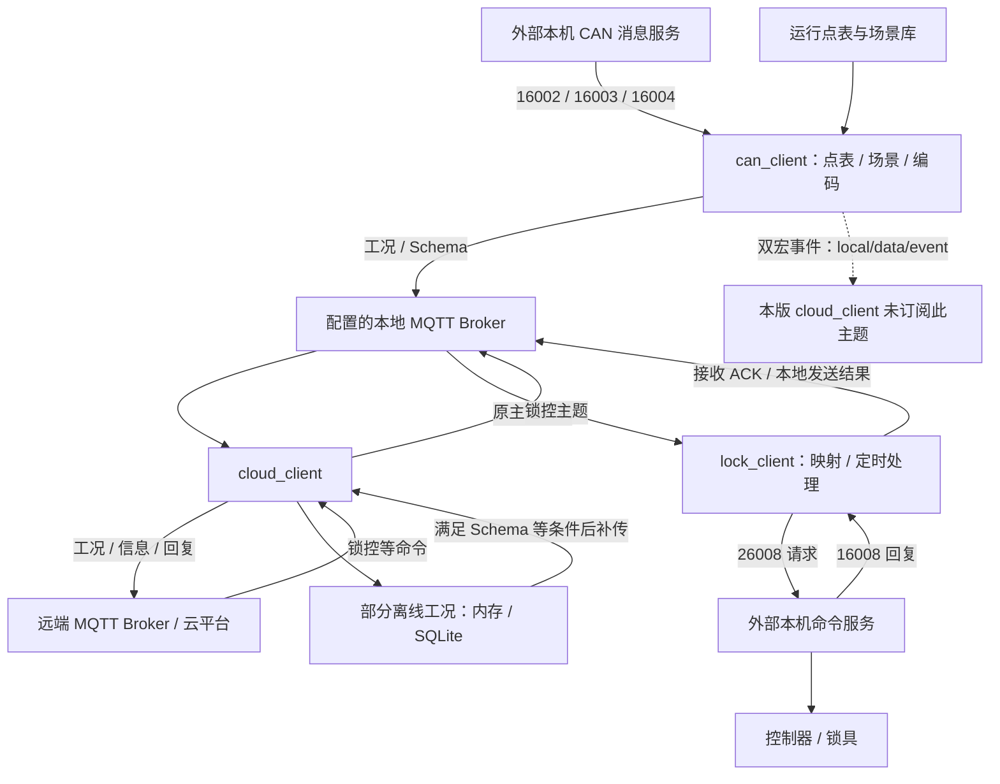

# Jinke（金科钻机）源码分析总览

> 更新：2026-10-15。本文是本目录三个应用源码分析的阅读入口、协作关系与核验总览。结构同时参照[RTMS SDK 总览](../源码分析总览.md)和[换电客户端总览](../../electric_station_truck_cn/源码分析总览.md)，按金科应用关系调整。三份详细报告的源码基线均为 `bc60961e`；另核对当前本地提交 `b7323a76` 的相关差异。运行链路仍是源码条件关系，尚无目标设备端到端验证结论。

## 文档目录

1. [分析基线与阅读方法](#overview)
2. [文档位置与章节导航](#documents)
3. [源码目录总览](#source)
4. [核心架构设计](#architecture)
5. [跨应用关键关系核验](#differences)
6. [逐文档主结论复核](#conclusions)
7. [核心模块深度分析](#modules)
8. [构建与运行边界](#build)
9. [核验方法、版本差异与验证范围](#verification)

<a id="overview"></a>

## 1. 分析基线与阅读方法

阅读范围为本目录下三份应用源码分析报告；项目速览和交接复核报告作为辅助入口。按三份报告共同的导读章节建立整体认识，再进入协议、风险与现场排查章节。

这组三个应用覆盖金科钻机的 CAN 数据整理、云通信和远程锁控：`can_client_for_jinke` 从本机消息服务接收 CAN 帧，依点表生成工况消息；`cloud_client` 桥接本地与远端 MQTT，处理注册、对时和部分历史工况补传；`lock_client` 将 MQTT 锁车/绑定指令转成本机命令，并产生接收确认与本地发送结果。

源码仓库：`/home/tronlong/lyp/code/rtms_sdk/`。三个文档文件夹对应同一仓库中的三个应用子目录，各自没有独立的 Git 分支。本文按三个应用的输入输出和调用关系组织内容。

| 详细报告 | 源码子目录 | 构建产物与目录声明版本 | 主要阅读用途 |
| --- | --- | --- | --- |
| [CAN 全链路源码分析](can_client_for_jinke/can_client_for_jinke_app源码分析.md) | `apps/can_client_for_jinke/` | `can_client`、`libscene.so`；CMake 项目版本 1.5 | 点表、场景、字段筛选、编码、金科事件及设备排查 |
| [云通信源码分析](cloud_client/cloud_client_源码分析.md) | `apps/cloud_client/` | `cloud_client`；CMake 项目版本 1.5 | MQTT 桥接、认证注册、对时、缓存补传及设备排查 |
| [锁控源码分析](lock_client/lock_client_app源码分析.md) | `apps/lock_client/` | `lock_client`；CMake 项目版本 1.1 | 指令映射、密码请求、本机命令、回执及设备排查 |

| 版本项 | 本轮核对结果 |
| --- | --- |
| 三份报告记录的分支 | `develop/rtms_sdk_v1.3_20240408` |
| 三份报告的完整提交基线 | `bc60961e64325d7448012097f92dc7214795a35f` |
| 本轮源码工作区分支 | `develop/rtms_sdk_v1.3_20240408` |
| 本轮源码工作区完整提交 | `b7323a76053e9daec26eb97af1dbba106a358918` |

目录声明版本不是固件发布版本，也不能证明设备正在运行哪一份二进制。`can_client_for_jinke` 的输出名为 `can_client`，SDK 其他应用也使用这个目标名；识别运行程序须结合实际二进制路径、构建参数与配置。

本目录另有[金科钻机项目交接复核报告](金科钻机项目交接复核报告.md)，关注协议、点表生成、固件包和交接证据。该报告中的固件与资料版本没有在本轮建立到上述源码提交的可复现映射，不能把其点表或交付包直接认定为这三个应用的已验证部署组合。

交接资料的业务 ID、源码中的十六进制 CAN ID（如 `0x215`）与点表 CBOR 索引属于各自的编号约定；跨层对应必须核对字段映射，不能只凭数字或名称相近认定相同。

<a id="documents"></a>

## 2. 文档位置与章节导航

```text
Jinke/                                      # 当前文档目录
├── 源码分析总览.md                           # 本文：入口、关系与核验结果
├── 金科钻机项目交接复核报告.md               # 交接资料的独立复核
├── can_client_for_jinke/
│   ├── AGENTS.md                            # 项目速览
│   └── can_client_for_jinke_app源码分析.md
├── cloud_client/
│   ├── AGENTS.md
│   └── cloud_client_源码分析.md
└── lock_client/
    ├── AGENTS.md
    ├── lock_client_app源码分析.md
    └── 流程图/
        ├── 01_整体消息流程.png
        ├── 02_启动与初始化.png
        ├── 03_定时指令处理.png
        └── 04_设备故障排查.png
```

三份详细报告现有的共同导读顺序为“项目概述 → 源码目录总览 → 核心架构设计 → 核心模块深度分析 → 关键流程与数据流”；详细正文保留各自编号。本轮沿用这些章节，按阅读任务提供跳转。

| 阅读任务 | CAN 报告 | 云通信报告 | 锁控报告 |
| --- | --- | --- | --- |
| 判断范围与构建条件 | [第 0–2 节入口](can_client_for_jinke/can_client_for_jinke_app源码分析.md#analysis-1) | [第 1 节](cloud_client/cloud_client_源码分析.md#analysis-1) | [第 1 节](lock_client/lock_client_app源码分析.md#analysis-1)、[第 9 节](lock_client/lock_client_app源码分析.md#analysis-9) |
| 启动、资源与执行单元 | [第 3–4 节入口](can_client_for_jinke/can_client_for_jinke_app源码分析.md#analysis-4) | [第 2–4 节入口](cloud_client/cloud_client_源码分析.md#analysis-2) | [第 3–4 节入口](lock_client/lock_client_app源码分析.md#analysis-3) |
| 主数据流与协议 | [第 5–8 节入口](can_client_for_jinke/can_client_for_jinke_app源码分析.md#analysis-6) | [第 5–7 节入口](cloud_client/cloud_client_源码分析.md#analysis-5) | [第 5–7 节入口](lock_client/lock_client_app源码分析.md#analysis-5) |
| 源码问题与证据边界 | [第 9 节](can_client_for_jinke/can_client_for_jinke_app源码分析.md#analysis-10)、[第 11 节](can_client_for_jinke/can_client_for_jinke_app源码分析.md#analysis-12) | [第 9–10 节入口](cloud_client/cloud_client_源码分析.md#analysis-9) | [第 8 节](lock_client/lock_client_app源码分析.md#analysis-8)、[第 10 节](lock_client/lock_client_app源码分析.md#analysis-10) |
| 设备异常排查 | [第 10 节](can_client_for_jinke/can_client_for_jinke_app源码分析.md#analysis-11) | [第 11 节](cloud_client/cloud_client_源码分析.md#analysis-11) | [第 11 节](lock_client/lock_client_app源码分析.md#analysis-11) |

初次阅读先看本文第 1–5 节，再用第 7 节的模块表进入详细分析。查“CAN 有值但平台没值”时联看 CAN 上报条件与云通信对时/Schema；查“有 ACK 但锁没动作”时联看锁控回执语义与命令服务接口。

三份详细报告开头的 `../../源码分析总览.md` 指向[RTMS SDK 源码分析总览](../源码分析总览.md)，用于跨产品导航；本文件补充金科三个应用之间的具体接口与条件。

<a id="source"></a>

## 3. 源码目录总览

```text
rtms_sdk/                                  # 源码仓库，非当前文档目录
└── apps/
    ├── CMakeLists.txt                     # 应用纳入开关
    ├── can_client_for_jinke/
    │   ├── CMakeLists.txt / main.c / global_config.h.in
    │   └── src/
    │       ├── can_mng/ / can_server/      # 状态、配置与 CAN 订阅
    │       ├── data_process/              # 点表、字段、筛选与编码
    │       ├── scene/ / scene_lib/         # 场景库加载和判断
    │       ├── mosquitto/                 # MQTT 数据与 Schema
    │       └── app_server/ / event/ / fei4/ / queue/ / list/
    ├── cloud_client/
    │   ├── CMakeLists.txt / main.c / global_config.h.in
    │   └── src/
    │       ├── cloud_dev/ / mosquitto/     # 状态、区域、MQTT 与注册
    │       ├── json_parse/ / nn_sock/      # 指令、对时与本机通信
    │       ├── db_manage/ / sdcard_check/  # SQLite 与 SD 卡条件
    │       └── common/ / posix/ / sany_log/ / base64/ / md5/
    └── lock_client/
        ├── CMakeLists.txt / main.c / global_config.h.in
        └── src/
            ├── lock_mgr/ / mosquitto/     # 配置、共享对象与 MQTT
            ├── lock/ / cmd/              # 命令映射、本机帧与回复
            └── list/ / common/            # 队列与时间辅助
```

源码树省略其他 SDK 应用和部分辅助文件。目录存在、目标被构建、线程被启动与现场能力可用需要分别确认。

<a id="architecture"></a>

## 4. 核心架构设计



图描述这些应用在配置到相容 Broker、构建条件满足且外部服务存在时的协作方向。它们是独立进程，通过 MQTT 与 nanomsg 传递消息，各自持有状态和队列；不存在三者共用的进程内全局对象。图中的本地 Broker 地址可由 INI 改写，也没有证据表明目标设备必然同时运行这三个应用。

<a id="differences"></a>

## 5. 跨应用关键关系核验

### 5.1 主题与转发关系

| 接口 | 生产/处理方 | 另一端的源码行为 | 组合结论 |
| --- | --- | --- | --- |
| `local/data/general_data` | CAN 的 `mtyp=0`，JSON，QoS 0 | cloud_client 订阅，实时映射到 `v4/p/post/thing/live/json/1.0` | 主题可对应；仍受首次对时、Schema 等条件影响 |
| `local/data/cbor_general_data` | CAN 的 `mtyp=1`，CBOR，QoS 0 | cloud_client 订阅，映射到 `v4/p/post/thing/live/cbor/1.1` | 需另核对 Schema/索引、协议前缀和平台模型 |
| `local/data/gz_general_data` | CAN 的 `mtyp=2`，生成普通 JSON，QoS 0 | cloud_client 执行 gzip 压缩后发 `…/live/jsongz/1.1`；压缩失败回退 `…/live/json/1.1` | 压缩步骤位于 cloud_client；不能凭本地主题名把输入当作 gzip 字节 |
| `local/data/schema`、`local/data/get_schema` | CAN 在 `NOT_USED_SCHEMA` 未定义时发布 Schema/响应非空请求 | cloud_client 接收 Schema，缺失时向本地请求 | CAN 旧路径不生产这条 Schema；需核对其他生产者或部署组合 |
| `local/data/event` | CAN 双宏路径发布 `DrillingCompletionEvent` | cloud_client 虽定义同名常量，本地连接回调没有订阅它；订阅的是 `v4/p/post/thing/event/json/1.0` | 本轮未发现从该本地事件主题到云端的自动转发闭环，需其他桥接/配置证据 |
| `v4/s/set/thing/lock/json/1.0` | cloud_client 从远端收取并原主题送到本地；lock_client 订阅 | lock_client 解析后入队，定时映射与发送 | 主题一致；执行仍依赖密码、本机命令服务及硬件 |
| `v4/p/resp/set/thing/lock/json/1.0` | lock_client 发布 ACK/本地处理结果，QoS 1 | cloud_client 本地订阅后由回复线程原主题发远端 | 远端在线但首次对时标志未置位时会丢弃；远端离线时不进入工况历史缓存 |

主题与调用依据：`bc60961e:apps/can_client_for_jinke/src/mosquitto/client_mosquitto.h:4–9`、`.c:164–240`；`apps/cloud_client/src/mosquitto/client_mosquitto.h:15–65`、`.c:214–238,337–427,579–627,831–875,1240–1276`；`apps/lock_client/src/mosquitto/client_mosquitto.h:4–5`。这里的对应关系来自实际订阅和分发调用，不能只看头文件是否定义了主题。

### 5.2 需要优先核对的组合条件

1. **CAN 宏组合先影响可编译性。** `can_data_t` 和共享对象中的 `can_data` 受 `NOT_USED_SCHEMA && USE_JINKE` 保护，`can_mng.c` 却无条件使用。其余三种组合存在类型/成员不可见问题；双宏均开启只满足这些声明条件，完整编译链接仍未验证。依据：`bc60961e:apps/can_client_for_jinke/src/can_mng/can_mng.h:21–29,82,117–130`、`.c:48,112`。
2. **CAN 旧路径与云端 Schema 等待需联查。** 双宏路径跳过 CAN 的 Schema 发布；cloud_client 默认发送路径等待 Schema，历史线程无条件等待 `cbor_schema_report`。cloud_client 开启 `NOT_USED_SCHEMA` 只跳过其远端线程的 Schema 分支，不能自动解除历史等待。两个目录还使用同名 CMake 选项，同一构建树中应核对实际缓存值与宏。依据：CAN `main.c:77–84`、`client_mosquitto.c:164–180`；cloud `client_mosquitto.c:806–830,1193–1198`。
3. **云端首次对时会影响采集进程。** cloud_client 首次对时解析返回成功后执行 `killall can_client alarm_client` 并置标志。设备必须有相应进程管理/拉起机制；设置系统时钟失败也可能返回成功，因此该标志不等于设备时间已正确。依据：`bc60961e:apps/cloud_client/src/json_parse/json_parse.c:64–89,349–363`。
4. **锁控标签存在跨服务差异。** lock_client 用 200 取密码、202 发锁控，请求带密码前 6 字节和命令码；同仓库 `io_mng` 的 `CMD_TAG_LOCK` 却为 200。须确认设备实际命令服务实现与帧布局，不能由共用 `16008/26008` 推断协议匹配。依据：`bc60961e:apps/lock_client/src/cmd/cmd.h:29–54`、`.c:146–197`；`apps/io_mng/src/cmd/cmd.h:29–30`。
5. **锁控回执没有硬件完成闭环。** `isAck=true` 是接收确认；`isAck=false,code=0` 在 `nn_send()` 未报错时生成；标签 202 回复只参与本地日志，不生成对应的 MQTT 硬件完成回执。依据：`bc60961e:apps/lock_client/src/lock/lock.c:177–214`、`src/cmd/cmd.c:104–111`。

<a id="conclusions"></a>

## 6. 逐文档主结论复核

下表借用 SDK 总览的“源码结论—外部证据”组织方式，分别核对三份报告的主链路。位置均按 `bc60961e`，从源码仓库根目录 `apps/` 起算；表内只给出代表性证据，不代替详细报告的全部分析。

| 详细报告 | 已核对的主要结论与源码依据 | 仍需外部证据的边界 |
| --- | --- | --- |
| [CAN 全链路分析](can_client_for_jinke/can_client_for_jinke_app源码分析.md) | `apps/can_client_for_jinke/src/can_mng/can_mng.c:98–112` 初始化点表上下文、默认场景并尝试加载场景库，未检查加载返回值；`src/can_server/can_server.c:168–174` 在同一收帧循环中调用专有解析、普通点表解析和场景判断，其中专有解析受宏控制；默认宏还存在第 5.2 节所述声明冲突。 | 最终构建宏、金科运行点表、动态库和真实 CAN 帧是否匹配；生成消息是否抵达预期 Broker 与平台。 |
| [云通信分析](cloud_client/cloud_client_源码分析.md) | `apps/cloud_client/src/mosquitto/client_mosquitto.c:222–238` 明确本地订阅列表；`363–372` 在远端在线但首次对时标志未置位时丢弃普通本地消息；`806–830,1193–1208` 分别给出默认发送的 Schema 等待、历史线程的无条件等待，以及发布返回成功后调用数据库删行函数。 | 首次对时与 Schema 来源、数据库操作是否成功、重连后消息是否送达，以及云端是否接受并保存。 |
| [锁控分析](lock_client/lock_client_app源码分析.md) | `apps/lock_client/src/lock/lock.c:181–207` 无密码时先请求密码，有密码时每次回调最多处理一条，发送函数返回成功后才排入 `code=0` 回执；`src/cmd/cmd.c:104–111` 对锁控回复仅记录本地成功日志，没有生成 MQTT 硬件完成回执。 | 命令服务对密码、标签和结构布局的实际解释，以及与同一业务请求关联的控制器/锁具状态。 |

三份报告的主结论在各自基线下可由上述入口与分支支持；“可对应主题”“发布调用成功”“数据库删行调用”“本机成功日志”分别证明不同阶段，不能合并为端到端完成结论。

<a id="modules"></a>

## 7. 核心模块深度分析

按 SDK 总览的模块导航方式，将三个应用串成可追踪的业务模块。源码路径均相对 `rtms_sdk/apps/`，详细章节链接沿用各报告现有显式锚点。

| 核心模块 | 入口与主要源码 | 关键判断和输出 | 深入阅读 |
| --- | --- | --- | --- |
| 配置、启动与共享状态 | 三应用的 `main.c`、`CMakeLists.txt`；`can_client_for_jinke/src/can_mng/`、`cloud_client/src/cloud_dev/`、`lock_client/src/lock_mgr/` | 构建开关、INI、运行目录、保活和线程创建决定后续路径是否进入；三个上下文各属于自己的进程。 | [CAN 启动](can_client_for_jinke/can_client_for_jinke_app源码分析.md#analysis-4)、[云初始化](cloud_client/cloud_client_源码分析.md#analysis-3)、[锁控启动](lock_client/lock_client_app源码分析.md#analysis-3) |
| CAN、点表与场景 | `can_client_for_jinke/src/can_server/`、`src/data_process/`、`src/scene/`、`src/scene_lib/` | 先按通道与 CAN ID 定位规则，按字段偏移提取值，再更新场景；上报还受场景、间隔、接收状态及变化阈值筛选。 | [点表解析](can_client_for_jinke/can_client_for_jinke_app源码分析.md#analysis-6)、[CAN 处理](can_client_for_jinke/can_client_for_jinke_app源码分析.md#analysis-7)、[筛选编码](can_client_for_jinke/can_client_for_jinke_app源码分析.md#analysis-8) |
| 本地编码与云端桥接 | `can_client_for_jinke/src/mosquitto/`、`cloud_client/src/mosquitto/`、`src/json_parse/` | CAN 选择 JSON/CBOR/JSONGZ；云通信按订阅、连接、对时、Schema 和消息类别分流。JSONGZ 的 gzip 步骤在云通信侧。 | [CAN 上报](can_client_for_jinke/can_client_for_jinke_app源码分析.md#analysis-8)、[认证注册](cloud_client/cloud_client_源码分析.md#analysis-4)、[主题映射](cloud_client/cloud_client_源码分析.md#analysis-5) |
| 金科事件与旧应用数据 | `can_client_for_jinke/src/app_server/`、`src/event/`、`src/fei4/`、`src/queue/` | 宏组合控制 GPS/MCU、工单事件和统计；事件文件保存上一工单号，不能充当离线消息库；本版云通信存在事件订阅缺口。 | [旧路径与金科事件](can_client_for_jinke/can_client_for_jinke_app源码分析.md#analysis-9)、[本文接口核验](#differences) |
| 历史缓存与补传 | `cloud_client/src/db_manage/`、`src/sdcard_check/`、`src/mosquitto/client_mosquitto.c` | 启动时 SD 卡状态决定是否建库，消息类别和条数决定入库/淘汰；补传等待 Schema 标志，并按发布调用返回值推进删除。 | [补传边界](cloud_client/cloud_client_源码分析.md#analysis-7)、[风险分析](cloud_client/cloud_client_源码分析.md#analysis-9) |
| 锁控转换与本机协议 | `lock_client/src/mosquitto/`、`src/lock/`、`src/cmd/`；`cloud_client/src/mosquitto/` | 云端命令原主题下发，锁控将 lock/bind/level 转成命令码；密码、5 秒节奏、标签/帧格式和回复语义分别核对。 | [锁控映射](lock_client/lock_client_app源码分析.md#analysis-5)、[本机协议](lock_client/lock_client_app源码分析.md#analysis-6)、[队列时序](lock_client/lock_client_app源码分析.md#analysis-7) |

### 7.1 CAN 点表、场景与金科扩展

主链路按“本机完整帧 → 通道/CAN ID 规则 → 字段解码 → 场景更新 → 上报筛选 → 编码与发布”执行。`Pointsheet_info1.json` 的 `mtyp` 决定发送格式，不能用 `GeneralParam.json` 中同名字段替代它；`dev[].slot` 索引三路 CAN，`app[].nm` 为 `can_client` 时才创建对应应用字段。字段偏移以整个 `can_frame_t` 为基准，数据区起于位偏移 64，不能直接套用以 `data[0]` 为零点的点表。

数值字段按类型处理符号、计算 `raw × sc + pofs` 并限幅；上报要求场景/间隔匹配且至少收到过该字段。首次合格值可上报，后续 `udif=0` 允许周期发送，非零时检查数值变化阈值或字符串变化。字段的上次值和上报时间在生成载荷时更新，尚未等待 MQTT 交付；源码没有按接收年龄统一淘汰所有普通字段，不能把“收过值”理解成“值仍新鲜”。递归 `rls` 虽保存子规则值，提取函数没有再次比较这些值。

场景库用 `0x171` 的转速和 `0x172` 的速度缓存：速度大于 0 为 `drive`；否则转速 0 为 `power_on`、1～800 为 `idle`、再高为 `work`。旧路径的数字 `device_standard_work_state` 另结合 ACC 与发动机转速、使用 900 的分界和 60 秒超时处理，两套状态不能混用。Schema 路径按字段名沿用模型索引或从 50 起为新名字分配索引，但输出的 Schema 单项仅附加名称和类型，接收方如何对应索引仍需协议证据。

双宏路径另启 GPS/MCU、日期和 FEI4 线程。`0x215` 帧按 1/2/2/2/1 字节提取工单号、计划深度、实际深度、耗时和成功标志，工单号变化且入队成功才更新上一工单号；日号变化会重置它。环形事件队列最多容纳 9 个事件，`jk_evt_no` 只记日号/上一工单号。FEI4 线程每约 300 秒依次输出此前样本、清零、采入当前样本，不能描述为连续采样 300 秒的平均值，也不构成独立的非四平台联网协议。

源码依据（均为 `bc60961e`，路径相对 `apps/can_client_for_jinke/`）：`src/data_process/data_process.c:223–250,364–383,445–568,756–844,852–1074,1280–1299`；`src/scene_lib/scene_judge.c:37–97`；`src/app_server/app_server.c:59–110`；`src/can_server/can_server.c:20–52,55–100`；`src/queue/queue.c:19–60`；`src/fei4/fei4.c:206–227`。具体字段和流程图见 [CAN 配置/解析](can_client_for_jinke/can_client_for_jinke_app源码分析.md#analysis-6)与[旧路径](can_client_for_jinke/can_client_for_jinke_app源码分析.md#analysis-9)。

### 7.2 云端区域、认证、对时与指令

| 阶段 | 关键条件与后续行为 |
| --- | --- |
| 区域选择 | INI 成功加载后，`domain_select:type` 缺键默认 `auto`，也支持 `domestic/oversea`。自动路径按平台从模组 MCC 或本机网络消息取得 PLMN/运营商，`460` 判国内，超时回退海外；普通网络消息路径另有约 9 分钟在线等待门限，总门限约 10 分钟。整个 INI 缺失时不能套用缺键默认值。 |
| DNS 与远端连接 | 先做 IPv4 域名预解析，失败每 5 秒重试；实际连接仍使用域名。远端连接使用当前候选身份，端口为 8883 且编译定义 `WITH_TLS` 时填入三份证书路径。 |
| 候选身份与注册 | 从 `conf2.ini` 读到 ID/secret 字段时优先作为候选，再用 `conf.ini`；否则仅后者。读取到字段不代表凭据通过云端认证。源码仅在连接回调满足 `result == MOSQ_ERR_CONN_REFUSED` 时标记失败并唤醒协调线程，不能把任何网络/认证错误都理解为自动触发注册。候选全部被标失败且机器序列号/模型 ID 可用后才进入注册。 |
| 注册完成条件 | 临时注册客户端使用租户、模型与设备信息构造认证，订阅 `v4/s/register`；本目录未主动发布注册请求。响应中的用户名/密码用于保存认证，临时线程仍等注册连接断开才退出；协调线程拿不到认证会 `exit(1)`，实际服务端交互仍需证据。 |
| 对时与信息上报 | 首次对时请求后以 5 秒定时器继续尝试，并有 24 小时定时器；时间解析返回成功不保证系统/MCU 设置成功。标准信息含 T-Box 标识、蜂窝类型和可得的机器序列号/模型 ID；系统信息由本地生产者提供，Schema 来自本地 Schema 主题。 |
| 远端命令处理 | 本进程处理时间及 `REBOOT/SCHEMA/CUSTOM` 等命令：重启安排 10 秒后执行，Schema 命令清标志，CUSTOM 当前处理注册相关模型信息。OTA、文件、锁、配置、实时数据和命令仍按原主题转给本地；`noReply` 控制直接命令回复，不阻止该原主题转发。 |
| 重连状态 | 远端断开回调没有清首次对时、Schema、系统/标准信息的上报标志，不能假定重连后自动完整重走首次启动流程。 |

依据：`bc60961e:apps/cloud_client/src/cloud_dev/cloud_dev.c:57–74,179–347`；`src/common/common.c:78–146,214–233`；`src/mosquitto/client_mosquitto.c:47–121,529–577,579–627,644–695,927–1143`；`src/json_parse/json_parse.c:97–295,296–347,349–422`。详见[区域初始化](cloud_client/cloud_client_源码分析.md#analysis-3)、[连接注册](cloud_client/cloud_client_源码分析.md#analysis-4)与[对时和命令](cloud_client/cloud_client_源码分析.md#analysis-6)。

### 7.3 锁控映射、密码与两类回执

锁控输入字段在 `body.lock` 中；`lock/bind` 缺失或为 `null` 时保持未指定。对合法布尔和整数输入，转换结果如下，载荷下标 6（第 7 个字节）使用该命令码：

| lock | bind | level | 命令码 |
| --- | --- | --- | --- |
| 未指定 | true / false | 忽略 | 绑定 `0x10` / 解绑 `0x20` |
| true | 未指定 | 1 / 2 / 3 | `0x31 / 0x32 / 0x33` |
| true | true | 1 / 2 / 3 | `0x51 / 0x52 / 0x53` |
| false | 未指定 / false | 忽略 | 解锁 `0x40` / 解绑并解锁 `0x60` |
| 其余组合 | 任意 | 任意 | 转换无效；进入正常定时处理分支后不下发，生成 `code=1` |

`delay` 只读取并写日志，没有延时执行效果。无缓存密码时，5 秒定时回调只请求密码、不处理指令；检查条件仅为密码长度大于 0，真正发送却固定复制前 6 字节，短密码存在越界读取风险。命令请求用结构体内存直接发送，SUB 以本进程 PID 的 4 字节作订阅前缀，必须联查对端 ABI、字节序和标签；回复没有与业务 `msgId` 或请求序号建立完成状态机。

消息回调取得 `msgId` 后排入 `isAck=true` 接收确认，指令随后另入处理队列；命令映射有效且本机发送未报错才排入 `isAck=false,code=0`。JSON 解析失败、发送失败等路径没有统一的失败业务回执；所以“没有结果”不能直接判作设备没动作。`hasError` 固定为 0，业务判断还需看 `isAck` 和 `results.lock.code`。

依据：`bc60961e:apps/lock_client/src/lock/lock.c:24–133,136–214`；`src/cmd/cmd.c:40–54,89–132,146–197`；`src/mosquitto/client_mosquitto.c:57–85`。完整输入边界和帧格式见[锁控映射](lock_client/lock_client_app源码分析.md#analysis-5)与[本机协议](lock_client/lock_client_app源码分析.md#analysis-6)。

<a id="build"></a>

## 8. 构建与运行边界

### 8.1 构建入口与平台

以下默认值和平台均以报告基线 `bc60961e` 为准，当前提交差异见第 9.1 节。

| 项目 | CAN 采集应用 | 云通信应用 | 锁控应用 |
| --- | --- | --- | --- |
| SDK 顶层接入 | `WITH_CAN_CLIENT_FOR_JINKE=OFF`，显式开启才加入 | `WITH_CLOUD_CLIENT=OFF`，显式开启才加入 | `apps/CMakeLists.txt` 未加入 `lock_client` |
| 本目录开关 | `NOT_USED_SCHEMA=OFF`、`USE_JINKE=OFF` | `NOT_USED_SCHEMA=OFF`；定义 `WITH_TLS` | 无同类业务开关 |
| 交叉编译平台分支 | `EC200A`、`EG25G` | `EC200A`、`EG25G`、`AG35GL`、`MCIMX6Y2CVM08AB` | `EC200A`、`EG25G` |
| 主要输入 | 本机三路 CAN；可选旧 GPS/MCU 路径 | 本地数据/回复、云端指令、本机网络信息 | MQTT 锁车/绑定 JSON、本机密码/命令回复 |
| 核心配置 | `/opt/conf_ext2.ini`；程序同目录点表与场景库；Schema 路径另需 `GeneralParam.json` | `/opt/conf.ini`、`conf_ext2.ini`、候选认证与型号文件；按端口配置证书 | `/opt/conf_ext2.ini`；本机服务返回的密码 |
| 调度方式 | CAN 接收与 MQTT 线程；双宏另启日期、FEI4 等线程 | 本地/远端 MQTT、注册、回复、历史等线程及库网络线程 | 主线程 libev、5 秒定时器、MQTT/保活线程及库网络线程 |
| 历史与持久化 | 工况无历史数据库；事件文件仅保存日期/上一工单号 | 部分离线工况按条件进入内存或 SQLite | 指令/回执仅内存队列，无持久化和业务去重 |
| 成功语义 | 生成载荷与 MQTT 发布调用分别判断 | 远端连接、对时、Schema、发布调用分别判断 | 接收 ACK、本机发送结果、服务回复、硬件状态分别判断 |

依据：基线 `apps/CMakeLists.txt:57–61,99–103`，三个应用的 `CMakeLists.txt`、`main.c` 及各报告的构建/启动章节。三者都使用 CPActive 更新本地活动时间；保活不证明业务线程或设备链路健康。

从构建到运行依次核对：顶层应用开关 → 各目录 CMake 与宏 → 链接和安装产物 → 设备启动配置 → 外部服务与点表 → 运行结果。锁控目录未被顶层加入、CAN 默认宏存在声明冲突、cloud_client 新增平台分支，分别处在这条链的不同阶段。已有预置二进制或源码函数不能替代完整构建和设备启动证据。

普通 CAN 应用的 `WITH_CAN_CLIENT` 与金科的 `WITH_CAN_CLIENT_FOR_JINKE` 分别进入两个目录，但两者均声明 `add_executable(can_client ...)`；在同一顶层构建中同时开启存在目标重名冲突。依据：`bc60961e:apps/CMakeLists.txt:63–67,99–103`、`apps/can_client/CMakeLists.txt:56`、`apps/can_client_for_jinke/CMakeLists.txt:48`。选择哪套采集实现必须由设备构建基线决定。

### 8.2 运行资源与本机端口

| 资源/接口 | 使用者与实际条件 |
| --- | --- |
| `/opt/conf_ext2.ini` | 三应用读取 `mgw:local_ip/local_port`，缺键默认 `127.0.0.1:1883`。CAN/锁控在文件不能加载时初始化失败；云通信调用者未检查整个配置读取结果。CAN 地址缓冲区仅 20 字节，长地址还会被截断。 |
| 程序同目录 `Pointsheet_info1.json / GeneralParam.json / libscene.so` | CAN 按 `/proc/self/exe` 推得目录读取；点表始终需要，GeneralParam 仅 Schema 路径需要，场景库导出 `judge_scene`。本目录安装语句没有安装两份 JSON。 |
| `/opt/conf.ini / conf2.ini` | 云通信的设备身份和候选认证；前者 ID/secret 缺失使初始化失败，后者可在注册或远端连接成功时被覆盖保存。 |
| `/opt/device_type.ini / device_model.json / machine_sn` | 云通信读取设备型号、模型映射和机器序列号，影响注册和标准信息；不能由目录名推定实际模型。 |
| `/opt/cert/ca.crt / client.crt / client.key` | 云通信远端业务连接在端口 8883 的条件分支使用；注册连接未设置同样的证书路径，不能把两类连接的 TLS 条件混写。 |
| `/media/sdcard/jk_evt_no / mqtt_history.db` | 前者由 CAN 事件路径记录日号/工单号，后者由云通信保存部分离线工况；用途与持久化范围不同。 |
| `127.0.0.1:16002 / 16003 / 16004` | CAN 应用的三个 nanomsg SUB 输入，对应服务端和物理 CAN 配置由其他进程提供。 |
| `127.0.0.1:16005 / 38000` | CAN 旧路径分别作为 GPS SUB、MCU REQ；`NOT_USED_SCHEMA` 控制入口，不能套到默认 Schema 路径。 |
| `127.0.0.1:16008 / 26008` | 云通信与锁控各自连接命令回复 SUB/命令请求 PUB；锁控使用 PID 前缀过滤，端口一致不保证命令语义一致。 |
| `127.0.0.1:38001` | 云通信网络信息 REQ；不是它直接订阅 CAN/GPS 的入口。 |
| `/tmp/cloud_status / cloud_client.pid / lock_client.pid` | 云状态 0/1/2 分别写于启动、断开或清理、远端连上；两个 pid 文件用于文件锁，不靠文件存在证明进程存活，也不写 PID。 |
| `/tmp/ql_time_set_pipe / system_is_rebooting` | 云通信非 IMX6 对时路径尝试写模组时间，重启指令写重启标志；两者都需联查外部服务和实际时序。 |

依据（`bc60961e`）：CAN `src/can_mng/can_mng.c:8–45`、`main.c:77–92`、`CMakeLists.txt:73–79`、`src/app_server/gps.c:10–35`、`src/app_server/mcu.c:10–31`；cloud `src/common/common.c:21–25,78–233,489–559`、`src/cloud_dev/cloud_dev.c:90–137`、`src/nn_sock/nn_sock.h:17–26`、`src/mosquitto/client_mosquitto.c:529–577,689–695`；lock `main.c:20–30`、`src/lock_mgr/lock_mgr.c:10–54`。完整表见[CAN 运行资源](can_client_for_jinke/can_client_for_jinke_app源码分析.md#analysis-5)和[云通信配置](cloud_client/cloud_client_源码分析.md#analysis-8)。

### 8.3 时序、缓存与丢失边界

| 路径 | 实际调度/保留方式 | 不能据此推导的保证 |
| --- | --- | --- |
| CAN 工况 | 按点表间隔/变化生成，QoS 0；生成时更新字段上次值和时间，无工况历史库 | 发布失败不会自动回退这次字段状态，不能保证逐个变化都有可靠重发 |
| CAN 金科事件 | 最多 9 个事件；生成 JSON 时即出队并释放，之后才发布 QoS 0；日号约每 10 秒检查 | 工单号文件不保存消息体，也不能证明事件已上云；入队满时还有对象未释放路径 |
| 云通信实时队列 | 远端在线且首次对时标志置位后，四类工况/定位进入实时队列；达到 100 条先移除旧项再追加 | 上限与首次对时前丢弃决定了其不提供全量无损缓存 |
| 云通信离线工况 | 启动时 SD 卡真实挂载、可写且空闲至少 500 MiB 才建库；累计 10 条批量写库，未满一批仍在内存；无卡时追加后达到 100 条淘汰首项 | 不保证掉电前未满批次的数据保留，也不自动随插拔卡重新判定建库条件 |
| 云通信历史补传 | 无条件等 Schema 标志；每轮尝试数据库与内存首项，约 200 ms 节奏；QoS 0 返回成功后调用删除 | 查询和删除未写 `ORDER BY`，不能承诺严格 FIFO；批量事务提交前已移除内存消息，提交失败可丢失；未知主题还可能因初始成功返回值而被删除 |
| 云通信事件/锁控回复 | 已订阅的云端事件、位置、CBOR 1.2 和回复主题在在线且已对时时进入原主题回复路径；远端离线不进四类工况缓存 | 已定义 `local/data/event` 映射函数不代表已订阅，也不能推导这些消息离线可恢复 |
| 锁控指令与回执 | 两条无容量上限的内存 FIFO；5 秒定时器最多处理一条，发布循环每 5 秒最多发一条，正常指令可能生成 ACK 和结果两条回执 | 没有按 msgId 去重或持久化；断网/高频输入可积压，发布失败出队后不重试，不能保证固定完成时延 |
| 保活与对时 | 三应用登记 10 秒超时，保活线程约每 5 秒更新；云对时有首次、5 秒重试及 24 小时请求 | 心跳、连接状态和对时标志均不单独证明业务健康或系统时间正确 |

依据（`bc60961e`）：CAN `src/event/jk_event.c:36–98`、`src/can_server/can_server.c:20–52,76–100`、`src/mosquitto/client_mosquitto.c:182–240`；cloud `src/mosquitto/client_mosquitto.c:337–427,1145–1276`、`src/db_manage/db_manage.c:387–555,590–609`；lock `src/mosquitto/client_mosquitto.c:133–150`、`src/lock/lock.c:177–214`。三应用的队列锁只保护对应操作，不代表全部共享状态已统一同步。

### 8.4 重点源码风险与核验入口

以下是固定提交中存在的未检查操作或控制流，尚未在目标设备上复现。

| 范围 | 已确认的源码条件 | 详细定位 |
| --- | --- | --- |
| CAN 动态库与解码边界 | `load_libscene()` 返回值未检查，错误处理还有 `dlclose(NULL)` 路径；点表槽位/数组、字段长度、字符串缓冲区缺少完整检查，`can_dlc` 不限制字段读取；有符号 char 拼接存在高位字节扩展风险 | [CAN 失败模式](can_client_for_jinke/can_client_for_jinke_app源码分析.md#analysis-10)；`src/scene/scene.c:18–41`、`src/data_process/data_process.c:445–568,807–827` |
| 云通信配置与认证错误传播 | 多个读取返回值与区域选择返回值未被调用者检查；注册切换只由特定回调条件触发，缺文件和网络故障不能套用缺键默认值/自动注册结论 | [云通信风险](cloud_client/cloud_client_源码分析.md#analysis-9)；`src/cloud_dev/cloud_dev.c:90–100`、`main.c:156`、`src/mosquitto/client_mosquitto.c:561–564` |
| 云通信启动保活顺序 | `main()` 先登记 10 秒超时，再选择区域，最后才启动保活线程；自动选择可能等待约 10 分钟。在该等待期间，本进程尚未启动周期保活，进程管理器是否因此处置它需现场证据 | `bc60961e:apps/cloud_client/main.c:130–166`、`src/cloud_dev/cloud_dev.c:204–263,296–341` |
| 锁控 JSON 与密码 | MQTT 载荷复制未补字符串终止符；header/msgId 异常存在空指针或未初始化指针路径；布尔/数值未严格做类型校验；短密码和短回复没有完整长度保护 | [锁控失败路径](lock_client/lock_client_app源码分析.md#analysis-8)；`src/mosquitto/client_mosquitto.c:65–82`、`src/lock/lock.c:91–129,189–212`、`src/cmd/cmd.c:95–127,181–183` |
| 队列失败与资源回收 | CAN 满事件队列未释放新对象、锁控发布失败出队不重入队且字符串未释放，云批量写库失败不能恢复此前已出队的消息 | [CAN 风险](can_client_for_jinke/can_client_for_jinke_app源码分析.md#analysis-10)、[锁控风险](lock_client/lock_client_app源码分析.md#analysis-8)、[云补传边界](cloud_client/cloud_client_源码分析.md#analysis-7) |
| 线程和退出 | 多处未检查线程创建结果；CAN 只 join 最后写入的 tid；锁控 MQTT 状态跨线程未同步，云退出信号处理内调用 MQTT 清理和 system；不能把进程仍在当作工作线程都正常 | CAN `main.c:100–112`；lock `src/mosquitto/client_mosquitto.c:22–38,133–149`；cloud `main.c:43–71,150–166` |
| 敏感日志 | 云通信部分日志输出设备/认证密钥或注册口令，锁控会转储密码及含密码的发送帧；导出日志需要遮盖相应值 | cloud `src/common/common.c:177`、`src/mosquitto/client_mosquitto.c:697–698`、`src/json_parse/json_parse.c:337–341`；lock `src/cmd/cmd.c:125–130,181–186` |

### 8.5 按症状联查的最小证据

| 症状 | 依序核对的链路 | 详细排查入口 |
| --- | --- | --- |
| 进程启动失败、反复退出 | 实际二进制/宏 → INI 和 JSON → 动态库/依赖 → CPActive 与启动管理器 → 首条错误；pid 文件不作为存活证明 | [CAN 启动排查](can_client_for_jinke/can_client_for_jinke_app源码分析.md#analysis-11)、[云通信排查](cloud_client/cloud_client_源码分析.md#analysis-11)、[锁控排查](lock_client/lock_client_app源码分析.md#analysis-11) |
| CAN 有帧但平台无字段 | 原始帧/通道 → 帧结构与点表偏移 → 规则/场景/udif → 本地主题 → 对时/Schema → 远端发布 → 平台接收解析 | [CAN 设备排查](can_client_for_jinke/can_client_for_jinke_app源码分析.md#analysis-11)、[云端数据排查](cloud_client/cloud_client_源码分析.md#analysis-11) |
| 事件缺失或历史不补传 | 金科双宏/工单变化 → 事件队列/日号 → 本地事件订阅缺口；另查历史类别 → 启动时 SD 状态 → Schema 等待 → 写库/补传/云端关联记录 | [金科事件](can_client_for_jinke/can_client_for_jinke_app源码分析.md#analysis-9)、[历史补传](cloud_client/cloud_client_源码分析.md#analysis-7) |
| 有锁控 ACK，但无动作/结果 | 同一 msgId → 密码取得及长度 → 定时队列 → 发送返回 → 标签与 PID/ABI → 命令服务回复 → 控制器/锁具状态 → 回执转发 | [锁控设备排查](lock_client/lock_client_app源码分析.md#analysis-11) |
| cloud_status=2 但仍异常 | PID 和故障时间 → 本地生产者/订阅 → 对时/Schema → 队列与发布 → 平台接收；状态 2 只证明连接回调曾成功 | [云通信设备排查](cloud_client/cloud_client_源码分析.md#analysis-11) |

复核记录至少关联设备时间、固件/二进制哈希、构建宏、实际配置校验和、原始 CAN 或业务 msgId、两端 Topic 和日志时间线。排查命令是详细报告中的设备示例，本轮未在设备执行；先保存证据再变更配置、重启或处理数据库。

<a id="verification"></a>

## 9. 核验方法、版本差异与验证范围

### 9.1 核验方法与版本处理

本轮先核对文档与实际文件名，再对照固定提交阅读构建入口、程序入口、主题定义、订阅/分发、回执与补传条件，最后比较报告基线与当前本地提交。源码通过 `git show` 和 `git diff` 只读访问，没有切换分支或修改源码。

```sh
git -C /home/tronlong/lyp/code/rtms_sdk status --short
git -C /home/tronlong/lyp/code/rtms_sdk branch --show-current
git -C /home/tronlong/lyp/code/rtms_sdk rev-parse bc60961e HEAD
git -C /home/tronlong/lyp/code/rtms_sdk show bc60961e64325d7448012097f92dc7214795a35f:apps/CMakeLists.txt
git -C /home/tronlong/lyp/code/rtms_sdk diff bc60961e64325d7448012097f92dc7214795a35f b7323a76053e9daec26eb97af1dbba106a358918 -- apps/CMakeLists.txt apps/can_client_for_jinke apps/cloud_client apps/lock_client
git -C /home/tronlong/lyp/code/rtms_sdk rev-parse bc60961e:apps/can_client_for_jinke b7323a76:apps/can_client_for_jinke
```

| 比较范围 | `bc60961e` → `b7323a76` 的实际结果 | 阅读处理 |
| --- | --- | --- |
| `apps/can_client_for_jinke/` | Git 目录树对象相同 | 该目录内容未变；整仓依赖和设备环境仍需分别核对 |
| `apps/lock_client/` | Git 目录树对象相同 | 该目录内容未变；顶层仍未加入该应用 |
| `apps/cloud_client/CMakeLists.txt` | 增加 `QL_MODULE_PLATFORM=RK3506` 分支，定义 `RK3506` 宏和平台编译项，链接 `log` | 旧报告的平台表不包含此后续增加项；增加配置分支不等于已完成目标构建验证 |
| `apps/cloud_client/src/cloud_dev/cloud_dev.c` | `get_quectel_module_info()` 的条件由 `IMX6ULL` 扩展为 `IMX6ULL` 或 `RK3506` | 两者在该函数中设置 `celluar_type_gl`；不能据此扩大到所有运行行为一致 |
| `apps/CMakeLists.txt` | 增加 `WITH_CLOUD_CLIENT_NC`、`WITH_OTA_CLIENT` 开关及其他排版/注释变化 | 本组 CAN/cloud 开关仍默认关闭；新增 cloud_client_newc 是另一源码目录，不自动替代本报告对象 |

上述三个应用目录及 `apps/CMakeLists.txt` 合计差异为 3 个文件、19 行新增、2 行删除。该计数只覆盖指定范围，未统计整个 SDK 的其他变化。读取开始和结束时，源码工作区均在上述分支、提交，`git status --short` 无输出；未访问远端，不判断本地提交是否为远端最新。

本文源码位置采用“提交:仓库相对路径:行号”；同一段或表格行中省略提交/应用前缀的 `src/`、`main.c` 等位置，均相对所述应用目录，并沿用 `bc60961e`。第 5.2 节中的 CAN/cloud 分别指 CAN 应用和云通信应用。旧报告中的行号也应按其固定基线读取，不能直接套到当前工作区的新行号。

<a id="changes"></a>

### 9.2 整理与核验发现

| 范围 | 本轮落实或确认的内容 |
| --- | --- |
| 新增专题总览 | 结合换电总览的版本/核验记录与 SDK 总览的九节导航，整理文档、源码、架构、跨应用关系、逐报告结论、核心模块及运行边界 |
| 本次完整性复核 | 补 CAN 字段/场景与事件边界、云区域/认证/对时/命令、锁控映射、资源端口、缓存时序、风险与排查证据；新增 CAN 同名目标及云启动保活顺序核验 |
| 本次补充参照 SDK 总览 | 独立列出核心架构、逐文档主结论复核和核心模块深度分析；新增源码证据与详细章节跳转 |
| 版本表述 | 补齐报告基线和当前本地提交的完整哈希；区分未变化的两个应用与 cloud_client 的 RK3506 增量 |
| 索引修正 | CAN 的 AGENTS 索引原指向不存在的 `can_client_for_jinke_全链路源码分析与流程图.md`；lock 的两处原指向不存在的 `lock_client_源码全面分析.md`；均改为本目录实际文件名 |
| 目录核对 | lock 报告及目录包含 4 张 PNG；索引中“三张”同步改为“四张” |
| 主题协作核对 | 区分 CAN 输出的未压缩 JSON 与 cloud_client 后续 gzip；确认锁控请求/回复主题一致，另记录 `local/data/event` 订阅缺口 |
| 构建与时序核对 | 明确 CAN 类型受宏保护的问题、云端 Schema 等待、首次对时结束采集进程，以及锁控回执和硬件动作的边界 |
| 保留分析范围 | 三份详细分析正文和上级 SDK 总览入口沿用现状；交接复核报告作为独立资料入口 |

前次整理已修正两份项目索引的文件名链接/图片数量说明，本次继续复核与补充仅调整本文；源码与设备程序没有修复或部署。总览中的新增组合结论依据本轮源码核对，不表示三份旧报告已逐条重新验证或已升级到当前 SDK 提交。

<a id="results"></a>

### 9.3 验证结果与尚缺证据

本轮完成文档目录与引用核查、固定提交关键调用链静态复核、两个应用目录树一致性检查，以及 cloud_client/顶层 CMake 的提交差异复核。本目录 8 份 Markdown 中共 173 处本地引用（含 4 处 PNG 引用）的文件存在性及所用章节锚点检查通过；4 张 PNG 的文件签名和非零尺寸检查通过。本文九节编号、表格列数、代码围栏配对、显式锚点唯一性和所列源码目录存在性检查通过；20 处写出完整仓库路径的源码引用另自动核对了固定提交内的文件存在性与行号范围。其余简写引用结合所在应用与对应代码段核对。

以下源码事实已核对，但仍有对应的运行证据缺口：

| 已核对的事实 | 尚需补齐的证据 |
| --- | --- |
| CAN 本目录没有随附 JSON 点表；字段从整个 `can_frame_t` 基址取偏移，数据区从位偏移 64 起；`0x171/0x172` 场景规则写在库中 | 金科实际点表、场景库、原始 CAN 帧及物理量映射，确认它们与设备和固件一致 |
| CAN 存在类型可见性约束，锁控没有接入 SDK 顶层构建 | 工具链、依赖、CMake 缓存/宏、完整构建安装记录，以及运行二进制哈希 |
| `local/data/event` 在 CAN 发布端存在，但没有进入此版 cloud_client 本地订阅列表 | 现场实际转发进程、Broker 桥接配置和同一事件的两端消息记录 |
| cloud_client 默认实时发送受 Schema 等待影响；历史线程无条件等标志 | 实际 Schema 生产者、首次对时记录、断网/重连/重启场景下的实时与补传记录 |
| SD 卡只在启动检查；可用时离线工况累计 10 条批量写库，不可用时接近 100 条淘汰旧记录；发布调用成功后删除历史记录 | 掉电前未满批次、拔插卡、写库失败、断网恢复与云端接收的关联测试 |
| 锁控命令依赖密码、本机标签/帧布局和 5 秒定时处理；ACK 与 `code=0` 不能证明锁具完成动作 | 实际命令服务协议、足够长度的密码回复、同一 `msgId` 的本地请求/回复和硬件状态 |
| 云通信历史 JSON 1.1 回退常量是 `v4/post/thing/history/json/1.1`，较相邻主题少 `/p/` | 云端协议或 Broker 路由确认，不能在缺少服务端依据时直接认定正确或错误 |

关键补充定位：帧结构与位偏移见 `bc60961e:apps/can_client_for_jinke/src/can_server/can_server.h:13–20`、`src/data_process/data_process.c:453–487`；缓存入口与删除见 `apps/cloud_client/src/mosquitto/client_mosquitto.c:397–423,1179–1238`；历史主题常量见该目录 `client_mosquitto.h:21–25`。其余细节见第 2 节所链的风险和排查章节。

本轮未执行目标 SDK 全量构建、主机动态测试、CAN 注入、Broker 联调、设备命令或实车验证；没有新增“已上云”或“已锁车”的实测结论。后续应先固定设备二进制/点表/构建组合，再沿 CAN → 本地 Broker → 云通信 → 云平台，以及云指令 → 本地 Broker → 锁控 → 命令服务 → 硬件逐段取证。

### 9.4 完整性复核口径

本轮按三份详细报告共 34 个原编号正文章节建立主题覆盖检查，覆盖情况如下；每份报告前置的共同导读不另计章节，交接复核报告不纳入这次源码结论复核。

| 报告与正文范围 | 主题覆盖 | 本总览对应位置 |
| --- | --- | --- |
| CAN 第 0–4 节 | 范围、产物、构建、启动、运行资源 | 第 1–3、6、8.1–8.2 节 |
| CAN 第 5–8 节 | 点表与字段、CAN/场景、上报、GPS/MCU、工单与统计 | 第 5、7.1、8.3 节及对应深读链接 |
| CAN 第 9–11 节 | 失败模式、设备排查、验证状态 | 第 8.4–8.5、9.3 节 |
| 云通信第 1–4 节 | 目标/构建、线程、初始化/区域、连接/注册 | 第 3–4、6、7.2、8.1 节 |
| 云通信第 5–8 节 | 转发、时间/命令、缓存、配置接口 | 第 5、7.2、8.2–8.3 节 |
| 云通信第 9–11 节 | 风险、复核与设备排查 | 第 8.4–8.5、9.1–9.3 节 |
| 锁控第 1–4 节 | 范围/边界、启动、MQTT 与回执生命周期 | 第 1–4、6、8.1–8.3 节 |
| 锁控第 5–7 节 | 指令映射、本机协议、队列与时序 | 第 5.2、7.3、8.3 节 |
| 锁控第 8–11 节 | 失败路径、构建部署、维护和设备排查 | 第 8、9 节及详细排查入口 |

本总览覆盖了项目级阅读所需的入口、构建、资源、进程关系、关键数据/控制路径、条件分支、主要风险及设备取证顺序；完整点表字段、所有协议字节和逐函数细节继续由三份详细报告承载。本次复核针对这些主题与总览中的具体结论，没有把所有第三方库、每一条异常分支或报告中每个字段重新做完整安全审计；运行结果与验收结论仍需第 9.3 节列出的设备证据。
