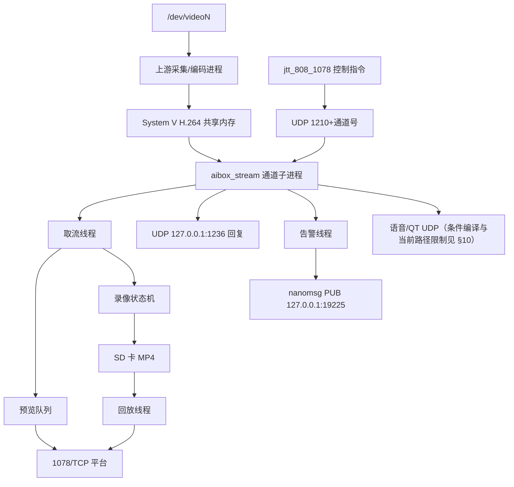
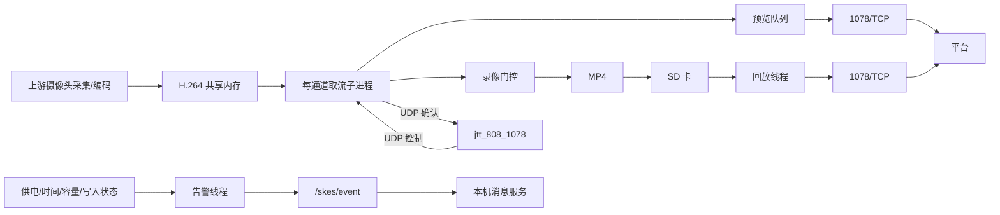
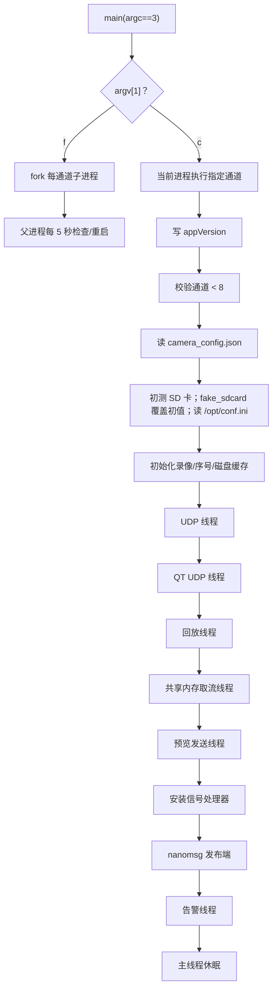
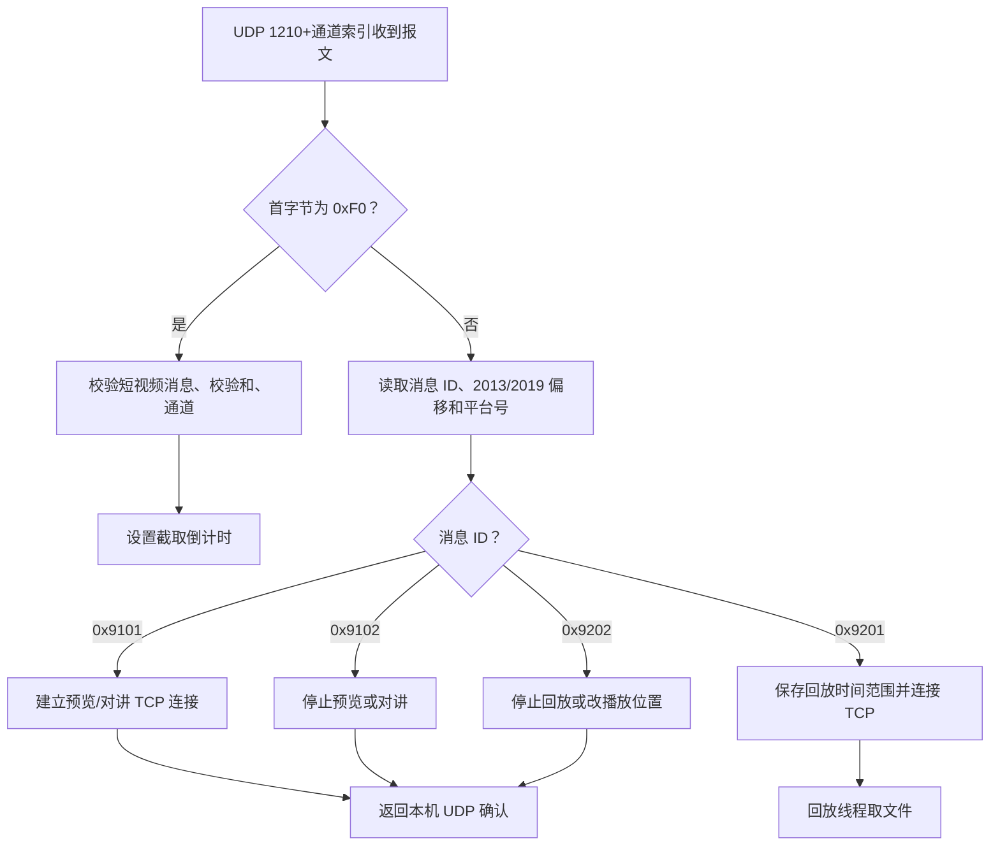
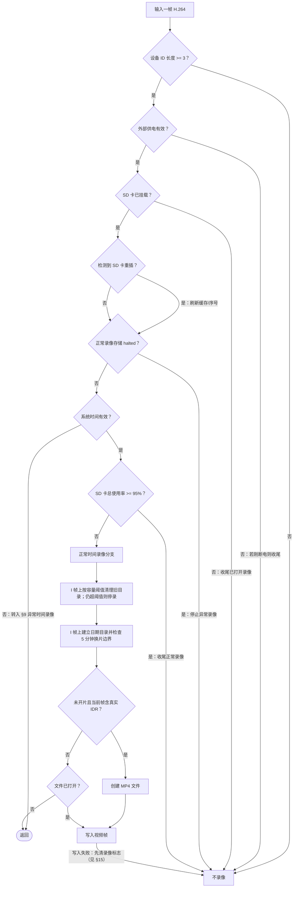
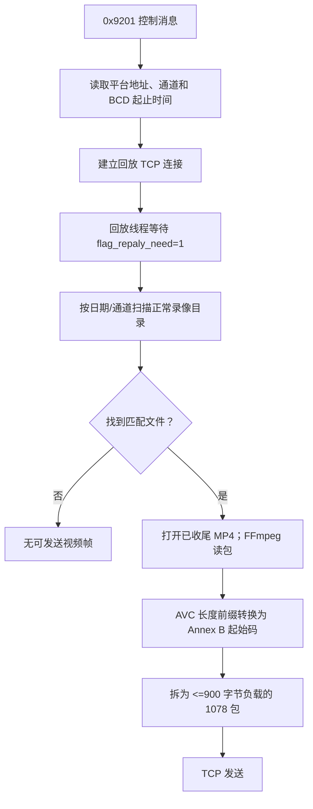
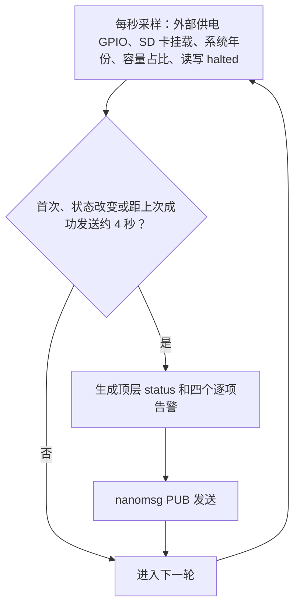
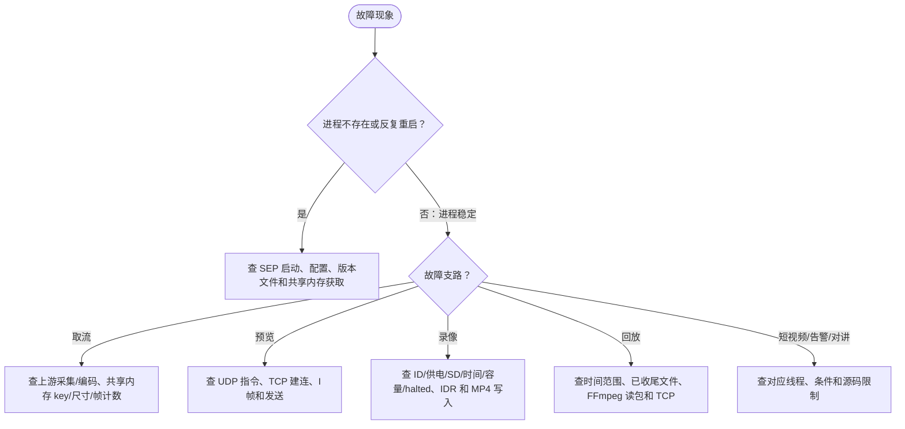

# aibox_stream 源码分析

## 文档目录

专题编号沿用原报告，以保留“§N”和“第 N 节”的交叉引用；阅读顺序按下面的主题排列。

1. [一、项目概述](#overview)
   - [专题 1：分析范围与读法](#detail-1)
   - [专题 2：项目职责和边界](#detail-2)
   - [专题 3：构建、安装及编译开关](#detail-3)
2. [二、源码目录总览](#source-tree)
   - [专题 14：文件与模块定位](#detail-14)
3. [三、核心架构设计](#architecture)
   - [专题 4：进程、线程与启动流程](#detail-4)
   - [专题 5：输入、输出与接口清单](#detail-5)
4. [四、核心模块深度分析](#modules)
   - [专题 6：共享内存取流与 H.264 处理](#detail-6)
   - [专题 7：UDP 控制、JT/T 1078 预览与确认](#detail-7)
   - [专题 8：录像状态机与正常录像](#detail-8)
   - [专题 9：系统时间异常录像与序号](#detail-9)
   - [专题 10：MP4 写入、音频与对讲当前状态](#detail-10)
   - [专题 11：录像回放](#detail-11)
   - [专题 12：报警短视频](#detail-12)
   - [专题 13：告警采样与发布](#detail-13)
5. [五、专题详解与设备排障](#details)
   - [专题 15：已确认的实现限制与核验边界](#detail-15)
   - [专题 16：关键术语对照](#detail-16)
   - [专题 17：设备故障排查：按通道追踪输入、控制、输出](#detail-17)
   - [专题 18：核验结论与主机样例](#detail-18)

<a id="overview"></a>
## 一、项目概述

`aibox_stream` 是 SKES 的车载视频流与录像应用。默认 `sep.ini` 以 `f 8` 启动父进程，再为每个通道建立子进程；子进程从上游 H.264 共享内存取帧，供实时预览与本地录像使用，并由独立线程监测设备和录像状态、发布告警。`jtt_808_1078` 通过本机 UDP 给它发送视频控制指令，预览与回放数据再经 TCP 发往平台。系统边界和版本基线详见下方原第 1、2 节。

阅读建议：先看目录和架构，随后按问题进入原第 6～13 节；现场故障直接参照原第 17 节。这里描述当前入口可达的代码路径，不把编译进目标但未启动的音频、对讲或共享内存辅助实现算作已运行功能。

<a id="detail-1"></a>
### 1. 分析范围与读法

- 源码位置：`/home/tronlong/lyp/code/skes/skes-apps/aibox_stream`；仓库分支：`main_ui`。本次复核日期为 **2026-10-18**，HEAD 为 **`3278128`**；该模块工作树相对 HEAD 无本地差异。此前基线为 `b28d0b8`（初次分析为 `6bc22ef`）。本文根据当前工作树中的 `CMakeLists.txt`、`sep.ini`、`src/`、`docs/`，以及同仓库相邻模块中与共享内存、UDP 对接直接相关的代码整理。
- 下文的 `src/...` 路径均相对于上述源码目录。`skes-ui/...`、`skes-apps/jtt_808_1078/...` 相对于仓库根目录。行号用于定位本次核验的源码；之后修改代码，行号可能变化。
- “代码执行”指当前入口与编译宏能到达的路径；“有实现但未启用”会明确标出。文中只描述可由源码确认的行为。硬件设备、真实平台收发、录像文件能否在目标板播放，未在目标板做运行验证。

#### 本次增量核验范围

对比 `b28d0b8` 与本次工作树，本模块只有两个文件变化：`src/main.cpp` 将应用版本从 `V1.1.5` 升到 **`V1.1.6`**；`src/jtt1078/jtt1078_stream.cpp` 增加累计计数、约 60 秒日志和计数递增。相关提交为 2026-10-09 的 `e23607b`、`f8038e5`，本文按最终源码差异分析，不把同主题提交重复计算为两套功能。

模块的构建清单、配置、预览、回放、录像、告警及对讲实现相对旧基线无变化；同仓库 `skes-ui/skes-main/camera_shm_multi.cpp` 和 `skes-apps/jtt_808_1078/` 也无差异。因此保留这些路径的既有分析，补充取流统计的实际口径、排障边界和既有 NAL 识别限制。§18 记录本次提取原函数后的主机样例验证；它不等同于运行完整应用。

<a id="detail-2"></a>
### 2. 项目职责和边界

`aibox_stream` 是每个视频通道一个子进程的车载视频流和录像程序。它不负责原始摄像头采集与 H.264 编码：同仓库 `skes-ui/skes-main/camera_shm_multi.cpp` 有以 V4L2/GStreamer 采集、`mpph264enc` 编码并写 H.264 共享内存的实现。它也不直接处理完整的 JT/T 808 平台会话：本地 `jtt_808_1078` 进程向它发送控制报文，它把确认报文发回本机 UDP 端口。预览、回放连接控制报文指定的 TCP 地址发送 JT/T 1078 数据。

总体关系图（Mermaid）：



文字版流程：上游先建立视频共享内存；本程序按通道从中取编码帧；每帧依次尝试实时预览入队和本地录像；本机 UDP 控制报文决定预览、回放、短视频与对讲连接；告警线程独立采样设备和录像状态后发布事件。生产端、JT/T 808 进程、SD 卡、GPIO 和消息接收端均是本程序以外的运行依赖。

<a id="detail-3"></a>
### 3. 构建、安装及编译开关

| 项目 | 源码确认的内容 |
| --- | --- |
| 纳入构建 | 仓库 `skes-apps/CMakeLists.txt` 使用 `add_subdirectory(aibox_stream)`。本目录要求 CMake 3.10、C++11，同时构建 C 和 C++ 文件。 |
| 包依赖 | `find_package` 要求 `ffmpeg-git >= 5.0`、`cjson-git >= 1.7.15`、`nanomsg-git >= 1.1.5`；目标链接 pthread、FFmpeg 四个库、m、cjson、nanomsg。 |
| 安装 | 本目录将 `CMAKE_INSTALL_PREFIX` 设为 `.`，安装目标与 `sep.ini` 到 `apps/aibox_stream`，cJSON、nanomsg、FFmpeg 动态库到 `lib`，并设置以 `$ORIGIN` 为基准的运行时库查找路径。设备绝对路径还取决于安装调用与打包方式。 |
| SEP 配置 | `sep.ini` 为 `[sep] enabled=true, name=aibox_stream, param=f 8`。`param=f 8` 对应父进程模式拉起 8 个通道。 |
| GPIO | CMake 缓存参数 `TPAD_EXT_PWR_GPIO` 默认 119；CMake 注释注明 TPAD 用 119、AIBOX 用 122，实际构建应核对设备值。 |
| 当前宏 | `src/main.h` 当前生效分支：`USE_TALKBACK=1`、`SAVE_AUDIO_FILE=0`、`PREVIEW_USE_AUDIO=1`、`PREVIEW_USE_MAIN_STREAM=1`、`AUDIO_CHN=CAMERA_INDEX_7`。前述宏只控制相关代码分支，不能据此断言整条音频链已运行。 |

`src/main.h` 还保留一组 `#if 0` 的低配设备宏；当前实际使用的是 `#else` 后的值。`CMakeLists.txt` 的 `SRC` 列表重复列出 `src/videoRecord/video_record.cpp`，这是构建清单的源码事实，本分析不据此推断最终构建是否重复编译该文件。

<a id="source-tree"></a>
## 二、源码目录总览

以下路径相对于 `skes-apps/aibox_stream/`，只列理解主目标所需的目录；`include/` 是随项目保存的依赖头文件，构建产物不作为源码模块。

```text
aibox_stream/
├── CMakeLists.txt、sep.ini          构建、安装与默认启动参数
├── docs/                            告警和录像设计资料
└── src/
    ├── main.cpp、main.h             父子进程、配置、线程和编译开关
    ├── jtt1078/                     H.264 取流及 1078 控制报文处理
    ├── udp/                         本机控制消息收发
    ├── preview/、replay/            实时预览与已录 MP4 回放
    ├── videoRecord/                 正常时间录像、MP4 写入和序号
    ├── videoRecordTimeErr/          系统时间异常时的录像与配额
    ├── alarm/                        存储、时间及录像状态告警
    ├── talkback/、sharedMemory/     对讲及另一套共享内存辅助实现
    └── config/、log/                INI 解析与日志封装
```

`src/sharedMemory/` 被纳入编译，不是当前 H.264 取流入口；实际消费链在 `src/jtt1078/jtt1078_stream.cpp`。上游生产实现位于同仓库 `skes-ui/skes-main/camera_shm_multi.cpp`，平台控制侧位于 `skes-apps/jtt_808_1078/`。逐文件定位见原第 14 节。

<a id="detail-14"></a>
### 14. 文件与模块定位

| 文件/目录 | 重点入口与修改时联查对象 |
| --- | --- |
| `src/main.cpp`、`src/main.h` | 进程模型、配置读取、通道上限、启动宏、信号；联查 `sep.ini`。 |
| `src/jtt1078/jtt1078_stream.cpp` | H.264 环形缓冲区消费者与分帧；联查 `skes-ui/skes-main/camera_shm_multi.cpp` 的生产格式和 key。 |
| `src/jtt1078/jtt1078_recv_handler.cpp`、`src/udp/` | UDP 报文分发、2013/2019 偏移、确认/短视频；联查 `jtt_808_1078` 的相应 UDP 接口。 |
| `src/preview/` | 实时帧队列、900 字节分包、TCP 发送、错误停播。 |
| `src/replay/` | BCD 时间、录像文件筛选、MP4 读取、AVC 转 Annex B、回放控制。 |
| `src/videoRecord/video_record.cpp`、`video_record.h` | 正常录像状态机、磁盘缓存、GPIO、目录清理、短视频。 |
| `src/videoRecord/h264_to_mp4.cpp` | MP4 输出、视频 PTS、视频包与未启用的音频写入。 |
| `src/videoRecord/record_seq.cpp` | 正常与时间异常录像共用序号的播种与获取。 |
| `src/videoRecordTimeErr/` | 异常时间录像、活跃通道配额、轮转和遗留碎片清理。 |
| `src/alarm/` | 独立采样、JSON 事件与 nanomsg 主题。 |
| `src/talkback/`、`src/sharedMemory/` | 对讲连接/上下行代码和另一套共享内存辅助代码；核对当前入口是否初始化与启动。 |
| `src/config/`、`src/log/` | 自带 INI 解析、日志宏；联查 `/opt/conf.ini`。 |
| `docs/` | 告警实现、TF 卡录像优化、时间异常录像的历史设计说明；实际行为以当前源码为准。 |

<a id="architecture"></a>
## 三、核心架构设计



父进程只负责创建和巡检通道子进程；取流、预览、回放、UDP 和告警在各子进程内由不同线程执行。预览与录像共用上游取流，回放读取已录文件。录像路径先判断设备 ID、供电、SD 卡、时间和容量，再在真实 IDR 上开片；系统时间无效时切换到单独的异常时间目录。图中箭头表示源码中的调用或数据方向，不代表外部服务已连通或设备已执行。启动与线程、接口、录像门控分别见原第 4、5、8、9 节。

<a id="detail-4"></a>
### 4. 进程、线程与启动流程

入口见 `src/main.cpp:554`。程序必须有两个参数：`aibox_stream f <数量>` 或 `aibox_stream c <通道号>`。默认 `sep.ini` 启动形式是 `f 8`。`f` 通过 `fork()` 为索引 `0..数量-1` 创建子进程，父进程每 5 秒用 `kill(pid, 0)` 检查并重启已经退出的子进程；`c` 在当前进程执行单通道逻辑。单通道入口在 `rtmp_chn_index >= VIDEO_CHANNELS`（当前 8）或找不到该通道摄像头参数时返回失败。

单通道启动流程图（Mermaid）：



文字版流程：子进程先写可执行文件同级 `appVersion/aibox_stream.ini`（版本宏当前 `V1.1.6` 与编译时间），读取 `/root/cameras/camera_config.json` 的对应 `channel`、`device`、`width`、`height`；初测 SD 卡挂载状态，再读取 `/opt/conf.ini` 的 `dev:id` 和 `dev:secret`。随后初始化录像状态与序号，创建 UDP、回放、取流、预览及告警线程。`fake_sdcard` 环境变量只在初测后覆盖 `sdcard_is_exit`，磁盘监控线程以后仍会每 10 秒重新检查挂载状态，故它并不是持久模拟开关。

| 执行单元 | 当前职责与入口 |
| --- | --- |
| 父进程 | `run_aibox_stream_channel_process` fork，主循环检查子 PID；收到 SIGCHLD 时回收退出子进程。 |
| 每通道取流线程 | `thread_1078_stream` 附着共享内存、取帧，并启动磁盘监控线程。 |
| UDP 线程 | `thread_udp_recv` 监听 `1210 + 通道索引`，解析控制报文。 |
| QT UDP 线程 | `USE_TALKBACK=1` 时创建；仅 `AUDIO_CHN`（当前索引 7）会实际监听 UDP 2402。 |
| 预览线程 | `thread_preview` 从内存队列读取帧并向预览 TCP 连接发送。 |
| 回放线程 | `thread_1078_replay` 等待回放标志，查询文件并发送。 |
| 磁盘监控线程 | 每 10 秒检查挂载及序号重播种，每 30 秒更新 SD 卡/正常录像占用率缓存。 |
| 告警线程 | 每秒检查 5 类内部条件，按首次、变化、心跳条件发布事件。 |

`SIGINT` 的子进程处理器调用正常录像和时间异常录像的收尾函数后退出；子进程没有在当前入口为 `SIGTERM` 安装相同收尾处理器。父进程收到终止信号时会对孩子发信号 9，不能将该路径描述成优雅 MP4 收尾。`SIGPIPE` 只记录日志，`SIGHUP` 直接退出。取流线程在共享内存获取失败时会 `exit(-1)`，父进程模式随后可检测到退出并重启通道。

<a id="detail-5"></a>
### 5. 输入、输出与接口清单

| 类别 | 当前代码使用的路径或端口 | 用途 |
| --- | --- | --- |
| 摄像头配置 | `/root/cameras/camera_config.json` | JSON 数组，按 `channel` 找设备路径与帧尺寸。 |
| 设备标识 | `/opt/conf.ini` 的 `dev:id`、`dev:secret` | 启动时读取两项；`dev:id` 用于录像命名，长度不足 3 时录像入口直接返回。当前本模块只读取、记录 `dev:secret`，未找到后续使用；读取失败会警告。 |
| 版本文件 | 可执行文件同级 `appVersion/aibox_stream.ini` | 子进程启动时写版本和编译时间。 |
| 主录像 | `/mnt/sdcard/videoRecord/YYYYMMDD/通道索引两位/` | 正常时间 MP4 与日期目录清理。 |
| 异常时间录像 | `/mnt/sdcard/videoRecordTimeErr/通道索引两位/` | 无可信系统时间时的 MP4 与本通道配额清理。 |
| 报警短视频 | `/mnt/sdcard/videoRecord/YYYYMMDD/shortVideo/` | 控制指令触发的片段提取文件。 |
| 状态文件 | `/tmp/sdcard_halted_ch<通道索引>.txt` | 正常录像确认存储故障并置 `sdcard_halted` 时写入。 |
| 1078 控制 UDP | 本地监听 `0.0.0.0:(1210+通道索引)`；回复 `127.0.0.1:1236` | 与 `jtt_808_1078` 对接，后者源码也使用相应端口。 |
| QT/语音 UDP | 索引 7 监听 `0.0.0.0:2402`，发送到 `127.0.0.1:2401` | 对讲相关 QT 通知；接收线程当前只读取、记录，报文分发调用被注释。 |
| 告警消息 | nanomsg `PUB` 连接 `tcp://127.0.0.1:19225`，主题 `/skes/event` | 本机发布告警状态。 |
| 预览/回放 TCP | IP 和端口来自 0x9101/0x9201 控制报文 | 向平台指定的流媒体服务端发送 JT/T 1078 帧。 |

没有在此仓库找到目标设备上这些文件和服务的统一启动时序，因此文档不把某个具体平台服务进程写成已验证的运行前提。`src/config/iniparser.cpp`、`dictionary.cpp` 是工程内的 INI 解析实现；`src/log/log_macro.h` 是日志宏封装。

<a id="modules"></a>
## 四、核心模块深度分析

| 模块 | 入口及主要数据 | 当前机制与边界 | 详解 |
| --- | --- | --- | --- |
| 进程与配置 | `src/main.cpp` 读取摄像头 JSON、设备 INI，按通道拉起子进程。 | `f` 模式巡检子进程，`c` 模式执行单通道；配置的通道数仍须与 8 路上限核对。 | 原第 3～5 节 |
| 共享内存与 H.264 | `thread_1078_stream` 读取编码帧，移除帧首 AUD 并标记可起播帧。 | 生产端须先建立匹配的 System V 区；本目录另一套 `sharedMemory/` 辅助代码不在这条入口链上。 | 原第 6 节 |
| 1078 控制与预览 | UDP 分派 `0x9101/0x9102`，预览线程从队列分包后发 TCP。 | 需区分 2013/2019 偏移和内部通道索引；连接或本机确认不能证明平台收到画面。 | 原第 7 节 |
| 正常与异常录像 | `video_record()` 每帧做门控，`video_record_timeerr()` 处理无效系统时间。 | 两套目录、配额与故障标志不同；共用通道序号，只在真实 IDR 上开新片。 | 原第 8～10 节 |
| 回放与短视频 | `replay/` 从正常录像 MP4 读包；短视频从录像分片提取 packet。 | 回放不检索异常时间目录；短视频完成通知不证明输出文件可用。 | 原第 11、12 节 |
| 告警与对讲 | `alarm/` 周期发布状态；`talkback/` 保存对讲相关实现。 | 供电影响顶层告警状态但无逐项告警；当前对讲上下行线程被关闭，不能按宏定义认定音频链可用。 | 原第 10、13 节 |

<a id="detail-6"></a>
### 6. 共享内存取流与 H.264 处理

`src/main.cpp:274` 从 `/dev/videoN` 提取设备号并计算消费端 key：`0x8100 | (N & 0x0FFF)`。同仓库生产实现的基础 key 为 `0x8000 | (N & 0x0FFF)`，H.264 区在其上加 `0x100`，两者对应。若设备路径无法解析，本程序退到 `0x8FFF`，而生产实现的回退值再加 `0x100`；此回退场景的 key 并不匹配。

`thread_1078_stream` 用 `width * height * 2` 计算槽位数据区，环形缓冲区上限 100 帧；`shmget` 只获取已存在的 H.264 区（无 `IPC_CREAT`）。头部含同步标记 `0x55AA55AA`、读写索引、帧数量、进程间互斥锁。线程锁住头部，从读索引复制一帧，更新读索引和帧数，再解锁。帧首 AUD 被移除；H.264 NAL 类型用于把参数帧或 IDR 标为可开始发送的帧。数据随后送到预览入队函数和 `video_record()`。`src/sharedMemory/sharedMemory.cpp` 虽编译入程序，当前入口未调用它的 `shm_init()`；本条取流链路直接调用 `shmget`/`shmat`。

取流文字版流程：每轮先检查是否到统计日志时间 → 检查同步标记 → 锁环形缓冲区 → 有帧则去 AUD、判断类型、按条件累计并推进读索引；无帧则短暂等待 → 有有效长度时入预览队列并进入录像状态机。若共享内存不存在，当前代码直接退出该通道进程，尚未进入统计循环。

#### 6.1 新增 I 帧日志的实际口径

`g_iframe_count` 是初值为 0 的 `uint32_t`，在 `FRAME_TYPE_PARAMS == frame_type || is_keyframe` 时加一。默认每通道一个子进程，因此各通道各自累计；打印后不清零，进程重新启动后重新计数。`g_iframe_report_time` 使用 `CLOCK_MONOTONIC` 的秒数，每次达到 60 秒后打印 `received iframe count: %u` 并更新报告时间。见 `src/jtt1078/jtt1078_stream.cpp:37-39,269-303`。

| 观察项 | 代码能够支持的解释 |
| --- | --- |
| 日志数值 | 自本进程启动以来、满足上述识别条件的累计次数；相邻日志差值才是对应时间段的增量，比较时须确认通道和 PID 相同。 |
| 被计数的数据 | `get_h264_frame_type()` 识别的 SPS/PPS 类型，或设置了 `is_keyframe` 的 IDR。参数类型会直接返回，未继续确认同一缓冲区内还有 IDR，因此不能称为严格的有效 IDR 数量。 |
| 无新帧或同步头错误 | 日志检查位于同步标记检查和读帧之前；只要线程持续回到循环顶部，仍可输出相同累计值。它并非独立心跳线程。 |
| 日志长时间缺失 | 先查版本、PID 和 syslog 的 INFO 收集设置，再查线程是否进入循环、是否阻塞在互斥锁、预览或录像调用；不能仅据缺日志判定摄像头无帧。 |
| 统计增加 | 说明取流端曾识别到符合条件的数据；计数发生在预览入队和 `video_record()` 之前，不证明平台收到画面或 MP4 写入成功。 |

日志实际通过 `include/glog/XSense_log.h:86-89` 的 `syslog(LOG_INFO, "[%d] ...", rtmp_chn_index, ...)` 输出，包含通道索引。60 秒只是循环再次执行时的检查间隔，线程阻塞时不能保证准时输出；32 位无符号累计值达到上限后也会回绕。

#### 6.2 统计继承的 NAL 识别边界

当前识别器在找到三字节起始码 `00 00 01` 时先执行 `offset += 2`，随后又执行通用的跳过起始码逻辑，可能越过实际 NAL 头。本次八字节 IDR 样例被识别为 `FRAME_TYPE_UNKNOWN`，因而未计数；四字节起始码 IDR 样例则被计数。此识别逻辑相对旧基线未变，本次新增统计继承了这一限制。见 `src/jtt1078/jtt1078_stream.cpp:94-143`，具体样例见 §18。

排查时应把“上游没有产生关键帧”和“本程序没有正确识别输入”分开验证。需要对照上游编码数据、AUD 移除后的起始码及实际 NAL 头，不能将计数不增长直接解释为上游没有 IDR。

<a id="detail-7"></a>
### 7. UDP 控制、JT/T 1078 预览与确认

`src/udp/udp_server.cpp` 每通道以 512 字节缓冲接收 UDP 数据并交给 `jtt1078_recv_data_handler()`。`src/jtt1078/jtt1078_recv_handler.h` 定义四个消息 ID：`0x9101` 开始实时预览、`0x9102` 预览控制、`0x9201` 请求回放、`0x9202` 回放控制。接收处理以报文末字节区分 2013/2019 格式，并分别使用偏移 13/18 读取参数，消息中的通道号与本子进程索引加一比较。回复函数在本地协议报文末附加平台编号，向 `127.0.0.1:1236` 发送。

控制流程图：



文字版流程：控制 UDP 到来后，先分流短视频消息和 JT/T 控制消息；后者按消息 ID 执行预览、回放及其控制。`0x9101` 的类型字段为 2 且当前索引是音频通道时进入对讲连接；否则检查视频通道、连接平台指定 TCP 地址并置预览发送标志。`0x9102` 当前只处理状态 0（停预览）或 4（停对讲）。`0x9202` 当前只处理标志 2（停回放）或 5（拖动定位），其余返回不支持。上述解析和确认行为见 `src/jtt1078/jtt1078_recv_handler.cpp:63-540`。

`PREVIEW_USE_MAIN_STREAM=1` 使收到的子码流选择位被强制改为主码流；当前取流线程调用预览入队时传入的 `sub_stream` 也固定为 0。预览开始需等首个被标记的 I 帧，再把帧写入 50 槽内存队列。发送线程每次取队列帧，以最多 900 字节媒体负载分包，填写帧类型、序号、终端编号、通道和会话相对时间戳后通过 TCP 发送。队列堆积超过半数时，代码尝试丢弃到下一个 I 帧；连续发送失败超过 5 次后关闭预览。`jtt1078_preview_re_start()` 虽有重连实现，但发送错误处分叉出的启动线程代码已注释，当前该自动重连路径不会触发。见 `src/preview/preview.cpp:76-751`。

<a id="detail-8"></a>
### 8. 录像状态机与正常录像

`video_record()` 是取流线程每帧调用的录像入口，决策顺序见 `src/videoRecord/video_record.cpp:1243-1490`。系统时间有效的判定是本地年份不小于 `MIN_SAFE_YEAR=2026`。如下流程图保留了实际先后顺序：



文字版流程：先检查设备 ID，再检查外部供电、SD 卡挂载及存储故障状态，随后判断时间是否有效。供电从有效变为无效时收尾正常录像和异常时间录像；保持无效时直接返回。外部供电 GPIO 读取有连续 5 帧状态一致的去抖逻辑；GPIO 初始化失败时源代码将供电状态当作正常。SD 卡由监控线程周期检查；当取流线程首次看到卡从缺失恢复为存在时，同步重新计算容量缓存并播种录像序号，然后继续处理当前帧。时间恢复正常时先关闭时间异常录像，再回到正常路径。

正常录像目录是 `videoRecord/YYYYMMDD/通道索引两位/`，文件初名为 `{设备ID}-{通道索引两位}-{十位序号}-{YYYYMMDDhhmmss}.mp4`。在墙上时间分钟能被 5 整除且不同于建片分钟的 I 帧处关闭旧文件；如果该分钟没有符合条件的 I 帧，换片不会恰好发生在五分钟边界。真正开新文件还需扫描缓冲区并找到 H.264 IDR NAL。收尾时依据单调时钟计算时长，在文件名增加 `-{秒数六位}`；无有效视频帧的空文件会删除。`check_ipc_chn()` 通过帧内特定字节判定是否用 `mp4_init_1080p()`，否则用 `mp4_init()`；二者的 MP4 元数据尺寸分别为 1920×1080 与 1280×720，并不从 JSON 的 `width/height` 自动推导。见 `src/videoRecord/video_record.cpp:473-520,1041-1238` 与 `src/videoRecord/h264_to_mp4.cpp:67-330`。

容量策略：`get_aibox_used_percent()` 用 `du -sb` 测量正常录像目录大小，再除以 `df -B1` 的 SD 卡总容量。源码以 75% 为正常录像预算，并结合 8 路、25 FPS、1280×720、128 GB、估算码率和清理间隔推导提前清理阈值；这里的 75% 不是直接使用的单一触发数值。到阈值后仅在 I 帧触发清理，至少间隔 30 秒，一次最多执行 3 轮；优先删最早的日期目录，必要时尝试清理当天旧小时文件。总卡使用率达到 95% 会停录。删除失败时在相应目录执行写入加 `fsync` 的健康检查，确认为 I/O 故障时置 `sdcard_halted` 并写 `/tmp` 状态文件。见 `src/videoRecord/video_record.h:12-75`、`video_record.cpp:229-267,809-1038,1330-1425`。

<a id="detail-9"></a>
### 9. 系统时间异常录像与序号

系统年份低于 2026 时，正常录像先收尾，后续帧进入 `video_record_timeerr()`。异常时间录像不依赖错误日期建目录，使用 `/mnt/sdcard/videoRecordTimeErr/<通道索引两位>/`，文件初名为 `{设备ID}-{通道索引两位}-{十位序号}.mp4`；收尾后增加 `-{秒数六位}`。以单调时钟为 300 秒换片依据，仅在真实 IDR 帧开片。首次进入时建立本通道目录、缓存总容量，并清理本通道未写入有效视频的遗留空碎片（文件大小不超过 4096 字节）；超过该阈值的遗留文件保留。见 `src/videoRecordTimeErr/video_record_timeerr.cpp:82-169,392-579`。

配额逻辑并非简单“目录达到 9% 就全局删”。代码先统计当前实际有 MP4 文件的异常录像通道数，把总卡 9% 清理触发额、10% 硬上限按活跃通道均分；每个子进程仅清理自己目录内按序号排序的旧文件，同时保留整目录 10% 的兜底检查。清理限频 30 秒、最多 5 轮；清理后仍达到本通道或整目录硬上限，或者 SD 卡总占用达到 95%，会挂起异常时间录像。删除失败后若写入加 `fsync` 证明存储故障，则设置本模块的 `timeerr_sdcard_halted`。源码在 `video_record_timeerr()` 收到缺卡状态时有清除此标志的分支；但通常上层 `video_record()` 已在缺卡时提前返回，故不能仅凭该分支认定换卡后一定清除这一标志。见 `src/videoRecordTimeErr/video_record_timeerr.cpp:198-391,470-579`。

清理函数单次只从本通道目录读取至多 64 个候选文件，再对这批文件按序号排序。目录中文件超过 64 个时，不能据此保证本次选中的是**全目录**序号最小的 64 个；最终是否腾出足够空间还取决于目录遍历顺序和每轮删除结果。此处的“10% 硬上限”也是检查时的停录条件，不表示任意时刻磁盘占比绝不会短暂超过 10%。

异常时间路径的开片失败处理与正常路径不同：`timeerr_new_file()` 检查 `mp4_init()`/`mp4_init_1080p()` 的返回值；失败时记录 `[timeerr] mp4_init ... failed`，将下一次开片尝试至少推迟 `TIMEERR_CLEANUP_INTERVAL_SEC`（当前 30 秒），不会把 `timeerr_recording` 置为 1。因而“有 IDR 但暂时没有新文件”还需要排查初始化错误与这段暂缓时间。见 `src/videoRecordTimeErr/video_record_timeerr.cpp:392-425,527-545`。

正常和异常录像共用 `record_seq_next()`，但每个通道在独立进程内维护本通道的计数。启动、重新插卡及磁盘监控周期检查会扫描本通道正常日期目录和异常录像目录，取现存最大序号加一；内存计数只增不回退。扫描忽略旧版没有序号、只有 14 位时间戳的正常录像文件。见 `src/videoRecord/record_seq.cpp:40-278`。异常录像文件没有可信时间字段，而当前回放检索仅扫描正常录像日期目录，因此不能把异常录像说成可直接按时间回放。

<a id="detail-10"></a>
### 10. MP4 写入、音频与对讲当前状态

`src/videoRecord/h264_to_mp4.cpp` 建立 MP4 输出上下文、视频流和 AAC 音频流，随后把取流线程给出的已编码 H.264 字节作为视频包写入；此处未调用编码器把原始图像编码成 H.264。正常录像初始化请求 `frag_keyframe+empty_moov+default_base_moof+faststart` 等 movflags；IPC 分支的初始化未传这组选项。`write_video_to_mp4()` 使用单调时钟计算相对 PTS，标记关键帧，并调用 FFmpeg 写包。`write_audio_to_mp4()` 当前函数开头直接 `return 0`，其后音频写包代码不可达，因此不能把 MP4 中音频流的建立等同于实际录入音频。`SAVE_AUDIO_FILE=0` 也关闭了另存 G.711 文件及其回放路径。

对讲现状需要分开看：`USE_TALKBACK=1` 使 QT UDP 初始化代码被编译和执行；`0x9101` 的对讲类型可调用 `jtt1078_talkback_start()` 建 TCP 连接。与此同时，`src/main.cpp:445-457` 的对讲上行和下行线程整体处于 `#if 0`，QT UDP 接收线程对收到的报文也没有调用分发处理器。另一个确定的源码前提是 `jtt1078_talkback_start()` 会访问全局 `shm_stream->flag_talkback`，但在本项目当前入口里没有找到给 `shm_stream` 赋有效地址的调用。因此，不能依据 `USE_TALKBACK=1` 断言当前对讲能完整运行；这条路径需要目标运行环境和代码修正后验证。相关位置：`src/talkback/talkback.cpp:93-171`、`src/main.cpp:420-457`、`src/udp/udp_server_qt.cpp:41-89`。

<a id="detail-11"></a>
### 11. 录像回放

`0x9201` 指令提供目标 TCP 地址及 BCD 编码的开始、结束时间。`jtt1078_replay_init()` 保存这些参数并尝试连接目标服务端；回放线程轮询 `flag_repaly_need`，随后从普通录像目录 `videoRecord/20YYMMDD/<通道索引两位>/` 查找覆盖请求时间的已收尾文件。文件名中的 14 位时间戳用于定位开始时间，尾部 6 位秒数用于计算结束时间；旧版没有序号的新旧文件名均尝试识别。没有时长后缀的打开态文件被跳过。异常时间录像目录没有参与这段查询。见 `src/replay/replay.cpp:55-115,512-691,1057-1172`。

回放流程图：



文字版流程：收到回放请求后，回放模块按 BCD 时间定位文件；FFmpeg 打开 MP4，必要时按起始时间 seek，逐包读视频数据，把 MP4 常见的长度前缀 NAL 形式转换为 Annex B 起始码，再封装 JT/T 1078 媒体包发送。发送节奏调用 `get_video_fps()`，无动态 FPS 信息时返回 25；回放控制指令可以停止或设置新的播放位置。当前 `jtt1078_replay_init()` 失败时是否已置回放标志、文件没匹配时如何继续尝试，都应按源码实际返回值判断，不能写成可靠的错误退出机制。

这里有两处具体实现限制。其一，`check_list()` 在目录打开成功但没有匹配文件时仍返回 0，调用者可能拿空路径继续尝试 `avformat_open_input()`；这说明“找到匹配文件”不能仅用函数返回 0 判定。其二，回放初始化做 IP/域名判断时调用的是 `server_is_ip(jtt1078.server_ip)`，而连接地址保存在 `replay.server_ip`；预览会话地址与回放地址不同的场景需专门验证。见 `src/replay/replay.cpp:74-100,512-692,1094-1125`。

回放文件扫描还固定使用请求开始时间转换出的日期目录，后续播放推进只更新时分秒，没有在此路径把目录切到次日。因此跨午夜的请求不能按“自动连读次日录像”理解；需拆分日期在目标设备验证。播放线程对未找到匹配文件后如何继续尝试也缺少明确成功判定，现场应把文件路径和 `open file error` 日志一起核对。见 `src/replay/replay.cpp:512-692,1018-1172`。

<a id="detail-12"></a>
### 12. 报警短视频

短视频命令由同一 UDP 端口进入，首字节为 `0xF0` 时按 `ST_ALARM_VIDEO_MEDIA` 解码。`alarm_shortvideo_recv_data_handler()` 校验消息类型、累加校验和、目标摄像头通道，然后调用 `start_short_video_record()`。该函数把当前录像的短视频倒计时设为 `record.count_max_frames_short_video / 2`；初始化值是 250 帧，按源码注释约为前后 5 秒、共 10 秒。倒计时在正常录像成功写入的视频帧上递减，归零后启动 `thread_short_video()`。该线程从当前或前后两个 MP4 分片读包，将指定帧范围的数据追加写到 `videoRecord/YYYYMMDD/shortVideo/` 下的目标文件，最后发送本机短视频完成通知。见 `src/jtt1078/jtt1078_recv_handler.cpp:426-469`、`src/videoRecord/video_record.cpp:170-192,1460-1484,1494-1640`。

这里的短视频输出代码直接将读出的 packet 字节写到文件，而未使用 MP4 muxer 创建短视频容器；输出名按报警通道、类型和序号拼接，源码没有在该处添加 `.mp4` 后缀。线程在调用 `record_short_video()` 后没有依据其返回值决定是否发送“完成”通知，因此通知只说明该线程走到了发送位置，不证明短视频文件可用。取样范围跨片时会尝试从上一个与当前录像文件各取一部分；若源文件尚未就绪或读取失败，实际结果依赖运行时文件状态。

`record_short_video()` 对源文件打开/读取流信息失败有返回值，但对目标文件 `fopen(...,"ab+")` 没有空指针检查，也没有检查 `fwrite`、`fflush`、`fsync` 的结果；目标目录权限或卡 I/O 异常时，可能无法可靠产出文件，甚至在后续使用空文件指针时异常退出。这是源码可推得的故障风险，不能据“short video ok”日志认定写入成功。见 `src/videoRecord/video_record.cpp:1494-1628`。

<a id="detail-13"></a>
### 13. 告警采样与发布

`alarm_monitor_thread()` 每秒计算一组 5 个内部状态；首次运行、任意状态变化、或上次成功发送后约 4 秒会组织 JSON 并调用 `alarm_event_pub_send()`。计时采用 `CLOCK_MONOTONIC`，事件时间字段来自实时钟。nanomsg 发布端使用 `NN_PUB` 套接字，连接 `tcp://127.0.0.1:19225`；发送数据格式是 1 字节主题长度、主题 `/skes/event`、4 字节载荷长度、JSON 文本。见 `src/alarm/alarm_monitor.cpp:199-288`、`src/alarm/alarm_event_pub.cpp:18-91`。

告警流程图：



文字版流程：容量告警在正常时间使用正常录像目录缓存占比，在异常时间使用异常录像目录缓存占比；全卡占比达到 95% 直接触发。读写故障只在卡存在时判断，对应正常或异常录像模块各自的 halted 标志。外部供电条件参与顶层 `status=malfunction/normal` 和状态变化检测，**但逐项 `data` 数组明确跳过外部供电项**；逐项只有卡缺失、时间无效、容量不足、录像读写故障四类。JSON 带 `source=aibox_stream`、通道索引、时间戳及逐项 `trigger` 布尔值。见 `src/alarm/alarm_monitor.cpp:38-197`。

发送重试存在一个源码层面的限制：`last_send_time` 只在发送成功后更新；如果首次发送失败，而且之后状态一直不变，`first_run` 已被清除、`last_send_time` 仍为 0，此时心跳条件也不会成立，线程不会仅因为时间流逝再次发送。这是代码条件可推得的路径，是否在现场出现取决于 nanomsg 连接与发送结果。

<a id="details"></a>
## 五、专题详解与设备排障

本部分集中实现限制、测试边界和现场排障。专题编号沿用原文，文中的“§N”“第 N 节”仍指本文同编号的专题。

<a id="detail-15"></a>
### 15. 已确认的实现限制与核验边界

下表只列代码直接支持的事实和由该事实带来的条件性影响，不代表已在设备上复现。

| 源码事实 | 可能影响与核验点 |
| --- | --- |
| `f <数量>` 的父进程循环没有先将数量限制为 `VIDEO_CHANNELS=8`；各子进程进入单通道初始化后才拒绝索引不小于 8。 | 配置数量大于 8 时，超出范围的子进程会退出并被父进程反复重启。见 `main.cpp:364-391,554-615`。 |
| `get_video_paras()` 检查 JSON 字段是否存在，但取 `device` 字符串和宽高数值时没有逐项检查 JSON 类型或尺寸范围。 | 输入配置需要保证字段类型、设备路径和尺寸有效；错误值可能在共享内存大小计算或复制前才暴露。见 `main.cpp:286-361`。 |
| `thread_1078_stream()` 仅用 `frame_size = width*height*2` 检查共享内存中的 `header.frame_size`，之后复制到固定 `LEN_STREAM_BUFFER_PER=1024000` 字节的栈缓冲；`shmat()` 结果用 `if (!shm_ptr)` 检查，而系统调用失败值是 `(void*)-1`。 | 配置尺寸允许的帧长度可大于目的缓冲区；异常共享内存帧或附着失败需要做边界与错误值核验。见 `jtt1078_stream.cpp:219-325`、`main.h:37`。 |
| 新增计数把参数类型与 IDR 一起累计；既有识别器对三字节起始码的偏移处理也会影响结果。 | 日志不是严格的 IDR 数量或录像成功数；主机样例与代码条件见 §6.1、§6.2、§18。 |
| UDP 接收在 `recvfrom` 返回负值后仍向分发函数传递 `num`，分发函数直接访问首字节、消息 ID 和末字节，具体消息解析还读固定偏移。 | 短包或接收错误缺少统一长度检查；仅源码可判定越界风险，未在目标设备触发验证。见 `udp_server.cpp:41-82`、`jtt1078_recv_handler.cpp:471-540`。 |
| 预览队列由取流线程写、发送线程读，当前入队路径未检查队列满且两端没有同一把互斥锁保护；`sem_wait` 调用被注释。 | 高负载时存在覆盖未发送槽位、读写竞争的可能，需用实际流量验证。见 `preview.cpp:531-750`。 |
| `new_file()` 记录 `mp4_init` 非零错误但仍返回，调用方随后设置 `record.recording=1`；`write_video_to_mp4()` 失败时先清零 `record.recording` 再调用只在该标志为 1 时关闭文件的 `init_record()`。 | 正常录像的打开/写入失败路径未形成完整的文件收尾流程。见 `video_record.cpp:1089-1166,1430-1470`。 |
| `write_video_to_mp4()` 用静态 `first_pts_us` 和 `last_pts_us` 生成 PTS；打开新 MP4 文件时没有在该函数中重置这两个静态值。 | 新分片的时间戳仍沿用本通道进程第一次写帧的基点；是否满足目标播放器预期需用生成文件验证。见 `h264_to_mp4.cpp:401-460`。 |
| `timeerr_sdcard_halted` 只在异常录像入口的缺卡分支清零，而上层正常入口在缺卡时通常提前返回。 | 异常录像存储故障后换卡恢复路径需要核对；不能据注释断言会自动清零。见 `video_record.cpp:1275-1315`、`video_record_timeerr.cpp:470-530`。 |
| `jtt1078_talkback_start()` 解引用 `shm_stream`；当前入口未调用 `shm_init()`，也未找到对 `shm_stream` 的赋值；对讲上下行线程被 `#if 0` 关闭。 | 对讲不能仅凭连接代码或 `USE_TALKBACK=1` 认定可用。见 `talkback.cpp:93-171`、`main.cpp:420-457`。 |
| `/opt/conf.ini` 的解析函数把 `dev:id` 和 `dev:secret` 都输出到日志，且 `strncpy` 使用目标缓冲区完整长度。 | 现场日志可能包含密钥；配置字符串过长时还需核对目标字符串结束符。见 `config/ini_process.cpp:7-44`。 |
| 回放域名判断引用预览地址；无匹配文件时 `check_list()` 仍可返回 0；异常时间文件不参与回放。 | 回放定位和失败处理不能简单按函数名或返回值理解，应按具体地址及文件状态验证。见 `replay.cpp:55-110,512-692,1057-1125`。 |
| 正常录像清理最终使用 `system("rm ...")` 删除旧日期目录；`rm_path_by_GB()` 的系统时间异常分支使用固定 100 个目录名槽位。 | 这是代码中的删除方式和数据结构边界；按当前 `video_record()` 入口，时间异常已提前转入 timeerr，该排序分支通常不会由每帧正常路径触发。实际卡上目录数量及文件权限需在设备环境核验。见 `video_record.cpp:809-1038,1243-1330`。 |

<a id="detail-16"></a>
### 16. 关键术语对照

| 术语 | 本程序中的具体含义 |
| --- | --- |
| 通道索引与逻辑通道 | 进程内部索引为 0 起；1078 报文中的逻辑通道号用索引加一；磁盘目录仍用两位内部索引。 |
| System V key | `shmget` 查找共享内存段的整数标识，须与生产端 H.264 区计算结果一致。 |
| I 帧与 IDR | 取流/预览先按 NAL 类型给帧打可起播标记；录像真正创建新文件时再扫描是否含 IDR（NAL 类型 5），避免仅 SPS/PPS 参数帧开空文件。 |
| AUD、SPS、PPS | H.264 访问单元分隔符和解码参数；取流入口尝试去除帧首 AUD，MP4 初始化包含固定参数信息。 |
| Annex B、AVC | H.264 NAL 的两种常见字节表示；回放模块将 MP4 包中的长度前缀形式改为起始码形式再发送。 |
| BCD | 控制指令时间字段的一位十进制数占 4 bit 的编码；回放模块将其转为日期和时分秒。 |
| PTS、单调时钟 | PTS 是媒体播放时间戳；本程序用不受系统时间校正影响的单调时钟计算录制、预览、回放的相对时间。 |
| halted | 代码检测到存储 I/O 故障后暂停录像的内部状态，正常录像和异常时间录像各有自己的标志。 |
| SEP | Skes-EndPoint，SKES 中独立业务功能应用的称呼；这里对应 `sep.ini` 启动配置。 |

<a id="detail-17"></a>
### 17. 设备故障排查：按通道追踪输入、控制、输出

以下命令均在**目标设备**上执行，先只读取证。记录故障时间、通道索引（内部和目录从 0 开始，1078 逻辑通道号为索引加一）、影响单路还是多路、当前版本及系统时间。先保存日志与文件列表，再决定是否重启；重启可能抹去进程退出和缓存状态的证据。配置和日志可能含 `dev:secret`，向外提供前需脱敏。

排查流程图（Mermaid）：



文字版流程：进程和版本是起点；共享内存取流是预览与录像的共同上游，二者同时失败应先排查上游。只有预览失败时核对控制报文与发送链路，只有录像失败时按 `video_record()` 的门控顺序核对。回放、短视频、告警与对讲再分别检查自己的输入和输出。某一层“存在”并不等于下一层“有效”，例如共享内存段存在不代表持续有帧。

#### 17.1 进程、版本及日志

```sh
date
ps -ef | grep '[a]ibox_stream'
cat /设备实际安装目录/appVersion/aibox_stream.ini
cat /设备实际安装目录/sep.ini
mount | grep '/mnt/sdcard'
df -h /mnt/sdcard
```

用真实安装目录替换占位符。源码只确定版本文件在可执行文件同级的 `appVersion/`，不保证设备绝对安装路径。当前 `sep.ini` 是 `f 8`：通常应有父进程及索引 0～7 的子进程，子进程以 `aibox_stream_N` 命名。若用 `c N` 单通道启动，则无父进程。若某通道 PID 约每 5 秒变化，查 `child N restart!`、`Failed to get video paras`、`shmget`；超范围通道会持续退出再被拉起。若版本文件目录不可写，`WriteAppVersion()` 对 `fopen` 结果缺少检查，启动早期崩溃也要考虑此条件。父进程本身缺失时先核对 SEP 启动、程序及动态库。

有效的 `include/glog/XSense_log.h` 宏调用 `syslog`，前缀含 `[通道索引]`；`main.cpp` 中向 `/mnt/sdcard/log/aibox_stream_XX` 写日志的初始化代码已注释。支持 systemd 的设备可试 `journalctl | grep 'aibox_stream'`，传统 syslog 设备可查 `/var/log/messages` 或 `/var/log/syslog`，以设备实际日志配置为准。部分 `shmget`/同步标记诊断用 `perror`/`printf` 输出，另查 SEP 对标准输出和错误输出的收集方式。源码不保证 syslog 的程序标识一定为 `aibox_stream`，可按时间、`[N]`、`compile at`、`Get video para` 查找。不要公开原始 `/opt/conf.ini` 或含密钥的日志。

#### 17.2 无视频输入或子进程循环重启

1. 查 `Unsupport video channel`、`Failed to get video paras`、`Get video para`。配置 `/root/cameras/camera_config.json` 要有对应 `channel`、`device`、`width`、`height`，且类型、尺寸有效；`f` 数量不可超过当前 8 路上限。
2. 用 `Get video para` 打印的 `shmkey` 与 `ipcs -m`（若不可用则看 `/proc/sysvipc/shm`）对照。对于 `/dev/videoN`，消费端 key 是 `0x8100 | (N & 0x0FFF)`；设备路径解析失败时退回 `0x8FFF`，与仓库中生产端的回退 key 不一致。缺段时 `shmget` 失败会退出整个子进程；需核查上游采集/编码进程、启动先后、key、尺寸与访问权限。
3. 段存在但没画面，查是否打印 `invalid sync header for share buffer.`（要求 `0x55AA55AA`），并结合上游日志确认帧持续产生；`ipcs` 只证明段存在。消费端按配置的 `width*height*2` 限制帧长，但拷贝目的缓冲只有 1024000 字节，配置过大或异常帧可能触及 §15 的边界问题。避免在生产设备上直接改共享内存内容做试验。
4. `V1.1.6` 可查 syslog 中同一通道、同一 PID 的 `received iframe count`，比较相邻记录的累计增量。持续不增长时继续区分无输入、只收到非计数类型、NAL 识别异常和线程阻塞；有增长时仍须分别检查预览发送与录像门控。统计口径和三字节起始码限制见 §6.1、§6.2。

#### 17.3 预览或控制指令失败

1. 用 `ss -lun`（或设备已有的 `netstat -lun`）确认本通道 UDP `1210+索引` 正在监听；`Bind()error.` 后线程仍继续运行，不能把进程存活当作绑定成功。核对 `jtt_808_1078` 发送目的端口、0x9101/0x9102 消息 ID、平台号、逻辑通道号和 2013/2019 报文格式。若无接收日志，先查本机 UDP。
2. UDP 到达但 TCP 未连接，查 `chn error`、`gethostbyname()error`、`socket()error`、`connect()error`，核对请求中的平台 IP/端口及网络可达性；确认报文送回 `127.0.0.1:1236`。可用 `ss -tn` 观察 TCP 状态，不能仅凭 UDP 确认推断平台已收到视频。
3. TCP 已连接但无画面，确认共享内存有帧、是否出现可起播的参数帧或 I 帧，再查 `send ok`、`tcp connect error!`。连续发送失败超过 5 次后停预览，当前发送错误分支不会自动重连。预览队列并发与满队列处理见 §15。

#### 17.4 有画面但无录像：严格按门控顺序核查

| 顺序 | 只读证据 | 源码中的结论 |
| --- | --- | --- |
| 设备 ID | 启动日志 `Get deviceId`、`can't not read deviceId and Secret`；脱敏核对 `/opt/conf.ini` | ID 长度小于 3 直接跳过录像，读取失败不一定退出进程。 |
| 外部供电 | 构建使用的 GPIO 119/122、`gpio... initialized`、供电丢失日志 | 连续 5 帧确认掉电后收尾并停录；GPIO 初始化失败时默认为供电正常。 |
| SD 挂载 | `mount | grep '/mnt/sdcard'`、`df -h /mnt/sdcard`、`sdcard_is_exit` 日志 | 约每 10 秒刷新挂载状态；卡缺失时停录。挂载未确认前不要向该路径写测试文件。 |
| I/O 故障 | `/tmp/sdcard_halted_chN.txt`、`[GATE] sdcard_halted`、`write`/`fsync` 错误 | 正常录像遇到确认的存储故障会暂停；状态文件需结合当前日志判断，不是独立的健康探针。 |
| 时间与容量 | `date`、`df -h`、`Time invalid`、`cleanup triggered`、`sdcard total ... stop` | 年份小于 2026 转异常时间目录；全卡缓存占用达到 95% 停录；正常目录到提前阈值时在 I 帧清理。 |
| IDR 与 MP4 | 两套录像目录的文件名、大小、修改时间；`mp4 init res`、`write failed` | 仅真实 IDR 能开新片；正常录像初始化及写入失败有 §15 所述收尾缺口。 |

用 `ls -l /mnt/sdcard/videoRecord/` 和 `ls -l /mnt/sdcard/videoRecordTimeErr/` 先找对应通道；系统时间异常时只查当天普通目录会漏文件。可用 `du -sb /mnt/sdcard/videoRecord/` 与 `df -B1 /mnt/sdcard` 复核代码的空间比例，但大目录遍历可能耗时，宜在低负载时做。清理逻辑会删除旧目录或旧文件，定位“文件消失”时保存清理日志、文件序号和时间线，不要先手工删除。环境变量 `fake_sdcard` 只覆盖启动初测，监控线程仍会重新判断真实挂载。

占用率需要交叉核对：`get_sd_used_percent()` 实际解析 `df | grep '/mnt/sdcard$'` 的倒数第二列百分数；命令无匹配、输出格式变化或解析失败时，初始值保持 0。现场看到程序报告 `sdcard_used=0%`，不能立即判定卡是空的，应同时看 `mount`、`df` 原始输出和 `df -B1`。普通录像目录占比还依赖 `du -sb` 与总容量解析，失败时也可能得到 0。见 `src/videoRecord/video_record.cpp:229-267,626-662`。

若系统年份小于 2026 且预览正常，却找不到异常时间录像，应看 `/mnt/sdcard/videoRecordTimeErr/索引两位/`、日志中 `[timeerr]` 的清理/开片/写入消息、该通道是否有真实 IDR，以及 `timeerr_hold` 对应的配额停录条件。此路径按活跃通道分配 9% 清理触发额、10% 上限，不能套用正常目录的 75% 预算；`timeerr_sdcard_halted` 也与正常录像的 halted 标志分开。缺卡时上层入口通常提前返回，不能假设重插卡已清除异常时间录像的 halted 状态。

#### 17.5 回放、短视频、告警与对讲

| 症状 | 检查与源码限制 |
| --- | --- |
| 有文件但回放为空 | 核对 0x9201 的 BCD 起止时间、逻辑通道和目标 TCP 地址；普通目录 `videoRecord/20YYMMDD/索引两位/` 需有尾部六位时长的已收尾 MP4。异常时间文件和打开态文件不参与检索。查 `opendir ... error`、`open file error`、`Could't find stream infomation`、TCP 错误；`check_list()` 返回 0 不证明匹配成功，回放域名判断还引用预览地址（§11）。 |
| 短视频通知到了但文件无效 | 核对 0xF0 命令的校验、通道、当时正常录像是否成功写帧及 `shortVideo/` 文件大小。倒计时依赖成功写入的视频帧；输出只是 packet 字节拼接，完成通知不检查提取返回值。 |
| 告警缺失 | 用 `ss -ltn` 核对本机 19225 接收端，查 `nn_connect`/`nn_send` 与告警线程日志，核对五类内部触发状态。PUB 连接成功不证明订阅端收到。首次发送失败而状态不变时可能不再发送；外部供电只计入顶层状态（§13）。 |
| 对讲无声 | 核对 0x9101 类型 2、索引 7、UDP 2402 和 TCP 建连。当前上下行线程被 `#if 0` 禁用，QT UDP 收包也未分发，`shm_stream` 未初始化（§10、§15）；端口或 TCP 连接成功不足以证明双向音频可用。 |

如需判断 MP4 是否完整，应复制已收尾文件，用设备已有的 `ffprobe` 或播放器只读检查视频流、时长与解码；正在写入的文件或仅有初始化数据的文件不能按完整成品判断。现场记录至少保留版本、通道/PID、故障时间、syslog 与标准输出关键行、脱敏配置、共享内存 key、端口状态、挂载/容量及相关文件名和大小。这样才能把上游采集、平台控制、存储介质和本程序实现问题区分开。

<a id="detail-18"></a>
### 18. 核验结论与主机样例

本文已对当前构建清单、启动入口、配置加载、线程与进程、共享内存生产/消费格式、UDP 控制、预览、两套录像、序号、短视频、回放、对讲与告警实现逐一核对，并将代码条件整理为设备排障顺序。流程图使用 Mermaid；每幅图下还有文字版流程。本文没有运行目标板、模拟平台或实际读写 SD 卡，因此设备时序、网络互通、文件可播放性与故障复现仍以现场验证为准。

2026-10-18 增量核验另从当前 `jtt1078_stream.cpp` 原样提取 `parse_slice_type()`、`get_h264_frame_type()` 及帧类型常量，用主机 C++11 编译器运行以下固定八字节样例。每项按照真实取流分支的 `type == FRAME_TYPE_PARAMS || is_keyframe` 判断是否计数；表中的样例用于验证分类和偏移，不是完整可解码视频流。

| 输入字节（十六进制） | 分类结果 / `is_keyframe` | 是否计数 |
| --- | --- | --- |
| `00 00 00 01 67 42 00 1E` | 参数类型 6 / 0 | 是 |
| `00 00 00 01 68 CE 06 E2` | 参数类型 6 / 0 | 是 |
| `00 00 00 01 65 88 84 00` | I 类型 1 / 1 | 是 |
| `00 00 00 01 41 80 00 00` | P 类型 2 / 0 | 否 |
| `00 00 01 65 88 84 00 00` | 未知类型 0 / 0 | 否 |

上述样例确认参数类型也被计数，并复现了三字节起始码样例的漏判。累计值、打印后不清零及约 60 秒检查由原循环源码确认；本次没有运行该循环或验证设备日志实际输出，也没有执行完整项目构建。
