# VBox Artery MCU Kernel — 技术全量分析报告

> **仓库**：`vbox_artery_mcu_kernel_with_new_protocol_for_ec200a`  
> **硬件平台**：Artery AT32F403A/F407（ARM Cortex-M4，主频 144/240MHz）  
> **RTOS**：FreeRTOS v9.x  
> **协议版本**：RTMS SPI Protocol v1.0，MCU Firmware v0x10.03  
> **分析日期**：2026-04-23

---

## A. 全局概览

### A.1 项目定位与核心功能

**一句话概括**：该项目是一块车载 TBOX（远程信息处理盒子）的 MCU 固件，负责在 EC200A 4G 模块与车辆 CAN 总线/传感器之间做数据桥接，同时实现三一叉车 ECU 的绑定/锁机/解锁控制逻辑。

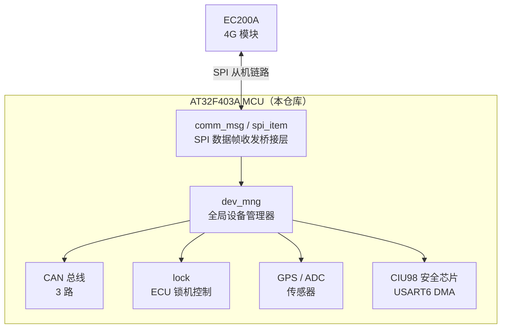

---

### A.2 目录结构与职责

```
Src/User/
├── Src/                    # 入口文件
│   ├── main.c              # 系统入口，硬件初始化，FreeRTOS任务创建
│   └── at32f4xx_it.c       # 中断服务路由
│
├── dev_mng/                # ★ 全局设备管理器（核心枢纽）
│   ├── dev_mng.h           # dev_mng_t 总结构体，所有模块指针汇聚于此
│   └── dev_mng.c           # 初始化、spi_item注册表、刷新MCU状态
│
├── comm_msg/               # ★ SPI通信协议层
│   ├── comm_msg.h          # comm_hdr_t帧头定义，缓冲区常量
│   └── comm_msg.c          # comm_msg_handler_task，帧打包/校验，EXTI中断
│
├── spi_item/               # SPI数据项框架
│   ├── spi_item.h          # spi_item_t, spi_item_hdr_t, spi_items_map_t
│   └── spi_item.c          # push/pop, build_map, register
│
├── spi_dma/                # SPI硬件DMA驱动
│   ├── spi_dma.h           # SPI1 DMA1_Channel2/3 引脚定义
│   └── spi_dma.c           # SPI初始化，DMA中断，reset_counter
│
├── lock/                   # ★ 叉车锁机模块（新SPI协议核心）
│   ├── lock.h/c            # lock_task总入口，引擎类型路由
│   ├── lock_common.h/c     # 命令解析，绑定锁状态，Flash持久化，平台上报
│   ├── lock_etm.h/c        # 三一ECU专用：XXTEA加密，CAN心跳，命令发送，状态解析
│   └── lock_general_message.h # 执行状态枚举：NULL/UNDERWAY/SUCCEED/FAIL
│
├── can/                    # CAN底层驱动
│   ├── can.h/c             # can_chn_init，can_msg_send，can_msg_item_t定义
│   └── can_isa_func.h/c    # CAN ISA消息过滤/读取（用于lock模块监听VCU）
│
├── can_mng/                # CAN管理（统计计数）
├── can_msg/                # CAN消息解析与分发
├── can_spi_item/           # CAN消息与SPI item的桥接
├── mcp2515/                # 第三路CAN（MCP2515 SPI外接）
│
├── CIU98/                  # 安全芯片CIU98（SM2/防拆）
│   ├── app/CIU98.h/c       # USART6 DMA收发，消息协议封装
│   ├── app/api/            # auth, crypto, ctrl, fs, info, key, update
│   ├── app/cmd/            # APDU/TPDU命令
│   └── driver/proto/       # SPI底层驱动适配
│
├── ec20/                   # EC200A 4G模块管理
│   ├── ec20_mng.h/c        # 状态机：boot→hw_reset→config→net_connect
│   └── ec20_pwr.h/c        # 电源控制，开关机
│
├── ec_uart_msg/            # EC-UART消息（MCU↔EC200A UART通道）
├── comm_msg/               # SPI帧处理主任务
├── share_ram/              # 跨重启共享RAM（0x2000FF00）
│
├── flash/                  # 内部Flash读写（持久化参数）
├── e2prom/                 # AT24Cxx EEPROM（参数存储）
├── at24cxx/                # AT24Cxx I2C驱动
├── pcf8563/                # PCF8563 RTC驱动（I2C）
├── rtc/                    # RTC时间封装
│
├── gpio/                   # GPIO初始化与宏
├── adc/                    # ADC采集（电压、电流、温度）
├── adc_spi_item/           # ADC数据→SPI item
├── g_sensor/               # 加速度传感器（陀螺仪）
├── nmealib/                # NMEA GPS解析库（第三方）
├── gps_spi_item/           # GPS数据→SPI item
│
├── sleep_mode/             # 休眠管理（ACC熄火+CAN静默→进入休眠）
├── led/                    # LED状态指示
├── log/                    # 日志输出
├── log_com_spi_item/       # 日志→SPI item
│
├── rb/                     # Ring Buffer
├── rb_obj/                 # Ring Buffer对象封装
├── uart/                   # UART驱动
├── rs485/                  # RS485驱动
├── hal_timer/              # 定时器抽象
├── io_spi_item/            # DI/DO→SPI item
├── event_spi_item/         # 事件→SPI item
├── cmd_spi_item/           # 命令item（从平台接收）
├── ota_spi_item/           # OTA item
├── ota/                    # OTA升级管理
├── fota/                   # FOTA（Flash OTA）
│
├── i2c/                    # I2C软件/硬件驱动
├── extend_ram/             # 外扩SRAM驱动
├── nca9555/                # NCA9555 I2C IO扩展芯片
│
└── utils/                  # 工具库
    ├── digest/             # MD5, SHA1, HMAC, Base64
    ├── LITE-utils/         # JSON解析，字符串工具（阿里IoT移植）
    ├── LITE-log/           # 日志格式化
    ├── bs64/               # Base64
    └── misc/               # 链表，定时器，网络工具
```

---

### A.3 模块依赖关系

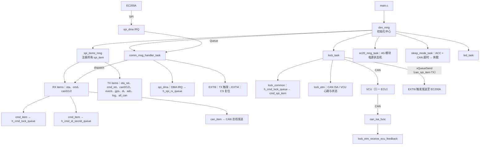

---

### A.4 关键入口与启动流程

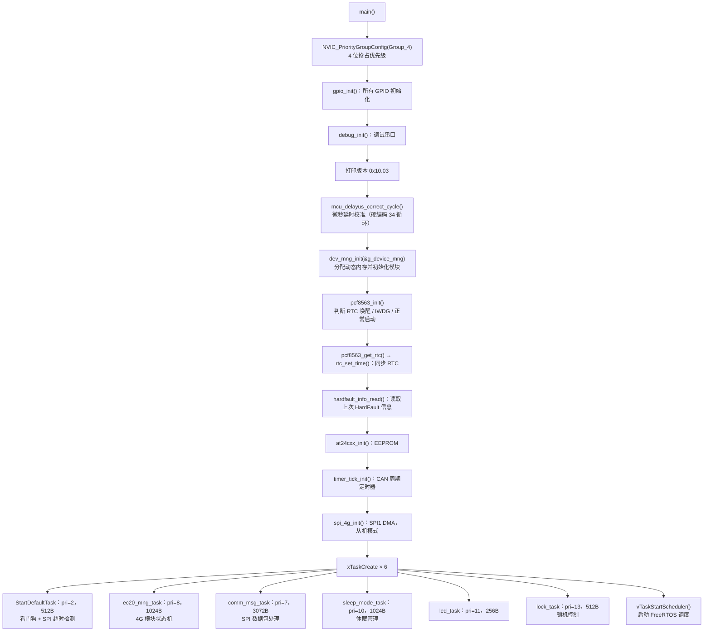

---

### A.5 技术栈与第三方库清单

| 类别 | 内容 |
|------|------|
| **RTOS** | FreeRTOS v9.x（Heap4，portRVDS ARM_CM4F） |
| **MCU SDK** | Artery AT32F4xx_StdPeriph_Driver（CMSIS + 厂商外设库） |
| **加密算法** | XXTEA（BTEA），MD5，SHA1，HMAC-SHA1，Base64，CRC16（多种变体） |
| **GPS库** | nmealib（开源NMEA解析库，移植版） |
| **JSON** | LITE-utils（阿里云IoT SDK裁剪版） |
| **安全芯片** | CIU98（国密SM2，独立UART DMA通信） |
| **CAN** | AT32内置CAN × 2 + MCP2515（SPI外接，第3路CAN） |
| **存储** | AT32内部Flash 1MB + AT24Cxx EEPROM（I2C） |
| **通信** | SPI1（从机，DMA），USART6（CIU98），UART（调试/EC20） |

---

## B. 深度逐模块分析

### B.1 dev_mng — 全局设备管理器

**职责**：系统唯一全局单例 `g_device_mng`，所有子模块指针和状态变量的容器。

**核心数据结构**（`dev_mng_t`，部分字段）：

```c
typedef struct {
    // SPI通信
    char         *p_spi_tx;             // SPI发送缓冲（4096+10字节，堆分配）
    char         *p_spi_rx;             // SPI接收缓冲（4096+10字节，堆分配）
    uint8_t       spi_tx_idx;           // 发送帧序号
    uint8_t       spi_rx_idx;           // 接收帧序号
    QueueHandle_t h_spi_rx_queue;       // DMA接收完成队列(深度8, 每项4096B)
    bool          is_spi_comm_connected; // SPI链路建立标志
    bool          is_spi_comm_failed;   // SPI校验失败标志
    iotx_time_t   spi_comm_timer;       // SPI超时10秒→系统重启

    // SPI item管理
    spi_items_mng_t *p_spi_items_mng;   // RX/TX item注册表

    // 子模块指针
    mcu_info_t        *p_mcu_info;
    adc_convert_mng_t *p_adc_convert_mng;
    sleep_mode_t      *p_sleep_mode;
    e2prom_mng_t      *p_e2prom_mng;
    fota_mng_t        *p_fota_mng;
    can_info_t        *p_can_info[3];   // 3路CAN统计
    spi_items_mng_t   *p_spi_items_mng;
    led_mng_t         *p_led_mng;
    ciu98_mng_t       *p_ciu98_mng;
    share_ram_param_t *p_share_ram_params; // 指向0x2000FF00（共享RAM）

    // 锁机相关
    lock_general_message_t lock_general_message; // 执行状态上报
    uint8_t  lock_password[6];                   // 动态密码
    uint8_t  lock_password_fixed;               // 密码已固化标志
    bool     lock_password_clr;                  // 请求重置密码

    // 命令队列
    QueueHandle_t h_cmd_lock_queue;       // 深度8
    QueueHandle_t h_cmd_id_secret_queue;  // 深度8
    QueueHandle_t h_cmd_can_set_queue;
    QueueHandle_t h_event_queue;          // 深度16

    // 其他
    can_isa_msg_buf_t *p_can_isa_msg;
    bool   is_going_to_sleep;
    bool   can_internal_shotdown_flag;
} dev_mng_t;
```

**spi_item 注册表**（dev_mng.c 静态定义）：

| 方向 | Tag | 类型 | 队列深度 | 周期 |
|------|-----|------|---------|------|
| RX | RX_OTA_SPI_ITEM_TAG | ota_item_t | OTA_RX_QUEUE_LENGTH | - |
| RX | RX_CMD_SPI_ITEM_TAG | cmd_item_t | CMD_RX_QUEUE_LENGTH | 100ms |
| RX | RX_CAN0/1/2_SPI_ITEM_TAG | can_msg_item_t | CAN_RX_QUEUE_LENGTH | - |
| TX | TX_OTA_RET_SPI_ITEM_TAG | ota_item_ret_t | OTA_RET_QUEUE_LENGTH | - |
| TX | TX_CMD_RET_SPI_ITEM_TAG | cmd_item_ret_t | CMD_RET_QUEUE_LENGTH | INFINITE |
| TX | TX_CAN0/1/2_SPI_ITEM_TAG | can_msg_item_t | CAN_TX_QUEUE_LENGTH | - |
| TX | TX_ENEVT_SPI_ITEM_TAG | event_item_t | EVENT_ITEM_QUEUE_LEN | 100ms |
| TX | TX_GPS_SPI_ITEM_TAG | gps_items | GPS_INFO_QUEUE_LENGTH | 1000ms |
| TX | TX_DI_SPI_ITEM_TAG | io_item_t | IO_INPUT_ITEM_QUEUE_LEN | 1000ms |
| TX | TX_AI_SPI_ITEM_TAG | adc_item_t | ADC_SPI_ITEM_QUEUE_LEN | 500ms |
| TX | TX_LOG_COM_SPI_ITEM_TAG | log_com_item | LOG_COM_QUEUE_LENGTH | 1000ms |
| TX | TX_ALL_CAN_SPI_ITEM_TAG | can_all_msg_item_t | CAN_TX_QUEUE_LENGTH | - |

---

### B.2 comm_msg — SPI通信协议层

**职责**：MCU作为SPI从机，与EC200A主机进行全双工DMA通信。

#### 帧格式

```
┌──────────────────────────────────────────────────────────┐
│                     SPI 数据帧（4096字节）                │
├─────────────────────┬────────────────────────────────────┤
│   comm_hdr_t(16B)   │  payload（多个 spi_item 组）        │
├──┬──┬──┬──┬──┬──┬───┤                                    │
│hdr│cmd│idx│len│crc│rtc│ack│cnt│hdr_crc│                  │
│2B │1B │1B │2B │2B │4B │1B │1B │2B      │                  │
└──┴──┴──┴──┴──┴──┴───┴───┴───┴──────────┘                 │
```

| 字段 | 说明 |
|------|------|
| hdr | 帧头魔数 0x5555 |
| cmd | 0=None, 1=Normal数据, 2=OTA升级 |
| idx | 帧序号（滚动递增，用于检测丢帧） |
| len | payload有效字节数 |
| crc | payload的16位简单累加和校验 |
| rtc | 发送时的Unix时间戳 |
| hdr_crc | 头部自身的16位累加和（不含hdr_crc字段本身） |

#### payload 格式（每个spi_item）

```
┌─────────────────────────────────────────────────────────┐
│    spi_item_hdr_t(6B)   │ item数据（item_sz × item_cnt）│
├───────┬───────┬──────┬──┤                               │
│ tag 1B│cnt 1B │sz 2B │.. │ item[0] │ item[1] │ ...      │
└───────┴───────┴──────┴──┴─────────┴─────────┴──────────┘
```

#### 收发流程

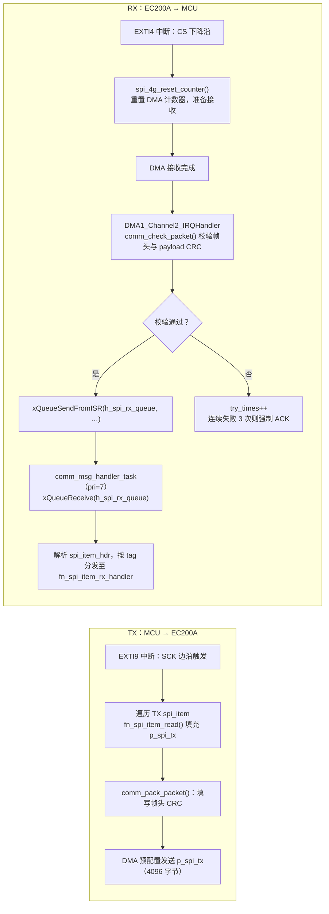

---

### B.3 lock — 叉车锁机模块

**职责**：接收平台下发的绑定/锁机指令，通过CAN总线控制三一ECU，实现叉车防盗管理。

#### 整体架构

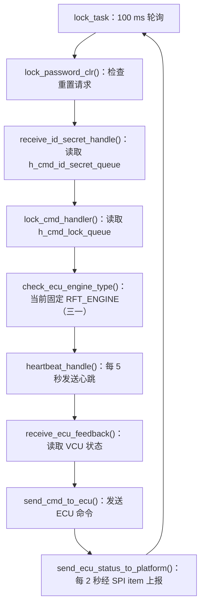

#### 状态机（cmd_status & ecu_status）

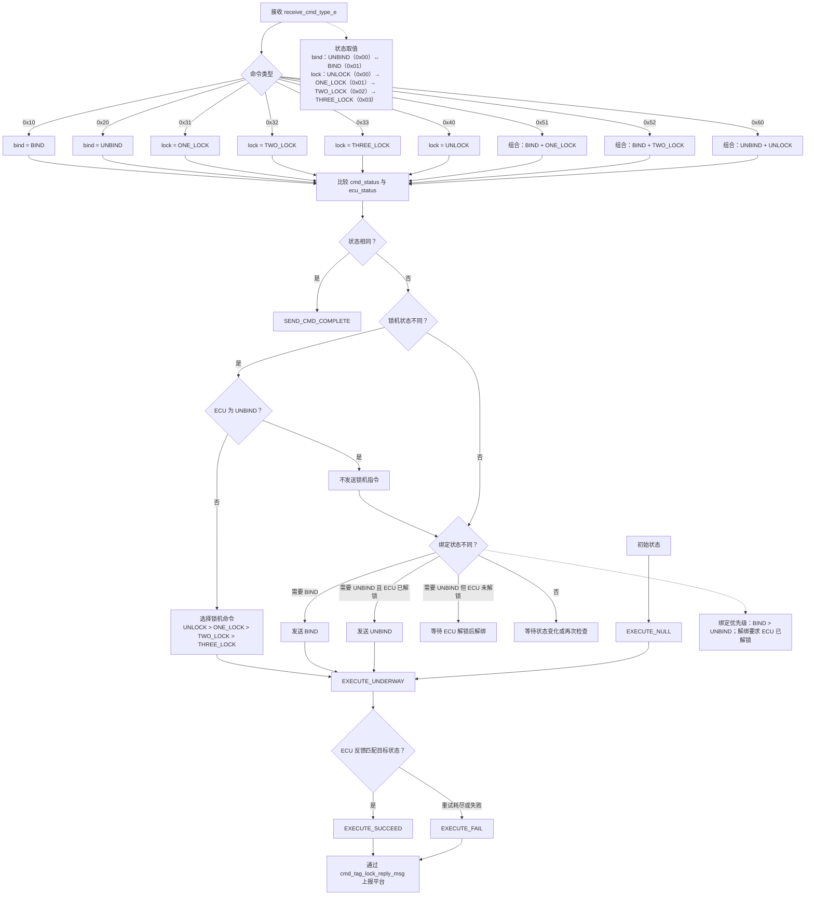

#### CAN ID映射（三一协议）

| 方向 | CAN ID | 功能 |
|------|--------|------|
| MCU→ECU | 0x9C1F05FD | 绑定/解绑命令 |
| MCU→ECU | 0x9C1F05FF | 锁机命令（one_lock/two_lock） |
| MCU→ECU | 0x9C1F05FE | 解锁命令 |
| MCU→ECU | 0x9C1F05FB | 心跳（每5秒，XXTEA加密） |
| VCU→MCU | 0x9C1F05FA | VCU心跳（含序列号+随机数，用于密钥生成） |
| VCU→MCU | 0x9C1F1150 | VCU状态反馈（bind+lock状态） |
| MCU→平台 | 0xFAAA0001 | ECU状态上报（每2秒，via SPI CAN TX） |

#### 加密算法（lock_etm.c）

```c
/* 1. 密钥生成（generate_secret_key）
   输入：VCU心跳8字节 can_msg_bytes[0..7]（其中[0..5]为序列号，[6..7]为随机数）
   mlockkey[16] = {byte6, byte7, b0^b6, (b1*b6)%256, b2&b6, b3|b7,
                   (b4+b7)%256, b5^b7, b0,b1,b2,b3,b4,b5, 0, 0}
   secret_key[4] = mlockkey 按小端拼成4个uint32_t

   2. 数据加密（XXTEA/BTEA，三一提供算法）
   参数：n=2（两个uint32_t=8字节），key=secret_key[4]
   输入：8字节原始数据（含指令类型）
   输出：8字节密文（填入CAN DT字段）
*/
```

#### Flash持久化地址

```
0x080D0000 : cmd_bind_lock_storage_t（绑定锁机状态，含CRC）
0x080D0000 + sizeof(cmd_bind_lock_storage_t) : 锁机密码（6字节+fixed标志）
0x080D2000 : id_secret_storage_t（设备ID 32B + Secret 64B，含CRC）
```

---

### B.4 spi_item — 数据项框架

**职责**：抽象化SPI通信数据的生产/消费模型，每类数据（CAN/GPS/ADC/CMD等）注册为一个 spi_item。

**核心结构**：

```c
typedef struct {
    QueueHandle_t h_spi_items_rx_queue;   // 接收队列（从EC200A收到数据放这里）
    QueueHandle_t h_spi_items_tx_queue;   // 发送队列（业务模块生产，SPI ISR消费）
    uint16_t      item_sz;                // 单个item字节数
    uint16_t      items_cnt;              // 队列深度
    uint16_t      inteval_ms;             // 刷新间隔
    uint8_t       item_tag;              // tag标识
    uint8_t       idx;                   // 当前序号（滚动）
    uint8_t       is_need_reply;         // 是否需要应答
    bool          is_period_refresh;     // 是否周期刷新
    uint32_t      resend_count;          // 重发次数（INFINITE_SEND=无限重发）
    fn_spi_item_register_t    fn_spi_item_register;    // 初始化回调
    fn_spi_item_rx_handler_t  fn_spi_item_rx_handler;  // 接收处理回调
    fn_spi_item_read_t        fn_spi_item_read;        // 读取发送数据回调
} spi_item_t;
```

**查找表（spi_items_map）**：tag作为数组下标，O(1)查找。

**关键函数**：
- `spi_item_push`：将接收数据入队（支持ISR/Task上下文自动切换）
- `spi_item_pop`：从发送队列取出数据，打包成 spi_item_hdr + data
- `build_spi_items_map`：构建tag→spi_item指针的查找数组
- `spi_items_mng_new`：创建管理器，注册所有RX/TX item

---

### B.5 ec20_mng — EC200A 管理

**职责**：管理EC200A 4G模块的上电、复位流程。

**状态机**：

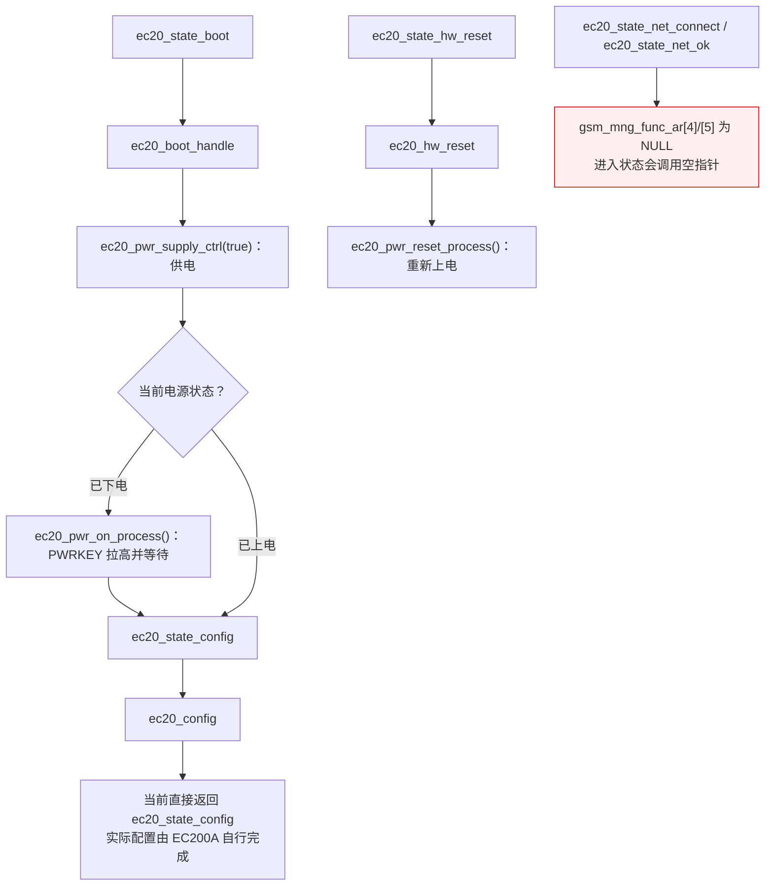

---

### B.6 sleep_mode — 休眠管理

**触发条件**（sleep_status_check）：
1. ACC断开（非运行状态）→ 计时 `acc_timeout`（3分钟）
2. CAN0静默（无消息接收）→ 计时 `can_timeout`（3分钟）
3. 两个定时器都超时 → 进入休眠流程

**休眠流程**：
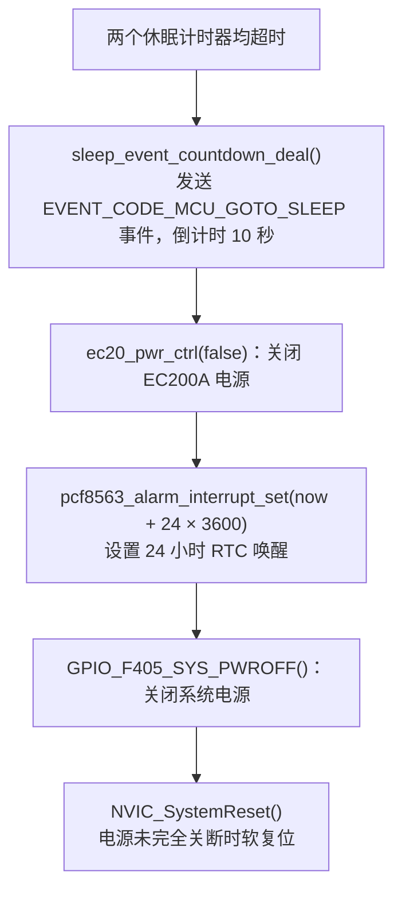

---

### B.7 CIU98 — 安全芯片

**职责**：通过USART6 DMA与CIU98安全芯片通信，提供SM2密钥操作、防拆检测、设备认证。

**帧格式**：

```
┌──────────────────────────────────────────────────────┐
│ hdr(2B) │ msg_typ(1B) │ msg_idx(1B) │ arg_len(2B)   │
│ ret_stat │ ret_info │ res(2B) │ crc(2B) │ msgArg[1024]│
└──────────────────────────────────────────────────────┘
hdr = 0x2323
```

**消息类型**：login, rt_pub, his_pub, logout, defuse_alarm, rtc_calc, tamper_proof

---

## C. 安全与 Bug 审计

### C.1 潜在 Bug 列表

| # | 文件 | 问题 | 严重度 |
|---|------|------|--------|
| 1 | `common.c: check_days_in_month()` | `y` 变量声明后未赋值直接用于 `y%4==0`，产生未定义行为 | 中 |
| 2 | `lock_etm.c: lock_etm_send_cmd_to_ecu()` | `p_spi_item` 在函数开头**未初始化**（仅声明），但在 for 循环内的 `if(p_spi_item != NULL)` 处使用前未赋值（第一次循环 `p_spi_item` 为垃圾值）| **高** |
| 3 | `ec20_mng.c: ec20_mng_task()` | `gsm_mng_func_ar[4]` 和 `[5]` 为 NULL，若状态机进入 `ec20_state_net_connect(4)` 或 `ec20_state_net_ok(5)`，将调用 NULL 函数指针 → **HardFault** | **高** |
| 4 | `flash.c: FLASH_Erase()` | 函数名误导性：实际是逐半字写0xFFFF，**不是**真正的 Flash 页擦除（未调用 FLASH_ErasePage），在已编程区域写 0xFFFF 会失败 | 中 |
| 5 | `lock_etm.c: lock_etm_send_cmd_to_ecu()` | 变量名遮蔽：外层循环变量 `i`（`for(int i=0; i<2; i++)`）被内层 `for(int i = 0; i<7; i++)` 遮蔽，内层循环计算 checksum 时索引正确，但外层 `i` 判断 `if(i==0)` 语义被破坏 | 中 |
| 6 | `lock.c: lock_password_init()` | 密码固化标志写在 `lock_password[6]`（第7字节），而 `memcpy` 只复制 `PASSWORD_LEN(6)` 字节，导致 `p_dev_mng->lock_password` 永远不包含固化标志，flash写入逻辑也存在偏差 | 中 |
| 7 | `spi_dma.c: DMA1_Channel2_IRQHandler()` | `try_times` 为 `static uint8_t`，溢出后从255回到0，掩盖连续失败计数；且通讯失败时调用 `printf` 在中断上下文中（违反FreeRTOS安全规范）| 中 |
| 8 | `share_ram.c: share_ram_init()` | 引用 `p_dev_mng->p_charge_mng` 和 `charge_ram_param_t`，但 `dev_mng.h` 中**无此字段**，该文件为历史遗留代码，编译依赖 `main.h` 中的完整结构体，存在隐患 | 低 |
| 9 | `comm_msg.c: comm_check_packet()` | CRC校验使用简单16位累加和（`check_sum_16`），**非标准CRC**，抗误码能力弱，易产生漏检 | 低 |
| 10 | `lock_etm.c` | `osDelay(50)` 在命令发送循环内（每条命令发2帧，间隔50ms），LOCK_TASK运行在100ms周期内，若发送超时（8秒），任务会在 `lock_etm_send_cmd_to_ecu` 内被延时阻塞，影响心跳发送 | 中 |

---

### C.2 内存安全问题

| 问题 | 位置 | 描述 |
|------|------|------|
| 堆内存泄漏 | `lock_common.c: receive_id_secret_handle()` | `cmd_item.cmd_bytes` 调用 `HAL_Free`，但若 `cmd_item.cmd_bytes` 为 NULL（队列数据不合法）时会 free NULL（依赖实现，部分平台崩溃） |
| 栈越界风险 | `comm_msg.c: comm_msg_handler_task()` | 栈上分配 `char comm_buffer[4096]`，任务栈分配仅 `0xC00(3072)` 字节，**严重栈溢出**！（4096 > 3072）|
| 固定地址访问 | `share_ram.c` | `SHARA_RAM_ADDR (0x2000FF00)` 硬编码访问 RAM 末尾区域，需与链接脚本严格匹配，否则与堆/栈冲突 |
| 无边界检查 | `comm_msg.c: comm_msg_handler_task()` | 解析 payload 时仅靠 `SPI_ITEM_TAG_END` 和 `sum_item_sz >= p_comm_hdr->len` 双重判断，若 `item_sz` 被篡改为大值，`p_spi_rx` 指针会越过 `comm_buffer` 末尾 |

---

### C.3 并发/竞态风险

| 问题 | 涉及资源 | 描述 |
|------|----------|------|
| `g_device_mng` 裸访问 | `is_spi_comm_failed`, `is_spi_comm_connected` | 多任务+ISR同时读写，无原子保护，bool赋值非原子（Cortex-M4 单字节访问理论安全，但编译器优化可能导致多步操作） |
| SPI TX缓冲 | `p_dev_mng->p_spi_tx` | EXTI9中断直接修改TX缓冲，DMA同时在发送，若DMA发送中途触发EXTI9写入，会产生数据撕裂 |
| `spi_item_t.idx` | 多处读写 | 在ISR（EXTI9）和任务（comm_msg_task分发）中均会访问spi_item，无mutex保护 |
| lock状态 | `cmd_status`, `ecu_status` | `lock_cmd_handler` 写，`check_need_to_send_cmd` 读，均在 lock_task 内串行执行（同一任务），此处无问题 |

---

### C.4 错误处理缺失

1. `lock_init()`：若 `pvPortMalloc` 失败返回 NULL，`lock_task` 中有判断并打印日志，但随后**仍然调用** `p_lock_mng->p_lock_common_mng`，造成空指针解引用
2. `ec20_uart_mng_new()`：`rb_new()` 失败时返回 NULL，上层无检查
3. `spi_items_mng_new()`：多处 `HAL_Malloc` 无 NULL 检查
4. `lock_etm_send_cmd_to_ecu()`：`xQueueSend` 返回值未检查，队列满时静默丢弃

---

### C.5 安全漏洞

| 类型 | 位置 | 描述 |
|------|------|------|
| 硬编码默认密钥 | `CIU98.h` | `DEFAULT_PUB_KEY` 和 `DEFAULT_AID` 硬编码在头文件中，一旦固件被提取即可获取 |
| 密码存储明文 | `lock.c` | 锁机密码以明文存储在 Flash `0x080D0000`，无加密保护 |
| 弱CRC | `comm_msg.c` | SPI帧使用16位累加和代替真正CRC，易被伪造 |
| 加密密钥可预测 | `lock_etm.c: generate_secret_key()` | XXTEA密钥直接由VCU广播的明文心跳数据派生，监听CAN总线即可还原密钥，加密形同虚设 |

---

## D. IPC / 通信协议分析

### D.1 IPC拓扑图

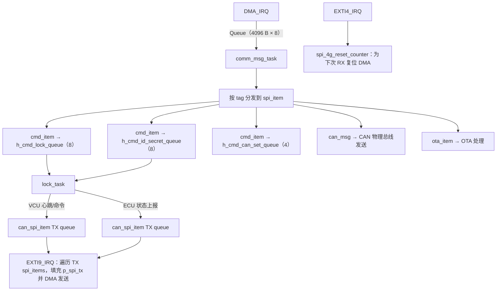

### D.2 所有通信协议汇总

#### SPI协议（MCU↔EC200A）

```
物理层：SPI1，从机模式，CPOL=1 CPHA=2（Mode3），MSB，8bit，无软件NSS
传输：DMA，4096字节全双工，每次CS有效完成一次交换

帧格式：
  [hdr=0x5555][cmd][idx][len][crc_payload][rtc_u32][ack_idx][cnt][hdr_crc]
   + N × [tag][item_cnt][item_sz][rsv] + item_data...
  末尾：[SPI_ITEM_TAG_END]

校验：
  hdr_crc = sum16(header前14字节)
  crc = sum16(payload)
```

#### CAN协议（三一叉车 ETM 锁机协议）

```
帧类型：扩展帧（29位ID），最高位置1（0x80000000标记）

心跳（MCU→VCU）0x9C1F05FB，8字节：
  原始：[serial_number×6][heartbeat_flag][0x00]
  加密：XXTEA(原始, key=secret_key)
  心跳标志每次 ^= 0x01（0/1交替）

绑定/解绑（MCU→VCU）0x9C1F05FD，8字节：
  BIND  : [0,0,0,0,0,0][0→2] 发两帧（第1帧byte4=0，第2帧byte4=2）
  UNBIND: [0,0,0,0,0,0][0→1] 发两帧（第1帧byte4=0，第2帧byte4=1）
  所有数据经XXTEA加密后发送

锁机（MCU→VCU）0x9C1F05FF，8字节：
  one_lock : [0/1,1,0,0,0,0,0,chksum] 发两帧（第1帧byte0=0，第2帧byte0=1）
  two_lock : [0/2,1,0,0,0,0,0,chksum]
  chksum = sum(byte0..byte6)

解锁（MCU→VCU）0x9C1F05FE，8字节：
  [0/1,1,0,0,0,0,0,chksum]

VCU心跳（VCU→MCU）0x9C1F05FA，8字节：
  byte[0..5] = serial_number（VCU序列号）
  byte[6..7] = random_number
  MCU收到后用此数据生成XXTEA密钥

VCU状态（VCU→MCU）0x9C1F1150，8字节：
  byte[0]:
    0x01 = BIND + ONE_LOCK
    0x02 = BIND + TWO_LOCK
    0x05 = BIND + UNLOCK
    0x08 = UNBIND + UNLOCK

ECU状态上报（MCU→平台/SPI）CAN ID 0xFAAA0001：
  dt[0] = ecu_status.bind_status
  dt[2] = ecu_status.lock_status
  dt[4] = cmd_status.bind_status
  dt[5] = cmd_status.lock_status
```

#### CIU98 UART协议

```
物理层：USART6，DMA，波特率由应用层配置
帧格式：
  [hdr=0x2323][msg_typ][msg_idx][arg_len][ret_stat][ret_info][res×2][crc×2][msgArg×N]
消息类型：login(0x01), rt_pub(0x02), his_pub(0x03), logout(0x04),
          defuse_alarm(0x05), rtc_calc(0x06), tamper_proof(0x07)
```

---

### D.3 关键状态机

#### 锁机完整状态转换

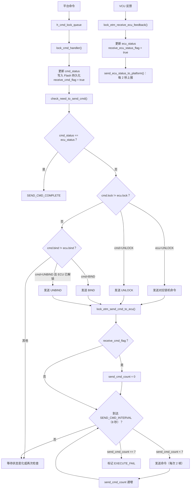

---

### D.4 超时/重试/错误恢复机制

| 机制 | 参数 | 行为 |
|------|------|------|
| SPI通信超时 | 10秒（`spi_comm_timer`） | 触发 `NVIC_SystemReset()` 重启 |
| 锁机命令重试 | 7次 × 8秒间隔 = 最长56秒 | 超过7次标记 EXECUTE_FAIL |
| SPI帧校验失败 | 连续3次 | 强制拉高ACK脚，重置接收流程 |
| EC200A无响应 | `EC20_POWER_CTRL_TIMEOUT` | 重新上电复位 |
| 休眠唤醒 | 24小时 RTC 定时 | PCF8563闹钟中断唤醒 |
| 看门狗 | 每500ms喂狗（`StartDefaultTask`） | IWDG超时强制复位 |

---

## E. 完整技术参考文档

### E.1 关键源文件功能说明

| 文件 | 功能 |
|------|------|
| `Src/main.c` | 系统入口，硬件初始化，6个FreeRTOS任务创建，HardFault记录 |
| `dev_mng/dev_mng.c` | 全局设备管理器初始化，spi_item注册表定义 |
| `comm_msg/comm_msg.c` | SPI通信处理任务，EXTI9/EXTI4中断，帧打包/校验 |
| `spi_dma/spi_dma.c` | SPI1 DMA初始化，DMA完成中断，复位计数器 |
| `spi_item/spi_item.c` | spi_item注册/推入/弹出，查找表构建 |
| `lock/lock.c` | 锁机任务入口，引擎类型路由 |
| `lock/lock_common.c` | 命令接收，状态持久化，平台上报，ID/Secret管理 |
| `lock/lock_etm.c` | 三一ECU专用：XXTEA加密，心跳，CAN命令发送，状态解析 |
| `ec20/ec20_mng.c` | EC200A电源状态机（boot→config循环） |
| `CIU98/app/CIU98.c` | 安全芯片USART6 DMA通信，消息协议 |
| `flash/flash.c` | 内部Flash读写（sector级，含写前读回机制） |
| `common/common.c` | CRC16多变体，时间函数，微秒延时校准，IWDG |
| `sleep_mode/sleep_mode.c` | 休眠条件判断，倒计时关机，RTC唤醒设置 |
| `share_ram/share_ram.c` | 跨复位共享RAM初始化（注：引用了不存在的字段，有遗留代码问题）|

---

### E.2 对外 API 汇总

#### comm_msg
```c
bool comm_check_packet(char *rcv_dt, uint32_t rcv_len, uint8_t rx_idx);
bool comm_pack_packet(char *p_dt, uint8_t comm_idx, uint8_t spi_items_nb,
                      uint8_t cmd, uint16_t len, uint32_t rtc);
void comm_msg_handler_task(void *param);  // FreeRTOS任务
```

#### lock
```c
void lock_task(void *argument);           // FreeRTOS任务
```

#### lock_common
```c
lock_common_mng_t* lock_common_init(void);
bool lock_cmd_handler(dev_mng_t*, lock_common_mng_t*);
send_cmd_type_e check_need_to_send_cmd(lock_common_mng_t*);
void send_ecu_status_to_platform(dev_mng_t*, lock_common_mng_t*);
void receive_id_secret_handle(dev_mng_t*, lock_common_mng_t*);
void write_cmd_bind_lock_to_storage(cmd_bind_lock_storage_t*, bind_lock_status_t*);
void read_cmd_bind_lock_from_storage(cmd_bind_lock_storage_t*, bind_lock_status_t*);
```

#### spi_item
```c
spi_items_mng_t* spi_items_mng_new(void*, spi_item_t*, uint8_t, spi_item_t*, uint8_t);
spi_item_t* get_spi_item_from_map(spi_items_map_t*, uint8_t tag);
char* spi_item_push(void*, void *p_spi_item, char *buf);
char* spi_item_pop(void *p_spi_item, char *buf, int max, int *nb);
```

#### flash
```c
void FLASH_Write(uint32_t WriteAddr, uint16_t *pBuffer, uint16_t NumToWrite);
void FLASH_Read(uint32_t ReadAddr, uint16_t *pBuffer, uint16_t NumToRead);
void FLASH_Erase(uint32_t erase_addr, uint16_t erase_size);  // ⚠️ 非真正擦除
```

#### common
```c
uint16_t CRC16_EF_CreatCRC(const uint8_t*, const uint16_t);  // CRC16/MODBUS
uint16_t CRC16_COMM(uint8_t*, uint32_t);                      // CRC16（初值0xFFFF）
uint16_t CRC16_COMM_for_atley_vbox(uint8_t*, uint32_t);       // 初值0xBBBB变体
uint16_t check_sum_16(char*, int);                            // 简单累加和
uint32_t get_timestamp_from_rtc(rtc_t*);
void mcu_delay_us(uint32_t us);
```

---

### E.3 关键流程时序图

#### 锁机命令完整时序

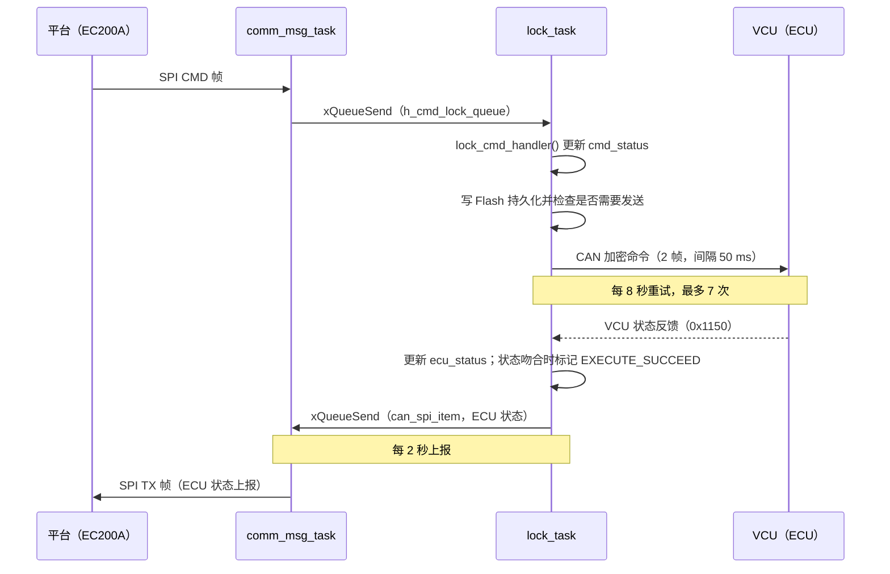

#### SPI 通信时序

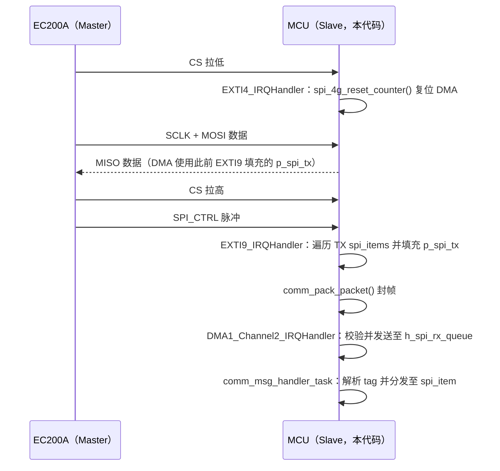

---

### E.4 已知问题与改进建议

#### 紧急（影响功能稳定性）

1. **comm_msg_handler_task 栈溢出**：`char comm_buffer[4096]` 局部变量需要4096字节栈，但任务栈只分配了 `0xC00(3072)` 字节。建议将 `comm_buffer` 改为静态变量或堆分配，或将任务栈增大到 `0x1400(5120)` 字节。

2. **ec20_mng_task NULL函数指针**：`gsm_mng_func_ar` 数组中 index 4/5 为 NULL，若状态机状态异常跳转将触发 HardFault。建议为所有状态补充安全处理函数。

3. **lock_etm_send_cmd_to_ecu 未初始化的 p_spi_item**：在函数顶部 `p_spi_item` 未赋初值，第一次循环 `if(p_spi_item != NULL)` 判断无效。建议在声明时赋 NULL：`spi_item_t *p_spi_item = NULL`。

#### 高优先级（影响数据可靠性）

4. **SPI TX/DMA 竞态**：EXTI9 中断修改 `p_spi_tx` 时，DMA 可能正在发送该缓冲区。建议使用双缓冲机制（ping-pong buffer）。

5. **FLASH_Erase 不是真擦除**：应调用 `FLASH_ErasePage()` 再写入，否则写 Flash 前需确保目标区域已经是 0xFFFF。

6. **lock_task init 后空指针**：`lock_init` 失败时打印错误后，`lock_task` 仍然访问 `p_lock_mng->p_lock_common_mng`。需要在 init 失败时直接 `vTaskSuspend(NULL)` 退出任务。

#### 安全改进

7. **加密密钥安全性**：XXTEA 密钥直接由广播心跳派生，任何监听 CAN 总线的设备都可以复现密钥。建议引入设备唯一密钥或使用非对称协议。

8. **SPI帧校验**：将 `check_sum_16` 替换为真正的 CRC16/MODBUS（`CRC16_EF_CreatCRC`，该函数已存在于代码库中）。

9. **锁机密码加密**：Flash 中的锁机密码应加密存储。

#### 代码质量

10. **`check_days_in_month` 未初始化变量 `y`**：应改为 `int y = year;`。

11. **变量名遮蔽**：`lock_etm_send_cmd_to_ecu` 中内外层都命名 `i`，应改为 `j` 区分。

12. **`share_ram.c` 遗留代码**：引用不存在的 `p_charge_mng`，需要清理或补全。

13. **EC200A 配置状态机**：`ec20_state_config` 直接返回自身形成死循环，需完善配置逻辑（APN/波特率等已有宏定义）。
